# Avancement

## Phase : maquette réaliste — quartier du Champ de Mars

| Étape | État |
|---|---|
| 1. Accès et couverture des sources, `docs/SOURCES.md` | ✅ validée |
| 2. Chaîne de données : relief, volumes et toits LiDAR, rues, arbres | ✅ fusionnée (PR #1) |
| 3. Fiches façade (estimées) + générateur + matières | ✅ faite, en attente de ton avis |
| **Étape 1 bis : toute la zone Autun centre, 2,25 km², par tuiles** | ✅ faite, à tester sur téléphone |
| 4.1 Se balader à pied : commandes tactiles, caméra, collisions | ✅ faite, à tester sur téléphone |
| 4.2 Vélo, puis voiture (conduite réaliste) | à faire |
| 4.3 Circulation, passants, pigeons | à faire |
| 4.4 Jour/nuit, plaque de rue, vue du ciel, KTX2, optimisation | à faire |

### Étape 3 (26 octobre 2026)

Fait :
- **Fiches façade** : 353 fiches JSON validées par `docs/facade-fiche.schema.json` (`tools/data/build_facades.py`). Époque et matériaux viennent de la BDNB et de BD TOPO, les niveaux de la hauteur LiDAR, 93 commerces nommés d'OpenStreetMap sont placés sur leur mur de rue. Chaque mur est qualifié (rue, cour, mitoyen). Toutes « estimées » (confiance 0,3 à 0,75) : aucune photo libre sur la zone.
- **Générateur** (`src/render/facades.ts`) : travées, fenêtres, volets, portes, vitrines et enseignes, balcons en fer forgé, corniches, bandeaux, soubassements. 5 300 fenêtres, 197 portes, 85 vitrines, 157 balcons, en sprites à relief (atlas de 2 pages).
- **Matières** : enduit et pierre de taille, tuile plate, tuile mécanique, ardoise, zinc, toit-terrasse ; sols en textures CC0 (asphalte, pavés, gravier, herbe, trottoir, dallage) avec assombrissement près des murs ; ciel en dégradé, brume, jupe sous le relief.
- **Toits** : 27 bâtiments passent en toit maillé sur le LiDAR quand les plans échouent (D11).
- Tests : 15 (relief, soleil, triangulation des toits, fiches, planificateur de façades).

Défauts connus :
- Hôtel de ville et théâtre : toits irréguliers (à modéliser à la main d'après photos, étape suivante).
- Le kiosque à musique forme une bosse sur le terrain (classé « sol » par le LiDAR).
- Arbres : couronnes en blobs plats, sans essence.
- Très près d'un mur, les sprites (≈ 55 px/m) sont un peu flous ; pas de LOD.
- Ombres : une seule carte, bords en escalier ; pas d'occlusion ambiante autre que sur le sol.
- Textures non compressées (KTX2 à faire) ; chargement ≈ 1,1 s de génération sur PC + décodage des PNG/JPEG.
- Les fenêtres ne s'allument pas encore la nuit.
- Largeurs de rues et trottoirs estimés (voir étape 2).

### Étape 4.1 (26 octobre 2026) : se balader à pied

Fait :
- `src/core/` (logique pure, sans rendu) : collisions (`collision.ts`), piéton (`player.ts`), caméra à la troisième personne (`camera-rig.ts`), obstacles du monde (`world.ts`) ; 27 tests dont un test d'intégration sur les vraies données.
- `src/input/controls.ts` : joystick flottant, regard au doigt, clavier, souris ; `src/game/game.ts` : boucle à pas fixe 60 Hz, soleil et ombres qui suivent le joueur, personnage articulé provisoire.
- Le viewer à caméra libre reste disponible avec `?view=` ou `?cam=` (captures, diagnostic) ; sans paramètre, c'est le jeu.
- Test tactile automatisé (`tools/play.sh`) : marche à mi-poussée 0,9 m/s, course à fond 5 m/s, regard au doigt.

Pas encore fait / limites :
- Pas de saut, pas d'escaliers ni de portes : on marche à plat sur le relief. Les passages couverts (Balthus, de la Terrasse) sont bloqués.
- Pas de recentrage automatique de la caméra derrière le personnage.
- Performances sur téléphone non mesurées : en navigateur logiciel le jeu tourne à 13-80 images/s selon l'instant, ce qui ne dit rien du téléphone.
- Personnage en blocs, sans visage ni vêtements d'Autun.

### Agrandissement : 2,25 km² par tuiles (26 octobre 2026)

Fait :
- **Zone** : 6 × 6 tuiles de 250 m alignées sur le Lambert-93, de la cathédrale Saint-Lazare au nord-ouest à la rue du Théâtre romain au sud (1,5 × 1,5 km, quatre dalles LiDAR HD). 3 486 bâtiments, 5 519 arbres, 522 voies, 351 murs et grilles, 464 éléments de mobilier.
- **Données par tuile** (`tools/data/build_tiles.py`) : `public/data/tiles/<col>_<ligne>.json` (bâtiments, fiches, arbres, murs, mobilier, 3 Ko à 1,2 Mo), `lod.json` (silhouettes simplifiées, 0,5 Mo), `world.json` (grille). Relief (4,7 Mo) et cartes de sol (1,4 Mo, 1 m par pixel) restent globaux.
- **Client** : `TileManager` charge en détail les tuiles à moins de 210 m (déchargées au-delà de 300 m), les autres sont des silhouettes à toit plat (un maillage par tuile). Relief par morceaux de 250 m à trois niveaux de pas (2, 5, 12 m) avec jupes. Atlas de façades rempli à la demande (3 pages de 2048, la plus ancienne est recyclée quand tout est plein ; les tuiles concernées se reconstruisent). Collisions étiquetées par tuile, retirées au déchargement.
- **Corrigé** : murs, murets, grilles (barreaux à transparence, piliers) et mobilier urbain (bancs, poubelles, bornes, boîtes aux lettres, toilettes, fontaines, feux) sont maintenant dessinés ; ils étaient seulement des obstacles invisibles.
- **Corrigé** : champs classés « gravier » par erreur (loin des routes et des bâtiments : herbe), parkings en asphalte par défaut.
- Téléchargements : l'API OpenStreetMap par blocs de 500 m remplace Overpass quand celui-ci coupe les connexions ; BDNB complète de la commune (5 823 groupes).
- Tests : 42 (données réelles sur les 36 tuiles).

Mesures (navigateur logiciel, PC) :
- Autour de la place : 6 à 8 tuiles détaillées, ≈ 170 000 à 320 000 triangles, 80 à 150 appels de dessin.
- Toute la zone en détail (test extrême) : 710 000 triangles, 490 appels, construction 14 s.
- **Rien n'est mesuré sur téléphone.** Les budgets (appels de dessin, triangles, mémoire des atlas ≈ 130 Mo) sont des estimations à vérifier.

Limites / à faire :
- Pas de LOD des arbres (absents des tuiles lointaines) ; silhouettes sans pente de toit.
- Une tuile se construit d'un bloc (≈ 100-300 ms sur PC) : à lisser si ça saccade sur téléphone.
- Les façades restent estimées ; monuments à modéliser (hôtel de ville, théâtre, cathédrale, monuments romains).
- Ajouter de la vie : passants, circulation, pigeons (étape 4.3).
- Fidélité des sols (parking du centre-ville, cours de lycée) : à revoir sur photos / orthophoto.

### Direction artistique : essai « conte peint » (26 octobre 2026)

Après test sur téléphone (carte correcte, mais lenteurs, scintillement des fenêtres, esthétique faible), on change de parti pris : garder la cartographie réelle, mais des façades imaginées, en aplats et volumes simples, sans textures.
- `?style=conte` : murs en aplats avec ombre au pied, fenêtres/volets/portes/vitrines/enseignes en volumes (`src/render/stylized.ts`), toits à pans nets avec trame douce, sols en palette, arbres à deux boules, lumière dorée (`src/render/style.ts`). Les silhouettes lointaines utilisent la même palette (`lod.json` porte l'époque et la clé de hachage).
- Sans paramètre, le rendu texturé reste inchangé pour comparer. Pas encore mesuré sur téléphone.
- À faire si le style plaît : monuments modélisés à la main, enseignes, détails (cheminées fumantes, lanternes), ciel et nuages, suppression de l'ancien rendu.

### Repartir de zéro : bâtiments propres + trois ambiances (26 octobre 2026)

- **Bâtiments** (`tools/data/build_roofs.py`) : seules l'emprise et la hauteur BD TOPO servent. Les toits sont générés (quatre pans ou deux pans avec pignons, plateau au-delà de 4,6 m de montée), sans relevé LiDAR : plus de trous ni d'éclats. 727 toits plats, 1 844 à quatre pans, 915 à deux pans.
- **Ambiances** (`?style=affiche|jouets|nuit`, `src/render/style.ts`) : même géométrie, palettes, lumière, ciel et surimpression différents. Les fenêtres s'allument la nuit.
- À choisir ensuite : une direction, puis finitions (sol, ciel, monuments, détails), puis suppression de l'ancien rendu texturé.

### Affiche par défaut, nettoyage (26 octobre 2026)

- Le style « affiche » est le rendu par défaut ; `?style=nuit` donne la nuit. Le rendu texturé réaliste et ses ressources sont supprimés (D17).
- Prochaines étapes : rues, trottoirs, bordures et places dessinés en géométrie (aujourd'hui seulement une carte de couleurs de sol), puis ciel, lampadaires, enseignes, arbres, cycle jour/nuit.

### Sols en vecteurs, ciel, lampadaires (26 octobre 2026)

- `tools/data/build_ground.py` : chaussées (largeurs BD TOPO), trottoirs de 2,2 m, places et parkings (OSM + sol minéral de la carte), passages piétons (207), lignes axiales, lampadaires (914, tous les 30 m sur les trottoirs). Découpés par tuile dans `tiles/*.json` (champ `ground`).
- Client (`src/render/ground.ts`) : polygones triangulés et posés sur le relief, bordure de 15 cm avec liseré clair, marquages en blanc ; un seul maillage « sol » par tuile.
- Ciel en trois teintes avec nuages en aplats (ombre rosée) ; arbres jaunes et orange par endroits ; enseignes avec lettres suggérées ; lampadaires et lanternes allumées la nuit.
- Enseignes : le nom du commerce s'affiche (atlas de noms de 192 cases, recyclé en anneau) ; lampadaires orientés vers la chaussée ; trottoirs prioritaires sur les places (bords nets).
- Parkings : pas de trottoir à l'intérieur, places marquées le long des allées ; personnage aux couleurs de l'affiche (veste vermillon, écharpe moutarde, bonnet bleu-vert).
- Pelouses (OSM, ~1 km² dans la zone), terrains de sport, eau, 24 haies, 14 remparts (hauteur 6 m, épaisseur 1,3 m, avec collisions).
- Lignes d'arrêt : abandonnées pour l'instant (les nœuds « stop » d'OSM ne sont jamais en bout de voie, le sens d'approche est inconnu).
- À revoir : bandes cyclables, mobilier orienté, ombres et couleurs par rue, mesures sur téléphone.

### Cycle jour/nuit (26 octobre 2026)

- Horloge de jeu (départ 16 h, un jour en 20 minutes) : jour « affiche », couchant orangé, crépuscule violet avec étoiles, nuit bleue ; les fenêtres et les lampadaires s'allument progressivement ; l'heure s'affiche dans le panneau de debug (touche F). Voir D19.
- À faire : lune visible, réverbères plus lumineux, ciel de pluie ?, vélo puis voiture (4.2), circulation et passants (4.3), monuments.

### Corrections du 26 octobre (retour de test)

- **Feux tricolores** : ils sont posés de part et d'autre de la chaussée (au bord, sur le trottoir), avec potence vers la route, au lieu de l'axe de la voie (`roadside_signals` dans `build_tiles.py`).
- **Grilles** : les clôtures et portails mesurés à 0 m par le LiDAR (barreaux trop fins) prennent une hauteur type (1,8 m et 2,4 m) ; `tools/data/manual.json`.
- **Escalier de l'hôtel de ville** : le relief LiDAR y forme un talus lisse de 4,4 m ; la zone est déclarée dans `manual.json` (`stairs`) et dessinée en marches de 17 cm (colonnes de 50 cm, relief lissé). Rendu encore anguleux : à affiner (marches orientées, paliers, rampes).
- **Champ de Mars** : les allées de parking OSM (`service=parking_aisle`) et les voies « Place du Champ de Mars » ne sont plus des rues avec trottoirs mais un grand parking en enrobé avec places marquées.
- Diagnostic : `?skip=furn,walls,misc,wall,place,stairs` masque des familles de géométrie d'une tuile ; `?hide=` masque des maillages.
- Non élucidé : un long ruban de corniche croise parfois la vue depuis un point de la rue Jondeau (≈ −62, 70) ; il vient des corniches/bandeaux des façades (`planFacades`), pas des feux. À reprendre si on le revoit en jeu.

### Banc de test et vélo (26 octobre 2026)

- **Banc de test** (`?bench=1`, D20) : parcours fixe de 2,6 km dans les rues à 50 puis 90 km/h, arrêts avec et sans ombres, en définition réduite ; rapport à copier ou télécharger (images/s, 1 % le plus lent, à-coups, constructions de tuiles, appels, triangles, mémoire). `?bench=court` sert seulement à vérifier le déroulé.
- Mesures indépendantes de l'appareil (conteneur sans carte graphique) : ≈ 70 appels de dessin à l'arrêt sur la place, ≈ 750 000 triangles avec ombres (≈ 530 000 sans : la carte d'ombres en coûte ≈ 220 000), géométrie ≈ 50 à 75 Mo, textures ≈ 26 Mo. **Une tuile se construit en 140 à 330 ms** (processeur de PC) : à vitesse de voiture, chaque nouvelle tuile fera un à-coup ; c'est l'objet de l'étape « chargement à vitesse ».
- **Vélo** (D21) : physique réaliste (pneus, inertie, pente réelle, chocs par impulsions), vélos garés aux 12 parkings à vélos (un à 25 m du départ, indicateur 🚲 en haut à droite), bouton Monter/Descendre, pédales tactiles, caméra de poursuite, cycliste penché sur le guidon qui pédale, inclinaison dans les virages. `?ride=velo` : départ sur un vélo.
- Tests : 58.
- À faire : trottinette, chargement à vitesse (anticipation, construction étalée), voiture, moto. Mesures sur téléphone à rapporter (`?bench=1`).

### Trottinette (26 octobre 2026)

- Trottinette électrique de location (D22) : bridée à 25 km/h, petites roues, freins plus faibles ; une au bout de chaque rangée de vélos ; conducteur debout. `?ride=trottinette` : départ dessus. Tests : 62.

### Chargement à vitesse et voiture (26 octobre 2026)

- **Tuiles en tranches** (D23) : la construction d'une tuile rend la main toutes les 4 ms (`?budget=`) ; ses maillages apparaissent un par image ; les tuiles vers lesquelles on roule sont chargées d'abord (3 s d'anticipation). Banc court : la plus longue interruption passe de 963 ms (d'un bloc) à une vingtaine de millisecondes au plus.
- **Voiture** (D24) : citadine à traction avant (0 à 100 km/h en ≈ 12 s, freinage ≈ 0,9 g, sous-virage, roulis de caisse), garée sur 30 % des 1 163 places de stationnement retrouvées dans le marquage au sol ; toutes les voitures garées sont dessinées en deux appels. Escaliers infranchissables en voiture. `?ride=voiture` : départ au volant.
- Tests : 74.
- À faire : moto ; mesures sur téléphone (`?bench=1`) ; pousser les véhicules garés lors d'un choc (avec la circulation).

### Moto (26 octobre 2026) — étape 1 terminée

- Moto de moyenne cylindrée (D25), garée par deux sur quelques places de stationnement ; pilote assis, inclinaison dans les virages. `?ride=moto`. Tests : 77.
- L'étape 1 (véhicules libres) est complète : vélo, trottinette, voiture, moto, chargement à vitesse. Reste à régler au doigt sur téléphone (commandes, caméra) et à mesurer (`?bench=1`).

### Premier rapport du banc sur téléphone (26 octobre 2026, version 7131cd3)

Honor Magic 8 Pro (Adreno 840), Chrome 155, tenu en portrait, rendu 633 × 1 230 px (densité plafonnée à 1,5 sur 2,975), ombres 2048.
- **60 i/s sur toutes les phases**, y compris à 50 et 90 km/h ; 1 % le plus lent ≥ 54 i/s. Le navigateur cadence à 60 Hz : le banc bute sur la synchronisation de l'écran et ne mesure donc pas la marge restante.
- À-coups : un seul > 50 ms (66 ms, pendant une construction de tuile) sur 2,6 km. Tuiles : 140 à 200 ms de travail en moyenne, étalées sur 28 à 40 images, plus longue tranche 24-26 ms.
- 40 à 87 appels de dessin, 0,5 à 1,26 M triangles, géométrie 49-85 Mo, textures 26 Mo, JavaScript 88 Mo.
- Conclusion : cibles de D20 atteintes avec une marge inconnue mais vraisemblablement large. À mesurer en chargeant davantage (définition native, ombres 4096, rayon de détail plus grand) avant de décider de relever les réglages par défaut.
- Deux passages plus chargés (définition native, ombres 4096, puis détail à 400 m) restent à 60 i/s. Réglages par défaut relevés (D26) : définition ×2,5, ombres 4096, détail 300 m.

### Retour d'essai des véhicules (27 octobre 2026)

- Freinage refait (D27) : report de charge, roues qui se bloquent sans ABS, glissades, traces de pneus ; pression qui monte tant qu'on appuie.
- Direction : braquage borné par l'adhérence à haute vitesse, braquage moins brusque, course du doigt progressive.
- Repères des véhicules : un par type (vélo, trottinette, moto, voiture).
- Tests : 79.

### Deuxième retour d'essai (27 octobre 2026)

- Feux tricolores et troncs sortis de la chaussée, couronnes au-dessus des rues relevées à 4 m ou réduites (D28, `tools/data/roadside.py`, tuiles corrigées sans tout régénérer).
- Direction plus vive ; l'arrière peut décrocher en virage serré, et se rattrape en relâchant ou en contre-braquant.
- Tests : 81.

### Troisième retour d'essai : ABS et frein à main (27 octobre 2026)

- Voiture et moto avec ABS : freiner ne bloque plus les roues, on peut freiner en tournant. Frein à main en voiture pour la faire pivoter (D29).
- Deux-roues stables : ils ne dérapent plus ni ne se retournent en freinant ou en tournant.
- Voiture plus maniable en ville (20-40 km/h).
- Tests : 84.

### Agrandissement vers la commune entière, étape A : tout par tuile (27 octobre 2026)

La commune fait 61,6 km² (27 fois la zone actuelle) ; avant d'agrandir la carte, on retire tout ce qui était chargé d'un bloc (D30).
- **Données** : relief fin (`terrain/<id>.bin`), sols fins (`ground/<id>_{a,b}.png`), sols grossiers par super-tuile de 1 km (`ground/s<i>_<j>_*.png`) et silhouettes (`lod/<id>.json`) par tuile ; relief grossier global à 8 m (72 ko). Au démarrage, le jeu ne charge plus que `world.json` (9 ko) et `terrain/coarse.bin` (72 ko), contre ≈ 7,8 Mo avant (relief, sols, silhouettes, rues). Ensuite tout arrive à la demande, par ordre de proximité, dans le sens de la marche.
- **Vérifié** : mêmes altitudes qu'avant (écart 0,00000 m sur 50 000 points) ; même image à l'écran (0,2 % des pixels diffèrent de plus de 40/765 sur la vue aérienne, 0,04 % sur la place) ; parcours en téléportation sur 1,2 km sans erreur, blocs de relief chargés puis libérés (28 → 19), 34 silhouettes en mémoire, tuiles détaillées chargées et déchargées comme avant.
- **Corrigé au passage** : les obstacles des tuiles déchargées restaient en mémoire (fuite qui aurait grossi sans fin en roulant dans toute la commune).
- Tests : 94 (relief par tuile : repli sur le grossier, absence de couture à chaque frontière de tuile, mêmes altitudes qu'avant, un seul chargement par bloc ; recyclage des obstacles).
- (Voir l'étape B ci-dessous : l'anneau a été fabriqué.)

### Étape B (27 octobre 2026) : l'anneau de 9 km²

La carte couvre maintenant 3 × 3 km autour de la mairie : 144 tuiles de 250 m, 5 972 bâtiments, 38 195 arbres, rendus avec les mêmes rues, trottoirs, mobilier, enseignes et façades que le centre.
- **Chaîne par blocs** (D31) : blocs de 2 × 2 km sur une grille mondiale stable (identifiants absolus `24_32`), la mémoire ne dépend plus de la taille du monde. Le bloc central refabriqué de bout en bout redonne les données publiées (bâtiments 3 487 / 3 486, murs et mobilier identiques) ; les trois autres blocs ont été fabriqués ensuite.
- **Poids** : 43 Mo pour l'anneau (4,8 Mo/km²) ; démarrage 2,4 Mo ; un tour complet de l'anneau 6,9 Mo. Extrapolation à la commune dans D31.
- **Vérifié dans un navigateur** (sans carte graphique : seuls les octets reçus et l'absence d'erreur comptent) : parcours par téléportation aux quatre coins de l'anneau, au centre et à l'ouest, sans erreur ; captures des nouveaux quartiers. **Pas encore mesuré sur téléphone** : le site n'est publié par GitHub Pages que depuis `main`, donc après la fusion d'une PR.
- Tests : 100.
- **Reste** : mesure sur téléphone (`?bench=1`), puis étape C (commune entière, relief fin à 2 m en campagne, forêts, limites du monde).

### Cadrage des fonctions de jeu (27 octobre 2026)

L'agrandissement à la commune est reporté (D32) ; on ajoute d'abord les fonctions de jeu, dans l'ordre J1 à J7 de `docs/ROADMAP.md` : interface, carte et sauvegarde ; navigation et passants ; circulation ; police ; armes et violence ; argent et objectifs ; sons. Le prompt de l'étape J1 est dans `docs/ROADMAP.md`.

### Étape J1 (27 octobre 2026) : interface, carte et sauvegarde

Fait (décisions D33 à D35) :
- **Interface en jeu** : horloge sous la minimap (haut à gauche), bouton pause à côté du plein écran (haut à droite), pastilles des véhicules en colonne dessous ; zone santé / arme / recherche prévue en haut au centre, vide (`body.layout` la montre pour les captures). Joystick et pédales n'ont pas bougé.
- **Menu pause** (⏸, Échap, P ; en voiture comme à pied) : reprendre, carte, réglages, lieux notés, sauvegarde. La pause fige les véhicules, le soleil et l'horloge ; le rendu continue à 4 Hz derrière le menu (coupé sous la carte). Réglages en direct, enregistrés localement : définition, ombres, rayon de détail, sensibilité de la caméra, minimap ; les paramètres d'URL restent prioritaires (réglage grisé).
- **Minimap** (canvas 2D rond, rayon 180 m, 16 Hz, tourne avec la caméra ou nord fixe) : routes, trottoirs, eau, pelouses, bâtiments, joueur, véhicules garés proches, repère (flèche au bord et distance hors champ). Coût chronométré (`Minimap.cost`) dans le panneau de debug et dans le rapport du banc.
- **Carte agrandie** : tout l'anneau, déplacement et pincement, noms de rues, lieux par catégorie avec filtres, fiche au tap, joueur et direction ; appui long = pose ou retire le repère, visible sur la minimap et dans le monde (colonne et losange).
- **Données** (`tools/data/build_map.py`, 1,3 Mo, aucune tuile régénérée) : 9 images de 1 km à 1 m et 2 m par pixel, vue d'ensemble à 4 m, `places.json` (271 lieux en 14 catégories dont `perso`, 246 rues nommées). `tools/data/places_perso.json` pour tes propres lieux.
- **Notes de lieu** (menu pause) : position, direction, heure, texte et capture (IndexedDB) ; copier le texte ou télécharger le JSON.
- **Sauvegarde locale** : position, caméra, véhicule conduit, véhicules déplacés, heure et jour, repère ; à la pause, en quittant la page, toutes les 30 s ; « Nouvelle partie ». Les paramètres de test (`?at=`, `?h=`…) coupent la sauvegarde.
- Tests : 146 (conversion monde/carte, zoom et déplacement, repère, sauvegarde et réglages, notes, véhicules déplacés, départ de partie, horloge). `tools/ui.sh` rejoue les écrans en tactile.

Mesuré ici (`?bench=court`, conteneur sans carte graphique : le rendu logiciel occupe les mêmes cœurs, les chiffres sont donc pessimistes) : mise à jour de la minimap à 0,21-0,33 ms en moyenne (pire cas 0,6 à 4,5 ms, lors d'à-coups du rendu logiciel), soit moins de 0,1 ms par image à 16 Hz ; objectif d'1 ms tenu en moyenne. Le banc (`?bench=1`) et le viewer (`?view=`) fonctionnent toujours.

À vérifier sur le téléphone : coût réel de la minimap (`?debug`, puis `?bench=1` : ligne « Minimap » de chaque phase), ressenti de l'appui long (520 ms) et du pincement, clavier virtuel pendant la saisie d'une note (paysage), lisibilité de la minimap au soleil.

Constats : aucun commissariat dans l'anneau d'après OpenStreetMap (la gendarmerie est à ≈ 270 m à l'est de la zone) ; commerces et monuments très denses au centre (icônes omises en vue d'ensemble quand elles se recouvrent).

### Étape P (27 octobre 2026) : personnages et compteur — compteur de vitesse

Fait :
- **Compteur de vitesse** (`#speedo`, `src/ui/speedo.ts`, partie pure `src/core/speedo.ts`) : en bas au centre, seulement au volant (voiture, moto, vélo, trottinette). Chiffres en km/h, arc jaune moutarde qui passe au vermillon au-delà de 85 % de la vitesse maximale du véhicule (`spec.topSpeed`). Masqué en pause. L'indice de départ (« Joystick à gauche… ») est caché au volant pour ne pas passer sous le compteur. Le DOM n'est touché que quand la valeur affichée change.
- Tests : 5 (conversion, marche arrière, bornes de la fraction, vitesse maximale nulle, tous les véhicules). 151 tests au total.
- Captures : `tools/ui.sh <dossier> speedo` (voiture, voiture à fond, pause, vélo). Le rendu logiciel est trop lent pour accélérer vraiment : le scénario impose le vecteur vitesse à chaque image.

À voir sur téléphone : lisibilité des chiffres au soleil, place par rapport aux pouces (pédales à droite, joystick flottant à gauche).

- **Recette de personnage** (`src/core/character.ts`, logique pure) : sexe, âge (adulte, senior), taille, corpulence (4), teint (6), coiffure (9) et couleur (10), haut (9 dont gilet de chantier et tablier), bas (6), chaussures (3), chapeau (casque, béret, bonnet, casquette, chapeau), lunettes, sac, écharpe, barbe. Tirage déterministe par graine avec des poids vraisemblables (≈ 52 % de femmes, ≈ 28 % de seniors, hommes 1,78 m et femmes 1,65 m en moyenne, cheveux gris surtout chez les seniors, tenues de ville / sport / travail cohérentes : gilet fluo avec pantalon de travail et bottes, casque seulement avec gilet, pas de jupe pour les hommes). Les recettes ne stockent que des indices de palette. Lecture défensive (`parseRecipe`, champ par champ, taille bornée, version). `bodyDims` donne les mesures du corps (segments, largeurs, voûte des seniors) d'après des proportions anthropométriques, pour que le rendu et les tests s'accordent.
- Tests : 15 de plus (déterminisme, bornes et cohérence sur 3 000 graines, distribution, couverture de toutes les pièces, variété : sur 1 000 graines aucune recette identique, 0,03 % de paires qui partagent 15 critères sur 19 ou plus, sérialisation, mesures). 166 tests au total.

- **Prototypes de rendu** (nouvelle page `?proto=1`, `src/game/proto.ts`) : la même foule dessinée de trois façons, sur le même squelette (13 os, `src/core/character-rig.ts`), le même catalogue de 53 pièces (`src/core/character-kit.ts`, formes dans `src/render/character-parts.ts`, deux niveaux de détail : ≈ 1 350 triangles de près, ≈ 340 au loin) et la même pose de marche, pour que seule la façon de dessiner change :
  - **A, peau et os** (`crowd-skinned.ts`) : un `SkinnedMesh` par personnage, couleurs cuites dans les sommets. Un appel de dessin par personnage.
  - **B, instances et nuanceur** (`crowd-shader.ts`) : un seul appel de dessin pour toute la foule ; géométrie universelle (toutes les pièces), texture de données (13 matrices, couleurs, masque de pièces par personnage), peau faite dans le nuanceur de sommets.
  - **C, pièces groupées** (`crowd-parts.ts`) : un `InstancedMesh` par pièce du catalogue ; le processeur copie les matrices d'os dans les instances.
  Les trois donnent la même image (captures comparées). La série mesure, pour 50, 100 et 200 personnages (et 100 sans ombres des personnages) : fluidité, travail réel par image avec `gl.finish` (la limite de 60 Hz masque ce que vaut une image), coût du processeur (mise à jour, envoi du dessin), appels de dessin, triangles, mémoire. Rendu logiciel : la série tourne sans erreur, mais ses chiffres n'ont aucune valeur pour le téléphone (seuls les appels de dessin et les triangles se comparent : A ≈ 420 appels à 200 personnages, C ≈ 280, B ≈ 140 comme sans foule ; B envoie ≈ 3× plus de triangles, dont des dégénérés).
  - `?proto=look&r=A|B|C&n=24&seed=…` : rangée de personnages immobiles ou en marche (vue de face, `turn=3.14` de dos, `dist`, `gap`, `eye`) ; `tools/proto.sh <dossier> nom:requête …` pour les captures et l'essai court `proto=court`.
- Le panneau de rapport du banc est devenu `src/game/report-panel.ts`, partagé avec les prototypes.

**À faire sur le téléphone** : ouvrir `https://kalypst.github.io/autun-3D/?proto=1` (paysage, batterie chargée, mode économie d'énergie coupé), laisser tourner ≈ 2 minutes sans toucher l'écran, « Copier le rapport » et le coller dans la conversation. Le choix de l'approche (D37) se fera sur ces chiffres.

- **Mesure sur téléphone (Adreno 840)** : 60,3 i/s partout, même à 200 personnages avec les trois approches. Coût de la foule à 200 : A +5,4 ms, C +3,0 ms, **B +2,1 ms** (un seul appel de dessin). **B retenue** (D37) : tableau complet et limites dans `docs/DECISIONS.md`.

- **Le joueur sur B** (D37) : `src/render/player-model.ts` réécrit sur la fabrique des passants (recette, 53 pièces, **un seul appel de dessin** au lieu de ≈ 10). À pied : marche et course (`walkPose`, phase de pas tirée de la distance parcourue). Sur véhicule : `src/core/character-pose.ts`, cinématique inverse à deux segments (bras vers les poignées, jambes vers les pédales, repose-pieds ou plateau, coudes et genoux du côté voulu, pieds à plat) ; le bassin est posé sur la selle (vélo, moto) ou entre les pieds (trottinette). Les véhicules exposent leurs **points d'appui** (`anchors` : poignées qui suivent le guidon, pieds qui suivent les pédales) ; le vélo a maintenant un vrai pédalier qui tourne (`setCrank`). En voiture, le conducteur reste caché.
- Approches A et C supprimées ; `?proto=1` ne mesure plus que B (50, 100, 200, 300 personnages, et 200 sans ombres des personnages). `?proto=riders&heading=1.57&steer=0.5&seed=3` affiche un vélo, une moto et une trottinette avec leur conducteur, pour juger les poses de près.
- Tests : 195 (7 de plus pour la cinématique inverse : longueurs conservées, cibles atteintes, pieds à plat, genoux vers l'avant, morphologies extrêmes).

- **Écran « Apparence »** (D38) : nouveau panneau du menu pause avec aperçu du personnage (dessiné par le moteur du jeu, sans second contexte WebGL ; glisser pour tourner), tous les choix de la recette, « Hasard » et « Par défaut ». Appliqué tout de suite en jeu, enregistré localement à part de la partie (`autun3d.appearance`, survit à « nouvelle partie »). `applyAppearance` garde la recette cohérente (couleurs admises par pièce, fluo réservé au gilet, pas d'écharpe sous un tablier). Captures : `tools/ui.sh <dossier> appearance` (écran, modifications, hasard, retour en jeu, rechargement).
- Tests : 205 (10 de plus : toutes les combinaisons haut × bas × chaussures × chapeau, bornes de la taille, passage gilet → haut ordinaire, stockage illisible, interdit ou plein, tirage aléatoire, libellés).

- **Banc de foule** : `?bench=1&crowd=100` ajoute au banc deux arrêts avec 100 personnages animés devant la caméra (avec puis sans ombres des personnages) ; `&soak=10` ajoute 10 minutes d'endurance avec cette foule (une phase par minute, puis une ligne « Endurance : x i/s la première minute, y la dernière »). Le rapport donne par phase : effectif, répartition près / loin, durée de la mise à jour de la foule, appels de dessin, triangles, mémoire. Les phases de rues restent sans foule.
- **Galerie** : `?view=characters` aligne 24 recettes (une sur trois en marche) ; un appui sur l'écran en tire 24 autres (`seed=`, `n=`, `dist=`, `gap=`, `eye=` en options).
- Tests : 206 (endurance).
- Feuille de route et prompt de J2 mis à jour (étape P faite, budget de foule mesuré, idées notées).

Étape P terminée, à tester sur téléphone. et de ses poses (pédalage, assis, trottinette), banc de foule (`?bench=1&crowd=N`), galerie `?view=characters`.

### Étape P : mesure du banc de foule sur téléphone (27 octobre 2026, version c1a485b)

`?bench=1&crowd=100&soak=10`, en paysage, Adreno 840 : 60,1 à 60,4 i/s dans les 19 phases, **endurance de 10 minutes avec 100 personnages sans aucune perte (60,3 i/s première et dernière minute)**, mise à jour de la foule 0,7 à 0,8 ms par image. Détail et réserves dans D37 (mémoire JavaScript arrondie par le navigateur, accroc de mise en route des ombres des personnages). **L'étape P est validée sur téléphone côté performances** ; reste le retour de l'utilisateur sur l'aspect (poses sur véhicules, écran Apparence, première image du jeu).

### Étape J2 : navigation et passants

**J2-1 (27 octobre 2026) : liste de voies partagée** (code de la chaîne de données seulement ; aucune donnée publiée n'a changé)
- `tools/data/streets_lib.py` : la construction de la liste de voies (OpenStreetMap + largeurs BD TOPO) est sortie de `build_streets.py`, pour servir aussi à la navigation. Nouveaux champs par voie : `osm` (étiquettes conservées : accès, pont, tunnel, couche, rond-point, trottoir, service…) et `bd` (attributs du tronçon BD TOPO le plus proche : vitesse, voies, niveau, sens, importance, accès piéton).
- Classes par niveau (`streets_lib.classes`) : 0 = celles que le sol dessinait avant J2 ; 1 = avec les routes principales (`primary`, 69 voies dans l'anneau, et `road`, 1) ; 2 = pour la navigation, avec en plus les pistes (`track`, 51) et les voies cyclables (`cycleway`, 11), dont le sol vient déjà de l'orthophoto. `STREET_LEVEL` dans `build_streets.py` choisit le niveau du sol (voir D39 et J2-0).
- `fetch.py --only routes` (tronçons BD TOPO seuls) ; `fetch.py` crée maintenant le dossier de l'extrait OpenStreetMap.
- **Vérifié** : l'ancien code (copié de `HEAD`) et `build_street_list(extra=False)` donnent exactement la même liste de voies, champ par champ, sur les quatre blocs de l'anneau (1 153, 293, 245 et 117 voies).
- Cadrage de J2 : D39. Feuille de route mise à jour.

**J2-0 (27 octobre 2026) : routes principales dessinées** (sol et tuiles régénérés)
- `STREET_LEVEL = 1` dans `build_streets.py` : le sol dessine maintenant `primary` et `road` (chaussée, ligne centrale, trottoirs, lampadaires, passages piétons). Chaîne complète rejouée sur les 4 blocs de l'anneau (`build_all.py 3,4 2,4 3,3 2,3`, ≈ 1 h 20 dont les téléchargements IGN et OpenStreetMap).
- **Résultat** : sol asphalte sur 100 % des points échantillonnés des routes principales (10,6 % avant) ; les autres classes ne changent pas (98 à 100 % sur les rues dessinées).
- **Ce qui a changé dans le dépôt** : 81 tuiles (sol 80, mobilier 41, arbres 23, fiches 14 : les trois dernières viennent de la dérive d'OpenStreetMap entre les deux fabrications, pas du changement de classes), 107 images de poids de sols, `world.json` (taille des tuiles). **Bâtiments et relief fin inchangés** ; le relief grossier a été refabriqué (74 octets différents sur 284 ko, bruit de quantification) et **laissé tel qu'il était**. Poids ajouté ≈ **5 Mo compressés** (estimé 15 Mo : le relief fin n'est pas refait).
- Tests 206/206, typecheck et lint au vert. Captures : avenue de la République et rue de Gaillon.

**J2-2 (27 octobre 2026) : données de navigation** (`tools/data/build_nav.py`, `nav_lib.py`, `public/data/nav/`, D40)
- Étape autonome, 12 s, déterministe : 9 fichiers par super-tuile de 1 km, **236 ko compressés** (756 ko en JSON) pour l'anneau.
- **Graphe piéton** : 317 km de files (trottoirs des deux côtés, décalées point par point pour rester à plus de 0,5 m des murs ; une file au milieu des rues étroites et de service ; chemins, escaliers, rues piétonnes), 466 passages marqués (dont les feux) et 1 182 traversées implicites en bout de rues calmes, coins de carrefour, **17 ha de places** (maillage de 8 m sur le Champ de Mars et les autres espaces publics, sans traversée de chaussée), 97,1 % de la longueur dans un seul réseau. Files dans un bâtiment : 0,06 % de la longueur.
- **Graphe routier** pour J3 : 2 277 arêtes (classe, voies, vitesse, sens unique, ponts, ronds-points), nœuds avec feux, stops, cédez-le-passage, passages piétons, approches de panneaux (298) et restrictions de virage (15).
- **Points d'intérêt** : 746 (488 commerces, 58 bancs, 51 restaurants, 21 arrêts de bus, 85 spots à pigeons, fontaines, lieux de culte…). `foot` et `zone` par arête.
- Coutures entre super-tuiles : 719 portails, 0 sans jumeau. Tests : 7 de plus (`src/data/nav-data.test.ts` : fichiers, indices, coutures, files hors bâtiments, connexité, passages, graphe routier).
- `fetch.py` garde maintenant les relations de restriction de virage. Outil de contrôle : `tools/data/nav_debug.py` (image des files sur les sols de tuiles).
- Aucun changement dans le jeu : le client charge ces données en J2-3.

**J2-3 (27 octobre 2026) : client de navigation** (D41)
- `src/data/nav.ts` (décodage), `src/core/nav-graph.ts` (graphe piéton raccordé entre super-tuiles : `next`, `nearest`, `pointAt`, `polyline`), `src/game/nav-manager.ts` (chargement à 400 m, retrait à 650 m, anticipation en roulant), `src/render/nav-debug.ts` (recouvrement).
- **`?nav=1`** (jeu ou viewer) : les files, passages, coins, places, nœuds et points d'intérêt s'affichent sur le relief ; `?nav=all` ajoute le graphe routier. Sans le paramètre, le jeu ne charge rien de plus.
- Tests : 222 (9 de plus).

**J2-4 (27 octobre 2026) : prototype de simulation et banc de mesure** (D42 ; **à mesurer sur le téléphone**)
- `src/core/pedestrians.ts` : passants qui suivent le graphe piéton (marche aléatoire pondérée par la fréquentation), trois paliers de mise à jour, évitement entre eux et du joueur, attente aux passages devant un véhicule, arrêts, naissance et disparition dans une couronne autour du joueur (décalée à grande vitesse), reproductible. `Colliders.resolveInto` (sans allocation), `CrowdState.alive`, `CrowdRigs.assign`.
- Banc : `?bench=1&crowd=N&sim=1` (+ `&tiers=0`, `&avoid=0`) mesure la simulation pendant tout le parcours. Viewer : `?view=…&sim=N&warm=20`.
- Micro-mesure sur PC : 0,05 ms par pas à 150 passants (budget 2 ms) ; la simulation ne devrait pas être le plafond.
- Tests : 229 (7 de plus).

**J2-5 (27 octobre 2026) : passants dans le jeu** (D43 ; à tester sur téléphone)
- Les passants vivent dans le jeu : ils marchent sur les trottoirs et les places, traversent aux passages quand ton véhicule n'arrive pas, s'arrêtent un moment, s'évitent et t'évitent à pied, naissent hors de vue autour de toi et disparaissent loin, selon l'heure (nuit presque vide, midi plein, soirée animée au centre) et le quartier (centre, résidentiel, périphérie).
- Réglage **Foule** dans les réglages du menu pause (Aucune, Peu, Normale, Dense) ; `?peds=0` coupe les passants ; la pause les fige. `?debug` affiche passants, cible, coût.
- Pas encore : choc physique avec le joueur et les véhicules (J2-6), pigeons (J2-7), vêtements selon l'heure (J2-8).
- Tests : 240 (11 de plus).

**J2-6 (27 octobre 2026) : chocs, esquives, klaxon** (D44 ; à tester sur téléphone)
- **Véhicules** : un passant percuté à plus de 12,6 km/h est projeté, tombe, reste à terre quelques secondes, se relève et reprend sa route ; plus lentement il trébuche ; au pas il est poussé. Le véhicule perd 10 à 30 % de sa vitesse, sans dégât. Les passants sur la trajectoire d'un véhicule rapide sautent de côté.
- **À pied** : bousculer un passant ralentit un instant ; courir dedans le fait trébucher.
- **Klaxon** (bouton en conduisant, touche H ; sonnette à vélo et en trottinette) : les passants devant sursautent, ceux de près s'écartent. Sans son pour l'instant (J7).
- Poses de trébuchement et de chute (tous les morphotypes, jamais sous le sol), entrées pour J4/J5 (`events`, `impact`, `queryCircle`, `applyImpulse`).
- Tests : 250 (10 de plus).

**J2-7 (27 octobre 2026) : pigeons** (D45 ; à tester sur téléphone)
- Des volées de 2 à 7 pigeons sur les places, les parvis et près des bancs : ils picorent et marchent, le jour seulement (7 h à 20 h 30). Ils s'envolent quand tu approches (à pied, au véhicule en marche, au klaxon, ou quand un passant les frôle), volent à 3-6 m puis se posent plus loin ; la nuit tombée ils partent. Jusqu'à 40 oiseaux (suit le réglage Foule), un seul appel de dessin en plus ; `?pigeons=N` pour forcer le nombre ; `?debug` donne le coût.
- Pas encore : sons (J7), vêtements selon l'heure (J2-8).
- Tests : 262 (12 de plus).

**J2-8 (27 octobre 2026) : vêtements selon l'heure** (D46)
- Les passants s'habillent selon la fraîcheur de l'heure : vestes, pulls, écharpes et bonnets la nuit et le matin ; t-shirts, shorts et lunettes de soleil l'après-midi. Même personne, mêmes couleurs, seules les couches changent.
- Tests : 265 (3 de plus).

**J2-10 (27 octobre 2026) : bilan** (D47)
- Le banc `?bench=1&crowd=100&sim=1` inclut les pigeons ; `&soak=10` pour l'endurance. J2-9 (portes) laissée de côté. Reste à faire de ton côté : fusionner les PR et lancer les mesures du téléphone listées en D47.

**Pigeons allégés (27 octobre 2026)** (D48) : après la mesure du téléphone (1,2 ms par image), recalcul des sommets 3 fois plus rapide, portée de 100 m, envoi partiel à la carte graphique. Tests : 266.

**Foule : boucle de renouvellement corrigée (27 octobre 2026)** (D49) : à l'arrêt, les passants naissaient et disparaissaient en boucle (20 par seconde) ; corrigé, test de régression. Endurance 10 minutes sur téléphone : 60,3 i/s constants, mémoire stable.

**V-0 (27 octobre 2026) : catalogue de véhicules** (D50)
- Le cadrage de l'étape V est fixé (vitesses plafonnées à 200 et 210 km/h, placement par zone, pas de garage, vieille voiture sans ABS). Le catalogue (`src/core/vehicle-catalog.ts`) réunit pour chaque modèle un identifiant, une famille, un nom, une fiche physique avec coque et une palette ; les quatre véhicules existants y sont migrés sans changer de comportement. La sauvegarde passe en version 2 (les anciennes sont migrées). `?ride=` accepte un identifiant du catalogue.
- Tests : 277.

**V-1 (27 octobre 2026) : vitesse** (D51)
- Les chocs des véhicules sont testés à chaque sous-pas, avec assez de sous-pas pour ne jamais avancer de plus que le plus petit rayon de la coque entre deux tests : une moto à 250 km/h ne traverse plus les murs fins (68 % de traversées avant). Rien ne change à vitesse normale.
- `TileManager.solidAt(x, y)` et banc `?bench=1&fast=200` : un trajet à la vitesse voulue, et un compteur « chargement en retard » sur tous les trajets (images où les obstacles de la tuile sous le véhicule, ou à 1 s devant, n'étaient pas encore en place ; objectif : 0). À mesurer sur le téléphone avec le bilan de V-6.
- Tests : 280.

**V-2 (27 octobre 2026) : générateur de carrosserie** (D52)
- Les voitures sont générées d'après leurs mesures (`src/render/car-body.ts`) ; la citadine est refaite avec, aux mêmes dimensions (692 triangles par voiture garée, +9 %). Voitures garées : deux maillages instanciés par modèle présent (un modèle absent ne coûte rien). Gabarit (`size`) dans le catalogue, vérifié contre le modèle et la coque. Galerie `?view=vehicles`.
- Tests : 286.

**V-3 (27 octobre 2026) : huit voitures** (D53)
- Citadine, compacte, berline, break, petit SUV, camionnette, vieille voiture (sans ABS : roues avant bloquées au freinage à fond) et sportive (propulsion, 0 à 100 km/h en 4,9 s, plafonnée à 200 km/h) : fiche physique, carrosserie générée, palette, caméra de poursuite propre à chaque modèle. Essai avec `?ride=sportive` etc. ; elles ne sont pas encore garées dans les rues (V-5).
- Tests : 322 (performances de chaque modèle, freinage, plafond, tenue de route à la vitesse maximale, caméra).

**V-4 (27 octobre 2026) : six deux-roues** (D54)
- Vélo de ville, VTT, trottinette, scooter 125, moto routière, moto sportive (plafonnée à 210 km/h) : fiche, modèle, palette, pose du conducteur (penché sur le réservoir pour la sportive). Vélo et moto paramétrés par style ; scooter 125 nouveau ; `scooter-model.ts` devient `kickscooter-model.ts`. Essai avec `?ride=vtt`, `scooter-125`, `moto-sportive` ; pas encore garés dans les rues (V-5).
- Tests : 337.

**V-5 (27 octobre 2026) : quels véhicules où** (D55)
- Les voitures, motos et vélos garés sont maintenant de tous les modèles du catalogue, selon le quartier : citadines, compactes et scooters en centre-ville ; berlines, breaks et SUV en résidentiel ; camionnettes et VTT en périphérie ; sportives rares (1,5 %). Le bouton affiche le modèle (« Monter 🚗 Berline »). Les sauvegardes restent chargeables (modèle enregistré). Essaie `?ride=` pour un modèle précis.
- Tests : 345.

**V-6 (27 octobre 2026) : bilan** (D56)
- Mesure au banc (nouveau `?bench=1&fleet=1`) : avec les nouveaux modèles garés, l'arrêt sur la place passait de 128 à 438 appels de dessin (deux-roues articulés) ; corrigé : tous les véhicules garés sont des instances, un maillage par modèle présent (157 appels, 1,6 M de triangles, comme avant l'étape V). Portée du klaxon et de la sonnette par famille. **Reste à mesurer sur l'Honor** : `?bench=1&crowd=100&sim=1&fleet=1&fast=200` (protocole en D56).
- Étape V terminée côté code : 14 modèles, générateur de carrosserie, plafond de vitesse, collisions à haute vitesse, placement par quartier, sauvegarde v2. Tests : 365.

**Mesure de l'étape V sur le téléphone (27 octobre 2026)** (D57)
- `?bench=1&crowd=100&sim=1&fleet=1&fast=200` sur l'Honor : 60,1 à 60,3 i/s partout, chargement en retard 0 image à 50, 90 et 200 km/h, 175 à 177 appels de dessin à l'arrêt sur la place (avec 100 passants, pigeons et 126 véhicules garés). L'étape V est validée côté performances ; reste ton avis au volant sur la conduite et l'aspect des 14 modèles.

**J3-0 (27 octobre 2026) : client du graphe routier** (D58, cadrage de J3 validé par l'utilisateur)
- `src/core/road-graph.ts` (`NavGraph.road`) : sens uniques, suites permises à travers les frontières de super-tuile, panneaux d'approche, branches, `nearest`, `pointAt`. Le décodeur de navigation fournit les portails et l'incidence de la couche routière.
- `?nav=all` montre sens uniques (flèches), ronds-points, arêtes interdites, feux, stops, cédez-le-passage et impasses.
- Mesure de `stepVehicle` : 6 à 7 µs par pas avec les vrais bâtiments (PC) : physique complète pour toute la circulation (D58).
- Tests : 373 (8 de plus).

**J3-1 (27 octobre 2026) : un conducteur sur la route** (D59)
- `src/core/driver.ts` : un conducteur simulé qui suit la voie de droite du graphe routier avec les commandes d'un joueur (tracé arrondi aux jonctions, adouci, écarté des obstacles fixes ; vitesse selon la limite, la courbure et la direction ; pas de demi-tour).
- Mesure sur les vraies données : 19,7 km, 26 départs, aucun conducteur perdu hors de la route, 7 trajets sur 26 avec un frôlement (pire 3,1 m/s). `?traffic=N` met N voitures dans le jeu (version provisoire, modèles articulés) : voir D59.
- `RoadGraph.next` ne propose plus le demi-tour sur une arête en boucle. Tests : 379 (6 de plus).

**J3-2a (28 octobre 2026) : plusieurs voitures** (D60)
- `src/core/traffic-sim.ts` : la circulation à plusieurs (suivi à distance de sécurité par IDM, prudence face aux voitures en face, chocs entre voitures et avec le joueur, joueur à pied vu comme obstacle) ; `src/core/vehicle-contact.ts` : chocs à deux corps. `?traffic=N` les utilise.
- 30 voitures dans le centre, 2 minutes : 10 pas avec contact sur 7 200, pire impact 2,6 m/s. Pas encore de règle aux carrefours (J3-2b), de feux (J3-3). Tests : 387.

**J3-2b (28 octobre 2026) : priorités, stops, carrefours** (D61)
- `src/core/junction.ts` : qui cède à qui (rond-point, panneaux, importance de la route, priorité à droite, tourne-à-gauche), conflit de deux trajets par cordes du cercle des branches ; arrêt complet aux stops ; arrêt à la ligne devant un conducteur prioritaire ; interblocage défait par identifiant ; virages interdits quand un mur coupe le coin.
- Mesure : 100 carrefours réels, 96 sur 103 où deux voitures passent, 0 interblocage, 7 impacts > 1,5 m/s (pire 4,7) ; 30 voitures, 2 minutes, 36 pas avec contact. Tests : 394.

**J3-3a (28 octobre 2026) : feux de circulation** (D62)
- `src/core/signals.ts` : phases des 55 feux (carrefours : 72 s en deux groupes ; passages piétons : 30 / 3 / 7 s), horloge de simulation partagée. Les voitures s'arrêtent au rouge et à l'orange, les passants attendent le feu des piétons aux passages à feux.
- Tests : 400 (6 de plus). Reste J3-3b : voitures qui s'arrêtent pour les passants, passants qui voient la circulation.

**J3-3b (28 octobre 2026) : passants et circulation se voient** (D63)
- `Observer.vehicles` : les passants attendent, sautent de côté et peuvent être heurtés par toute la circulation ; les voitures s'arrêtent pour un piéton engagé sur un passage et pour un piéton sur la route. Tests : 403.

**J3-4 (28 octobre 2026) : naissance, disparition, densité** (D64)
- Réglage « Circulation » (Aucune par défaut, Faible 10, Normale 20, Dense 30 ; `?traffic=N`) : les voitures naissent hors de la vue du joueur dans une couronne qui s'éloigne avec sa vitesse, selon l'heure (pointes de 7 h à 9 h et de 17 h à 19 h) et le quartier ; elles disparaissent au loin, perdues ou en surnombre quand il ne les voit pas. Tests : 418.

**J3-5 (28 octobre 2026) : rendu par instances** (D65)
- `src/render/traffic-models.ts` : une caisse instanciée par modèle présent, un maillage de roues pour tous (rotation et braquage), un maillage de feux (allumés la nuit comme les fenêtres). Identique au modèle articulé à 0,1 mm près (test) ; **+12 à +14 appels de dessin pour 20 voitures** (168 → 180), au lieu de 240. Tests : 423.

**J3-6 (28 octobre 2026) : interactions avec le joueur** (D66)
- Les conducteurs freinent pour le joueur (même de face), klaxonnent quand il les bloque ou les heurte (les passants sursautent), se pressent quand il klaxonne derrière eux ; une voiture heurtée par le joueur s'arrête un moment puis repart. `Traffic.extract` prépare le vol de J4. Tests : 429.

**J3-7 (28 octobre 2026) : banc et bilan** (D67)
- `?bench=1&traffic=N` : la circulation du jeu pendant le banc, rapport par phase (voitures, cible, maillages, coût de simulation et de mise à jour). Essai en rendu logiciel : 177 à 178 appels de dessin et 1,78 M de triangles à l'arrêt sur la place avec 100 passants, pigeons, 126 véhicules garés et 20 voitures. Simulation : 0,29 ms par pas pour 20 voitures hors rendu (0,05 ms pour les conducteurs).
- **Étape J3 terminée côté code** (D58 à D67, 429 tests) ; reste à mesurer sur l'Honor (`?bench=1&crowd=100&sim=1&fleet=1&traffic=20`, protocole en D67) puis à décider du défaut du réglage « Circulation » (Aucune pour l'instant).

**Mesure de J3 sur le téléphone (28 octobre 2026)** (D68)
- `?bench=1&crowd=100&sim=1&fleet=1&traffic=20` sur l'Honor : 60,2 à 60,4 i/s partout, chargement en retard nul à 50 et 90 km/h, **187 appels de dessin à l'arrêt sur la place (177 sans circulation)**, 1,79 M de triangles, simulation des voitures 0,95 à 1,04 ms par pas pour 17 voitures, mise à jour 0,15 à 0,20 ms par image, 0 klaxon. **Le réglage « Circulation » vaut Normale (20) par défaut.** Reste : nuit, « Dense », endurance.

**Mesures de nuit, « Dense » et endurance de J3 (28 octobre 2026)** (D69)
- Nuit avec 20 puis 30 voitures et dix minutes d'endurance sur l'Honor : 60,2 à 60,4 i/s partout, pas de fuite de mémoire, mais 195 à 200 appels de dessin en moyenne avec « Dense » la nuit (limite atteinte). Défaut trouvé : des voitures collées l'une à l'autre pendant plus d'une minute (jusqu'à 2 325 pas de contact par minute) : corrigé (D69, tests : 430), à remesurer.

**J4-0 (28 octobre 2026) : cadrage de J4 et niveau de recherche** (D70)
- Cadrage de l'étape J4 : trois étoiles, infractions et témoins, perte de piste, arrestation et reprise au bord est de l'anneau, vol avec conducteur, conducteurs visibles, police de la gendarmerie sans arme à feu, découpage en J4-0 à J4-6.
- `src/core/wanted.ts` : niveau de recherche (infractions vues par la police ou signalées par un passant après 6 s, zone de recherche, une étoile perdue après 15, 25 ou 40 s hors de vue) ; `src/ui/wanted-hud.ts` : étoiles dans `#wanted` (disques et étoiles pleines, clignotement quand la piste est perdue). `?wanted=N` pour essayer. Tests : 441.

**J4-1 (28 octobre 2026) : vol avec conducteur** (D71)
- Bouton « Prendre » à côté d'une voiture de la circulation à moins de 3 m/s : elle devient un véhicule de la flotte (même modèle, même couleur, sauvegardée quand on la quitte) ; son conducteur sort côté gauche, trébuche et s'enfuit en courant (`PedSim.eject`), et la police est prévenue (une étoile au bout de 6 s). Tests : 442.

**J4-2 (28 octobre 2026) : voiture de gendarmerie** (D72)
- Entrée `gendarmerie` du catalogue (caisse de la compacte, bleu nuit, bandes claires, barre de gyrophares, moteur plus fort), gyrophares allumés en un seul maillage pour toutes les voitures de police (+1 appel de dessin, sans ombre), patrouilles dans la circulation ordinaire (une à la fois). Galerie : `?view=vehicles&ids=gendarmerie`.

**J4-3 (28 octobre 2026) : itinéraire et poursuite** (D73)
- `src/core/road-route.ts` (A*, sens uniques ignorés pour la police), `src/core/chase.ts` (route, conduite directe, marche arrière, attente près du joueur arrêté), conducteur en poursuite (axe de la chaussée, plus vite, règles ignorées), civils qui se rangent devant la sirène, `Traffic.pursuers` et `?chase=N`. Essais sur les vraies données : la gendarmerie rattrape un fugitif qui roule comme la circulation et s'arrête à 4 à 8 m de lui quand il s'arrête. Tests : 457.

**J4-4 (28 octobre 2026) : détection et renforts** (D74)
- La police voit (patrouilles devant elles, poursuivants tout autour, murs qui cachent), constate les infractions (vol, passant renversé, voiture de police percutée, excès de vitesse et feu rouge sous ses yeux, refus de s'arrêter), envoie 1, 2 puis 4 voitures, fouille la zone de recherche quand elle a perdu la piste ; police et zone sur la minimap.

**J4-5 (28 octobre 2026) : gendarmes à pied, arrestation, reprise** (D75)
- Les gendarmes descendent d'une voiture arrêtée près du joueur, courent vers lui (4,7 m/s, le joueur court à 5), l'arrêtent au contact (à pied 1,5 s, au volant à l'arrêt 2 s) ; renversés par une voiture, ils tombent et se relèvent (+1 étoile). Dessinés dans la foule des passants (aucun appel de dessin de plus). Arrestation : bandeau « Arrêté », véhicule confisqué, reprise à pied au bord est de l'anneau six heures plus tard. Tests : 471.

**J4-6 (28 octobre 2026) : banc, endurance, bilan de J4** (D76)
- `?bench=1&police=1` : une poursuite à trois étoiles pendant tout le banc (quatre gendarmeries, équipages aux arrêts), rapport « Police » par phase. Rendu logiciel, « Dense » la nuit : appels de dessin identiques à ±2 près avec et sans police. Endurance sans écran d'une poursuite (dix minutes, deux départs) : rien d'aberrant ; elle a trouvé des voitures lointaines qui ne disparaissaient jamais (la vue du joueur n'avait pas de portée) : corrigé.
- **Étape J4 terminée côté code** (D70 à D76, 472 tests) ; reste la mesure sur l'Honor (protocole en D76) et ton avis en jouant ; J4-1b (conducteurs visibles) attend ta décision.

**Remesure de la correction D69 sur le téléphone (28 octobre 2026)** (D77)
- Build `2a1fb50` (avant J4), 22 h, `traffic=30`, `traffic=20`, `traffic=30&soak=10` : 60 i/s partout, dix minutes d'endurance sans image au-dessus de 33 ms, **voitures collées : rafales isolées (183, 412 et 215 pas avec contact en trois minutes sur dix, 0 ailleurs) au lieu de 229 à 2 325 par minute**, pas de fuite de mémoire, « Dense » la nuit toujours à 195-200 appels de dessin en moyenne. La mesure de J4 reste à faire.

**Mesure de J4 sur le téléphone (28 octobre 2026)** (D78)
- Build `42a640b` (J4 fusionné), 22 h, `&police=1`, « Dense » et Normale, dix minutes d'endurance : **60 i/s partout, aucune image au-dessus de 33 ms pendant l'endurance**, coût de la police dans le bruit (0,04 à 0,11 ms par image), pas de fuite de mémoire. Appels de dessin « Dense » : **199 à 204 en moyenne (pic 205)**, +5 à +8 par rapport à sans police dont +2 d'artefact du banc (corrigé). Les poursuivants se touchent et touchent des civils (2 284 pas à 50 km/h) : la marche arrière ne regarde plus derrière (corrigé, à remesurer). Tests : 472.

**Mesure du correctif de D78 sur le téléphone et places des poursuivants (28 octobre 2026)** (D79)
- Build `29be8a5` : la marche arrière n'était pas la cause des contacts (2 775 pas sur 5 800 à 50 km/h). Les poursuivants visaient tous le même point en conduite directe et s'empilaient (le banc vise un point sans corps) : chacun a maintenant sa place autour de la cible. Sans écran, scénario du banc : pas avec contact 65 % → 1,3 %. Appels de dessin à l'arrêt 194 à 195 (artefact du banc parti). Tests : 473. À remesurer sur le téléphone.

**J5-0 (28 octobre 2026) : santé et mort du joueur** (D80)
- Cadrage de J5 (armes, passants blessés et morts, police armée à 4 et 5 étoiles, découpage J5-0 à J5-6) consigné en D80 sur la base des recommandations proposées. `src/core/health.ts` (100 points, régénération jusqu'à 50 seulement après 6 s, mort), jauge dans `#health` (cœur et barre, rouge brique sous 30 %), flash rouge sur les bords à chaque dégât, mort : bandeau sombre, reprise dans la cour de l'hôpital Latouche 3 h plus tard, santé pleine, plus d'étoile. Sauvegarde en version 3 (santé ; versions 1 et 2 migrées). `?hurt=N` pour les essais. **Rien ne blesse encore le joueur** (les armes arrivent en J5-1 et J5-3). 481 tests. Défaut trouvé et corrigé : un pas de temps négatif à la première image déclenchait une arrestation sans gendarme (surtout visible en rendu logiciel). 481 tests.

**J5-1 (28 octobre 2026) : armes, inventaire, corps à corps** (D81)
- `src/core/weapons.ts` (six armes, inventaire : poings toujours là, perdus à la mort ou à l'arrestation), `src/core/melee.ts` (coup avec départ, frappe et retour, visée assistée, série de poings dont le troisième fait tomber, batte qui balaie deux cibles), `src/core/character-attack.ts` (garde, poing, estoc, balayage par-dessus la marche), bouton d'attaque et pastille d'arme (`#attack`, `#weapon`, touche J, X, 1 à 6). Passants avec 100 points de vie, blessés sous 40 (fuite plus longue, vitesse × 0,7), touchés qui fuient loin du coup, assommés à 0 (**la mort vient en J5-2**). Couteau et batte tenus dans la main droite (deux pièces du kit, +116 triangles par personnage proche, aucun appel de dessin de plus). **Pas d'arme trouvable en ville avant J5-3** : `?arms=all` en donne pour les essais. Frapper ne fait pas encore monter les étoiles (J5-4). 501 tests.

**J5-2 (28 octobre 2026) : mort et cadavres des passants** (D82)
- À 0 point de vie un passant meurt et reste à terre ; 8 cadavres au plus (le plus ancien s'enfonce dans le sol), disparition au bout de 60 s hors de vue ou 150 s en vue, ni témoin ni cible, obstacle pour les voitures pendant 20 s. Un véhicule tue au-delà d'environ 50 km/h ((vitesse − 3,5) × 9,6 points de vie). Aucun appel de dessin de plus. Endurance sans écran du combat (2 graines : 8 à 9 morts, plafond tenu, aucun emplacement perdu, plus aucun cadavre 200 s après). Le meurtre ne fait pas encore monter les étoiles (J5-4). 507 tests.

**J5-4 (28 octobre 2026) : réactions et infractions, cinq étoiles** (D83, fait avant J5-3)
- Cinq étoiles : la conduite et les bousculades s'arrêtent à trois, les deux dernières viennent de la violence. Frapper un passant est une agression (une étoile), tuer est un meurtre (deux étoiles puis une de plus à chaque nouveau), y compris en voiture ; un témoin vivant à moins de 25 m téléphone. Poursuivants 5 puis 6 à 4 et 5 étoiles (la police n'a toujours pas d'arme : J5-5). Les passants à moins de 12 m d'un coup (25 m d'un meurtre) s'enfuient loin de la scène. `gunfire` et `kill_cop` sont prêtes pour J5-3 et J5-5. Endurance sans écran de la poursuite à cinq étoiles. 516 tests.

**J5-3 (28 octobre 2026) : armes à feu, caches, effets de tir, sauvegarde** (D84)
- Pistolet, fusil à pompe, fusil d'assaut : tir instantané (un rayon qui s'arrête au premier mur ou à la première personne), visée assistée vers la personne la plus proche du regard (réticule), dispersion, chargeur, rechargement automatique (touche R), huit plombs pour le fusil à pompe. Traits, éclairs et étincelles (crème sur une personne, pas de sang) et armes au sol dans **un seul maillage instancié : +1 appel de dessin quand quelque chose brille, 0 au repos**. 13 caches dans la ville (batte et couteau près du départ, fusil d'assaut à 1 200 m) avec caisse, faisceau, losange sur la minimap, pastille de la plus proche, bouton « Ramasser » ; réapparition après 5 minutes. Un tir est `gunfire` (deux étoiles) et effraie tout dans 40 m. **Sauvegarde en version 4** (armes, balles, arme en main). Endurance sans écran d'un tireur. 533 tests.

**J5-5 (28 octobre 2026) : police armée** (D85)
- À quatre étoiles et plus les gendarmes à pied sont armés : ils s'arrêtent à 10 m, visent, tirent toutes les 1,2 s (précision qui baisse avec la distance et ta vitesse, 12 points de vie par balle, moitié au volant) ; à cinq étoiles les voitures de poursuite tirent aussi par la vitre, et un gendarme tire sur un joueur au volant. On ne se fait plus arrêter à 4 et 5 étoiles : on meurt (reprise à l'hôpital) ou on s'échappe. Les gendarmes ont 100 points de vie, on peut les frapper et leur tirer dessus : ils tombent, restent 40 s, leur pistolet tombe (ramassable) et `kill_cop` fait monter à quatre puis cinq étoiles. Pistolet tenu par la pièce du kit, aucun appel de dessin de plus. Mesuré sans écran : mort en 7 à 15 s sous deux gendarmes, deux fois plus tard en courant. 543 tests.

**J5-6 (28 octobre 2026) : banc, endurance, bilan de J5** (D86)
- `?bench=1&crowd=100&sim=1&combat=1` (avec ou sans `&police=1`, qui passe alors à cinq étoiles armées) : un tireur automatique au fusil d'assaut, passants qui meurent, effets dans le vrai maillage, ligne « Combat » par phase. Essai en rendu logiciel : appels de dessin identiques à ±4 près avec et sans combat, +1 quand des effets existent, 0,05 à 0,17 ms par image. Endurance sans écran de l'ensemble (circulation, foule, police à cinq étoiles, tireur, mort et reprise du joueur, 4 minutes, 2 graines) : rien ne s'accumule. Trouvé par l'endurance : six gendarmes et six voitures armés tuaient en deux secondes : **au plus 3 gendarmes et 2 voitures tirent en même temps**. **Étape J5 terminée côté code** (D80 à D86, 545 tests) ; reste la mesure sur l'Honor (protocole en D86) et ton avis en jouant.

**Mesure de J5 sur le téléphone (28 octobre 2026)** (D87)
- Build `fa120e5`, 22 h, `crowd=100&sim=1&fleet=1&police=1&combat=1`, trois rapports (30 voitures, 20 voitures, 30 voitures avec `soak=10`) : **60 i/s partout, dix minutes d'endurance sans perte** (aucune image de plus de 33 ms en une minute), **199,4 appels de dessin en moyenne pendant l'endurance (pic 204, D78 : 201,6)**, tireur et effets 0,04 à 0,09 ms par image, police armée 0,06 à 0,14 ms, mémoire stable (pas de fuite). Un joueur immobile à cinq étoiles meurt en 4 à 5 s (réglage à juger en jouant). Contacts entre voitures à 50 km/h : 15 à 51 % des pas (D79 visait moins de 10 %), mais cinq étoiles et six poursuivants au lieu de trois : **à remesurer sans `&combat=1`**.

**Remesure des contacts de la police sur le téléphone (28 octobre 2026)** (D88)
- Build `fa120e5`, `traffic=30&police=1` à trois étoiles, sans `&combat=1` : **contacts 9,0 % des pas à 50 km/h, 2,8 % à 90 km/h** (D79 avant correction : 48 % et 4 %) : **l'objectif de D79 est atteint**. Les 15 à 51 % de D87 venaient des cinq étoiles (six poursuivants, gendarmes à pied). Le combat n'ajoute rien de mesurable au dessin (193, 194, 195 appels à l'arrêt avec ou sans). J5 est mesuré et validé.

**J7 (28 octobre 2026) : les sons** (D89)
- Tout est fabriqué par le navigateur, sans fichier. Véhicule conduit : démarreur, moteur avec boîte de vitesses imaginaire (passages de rapport, pétarades des sportives), sifflement de la trottinette, roue libre du vélo, pneus qui roulent et qui crissent, vent, klaxon tenu ou sonnette, portière, chocs. Circulation : moteurs des 4 voitures les plus proches, klaxons, sirène deux-tons des 2 poursuivants les plus proches, avec effet Doppler. Armes, coups, pas, cris des passants, envol des pigeons, **cloches de Saint-Lazare qui sonnent les heures de 7 h à 21 h (volée à midi)**, oiseaux selon l'heure et la saison, chouette la nuit, grillons les nuits d'été, rumeur de la ville, alertes des étoiles. Les sons sont placés (gauche, droite, distance).
- Rien ne joue avant le premier appui (règle des navigateurs), la pause met le son en veille. Réglage « Volume » dans le menu pause ; `?sound=0` coupe tout. **Page d'écoute `?sounds`** pour juger chaque son au téléphone ; `tools/sounds.sh` les rend hors ligne (51 scènes : aucune muette, saturée ni invalide). 566 tests.
- À faire de ton côté : écouter (`?sounds`, puis en jouant), dire ce qui sonne faux ; vérifier avec `?debug` que les images par seconde ne bougent pas avec le son.

**Lot rapide (28 octobre 2026) : phares, vibrations, sensation de vitesse** (D90)
- Ton véhicule allume ses phares et ses feux arrière à la nuit tombée, avec un faisceau peint sur la chaussée devant lui ; feux stop quand tu freines (même de jour), feu de recul. 0 appel de dessin le jour, 3 la nuit.
- Le téléphone vibre aux chocs, aux tirs, aux coups portés et reçus, à la mort et à l'arrestation ; réglage « Vibrations » dans le menu pause.
- Sensation de vitesse : le champ de vision s'ouvre progressivement jusqu'à 200 km/h (avant, il plafonnait dès 36 km/h), la caméra frémit à grande vitesse et se secoue aux chocs, des traits de vitesse apparaissent au-delà de 100 km/h.

### Étape M : une carte qui ressemble à Autun (28 octobre 2026)

Cadrage (D91) après ta balade : bâtiments non reconnaissables, ponts et rivières mal rendus, rues mal proportionnées. Quatre lots : M1 bâtiments typés, M2 ponts, eau et voies ferrées, M3 rues sur le cadastre, M4 repères et monuments (cathédrale, portes romaines).

**M1 (28 octobre 2026) : bâtiments typés** (D92)
- 711 bâtiments reçoivent un type d'après OpenStreetMap et l'IGN (`tools/data/build_kinds.py`, 49 ko, aucune tuile régénérée) : le Leclerc, l'Aldi, la Biocoop, Mr.Bricolage ont un toit plat, une entrée vitrée sous auvent et leur enseigne ; les 123 hangars sont bardés avec des portes sectionnelles ; les gymnases ont leur bande translucide et leur nom ; les 330 annexes une porte de garage ; la mairie porte « HÔTEL DE VILLE » et ses drapeaux, la gare son nom et son horloge, La Poste son panneau jaune, les écoles leur nom et le drapeau ; les églises ont des vitraux, un portail, une rosace et leur clocher mesuré au LiDAR (**la flèche de Saint-Lazare se voit de loin**).
- Devantures : stores rayés, terrasses de café quand le trottoir le permet, croix verte des pharmacies, carotte des tabacs. Stations-service avec auvent, pompes et totem. Terrains de foot verts rayés avec leurs lignes, tennis en terre battue, pistes rouges, tombes dans les cimetières.
- Aucun appel de dessin de plus ; quelques pour cent de triangles (le plus : un cimetière). 584 tests.
- À faire de ton côté : te balader (Leclerc, gare, mairie, stade Saint-Roch, cimetière, rue aux commerces) et dire ce qui sonne faux ; vérifier avec `?debug` que les images par seconde ne bougent pas.

**M2 (28 octobre 2026) : ponts, eau, voies ferrées** (D93)
- Les 28 ponts de l'anneau ont un tablier à leur vraie hauteur, mesurée sur le modèle de surface LiDAR : la route ne plonge plus vers la rivière. Les grands ponts routiers sur l'eau (Saint-Andoche, route de Saulieu, avenue de la République…) sont en pierre, avec voûtes, piles et avant-becs ; les autres ont un tablier droit, les passerelles un garde-corps. Les parapets empêchent de tomber.
- Deux niveaux : sous le pont Saint-Andoche, la route du bas reste en bas, et le joueur, les voitures et les passants qui passent dessous ne sont pas soulevés sur le tablier.
- Toute l'eau (27,8 ha au lieu de 3,9), avec un liseré sur les rives et des rides ; 26 km de ruisseaux ; le seuil de l'Arroux. La ligne de chemin de fer (8,2 km) avec ballast, traverses et rails, le faisceau de la gare, deux quais avec abri, les passages à niveau.
- Aucun appel de dessin de plus ; +10 % de triangles au pire (vue sur le faisceau de la gare). 590 tests.
- À faire de ton côté : passer les ponts à pied, à vélo et en voiture (Saint-Andoche, route de Saulieu, rue de Paris), passer dessous, longer l'Arroux, aller à la gare.

**M3 (28 octobre 2026) : rues sur le cadastre** (D94)
- Les sols des 144 tuiles sont refaits d'après le cadastre : l'espace public est ce qui n'est dans aucune parcelle. Les trottoirs vont jusqu'aux façades (plus de trottoir mangé par les maisons, plus de bande vide dans les avenues), les rues étroites deviennent des rues partagées, la chaussée ne déborde plus sur les parcelles, 47 rues ont leur largeur corrigée d'après l'orthophoto.
- Les cours privées ne sont plus dessinées comme des places publiques (les taches beiges) ; chaque limite de parcelle sur la rue a sa clôture : mur (surtout en vieille ville), grille ou haie, avec des passages aux allées et des portillons (71 km). On voit et on tire par-dessus ; on ne passe pas à travers.
- Accotements enherbés, îlots des ronds-points en pelouse, lignes de rive sur les grandes routes, lignes d'arrêt aux stops. Lampadaires, feux et arbres recalés. Navigation des passants et des voitures reconstruite sur ces sols, carte régénérée.
- Coût : +1 % de triangles, +5 à +8 appels de dessin au centre (à vérifier au banc). 590 tests.
- À faire de ton côté : te balader en vieille ville et dans les faubourgs, rouler dans les rues étroites, regarder la carte ; dire si les clôtures gênent (on peut en réduire la part de murs ou ouvrir plus de passages).

**M4 (28 octobre 2026) : cathédrale, portes romaines, repères lointains** (D95)
- La cathédrale Saint-Lazare a ses volumes mesurés au LiDAR : nef, transept, chœur à abside, tour de croisée et flèche octogonale (≈ 86 m), deux tours de façade, grand portail. Sa flèche se voit de toute la ville, même quand sa tuile n'est pas encore chargée.
- Les portes d'Arroux et Saint-André : deux grandes arches pour les voitures, deux petites pour les piétons, galerie de dix arcades en haut. On passe dessous à pied, à vélo et en voiture ; seules les piles bloquent.
- Aucun appel de dessin de plus ; environ 3 000 triangles pour les deux portes et la cathédrale. 595 tests.
- À faire de ton côté : passer sous les deux portes (en voiture par le milieu), faire le tour de la cathédrale, regarder la flèche depuis le bas de la ville ; dire ce qui sonne faux.

**Retouche des clôtures et des cours d'eau (28 octobre 2026)** (D96)
- Les clôtures ne bordent plus que les rues : 55 km au lieu de 68. Plus de grille à travers les prés ni dans l'enceinte du stade Saint-Roch, ni sur les rives ; des haies face aux champs et aux bois ; des portillons plus fréquents.
- L'Acaron et les autres ruisseaux ont leur lit et leurs berges enherbées : plus de « chemin entre deux grilles ».
- À regarder : le ruban d'eau des ruisseaux, encore tacheté par endroits. 595 tests.

**Conduite des voitures (29 octobre 2026)** (D97)
- On tourne à haute vitesse : environ 0,95 g à 90, 130 et 170 km/h, au lieu de 0,66, 0,43 et 0,30 g pour la citadine. La voiture sous-vire un peu à la limite au lieu de partir de l'arrière.
- Dérapages dosés : frein à main, ou freinage fort en braquant, pour faire partir l'arrière ; on tient la glisse à l'accélérateur et au contre-braquage, avec une aide qui tourne les roues dans la glisse ; une stabilisation empêche le tête-à-queue (sauf frein à main tenu).
- La sportive ne part plus en tête-à-queue (80° avant) : antipatinage en virage ; plein braquage et plein gaz, elle glisse d'environ 23° et se remet droite quand on relâche.
- L'accélérateur monte en 0,35 s au lieu d'un coup. Caractère par voiture : camionnette très stable, vieille voiture sans aucune aide. 603 tests.
- À faire de ton côté : rouler vite sur les grands axes, essayer le frein à main dans un carrefour, la sportive en sortie de virage ; dire si tu veux plus d'arcade (aide au contre-braquage, angle de glisse) ou plus de simulation.

**Conduite des deux-roues (29 octobre 2026)** (D98)
- On tourne en se penchant : la direction fixe l'inclinaison, et c'est elle qui fait le virage. La moto se couche à 40° en une demi-seconde et prend 0,87 g à 85 km/h (0,78 avant) ; la sportive 0,96 g ; le VTT 0,85 g à 20 km/h (0,52 avant). Freiner en virage redresse.
- Roue arrière : joystick tiré vers le bas en accélérant (Maj au clavier). Motos vers 40 à 45°, vélo et VTT vers 18° (coup de rein) ; pas en scooter ni en trottinette. Roue avant : joystick poussé vers le haut en freinant (C), pour tous. Une aide tient l'équilibre, lâcher le joystick repose la roue. Distance et record affichés au-dessus du compteur.
- Chutes : un choc de face au-delà de 12 km/h en trottinette, 15 km/h à vélo, 20 km/h à moto fait tomber ; le deux-roues reste couché, le pilote glisse, reste au sol puis se relève ; blessure selon la vitesse (0,8 point par km/h), jamais mortelle. On ne tombe pas en se penchant. 615 tests.
- À faire de ton côté : la sportive dans les grandes courbes, une roue arrière au doigt (joystick vers le bas), une roue avant à vélo ; dire si la moto se penche trop vite ou trop lentement.

**Personnages plus réalistes, étape 1 : corps et articulations (29 octobre 2026)** (D99)
- Joueur et passants changent ensemble (même fabrique) : ombrage lisse au lieu des facettes, torse avec taille, poitrine et épaules arrondies, bassin et fessiers, cuisses, mollets, biceps et avant-bras galbés, mains avec pouce, vraies chaussures, tête à mâchoire, nez, yeux et sourcils arrondis.
- Coudes, genoux, épaules et hanches plient en souplesse au lieu de deux tubes qui se croisent (visible sur les véhicules et en marchant) ; jupes et manteaux suivent un peu les jambes.
- Épaules des hommes moins larges, jambes moins écartées. Toujours un seul appel de dessin pour toute la foule ; environ 2,5 fois plus de triangles par personnage proche. 616 tests.
- À faire de ton côté : regarder ton personnage (écran Apparence, en marchant, sur un vélo) et les passants de près ; lancer `?bench=1&crowd=100&soak=10` sur le téléphone pour vérifier qu'on tient 60 i/s. Ensuite : étape 2 (démarche), puis étape 3 (vêtements et visage peints).

**Personnages plus réalistes, étape 2 : la démarche (29 octobre 2026)** (D100)
- Poitrine des femmes refaite : modelée dans la surface du torse (plus de « boules » ni d'étagère).
- Marche d'après un vrai cycle de marche : le talon se pose, le genou amortit, le pied se déroule jusqu'à la pointe, la jambe se plie pour passer ; le bassin bascule et se porte sur la jambe d'appui, les épaules tournent à l'inverse, la tête reste stable, les bras balancent avec un léger retard, coude plié.
- Course : genou très replié derrière, buste penché, coudes à angle droit (fini les jambes raides).
- Joueur, passants et gendarmes en profitent ; `?proto=look&walk=1.4&turn=1.5708` montre tout le cycle d'un coup. 616 tests.
- À faire de ton côté : marcher et courir avec ton personnage (de dos, comme en jeu), regarder les passants de profil ; dire si les bras balancent trop ou pas assez, si les hanches roulent trop.

**Personnages plus réalistes, étape 3 : vêtements et visage peints (29 octobre 2026)** (D101)
- Une texture peinte par le jeu lui-même (aucune image téléchargée) habille chaque vêtement : chemise à boutons et poche, veste à fermeture éclair, manteau à double boutonnage et ceinture, sweat à poche kangourou et cordons, pull à côtes, survêtement à bandes ; jean avec piqûres, délavage et poches arrière, pantalon à pli, jogging à bandes, pantalon de travail à poches et genouillères, jupe plissée ; baskets à lacets, chaussures de ville, chaussures montantes à lacets croisés ; cheveux en mèches.
- Visages peints : yeux (blanc, iris, paupière), sourcils, lèvres, ombres ; plus fins et plus colorés chez les femmes, ridés chez les seniors.
- Les couleurs choisies (écran Apparence, passants) ne changent pas : la texture les module. Toujours un seul appel de dessin pour la foule. 620 tests.
- À faire de ton côté : regarder ton personnage dans l'écran Apparence en changeant de haut, de bas et de chaussures ; croiser des passants ; lancer `?bench=1&crowd=100&soak=10` sur le téléphone. Dire si les détails sont trop marqués ou pas assez.

**Interface en jeu, étape 1 : style commun, pause par la minimap (29 octobre 2026)** (D102)
- Plus de bouton pause : toucher la minimap ouvre la carte, qui est l'écran de pause, avec « Reprendre » et « Menu ». Échap ou P marchent toujours.
- Plus de bouton plein écran : le jeu passe en plein écran au premier appui (réglage « Plein écran » dans le menu pour le couper). Les crédits sont dans le menu (« Crédits »), sur la carte et au chargement.
- Un seul style « affiche » : santé, arme et étoiles réunies dans un bandeau à double filet en haut au centre (l'arme est cachée en voiture) ; heure en pastille sous la minimap ; joystick, pédales et bouton d'action en sombre cerclé de crème. 621 tests.
- À faire de ton côté : toucher la minimap en jouant, revenir au jeu par « Reprendre » ; vérifier le plein écran au premier appui ; dire si le bandeau du haut est lisible au soleil. Ensuite : étape 2 (à pied), puis étape 3 (véhicules et compteur près de la minimap).

**Interface en jeu, étape 2 : à pied (29 octobre 2026)** (D103)
- Plus de colonne d'objets proches à droite : la minimap montre véhicules et armes au sol.
- Pouce droit : gros bouton rond pour frapper ou tirer ; à sa gauche, un bouton rond « Monter », « Prendre » ou « Ramasser » avec un pictogramme ; au-dessus, un bouton ↻ pour recharger quand on tient une arme à feu.
- Pictogrammes dessinés au lieu des emoji (armes, véhicules). 621 tests.
- À faire de ton côté : marcher jusqu'à un vélo ou une voiture, ramasser une arme, recharger au bouton ; dire si le bouton d'action tombe bien sous le pouce. Ensuite : étape 3 (véhicules : pédales, « Descendre » en haut à droite, compteur près de la minimap).

**Interface en jeu, étape 3 : en véhicule (29 octobre 2026)** (D104)
- Le compteur est un petit cadran collé à la minimap : il ne cache plus ton véhicule. La distance de roue arrière s'affiche juste en dessous.
- « Descendre » passe en haut à droite, en petit : plus de descente par erreur en accélérant.
- Pédales redessinées : accélérateur haut, frein large rouge, frein à main au-dessus du frein (voiture), klaxon ou sonnette en bouton rond.
- En voiture, le bouton du joystick ne bouge plus qu'à gauche et à droite. 621 tests.
- À faire de ton côté : rouler en voiture et à vélo, dire si le compteur se lit d'un coup d'œil et si la taille des pédales convient.

**La ville entière, entourée par la mer (29 octobre 2026)** (D105)
- La carte suit maintenant toute la ville : Saint-Pantaléon, Saint-Martin, Saint-Symphorien, la rive est du plan d'eau du Vallon (Village du Vallon, Saint-Pierre, la gendarmerie), les Cours et la Cité de l'Orme au nord, Pierrefitte et la Verrerie à l'ouest, Bellevue et les Télots. 18,9 km² jouables (contre 9), 8 166 bâtiments, 60 093 arbres.
- Tout autour, la mer, comme dans un GTA : on avance dans l'eau jusqu'à la taille, une voiture s'arrête à 50 cm d'eau, un deux-roues à 35 cm, sans choc. Plages dans la plaine de l'Arroux (nord, ouest), falaises sur les collines de Montjeu (sud), Bellevue en presqu'île. La minimap et la carte montrent la mer.
- La police sort de la gendarmerie quand tu es à moins de 800 m, et c'est devant elle que tu reprends après une arrestation.
- La mairie annexe de Saint-Pantaléon a son inscription « MAIRIE ANNEXE ».
- 101 Mo de données (47 avant) ; le jeu ne charge toujours que les tuiles autour de toi. 625 tests.
- À faire de ton côté : aller voir la mer (plage à l'ouest de la Verrerie, falaises au sud), entrer dans l'eau à pied et en voiture ; rouler jusqu'aux Télots par la route de Saulieu ; te faire arrêter (reprise devant la gendarmerie) ; lancer `?bench=1` sur le téléphone. Pour fusionner, préfère « Squash and merge » (la branche contient plusieurs fabrications successives des données).

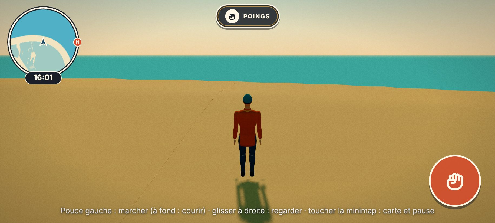
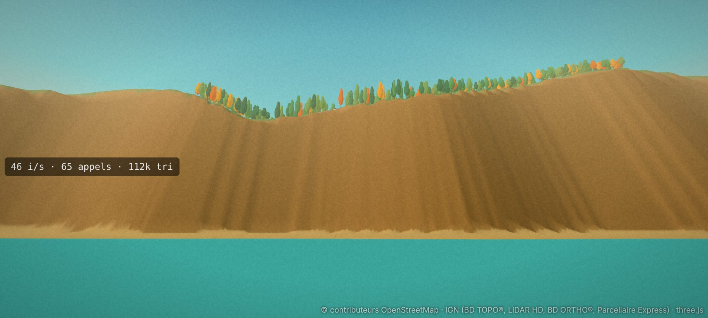
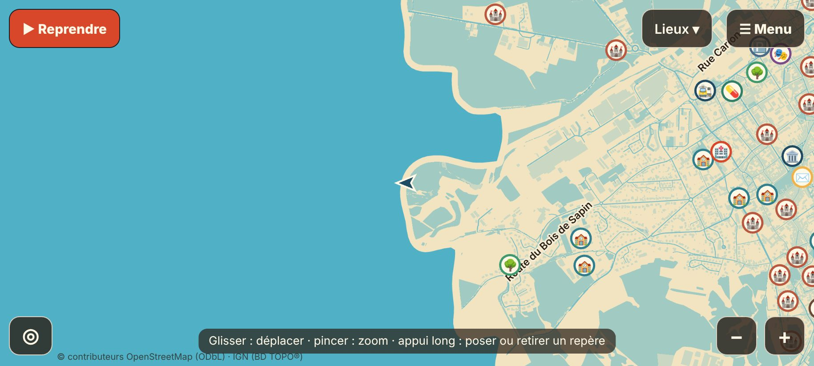
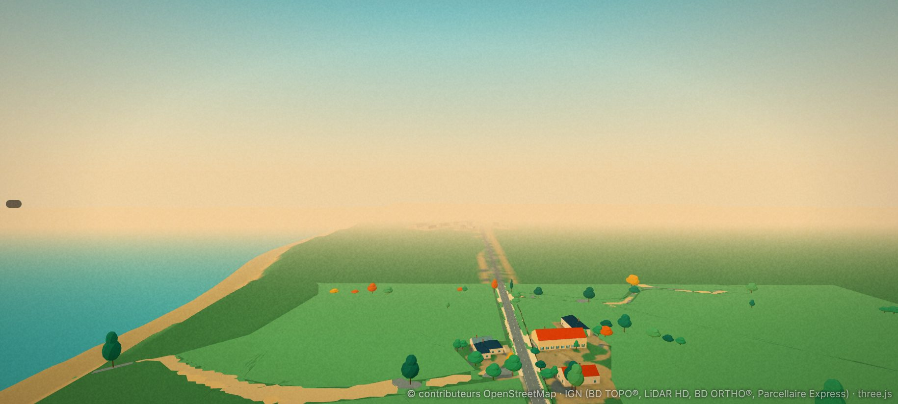
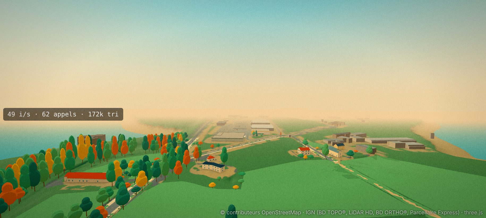
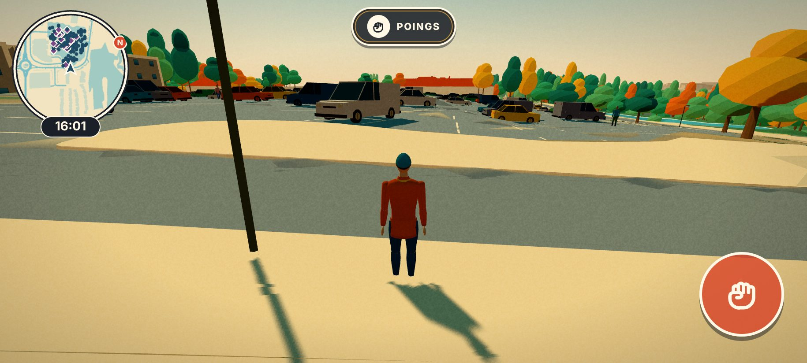

**Gravité : sauter, escalader, tomber, décoller (30 octobre 2026)** (D106)
- À pied : bouton rond « Sauter » au-dessus du bouton d'attaque (espace au clavier). On saute par-dessus les murets et haies basses (jusqu'à 1,4 m). Contre une grille, un portail ou un mur un peu plus haut (jusqu'à 2,5 m), un appui sur Sauter fait escalader puis retomber de l'autre côté. Les murs de bâtiments et les remparts restent infranchissables.
- On tombe vraiment du haut d'un mur ou d'une falaise : rien jusqu'à 4 m, blessé au-delà, mort vers 15 m.
- En véhicule (le tien seulement) : une crête prise vite ou le haut d'une montée font décoller, une falaise fait tomber ; en l'air, plus de direction ni de frein ; une réception brutale secoue, et fait tomber d'un deux-roues. La sortie des ponts ne fait pas sauter (les données des ponts ne rejoignent pas toujours la route).
- 635 tests.
- À faire de ton côté : sauter par-dessus une haie, escalader une grille, sauter d'un mur haut ; en voiture, prendre vite le haut d'une rue en pente et rouler vers une falaise au sud ; dire si la hauteur des sauts et la force des réceptions te conviennent.

**Voitures plus belles et reconnaissables, nom du modèle en montant (30 octobre 2026)** (D107)
- Chaque voiture a maintenant sa silhouette et sa « face » : formes arrondies ou anguleuses selon le modèle, passages de roue, vraies vitres avec leurs montants, portières, poignées, rétroviseurs, plaques ; phares ronds, rectangulaires, en amande ou en bandeau, calandres, feux, pare-chocs, jantes et accessoires différents (barres de toit, aileron, toit noir, chromes, ailes de voiture ancienne…).
- Chaque modèle a un nom (marques fictives d'Autun) qui s'affiche quelques secondes en haut à droite quand tu montes dedans : Éduen Moineau (citadine), Éduen Arroux (compacte), Augusta Préfète (berline), Augusta Morvandelle (break), Éduen Morvan (petit SUV), Couhard Mulet (camionnette), Éduen Pétrolette (vieille voiture), Augusta Janus (sportive).
- Une palette de couleurs propre à chaque modèle. Aucun appel de dessin de plus ; environ 1 200 triangles par voiture au lieu de 700. 638 tests.
- À faire de ton côté : regarder la galerie (`?view=vehicles&family=car`, appui pour changer de couleur), monter dans plusieurs voitures, dire si on les reconnaît de loin et si les noms te plaisent ; lancer `?bench=1&fleet=1&traffic=20` sur le téléphone. Ensuite : les deux-roues, puis les modèles uniques et les dégâts.

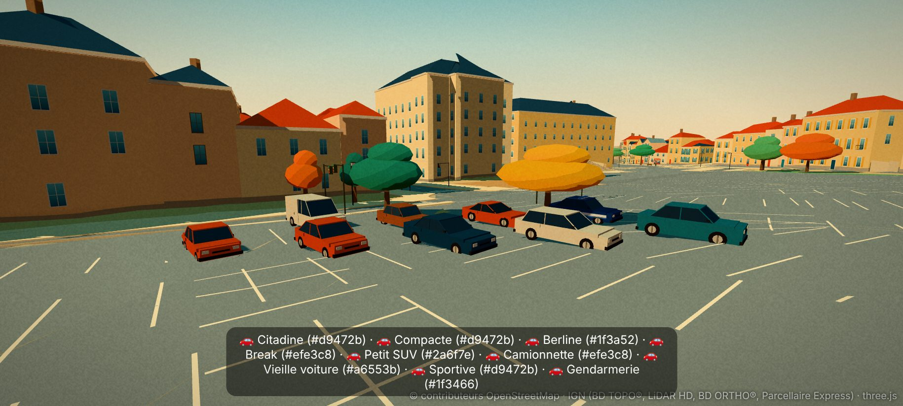
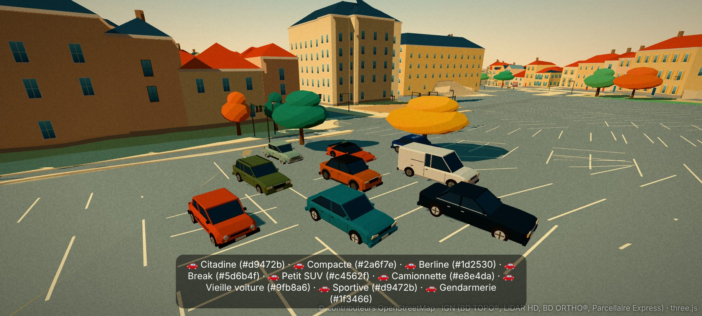
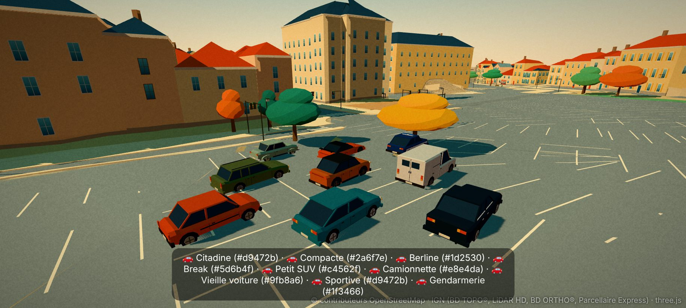
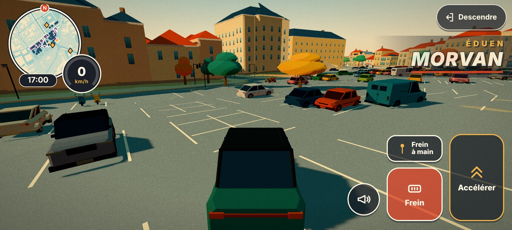

**Deux-roues plus beaux et reconnaissables, et leurs noms (30 octobre 2026)** (D108)
- Vélo de ville (Bibracte Promenade) : cadre ouvert, garde-boue, porte-bagages, panier en osier, guidon relevé, selle à ressorts. VTT (Bibracte Beuvray) : cadre plongeant, fourche suspendue, pneus à crampons, freins à disque, bidon. On ne les confond plus.
- Scooter (Éduen Zéphyr 125) : tablier galbé, coque arrondie, top-case, phare dans le guidon, rétroviseurs ronds. Moto routière (Bibracte Druide) : réservoir en goutte, moteur à ailettes, deux échappements chromés, phare rond, roues à rayons. Moto sportive (Bibracte Celte R) : carénage intégral, double phare, bulle, coque arrière effilée, jantes coulées.
- Trottinette (Trott'Autun Libre-service) : livrée du service de location, phare et écran.
- Le nom s'affiche en montant, comme pour les voitures. Aucun appel de dessin de plus ; les vélos garés coûtent ≈ 500 triangles de plus chacun. 644 tests.
- À faire de ton côté : galerie `?view=vehicles&family=moto` puis `family=bike` (et `&rider=1` pour voir les conducteurs), monter sur chacun ; lancer `?bench=1&fleet=1&traffic=20` sur le téléphone (voitures et deux-roues ensemble). Ensuite : les modèles uniques, puis les dégâts.

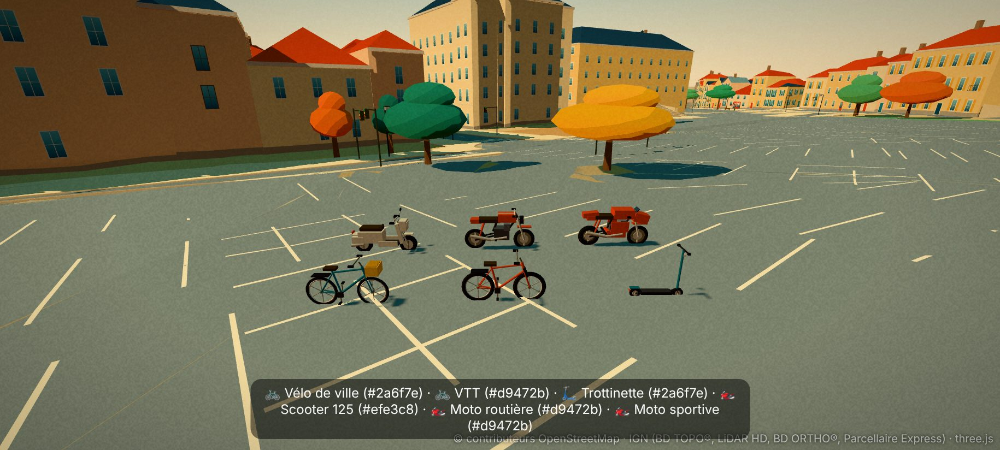
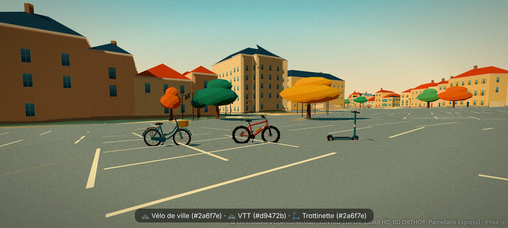
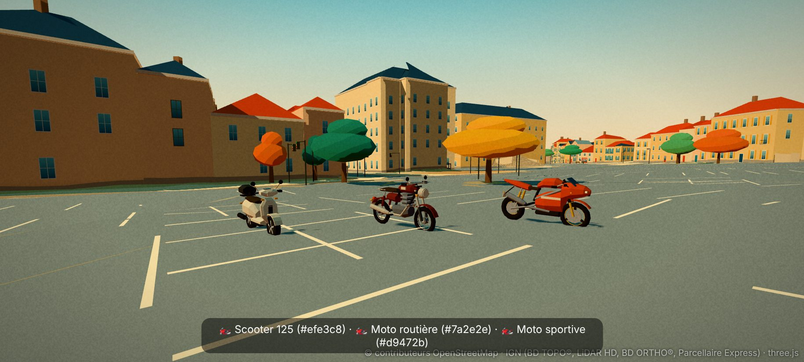
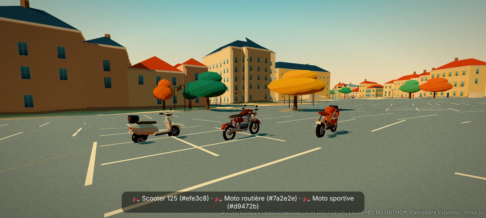
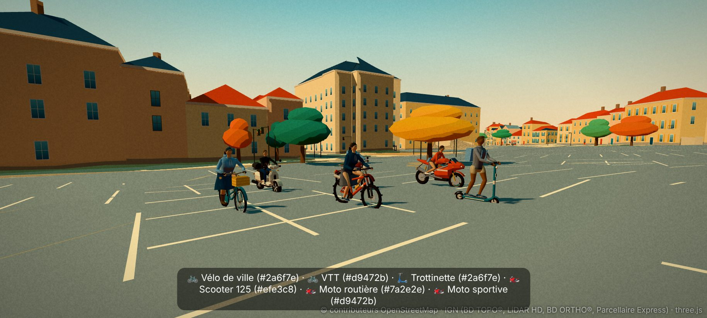
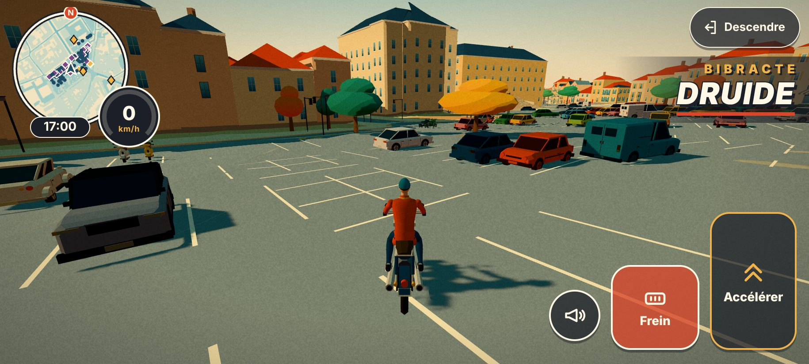

**Dégâts des véhicules, étape 1 : la logique (30 octobre 2026)** (D109)
- Chaque véhicule a maintenant une santé et quatre zones (avant, arrière, côtés). Les chocs au-delà de 12 km/h l'abîment, à l'endroit touché, selon la solidité du modèle (la gendarmerie et la camionnette encaissent mieux, une moto ou un vélo moins).
- Paliers : fumée blanche sous 60 %, fumée noire sous 30 %, feu sous 10 %, explosion 5 s plus tard. Le moteur faiblit à chaque palier ; la direction et les freins restent intacts. Un vélo ou une trottinette ne brûle pas : il casse. Une épave ne se reprend pas.
- Sous 30 %, le compteur se cercle de rouge et bat lentement (pas de jauge, comme convenu).
- Prévu pour le mode enfant : un seul aiguillage fait finir une voiture en panne plutôt qu'en explosion.
- Pas encore à l'écran : la carrosserie abîmée, la fumée, le feu, l'explosion (étapes 2 et 3) ; pour l'instant l'explosion n'est qu'un grand choc ressenti. 656 tests.
- À faire de ton côté : `?ride=citadine&debug`, foncer dans des murs à différentes vitesses et lire la ligne « dégâts » ; `?ride=citadine&damage=25` pour voir le compteur rouge et sentir le moteur faible. Dis-moi si le barème te paraît trop dur ou trop doux (une voiture qui prend feu à 90 km/h contre un mur).

**Dégâts des véhicules, étape 2 : ce qu'on voit et ce qu'on entend (30 octobre 2026)** (D110)
- Ta voiture se froisse là où elle a pris le choc : l'avant ou l'arrière recule et se plie, le capot se soulève, les flancs s'enfoncent, la peinture se ternit. Les phares et feux du côté touché se cassent et ne s'allument plus la nuit ; les vitres se fêlent.
- Fumée blanche sous 60 %, noire sous 30 %, épaisse en feu ; une voiture abîmée que tu laisses continue de fumer. Étincelles au moment du choc.
- Le moteur a des ratés, et pétarade quand il est très touché.
- Pas encore : flammes et explosion (étape 3) ; une voiture abîmée qu'on gare redevient intacte (étape 4). 662 tests.
- À faire de ton côté : `?ride=citadine&debug` et foncer dans des murs ; ou directement `?ride=berline&damage=45&dent=front,left` (fumée blanche) et `damage=20` (fumée noire). Dis-moi si la déformation est assez visible, et si les ratés du moteur ne sont pas agaçants.

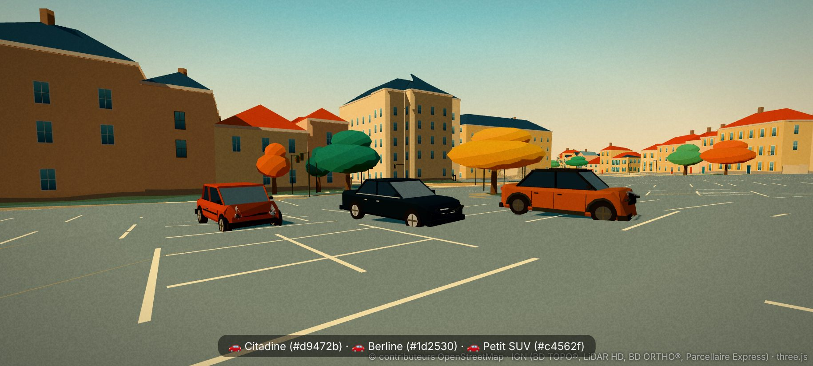
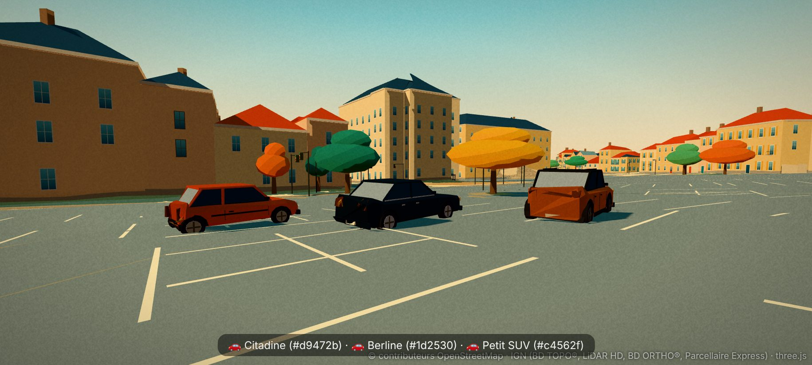
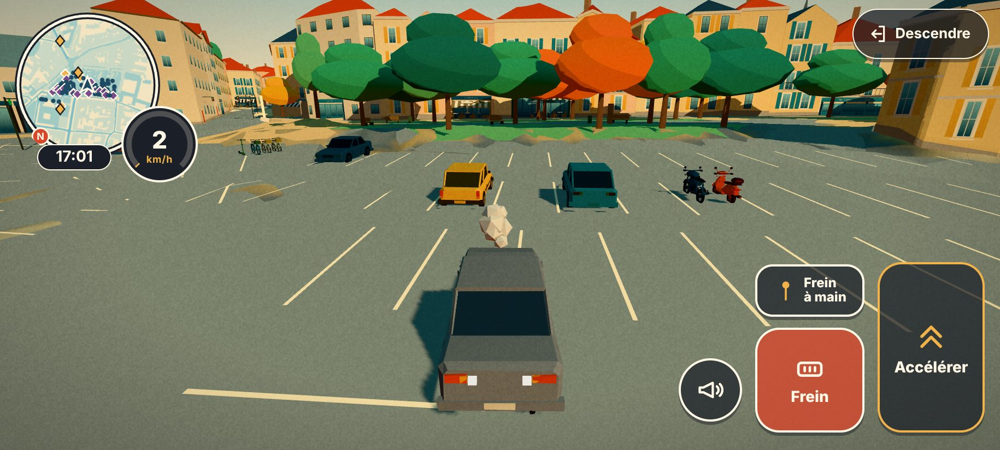
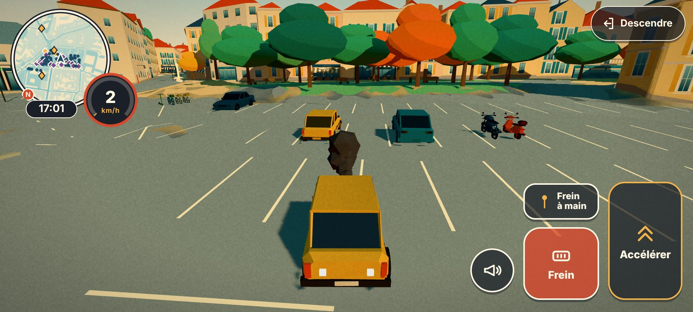

**Dégâts des véhicules, étape 3 : feu, explosion, épave (30 octobre 2026)** (D111)
- Une voiture en feu crache des flammes par le capot et crépite ; 5 secondes plus tard, elle explose : boule de feu, nuage de fumée, grondement, secousse.
- Le souffle tue celui qui est resté dedans, blesse ou tue les passants et gendarmes autour (et les projette), te blesse si tu es à quelques mètres, et abîme les voitures voisines : une voiture déjà bien touchée peut exploser à son tour.
- Faire exploser une voiture en public te donne au moins deux étoiles ; les victimes comptent comme des meurtres.
- L'épave est noircie, brûle quelques secondes, fume, puis finit par disparaître quand tu es loin.
- Pas encore : la circulation et la police ne sont pas touchées par les explosions (étape 4). 667 tests.
- À faire de ton côté : `?ride=berline&damage=8` : descends tout de suite et éloigne-toi en courant, puis regarde. Écoute aussi `?sounds` (Explosion, Crépitement). Dis-moi si la boule de feu est assez impressionnante et si la portée du souffle (mort à 2,5 m, blessé jusqu'à 8 m) te va.

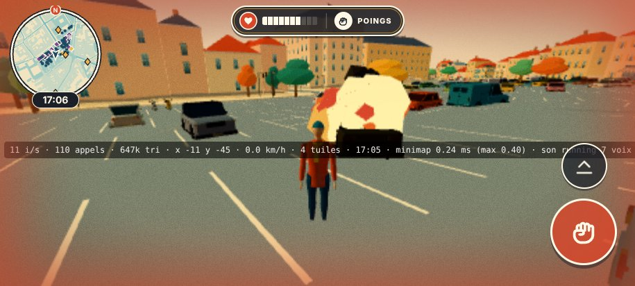
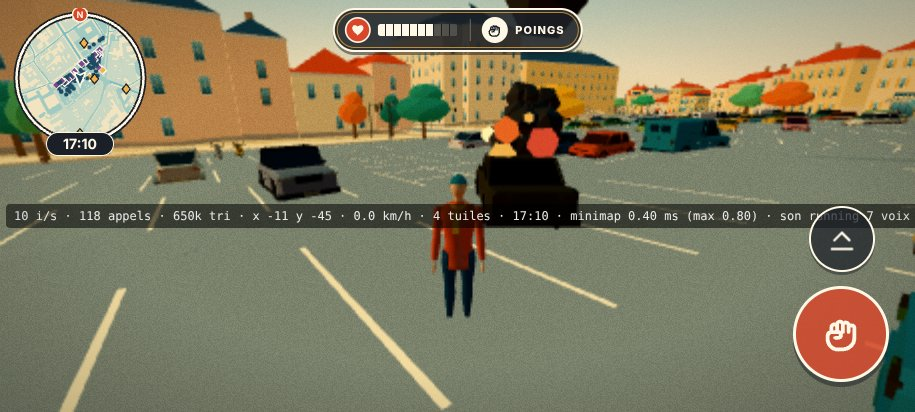

**Dégâts des véhicules, étape 4 : police, circulation, voitures garées (30 octobre 2026)** (D112)
- Les voitures de la circulation s'abîment aux chocs (contre toi, entre elles, contre les murs), fument, ralentissent. À la fumée noire, le conducteur s'arrête, descend et s'enfuit : la voiture reste là, abîmée ; elle peut brûler et exploser, ou tu peux la reprendre si elle roule encore.
- Une gendarmerie à la fumée noire est hors d'usage : elle quitte la poursuite (la police envoie des renforts). Elle est 1,4 fois plus solide qu'une voiture ordinaire.
- Les voitures garées que tu percutes s'abîment aussi, et fument si elles sont bien touchées.
- Les voitures cabossées garées ou qui roulent ont une forme abîmée (une par modèle) ; les explosions abîment aussi la circulation.
- 673 tests. Le chargement prend environ 70 ms de plus sur PC (fabrication des formes abîmées).
- À faire de ton côté : percuter des voitures de la circulation et des voitures garées ; se faire poursuivre (`?wanted=2`) et mettre une gendarmerie hors d'usage en la percutant plusieurs fois. Dis-moi si les gendarmeries tombent trop vite ou pas assez.

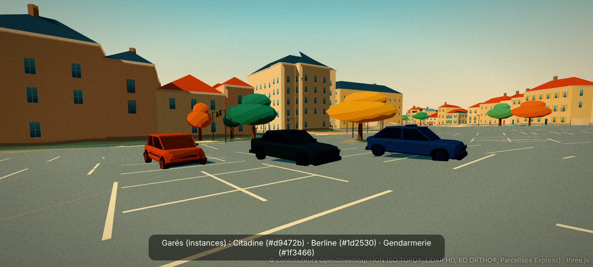

**Dégâts des véhicules, étape 5 : balles, garages, sauvegarde (30 octobre 2026)** (D113)
- Les balles abîment les véhicules, garés ou qui roulent, et s'arrêtent sur les carrosseries : tu peux t'abriter derrière une voiture garée, les gendarmes ne tirent plus à travers. Un chargeur de pistolet met une voiture en fumée noire, deux la font brûler. Au volant, les balles des gendarmes abîment aussi ta voiture. Les balles s'arrêtent aussi sur les troncs et les poteaux.
- Garages : les 8 garages automobiles d'Autun (Norauto, Eurorepar, Renault…) sont sur la minimap (pastille bleu-vert avec une clé). Arrête-toi devant, au volant d'un véhicule abîmé : une seconde plus tard, il est réparé et le nom du garage s'affiche. Gratuit pour l'instant, sans effet sur les étoiles.
- Les dégâts de tes véhicules sont enregistrés avec la partie (les anciennes sauvegardes se lisent toujours).
- Chantier des dégâts terminé côté code (D109 à D113). 680 tests.
- À faire de ton côté : tirer sur une voiture garée, t'abriter derrière une voiture pendant une poursuite à quatre étoiles (`?wanted=4&arms=all`), te faire réparer dans un garage. Puis la mesure sur l'Honor (protocole en D113) : `?bench=1&fleet=1&traffic=20`, puis la même avec `&dent=1`, et une explosion en jeu avec `?debug`.

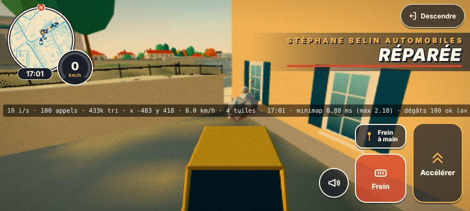

**Véhicules uniques, étape 1 : la jeep du Lycée militaire (30 octobre 2026)** (D114)
- Une jeep militaire kaki (Couhard Sentinelle), capote en toile et roue de secours, garée dans l'enceinte du Lycée militaire. Un seul exemplaire : détruite ou abandonnée ailleurs, elle revient à sa place quelques minutes après que tu t'es éloigné. Lourde, lente (130 km/h), robuste.
- La minimap ne montre plus les véhicules garés (seulement la police en poursuite).
- Défaut ancien trouvé dans la circulation (la répartition des modèles par quartier n'était pas respectée) : noté, à corriger dans un chantier de la circulation.
- 689 tests.
- À faire de ton côté : aller au Lycée militaire, prendre la jeep. Ensuite : le camion Pizza du Vallon et la rôtisserie du marché.

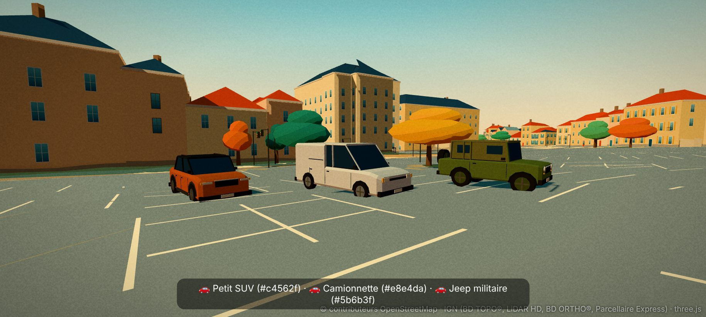
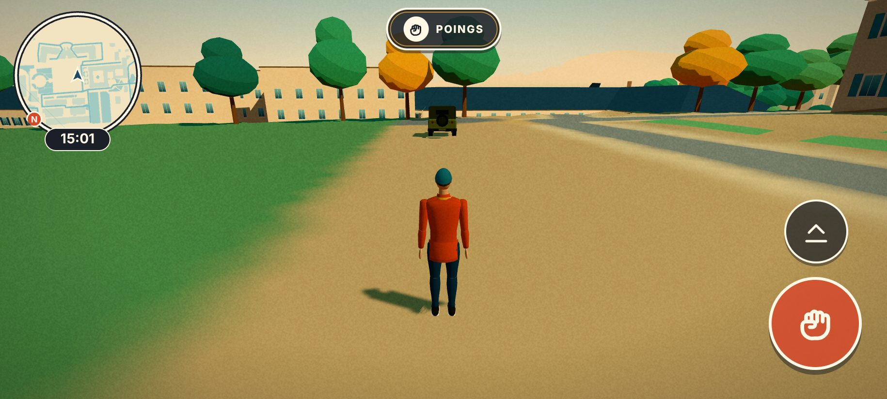

**Véhicules uniques, étape 2 : Pizza du Vallon et Rôtisserie du Champ de Mars (30 octobre 2026)** (D115)
- Le camion Pizza du Vallon (vert, « PIZZA » à la verticale, cheminée du four à bois qui fume) est sur le parking du Collège du Vallon de 17 h à 22 h, dos à la route, cabine vers l'ouest, comptoir ouvert sur le parking, avec son pizzaïolo en tablier derrière.
- La Rôtisserie du Champ de Mars (auvent rayé rouge et blanc, poulets à la broche) est sur le petit parking devant la mairie de 7 h à 13 h, comptoir tourné vers les places et la mairie.
- En dehors de leurs heures, ils ne sont pas là. Prendre un camion ouvert, c'est un vol : le vendeur s'enfuit et la police est prévenue. La pizza qui soigne viendra avec l'argent.
- 700 tests.
- À faire de ton côté : aller voir les deux camions à leur heure (`?at=506,1092&yaw=-0.2&h=18` pour la pizza, `?at=37,23&yaw=-0.35&h=9` pour la rôtisserie, ou en jouant), les prendre et les conduire. Ensuite : le petit train touristique.

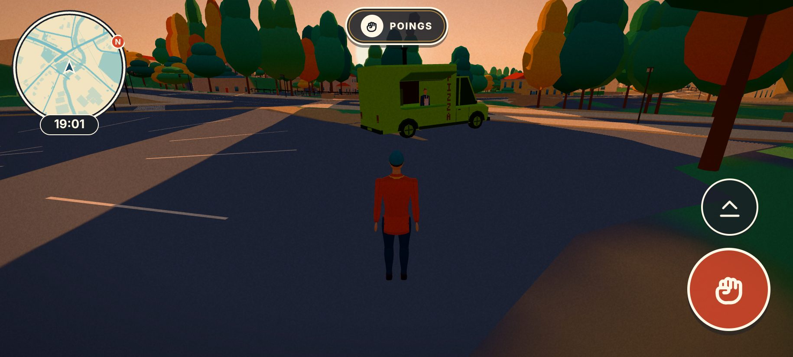
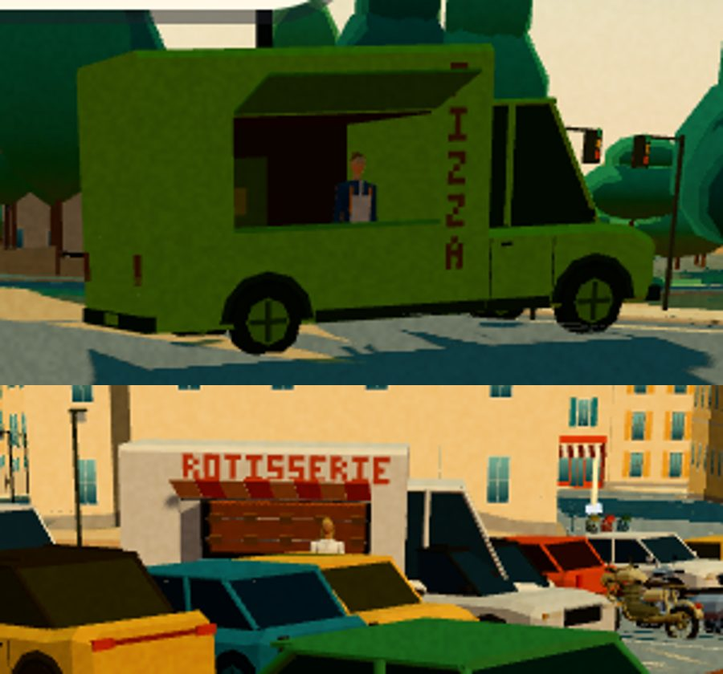
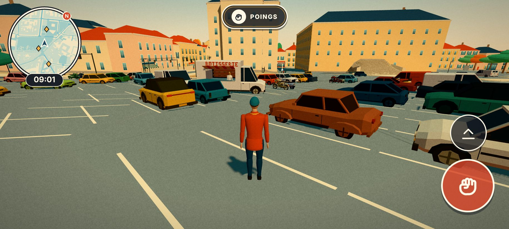

**Véhicules uniques, étape 3 : le Grumier du Morvan (30 octobre 2026)** (D116)
- Un grumier rouge, chargé de deux piles de grumes, grue jaune repliée, attend sur le bas-côté de la route de Château-Chinon, à l'entrée de la ville côté Morvan, tourné vers la ville. Il est toujours là.
- C'est un vrai poids lourd à conduire : 16 tonnes, trois essieux, bridé à 90 km/h, lent à démarrer (0 à 80 km/h en une vingtaine de secondes), qui tourne large et pousse les voitures. Très solide (il encaisse plus de deux fois ce que prend une voiture).
- Correction au passage : les voitures garées et la circulation étaient teintes en entier de la couleur de leur carrosserie (jantes, feux, vitres compris), le réglage censé ne teindre que la peinture ne s'appliquait pas. Elles retrouvent leurs jantes grises, leurs feux rouges et orange et leurs vitres sombres.
- 705 tests.
- À faire de ton côté : aller voir le grumier (`?at=-1090,961&yaw=-1.2`, ou en jouant : route de Château-Chinon, après le pont Saint-Andoche), le conduire, et regarder les voitures garées. Ensuite : le circuit du petit train touristique, à valider sur une carte avant de coder.

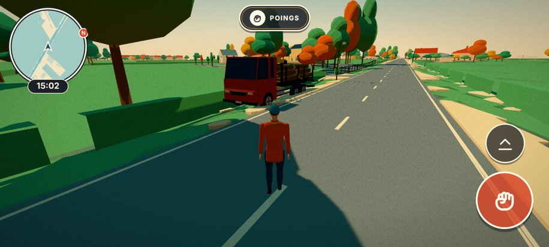
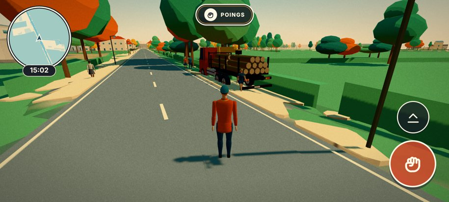
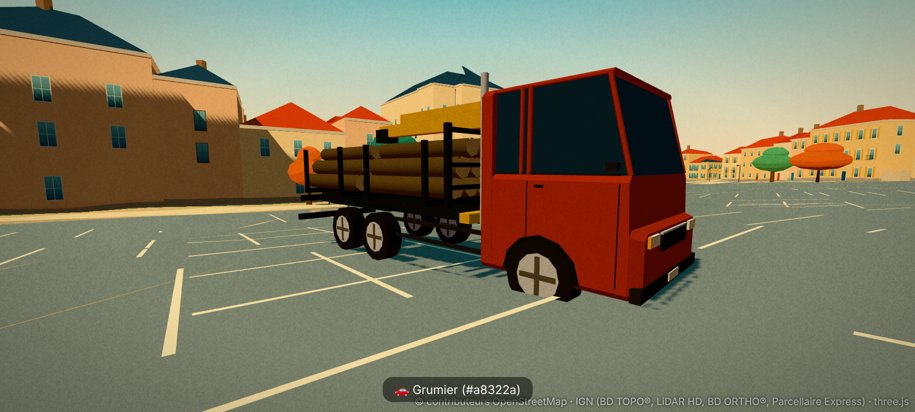
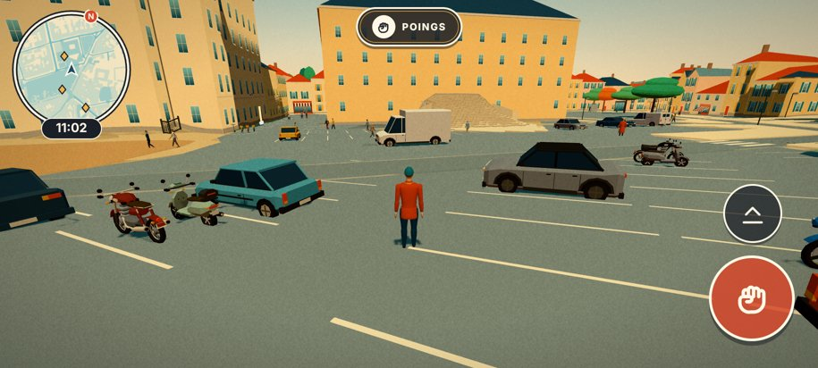

**Petit train touristique, étape 1 : le circuit et le train qui tourne (30 octobre 2026)** (D117)
- Un petit train vert et doré (« AUTUN » sur la locomotive, trois wagons à bancs) fait le tour des monuments : cathédrale et musée Rolin, théâtre romain, porte Saint-André, porte d'Arroux, tour de l'Horloge, hôtel de ville. 6,9 km, sans demi-tour, environ 38 minutes par tour.
- Il part de la rue du Général Demetz (côté Champ de Mars), s'y arrête une minute à chaque tour, ralentit devant les monuments, s'arrête aux feux rouges et devant ce qui bloque sa voie. Les voitures et les passants le voient et l'évitent ; on bute dessus.
- Il est là de 11 h à 18 h. Le temps du jeu va trop vite pour qu'il fasse un tour dans ces heures-là : il tourne sans fin et n'apparaît (ou ne disparaît) qu'aux bonnes heures, loin des yeux du joueur.
- 714 tests.
- À faire de ton côté : aller le voir (`?at=57,-40.5&yaw=-2.71&h=12` au départ, ou en jouant vers 11 h au Champ de Mars), le suivre, lui barrer la route. Ensuite : le prendre et le conduire (étape 2).

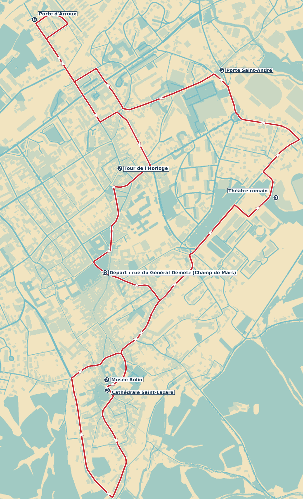
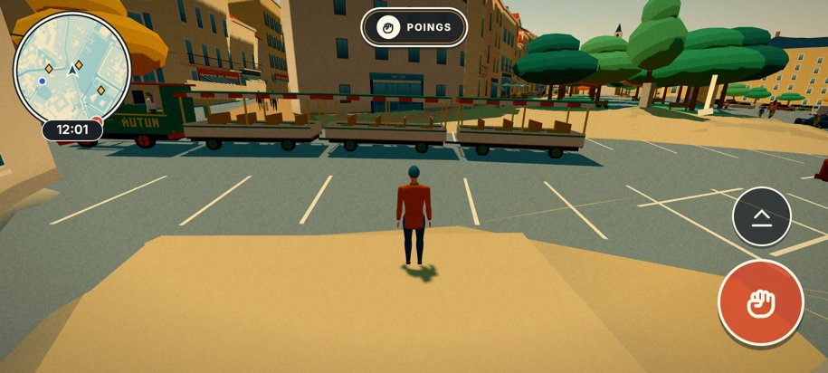
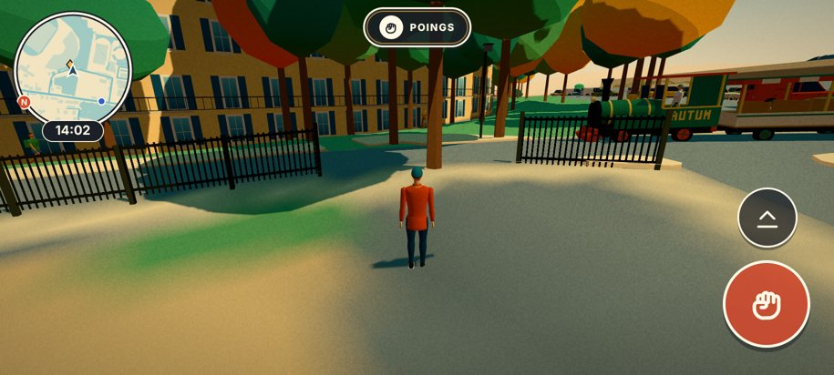
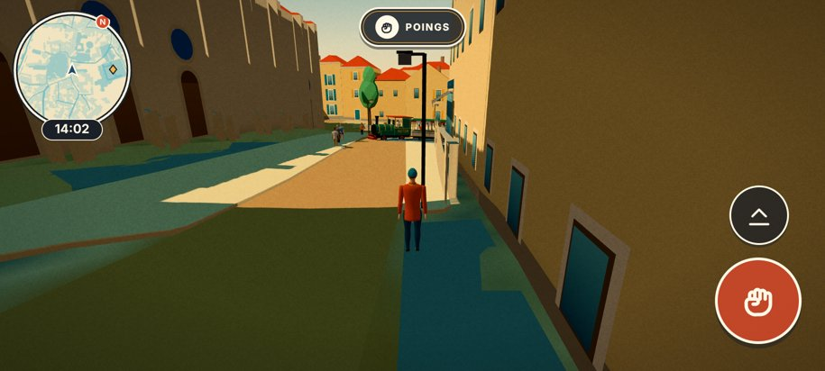

**Petit train touristique, étape 2 : le voler et le conduire (30 octobre 2026)** (D118)
- On peut prendre le petit train comme une voiture : le conducteur saute de la cabine et s'enfuit, c'est un vol avec témoins. On conduit debout dans la cabine, les trois wagons suivent derrière comme des remorques et coupent les virages.
- C'est lent et lourd : 25 km/h au plus, mais il monte jusqu'à la cathédrale.
- Abandonné loin de toi, il revient au départ de son circuit au bout de deux minutes, avec un nouveau conducteur.
- 719 tests.
- À faire de ton côté : le voler au départ (Champ de Mars, entre 11 h et 18 h) ou essayer directement `?ride=petit-train`, prendre des virages serrés, monter vers la cathédrale.

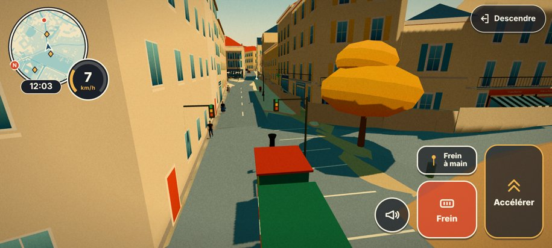
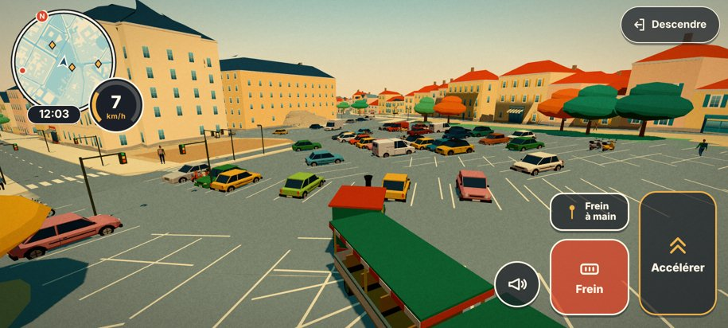

**Petit train : des passagers (30 octobre 2026)** (D119)
- Les wagons portent des touristes assis sur les bancs, environ une place sur deux, tous différents.
- Quand on vole le train, ils descendent et quelques-uns s'enfuient en courant. Revenu sur son circuit, le train repart avec ses passagers.
- 720 tests.

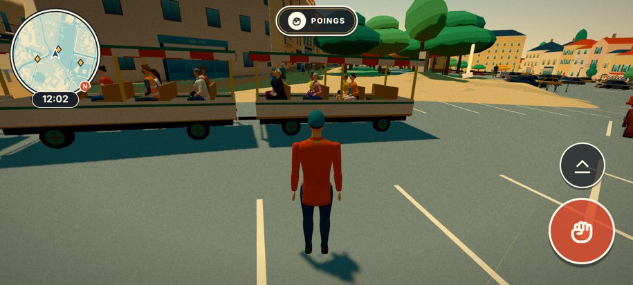
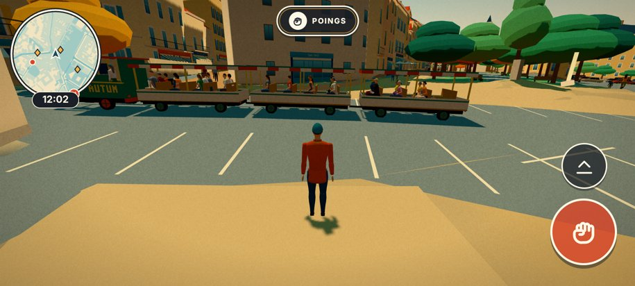

**Les vitrines et les enseignes du bon côté (30 octobre 2026)** (D120)
- Avant : une vitrine sans nom sur deux et près d'une enseigne sur quatre étaient sur l'arrière du bâtiment ou sur une autre rue que celle de leur adresse (toute l'avenue Charles-de-Gaulle, entre autres).
- Maintenant, chaque bâtiment commerçant a un mur d'entrée : la porte cartographiée, sinon le mur qui donne sur la rue de l'adresse, sinon (grandes surfaces) celui qui donne sur le parking. Il reste 6 enseignes et 2 vitrines sur une autre rue, toutes sur des bâtiments d'angle.
- Une correction à la main par bâtiment est possible (`fronts` dans `tools/data/manual.json`). Première utilisée : E.Leclerc, dont l'entrée est le bloc avancé de la façade nord d'après ta photo (sas au milieu, vitrines de part et d'autre, enseigne sur le mur blanc juste à droite de l'entrée).
- 721 tests.

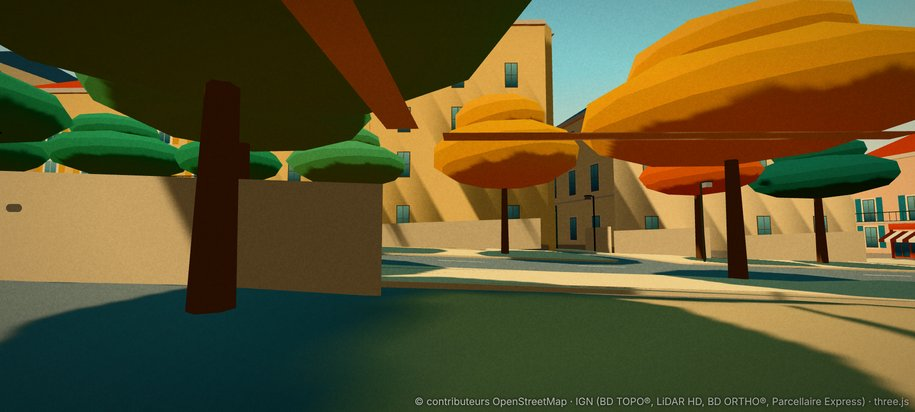
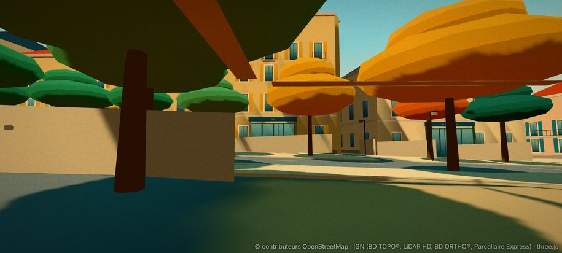
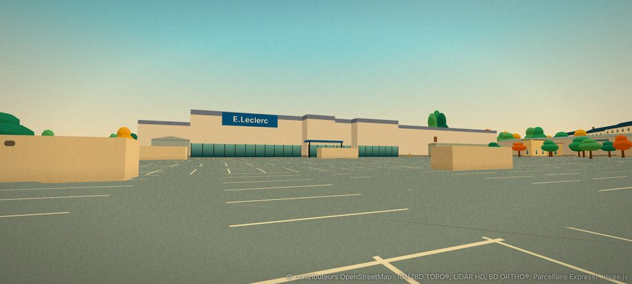

**Bâtiments d'après photos, étape 1 : les abris à chariots (30 octobre 2026)** (D121)
- Les six cubes beiges du parking de Leclerc sont devenus des abris ouverts d'après ta photo : cadre anthracite, toit plat, bandeau jaune et noir côté magasin, chariots bleus.
- Suite prévue : l'entrée de Leclerc (sas à pyramide, vitrage, auvent sur poteaux, enseigne basse), puis son volume (toits à deux pentes, bardage vert-gris).
- 721 tests.

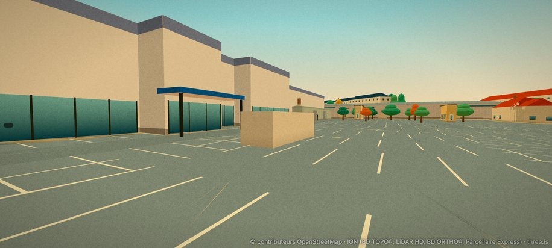
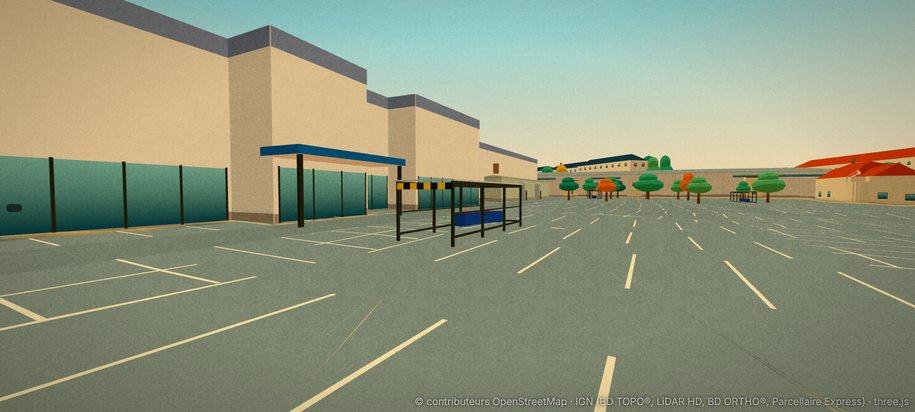

**Bâtiments d'après photos, étape 2 : l'entrée d'E.Leclerc (30 octobre 2026)** (D122)
- Le bloc d'entrée suit tes photos : grand vitrage à montants sombres, marquise anthracite continue sur poteaux fins, bandeau sombre au-dessus, potelets inox, pyramide de verre sur le sas.
- Le faux hangar collé au mur nord est devenu la marquise qui prolonge l'entrée ; l'enseigne est basse, en lettres bleues sur panneau blanc.
- Suite prévue : le volume (toits à deux pentes du LiDAR, pignons crème, bardage vert-gris du côté est).
- 721 tests.

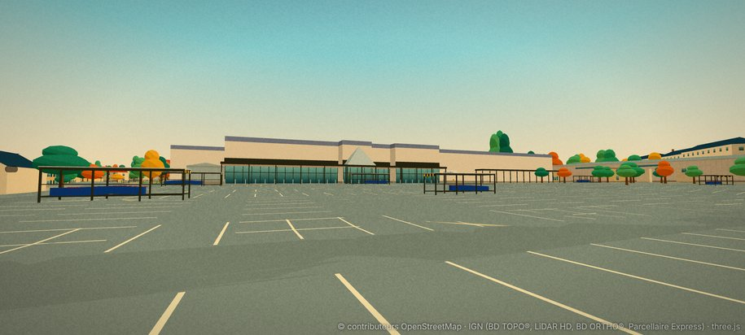
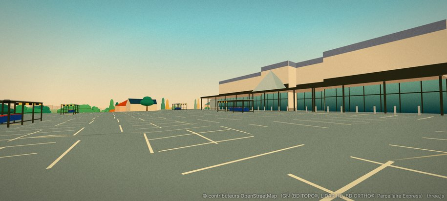

**Bâtiments d'après photos, étape 3 : l'hôtel de ville, volumes et toits (30 octobre 2026)** (D123)
- La mairie n'est plus une boîte à cinq rangs de petites fenêtres : d'après ta photo et le relevé LiDAR, elle a son corps principal sur le Champ de Mars (corniche à 17 m), ses deux pavillons d'angle et son pavillon central en légère saillie, à toits d'ardoise raides et tronqués (25 m et 28 m), et des ailes plus basses autour d'une cour ouverte.
- Trois niveaux comme sur la photo : soubassement à arcades et étage en pierre blonde, étage noble clair ; 11 travées régulières, portes et baies en plein cintre au centre. Les fenêtres s'allument la nuit.
- L'inscription « HÔTEL DE VILLE » est retirée (et les drapeaux génériques, qui étaient sur le mur nord-est).
- Nouvelle étape de données `tools/data/build_monuments.py` : la lecture de la photo est dans `manual.json`, les hauteurs sont mesurées au LiDAR.
- 722 tests.
- Suite prévue : le détail de la façade (bossages, frontons, chaînes d'angle), puis le portique, le balcon, les drapeaux et le perron, puis les lucarnes et cheminées.

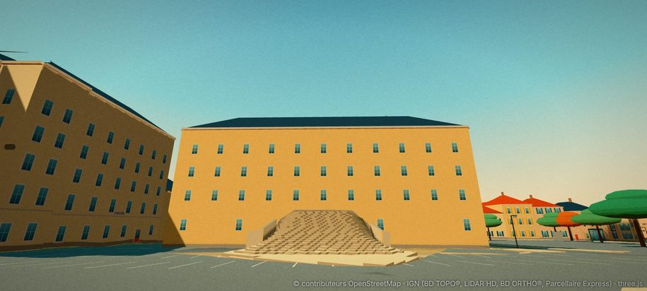
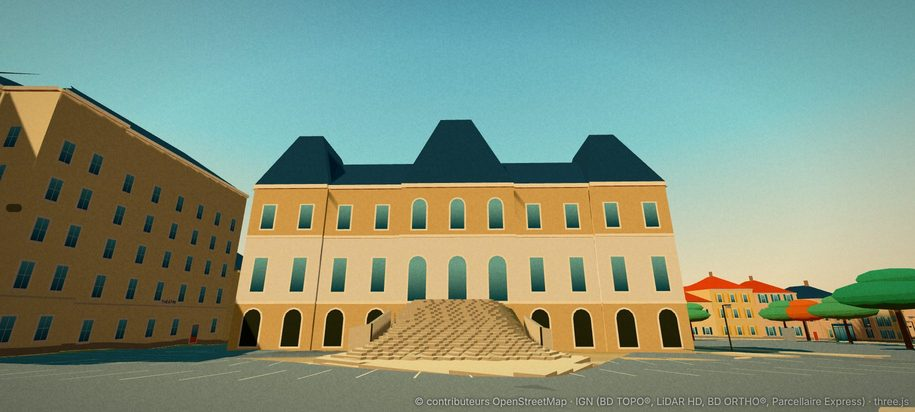

**Bâtiments d'après photos, étape 4 : l'hôtel de ville, détail de la façade (30 octobre 2026)** (D124)
- Soubassement à bossages (refends, clés d'arcades, cordon), frontons cintrés et appuis aux fenêtres de l'étage noble, linteaux à l'étage, chaînes d'angle en pierre blonde aux pavillons, corniche moulurée à modillons.
- 722 tests.

**Bâtiments d'après photos, étape 5 : l'hôtel de ville, portique, balcon, drapeaux et perron (30 octobre 2026)** (D125)
- Le talus en marches devant la mairie est devenu un vrai perron (palier et pied mesurés au LiDAR) : marches régulières, murs d'échiffre, deux rampes, lampadaires à deux lanternes allumés la nuit.
- Portique à six colonnes devant les trois portes, balcon à balustrade, drapeaux tricolore et européen aux baies du balcon.
- Le troisième drapeau de ta photo (rouge et bleu) n'est pas dessiné : dis-moi lequel c'est.
- 722 tests.

**Bâtiments d'après photos, étape 6 : l'hôtel de ville, toits et silhouette lointaine (30 octobre 2026)** (D126)
- Lucarnes rondes entre les pavillons et lucarne-fronton aux armes sur le pavillon central (hauteurs mesurées au LiDAR), œils-de-bœuf sur les pavillons d'angle, crêtes, épis, paratonnerre, cheminée de brique.
- De loin, la mairie n'est plus une boîte : corps principal, trois pavillons plus hauts, ailes plus basses.
- 723 tests.
- La mairie est faite pour la façade sur le Champ de Mars. Pour aller plus loin, il faudrait des photos des autres côtés et de la cour, et savoir quel est le troisième drapeau (rouge et bleu).

**Bâtiments d'après photos, étape 7 : la cathédrale, volumes mesurés (30 octobre 2026)** (D127)
- La cathédrale n'est plus un bâtiment générique avec un clocher : d'après tes photos et le relevé LiDAR, elle a son porche et ses deux tours, sa nef haute (30 m au faîtage) avec ses fenêtres hautes, ses bas-côtés et ses chapelles, son transept plus bas, le bloc carré au bout du bras ouest, sa tour de croisée (40 m) et sa flèche (86 m), son chœur et son abside polygonale.
- Les toits sont en tuiles brun-ocre (gris-vert sur les chapelles) et les flèches en pierre grise, plus en ardoise bleue.
- Les deux tours du porche n'apparaissent pas dans le relevé LiDAR, alors qu'on les voit sur tes photos et sur l'orthophoto : leur hauteur vient des photos (26 m au corps, 36 m à la pointe).
- De loin, on voit la tour de croisée et le vaisseau, plus un mât de 54 m.
- 724 tests.
- Suite : le chevet et ses tuiles vernissées.

**Bâtiments d'après photos, étape 8 : la cathédrale, le chevet (30 octobre 2026)** (D128)
- L'abside, le bloc carré au bout du transept et la petite tourelle (retrouvée dans le relevé LiDAR, pointe à 22 m) ont leurs toits en tuiles vernissées : losanges jaunes, résille verte et brun-noir, losanges rouges, en aplats.
- L'abside a ses contreforts, sa corniche et deux étages de baies en arc brisé ; le bloc a ses grandes baies.
- 724 tests.
- Suite : la tour de croisée et la flèche.

**Bâtiments d'après photos, étape 9 : la cathédrale, tour de croisée et flèche (30 octobre 2026)** (D129)
- La tour de croisée a ses contreforts, ses baies jumelles en arc brisé et sa balustrade ajourée ; la flèche a sa vraie largeur au pied (mesurée au LiDAR), ses crochets sur les arêtes, ses gâbles, ses clochetons d'angle et sa croix.
- Les clochetons et les gâbles sont trop fins pour le relevé : leur hauteur vient de ta photo.
- 724 tests.
- Suite : les flancs et le porche.

**Bâtiments d'après photos, étape 10 : la cathédrale, flancs et porche (30 octobre 2026)** (D130)
- Côté est, les chapelles ont leurs grandes baies en arc brisé à meneau, leurs contreforts surmontés de pinacles et leur balustrade ajourée, comme sur ta photo de nuit ; le bras est du transept a son portail roman à petit pignon.
- Les tours du porche ont deux étages de baies jumelles, leurs contreforts et des clochetons au pied de leur flèche.
- Toute la cathédrale : 4 163 triangles (moins que la mairie).
- 724 tests.
- Il manque, faute de photo : la façade du porche (portail, marches), les chapelles de l'ouest, la fontaine Saint-Lazare. La nuit, la cathédrale n'est pas illuminée comme sur ta photo : à faire si tu veux.

**Bâtiments d'après photos, étape 11 : le portail et la fontaine Saint-Lazare (30 octobre 2026)** (D131)
- Le porche s'ouvre maintenant sur le parvis par un grand arc. On y voit la voûte, l'escalier entre ses grilles et le portail de ta photo : portes de bois, trumeau et statue, colonnes, linteau, tympan du Jugement dernier (Christ en mandorle et figures, en aplats), voussures à médaillons.
- La fontaine Saint-Lazare est à sa vraie place (OpenStreetMap), à sa hauteur mesurée au LiDAR (8,3 m) : bassin à lobes, vasque et jet, édicule à arcs, entablement, vases, lanterne et pélican. On ne la traverse plus, et l'arbre qui poussait au milieu a disparu.
- On ne peut pas encore entrer dans le porche (la collision suit l'emprise du bâtiment).
- 725 tests.

**Bâtiments d'après photos, étape 12 : façade et entrée du porche, la cathédrale la nuit (30 octobre 2026)** (D132)
- La façade du porche suit tes deux photos : grand arc à voussure sur colonnes, contreforts, galerie de petites arcades, corniche, arcs plus bas sous les tours avec leurs grilles.
- On entre dans le porche : trois marches depuis le parvis, puis la volée entre les grilles jusqu'aux portes (fermées).
- La nuit, la cathédrale est illuminée, comme sur ta photo : murs et flèches dorés, plus clairs en bas, toits sombres, baies sombres.
- Les passants contournaient déjà la fontaine ; la génération de la navigation prend désormais son bassin en compte.
- 728 tests.
- À essayer de ton côté : `?at=13.4,-531` (sur le parvis), monter jusqu'aux portes ; `?h=23` pour la nuit.

**Bâtiments d'après photos, étape 13 : le théâtre romain, volumes mesurés (31 octobre 2026)** (D133)
- Le théâtre n'est plus un immeuble de six étages en fer à cheval : d'après tes photos et le relevé LiDAR, la cavea s'ouvre vers l'est-nord-est (orchestre de 26,5 m de rayon, 148 m de diamètre au haut de la pente, 17 m de dénivelé).
- Orchestre en terre battue, podium, 15 rangs de gradins restaurés en pierre grise (de −58° à +61° autour de l'axe, mesurés sur l'orthophoto), allée herbue, sept coins herbus séparés par six escaliers, massifs ruinés aux extrémités, scène moderne avec ses marches.
- On y marche déjà : gradins, allée, coins et escaliers sont praticables (tabliers invisibles alignés sur les marches) ; le podium et les hauts massifs sont des obstacles qu'on escalade.
- La piste du stade du Théâtre romain est en terre rouge-brun, plus en rouge synthétique.
- Pas d'éclairage la nuit, comme demandé.
- 6 966 triangles. 732 tests.
- Suite : le détail des ruines (moellons, coins du haut à gradins restaurés, marches de bois), puis les passants, puis les barrières de la scène, le poteau d'éclairage et les bancs.
- À essayer : `?at=845,290&h=14` (dans l'orchestre), monter par l'escalier central ; `?at=765.3,298&yaw=2.14&h=14&train=3170` (le petit train).

**Bâtiments d'après photos, étape 14 : le théâtre romain, ruines et détails (31 octobre 2026)** (D134)
- Les massifs des extrémités ne sont plus de grandes marches : blocs de maçonnerie cassés, de hauteurs inégales, en dents de scie au bout de la cavea.
- Deux coins de la partie haute ont leurs gradins restaurés (20 et 19 rangs), comme sur tes photos : le relevé ne les distingue que pour l'un des deux, l'autre vient de ta photo de drone.
- Maçonnerie en moellons nuancés à assises sombres, murs des voûtes qui affleurent dans l'herbe, escaliers du haut à traverses de bois.
- Tout reste praticable, à la hauteur dessinée.
- 9 518 triangles. 733 tests.
- Suite : les passants, puis les barrières de la scène, le poteau d'éclairage et les bancs.

**Bâtiments d'après photos, étape 15 : le théâtre romain, les passants (31 octobre 2026)** (D135)
- Les passants entrent dans le théâtre : allée de la précinction, escalier central jusqu'à l'orchestre, six escaliers jusqu'au chemin du sommet, scène, sortie au nord vers la maison du gardien.
- Ils montent sur les gradins et la scène à leur vraie hauteur.
- Nouvelle étape `tools/data/build_theatre_nav.py` : elle ne touche que la navigation autour du théâtre, sans régénérer la ville (à relancer après `build_nav.py`).
- 734 tests.
- Suite : les barrières de la scène, le poteau d'éclairage et les bancs.

**Bâtiments d'après photos, étape 16 : le théâtre romain, barrières, poteaux et arbustes (31 octobre 2026)** (D136)
- La scène a ses barrières galvanisées sur ses deux côtés.
- Deux poteaux d'éclairage (9,2 m), retrouvés par leur ombre sur l'orthophoto ; l'un était dans la carte comme un arbre. Ils ne s'allument pas la nuit.
- Correction : ce que j'avais pris pour des bancs sur ta photo de drone sont quatre arbustes taillés (orthophoto) ; ils sont dessinés comme tels.
- 10 930 triangles pour tout le théâtre. 735 tests.
- Le plan du théâtre est terminé (D133 à D136).

**Bâtiments d'après photos, étape 17 : la porte d'Arroux (31 octobre 2026)** (D137)
- La porte d'Arroux suit ta photo :
  - deux grandes arches à archivoltes moulurées et deux petites à demi enterrées ;
  - le blocage de moellons apparent là où le parement est tombé ;
  - la corniche et l'attique ;
  - la galerie conservée seulement sur la partie gauche (7 arcades sur pilastres à chapiteaux, entablement, bloc au sommet) et le bout gauche en gradins.
- Le relevé LiDAR n'a qu'une partie de la porte (pas la galerie). Il donne l'épaisseur (4,25 m), le recalage (1,5 m) et la rue. Les hauteurs viennent de ta photo, à l'échelle de la longueur de la porte. Le haut du blocage mesuré concorde à moins d'1 m.
- La nuit, la porte est éclairée par en dessous, comme sur ta photo 4.
- Elle a une silhouette lointaine (elle disparaissait de loin).
- Voitures sous les grandes arches et piétons sous les petites, comme avant.
- 2 372 triangles. 736 tests.
- Suite : la porte Saint-André avec l'église et sa tour ronde, puis le temple de Janus (à (−795 ; 1211), tuile 22_40).
- À essayer : `?at=-262,1060&h=14`, puis `?h=23` pour la nuit.

**Bâtiments d'après photos, étape 18 : la porte Saint-André et l'église Saint-André (31 octobre 2026)** (D138)
- La porte Saint-André suit tes deux photos :
  - galerie complète de 10 arcades sur les deux faces, sous un toit de tuiles ;
  - deux grandes arches, deux petites, archivoltes ;
  - la tour de moellons au bout sud-sud-est.
- Ses bouts sont mesurés au LiDAR : le contour OpenStreetMap était décalé de 2 m. Elle fait 20,8 m de la tour à l'église.
- L'église Saint-André a son modèle : nef à pignons, tour ronde à toit conique plus basse que la nef, porte claire, baies en plein cintre. Elle remplace l'église générique.
- Tout est éclairé la nuit par en dessous, comme Arroux.
- Les passants passent par les arches (nouvelle étape `build_monuments_nav.py`). La cache d'arme de la porte n'est plus dans une pile.
- 2 850 triangles pour la porte, 202 pour l'église. 739 tests.
- Suite : le temple de Janus.
- À essayer : `?at=536,830&h=14`, puis `?h=23` pour la nuit.

**Bâtiments d'après photos, étape 19 : le temple de Janus (31 octobre 2026)** (D139)
- Le temple est à (−795 ; 1211), tuile 22_40, et non à la position de la demande.
- Avant, c'était un mur fermé de 4 côtés, avec trois « arbres » de 20 m qui étaient en fait ses murs vus par le LiDAR. Mur et faux arbres ont disparu.
- Les deux murs debout suivent tes photos :
  - cella de 16,6 m mesurée, murs de 2,3 à 2,5 m, jusqu'à 21,7 m de haut ;
  - dessus cassé en paliers et herbu ;
  - en bas, trois arches traversantes et des niches ;
  - à l'étage, trois baies par mur sous des arcs de brique ;
  - trous de boulin et lichen orange ;
  - souches des murs nord et est au ras du terre-plein.
- On passe par les arches ; les passants font une boucle par le temple.
- Éclairé la nuit par en dessous, comme les portes.
- Les captures ne photographient plus une ancienne construction (un serveur restait ouvert, corrigé).
- 2 302 triangles. 741 tests.
- Le plan des portes et du temple est terminé (D137 à D139).
- À essayer : `?at=-806,1196&h=14`, puis `?h=23` pour la nuit.

**Petits éléments d'après photos, étape 1 : la maison du 7 allée de l'Acaron (31 octobre 2026)** (D140)
- La maison suit tes photos de drone :
  - plain-pied avec combles, enduit crème ;
  - grand toit raide de tuiles plates brunes tachées de lichen, en L, à croupes ;
  - deux lucarnes, la cheminée et sa parabole ;
  - l'entrée couverte dans l'angle, avec son poteau de bois ;
  - les portes-fenêtres cintrées à volets persiennés bruns ;
  - la terrasse et l'allée claire.
- Mesures au LiDAR : corps de 13,3 × 7,7 m, aile de 7,8 m qui avance de 3,15 m, égout à 3 m, pente de 44°, faîtage à 6,6 m. Le contour cadastral était plus petit et décalé : la maison et son obstacle suivent maintenant le relevé.
- On entre sous l'auvent jusqu'à la porte. La nuit, quelques fenêtres et les appliques s'allument.
- 1 154 triangles. 742 tests.
- Suite : la boutique du 21 rue Guérin.
- À essayer : `?at=709,900&h=14`, puis `?h=23` pour la nuit.

**Petits éléments d'après photos, étape 2 : la boutique du 21 rue Guérin (31 octobre 2026)** (D141)
- L'Armoire de Julie suit ta photo :
  - devanture en bois bleu lavande avec ses pilastres, sa frise et sa corniche ;
  - la porte d'immeuble du 21, la vitrine « DEPOT VENTE » et la porte du magasin ;
  - la seconde vitrine à mannequins ;
  - les soubassements de pierre à grecque et l'enseigne rouge en italique ;
  - l'étage en enduit blanc.
- Le bâtiment était une maison sans commerce (la boutique n'est pas dans OpenStreetMap) ; il devient un commerce, et les passants y ont leur point « commerce ».
- La nuit, les vitrines s'allument, et les vêtements restent visibles derrière.
- 398 triangles. 746 tests.
- Suite : le rond-point de la Croix Verte.
- À essayer : `?at=133,266&h=10` (en face de la boutique), puis `?h=23`.

**Petits éléments d'après photos, étape 3 : le rond-point de la Croix Verte (31 octobre 2026)** (D142)
- Le rond-point a son îlot : pelouse bordée d'une bordure claire, massif de fleurs au pied et, au centre, un grand cèdre à plateaux étagés bleu-vert, comme sur ta photo.
- Mesuré à l'orthophoto et au LiDAR : îlot de 13,7 m de rayon, bombé de 41 cm, cèdre de 13,7 m, couronne de 10,4 m de rayon.
- Avant, le cèdre était trois arbres génériques ; ils disparaissent, avec un lampadaire posé au bord de l'îlot.
- La circulation ne change pas (ses files restent à 3 m de la bordure), les passants non plus.
- Nouvelle étape `tools/data/build_roundabouts.py` : elle n'écrit que le site de l'îlot, sans régénérer les sols de toute la ville.
- 1 956 triangles pour l'îlot, 252 pour les sols. 747 tests.
- Le plan des trois petits éléments est terminé (D140 à D142).
- À essayer : `?at=600,632&h=14`, puis `?h=23` pour la nuit.

**Le Lidl de Saint-Pantaléon, sa pharmacie et son abri à chariots d'après photos (31 octobre 2026)** (D143)
- Le Lidl suit tes photos :
  - mur vitré sur toute la longueur du **mur ouest** (côté parking), bande de bardage gris au-dessus, sas d'entrée en saillie près du coin sud ;
  - deux panneaux « LIDL » (carré bleu, disque jaune) perpendiculaires au mur de part et d'autre du sas ;
  - toit plat à garde-corps ;
  - long mur sud-est blanc et gris avec ses grilles, le casier rose et la zone jaune et noire hachurée au sol.
- L'entrée n'était pas au bon endroit : elle était au milieu du long mur sud-est ; elle passe sur le mur ouest.
- Mesures au LiDAR : le toit du Lidl n'est pas plat, il penche de 6,9 % vers le nord-ouest (5,3 m à 7,5 m au-dessus du sol, écart de 3 cm) ; avant, il était à plat à 8,6 m.
- La pharmacie (« Pharmacie de Saint-Pan ») : galerie à poteaux gris-bleu et potelets inox, vitrage en retrait, bandeau gris à croix vertes, grande croix verte sur le toit ; toit plat mesuré à 3,3 m.
- L'abri à chariots du Lidl : toit sombre, côtés vitrés, panneau Lidl au fond, chariots gris. Le LiDAR ne le voit pas : sa hauteur vient de la photo.
- Le sas et le casier bloquent les passants ; le point « commerce » du Lidl et celui de la pharmacie passent devant leur entrée. Aucune cache d'arme n'est touchée.
- Environ 1 990 triangles pour les trois, dans les maillages de la tuile. 757 tests.
- Nouvelle étape `tools/data/build_stores.py` (après `build_carts.py`) ; `build_carts.py` ne supprime plus les abris imposés à la main.
- Limites : positions le long des murs lues sur des photos en perspective (à un mètre près) ; potelets sans obstacle ; silhouettes lointaines inchangées.
- À essayer : `?at=962,1338&h=14` (devant le Lidl), `?at=1014,1374&h=14` (devant la pharmacie), puis `?h=23` pour la nuit.

**La zone commerciale de Bellevue d'après photos : But, Bricomarché, Intermarché et Jardinerie d'Autun (31 octobre 2026)** (D144)
- Quatre magasins suivent tes photos, dans une seule décision :
  - **Bricomarché** : bardage anthracite, auvent orange continu sur poteaux fins, portique orange devant les portes centrées sur le mur sud-ouest, enseigne « BRICO MARCHÉ », tondeuses alignées devant, chariots jaunes à droite ;
  - **Intermarché** : bloc de lames rouges, vitrage à meneaux blancs, enseigne « Intermarché SUPER » allumée la nuit, store rouge du Drive au coin ouest ;
  - **But** : magasin ouvert, bloc central anthracite plus haut que les ailes blanches, auvent sombre, enseigne carrée rouge « BUT » et « Cosy », sans volets ni pylône ;
  - **Jardinerie d'Autun** : elle remplace « Agri Sud Est » (nom d'OpenStreetMap du même bâtiment) ; deux pavillons vitrés à pignon de bois au nord-ouest, bannière blanche à feuille verte sur le mur crème.
- Six abris de parking solaires devant l'Intermarché, mesurés au LiDAR (plans inclinés de 11 à 15 %).
- L'entrée du But n'était pas au bon endroit (face sud-ouest) : elle passe sur la face sud-est. Le petit bâtiment collé au Bricomarché n'est plus un second magasin mais un abri ouvert.
- Mesures au LiDAR : les toits du Bricomarché, de l'Intermarché et du But sont plats (le Bricomarché n'a pas le toit « à croupes » de BD TOPO) ; la Jardinerie a trois niveaux (la halle seule est mesurée).
- Les passants ont un point « commerce » devant chaque entrée, les anciens points mal placés sont retirés. Les poteaux (portique, auvents, abris solaires, pavillons) bloquent ; tondeuses et store du Drive se traversent. Aucune cache d'arme dans le secteur.
- Environ 1 400 triangles pour toute la zone ; aucun appel de dessin de plus. 766 tests.
- `build_stores.py` mesure aussi les toits à plusieurs niveaux (`fit`) et les abris solaires (`carports`).
- Limites : positions sur les murs à un mètre près ; pavillons vitrés d'après la photo (le LiDAR ne voit pas le verre) ; toit de la Jardinerie à un seul plan (partie nord-ouest 1 m trop haute) ; sept petites boîtes de parking (abris à chariots probables) non traitées.
- À essayer : `?at=-1851,2016&h=14` (devant le Bricomarché), `?at=-1792,1937&h=14` (devant l'Intermarché), `?at=-1858,2140&h=14` (devant le But), `?at=-1757,1897&h=14` (devant la Jardinerie), puis `?h=23` pour la nuit.

**La zone commerciale nord-ouest de Bellevue d'après photos : deux galeries marchandes, GiFi et Action (31 octobre 2026)** (D145)
- Les enseignes de tes photos ne sont pas où on les cherchait : deux galeries marchandes de part et d'autre d'un grand parking (x −2340 à −2160, y 2310 à 2545), GiFi et Action au sud-est.
- **Une aile entière manquait** : la galerie nord-est a, au nord-ouest, une aile de 50 × 34 m (Centrakor) que ni BD TOPO ni OpenStreetMap ne connaissent ; le LiDAR la voit, elle est ajoutée (nouvelle étape `build_extras.py`).
- Deux galeries : bardage bois miel entre des piles anthracite, une unité par enseigne (Intersport, Gémo, Schmidt, Optical Center, Générale d'Optique, Comme j'aime, Maxi Zoo, Stokomani, Maison de la Literie, Centrakor…) avec vitrine, porte et bandeau coloré allumé la nuit, **auvent vitré continu** sur poteaux fins verts (mesuré au LiDAR : dessus à 8,3 – 8,6 m ; la bande « industrielle » de 10 m qui le figurait en mur plein est retirée), deux aires de jeux (toboggan, trampoline, banc).
- GiFi : bardage gris, tour d'entrée orange à enseigne ; Action : bandeau bleu, entrée, vitrines dont une condamnée par une planche (état de 2023).
- Mesures au LiDAR : tous les toits sont plats (les « croupes » de BD TOPO sont fausses) à 5,6 – 6,7 m ; le mur d'entrée de la galerie sud-ouest passe du mur de bout à ses deux longs murs.
- Les poteaux des auvents, les tours de jeux et les poteaux d'entrée du GiFi bloquent (68 obstacles) ; un point « commerce » par entrée pour les passants (18) ; aucune cache d'arme dans le secteur.
- Environ 2 500 triangles pour toute la zone, aucun appel de dessin de plus. 776 tests. `build_monuments_nav.py` sait poser plusieurs points par bâtiment (`pois`).
- Limites : largeur et position des unités à ± 5 m (photos d'ensemble) ; Basic-Fit, Chaussea, Centrakor et deux unités sont des hypothèses ; poteaux sans jambes de force ; murs arrière en bardage miel ; Aubade et Norauto à suivre (D146).
- À essayer : `?at=-2213,2360&h=14` (devant la galerie sud-ouest), `?at=-2199,2455&h=14` (devant la galerie nord-est), `?at=-2114,2292&h=14` (devant GiFi), `?at=-2082,2309&h=14` (devant Action), puis `?h=23` pour la nuit.

**Espace Aubade, Comptoir des Fers, rotonde d'entrée et Norauto d'après photos (31 octobre 2026)** (D146)
- Espace Aubade n'était pas un seul toit : le LiDAR y mesure un hangar et un Comptoir des Fers à 6,8 m, une partie centrale à 5,5 m et une salle arrondie à 4,2 m (BD TOPO : un seul toit de 8,4 m). Le bâtiment est redécoupé en quatre volumes de même emprise, chacun à son niveau de toit.
- Hangar anthracite, mur clair « COMPTOIR DES FERS » (nord-est et côté route), rotonde d'entrée à poteaux bleus et bandeau blanc « ENTRÉE », mur blanc « Aubade », six baies vitrées sur l'arc de la salle arrondie.
- Norauto : toit penché de 3,2 % vers le nord-est (mesuré, écart de 3 cm), quatre portes d'atelier sous des bandeaux bleus (« Atelier » sur la deuxième), bloc d'entrée bleu en saillie et plus haut, enseigne « Norauto » allumée la nuit, panneau bleu, bande sombre au bord du toit.
- Un point « commerce » devant la rotonde et un devant l'entrée de Norauto ; les anciens points sont retirés ; aucun obstacle de plus, aucune cache d'arme dans le secteur.
- Environ 410 triangles de détails ; aucun appel de dessin de plus. 782 tests.
- Limites : limites entre les quatre volumes à 2 m près ; ni logo, ni flèches, ni rayonnages, ni enseigne verticale d'Aubade ; quatrième porte de Norauto lue sur la photo de l'enseigne ; LOD inchangé.
- À essayer : `?at=-1966,2172&h=14` (devant la rotonde), `?at=-1846,1971&h=14` (devant Norauto), puis `?h=23` pour la nuit.

**Bellevue : jambes de force des auvents et silhouettes lointaines (31 octobre 2026)** (D147)
- Les auvents vitrés des deux galeries ont leurs jambes de force (poteau vers le mur), comme sur tes photos aériennes.
- De loin, l'aile Centrakor apparaît et l'ancien gros volume d'Aubade est remplacé par ses quatre volumes.
- Environ 250 triangles de plus ; aucun obstacle de plus. 783 tests.
- Reste, faute de photos : unités des galeries à ± 5 m, murs de bout, détails d'Aubade, navigation des passants (`build_nav.py` complet non relancé).

**Le lycée Bonaparte, étape 1 : volumes et toits mesurés (31 octobre 2026)** (D148)
- Le lycée n'était qu'un seul toit à 21,3 m sur 36 sommets : le LiDAR y lit six ailes, quatre à 21 m et deux plus basses (18 m) ; le sol va de −3 à +1,7 m d'une cour à l'autre.
- Nouveau modèle `college` (murs sur le contour, fenêtres à leur niveau, un toit à deux pans par aile) pour l'ensemble et l'aile de la rue aux Raz, plans de toit mesurés pour trois annexes, silhouette lointaine par aile.
- 2 536 triangles ; la vue d'ensemble en perd 8 000. Aucun obstacle ni passant de plus ; aucune cache d'arme dans l'enceinte. 789 tests.
- Le bâtiment du 2c rue Saint-Saulge perd l'enseigne « LYCÉE BONAPARTE » (non confirmé). `?view=bonaparte` (l'ancien `?view=lycee` regardait ailleurs).
- Limites : fenêtres génériques, ni lucarnes, ni cheminées, ni inscription ; église, grille et cour d'honneur encore génériques (D149, D150) ; façades d'après photo : D151.
- À essayer : `?view=bonaparte&h=14`, `?cam=-62,-96,2,-105,-121,7&h=14` (devant la grille), puis `&h=23`.

**Le lycée Bonaparte, étape 2 : la grille d'honneur (31 octobre 2026)** (D149)
- La grille de la place du Champ de Mars n'est plus un mur de pierre (qu'on pouvait escalader) : soubassement bas, barreaux de fer noir à fers de lance dorés, bandeau à rosaces, six piles, portail fermé à deux vantaux sous des volutes et un écusson doré bleu, blanc, rouge, urnes dorées.
- Derrière, sept arbres taillés en rideau (tronc nu, couronne cubique) remplacent les arbres génériques ; leurs troncs restent des obstacles.
- La grille est fermée et non escaladable (on voit et on tire à travers) ; un point « école » est posé pour les passants à 3 m devant le portail.
- 1 830 triangles ; 794 tests ; aucune cache d'arme à moins de 3 m.
- Limites : piles intermédiaires, volutes et largeur du portail lues sur une seule photo ; écusson en aplat ; pas de drapeaux ni de bassin (le LiDAR ne le voit pas) ; façades et église dans les lots suivants.
- À essayer : `?cam=-62,-100,1.7,-80,-104,3.2&h=14` (devant le portail), `?cam=-100,-110,1.7,-79,-104,3&h=14` (depuis la cour), puis `&h=23`.

**Le lycée Bonaparte, étape 3 : l'église Notre-Dame (31 octobre 2026)** (D150)
- L'église n'est plus le gabarit d'église (oculi violets, toit unique) : nef et transept de même faîtage (25,5 m, mesuré) en croix, bas-côtés en appentis côté façade, clocheton à dôme sur le faîtage (34 m au LiDAR).
- Façade d'après ta photo 1 : quatre pilastres, trois portes en plein cintre, étage de la nef à fronton, cadran, croix ; flancs à hautes baies en plein cintre.
- Son chevet (autre bâtiment BD TOPO, typé « école » à tort) est dessiné avec elle. Le point « lieu de culte » des passants passe du milieu de la nef à 3 m devant la porte.
- 932 triangles ; 798 tests ; aucun obstacle de plus, aucune cache d'arme à moins de 3 m.
- Limites : façade lue sur une photo de biais (volutes en simples rampes), flancs et chevet sans photo, clocheton simplifié ; pas d'enseigne.
- À essayer : `?cam=-52,-112,1.8,-66,-127,9&h=14` (devant la façade), `?view=bonaparte&h=14`, puis `&h=23`.

**Le lycée Bonaparte, étape 4 : façades, lucarnes et avant-corps « LYCÉE » (31 octobre 2026)** (D151)
- Les murs ont leur soubassement et leur bandeau ; des lucarnes à fronton triangulaire (côté cours d'honneur et sud, côté place) et des chiens-assis (côté cour nord) tous les 3,2 m, lues au LiDAR et à l'orthophotographie.
- Au milieu de la face est de l'aile centrale : avant-corps à porte et baies en plein cintre, inscription « LYCÉE », fronton cintré à œil-de-bœuf, drapeaux tricolore et européen, dans l'axe de la grille.
- Les largeurs des ailes sont recalées sur les murs du contour (l'axe du faîtage n'est pas au milieu : jusqu'à 0,9 m d'écart) ; un pavillon d'angle à 21 m est ajouté à l'angle nord-est.
- 5 124 triangles pour tout le lycée (grille comprise) ; 802 tests ; aucun obstacle ni passant de plus.
- Limites : pas de cheminées (le LiDAR ne les distingue pas des bosses du toit) ; fenêtres toutes pareilles ; façades des rues Bulliot et aux Raz sans photo.
- À essayer : `?cam=-104.6,-114.4,2,-112.6,-118.6,7&h=14` (devant l'avant-corps), `?cam=-112,-52,38,-112,-95,12&h=14` (vue du nord), puis `&h=23`.

**Le lycée Bonaparte, étape 5 : sols des cours, zinc des annexes (31 octobre 2026)** (D152)
- Les cours ont leur sol : gravier beige dans la cour d'honneur et la cour sud, enrobé sombre dans la cour nord (lus à l'orthophotographie) ; nouvelle étape `build_courts.py`.
- Les annexes `…490`, `…491` et `…507` ont un toit de zinc gris ; la nuit, toutes les baies de l'avant-corps « LYCÉE » sont allumées.
- 805 tests ; aucun obstacle ni passant de plus ; la vue d'ensemble perd 1 700 triangles.
- Limites : sols en aplat (ni marquages, ni bandes pavées, ni pelouses) ; le bassin de la cour d'honneur n'est pas dessiné (invisible au LiDAR, aucune photo) ; pas de lampadaires ni de lanterne ; façades des rues Bulliot et aux Raz sans photo.
- À essayer : `?cam=-125,-175,22,-140,-135,3&h=14` (cour sud et annexes), `?cam=-115,-125,150,-115,-124,0&h=14` (de dessus).

**Centre-ville, lot 1 : la chaussée de la place du Champ de Mars (31 octobre 2026)** (D153)
- La route de la place du Champ de Mars (quatre tronçons, 5,5 m) n'avait pas de chaussée : D94 la prenait pour une allée de parking, d'où une nappe grise parsemée de traits de places. Elle a maintenant sa chaussée, son axe discontinu et ses passages piétons ; 34 traits de stationnement parasites sont retirés. Étape `build_streetscape.py` (nouvelle) ; une seule tuile change (26_35).
- `build_nav.py --only s6_8` existe (une seule super-tuile, graphe routier gardé, 0 portail sans jumeau) mais son résultat n'est **pas** gardé : avec l'OpenStreetMap d'aujourd'hui, il fait dépasser leurs seuils à deux tests de poursuite (`police-soak`), même sans mes sols ; la navigation reste celle de `main` (les passants peuvent encore flâner sur la route de la place).
- +1 524 triangles, aucun appel de dessin de plus ; 6 tests de plus ; aucune file de voiture ne bouge ; 811 tests. L'avenue Charles-de-Gaulle mesure 7,2 m entre caniveaux (6,5 m dans le jeu) : inchangée.
- Limites : la route est plus large sur l'orthophotographie (≈ 10 – 12 m dans la courbe) ; ni zébras, ni plateau clair, ni bordures ; épis de la place est, rue du Champ de Mars et trottoirs en enrobé de l'avenue reportés (D154) ; largeur de l'avenue dans la navigation non décidée.
- À essayer : `?cam=-9,7,1.7,30,-35,1.5&h=14` (comme ta photo 1), `?cam=63,-53,1.7,10,40,6&h=14` (photo 2), `?cam=25,-15,95,25,-14,0&h=14` (de dessus).

**Centre-ville, lot 2 : les rangées du grand parking du Champ de Mars (31 octobre 2026)** (D154)
- Le grand parking a ses vraies rangées : cinq rangées lues à l'orthophotographie redressée (O1, O2, O3 à l'ouest de l'allée piétonne, E1, E2 à l'est ; 94 places tracées, pas de 2,5 m ajusté sur les pics de lignes blanches), l'allée piétonne centrale en dallage clair, et les anciens traits (et les carrés blancs de « passages piétons » tombés sur les allées) retirés. Les voitures garées se posent sur ces places sans changer `vehicles.ts`.
- L'asphalte des places ne recouvre plus le dallage ni les trottoirs (taches beiges qui changeaient avec la triangulation).
- Navigation de `main` gardée comme demandé (aucun `build_nav.py`). 815 tests (4 de plus).
- Limites : pas fait : parking est (épis dont les lignes sont cachées par les voitures), parkings devant la mairie, massifs, zébras, flèches, colonne de places de la bordure ouest, rangée sud ; pas de bordure ; 83 places retrouvées sur 94 (la limite des tuiles coupe des traits).
- À essayer : `?cam=-55,-55,115,-55,-54,0&h=14` (de dessus), `?cam=-92,-72,1.7,-45,-45,1.5&h=14` (depuis l'angle ouest), `?cam=-75,-62,2.4,-35,-40,1&h=14`.

**Centre-ville, lot 3 : les tilleuls en rideau et le kiosque à musique (1er novembre 2026)** (D155)
- Les six blocs de tilleuls taillés de la promenade (rue Demetz) sont dessinés en rideaux : couronne à dessus chanfreiné de 6,5 à 6,8 m (LiDAR) sur deux files de troncs nus, à la place des 29 arbres ronds génériques ; leurs troncs (une soixantaine) restent des obstacles.
- Le kiosque à musique n'est plus une maison de trois niveaux : octogone de fonte sur socle de pierre à marches, huit colonnes, garde-corps, lambrequins, toit à huit pans et épi, d'après la photo 8 ; maison masquée, silhouette lointaine octogonale.
- Nouvelle étape `build_square.py` (rien d'autre que `kinds` et `lod` ne change) ; +984 triangles, aucun appel de dessin de plus ; 7 tests de plus ; navigation de `main` gardée (aucune file de passants à moins de 55 cm d'un tronc).
- Limites : monument aux morts non refait (pas de photo de près) ; rideau de la rue de Lattre non traité ; hauteur des troncs (3 m), pas (4 m) et détail du kiosque lus sur photo à un mètre près ; on ne monte pas sur le kiosque.
- À essayer : `?cam=-6,-88,1.7,-19,-72,4&h=14` (comme ta photo 8), `?cam=-36,-62,2.5,-19,-72,4&h=14`, `?cam=-10,-50,95,-10,-70,0&h=14` (de dessus), puis `&h=23`.

**Centre-ville, lots 4 à 6 : rues piétonnes, cafés, boutiques (1er novembre 2026)** (D156, D157, D158)
- Les rues piétonnes ont leur sol d'une façade à l'autre, dans leur matière : pavés de granit gris clair (rue aux Cordiers, avec son caniveau central), pavés de béton gris (rue Saint-Saulge), béton clair (rues Demetz, de Lattre). Plus aucune clôture de parcelle à moins de 300 m de la mairie (304 tronçons, 2 427 m retirés, dont les 177 m de la rue aux Cordiers ; la grille du lycée est gardée). Potelets marron à tête blanche.
- L'Augusto, Havas Voyages et Le Central ont leur vitrine sur la place, avec leur terrasse (estrade et tonneaux plantés, panneaux gris) ; Le Commerce reçoit ses stores et ses parasols.
- Trois boutiques de la rue aux Cordiers d'après tes photos : Carrefour City (pierre claire, cadres noirs, lettres vertes), La Promesse de l'Aube (devanture rouge), Territoire d'Homme (cadre blanc) ; nouvelles options du gabarit de devanture (cadres, vitres claires, vitrines vides, lettres sans panneau).
- Triangles : D156 en retire 1 600 à 3 500 (les clôtures), D157 et D158 ensemble en ajoutent 1 820 ; aucun appel de dessin de plus ; 12 tests de plus ; navigation de `main` gardée (les points « commerce » ne sont pas déplacés).
- Limites : seuils de maisons, totems et bornes, Optic 2000 et les autres devantures, terrasse d'angle du Commerce non faits ; sol des parties nord supposé.
- À essayer : `?cam=-6,-207,1.7,25,-158,3&h=14` (comme ta photo 6), `?cam=50,-100,1.7,60,-108,2.5&h=14` (Carrefour City), `?cam=-62,-33,1.7,-100,-62,3&h=14` (Le Central), `?cam=-44,-26,1.7,-48,-8,3&h=14` (L'Augusto), puis `&h=23`.

**Les croix de pharmacie, le ramassage automatique et la façade de Bonaparte (1er novembre 2026)** (D159)
- Devant chacune des cinq pharmacies d'Autun (Bonaparte, l'Arbalète, la Gare, la Croix Blanche, Saint-Pan, ajoutée à la carte), une croix verte tourne et brille : **la ramasser remet la santé à 100 %**. Elle revient après 2 minutes ; à santé pleine, elle reste là. La minimap les montre en croix verte.
- **Tous les objets au sol (armes, balles, croix) se ramassent en marchant dessus** : plus de bouton « Ramasser ».
- Les croix de pharmacie des façades sont des drapeaux perpendiculaires au mur, à la taille de la photo (0,85 m), en vert sombre et vif comme l'enseigne à diodes.
- La façade de la Grande Pharmacie Bonaparte est refaite d'après tes deux photos : enduit ocre, La Poste à gauche, baies d'aluminium aux bandeaux « MATÉRIEL MÉDICAL » et « ORTHOPÉDIE », lettres blanches dont PHARMACIE en vert, projecteurs, croix en drapeau, étage crème à balcons ; allumée la nuit.
- Limites : les croix de Gare, Arbalète et Croix Blanche ne s'allument pas la nuit ; la moitié gauche de la façade est lue sur une photo de biais.
- À essayer : `?hurt=40&at=54,-32.7&yaw=1.5708&h=14` (devant Bonaparte, blessé : avance sur la croix), `?cam=44,-31,1.6,65,-32.7,2.4&h=14` (la façade de face), puis `&h=22` ; `?hurt=40&at=91.8,-62` (l'Arbalète).

**Mobilier cassable, voitures plus solides, saut hors d'une voiture en marche (1er novembre 2026)** (D160)
- **Lampadaires, feux, poubelles, boîtes aux lettres, potelets et bornes à eau s'arrachent** : la voiture (ou tout véhicule de plus de 500 kg) que tu conduis, si elle les heurte assez vite, les casse au lieu de s'arrêter net. À 50 km/h contre un lampadaire : elle garde environ 84 % de sa vitesse et prend moitié moins de dégâts qu'un mur. Le poteau bascule, reste couché 20 s, puis disparaît ; il revient quand la zone est rechargée. Vélos, trottinettes et motos butent toujours dessus ; bancs, fontaines et arbres restent solides.
- **Les voitures tiennent mieux** : dégâts réduits de 15 % et un choc coûte au plus 75 points : une voiture neuve ne prend plus jamais feu d'un seul choc (au pire fumée noire). Mur de face : 50 km/h → 29 points, 70 km/h → 55, 90 km/h et plus → 75 (fumée noire).
- **On peut quitter une voiture en marche** : jusqu'à 8 km/h, descente normale tout de suite ; au-delà, on saute par la portière, on tombe et on perd de la santé (17 points à 50 km/h, 33 à 90, jamais mortel). La voiture finit sa course toute seule.
- Les feux tricolores n'étaient pas des obstacles : ils le deviennent **pour les voitures que tu conduis seulement** (la circulation et les passants les traversent, sinon elle se bloquait).
- Seul ton véhicule arrache : la circulation et la police les trouvent solides comme avant. Jusqu'à 2 appels de dessin de plus par tuile qui a du mobilier cassable ; 861 tests (18 de plus).
- Limites : chute du poteau et saut hors de la voiture non vérifiés à l'image ; un feu arraché reste obéi par la circulation ; pas de son propre au poteau arraché.
- À essayer : `?ride=citadine` puis foncer dans un lampadaire (≥ 25 km/h) ; foncer dans un mur à 90 km/h (fumée noire, pas de feu) ; appuyer sur E (Descendre) à 40 km/h.

**L'Hexagone, lot 0 : relevés (1er novembre 2026)** (D164)
- Rien ne change dans le jeu : mesures sur le LiDAR et l'orthophotographie, notées dans `docs/plans/hexagone.md` §8.
- Le toit de l'Hexagone est une **pyramide à 12 pans, pente 0,205**, 12,8 m de haut ; le jeu la dessine avec une pente de 0,70 et 3,6 m trop bas (d'où l'amas bleu nuit hérissé).
- La façade principale (portes vitrées, bandeaux) est à l'**ouest**, normale 275°, à 30 m du sommet ; la face nord-est a un étage en bardage sombre, 1,1 m plus haut que le reste.
- Le parking : sept blocs de places, traits à 143°, pas 2,5 m. Prochain lot : le volume et le toit (lot 1).

**L'Hexagone, lot 1 : volumes et toit (1er novembre 2026)** (D165)
- Le bâtiment a sa vraie forme : pyramide à 12 pans de 12,8 m (au lieu d'un amas hérissé de 9 m), tambour, six terrasses étagées autour, annexe sombre à l'est. Le contour est celui du bâtiment d'origine (collisions et navigation inchangées).
- Les murs sont encore unis : la façade (bandeaux, portes vitrées, enseigne) vient au lot 2.
- 880 tests (9 de plus). À regarder : une vue du parvis (`?view=custom&cam=335,176,8,385,186,5`) et une vue aérienne (`cam=380,110,60,385,186,0`).

**L'Hexagone, lot 2 : façades (1er novembre 2026)** (D166)
- La façade ouest a ses portes vitrées, ses bandeaux, son auvent d'entrée et l'enseigne « HEXAGONE » ; la face nord-est a son étage en bardage sombre sur poteaux (d'après tes photos).
- Les autres côtés restent des murs unis. On s'arrête encore 1 à 3 m avant les vitres (collisions inchangées).
- 885 tests (5 de plus). À regarder : `?view=custom&cam=322,172,2.5,355,186,-0.5` (façade) et `cam=398,225,2.5,384,208,0` (nord-est).

**L'Hexagone, lot 3 : le parvis (1er novembre 2026)** (D167)
- Le parvis a son dallage : un grand octogone de brique rose, des hexagones et bandes gris ardoise, un fond clair. Les murets de 2 m qui barraient la place sont partis (c'étaient des clôtures de parcelle générées).
- Pas encore : la sphère, les bacs et topiaires, les drapeaux, la colonne Morris, le lampadaire (lot 4), ni la moitié ouest du parvis (dallage clair à zigzags).
- 890 tests (5 de plus). À regarder : `?view=custom&cam=322,172,2.5,355,186,-0.5` et `cam=345,200,14,335,170,-2`.

**L'Hexagone, lot 4 : le mobilier du parvis (1er novembre 2026)** (D168)
- Le parvis a sa sphère rayée, sa colonne Morris, ses trois mâts à drapeaux (France, Europe, un autre), son lampadaire à tête triangulaire, deux bacs de topiaires en spirale et trois arceaux à vélos ; on ne traverse ni la sphère, ni la colonne, ni les bacs.
- Positions de la sphère et du lampadaire lues sur l'orthophotographie ; le reste estimé (± 3 m). Pas encore cassable, ni corbeille, ni bancs.
- 894 tests (4 de plus). À regarder : `?view=custom&cam=334,166,3.2,345,182,1.5` et `cam=330,185,6,342,176,1`.

**L'Hexagone, lot 5 : le parking (1er novembre 2026)** (D169)
- Le parking a ses vraies rangées : six rangées lues à l'orthophotographie redressée, 110 places en traits propres au pas de 2,5 m ; les 236 anciens traits au hasard sont partis. Les voitures garées se posent sur ces places.
- Pas fait : les hachures aux bouts de rangées, les flèches et le passage piétons ; places cachées par les voitures ou l'ombre extrapolées.
- 898 tests (4 de plus). À regarder : `?view=custom&cam=340,230,45,335,245,0`.

**L'Hexagone, lot 6 : deux barres à toit-terrasse (1er novembre 2026)** (D170)
- Les deux grandes barres voisines (au nord-ouest et à l'est du parking) n'ont plus de toit à croupes : toits plats mesurés au LiDAR avec leurs édicules ; celle de l'est a deux niveaux (redan de 1,15 m).
- Trois petits bâtiments du voisinage ont encore un toit trop haut (hauteur BD TOPO prise pour l'égout) : à traiter pour toute la ville, pas ici.
- 903 tests (5 de plus). À regarder : `?view=custom&cam=392,270,38,408,270,6` et `cam=345,215,35,365,250,9`.

**Collège du Vallon, lot 0 : relevés (1er novembre 2026)** (D171)
- Rien n'a changé dans le jeu : relevés LiDAR et orthophotographie du collège (`tools/data/survey_college.py`), résultats au §9 de `docs/plans/college-vallon.md`.
- Le bâtiment principal est fait d'une barre de 4 niveaux (13,6 m), de blocs à 2 niveaux (7,7 m) et d'un préau (3,8 m) ; le gymnase a un toit presque plat (faîtage 5,3 m, le jeu le fait à 9 m) ; le parking compte à peu près 42 places ; les plateaux sont en enrobé gris, sans grillage.
- À confirmer de ta part : le cap de la photo de la cour (je lis ouest-sud-ouest, pas est-sud-est) et ce que « grille fermée » veut dire (fermée en dehors des heures de classe, par défaut).
- Réponses du 1er novembre : la photo de la cour est vise bien l'ouest-sud-ouest ; la grille sera fermée en dehors des heures de classe.

**Collège du Vallon, lot 1 : volumes et toits (1er novembre 2026)** (D172)
- Le bâtiment principal n'est plus une boîte : six ailes à toit plat (barre de quatre niveaux, blocs de deux niveaux), le préau a ses quatre voûtes, le gymnase son toit à deux pentes (plus bas de 3,7 m qu'avant). Murs encore unis : les façades sont le lot 2.
- Le petit bâtiment gris au nord-est (photo de l'avenue) est ramené à 4,3 m. 917 tests (14 de plus).
- À regarder : `?view=custom&cam=640,1160,25,625,1100,0` et `cam=598,1108,3,630,1108,5` (cour ouest).

**Collège du Vallon, lot 2 : façades (1er novembre 2026)** (D173)
- Le collège a ses façades : mur-rideau à panneaux bleu-vert et double porte à l'entrée (côté ouest), barre de quatre étages à bandes de fenêtres avec sa bande orangée, bardage bleu-gris du noyau, escalier extérieur en béton, préau ouvert sur poteaux bleu-vert.
- Pas encore : marches, bacs, rochers et sol de la cour (lot 4), grille (lot 3). On ne peut pas encore marcher sous le préau. 926 tests (9 de plus).
- À regarder : `?view=custom&cam=596,1112,3.5,630,1106,5` (entrée) et `cam=668,1122,4,646,1114,4` (cour est).
