# Avancement

## Phase : maquette réaliste — quartier du Champ de Mars

| Étape | État |
|---|---|
| 1. Accès et couverture des sources, `docs/SOURCES.md` | ✅ validée |
| 2. Chaîne de données : relief, volumes et toits LiDAR, rues, arbres | ✅ fusionnée (PR #1) |
| 3. Fiches façade (estimées) + générateur + matières | ✅ faite, en attente de ton avis |
| **Étape 1 bis : toute la zone Autun centre, 2,25 km², par tuiles** | ✅ faite, à tester sur téléphone |
| 4.1 Se balader à pied : commandes tactiles, caméra, collisions | ✅ faite, à tester sur téléphone |
| 4.2 Vélo, puis voiture (conduite réaliste) | à faire |
| 4.3 Circulation, passants, pigeons | à faire |
| 4.4 Jour/nuit, plaque de rue, vue du ciel, KTX2, optimisation | à faire |

### Étape 3 (26 octobre 2026)

Fait :
- **Fiches façade** : 353 fiches JSON validées par `docs/facade-fiche.schema.json` (`tools/data/build_facades.py`). Époque et matériaux viennent de la BDNB et de BD TOPO, les niveaux de la hauteur LiDAR, 93 commerces nommés d'OpenStreetMap sont placés sur leur mur de rue. Chaque mur est qualifié (rue, cour, mitoyen). Toutes « estimées » (confiance 0,3 à 0,75) : aucune photo libre sur la zone.
- **Générateur** (`src/render/facades.ts`) : travées, fenêtres, volets, portes, vitrines et enseignes, balcons en fer forgé, corniches, bandeaux, soubassements. 5 300 fenêtres, 197 portes, 85 vitrines, 157 balcons, en sprites à relief (atlas de 2 pages).
- **Matières** : enduit et pierre de taille, tuile plate, tuile mécanique, ardoise, zinc, toit-terrasse ; sols en textures CC0 (asphalte, pavés, gravier, herbe, trottoir, dallage) avec assombrissement près des murs ; ciel en dégradé, brume, jupe sous le relief.
- **Toits** : 27 bâtiments passent en toit maillé sur le LiDAR quand les plans échouent (D11).
- Tests : 15 (relief, soleil, triangulation des toits, fiches, planificateur de façades).

Défauts connus :
- Hôtel de ville et théâtre : toits irréguliers (à modéliser à la main d'après photos, étape suivante).
- Le kiosque à musique forme une bosse sur le terrain (classé « sol » par le LiDAR).
- Arbres : couronnes en blobs plats, sans essence.
- Très près d'un mur, les sprites (≈ 55 px/m) sont un peu flous ; pas de LOD.
- Ombres : une seule carte, bords en escalier ; pas d'occlusion ambiante autre que sur le sol.
- Textures non compressées (KTX2 à faire) ; chargement ≈ 1,1 s de génération sur PC + décodage des PNG/JPEG.
- Les fenêtres ne s'allument pas encore la nuit.
- Largeurs de rues et trottoirs estimés (voir étape 2).

### Étape 4.1 (26 octobre 2026) : se balader à pied

Fait :
- `src/core/` (logique pure, sans rendu) : collisions (`collision.ts`), piéton (`player.ts`), caméra à la troisième personne (`camera-rig.ts`), obstacles du monde (`world.ts`) ; 27 tests dont un test d'intégration sur les vraies données.
- `src/input/controls.ts` : joystick flottant, regard au doigt, clavier, souris ; `src/game/game.ts` : boucle à pas fixe 60 Hz, soleil et ombres qui suivent le joueur, personnage articulé provisoire.
- Le viewer à caméra libre reste disponible avec `?view=` ou `?cam=` (captures, diagnostic) ; sans paramètre, c'est le jeu.
- Test tactile automatisé (`tools/play.sh`) : marche à mi-poussée 0,9 m/s, course à fond 5 m/s, regard au doigt.

Pas encore fait / limites :
- Pas de saut, pas d'escaliers ni de portes : on marche à plat sur le relief. Les passages couverts (Balthus, de la Terrasse) sont bloqués.
- Pas de recentrage automatique de la caméra derrière le personnage.
- Performances sur téléphone non mesurées : en navigateur logiciel le jeu tourne à 13-80 images/s selon l'instant, ce qui ne dit rien du téléphone.
- Personnage en blocs, sans visage ni vêtements d'Autun.

### Agrandissement : 2,25 km² par tuiles (26 octobre 2026)

Fait :
- **Zone** : 6 × 6 tuiles de 250 m alignées sur le Lambert-93, de la cathédrale Saint-Lazare au nord-ouest à la rue du Théâtre romain au sud (1,5 × 1,5 km, quatre dalles LiDAR HD). 3 486 bâtiments, 5 519 arbres, 522 voies, 351 murs et grilles, 464 éléments de mobilier.
- **Données par tuile** (`tools/data/build_tiles.py`) : `public/data/tiles/<col>_<ligne>.json` (bâtiments, fiches, arbres, murs, mobilier, 3 Ko à 1,2 Mo), `lod.json` (silhouettes simplifiées, 0,5 Mo), `world.json` (grille). Relief (4,7 Mo) et cartes de sol (1,4 Mo, 1 m par pixel) restent globaux.
- **Client** : `TileManager` charge en détail les tuiles à moins de 210 m (déchargées au-delà de 300 m), les autres sont des silhouettes à toit plat (un maillage par tuile). Relief par morceaux de 250 m à trois niveaux de pas (2, 5, 12 m) avec jupes. Atlas de façades rempli à la demande (3 pages de 2048, la plus ancienne est recyclée quand tout est plein ; les tuiles concernées se reconstruisent). Collisions étiquetées par tuile, retirées au déchargement.
- **Corrigé** : murs, murets, grilles (barreaux à transparence, piliers) et mobilier urbain (bancs, poubelles, bornes, boîtes aux lettres, toilettes, fontaines, feux) sont maintenant dessinés ; ils étaient seulement des obstacles invisibles.
- **Corrigé** : champs classés « gravier » par erreur (loin des routes et des bâtiments : herbe), parkings en asphalte par défaut.
- Téléchargements : l'API OpenStreetMap par blocs de 500 m remplace Overpass quand celui-ci coupe les connexions ; BDNB complète de la commune (5 823 groupes).
- Tests : 42 (données réelles sur les 36 tuiles).

Mesures (navigateur logiciel, PC) :
- Autour de la place : 6 à 8 tuiles détaillées, ≈ 170 000 à 320 000 triangles, 80 à 150 appels de dessin.
- Toute la zone en détail (test extrême) : 710 000 triangles, 490 appels, construction 14 s.
- **Rien n'est mesuré sur téléphone.** Les budgets (appels de dessin, triangles, mémoire des atlas ≈ 130 Mo) sont des estimations à vérifier.

Limites / à faire :
- Pas de LOD des arbres (absents des tuiles lointaines) ; silhouettes sans pente de toit.
- Une tuile se construit d'un bloc (≈ 100-300 ms sur PC) : à lisser si ça saccade sur téléphone.
- Les façades restent estimées ; monuments à modéliser (hôtel de ville, théâtre, cathédrale, monuments romains).
- Ajouter de la vie : passants, circulation, pigeons (étape 4.3).
- Fidélité des sols (parking du centre-ville, cours de lycée) : à revoir sur photos / orthophoto.

### Direction artistique : essai « conte peint » (26 octobre 2026)

Après test sur téléphone (carte correcte, mais lenteurs, scintillement des fenêtres, esthétique faible), on change de parti pris : garder la cartographie réelle, mais des façades imaginées, en aplats et volumes simples, sans textures.
- `?style=conte` : murs en aplats avec ombre au pied, fenêtres/volets/portes/vitrines/enseignes en volumes (`src/render/stylized.ts`), toits à pans nets avec trame douce, sols en palette, arbres à deux boules, lumière dorée (`src/render/style.ts`). Les silhouettes lointaines utilisent la même palette (`lod.json` porte l'époque et la clé de hachage).
- Sans paramètre, le rendu texturé reste inchangé pour comparer. Pas encore mesuré sur téléphone.
- À faire si le style plaît : monuments modélisés à la main, enseignes, détails (cheminées fumantes, lanternes), ciel et nuages, suppression de l'ancien rendu.

### Repartir de zéro : bâtiments propres + trois ambiances (26 octobre 2026)

- **Bâtiments** (`tools/data/build_roofs.py`) : seules l'emprise et la hauteur BD TOPO servent. Les toits sont générés (quatre pans ou deux pans avec pignons, plateau au-delà de 4,6 m de montée), sans relevé LiDAR : plus de trous ni d'éclats. 727 toits plats, 1 844 à quatre pans, 915 à deux pans.
- **Ambiances** (`?style=affiche|jouets|nuit`, `src/render/style.ts`) : même géométrie, palettes, lumière, ciel et surimpression différents. Les fenêtres s'allument la nuit.
- À choisir ensuite : une direction, puis finitions (sol, ciel, monuments, détails), puis suppression de l'ancien rendu texturé.

### Affiche par défaut, nettoyage (26 octobre 2026)

- Le style « affiche » est le rendu par défaut ; `?style=nuit` donne la nuit. Le rendu texturé réaliste et ses ressources sont supprimés (D17).
- Prochaines étapes : rues, trottoirs, bordures et places dessinés en géométrie (aujourd'hui seulement une carte de couleurs de sol), puis ciel, lampadaires, enseignes, arbres, cycle jour/nuit.

### Sols en vecteurs, ciel, lampadaires (26 octobre 2026)

- `tools/data/build_ground.py` : chaussées (largeurs BD TOPO), trottoirs de 2,2 m, places et parkings (OSM + sol minéral de la carte), passages piétons (207), lignes axiales, lampadaires (914, tous les 30 m sur les trottoirs). Découpés par tuile dans `tiles/*.json` (champ `ground`).
- Client (`src/render/ground.ts`) : polygones triangulés et posés sur le relief, bordure de 15 cm avec liseré clair, marquages en blanc ; un seul maillage « sol » par tuile.
- Ciel en trois teintes avec nuages en aplats (ombre rosée) ; arbres jaunes et orange par endroits ; enseignes avec lettres suggérées ; lampadaires et lanternes allumées la nuit.
- Enseignes : le nom du commerce s'affiche (atlas de noms de 192 cases, recyclé en anneau) ; lampadaires orientés vers la chaussée ; trottoirs prioritaires sur les places (bords nets).
- Parkings : pas de trottoir à l'intérieur, places marquées le long des allées ; personnage aux couleurs de l'affiche (veste vermillon, écharpe moutarde, bonnet bleu-vert).
- Pelouses (OSM, ~1 km² dans la zone), terrains de sport, eau, 24 haies, 14 remparts (hauteur 6 m, épaisseur 1,3 m, avec collisions).
- Lignes d'arrêt : abandonnées pour l'instant (les nœuds « stop » d'OSM ne sont jamais en bout de voie, le sens d'approche est inconnu).
- À revoir : bandes cyclables, mobilier orienté, ombres et couleurs par rue, mesures sur téléphone.

### Cycle jour/nuit (26 octobre 2026)

- Horloge de jeu (départ 16 h, un jour en 20 minutes) : jour « affiche », couchant orangé, crépuscule violet avec étoiles, nuit bleue ; les fenêtres et les lampadaires s'allument progressivement ; l'heure s'affiche dans le panneau de debug (touche F). Voir D19.
- À faire : lune visible, réverbères plus lumineux, ciel de pluie ?, vélo puis voiture (4.2), circulation et passants (4.3), monuments.

### Corrections du 26 octobre (retour de test)

- **Feux tricolores** : ils sont posés de part et d'autre de la chaussée (au bord, sur le trottoir), avec potence vers la route, au lieu de l'axe de la voie (`roadside_signals` dans `build_tiles.py`).
- **Grilles** : les clôtures et portails mesurés à 0 m par le LiDAR (barreaux trop fins) prennent une hauteur type (1,8 m et 2,4 m) ; `tools/data/manual.json`.
- **Escalier de l'hôtel de ville** : le relief LiDAR y forme un talus lisse de 4,4 m ; la zone est déclarée dans `manual.json` (`stairs`) et dessinée en marches de 17 cm (colonnes de 50 cm, relief lissé). Rendu encore anguleux : à affiner (marches orientées, paliers, rampes).
- **Champ de Mars** : les allées de parking OSM (`service=parking_aisle`) et les voies « Place du Champ de Mars » ne sont plus des rues avec trottoirs mais un grand parking en enrobé avec places marquées.
- Diagnostic : `?skip=furn,walls,misc,wall,place,stairs` masque des familles de géométrie d'une tuile ; `?hide=` masque des maillages.
- Non élucidé : un long ruban de corniche croise parfois la vue depuis un point de la rue Jondeau (≈ −62, 70) ; il vient des corniches/bandeaux des façades (`planFacades`), pas des feux. À reprendre si on le revoit en jeu.

### Banc de test et vélo (26 octobre 2026)

- **Banc de test** (`?bench=1`, D20) : parcours fixe de 2,6 km dans les rues à 50 puis 90 km/h, arrêts avec et sans ombres, en définition réduite ; rapport à copier ou télécharger (images/s, 1 % le plus lent, à-coups, constructions de tuiles, appels, triangles, mémoire). `?bench=court` sert seulement à vérifier le déroulé.
- Mesures indépendantes de l'appareil (conteneur sans carte graphique) : ≈ 70 appels de dessin à l'arrêt sur la place, ≈ 750 000 triangles avec ombres (≈ 530 000 sans : la carte d'ombres en coûte ≈ 220 000), géométrie ≈ 50 à 75 Mo, textures ≈ 26 Mo. **Une tuile se construit en 140 à 330 ms** (processeur de PC) : à vitesse de voiture, chaque nouvelle tuile fera un à-coup ; c'est l'objet de l'étape « chargement à vitesse ».
- **Vélo** (D21) : physique réaliste (pneus, inertie, pente réelle, chocs par impulsions), vélos garés aux 12 parkings à vélos (un à 25 m du départ, indicateur 🚲 en haut à droite), bouton Monter/Descendre, pédales tactiles, caméra de poursuite, cycliste penché sur le guidon qui pédale, inclinaison dans les virages. `?ride=velo` : départ sur un vélo.
- Tests : 58.
- À faire : trottinette, chargement à vitesse (anticipation, construction étalée), voiture, moto. Mesures sur téléphone à rapporter (`?bench=1`).

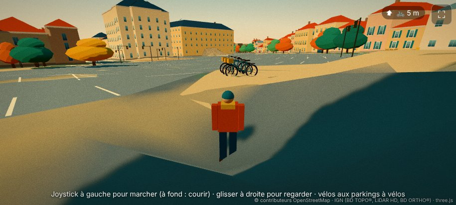
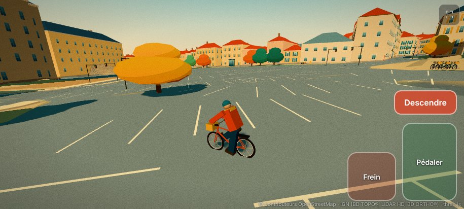
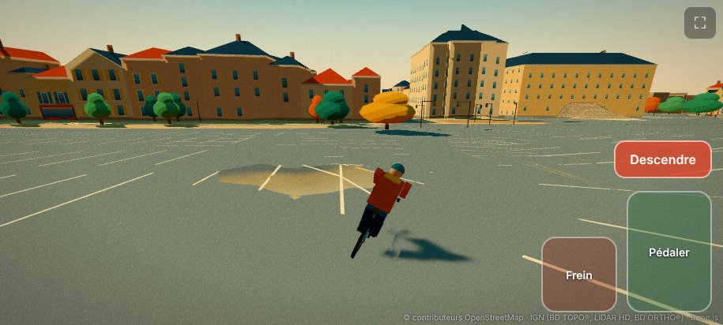

### Trottinette (26 octobre 2026)

- Trottinette électrique de location (D22) : bridée à 25 km/h, petites roues, freins plus faibles ; une au bout de chaque rangée de vélos ; conducteur debout. `?ride=trottinette` : départ dessus. Tests : 62.

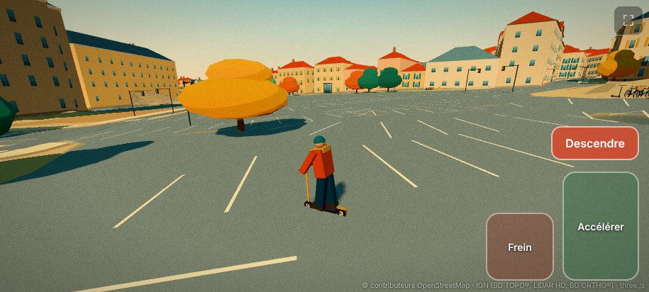

### Chargement à vitesse et voiture (26 octobre 2026)

- **Tuiles en tranches** (D23) : la construction d'une tuile rend la main toutes les 4 ms (`?budget=`) ; ses maillages apparaissent un par image ; les tuiles vers lesquelles on roule sont chargées d'abord (3 s d'anticipation). Banc court : la plus longue interruption passe de 963 ms (d'un bloc) à une vingtaine de millisecondes au plus.
- **Voiture** (D24) : citadine à traction avant (0 à 100 km/h en ≈ 12 s, freinage ≈ 0,9 g, sous-virage, roulis de caisse), garée sur 30 % des 1 163 places de stationnement retrouvées dans le marquage au sol ; toutes les voitures garées sont dessinées en deux appels. Escaliers infranchissables en voiture. `?ride=voiture` : départ au volant.
- Tests : 74.
- À faire : moto ; mesures sur téléphone (`?bench=1`) ; pousser les véhicules garés lors d'un choc (avec la circulation).

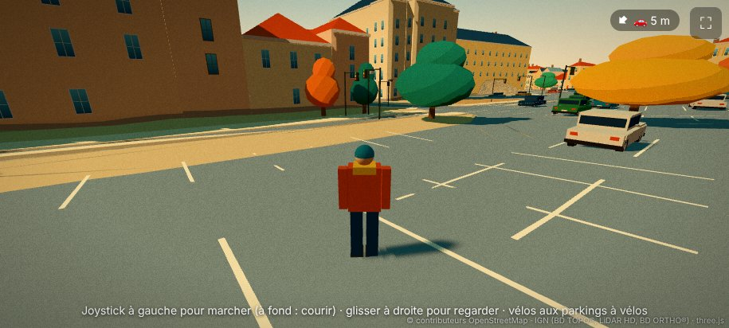
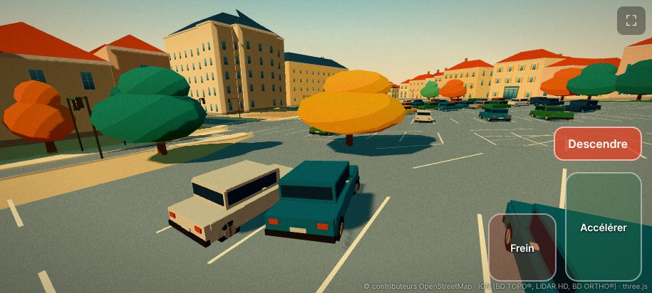

### Moto (26 octobre 2026) — étape 1 terminée

- Moto de moyenne cylindrée (D25), garée par deux sur quelques places de stationnement ; pilote assis, inclinaison dans les virages. `?ride=moto`. Tests : 77.
- L'étape 1 (véhicules libres) est complète : vélo, trottinette, voiture, moto, chargement à vitesse. Reste à régler au doigt sur téléphone (commandes, caméra) et à mesurer (`?bench=1`).

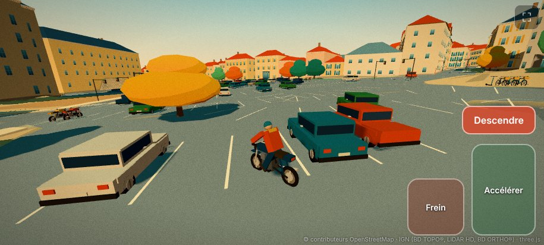

### Premier rapport du banc sur téléphone (26 octobre 2026, version 7131cd3)

Honor Magic 8 Pro (Adreno 840), Chrome 155, tenu en portrait, rendu 633 × 1 230 px (densité plafonnée à 1,5 sur 2,975), ombres 2048.
- **60 i/s sur toutes les phases**, y compris à 50 et 90 km/h ; 1 % le plus lent ≥ 54 i/s. Le navigateur cadence à 60 Hz : le banc bute sur la synchronisation de l'écran et ne mesure donc pas la marge restante.
- À-coups : un seul > 50 ms (66 ms, pendant une construction de tuile) sur 2,6 km. Tuiles : 140 à 200 ms de travail en moyenne, étalées sur 28 à 40 images, plus longue tranche 24-26 ms.
- 40 à 87 appels de dessin, 0,5 à 1,26 M triangles, géométrie 49-85 Mo, textures 26 Mo, JavaScript 88 Mo.
- Conclusion : cibles de D20 atteintes avec une marge inconnue mais vraisemblablement large. À mesurer en chargeant davantage (définition native, ombres 4096, rayon de détail plus grand) avant de décider de relever les réglages par défaut.
- Deux passages plus chargés (définition native, ombres 4096, puis détail à 400 m) restent à 60 i/s. Réglages par défaut relevés (D26) : définition ×2,5, ombres 4096, détail 300 m.

### Retour d'essai des véhicules (27 octobre 2026)

- Freinage refait (D27) : report de charge, roues qui se bloquent sans ABS, glissades, traces de pneus ; pression qui monte tant qu'on appuie.
- Direction : braquage borné par l'adhérence à haute vitesse, braquage moins brusque, course du doigt progressive.
- Repères des véhicules : un par type (vélo, trottinette, moto, voiture).
- Tests : 79.

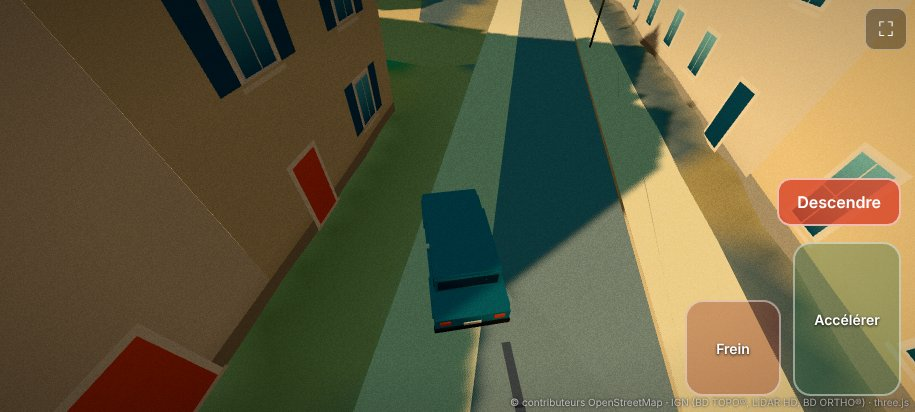

### Deuxième retour d'essai (27 octobre 2026)

- Feux tricolores et troncs sortis de la chaussée, couronnes au-dessus des rues relevées à 4 m ou réduites (D28, `tools/data/roadside.py`, tuiles corrigées sans tout régénérer).
- Direction plus vive ; l'arrière peut décrocher en virage serré, et se rattrape en relâchant ou en contre-braquant.
- Tests : 81.

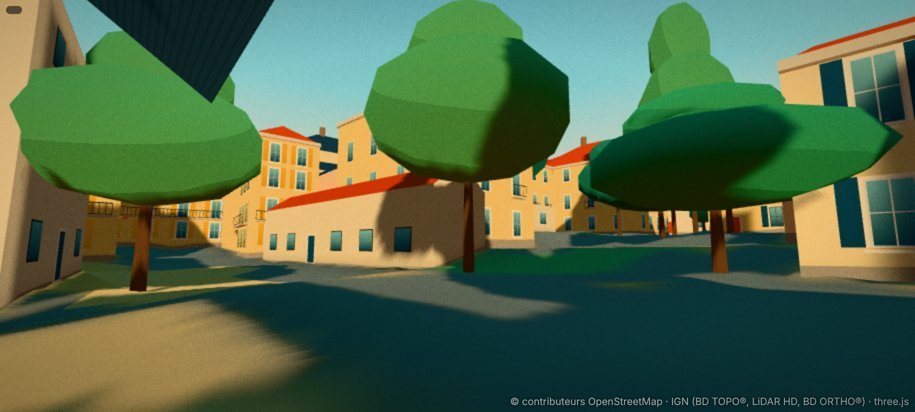

### Troisième retour d'essai : ABS et frein à main (27 octobre 2026)

- Voiture et moto avec ABS : freiner ne bloque plus les roues, on peut freiner en tournant. Frein à main en voiture pour la faire pivoter (D29).
- Deux-roues stables : ils ne dérapent plus ni ne se retournent en freinant ou en tournant.
- Voiture plus maniable en ville (20-40 km/h).
- Tests : 84.

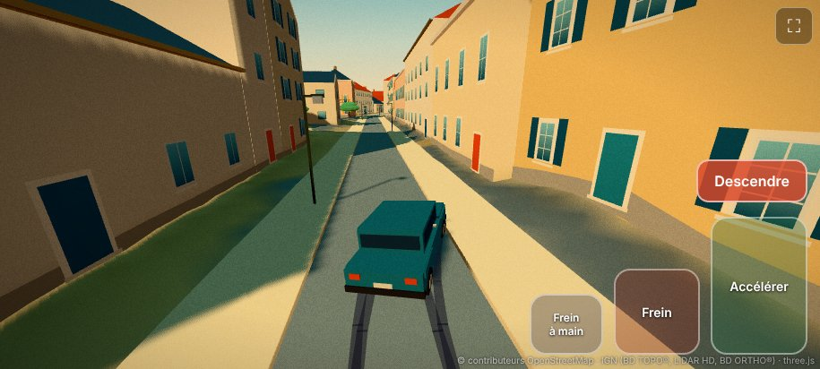

### Agrandissement vers la commune entière, étape A : tout par tuile (27 octobre 2026)

La commune fait 61,6 km² (27 fois la zone actuelle) ; avant d'agrandir la carte, on retire tout ce qui était chargé d'un bloc (D30).
- **Données** : relief fin (`terrain/<id>.bin`), sols fins (`ground/<id>_{a,b}.png`), sols grossiers par super-tuile de 1 km (`ground/s<i>_<j>_*.png`) et silhouettes (`lod/<id>.json`) par tuile ; relief grossier global à 8 m (72 ko). Au démarrage, le jeu ne charge plus que `world.json` (9 ko) et `terrain/coarse.bin` (72 ko), contre ≈ 7,8 Mo avant (relief, sols, silhouettes, rues). Ensuite tout arrive à la demande, par ordre de proximité, dans le sens de la marche.
- **Vérifié** : mêmes altitudes qu'avant (écart 0,00000 m sur 50 000 points) ; même image à l'écran (0,2 % des pixels diffèrent de plus de 40/765 sur la vue aérienne, 0,04 % sur la place) ; parcours en téléportation sur 1,2 km sans erreur, blocs de relief chargés puis libérés (28 → 19), 34 silhouettes en mémoire, tuiles détaillées chargées et déchargées comme avant.
- **Corrigé au passage** : les obstacles des tuiles déchargées restaient en mémoire (fuite qui aurait grossi sans fin en roulant dans toute la commune).
- Tests : 94 (relief par tuile : repli sur le grossier, absence de couture à chaque frontière de tuile, mêmes altitudes qu'avant, un seul chargement par bloc ; recyclage des obstacles).
- (Voir l'étape B ci-dessous : l'anneau a été fabriqué.)

### Étape B (27 octobre 2026) : l'anneau de 9 km²

La carte couvre maintenant 3 × 3 km autour de la mairie : 144 tuiles de 250 m, 5 972 bâtiments, 38 195 arbres, rendus avec les mêmes rues, trottoirs, mobilier, enseignes et façades que le centre.
- **Chaîne par blocs** (D31) : blocs de 2 × 2 km sur une grille mondiale stable (identifiants absolus `24_32`), la mémoire ne dépend plus de la taille du monde. Le bloc central refabriqué de bout en bout redonne les données publiées (bâtiments 3 487 / 3 486, murs et mobilier identiques) ; les trois autres blocs ont été fabriqués ensuite.
- **Poids** : 43 Mo pour l'anneau (4,8 Mo/km²) ; démarrage 2,4 Mo ; un tour complet de l'anneau 6,9 Mo. Extrapolation à la commune dans D31.
- **Vérifié dans un navigateur** (sans carte graphique : seuls les octets reçus et l'absence d'erreur comptent) : parcours par téléportation aux quatre coins de l'anneau, au centre et à l'ouest, sans erreur ; captures des nouveaux quartiers. **Pas encore mesuré sur téléphone** : le site n'est publié par GitHub Pages que depuis `main`, donc après la fusion d'une PR.
- Tests : 100.
- **Reste** : mesure sur téléphone (`?bench=1`), puis étape C (commune entière, relief fin à 2 m en campagne, forêts, limites du monde).

### Cadrage des fonctions de jeu (27 octobre 2026)

L'agrandissement à la commune est reporté (D32) ; on ajoute d'abord les fonctions de jeu, dans l'ordre J1 à J7 de `docs/ROADMAP.md` : interface, carte et sauvegarde ; navigation et passants ; circulation ; police ; armes et violence ; argent et objectifs ; sons. Le prompt de l'étape J1 est dans `docs/ROADMAP.md`.

### Étape J1 (27 octobre 2026) : interface, carte et sauvegarde

Fait (décisions D33 à D35) :
- **Interface en jeu** : horloge sous la minimap (haut à gauche), bouton pause à côté du plein écran (haut à droite), pastilles des véhicules en colonne dessous ; zone santé / arme / recherche prévue en haut au centre, vide (`body.layout` la montre pour les captures). Joystick et pédales n'ont pas bougé.
- **Menu pause** (⏸, Échap, P ; en voiture comme à pied) : reprendre, carte, réglages, lieux notés, sauvegarde. La pause fige les véhicules, le soleil et l'horloge ; le rendu continue à 4 Hz derrière le menu (coupé sous la carte). Réglages en direct, enregistrés localement : définition, ombres, rayon de détail, sensibilité de la caméra, minimap ; les paramètres d'URL restent prioritaires (réglage grisé).
- **Minimap** (canvas 2D rond, rayon 180 m, 16 Hz, tourne avec la caméra ou nord fixe) : routes, trottoirs, eau, pelouses, bâtiments, joueur, véhicules garés proches, repère (flèche au bord et distance hors champ). Coût chronométré (`Minimap.cost`) dans le panneau de debug et dans le rapport du banc.
- **Carte agrandie** : tout l'anneau, déplacement et pincement, noms de rues, lieux par catégorie avec filtres, fiche au tap, joueur et direction ; appui long = pose ou retire le repère, visible sur la minimap et dans le monde (colonne et losange).
- **Données** (`tools/data/build_map.py`, 1,3 Mo, aucune tuile régénérée) : 9 images de 1 km à 1 m et 2 m par pixel, vue d'ensemble à 4 m, `places.json` (271 lieux en 14 catégories dont `perso`, 246 rues nommées). `tools/data/places_perso.json` pour tes propres lieux.
- **Notes de lieu** (menu pause) : position, direction, heure, texte et capture (IndexedDB) ; copier le texte ou télécharger le JSON.
- **Sauvegarde locale** : position, caméra, véhicule conduit, véhicules déplacés, heure et jour, repère ; à la pause, en quittant la page, toutes les 30 s ; « Nouvelle partie ». Les paramètres de test (`?at=`, `?h=`…) coupent la sauvegarde.
- Tests : 146 (conversion monde/carte, zoom et déplacement, repère, sauvegarde et réglages, notes, véhicules déplacés, départ de partie, horloge). `tools/ui.sh` rejoue les écrans en tactile.

Mesuré ici (`?bench=court`, conteneur sans carte graphique : le rendu logiciel occupe les mêmes cœurs, les chiffres sont donc pessimistes) : mise à jour de la minimap à 0,21-0,33 ms en moyenne (pire cas 0,6 à 4,5 ms, lors d'à-coups du rendu logiciel), soit moins de 0,1 ms par image à 16 Hz ; objectif d'1 ms tenu en moyenne. Le banc (`?bench=1`) et le viewer (`?view=`) fonctionnent toujours.

À vérifier sur le téléphone : coût réel de la minimap (`?debug`, puis `?bench=1` : ligne « Minimap » de chaque phase), ressenti de l'appui long (520 ms) et du pincement, clavier virtuel pendant la saisie d'une note (paysage), lisibilité de la minimap au soleil.

Constats : aucun commissariat dans l'anneau d'après OpenStreetMap (la gendarmerie est à ≈ 270 m à l'est de la zone) ; commerces et monuments très denses au centre (icônes omises en vue d'ensemble quand elles se recouvrent).

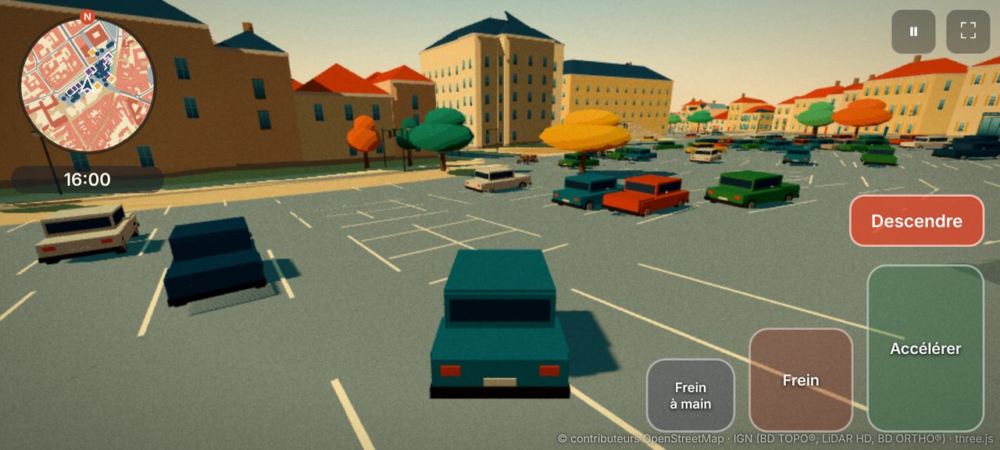
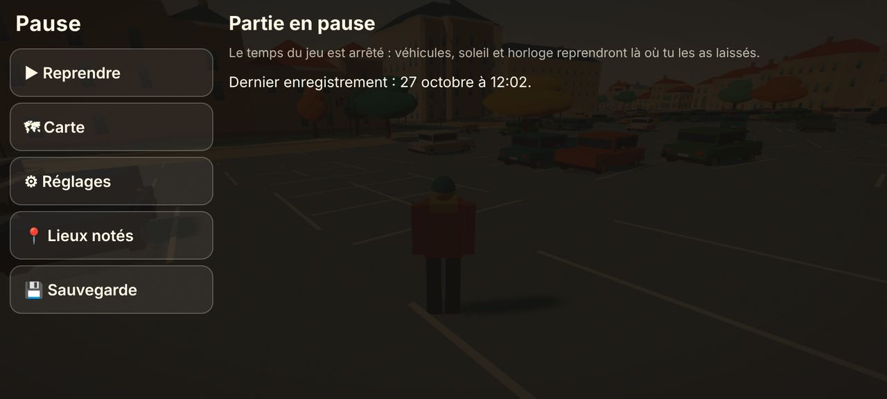
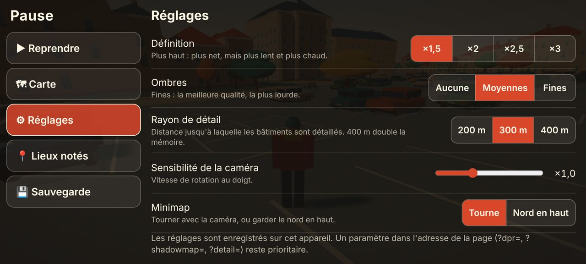
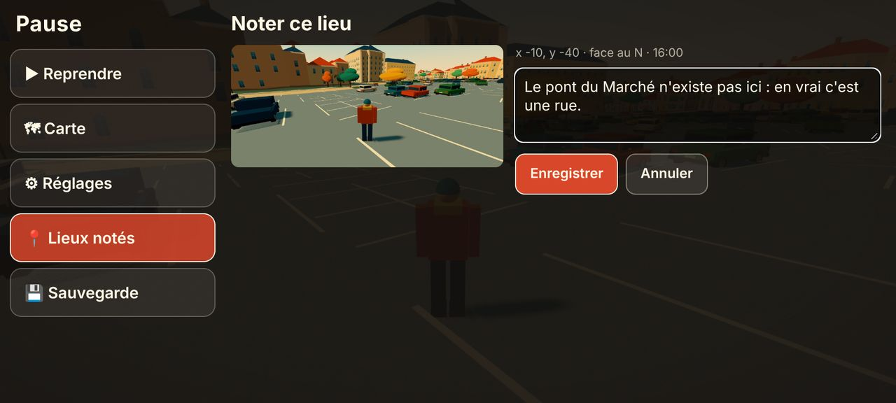
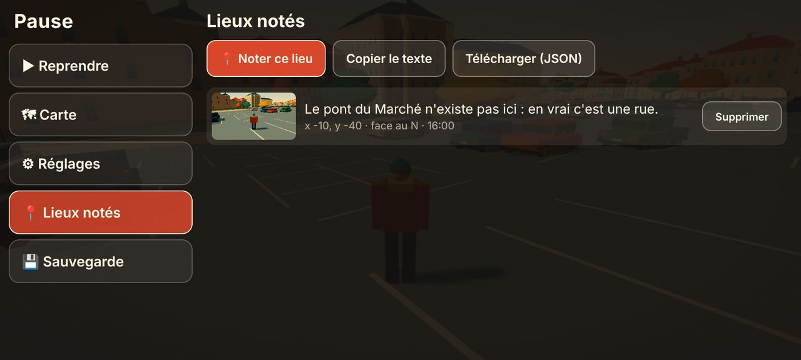
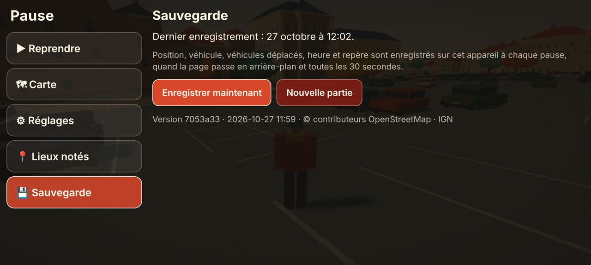
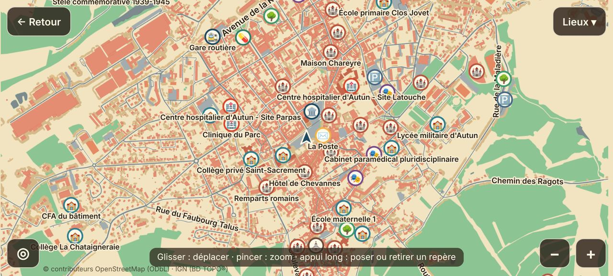
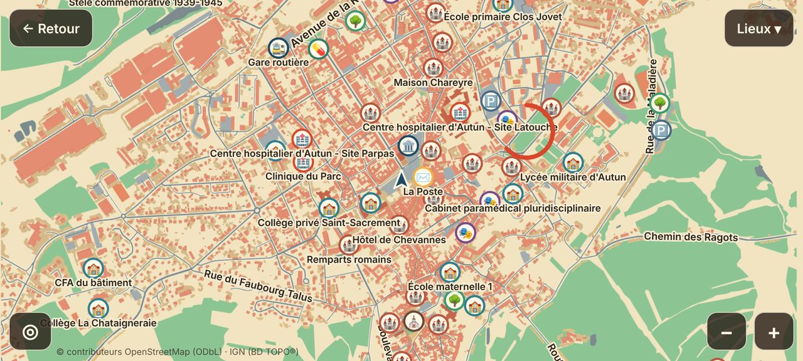
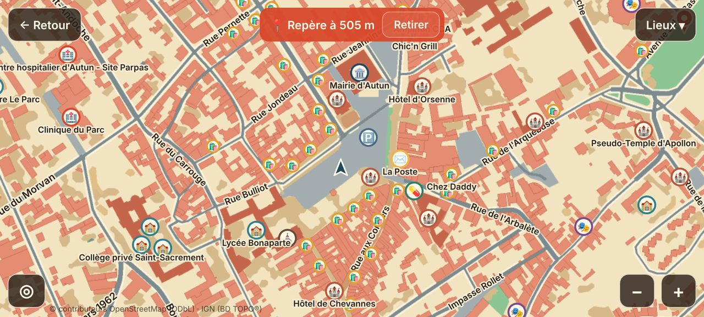
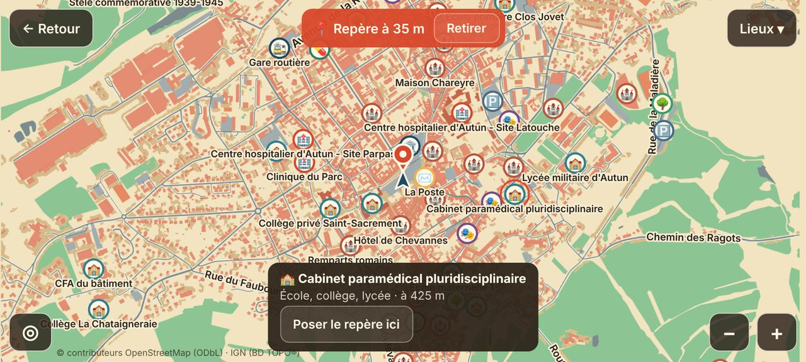
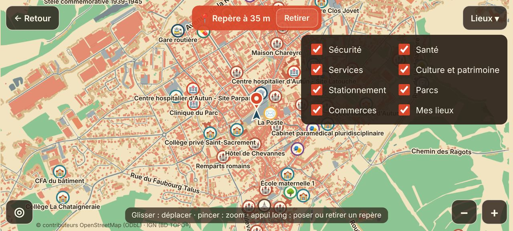
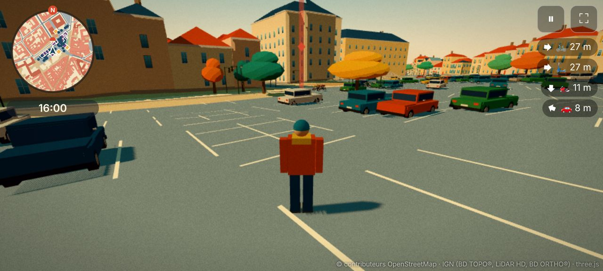

### Étape P (27 octobre 2026) : personnages et compteur — compteur de vitesse

Fait :
- **Compteur de vitesse** (`#speedo`, `src/ui/speedo.ts`, partie pure `src/core/speedo.ts`) : en bas au centre, seulement au volant (voiture, moto, vélo, trottinette). Chiffres en km/h, arc jaune moutarde qui passe au vermillon au-delà de 85 % de la vitesse maximale du véhicule (`spec.topSpeed`). Masqué en pause. L'indice de départ (« Joystick à gauche… ») est caché au volant pour ne pas passer sous le compteur. Le DOM n'est touché que quand la valeur affichée change.
- Tests : 5 (conversion, marche arrière, bornes de la fraction, vitesse maximale nulle, tous les véhicules). 151 tests au total.
- Captures : `tools/ui.sh <dossier> speedo` (voiture, voiture à fond, pause, vélo). Le rendu logiciel est trop lent pour accélérer vraiment : le scénario impose le vecteur vitesse à chaque image.

À voir sur téléphone : lisibilité des chiffres au soleil, place par rapport aux pouces (pédales à droite, joystick flottant à gauche).

- **Recette de personnage** (`src/core/character.ts`, logique pure) : sexe, âge (adulte, senior), taille, corpulence (4), teint (6), coiffure (9) et couleur (10), haut (9 dont gilet de chantier et tablier), bas (6), chaussures (3), chapeau (casque, béret, bonnet, casquette, chapeau), lunettes, sac, écharpe, barbe. Tirage déterministe par graine avec des poids vraisemblables (≈ 52 % de femmes, ≈ 28 % de seniors, hommes 1,78 m et femmes 1,65 m en moyenne, cheveux gris surtout chez les seniors, tenues de ville / sport / travail cohérentes : gilet fluo avec pantalon de travail et bottes, casque seulement avec gilet, pas de jupe pour les hommes). Les recettes ne stockent que des indices de palette. Lecture défensive (`parseRecipe`, champ par champ, taille bornée, version). `bodyDims` donne les mesures du corps (segments, largeurs, voûte des seniors) d'après des proportions anthropométriques, pour que le rendu et les tests s'accordent.
- Tests : 15 de plus (déterminisme, bornes et cohérence sur 3 000 graines, distribution, couverture de toutes les pièces, variété : sur 1 000 graines aucune recette identique, 0,03 % de paires qui partagent 15 critères sur 19 ou plus, sérialisation, mesures). 166 tests au total.

- **Prototypes de rendu** (nouvelle page `?proto=1`, `src/game/proto.ts`) : la même foule dessinée de trois façons, sur le même squelette (13 os, `src/core/character-rig.ts`), le même catalogue de 53 pièces (`src/core/character-kit.ts`, formes dans `src/render/character-parts.ts`, deux niveaux de détail : ≈ 1 350 triangles de près, ≈ 340 au loin) et la même pose de marche, pour que seule la façon de dessiner change :
  - **A, peau et os** (`crowd-skinned.ts`) : un `SkinnedMesh` par personnage, couleurs cuites dans les sommets. Un appel de dessin par personnage.
  - **B, instances et nuanceur** (`crowd-shader.ts`) : un seul appel de dessin pour toute la foule ; géométrie universelle (toutes les pièces), texture de données (13 matrices, couleurs, masque de pièces par personnage), peau faite dans le nuanceur de sommets.
  - **C, pièces groupées** (`crowd-parts.ts`) : un `InstancedMesh` par pièce du catalogue ; le processeur copie les matrices d'os dans les instances.
  Les trois donnent la même image (captures comparées). La série mesure, pour 50, 100 et 200 personnages (et 100 sans ombres des personnages) : fluidité, travail réel par image avec `gl.finish` (la limite de 60 Hz masque ce que vaut une image), coût du processeur (mise à jour, envoi du dessin), appels de dessin, triangles, mémoire. Rendu logiciel : la série tourne sans erreur, mais ses chiffres n'ont aucune valeur pour le téléphone (seuls les appels de dessin et les triangles se comparent : A ≈ 420 appels à 200 personnages, C ≈ 280, B ≈ 140 comme sans foule ; B envoie ≈ 3× plus de triangles, dont des dégénérés).
  - `?proto=look&r=A|B|C&n=24&seed=…` : rangée de personnages immobiles ou en marche (vue de face, `turn=3.14` de dos, `dist`, `gap`, `eye`) ; `tools/proto.sh <dossier> nom:requête …` pour les captures et l'essai court `proto=court`.
- Le panneau de rapport du banc est devenu `src/game/report-panel.ts`, partagé avec les prototypes.

**À faire sur le téléphone** : ouvrir `https://kalypst.github.io/autun-3D/?proto=1` (paysage, batterie chargée, mode économie d'énergie coupé), laisser tourner ≈ 2 minutes sans toucher l'écran, « Copier le rapport » et le coller dans la conversation. Le choix de l'approche (D37) se fera sur ces chiffres.

- **Mesure sur téléphone (Adreno 840)** : 60,3 i/s partout, même à 200 personnages avec les trois approches. Coût de la foule à 200 : A +5,4 ms, C +3,0 ms, **B +2,1 ms** (un seul appel de dessin). **B retenue** (D37) : tableau complet et limites dans `docs/DECISIONS.md`.

- **Le joueur sur B** (D37) : `src/render/player-model.ts` réécrit sur la fabrique des passants (recette, 53 pièces, **un seul appel de dessin** au lieu de ≈ 10). À pied : marche et course (`walkPose`, phase de pas tirée de la distance parcourue). Sur véhicule : `src/core/character-pose.ts`, cinématique inverse à deux segments (bras vers les poignées, jambes vers les pédales, repose-pieds ou plateau, coudes et genoux du côté voulu, pieds à plat) ; le bassin est posé sur la selle (vélo, moto) ou entre les pieds (trottinette). Les véhicules exposent leurs **points d'appui** (`anchors` : poignées qui suivent le guidon, pieds qui suivent les pédales) ; le vélo a maintenant un vrai pédalier qui tourne (`setCrank`). En voiture, le conducteur reste caché.
- Approches A et C supprimées ; `?proto=1` ne mesure plus que B (50, 100, 200, 300 personnages, et 200 sans ombres des personnages). `?proto=riders&heading=1.57&steer=0.5&seed=3` affiche un vélo, une moto et une trottinette avec leur conducteur, pour juger les poses de près.
- Tests : 195 (7 de plus pour la cinématique inverse : longueurs conservées, cibles atteintes, pieds à plat, genoux vers l'avant, morphologies extrêmes).

- **Écran « Apparence »** (D38) : nouveau panneau du menu pause avec aperçu du personnage (dessiné par le moteur du jeu, sans second contexte WebGL ; glisser pour tourner), tous les choix de la recette, « Hasard » et « Par défaut ». Appliqué tout de suite en jeu, enregistré localement à part de la partie (`autun3d.appearance`, survit à « nouvelle partie »). `applyAppearance` garde la recette cohérente (couleurs admises par pièce, fluo réservé au gilet, pas d'écharpe sous un tablier). Captures : `tools/ui.sh <dossier> appearance` (écran, modifications, hasard, retour en jeu, rechargement).
- Tests : 205 (10 de plus : toutes les combinaisons haut × bas × chaussures × chapeau, bornes de la taille, passage gilet → haut ordinaire, stockage illisible, interdit ou plein, tirage aléatoire, libellés).

- **Banc de foule** : `?bench=1&crowd=100` ajoute au banc deux arrêts avec 100 personnages animés devant la caméra (avec puis sans ombres des personnages) ; `&soak=10` ajoute 10 minutes d'endurance avec cette foule (une phase par minute, puis une ligne « Endurance : x i/s la première minute, y la dernière »). Le rapport donne par phase : effectif, répartition près / loin, durée de la mise à jour de la foule, appels de dessin, triangles, mémoire. Les phases de rues restent sans foule.
- **Galerie** : `?view=characters` aligne 24 recettes (une sur trois en marche) ; un appui sur l'écran en tire 24 autres (`seed=`, `n=`, `dist=`, `gap=`, `eye=` en options).
- Tests : 206 (endurance).
- Feuille de route et prompt de J2 mis à jour (étape P faite, budget de foule mesuré, idées notées).

Étape P terminée, à tester sur téléphone. et de ses poses (pédalage, assis, trottinette), banc de foule (`?bench=1&crowd=N`), galerie `?view=characters`.

### Étape P : mesure du banc de foule sur téléphone (27 octobre 2026, version c1a485b)

`?bench=1&crowd=100&soak=10`, en paysage, Adreno 840 : 60,1 à 60,4 i/s dans les 19 phases, **endurance de 10 minutes avec 100 personnages sans aucune perte (60,3 i/s première et dernière minute)**, mise à jour de la foule 0,7 à 0,8 ms par image. Détail et réserves dans D37 (mémoire JavaScript arrondie par le navigateur, accroc de mise en route des ombres des personnages). **L'étape P est validée sur téléphone côté performances** ; reste le retour de l'utilisateur sur l'aspect (poses sur véhicules, écran Apparence, première image du jeu).

### Étape J2 : navigation et passants

**J2-1 (27 octobre 2026) : liste de voies partagée** (code de la chaîne de données seulement ; aucune donnée publiée n'a changé)
- `tools/data/streets_lib.py` : la construction de la liste de voies (OpenStreetMap + largeurs BD TOPO) est sortie de `build_streets.py`, pour servir aussi à la navigation. Nouveaux champs par voie : `osm` (étiquettes conservées : accès, pont, tunnel, couche, rond-point, trottoir, service…) et `bd` (attributs du tronçon BD TOPO le plus proche : vitesse, voies, niveau, sens, importance, accès piéton).
- Classes par niveau (`streets_lib.classes`) : 0 = celles que le sol dessinait avant J2 ; 1 = avec les routes principales (`primary`, 69 voies dans l'anneau, et `road`, 1) ; 2 = pour la navigation, avec en plus les pistes (`track`, 51) et les voies cyclables (`cycleway`, 11), dont le sol vient déjà de l'orthophoto. `STREET_LEVEL` dans `build_streets.py` choisit le niveau du sol (voir D39 et J2-0).
- `fetch.py --only routes` (tronçons BD TOPO seuls) ; `fetch.py` crée maintenant le dossier de l'extrait OpenStreetMap.
- **Vérifié** : l'ancien code (copié de `HEAD`) et `build_street_list(extra=False)` donnent exactement la même liste de voies, champ par champ, sur les quatre blocs de l'anneau (1 153, 293, 245 et 117 voies).
- Cadrage de J2 : D39. Feuille de route mise à jour.

**J2-0 (27 octobre 2026) : routes principales dessinées** (sol et tuiles régénérés)
- `STREET_LEVEL = 1` dans `build_streets.py` : le sol dessine maintenant `primary` et `road` (chaussée, ligne centrale, trottoirs, lampadaires, passages piétons). Chaîne complète rejouée sur les 4 blocs de l'anneau (`build_all.py 3,4 2,4 3,3 2,3`, ≈ 1 h 20 dont les téléchargements IGN et OpenStreetMap).
- **Résultat** : sol asphalte sur 100 % des points échantillonnés des routes principales (10,6 % avant) ; les autres classes ne changent pas (98 à 100 % sur les rues dessinées).
- **Ce qui a changé dans le dépôt** : 81 tuiles (sol 80, mobilier 41, arbres 23, fiches 14 : les trois dernières viennent de la dérive d'OpenStreetMap entre les deux fabrications, pas du changement de classes), 107 images de poids de sols, `world.json` (taille des tuiles). **Bâtiments et relief fin inchangés** ; le relief grossier a été refabriqué (74 octets différents sur 284 ko, bruit de quantification) et **laissé tel qu'il était**. Poids ajouté ≈ **5 Mo compressés** (estimé 15 Mo : le relief fin n'est pas refait).
- Tests 206/206, typecheck et lint au vert. Captures : avenue de la République et rue de Gaillon.

**J2-2 (27 octobre 2026) : données de navigation** (`tools/data/build_nav.py`, `nav_lib.py`, `public/data/nav/`, D40)
- Étape autonome, 12 s, déterministe : 9 fichiers par super-tuile de 1 km, **236 ko compressés** (756 ko en JSON) pour l'anneau.
- **Graphe piéton** : 317 km de files (trottoirs des deux côtés, décalées point par point pour rester à plus de 0,5 m des murs ; une file au milieu des rues étroites et de service ; chemins, escaliers, rues piétonnes), 466 passages marqués (dont les feux) et 1 182 traversées implicites en bout de rues calmes, coins de carrefour, **17 ha de places** (maillage de 8 m sur le Champ de Mars et les autres espaces publics, sans traversée de chaussée), 97,1 % de la longueur dans un seul réseau. Files dans un bâtiment : 0,06 % de la longueur.
- **Graphe routier** pour J3 : 2 277 arêtes (classe, voies, vitesse, sens unique, ponts, ronds-points), nœuds avec feux, stops, cédez-le-passage, passages piétons, approches de panneaux (298) et restrictions de virage (15).
- **Points d'intérêt** : 746 (488 commerces, 58 bancs, 51 restaurants, 21 arrêts de bus, 85 spots à pigeons, fontaines, lieux de culte…). `foot` et `zone` par arête.
- Coutures entre super-tuiles : 719 portails, 0 sans jumeau. Tests : 7 de plus (`src/data/nav-data.test.ts` : fichiers, indices, coutures, files hors bâtiments, connexité, passages, graphe routier).
- `fetch.py` garde maintenant les relations de restriction de virage. Outil de contrôle : `tools/data/nav_debug.py` (image des files sur les sols de tuiles).
- Aucun changement dans le jeu : le client charge ces données en J2-3.

**J2-3 (27 octobre 2026) : client de navigation** (D41)
- `src/data/nav.ts` (décodage), `src/core/nav-graph.ts` (graphe piéton raccordé entre super-tuiles : `next`, `nearest`, `pointAt`, `polyline`), `src/game/nav-manager.ts` (chargement à 400 m, retrait à 650 m, anticipation en roulant), `src/render/nav-debug.ts` (recouvrement).
- **`?nav=1`** (jeu ou viewer) : les files, passages, coins, places, nœuds et points d'intérêt s'affichent sur le relief ; `?nav=all` ajoute le graphe routier. Sans le paramètre, le jeu ne charge rien de plus.
- Tests : 222 (9 de plus).

**J2-4 (27 octobre 2026) : prototype de simulation et banc de mesure** (D42 ; **à mesurer sur le téléphone**)
- `src/core/pedestrians.ts` : passants qui suivent le graphe piéton (marche aléatoire pondérée par la fréquentation), trois paliers de mise à jour, évitement entre eux et du joueur, attente aux passages devant un véhicule, arrêts, naissance et disparition dans une couronne autour du joueur (décalée à grande vitesse), reproductible. `Colliders.resolveInto` (sans allocation), `CrowdState.alive`, `CrowdRigs.assign`.
- Banc : `?bench=1&crowd=N&sim=1` (+ `&tiers=0`, `&avoid=0`) mesure la simulation pendant tout le parcours. Viewer : `?view=…&sim=N&warm=20`.
- Micro-mesure sur PC : 0,05 ms par pas à 150 passants (budget 2 ms) ; la simulation ne devrait pas être le plafond.
- Tests : 229 (7 de plus).

**J2-5 (27 octobre 2026) : passants dans le jeu** (D43 ; à tester sur téléphone)
- Les passants vivent dans le jeu : ils marchent sur les trottoirs et les places, traversent aux passages quand ton véhicule n'arrive pas, s'arrêtent un moment, s'évitent et t'évitent à pied, naissent hors de vue autour de toi et disparaissent loin, selon l'heure (nuit presque vide, midi plein, soirée animée au centre) et le quartier (centre, résidentiel, périphérie).
- Réglage **Foule** dans les réglages du menu pause (Aucune, Peu, Normale, Dense) ; `?peds=0` coupe les passants ; la pause les fige. `?debug` affiche passants, cible, coût.
- Pas encore : choc physique avec le joueur et les véhicules (J2-6), pigeons (J2-7), vêtements selon l'heure (J2-8).
- Tests : 240 (11 de plus).

**J2-6 (27 octobre 2026) : chocs, esquives, klaxon** (D44 ; à tester sur téléphone)
- **Véhicules** : un passant percuté à plus de 12,6 km/h est projeté, tombe, reste à terre quelques secondes, se relève et reprend sa route ; plus lentement il trébuche ; au pas il est poussé. Le véhicule perd 10 à 30 % de sa vitesse, sans dégât. Les passants sur la trajectoire d'un véhicule rapide sautent de côté.
- **À pied** : bousculer un passant ralentit un instant ; courir dedans le fait trébucher.
- **Klaxon** (bouton en conduisant, touche H ; sonnette à vélo et en trottinette) : les passants devant sursautent, ceux de près s'écartent. Sans son pour l'instant (J7).
- Poses de trébuchement et de chute (tous les morphotypes, jamais sous le sol), entrées pour J4/J5 (`events`, `impact`, `queryCircle`, `applyImpulse`).
- Tests : 250 (10 de plus).

**J2-7 (27 octobre 2026) : pigeons** (D45 ; à tester sur téléphone)
- Des volées de 2 à 7 pigeons sur les places, les parvis et près des bancs : ils picorent et marchent, le jour seulement (7 h à 20 h 30). Ils s'envolent quand tu approches (à pied, au véhicule en marche, au klaxon, ou quand un passant les frôle), volent à 3-6 m puis se posent plus loin ; la nuit tombée ils partent. Jusqu'à 40 oiseaux (suit le réglage Foule), un seul appel de dessin en plus ; `?pigeons=N` pour forcer le nombre ; `?debug` donne le coût.
- Pas encore : sons (J7), vêtements selon l'heure (J2-8).
- Tests : 262 (12 de plus).

**J2-8 (27 octobre 2026) : vêtements selon l'heure** (D46)
- Les passants s'habillent selon la fraîcheur de l'heure : vestes, pulls, écharpes et bonnets la nuit et le matin ; t-shirts, shorts et lunettes de soleil l'après-midi. Même personne, mêmes couleurs, seules les couches changent.
- Tests : 265 (3 de plus).

**J2-10 (27 octobre 2026) : bilan** (D47)
- Le banc `?bench=1&crowd=100&sim=1` inclut les pigeons ; `&soak=10` pour l'endurance. J2-9 (portes) laissée de côté. Reste à faire de ton côté : fusionner les PR et lancer les mesures du téléphone listées en D47.

**Pigeons allégés (27 octobre 2026)** (D48) : après la mesure du téléphone (1,2 ms par image), recalcul des sommets 3 fois plus rapide, portée de 100 m, envoi partiel à la carte graphique. Tests : 266.

**Foule : boucle de renouvellement corrigée (27 octobre 2026)** (D49) : à l'arrêt, les passants naissaient et disparaissaient en boucle (20 par seconde) ; corrigé, test de régression. Endurance 10 minutes sur téléphone : 60,3 i/s constants, mémoire stable.

**V-0 (27 octobre 2026) : catalogue de véhicules** (D50)
- Le cadrage de l'étape V est fixé (vitesses plafonnées à 200 et 210 km/h, placement par zone, pas de garage, vieille voiture sans ABS). Le catalogue (`src/core/vehicle-catalog.ts`) réunit pour chaque modèle un identifiant, une famille, un nom, une fiche physique avec coque et une palette ; les quatre véhicules existants y sont migrés sans changer de comportement. La sauvegarde passe en version 2 (les anciennes sont migrées). `?ride=` accepte un identifiant du catalogue.
- Tests : 277.

**V-1 (27 octobre 2026) : vitesse** (D51)
- Les chocs des véhicules sont testés à chaque sous-pas, avec assez de sous-pas pour ne jamais avancer de plus que le plus petit rayon de la coque entre deux tests : une moto à 250 km/h ne traverse plus les murs fins (68 % de traversées avant). Rien ne change à vitesse normale.
- `TileManager.solidAt(x, y)` et banc `?bench=1&fast=200` : un trajet à la vitesse voulue, et un compteur « chargement en retard » sur tous les trajets (images où les obstacles de la tuile sous le véhicule, ou à 1 s devant, n'étaient pas encore en place ; objectif : 0). À mesurer sur le téléphone avec le bilan de V-6.
- Tests : 280.

**V-2 (27 octobre 2026) : générateur de carrosserie** (D52)
- Les voitures sont générées d'après leurs mesures (`src/render/car-body.ts`) ; la citadine est refaite avec, aux mêmes dimensions (692 triangles par voiture garée, +9 %). Voitures garées : deux maillages instanciés par modèle présent (un modèle absent ne coûte rien). Gabarit (`size`) dans le catalogue, vérifié contre le modèle et la coque. Galerie `?view=vehicles`.
- Tests : 286.

**V-3 (27 octobre 2026) : huit voitures** (D53)
- Citadine, compacte, berline, break, petit SUV, camionnette, vieille voiture (sans ABS : roues avant bloquées au freinage à fond) et sportive (propulsion, 0 à 100 km/h en 4,9 s, plafonnée à 200 km/h) : fiche physique, carrosserie générée, palette, caméra de poursuite propre à chaque modèle. Essai avec `?ride=sportive` etc. ; elles ne sont pas encore garées dans les rues (V-5).
- Tests : 322 (performances de chaque modèle, freinage, plafond, tenue de route à la vitesse maximale, caméra).

**V-4 (27 octobre 2026) : six deux-roues** (D54)
- Vélo de ville, VTT, trottinette, scooter 125, moto routière, moto sportive (plafonnée à 210 km/h) : fiche, modèle, palette, pose du conducteur (penché sur le réservoir pour la sportive). Vélo et moto paramétrés par style ; scooter 125 nouveau ; `scooter-model.ts` devient `kickscooter-model.ts`. Essai avec `?ride=vtt`, `scooter-125`, `moto-sportive` ; pas encore garés dans les rues (V-5).
- Tests : 337.

**V-5 (27 octobre 2026) : quels véhicules où** (D55)
- Les voitures, motos et vélos garés sont maintenant de tous les modèles du catalogue, selon le quartier : citadines, compactes et scooters en centre-ville ; berlines, breaks et SUV en résidentiel ; camionnettes et VTT en périphérie ; sportives rares (1,5 %). Le bouton affiche le modèle (« Monter 🚗 Berline »). Les sauvegardes restent chargeables (modèle enregistré). Essaie `?ride=` pour un modèle précis.
- Tests : 345.

**V-6 (27 octobre 2026) : bilan** (D56)
- Mesure au banc (nouveau `?bench=1&fleet=1`) : avec les nouveaux modèles garés, l'arrêt sur la place passait de 128 à 438 appels de dessin (deux-roues articulés) ; corrigé : tous les véhicules garés sont des instances, un maillage par modèle présent (157 appels, 1,6 M de triangles, comme avant l'étape V). Portée du klaxon et de la sonnette par famille. **Reste à mesurer sur l'Honor** : `?bench=1&crowd=100&sim=1&fleet=1&fast=200` (protocole en D56).
- Étape V terminée côté code : 14 modèles, générateur de carrosserie, plafond de vitesse, collisions à haute vitesse, placement par quartier, sauvegarde v2. Tests : 365.

**Mesure de l'étape V sur le téléphone (27 octobre 2026)** (D57)
- `?bench=1&crowd=100&sim=1&fleet=1&fast=200` sur l'Honor : 60,1 à 60,3 i/s partout, chargement en retard 0 image à 50, 90 et 200 km/h, 175 à 177 appels de dessin à l'arrêt sur la place (avec 100 passants, pigeons et 126 véhicules garés). L'étape V est validée côté performances ; reste ton avis au volant sur la conduite et l'aspect des 14 modèles.

**J3-0 (27 octobre 2026) : client du graphe routier** (D58, cadrage de J3 validé par l'utilisateur)
- `src/core/road-graph.ts` (`NavGraph.road`) : sens uniques, suites permises à travers les frontières de super-tuile, panneaux d'approche, branches, `nearest`, `pointAt`. Le décodeur de navigation fournit les portails et l'incidence de la couche routière.
- `?nav=all` montre sens uniques (flèches), ronds-points, arêtes interdites, feux, stops, cédez-le-passage et impasses.
- Mesure de `stepVehicle` : 6 à 7 µs par pas avec les vrais bâtiments (PC) : physique complète pour toute la circulation (D58).
- Tests : 373 (8 de plus).

**J3-1 (27 octobre 2026) : un conducteur sur la route** (D59)
- `src/core/driver.ts` : un conducteur simulé qui suit la voie de droite du graphe routier avec les commandes d'un joueur (tracé arrondi aux jonctions, adouci, écarté des obstacles fixes ; vitesse selon la limite, la courbure et la direction ; pas de demi-tour).
- Mesure sur les vraies données : 19,7 km, 26 départs, aucun conducteur perdu hors de la route, 7 trajets sur 26 avec un frôlement (pire 3,1 m/s). `?traffic=N` met N voitures dans le jeu (version provisoire, modèles articulés) : voir D59.
- `RoadGraph.next` ne propose plus le demi-tour sur une arête en boucle. Tests : 379 (6 de plus).

**J3-2a (28 octobre 2026) : plusieurs voitures** (D60)
- `src/core/traffic-sim.ts` : la circulation à plusieurs (suivi à distance de sécurité par IDM, prudence face aux voitures en face, chocs entre voitures et avec le joueur, joueur à pied vu comme obstacle) ; `src/core/vehicle-contact.ts` : chocs à deux corps. `?traffic=N` les utilise.
- 30 voitures dans le centre, 2 minutes : 10 pas avec contact sur 7 200, pire impact 2,6 m/s. Pas encore de règle aux carrefours (J3-2b), de feux (J3-3). Tests : 387.

**J3-2b (28 octobre 2026) : priorités, stops, carrefours** (D61)
- `src/core/junction.ts` : qui cède à qui (rond-point, panneaux, importance de la route, priorité à droite, tourne-à-gauche), conflit de deux trajets par cordes du cercle des branches ; arrêt complet aux stops ; arrêt à la ligne devant un conducteur prioritaire ; interblocage défait par identifiant ; virages interdits quand un mur coupe le coin.
- Mesure : 100 carrefours réels, 96 sur 103 où deux voitures passent, 0 interblocage, 7 impacts > 1,5 m/s (pire 4,7) ; 30 voitures, 2 minutes, 36 pas avec contact. Tests : 394.

**J3-3a (28 octobre 2026) : feux de circulation** (D62)
- `src/core/signals.ts` : phases des 55 feux (carrefours : 72 s en deux groupes ; passages piétons : 30 / 3 / 7 s), horloge de simulation partagée. Les voitures s'arrêtent au rouge et à l'orange, les passants attendent le feu des piétons aux passages à feux.
- Tests : 400 (6 de plus). Reste J3-3b : voitures qui s'arrêtent pour les passants, passants qui voient la circulation.

**J3-3b (28 octobre 2026) : passants et circulation se voient** (D63)
- `Observer.vehicles` : les passants attendent, sautent de côté et peuvent être heurtés par toute la circulation ; les voitures s'arrêtent pour un piéton engagé sur un passage et pour un piéton sur la route. Tests : 403.

**J3-4 (28 octobre 2026) : naissance, disparition, densité** (D64)
- Réglage « Circulation » (Aucune par défaut, Faible 10, Normale 20, Dense 30 ; `?traffic=N`) : les voitures naissent hors de la vue du joueur dans une couronne qui s'éloigne avec sa vitesse, selon l'heure (pointes de 7 h à 9 h et de 17 h à 19 h) et le quartier ; elles disparaissent au loin, perdues ou en surnombre quand il ne les voit pas. Tests : 418.

**J3-5 (28 octobre 2026) : rendu par instances** (D65)
- `src/render/traffic-models.ts` : une caisse instanciée par modèle présent, un maillage de roues pour tous (rotation et braquage), un maillage de feux (allumés la nuit comme les fenêtres). Identique au modèle articulé à 0,1 mm près (test) ; **+12 à +14 appels de dessin pour 20 voitures** (168 → 180), au lieu de 240. Tests : 423.

**J3-6 (28 octobre 2026) : interactions avec le joueur** (D66)
- Les conducteurs freinent pour le joueur (même de face), klaxonnent quand il les bloque ou les heurte (les passants sursautent), se pressent quand il klaxonne derrière eux ; une voiture heurtée par le joueur s'arrête un moment puis repart. `Traffic.extract` prépare le vol de J4. Tests : 429.

**J3-7 (28 octobre 2026) : banc et bilan** (D67)
- `?bench=1&traffic=N` : la circulation du jeu pendant le banc, rapport par phase (voitures, cible, maillages, coût de simulation et de mise à jour). Essai en rendu logiciel : 177 à 178 appels de dessin et 1,78 M de triangles à l'arrêt sur la place avec 100 passants, pigeons, 126 véhicules garés et 20 voitures. Simulation : 0,29 ms par pas pour 20 voitures hors rendu (0,05 ms pour les conducteurs).
- **Étape J3 terminée côté code** (D58 à D67, 429 tests) ; reste à mesurer sur l'Honor (`?bench=1&crowd=100&sim=1&fleet=1&traffic=20`, protocole en D67) puis à décider du défaut du réglage « Circulation » (Aucune pour l'instant).

**Mesure de J3 sur le téléphone (28 octobre 2026)** (D68)
- `?bench=1&crowd=100&sim=1&fleet=1&traffic=20` sur l'Honor : 60,2 à 60,4 i/s partout, chargement en retard nul à 50 et 90 km/h, **187 appels de dessin à l'arrêt sur la place (177 sans circulation)**, 1,79 M de triangles, simulation des voitures 0,95 à 1,04 ms par pas pour 17 voitures, mise à jour 0,15 à 0,20 ms par image, 0 klaxon. **Le réglage « Circulation » vaut Normale (20) par défaut.** Reste : nuit, « Dense », endurance.

