# Décisions

Chaque décision : date, contexte, choix, raison. On ne la réécrit pas : si elle change, on ajoute une nouvelle entrée qui la remplace.

## 2026-10-25 — D1. Chaîne de données en Python, jeu en TypeScript

- Contexte : le LiDAR HD est livré en COPC/LAZ, en Lambert-93, avec des rasters GeoTIFF.
- Choix : `tools/data/` est écrit en Python 3 (laspy + lazrs, pyproj, shapely, numpy, tifffile, requests). Le jeu reste en TypeScript strict avec three.js comme seule dépendance d'exécution.
- Raison : Node n'a pas de lecteur LAZ fiable. Python fait cela en quelques lignes. La chaîne de données ne tourne que chez le développeur ; elle n'alourdit pas le jeu.

## 2026-10-25 — D2. Données brutes hors git

- Choix : les téléchargements (LiDAR, rasters, orthophotos, photos, réponses d'API) vont dans `.cache/` (ignoré par git). Seuls les fichiers compacts produits par la chaîne sont versionnés.

## 2026-10-25 — D3. Repère de travail en Lambert-93

- Choix : tous les calculs de la chaîne se font en Lambert-93 (EPSG:2154), en mètres, avec les altitudes IGN69 du LiDAR. Le jeu reçoit des coordonnées locales en mètres, avec une origine au centre de la zone.
- Raison : c'est le système natif de BD TOPO, du LiDAR et de l'orthophoto. On évite ainsi toute reprojection d'image.

## 2026-10-25 — D4. Pas de données Google

- Choix : ni Street View, ni 3D Tiles, ni aucune donnée Google. Si l'option est retenue, Mapillary (Meta, CC-BY-SA) est autorisé ; il n'est pas utilisé pour l'instant.

## 2026-10-26 — D5. Emprises BD TOPO gardées telles quelles, toits recalés sur le LiDAR

- Contexte : BD TOPO annonce 3 m de précision planimétrique. Mesure : 83 % des points « bâtiment » du LiDAR tombent dans les emprises, 95 % à moins d'1 m (le reste, ce sont des débords de toit). Un recalage par bâtiment ne gagne en médiane que 8 % de points.
- Choix : on garde les emprises sans les déplacer. Les toits sont reconstruits sur les points LiDAR, découpés à l'emprise.
- Raison : un recalage individuel ajouterait du bruit sans gain mesurable ; les murs restent alignés sur le cadastre et les rues OSM.

## 2026-10-26 — D6. Toits : plans RANSAC, sommets alignés sur les arêtes réelles

- Choix : pour chaque bâtiment, plans de toit ajustés par RANSAC sur la surface supérieure du nuage (on écarte les points de façade), cellules de 0,5 m étiquetées par le plan le plus proche de l'altitude mesurée, régions simplifiées avec arêtes communes, puis **sommets partagés ramenés sur l'intersection exacte des plans voisins**. Triangles précalculés en Python (Delaunay contraint).
- Raison : sans ce recalage, les arêtes suivent la grille (escaliers de 0,5 m, marches de 0,7 m entre faces) ; la triangulation d'earcut dans three se trompait sur 7 faces avec trous (test `roof-triangulation.test.ts`).
- Mesure : écart médian modèle/MNS 0,03 m, 86 % des cellules à moins de 0,5 m (`tools/data/check_buildings.py`).

## 2026-10-26 — D7. Altitudes relatives, repère local

- Choix : coordonnées locales en mètres (x est, y nord, z haut) autour de (798770, 6650812) en Lambert-93, altitudes relatives à 330 m IGN69. Le rendu convertit en (x, z, −y).
- Raison : petits nombres, pas de perte de précision en float32 sur le téléphone.

## 2026-10-26 — D8. Données générées versionnées, brutes hors dépôt

- `public/data/` (≈ 1,5 Mo : relief, bâtiments, rues, sols, arbres) est versionné pour que le jeu et la publication ne dépendent pas des serveurs IGN/OSM. `.cache/` (dalle LiDAR 173 Mo, rasters, orthophoto, réponses d'API) est ignoré par git. `python3 tools/data/build_all.py` refait tout.
- Overpass (serveur public) est parfois indisponible : `fetch.py` garde alors le cache existant au lieu d'échouer.

## 2026-10-26 — D9. Dépendances d'exécution

- Une seule : `three`. Le reste (vite, typescript, vitest, eslint, @types) ne sert qu'au développement. Les triangulations et le LiDAR sont traités à l'avance en Python.

## 2026-10-26 — D10. Façades : fiches en données, sprites à relief plutôt que maillages

- Choix : une fiche JSON par bâtiment (`docs/facade-fiche.schema.json`, validée à la génération par `build_facades.py`). Le rendu ne modélise pas chaque fenêtre en géométrie : il pose des quads texturés (atlas de fenêtres, volets, portes, vitrines dessinés à partir des fiches, avec carte de normales pour le relief) et ne garde en volume que les corniches, bandeaux, soubassements, balcons et chaînages.
- Raison : ~12 000 fenêtres en maillage coûteraient plus d'un million de triangles ; en quads, ~25 000.
- Les fiches sont toutes « estimées » (aucune photo de rue libre sur la zone) ; `status: observed` + `photos` serviront quand on aura des photos.
- KTX2 : repoussé à l'étape de rendu final, il faut un encodeur (basisu/toktx) qui n'est pas installé ici. Pour l'instant textures PNG/JPEG générées ou réduites.

## 2026-10-26 — D11. Toits : plans par défaut, maillage LiDAR quand les plans échouent

- Constat : 78 bâtiments sur 353 avaient plus de 15 % de cellules à plus d'1 m d'écart au MNS ; 27 d'entre eux (plus de 15 m²) portaient des éclats de toit visibles.
- Choix : si plus de 12 % des cellules s'écartent de plus d'1 m, le toit est un maillage direct de la surface LiDAR (1 m, adouci), plafonné à l'altitude BD TOPO du toit + 1,5 m. Chaque sommet est aussi plafonné à ±1 m de la mesure la plus proche.
- Limite connue : les ailes de l'hôtel de ville et du théâtre restent irrégulières. Ce sont des monuments : ils seront modélisés à part d'après des photos.
- Les décrochements de moins de 1,5 m entre faces voisines ne dessinent plus de mur (ils formaient des plaques parasites).

## 2026-10-26 — D12. Atlas de sprites

- Les sprites de façade sont regroupés en 2 pages de 2048 px (≈ 55 px/m, 497 sprites distincts) ; les variantes invisibles sont fusionnées (`canonicalWindow`). Mémoire de texture : ≈ 45 Mo avec mipmaps, à réduire avec KTX2 à l'étape de rendu final.

## 2026-10-26 — D13. Déplacement à pied : collisions 2D, pas fixe, caméra qui se rétracte

- Collisions : le plan (x, y) suffit pour se balader. Contours des bâtiments et de leurs cours, murs OSM = segments ; mobilier et troncs d'arbres = cercles ; grille spatiale de 8 m. Le piéton est un cercle de 0,35 m repoussé hors des obstacles, sa vitesse perd la part qui entre dans le mur (il glisse). Les cours intérieures et passages couverts ne sont pas franchissables.
- Simulation à pas fixe de 1/60 s, indépendante des images affichées : même comportement à 30 ou 60 images/s. Les pas rapides (5 m/s ≈ 8 cm par pas) ne traversent pas les murs (test sur les vraies données : 120 trajets aléatoires de 8 s en courant).
- Caméra à la troisième personne : orbite autour de la tête ; un rayon vers la caméra raccourcit la distance devant un mur (marge 0,35 m, minimum 0,6 m) ; le personnage se masque sous 0,9 m ; la distance revient doucement quand le mur disparaît.
- Commandes : joystick flottant (moitié gauche de l'écran, à fond = course), regard au doigt (moitié droite), clavier (touches physiques WASD : fonctionne en AZERTY ZQSD), souris (glisser), plein écran + verrouillage paysage.
- Rendu en jeu : densité de pixels plafonnée à 1,5 et carte d'ombres de 2048 centrée sur le joueur (±80 m) pour économiser le téléphone ; à mesurer.

## 2026-10-26 — D14. Monde par tuiles de 250 m, détail près du joueur, silhouettes au loin

- Choix : zone de 6 × 6 tuiles alignées sur le Lambert-93 ; un objet appartient à la tuile de son centre. Chaque tuile est un JSON chargé à la demande ; `lod.json` (silhouettes simplifiées à 0,6 m) donne le reste. Relief et cartes de sol sont globaux (6 Mo) : plus simple que de les découper, et ils tiennent en mémoire.
- Rayon de chargement 210 m, déchargement à 300 m (hystérésis). Brouillard de 260 à 1 000 m : au-delà de 210 m on ne voit de toute façon que des volumes.
- Raison : toute la zone en détail fait 710 000 triangles et 490 appels de dessin, trop pour un téléphone milieu de gamme ; 8 tuiles en font 170 000 à 320 000.
- Alternative écartée : un second pipeline de LOD complet (toits, façades simplifiés) ; les silhouettes à partir des mêmes données suffisent à cette distance.

## 2026-10-26 — D15. Atlas de sprites rempli à la demande, avec recyclage

- Les sprites ne sont plus planifiés pour toute la ville : chacun est dessiné dans l'atlas partagé à la première tuile qui en a besoin (48 px/m, 3 pages de 2048 + 1 de 1024 pour les enseignes). 1 214 sprites distincts sur la zone, 834 tiennent ensemble.
- Quand les pages sont pleines, la moins récemment utilisée est vidée ; les tuiles qui s'en servaient masquent leurs sprites puis se reconstruisent (une par image). Alternative écartée : un atlas par tuile (trop d'appels de dessin et de textures).
- Mémoire de texture des atlas : ≈ 130 Mo avec mipmaps et cartes de normales. À réduire (KTX2, pages plus petites) si le téléphone ne suit pas.

## 2026-10-26 — D16. Relief par morceaux, sols en deux textures de poids

- Relief : morceaux de 250 m, pas de 2 m à moins de 110 m, 5 m jusqu'à 380 m, 12 m au-delà ; normales calculées sur le relief (pas par maillage) pour qu'elles se raccordent entre niveaux ; jupe de 3 m sous chaque bord pour cacher les fissures.
- Sols : deux PNG RVB de poids (asphalte/pavés/gravier ; herbe/trottoir/ombre près des murs), 1 m par pixel, avec mipmaps pour ne pas scintiller au loin ; le dallage est le complément à 1.
- OSM : l'API `map` par blocs de 500 m remplace Overpass quand celui-ci coupe les connexions (même données, même licence).

## 2026-10-26 — D17. Abandon du rendu réaliste, direction « affiche de voyage »

- Constat (test sur téléphone) : carte correcte, mais lenteurs, scintillement des fenêtres texturées et rendu peu esthétique ; les toits LiDAR laissaient des trous et des éclats.
- Choix : garder la cartographie (emprises, hauteurs BD TOPO, rues, relief, arbres, tuiles) et dessiner un style propre, sans texture externe : aplats, ombres en paliers, palette limitée, grain de papier léger ; façades **imaginées** par une grammaire (fenêtres, volets, portes, vitrines en petits volumes) plutôt que reconstituées. `?style=nuit` : même géométrie, fenêtres allumées (cycle jour/nuit à venir).
- Bâtiments : toits générés depuis l'emprise (D18), plus de relevé LiDAR de toits.
- Supprimés : atlas de sprites, textures de façade et de sol, cartes de normales (≈ 130 Mo de textures, 2 000 lignes de code).
- Conséquence : un maillage de bâti par tuile (murs, façades, murets, mobilier), un de toits, un de grilles, deux d'arbres.

## 2026-10-26 — D18. Toits générés

- Chaque pan est la région du toit la plus proche d'un bord de l'emprise (Voronoï de points échantillonnés sur les bords), à pente constante de 0,7 : un toit à quatre pans pour n'importe quelle emprise ; deux pans avec pignons pour les rectangles à peu près réguliers (62 %) ; plateau au-delà de 4,6 m de montée ; toit plat pour les annexes (< 14 m²) et les terrasses.
- Hauteur d'égout = hauteur BD TOPO × 0,94. Les fiches de façade sont recalculées sur ces emprises.

## 2026-10-26 — D19. Cycle jour/nuit par interpolation d'ambiances

- Le soleil vient de `core/sun.ts` (latitude d'Autun, jour de l'année, heure solaire). Quatre jalons selon sa hauteur (−10°, −3°, 3°, 15°) : nuit, crépuscule, couchant, jour ; ciel, brouillard, lumières, exposition sont interpolés entre deux jalons (`render/atmosphere.ts`).
- Lumière : le soleil ne descend pas sous 5° (jamais d'éclairage par en dessous), puis la lune prend le relais du côté opposé. Même matière, même géométrie jour et nuit : seules les couleurs de lumière changent, pas de seconde palette.
- Fenêtres et lampadaires : une couche chaude translucide posée sur 62 % des vitres (90 % des vitrines) et sur les lanternes, dont l'opacité suit la hauteur du soleil (de 3° à −6°) ; masquée en plein jour. Étoiles et nuages suivent aussi.
- Horloge : 1 heure de jeu = 50 s réelles par défaut (un jour en 20 minutes), réglable par `?speed=`, figée dans le viewer.

## 2026-10-26 — D20. Banc de test embarqué, mesures sur le téléphone de l'utilisateur

- `?bench=1` lance un parcours fixe (`src/game/bench-route.ts`, 2,6 km de plus courts chemins sur les rues carrossables), caméra en poursuite comme derrière un véhicule : arrêt sur la place (8 s), rues à 50 km/h, rues à 90 km/h, puis arrêt sans ombres et arrêt sans ombres en définition 1×. Heure figée à 16 h pour que deux rapports soient comparables.
- Mesures par phase : images/s moyennes et sur le 1 % le plus lent, durées d'image (médiane, 95 %, 99 %, max), à-coups (> 33 et > 50 ms) et part de ceux qui tombent sur une construction de tuile, appels de dessin et triangles, durée de chaque construction de tuile, mémoire géométrie et textures (estimation à partir de la scène), tas JavaScript quand Chrome le donne. Le rapport s'affiche à la fin (copier, télécharger en JSON) et porte la version (commit).
- Le conteneur de développement n'a pas de carte graphique : ses images/s ne valent rien. Seul le téléphone de l'utilisateur fait foi ; les chiffres indépendants de l'appareil (appels, triangles, mémoire) sont vérifiés ici.
- Cibles provisoires (Honor Magic 8 Pro) : 60 i/s de moyenne, 1 % le plus lent ≥ 40 i/s, aucune image > 50 ms en roulant à 50 km/h. À confirmer après le premier rapport.

## 2026-10-26 — D21. Véhicules : modèle « bicyclette » dynamique, chocs par impulsions

- Physique (`src/core/vehicle.ts`, logique pure, testée) : deux essieux, pneus à rigidité de dérive bornée par l'adhérence (cercle de frottement simplifié), inertie de lacet, puissance et force de traction, frein, résistance au roulement et de l'air, pente du relief réel. Sous 4 m/s, le modèle tend progressivement vers le modèle géométrique (lacet = v tan δ / L), le modèle dynamique étant instable à très basse vitesse. Deux sous-pas par pas de 1/60 s.
- Braquage maximal réduit avec la vitesse (max / (1 + (v / v₀)²)) et vitesse de braquage limitée : la direction au doigt reste stable à pleine vitesse.
- Chocs : l'emprise est une suite de cercles le long de l'axe, testés contre les collisions 2D existantes ; impulsion au point de contact avec restitution et frottement de Coulomb, donc un choc de biais fait pivoter le véhicule. Pas de dégâts pour l'instant.
- Deux-roues : l'inclinaison est l'équilibre entre gravité et accélération latérale (atan(v·ω / g)), lissée ; elle est visuelle, la physique reste plane.
- Vélo (`BIKE`) : 92 kg avec le cycliste, ≈ 250 W, on ne pédale plus au-delà de 27 km/h ; une côte de 8 % se monte vers 11 km/h, les descentes accélèrent au-delà. Freinage ≈ 6,7 m/s². À l'arrêt, le frein fait reculer à 1,2 m/s.
- Véhicules garés aux parkings à vélos d'OSM (2 ou 3 par parking, couleurs et orientation tirées de l'identifiant), qui deviennent les obstacles à la place de l'ancien cercle invisible du parking. Un véhicule quitté reste où on le laisse (jusqu'au rechargement). Monter à moins de 2,2 m ; descendre en roulant freine d'abord.
- Commandes (schéma A) : à gauche, glisser horizontalement pour diriger (70 px pour braquer à fond) ; à droite, pédales Pédaler et Frein ; le reste de la moitié droite sert à regarder, la caméra de poursuite se recale derrière après 1,2 s sans toucher. Clavier : Z/W ou flèche haut, S ou flèche bas, Q/A et D, espace, E pour monter et descendre.
- Rendu : un vélo = 4 maillages (cadre, direction, deux roues) en couleurs de sommets ; les véhicules garés à plus de 110 m ne sont pas dessinés.

## 2026-10-26 — D22. Trottinette électrique de location

- Même physique que le vélo, autres paramètres (`SCOOTER`) : moteur ≈ 500 W bridé à 25 km/h (limite légale), petites roues (adhérence 0,72, roulement deux fois plus fort), freinage ≈ 4,5 m/s², poussée à reculons à 1 m/s. Elle monte une côte de 8 % vers 20 km/h, mieux qu'un cycliste.
- Une trottinette au bout de chaque rangée de vélos (parkings à vélos d'OSM). Conducteur debout, un pied devant l'autre ; la pédale de droite devient « Accélérer ».
- Modèles de véhicules : interface commune `VehicleModel` (`src/render/vehicle-model.ts`), posture du conducteur portée par le modèle (« pedal » ou « stand »).

## 2026-10-26 — D23. Construction des tuiles en tranches, anticipation selon la vitesse

- Constat (profil sur processeur de PC) : une tuile dense coûte 150 à 340 ms d'un bloc — plan des façades 50-70 ms, éléments de façade 80-125 ms, assemblage du maillage « bâti » 50-65 ms, sols 15-60 ms. En roulant, chaque tuile aurait fait sauter 10 à 20 images.
- La construction devient un générateur (`buildTileSteps`, `planFacadesSteps`, `buildGroundSteps`, `MeshBuilder.buildSteps`) qui rend la main après chaque bâtiment, tous les 40 éléments de façade, chaque polygone de sol et tous les 90 000 flottants copiés. `TileManager` lui accorde 4 ms par image (`?budget=`, `?budget=1000` = d'un bloc pour comparer) ; une tuile se construit ainsi en quelques dizaines d'images. Le préchargement du départ reste d'un bloc.
- Les maillages d'une tuile neuve sont montrés un par image (l'envoi des sommets à la carte graphique est étalé) ; la silhouette reste visible jusqu'au dernier.
- Anticipation : la distance d'une tuile est la plus petite entre la position et le point atteint dans 3 s à la vitesse actuelle ; les tuiles devant sont chargées et construites d'abord.
- Les obstacles d'une tuile ne comptent qu'une fois sa construction finie. À 90 km/h, une tuile entre en chargement ≈ 11 s avant qu'on y arrive (210 m + 3 s d'anticipation) ; sa construction prend de l'ordre d'une seconde : la marge est large, mais à vérifier au banc sur téléphone si plusieurs tuiles attendent en même temps.
- Mesure (banc court, processeur de PC, rendu logiciel) : d'un bloc, la plus longue interruption atteint 963 ms (tuile 0_4) ; en tranches de 4 ms, une tuile de ≈ 210 ms de travail s'étale sur ≈ 35 images. Les étapes trop longues trouvées par instrumentation (enseignes dessinées dans l'atlas, très grands bâtiments, assemblage des vitres) rendent maintenant la main plus souvent.
- Limite : `JSON.parse` d'une tuile (jusqu'à ≈ 1 Mo) reste d'un bloc sur le fil principal ; à déplacer dans un worker si le banc le montre.

## 2026-10-26 — D24. Voiture : citadine à traction avant, voitures garées sur les places marquées

- Physique (`CAR`) : 1 250 kg, 66 kW (≈ 56 kW aux roues), 0 à 100 km/h en ≈ 12 s, 175 km/h, freinage ≈ 0,9 g (50 km/h → arrêt en ≈ 10 m), braquage 35° réduit avec la vitesse, pneus de tourisme ; motricité bornée par l'adhérence des roues avant (traction), frein moteur, roulis de caisse visuel vers l'extérieur du virage. Emprise : trois cercles de 0,82-0,85 m sur l'axe.
- Places de stationnement : retrouvées dans le jeu à partir du marquage au sol (deux traits de ≈ 4,8 m parallèles à ≈ 2,5 m), sans régénérer les données (`src/core/parking.ts`, 1 163 places sur la zone). 30 % sont occupées, couleur et sens de stationnement tirés de la position ; aucune voiture dans les 4 m du point de départ.
- Rendu : voitures garées en deux maillages instanciés pour toute la ville (peinture teintée par instance, détails et roues) dans un rayon de 170 m, mis à jour tous les 10 m de déplacement ; la voiture conduite reçoit un modèle articulé (caisse qui prend le roulis, quatre roues, braquage des roues avant). Le conducteur n'est pas dessiné (vitres sombres).
- Escaliers : obstacles réservés aux voitures (`Fleet.carOnly`, emprise des zones `stairs`), retirés avec la tuile.
- Chocs : les véhicules garés sont des obstacles fixes (masse infinie) ; les pousser viendra avec la circulation (étape 3).
- Caméra de poursuite par type (distance, recul avec la vitesse, hauteur) ; on monte à moins de 3 m d'une voiture, on en descend côté conducteur (gauche).

## 2026-10-26 — D25. Moto de moyenne cylindrée

- Physique (`MOTO`) : 265 kg avec le pilote, 35 kW (≈ 32 kW à la roue), 0 à 100 km/h en ≈ 5,5 s, 170 km/h, freinage ≈ 0,9 g ; seule la roue arrière est motrice (motricité bornée) ; frein moteur ; inclinaison des deux-roues (jusqu'à ≈ 43°).
- Garées par deux sur 4 % des places de stationnement (en plus des 30 % de voitures). Pilote assis, buste penché vers le guidon. `?ride=moto`.
- Modèle : quatre maillages (cadre avec réservoir, moteur et échappement ; direction avec fourche, guidon et phare ; deux roues), angle de chasse de 24°.

## 2026-10-27 — D26. Réglages par défaut relevés d'après le banc sur téléphone

- Mesures (Honor Magic 8 Pro, Adreno 840) : 60 i/s sur toutes les phases en définition native (×2,975), ombres 4096 et détail à 400 m ; seule baisse : 1 % le plus lent à 49 i/s à 90 km/h avec 400 m de détail, mémoire JavaScript 169 Mo (88 Mo à 210 m). Le navigateur cadence à 60 Hz : la marge au-delà reste inconnue.
- Nouveaux défauts en jeu : définition ×2,5 au plus (au lieu de 1,5), carte d'ombres 4096 (au lieu de 2048), détail jusqu'à 300 m (au lieu de 210). On ne prend pas le maximum mesuré : le banc dure 3 minutes, la cible est 30 minutes de jeu, et la chauffe peut faire baisser la cadence d'un téléphone sur la durée.
- À vérifier : une partie de 30 minutes sans baisse de fluidité ni chauffe gênante. Les paramètres `?dpr=`, `?shadowmap=`, `?detail=` restent disponibles pour comparer.

## 2026-10-27 — D27. Freinage par essieu, roues qui se bloquent, braquage borné par l'adhérence

Retour d'essai : « frein à revoir, avec dérapages » ; « direction à adapter à haute vitesse » ; « pas trouvé de vélo ».
- Freinage : réparti entre l'avant et l'arrière (voiture 80/20, deux-roues 50-70 % à l'avant), avec report de charge (hauteur du centre de gravité) : l'avant s'écrase, l'arrière s'allège. Chaque essieu a un « cercle d'adhérence » : ce qui sert à freiner ou à tracter ne sert plus à tourner.
- Une roue freinée au-delà de son adhérence se bloque (voiture sans ABS) : elle glisse avec 75 % de l'adhérence, dans le sens de son mouvement, et ne dirige plus. Répartition réglée pour que l'avant bloque d'abord : la voiture file tout droit au lieu de partir en tête-à-queue. Deux-roues : frein avant toujours dosé (pas de chute modélisée), l'arrière peut bloquer.
- Pédale tactile tout ou rien : la pression monte en 0,7 s tant qu'on appuie (un appui bref ralentit, un appui long bloque) et retombe en 0,15 s. Voiture lancée à 50 km/h, frein maintenu : arrêt en ≈ 15 m roues avant bloquées.
- Traces de pneus au sol derrière les roues bloquées ou à la limite d'adhérence (un maillage instancié, 1 500 segments recyclés).
- Braquage : en plus de la réduction avec la vitesse, borné à ce que les pneus peuvent tenir (v² δ / L ≤ 1,15 × adhérence) ; plein braquage en 0,35 s au plus ; course du doigt progressive (puissance 1,6) pour les petites corrections.
- Repères à l'écran : un par type de véhicule (🚲 🛴 🏍️ 🚗), car les voitures garées partout masquaient les vélos.

## 2026-10-27 — D28. Bords de chaussée : feux, troncs et couronnes ; direction plus vive

Retour d'essai : feux encore au milieu de la route, arbres sur le bord de la route, feuillages trop gros ou trop bas qui masquent la route, direction trop molle.
- `tools/data/roadside.py` (appelé par `build_tiles.py`, exécutable seul sur les tuiles publiées) : feux encore dans la chaussée (8 sur 29, aux carrefours : le décalage perpendiculaire à une rue tombait dans la rue qui croise) posés au point de trottoir le plus proche ; troncs dans la chaussée (54) poussés sur le bord, supprimés s'ils en sont à plus de 3 m ; couronnes qui débordent sur la chaussée élaguées comme des arbres d'alignement, à 4 m au moins (313), ou réduites quand l'arbre est trop petit (167). Un test vérifie qu'aucun feu ni tronc n'est dans la chaussée.
- Rendu des arbres : le feuillage commence en haut du tronc (et non plus à 60 % de sa hauteur).
- Direction : braquage permis jusqu'à 1,4 × l'adhérence à haute vitesse (on peut dépasser la limite et sentir glisser), plein braquage en 0,2 s, course du doigt moins atténuée (exposant 1,3). Conséquence voulue : braquage à fond à 50 km/h, l'arrière décroche peu à peu ; la voiture se remet droite en ≈ 1 s quand on relâche, ≈ 0,5 s en contre-braquant.

## 2026-10-27 — D29. ABS, frein à main, deux-roues qui ne dérapent pas

Retour d'essai : « voiture : à partir d'une certaine vitesse, presque impossible de tourner, même en freinant » ; « la moto glisse et se retourne dès qu'on tourne ».
- Diagnostic (simulation) : à 70 km/h, la voiture tourne de 23°/s (rayon ≈ 48 m), ce que permettent ses pneus ; mais en freinant, la pédale tactile tout ou rien bloquait les roues avant en ≈ 1 s, et une roue bloquée ne dirige plus. La moto, en freinant dans un virage, bloquait l'arrière (délesté par le report de charge) et pivotait à 263°/s.
- ABS sur la voiture et la moto (obligatoire sur les motos neuves depuis 2016), freinage dosé pour le vélo et la trottinette : aucune roue ne bloque au freinage, on peut freiner en tournant (le rayon se resserre en ralentissant).
- Frein à main (voiture) : bloque l'arrière, la voiture pivote ; on la rattrape en relâchant ou en contre-braquant. C'est la façon volontaire de faire déraper une traction avant et de prendre un angle droit sans s'arrêter. Bouton à gauche du frein (en voiture seulement), espace au clavier.
- Direction : marge de braquage par véhicule (`steerGrip`) : voiture 1,4 × l'adhérence (on peut faire glisser), deux-roues 0,9 (jamais au-delà) ; voiture moins bridée en ville (réduction avec la vitesse plus douce : 30 km/h → 26° au lieu de 19°).
- Deux-roues : la chute n'est pas modélisée, ils ne dérapent donc pas : lacet et glissade latérale restent proches de ce que donne le guidon (marges 0,2 rad/s et 0,4 m/s) ; une rotation due à un choc s'amortit.

## 2026-10-27 — D30. Tout par tuile : plus aucune donnée globale (préparation de la commune entière)

Contexte : la commune d'Autun fait 61,6 km² (10,4 × 12,5 km, 1 132 tuiles de 250 m), soit 27 fois la zone actuelle. D14 et D16 laissaient le relief, les cartes de sol et les silhouettes en fichiers globaux (« plus simple, et ils tiennent en mémoire ») : à l'échelle de la commune, ils pèseraient plus de 150 Mo à charger avant le premier pixel. Cette décision remplace ce choix ; D14 (détail près du joueur, silhouettes au loin) reste valable.
- **Relief fin** : `terrain/<id>.bin`, un bloc de 254 × 254 pixels de 1 m par tuile (250 m + 2 m de marge de chaque côté), uint16 en cm au-dessus d'une base propre au bloc, en-tête de 16 octets (base, x0, y1, côté). Les blocs sont sur la même grille de pixels que l'ancien fichier global : les altitudes sont identiques (écart 0,00000 m sur 50 000 points tirés au hasard, dont des points au ras des frontières), et l'interpolation ne sort jamais de son bloc, donc aucune couture entre tuiles.
- **Relief grossier** : `terrain/coarse.bin`, toute la zone à 8 m (72 ko aujourd'hui, ≈ 4 Mo pour la commune), chargé au démarrage. Sert à la silhouette des tuiles lointaines, aux maillages au-delà de 300 m et de repli tant qu'un bloc fin n'est pas arrivé (`TiledTerrain.heightAt`). Écart au relief fin : 99 % des points à moins de 1,1 m, au pire 4,3 m (le talus de l'escalier de l'hôtel de ville).
- **Sols fins** : `ground/<id>_{a,b}.png`, poids de mélange à 1 m, 254 × 254 pixels. **Sols grossiers** : `ground/s<i>_<j>_{a,b}.png` par super-tuile de 4 × 4 tuiles (1 km), 4 m par pixel, 252 × 252. Un morceau de relief à moins de 300 m utilise ses sols fins ; plus loin, ceux de sa super-tuile ; en attendant, de l'herbe. Les morceaux de relief sont maintenant alignés sur les tuiles (ils ne l'étaient pas : 20 m de décalage).
- **Silhouettes** : `lod/<id>.json` par tuile, chargées jusqu'à 1 300 m (`VIEW_RANGE`, au-delà le brouillard cache tout) et libérées à 1 500 m ; un maillage construit par image au plus.
- **Chargement** : le relief fin est demandé autour de toute tuile détaillée avec ses 8 voisines (rayon 300 + 360 m) ; une tuile ne se construit que quand ces 9 blocs sont là (bâtiments, murs et sols s'y posent) ; les blocs sont libérés au-delà de 860 m. Les listes de tuiles à examiner se calculent par indices de grille (pas de tri des 1 132 tuiles à chaque image) ; les passes lentes (relief, silhouettes) tournent une image sur six.
- **Mémoire** : `Colliders.removeTag` recyclait mal : les obstacles d'une tuile déchargée restaient en mémoire et dans la grille (marqués morts), et une tuile rechargée en ajoutait de nouveaux. Les emplacements sont maintenant libérés et réutilisés (test : 200 cycles de chargement n'agrandissent rien). Sans cela, rouler longtemps dans la commune aurait fait grossir la mémoire sans fin.
- `streets.json` n'est plus chargé par le client (il ne s'en servait pas) ; il reste un intermédiaire de la chaîne de données.
- **Chaîne de données** : `build_terrain.py` et `build_streets.py` écrivent leurs grilles globales dans `.cache/work/global/` ; `build_tiles.py` écrit tuiles et silhouettes ; `pack.py` (nouvelle étape) découpe relief et sols par tuile et complète `world.json` (`lattice`, `coarse`, `super`). Les fichiers versionnés ont été convertis depuis l'ancien format par `pack.py --src`.
- **Pas encore fait** : en entrée, la chaîne lit encore des rasters 0,5 m d'un seul bloc (10 000 × 10 000 pixels aujourd'hui, 500 millions pour la commune). Les étapes de téléchargement et de fabrication par fenêtres sont pour l'anneau suivant, où elles pourront être vérifiées sur de vraies données. Le relief grossier global (≈ 4 Mo pour la commune) devra peut-être passer lui aussi en super-tuiles.

## 2026-10-27 — D31. Chaîne de données par blocs de 8 × 8 tuiles, grille mondiale stable

Contexte : les scripts lisaient des rasters 0,5 m d'une seule pièce (10 000 × 10 000 pixels pour 2,25 km², 500 millions pour la commune) et les identifiants de tuile dépendaient de la zone fabriquée. Réécrire chaque algorithme par fenêtres aurait coûté cher et risqué de changer les résultats ; on a gardé les algorithmes et on change la fenêtre.
- **Grille mondiale** (`tools/data/config.py`) : 56 × 56 tuiles de 250 m alignées sur le Lambert-93, origine (3169, 26568), qui couvre la commune avec marge. Les identifiants sont absolus (`colonne_ligne`, ex. `24_32`) et ne changeront plus quand la zone grandira. Le bloc central (3, 4) commence à la tuile (24, 32) : c'est le coin sud-ouest de la première zone de 6 × 6 tuiles, que le découpage garde entière. Les super-tuiles de sols (4 × 4 tuiles) et les blocs (8 × 8) sont alignés sur cette grille.
- **Blocs** : `python3 tools/data/build_all.py [bloc ...]` (ou `AUTUN_BLOCK=bi,bj` pour un script seul) fait tourner toute la chaîne sur un bloc de 2 × 2 km, rasters et nuage de points débordant de 20 m. Seules les tuiles de `REGION` que le bloc contient sont écrites : aucun bloc ne touche aux fichiers d'un autre. `REGION` est pour l'instant l'anneau de 12 × 12 tuiles (3 km, 9 km²) autour de la mairie, soit quatre blocs (3,4), (2,4), (3,3), (2,3).
- **Partagé ou propre au bloc** : dalles LiDAR, blocs OpenStreetMap de 500 m (alignés sur le Lambert-93) et BDNB de la commune dans `.cache/shared` ; rasters, BD TOPO, points, travail intermédiaire dans `.cache/blocks/<bloc>`. Les bâtiments voisins sont reconstruits sur 12 m autour du bloc, pour que les murs mitoyens en bordure soient reconnus.
- **Fusion** : `pack.py` fusionne chaque bloc dans `public/data/world.json` (tuiles, super-tuiles) et dans le relief grossier (`terrain/coarse.bin`, agrandi au besoin). Le plan du monde est donc l'état persistant : pas de fragments à garder entre deux sessions. `zone` devient l'emprise des tuiles qui existent (limites du monde jouable) ; `gridOrigin` donne l'origine de la grille pour calculer les indices. `streets.json` est un intermédiaire de bloc, plus un fichier publié.
- **Vérifié sur des données IGN fraîches** (téléchargées ici : 12 dalles LiDAR de 2 Go, rasters 0,5 m du bloc de 2 × 2 km) : relief fin des 36 tuiles déjà publiées à 1 cm près (une seule quantification), mêmes origines de blocs ; 3 472 des 3 487 bâtiments identiques (égout et faîtage à 5 cm), 14 modifiés, 1 de plus, 0 de moins ; arbres à 11 près sur 5 519. Le bloc central compte 4 437 bâtiments et 9 973 arbres (950 bâtiments en dehors de l'ancienne zone).
- **Chaîne complète** (OpenStreetMap et BDNB ensuite autorisés dans l'environnement) : le bloc central refabriqué de bout en bout redonne les 36 tuiles publiées (bâtiments 3 487 contre 3 486, murs 378 et mobilier 1 168 identiques, mêmes couches de sols à quelques polygones près) et ajoute 28 tuiles. Les trois autres blocs (2,4), (3,3), (2,3) ont suivi : l'anneau compte 144 tuiles (3 × 3 km), 5 972 bâtiments, 38 195 arbres.
- **Poids mesuré de l'anneau (9 km²)** : 43 Mo, soit 4,8 Mo/km² : tuiles 19,4 Mo, relief fin 18,9 Mo (1 m, 2,1 Mo/km², fixe quelle que soit la densité), sols 3,8 Mo, silhouettes 1 Mo, relief grossier 0,28 Mo, `world.json` 34 ko. Extrapolation à la commune (61,6 km²) : ≈ 300 Mo si tout était aussi dense que l'anneau, donc moins (la campagne pèse peu en tuiles) ; le relief fin en pèsera au moins 130 Mo : à 2 m pour la campagne, il tomberait à 35 Mo. GitHub Pages tient jusqu'à 1 Go.
- **Chargement mesuré** (navigateur sans carte graphique, donc la durée ne vaut rien, les octets si) : démarrage 2,4 Mo reçus (34 silhouettes, 33 blocs de relief, 42 images de sols, 12 tuiles) ; un tour de l'anneau par téléportation aux quatre coins, au centre et à l'ouest : 6,9 Mo en tout, aucune erreur ni requête en échec, la tuile du joueur est construite à chaque arrêt.

## 2026-10-27 — D32. Fonctions de jeu d'abord, commune entière plus tard

Contexte : l'anneau de 9 km² est fabriqué (D31). Question de l'utilisateur : traiter toute la carte puis le reste, ou l'inverse.
- **Décision** : on reporte l'étape C (commune entière) et on ajoute d'abord les fonctions de jeu (J1 à J7, `docs/ROADMAP.md`). Raisons : un monde de 3 × 3 km se traverse en 2 minutes à 90 km/h, ce qui suffit pour développer et tester PNJ, police et armes ; les PNJ et la circulation ont besoin de nouvelles données de navigation (graphes routier et piéton, points d'apparition) que la chaîne doit produire, et la carte a besoin d'un format de lieux et d'images : les fixer d'abord évite de fabriquer la commune deux fois (≈ 300 Mo, plusieurs heures, ≈ 100 Mo de plus dans le dépôt à chaque régénération) ; le budget de PNJ que le téléphone supporte se mesure mieux avant de remplir une carte six fois plus grande.
- **Ordre** : J1 interface, carte et sauvegarde ; J2 navigation et passants ; J3 circulation ; J4 police et recherche ; J5 armes et violence ; J6 argent, petits boulots, monuments, objectifs ; J7 sons ; puis étape C.
- **Violence** : le curseur monte au-delà de la première proposition (corps à corps et armes de poing sans gore) ; jeu pour adultes. Le niveau exact (armes, effets sur les PNJ, dégâts de véhicules, mort ou non des PNJ) se fixe avec l'utilisateur au début de J5. Le style graphique reste « affiche » (D17).
- **Interface** : l'horloge (déjà calculée par `Atmosphere.clock`, affichée seulement en debug) arrive en J1, avec une zone prévue pour santé, arme en cours et étoiles de recherche, remplies en J4 et J5.
- **Carte** : minimap qui tourne avec la caméra (nord fixe en option), carte agrandie dans le menu pause, simple repère posé par l'utilisateur (pas de guidage par les routes pour l'instant).

## 2026-10-27 — D33. Données de la carte : images par kilomètre, lieux et rues (format fixé avant la commune entière)

Contexte : J1 ajoute une minimap et une carte agrandie. Leurs données doivent être fabriquées par la chaîne, au format qui servira aussi à la commune entière (D32), et sans charger les 144 tuiles dans le jeu. Les noms de rues ne sont pas dans les tuiles (couches de sol sans nom ; `streets.json` ne couvre que l'ancienne zone et n'est plus publié) : ils viennent d'OpenStreetMap.
- **Étape autonome** `tools/data/build_map.py` (`--force` retélécharge OpenStreetMap) : lit `public/data/world.json` et `tiles/*.json` (couches de sol, emprises de bâtiments, fiches de monuments), télécharge OpenStreetMap par blocs de 500 m (API `map`, `.cache/shared/map_osm`, 49 requêtes pour l'anneau) et n'écrit que dans `public/data/map/`. Aucune tuile n'est régénérée. 18 s pour l'anneau, 1,3 Mo.
- **Images de fond** : un couple de PNG indexés par kilomètre de la grille mondiale (mêmes indices `s<i>_<j>` que les super-tuiles de sols, D30) : `map/s5_7.png` à 1 m par pixel (1 000 × 1 000) et `map/s5_7_2.png` à 2 m par pixel (500 × 500). Dessinées à 2× puis ramenées à 1 m (bords lissés), même palette partout (96 couleurs), couleurs du thème « affiche » éclaircies : papier `#f2e4c0`, trottoirs `#fbf3dc`, chaussées `#7d8a8e`, pelouses `#8cc494`, eau `#4fb0c6`, bâtiments `#e58d73` (monuments `#d9472b`). La minimap n'utilise que le niveau 2 m (jamais de décodage d'image fine) ; la carte agrandie choisit le niveau le plus grossier dont un pixel ne dépasse pas 2 pixels d'écran (`pickLevel`).
- **Vue d'ensemble** : `map/overview.png`, toute la zone à 4 m par pixel (750 × 750 pour l'anneau), pour les vues très dézoomées et pour ne jamais montrer de trou pendant le chargement. Pour la commune (61 km², 62 images), elle fera ≈ 2 600 × 3 100 px : à découper en deux niveaux le moment venu.
- **`map/index.json`** : `{ version, size (m, côté d'une image), levels [1, 2], zone [x0, y0, x1, y1], images: [{ id, x0 (bord ouest), y1 (bord nord), files: { "1": "s5_7.png", "2": "s5_7_2.png" } }], overview: { file, x0, y1, res, w, h } }`. Coordonnées locales en mètres (D7). Un pixel (u, v) d'une image vaut le point (x0 + u·res, y1 − v·res).
- **`map/places.json`** : `{ version, attribution, groups: [{ id, label }], categories: [{ id, label, group, glyph, color }], places: [{ id, cat, name, x, y, kind?, mhs?, note?, story? }], streets: [{ name, kind, rank, lines: [[x0, y0, x1, y1, …], …] }] }`. Les `id` sont stables (`osm:node/123`, `osm:way/456`, `mh:<code Mérimée>:<n>`, `perso:<id>`).
  - Catégories : `police`, `hopital`, `pharmacie`, `mairie`, `poste`, `ecole`, `gare`, `monument`, `culture`, `culte`, `parking`, `parc`, `commerce`, `perso`, réunies en groupes (sécurité, santé, services, culture et patrimoine, stationnement, parcs, commerces, mes lieux). Les commerces sont à part pour pouvoir être masqués.
  - Sources : lieux OpenStreetMap classés par étiquettes (`amenity`, `shop`, `tourism`, `historic`, `railway`, `leisure`) ; monuments des fiches de façade (un lieu par groupe de bâtiments à moins de 150 m, ignoré si un lieu OpenStreetMap de même nom est à moins de 250 m, qui reçoit alors `mhs`) ; l'hôpital vient d'OpenStreetMap, pas des 30 fiches « Site Latouche ». Deux lieux de même catégorie et même nom à moins de 120 m n'en font qu'un.
  - `rank` des rues : 0 grandes voies, 1 voies secondaires, 2 rues, 3 sentiers et services ; la carte écrit les rangs de plus en plus bas en zooment.
- **Catégorie `perso`** : lieux définis à la main dans `tools/data/places_perso.json` (`{ id, name, x, y, note?, story? }`, coordonnées locales, celles que donne « Noter ce lieu »), fusionnés par `build_map.py`. Ils sont prévus pour l'histoire du jeu (`story` est réservé, non affiché pour l'instant).
- **Constat sur OpenStreetMap** : aucun commissariat ni gendarmerie dans l'anneau (la « Gendarmerie Nationale » est à ≈ 270 m à l'est de la zone) ; la catégorie `police` reste donc vide aujourd'hui. À corriger avec `perso` ou à l'agrandissement de la zone. Une seule gare (routière).
- Alternative écartée : dessiner la carte depuis les tuiles dans le navigateur (charger 19 Mo de JSON pour la carte) ; images dessinées côté jeu à partir des couches de sol (coût CPU à chaque ouverture).

## 2026-10-27 — D34. Interface de J1 : mise en page, pause qui fige tout, réglages en direct

- **Mise en page** (paysage, 915 × 412 px CSS) : minimap ronde de 140 px et horloge sous elle en haut à gauche ; zone santé / arme / recherche en haut au centre (trois emplacements `#health`, `#weapon`, `#wanted`, vides et sans fond jusqu'à J4-J5 ; `body.layout` les montre en pointillés) ; pause et plein écran en haut à droite ; les pastilles des véhicules proches passent en colonne sous ces boutons ; le panneau de debug descend sous l'horloge. Le joystick (moitié gauche, au doigt) et les pédales (droite, bas) ne bougent pas, et minimap, horloge et zones ne captent aucun toucher (`pointer-events: none`). La minimap n'est pas en bas à gauche : c'est là que le pouce pose le joystick.
- **Pause** : bouton ⏸, Échap ou P (sauf pendant la saisie d'une note). Elle fige la simulation (pas fixe, véhicule conduit) et l'horloge du jeu (`Atmosphere.advance` n'est pas appelé), mais le chargement des tuiles continue et l'image est redessinée à 4 Hz (ou tout de suite quand un réglage change). Les commandes sont remises à zéro à l'entrée comme à la sortie (`Controls.reset`) : un doigt resté sur une pédale ne la laisse pas collée. L'interface du jeu s'efface sous le menu ; les raccourcis clavier du jeu (E, F) sont coupés.
- **Réglages** (`src/core/settings.ts`, enregistrés dans `localStorage`, séparés de la partie : « nouvelle partie » ne les efface pas) : définition (×1,5 à ×3), ombres (aucune, 2048, 4096), rayon de détail (200, 300, 400 m), sensibilité de la caméra (×0,5 à ×2), minimap (tourne / nord en haut). Tout s'applique sans recharger : `setPixelRatio`, lumière qui projette ou non des ombres (le rendu reste configuré avec ombres, pour ne pas recompiler les matériaux) et carte d'ombres recréée à la nouvelle taille, `TileManager.load`, `Controls.sensitivity`. Les paramètres d'URL `?dpr=`, `?shadowmap=`, `?shadow=0`, `?detail=` restent prioritaires : le réglage est alors grisé avec la valeur imposée. Le viewer et le banc ignorent les réglages enregistrés (défauts de D26), pour que deux rapports restent comparables.
- **Minimap** (`src/ui/minimap.ts`) : un canvas 2D rond, mis à jour à 16 Hz, rayon visible 180 m, qui tourne avec la caméra (nord fixe en option, avec un « N » sur l'anneau). Elle dessine le niveau 2 m des images de fond, les voitures garées à moins de 150 m en points et les deux-roues en losanges, le repère (épingle dans le champ, flèche et distance sur le bord au-delà) et le joueur (flèche tournée vers sa direction, ou celle du véhicule). Son coût (préparation de l'état et dessin) est chronométré dans `Minimap.cost` : moyenne et pire cas apparaissent dans le panneau de debug et, par phase, dans le rapport du banc (`?bench=1`, `?minimap=0` pour comparer).
- **Mesure du coût** : le banc est plafonné à 60 Hz par le navigateur (D26), donc un écart d'1 ms n'y apparaît pas dans les images par seconde. On chronomètre directement la minimap avec `performance.now` ; objectif : moins d'1 ms par mise à jour, soit moins de 0,1 ms par image à 16 Hz sur 60.
- **Carte agrandie** (`src/ui/bigmap.ts`) : nord en haut ; déplacement au doigt, pincement (deux pointeurs), molette ; niveau d'image choisi selon le zoom ; rues écrites le long de leur plus longue polyligne (de plus en plus de rangs en zoomant, sans chevauchement), lieux en pastilles avec pictogramme, noms placés par ordre d'importance, commerces seulement au-delà de ×0,7 ; filtres par groupe ; un tap sur un lieu affiche sa fiche (distance, « Poser le repère ici »). **Appui long (520 ms, doigt immobile à 10 px près)** : pose le repère, ou le retire s'il est à moins de 28 px ; un cercle se remplit pendant l'appui. Pas de guidage par les routes.
- **Repère dans le monde** (`src/render/waypoint-marker.ts`) : colonne translucide de 90 m, losange qui tourne, anneau au sol ; matériaux hors brouillard et hors tonalité, taille qui grandit avec la distance (jusqu'à ×14) pour rester visible.

## 2026-10-27 — D35. Sauvegarde locale et notes de lieu

- **Sauvegarde** (`src/core/save.ts`, clé `localStorage` `autun3d.save`, un seul emplacement, `version: 1`) : position du joueur, direction et inclinaison de la caméra, véhicule conduit, véhicules déplacés ou conduits (identifiant, type, variante, position, cap), heure et jour du jeu, repère. Lecture défensive : texte absent, illisible, d'une autre version, coordonnées hors d'une zone de 50 km ou nombres non finis → pas de sauvegarde (jamais d'exception) ; véhicules invalides écartés ; heure ramenée dans [0, 24[, jour dans [1, 365], tangage borné. Les versions plus récentes que le jeu ne sont pas touchées ; les anciennes seront migrées dans `parseSave`. Une position hors de la zone jouable est ignorée au démarrage.
- **Quand** : à chaque entrée en pause, à chaque pose ou retrait du repère, quand la page passe en arrière-plan (`visibilitychange`) ou se ferme (`pagehide`), et toutes les 30 s. « Nouvelle partie » efface la sauvegarde et recharge la page sans réécrire la partie en cours ; les réglages et les notes sont conservés.
- **Paramètres de test** (`?at=`, `?yaw=`, `?ride=`, `?h=`, `?day=`, `?speed=`, `?style=`) : le départ est imposé et la sauvegarde n'est ni lue ni écrite, pour qu'une capture, un essai ou un lien partagé n'écrase pas la partie du joueur. `?new` ignore la sauvegarde et la remplace. `?debug`, `?dpr=`, `?detail=` n'y touchent pas.
- **Véhicules déplacés** : les véhicules sont recréés par tuile avec des identifiants déterministes (D21, D24) ; sans précaution, un véhicule laissé ailleurs serait recréé à sa place d'origine en double. `Fleet.add` renvoie maintenant le véhicule existant quand l'identifiant est déjà connu, et `Fleet.restore` recrée d'abord ceux de la sauvegarde, avant que les tuiles ne chargent. Un véhicule retrouvé n'a pas de place d'origine connue (`home: null`) : il est réenregistré à chaque fois. Un véhicule est « déplacé » au-delà de 0,5 m ou 0,1 rad d'écart avec son origine, ou s'il est conduit. Le véhicule conduit est remonté à l'arrêt, au même endroit. Aucune voiture n'est retirée autour du point de reprise (seul un départ neuf libère 4 m autour du joueur).
- **Jour du jeu** : `Atmosphere.day` n'était qu'une constante (200) ; il avance maintenant à chaque minuit du jeu (boucle de 365 à 1), pour que « heure et jour » aient un sens. Effet : le soleil se déplace très légèrement d'un jour à l'autre (une journée dure 20 minutes).
- **Notes de lieu** (`src/core/notes.ts`, `notes-store.ts`, `src/ui/notes-idb.ts`) : position, direction (rad, 0 = nord), heure et jour du jeu, texte libre et capture. Les captures sont des JPEG de 800 px de large : elles ne tiennent pas dans les ≈ 5 Mo de `localStorage` (une trentaine de notes), donc notes et captures sont dans **IndexedDB** (base `autun3d`, magasins `notes` et `shots`) ; en secours (stockage interdit), elles restent en mémoire jusqu'au rechargement et l'écran le dit. La capture est prise **à l'entrée en pause**, dans la même tâche que le dernier rendu (le tampon WebGL est alors encore valide), sans interface par-dessus : « Noter ce lieu » depuis le menu pause la reprend telle quelle.
- **Export** (comme le rapport du banc) : « Copier le texte » (une ligne par note, sans les captures, avec la version du jeu ; sélection du texte en secours si le presse-papiers est refusé) et « Télécharger (JSON) » (`{ format: "autun3d-notes", version: 1, game, exportedAt, notes: [{ id, time, x, y, z, heading, hour, day, text, hasShot, screenshot (URL de données) }] }`). Les coordonnées sont celles qu'attend `tools/data/places_perso.json`.

## 2026-10-27 — D36. Cadrage de l'étape P (personnages et compteur) et nouvel ordre des étapes

- **Ordre** : **P. Personnages et compteur** → **J2. Navigation et passants** → **V. Véhicules** → J3. Circulation → J4 → … Raison : le coût d'une foule est celui d'un personnage multiplié par leur nombre ; le budget de PNJ de J2 n'a de sens que mesuré sur le modèle final. Les véhicules ne bloquent pas J2, mais bloquent J3 (circulation) et J4 (voiture de police, vol de véhicule) ; on connaîtra alors le budget restant après les passants.
- **Niveau visuel** : style « affiche » (D17) conservé, proportions et détails réalistes, aucun modèle 3D externe. Un humain photoréaliste est hors de portée (tout en code, sans texture, 60 images/s avec des dizaines de PNJ).
- **Variété** : hommes et femmes, adultes et seniors (pas d'enfants pour l'instant, noté dans la feuille de route), corpulences et tailles, teints, coiffures et couleurs de cheveux, tenues de ville, sportives et de travail, accessoires. Chaque PNJ vient d'une « recette » déterministe tirée d'une graine : peu de pièces, des milliers de silhouettes, sans coût de plus.
- **Joueur** : même recette que les PNJ, apparence choisie dans le menu pause (panneau « Apparence »), enregistrée localement et séparément de la partie (survit à « nouvelle partie », comme les réglages).
- **Compteur de vitesse** : petit affichage en bas au centre quand on conduit (voiture, moto, vélo, trottinette) : km/h en gros chiffres et arc de jauge « affiche ».
- **Étape V (plus tard)** : catalogue de véhicules aux caractéristiques différentes ; voir `docs/ROADMAP.md`. Pas dans l'étape P.
- Les décisions de rendu (technique retenue pour dessiner une foule, niveaux de détail) viendront dans D37 après prototype et mesure.

## 2026-10-27 — D37. Rendu des personnages : instances et nuanceur (approche B)

**Mesure** sur le Honor Magic 8 Pro (Adreno 840, rendu 1055 × 2050 px, ×2,5, ombres du soleil, rapport de `?proto=1` version bc0cd32). Le décor seul coûte ≈ 3,1 ms par image (97 appels de dessin, 1,48 M de triangles). « Coût » = travail par image avec attente de fin de dessin, moins ce décor ; le budget d'une image à 60 i/s est de 16,7 ms. Les 13 phases tiennent 60,3 i/s, 0 image au-dessus de 33 ms.

| Personnages | A peau et os | B instances + nuanceur | C pièces groupées |
|---|---|---|---|
| 50 | +2,2 ms · 166 appels | **+0,6 ms** · 100 appels | +1,6 ms · 227 appels |
| 100 | +3,9 ms · 239 appels | **+0,8 ms** · 100 appels | +2,3 ms · 240 appels |
| 200 | +5,4 ms · 383 appels | **+2,1 ms** · 100 appels | +3,0 ms · 242 appels |
| 100, sans ombres des personnages | +3,7 ms | +1,0 ms | +1,9 ms |

Processeur à 200 personnages (mise à jour de la foule + envoi du dessin) : A 8,8 ms, B 4,5 ms, C 5,6 ms. Triangles envoyés à 200 : A et C 1,75 M, B 2,4 M (B traite toutes les pièces du catalogue, celles qu'un personnage ne porte pas sont réduites à un point).

**Décision** : approche B pour tous les personnages (PNJ et joueur). Raisons :
- Elle gagne à chaque effectif et monte le moins vite avec le nombre (≈ 11 µs par personnage à 200, contre 15 pour C et 27 pour A).
- Un seul appel de dessin pour toute la foule (plus un pour l'ombre) : il reste du budget d'appels de dessin pour la circulation (J3) et les véhicules (V), alors que A et C en ajoutent 140 à 280.
- C'est la moins chère pour le processeur, qui devra aussi faire tourner la navigation de J2.
- Le surcoût en triangles dégénérés, craint, ne se voit pas sur ce GPU (Adreno). À surveiller sur un autre appareil.

**Ce que ça ne dit pas** :
- 25 secondes de mesure par phase, pas 30 minutes : la chauffe n'est pas mesurée. Le banc de foule (`?bench=1&crowd=N`) la mesurera.
- La page a été ouverte en portrait (écran 423 × 944) : la foule, placée devant la caméra, était en partie hors champ, ce qui sous-estime un peu le coût de remplissage (les personnages sont petits à l'écran, l'effet est faible). Le banc de foule se fera en paysage.
- La mémoire JavaScript affichée (141 Mo) ne varie pas : la valeur du navigateur est trop grossière pour comparer les approches.

**Limites de B** : un nuanceur à maintenir (injection dans `MeshLambertMaterial` et `MeshDepthMaterial`), des normales approchées sous une mise à l'échelle non uniforme (invisible à cette taille), et une texture de données à réécrire à chaque image (≈ 200 octets par personnage). Les poses sont calculées par le processeur (`walkPose`) : toute pose nouvelle (pédalage, assis, debout) est du code TypeScript, pas du nuanceur.

**Conséquences** :
- Les approches A (`crowd-skinned.ts`) et C (`crowd-parts.ts`) seront supprimées dès que B porte le joueur et le banc de foule (l'historique git les garde ; les chiffres ci-dessus restent la référence). `?proto=1` ne mesurera plus que B.
- Le joueur utilise B avec une instance, y compris sur les véhicules : poses `ride`, `stand` et assis à écrire dans `character-rig.ts` à partir des mêmes matrices d'os.
- Budget pour J2 : rendu de 100 personnages ≈ +0,8 ms, 200 ≈ +2,1 ms ; le plafond sera plutôt la simulation (navigation) et la chauffe que le dessin.

## 2026-10-27 — D38. Apparence du joueur : aperçu sans second contexte WebGL, choix cohérents, stockage séparé

- **Aperçu** (`src/render/appearance-preview.ts`) : le personnage est dessiné par le moteur du jeu dans un coin de son canevas (petite scène : socle, lumière de l'affiche, fond crème), puis copié dans un canevas 2D de la page (`drawImage` dans la même tâche, le tampon est alors valide). **Aucun second contexte WebGL** : sur téléphone, un contexte de plus coûte de la mémoire graphique pour rien, alors que le menu pause couvre l'écran et que le jeu n'y dessine plus. L'aperçu est dessiné à la demande (changement d'apparence, glissement au doigt pour tourner), jamais en boucle ; il n'est fabriqué qu'à la première ouverture de l'écran (démarrage inchangé). L'état du moteur (fenêtre, ciseau, couleur d'effacement, ombres) est rétabli après chaque dessin.
- **Écran « Apparence »** du menu pause : sexe, âge, corpulence, taille (1,45 à 2,02 m, par centimètre), teint, coiffure et couleur, barbe, haut et couleur, bas et couleur, chaussures et couleur, chapeau, lunettes, sac, écharpe ; boutons « Hasard » (tirage complet cohérent) et « Par défaut » (veste vermillon, bonnet bleu-vert de l'affiche). Chaque choix s'applique tout de suite au personnage du jeu.
- **Cohérence** (`applyAppearance`, pure, testée sur toutes les combinaisons de haut, bas, chaussures et chapeau) : les couleurs proposées sont celles que la pièce admet (gilet : fluo seulement, casque : jaune, blanc, orange…, jamais de fluo ailleurs que sur un gilet), la famille de tenue se déduit du haut, et sous un tablier la couleur « écharpe » devient celle de la chemise (pas d'écharpe). Le joueur peut tout combiner (homme en jupe, femme barbue) : les restrictions du tirage au hasard (D36) sont des vraisemblances statistiques, pas des règles.
- **Stockage** (`AppearanceStore`, clé `autun3d.appearance`) : comme les réglages, séparé de la partie. « Nouvelle partie » ne l'efface pas. Lecture défensive : un contenu illisible ou d'une autre version redonne l'apparence par défaut ; aucune exception si le stockage est interdit ou plein.
- Limite : l'aperçu montre le personnage debout ; les poses sur véhicule ne s'y voient pas (elles se jugent en jeu ou avec `?proto=riders`).

**Confirmation en paysage et sur la durée (27 octobre 2026, `?bench=1&crowd=100&soak=10`, version c1a485b)** : même appareil, rendu 2245 × 745 px (×2,5), ombres du soleil en 4096.
- Les 19 phases tiennent 60,1 à 60,4 i/s. Cent personnages animés (42 près, 58 loin au départ ; 25 près et 75 loin pendant l'endurance) ajoutent ≈ 450 000 triangles envoyés et 3 à 8 appels de dessin ; **aucune image perdue**.
- **Endurance : 10 minutes avec 100 personnages, 60,3 i/s la première minute, 60,3 la dernière, perte nulle** (1 % les plus lentes : 56,8 à 59,9 i/s, une seule image à 50 ms en dix minutes). La chauffe ne se voit pas sur cette durée ; les 30 minutes restent à vérifier avec `soak=30` si un doute apparaît.
- Coût processeur de la foule : 0,7 à 0,8 ms par image pour 100 personnages (pose et cinématique directe), à rapprocher du budget de 16,7 ms ; la navigation de J2 s'y ajoutera.
- Les ombres des personnages : la phase de 8 s avec ombres a eu un 1 % le plus lent à 50 i/s (contre 59,9 sans), mais l'endurance avec ombres tient 59 à 60 : l'écart est un accroc de mise en route (compilation des nuanceurs), pas un coût permanent. On les garde.
- La mémoire JavaScript affichée (272,8 Mo) ne varie pas d'une phase à l'autre : le navigateur arrondit cette valeur, elle ne permet pas de conclure (elle était de 141 Mo sur la page de prototypes, de 88 à 169 Mo en D26). À regarder avec `?debug` en jeu si un doute apparaît.

## 2026-10-27 — D39. Cadrage de l'étape J2 (navigation et passants)

Plan établi avec l'utilisateur ; chiffres relevés sur les données de l'anneau le jour même (OpenStreetMap actuel, 56 blocs de 500 m).
- **Les axes de rues ne sont pas dans les tuiles** (polygones de chaussées, trottoirs et marquages seulement ; `public/data/streets.json` est périmé, 522 voies de la première zone). La navigation recalcule donc ses axes depuis OpenStreetMap et BD TOPO avec **le même code que le sol** (`tools/data/streets_lib.py`), pour que largeurs et sens uniques soient ceux que le joueur voit. Retrouver des axes par squelette de polygones a été écarté (fragile).
- **Bug de données trouvé : les routes principales ne sont pas dessinées.** `build_streets.py` ignorait `primary`, `road`, `track` et `cycleway` (absents de `DEFAULT_WIDTH`). Dans l'anneau : 5,5 km de routes principales (avenue de la République D681, avenue du 2e Dragons, route de Beaune, route de Château-Chinon, rue du Théâtre-Romain), dont le sol est de l'asphalte pour 10,6 % des points échantillonnés (98 à 100 % sur les rues dessinées) ; 37 des 339 passages piétons sont sur ces routes, sans bandes. Cause : la première zone de 36 tuiles n'en contenait pas. Correction : `STREET_LEVEL = 1` dans `build_streets.py` (le sol dessine `primary` et `road` ; pistes et voies cyclables restent à la navigation), puis régénération du sol et des tuiles (PR J2-0, ≈ +15 Mo ; décidée oui, à faire avant la fabrication des données de navigation).
- **Données de navigation** : fichiers JSON `public/data/nav/s<i>_<j>.json` par super-tuile de 1 km (comme les sols grossiers, D30), `nav/index.json`, étape autonome `tools/data/build_nav.py` (comme `build_map.py`, ne touche aucune tuile). Estimation : ≈ 0,1 à 0,2 Mo pour l'anneau, ≈ 1 Mo pour la commune (8 035 sommets d'axe, 1 519 jonctions, ≈ 16 000 sommets de files piétonnes) : le poids n'est pas le sujet, la **couture** l'est (arêtes coupées à la frontière, nœuds « portails » aux coordonnées identiques de chaque côté, raccord par égalité de coordonnées, test des jumeaux). Régénération libre (≈ +0,1 Mo), contre +15 Mo pour les tuiles. Le format exact sera fixé dans D40.
- **Graphe piéton généré depuis le graphe routier** (aucun trottoir dans OpenStreetMap : 10 voies sur 1 530 ont un tag `sidewalk`) : deux files par rue décalées de `largeur/2 + 1,1 m` (le sol trace des trottoirs de 2,2 m), nœuds de coin aux carrefours, passages piétons repérés comme le sol les trace (nœud OpenStreetMap accroché à la voie à moins de 3 m), traversées aux bouts de rues transversales permises sur voies calmes et interdites sur `primary` et `secondary`, ponts et tunnels hors du graphe piéton. Validation contre les bâtiments et murs des tuiles. Places : seulement les espaces publics confirmés par OpenStreetMap (zones piétonnes, parkings publics comme le Champ de Mars, parvis), maillage de points tous les 6 m ; `plaza_paving` des tuiles vient en partie de l'orthophoto (cours privées) et n'est pas fiable. Parcs : chemins OpenStreetMap, jamais l'herbe.
- **Graphe routier** (pour J3, fixé maintenant) : arêtes dirigées (classe, voies, vitesse BD TOPO, sens unique, largeur, pont ou tunnel), nœuds (feux, stop, cédez-le-passage rattachés à l'arête d'approche, ronds-points, passages piétons) ; les restrictions de virage (relations OpenStreetMap) seront téléchargées. Les feux des tuiles (46) sont les poteaux multiples de `roadside.py` ; les feux OpenStreetMap sont 26 (indexés par id OpenStreetMap).
- **Simulation (hypothèses à valider par la mesure en J2-4, pas des engagements)** : marche aléatoire persistante sur le graphe (A* seulement pour une minorité allant quelque part) ; trois paliers de mise à jour (< 28 m à chaque pas, 28 à 80 m un pas sur 3, au-delà un pas sur 12 ; la position avance chaque image le long de l'arête) ; évitement : marche à droite, ralentissement derrière un plus lent, séparation par grille de voisinage ; `Colliders` pour le palier proche seulement, via une variante sans allocation (`resolveInto`). Simulation dans la boucle à pas fixe, bornée à 2 pas par image. Micro-mesures sur PC (Node 22, 150 agents, vraies tuiles) : `Colliders.resolve` 0,5 µs par appel, `heightAt` 0,08 µs, voisinage 0,03 ms par image ; ordres de grandeur seulement.
- **Apparition et disparition** : couronne `[R_in, R_out]` autour du joueur avec `R_in = 35 + 3·v` m (≤ 110) et `R_out = min(R_in + 90, rayon de détail − 40)`, décalée devant le véhicule ; au-delà de ≈ 40 km/h la cible baisse de moitié. Naissance hors du cône de vision, ou masquée (`Colliders.raycast`), au plus un passant toutes les 100 ms, apparition par échelle si le lieu est visible ; mort hors de `R_out` et hors champ, ou à `R_out + 30`. Graine d'un passant = `hash(arête, créneau d'une heure de jeu, k)` ; flux aléatoire de la simulation fixé par (graine du monde, numéro de pas) ; les passants ne sont pas sauvegardés. Foule : tableaux de capacité fixe + compteur `active` + `rigs.assign` (la foule de l'étape P est figée à sa construction).
- **Densité** (réponse de l'utilisateur : proposition validée) : 100 visibles par défaut, 150 au plus, réglage « Foule » ; poids de zone centre et places 100 %, résidentiel 35 %, périphérie 10 %, chemins 10 % ; courbe horaire 0-6 h 3 %, 7-9 h 70 %, 10-12 h 85 %, 12-14 h 100 %, 14-17 h 90 %, 17-19 h 100 %, 19-22 h 50 %, 22-24 h 12 %. `foot` (fréquentation) et `zone` sont calculés dans la chaîne de données (bâtiments, commerces et places autour de l'arête).
- **Structures pour J3 à J5** : `PedSim` en tableaux (id stable, graine, position, cap, vitesses, arête, abscisse, sens, décalage latéral, état, minuteur, but, peur, drapeaux ; réservés à J5 : santé, états fuite, au sol, mort) ; interface `Bodies` (`queryCircle`, `applyImpulse`, file d'événements `hit`, `near_miss`, `startled` avec vitesse relative) ; interface `RoadHazards.crossingClear(arête, t)` (J2 : le véhicule du joueur ; J3 : circulation et feux).
- **Réponses de l'utilisateur** : routes principales régénérées ; vêtements selon l'heure seulement (le monde n'a pas de saisons : arbres toujours verts, jour de départ 200) ; choc véhicule-passant « C » (le passant est projeté ou trébuche puis se relève, le véhicule perd 10 à 30 % de sa vitesse, aucun dégât, événement `hit` prêt pour J5) ; passants apparaissant d'abord hors de vue, sans portes (portes en PR optionnelle) ; pigeons sur places, parvis et bancs, de jour ; traversée hors passage seulement sur voies calmes hors carrefour ; repères sonores : `zone` et `poi` gravés dans les données pour J7.
- **Découpage** : J2-0 routes principales ; J2-1 liste de voies partagée ; J2-2 données de navigation ; J2-3 client et recouvrement `?nav=1` ; J2-4 prototype de simulation et mesure sur téléphone ; J2-5 passants dans le jeu ; J2-6 interactions avec le joueur ; J2-7 pigeons ; J2-8 vêtements selon l'heure ; J2-9 portes (optionnelle) ; J2-10 bilan.

**Suite de D39 : routes principales corrigées (J2-0, 27 octobre 2026).** `STREET_LEVEL = 1` ; sol asphalte sur 100 % des points des routes principales (10,6 % avant) ; régénération des 4 blocs : 81 tuiles modifiées (dont mobilier, arbres et fiches par dérive d'OpenStreetMap), bâtiments et relief fin inchangés, ≈ 5 Mo compressés de plus dans le dépôt. Les ponts (`bridge=yes`, 32 voies, courts) sont dessinés comme des routes au niveau du relief : sans effet visible sur ces portées. Les pistes (`track`) et voies cyclables ne sont pas dessinées (leur sol vient de l'orthophoto).

## 2026-10-27 — D40. Données de navigation : format et fabrication (J2-2)

Fabrication : `python3 tools/data/build_nav.py` (étape autonome, ≈ 12 s ; entrées : tuiles, extrait OpenStreetMap par blocs de 500 m dans `.cache/shared/raw/osm`, tronçons BD TOPO de chaque bloc ; avant : `fetch.py --only osm` et `--only routes` pour chaque bloc de REGION). Sorties : `public/data/nav/index.json` et `nav/s<i>_<j>.json`, **un fichier par super-tuile de 1 km** (les mêmes identifiants que `ground/s<i>_<j>`). Deux fabrications donnent des fichiers identiques octet pour octet. Le fichier `nav/index.json` porte les progressions, les largeurs de tableaux (`stride`), la liste des types et les statistiques.
- **Poids** : 9 fichiers, 756 ko en JSON, **236 ko compressés** pour l'anneau (estimé 0,1 à 0,2 Mo) ; extrapolation commune ≈ 1,6 Mo. Le plus gros fichier (centre) : 191 ko, 58 ko compressé. Décodage d'un fichier : < 1 ms.
- **Contenu d'un fichier** : `{v, id, bounds, ped, road, poi}`. Les coordonnées sont locales (repère du jeu, m, arrondies au centimètre). `ped` et `road` ont chacun `n` (nœuds : x, y, drapeaux ; pas de 3), `e` (arêtes ; pas de 11), `g` (sommets intérieurs des arêtes : x, y ; l'arête a ses extrémités dans les nœuds), et `road` ajoute `s` (approches de panneaux : nœud, arête, type ; pas de 3) et `r` (restrictions : arête d'arrivée, arête de départ, code ; pas de 3). `poi` : pas de 5 (type, x, y, cap, distance à la file la plus proche en dm).
- **Drapeaux de nœuds** : 1 = portail (nœud créé à la frontière de la super-tuile), 2 = bord du monde (portail sans voisine) ; routier : 4 feu, 8 stop, 16 cédez-le-passage, 32 passage piéton, 64 mini-rond-point, 128 impasse (`turning_circle`).
- **Couture** : toute arête qui traverse une frontière est coupée ; les deux morceaux se terminent par un portail aux **mêmes coordonnées exactes** (arrondies au cm), un de chaque côté. Le client raccorde par égalité de coordonnées. Contrôlé à chaque fabrication (script) et par un test (`src/data/nav-data.test.ts`) : 719 portails, 0 sans jumeau, 153 au bord du monde.
- **Arêtes piétonnes** (`ped.e`) : `[a, b, type, drapeaux, largeur (dm), foot, zone, longueur (dm), ref, p0, np]`. Types : 0 file (trottoir), 1 coin, 2 passage marqué, 3 passage à feux, 4 traversée implicite, 5 chemin (footway, path, track), 6 escalier, 7 place (maillage), 8 lien place-file, 9 rue piétonne. Drapeaux : 1 pont (la hauteur est à interpoler entre les extrémités : le relief ne porte pas le tablier), 2 escalier, 4 éclairée, 8 file partagée (rue étroite : une seule file au milieu). `ref` : id de la voie OpenStreetMap (pour un passage : la voie traversée, que J3 retrouvera). `foot` : fréquentation 0 à 255 ; `zone` : 0 centre, 1 résidentiel, 2 périphérie, 3 nature.
- **Construction des files** (`nav_lib.py`) : axes de voies découpés aux jonctions et aux passages piétons ; deux files par rue carrossable (une file au milieu pour les voies de service, chemins, rues piétonnes et rues trop étroites), décalées de `largeur/2 + 1,1 m` ; **le décalage s'adapte point par point** (tous les 3 m, jusqu'à l'axe par pas de 0,4 m) pour rester à plus de 0,5 m des bâtiments et des murs. Aux carrefours : bras triés par angle, coin = intersection de la file gauche d'un bras et de la file droite du suivant (bouts fusionnés par union-find ; un chemin qui arrive sur un trottoir y accroche son nœud) ; angle plat : nœud commun ; coin extérieur ou aigu : deux nœuds reliés par un arc ou une corde. Passages : nœuds OpenStreetMap `highway=crossing` (même repérage que le tracé du sol), marqués ou à feux ; **traversées implicites** seulement au bout d'une rue calme (résidentielle, de service, non classée, ≤ 7,5 m, ≤ 50 km/h) à un carrefour, jamais sur routes principales ou secondaires ni au milieu d'une rue non marquée.
- **Places** : composantes des sols de place des tuiles qui touchent un espace public confirmé (zone piétonne, parking public, allée de parking sans parking réservé voisin), limitées à 22 m autour de ces espaces ; maillage régulier de 8 m, à 1,2 m des bâtiments et murs et 0,8 m des troncs et du mobilier, 8 voisins, **aucune arête ne traverse une chaussée** ; relié aux files par au plus un lien tous les 10 m. 74 composantes, 17 ha, 2 195 nœuds. Les parkings privés ou « clients » sont exclus ; une partie des parkings d'entreprises (accès non renseigné) est restée : les passants y marcheront.
- **Nettoyage** : 31 arêtes dont plus du quart est dans un bâtiment (escaliers sous un porche, chemins qui traversent une cour) retirées ; 56 îlots de moins de 100 m retirés ; 18 composantes dont la plus grande fait 97,1 % ; 317 km de files (301 sans les places).
- **Qualité mesurée** (échantillons tous les mètres) : files dans un bâtiment 0,06 %, à moins de 25 cm d'un mur ou bâtiment 0,11 % ; coins et passages 0 % ; chemins 0,2 % ; rues piétonnes 0,2 %. 22 coins et 2 passages refusés pour obstacle.
- **`foot` et `zone`** : `score = 0,45·min(1, lieux/8) + 0,35·min(1, part bâtie/0,30) + 0,20·exp(−distance à la mairie/700 m)`, à 70 m autour du milieu de l'arête (lieux : commerces des fiches, restaurants, arrêts de bus, lieux de culte). `foot = 255·min(1, score·multiplicateur/0,95)` (chemins ×0,6, escaliers ×0,7, rues piétonnes et places ×1,15). Zones : centre ≥ 0,55, résidentiel ≥ 0,18, sinon périphérie ; nature = chemin à moins de 4 % de part bâtie sans aucun lieu. Répartition par longueur de files : centre 22 % (les places y pèsent beaucoup), résidentiel 40 %, périphérie 27 %, nature 12 %. Le score moyen décroît du centre (0,88 à moins de 150 m) à 0,04 au-delà de 1,5 km.
- **Graphe routier** (`road`, pour J3) : une arête non orientée par axe entre deux nœuds (jonctions, extrémités, passages piétons, feux, stops, cédez-le-passage) : `[a, b, classe, drapeaux, voies, vitesse (km/h), largeur (dm), longueur (dm), gid, p0, np]`. Classes : 0 primary, 1 secondary, 2 tertiary, 3 unclassified, 4 residential, 5 living_street, 6 service, 7 road. Drapeaux : 1 sens unique dans le sens de l'arête, 2 sens unique inverse, 4 pont, 8 tunnel, 16 rond-point, 32 éclairée, 64 allée de parking, 128 réservée aux bus. Vitesse : `maxspeed`, sinon BD TOPO, sinon valeur par classe, bornée à 5–130 (une voie de service porte `maxspeed=1`). `gid` = id de voie × 64 + numéro de tronçon. **Approches de panneaux** `s` : l'arête qui arrive au nœud dans le sens du panneau (`direction=forward|backward`), type 1 stop, 2 cédez-le-passage, 3 feux ; **+8 quand OpenStreetMap ne donne pas la direction** (toutes les arrivées sont listées : J3 tranchera). **Restrictions** `r` : codes 0 no_left_turn, 1 no_right_turn, 2 no_straight_on, 3 no_u_turn, 4 no_entry, 5 only_straight_on, 6 only_left_turn, 7 only_right_turn, 8 only_u_turn ; 15 résolues sur 17 présentes dans l'anneau (les relations OpenStreetMap sont maintenant gardées dans l'extrait téléchargé, `fetch.py`). 1 949 nœuds et 2 277 arêtes dans l'anneau (1 694 et 1 854 retenus dans les fichiers).
- **Points d'intérêt** (`poi`) : types 0 banc, 1 arrêt de bus, 2 commerce (milieu du mur de rue le plus long d'un bâtiment à fiche « commerce », 0,8 m dehors), 3 fontaine, 4 eau potable, 5 boîte aux lettres, 6 distributeur, 7 boîte à livres, 8 mémorial, 9 lieu de culte, 10 restaurant ou café, 11 spot à pigeons (points éloignés au sein de chaque place), 12 école, 13 toilettes. Le cap regarde vers la file piétonne la plus proche. 746 points (dont 488 commerces, 85 spots à pigeons). **Repères sonores (J7)** : ces types, `zone` et `foot` suffisent à placer terrasses, fontaines, cloches, commerces.
- **Écarts avec le plan (D39)** : les **ponts restent dans le graphe piéton** (drapeau pont) au lieu d'en être exclus, parce que les exclure coupait des voies (le relief ne porte pas les tabliers : le client interpole la hauteur) ; les passages couverts (`building_passage`) restent exclus (les collisions les bloquent, D13) ; pistes cyclables exclues sauf `foot=yes|designated|permissive` ; accès privés, `service=driveway` et `emergency_access` exclus.
- **Limites connues** : traversées implicites nombreuses (1 182) et en toile d'araignée aux fourches très ouvertes (rendu `tools/data/nav_debug.py`) ; les coins refusés peuvent laisser une marche impossible à un carrefour très dense (22 refusés) ; les largeurs libres (champ largeur) ne sont pas mesurées par file mais valent 2 m pour une file, la largeur de la voie pour une file partagée ou un chemin ; `foot` ne connaît pas les écoles, mairies, marchés (hors des types listés) ; les noms de rue ne sont pas dans les fichiers (la carte les a déjà).
- **Contrôle visuel** : `python3 tools/data/nav_debug.py sortie.png x0 y0 x1 y1 [pixels par mètre]` dessine sols, bâtiments, files colorées par type, passages et points.

## 2026-10-27 — D41. Client de navigation : graphe raccordé, chargement, recouvrement (J2-3)

- **Décodage** (`src/data/nav.ts`) : chaque super-tuile devient des tableaux typés (nœuds, arêtes, sommets, distances cumulées, arêtes incidentes à chaque nœud en format CSR, portails). Il lève une erreur si la version n'est pas 1 ou si une taille de tableau ne colle pas (un fichier abîmé ne doit pas produire un graphe silencieusement faux). Les longueurs d'arêtes sont recalculées sur la géométrie (accord avec le fichier au décimètre). Le graphe routier est décodé tel quel pour J3 (aucune logique dessus avant).
- **Graphe raccordé** (`src/core/nav-graph.ts`) : un nœud ou une arête est un nombre `emplacement × 65 536 + indice local` (sans allocation, stable tant que la super-tuile est chargée). Les portails sont indexés par leurs coordonnées : `next(arête, extrémité, out)` donne les suites en regardant le nœud et ses jumeaux de l'autre côté de la frontière, sans fusionner de tableaux. Retirer une super-tuile libère son emplacement et ses portails (test : 40 cycles d'ajout et de retrait des 9 super-tuiles ne changent ni le nombre d'arêtes ni celui de portails). Une grille de 32 m par super-tuile accélère `nearest(x, y, maxDist, masqueDeTypes)`. `pointAt(arête, abscisse)` donne position et cap ; `polyline` les sommets. Analogie : des morceaux de plan de métro posés côte à côte ; deux gares de même nom et de même position sont la même.
- **Chargement** (`src/game/nav-manager.ts`) : les super-tuiles à moins de **400 m** du joueur, ou du point où il sera dans 4 s (comme les tuiles), sont chargées, deux requêtes en parallèle ; au-delà de **650 m** elles sont retirées (hystérésis) ; le travail ne se fait qu'une image sur dix. 400 m couvre la couronne des passants (≤ 250 m, D39) avec marge ; à un coin de super-tuile on en a quatre (≈ 150 ko compressés au plus). **Rien n'est chargé sans `?nav`** tant que J2-5 n'a pas branché les passants : le jeu normal est inchangé.
- **Recouvrement de contrôle** (`src/render/nav-debug.ts`) : `?nav=1` (jeu, ou viewer avec `view=`/`cam=`) dessine à moins de 220 m files, passages, coins, places (mêmes couleurs que `tools/data/nav_debug.py`), nœuds (jaune : portail, rouge : bord du monde) et points d'intérêt (magenta) en rubans posés sur le relief ; `?nav=all` ajoute le graphe routier. Reconstruit quand le graphe change ou quand le joueur s'éloigne de 40 m. Avec `?debug`, la ligne de diagnostic donne le nombre de super-tuiles, d'arêtes et le coût de la dernière reconstruction.
- **Tests** : 9 de plus (`src/core/nav-graph.test.ts`) : refus des fichiers incohérents, longueurs, passage de chaque portail à la super-tuile voisine, **plus de 90 % de la longueur atteignable en suivant `next` depuis la mairie**, chargement et déchargement sans fuite, `nearest` (200 points tirés sur des files), `pointAt`, choix des super-tuiles à charger (coin, anticipation en roulant, hors du monde).

## 2026-10-27 — D42. Prototype de simulation des passants et protocole de mesure (J2-4)

**Statut : prototype, à mesurer sur le téléphone avant de passer à J2-5.** Les décisions de technique (paliers, évitement, A*) seront figées ici avec les chiffres du téléphone.
- **Ce qui est écrit** (`src/core/pedestrians.ts`, logique pure) : `PedSim`, des passants en tableaux typés (un tableau par champ) qui suivent le graphe piéton (D41). Un passant a : arête, sens, abscisse, côté de la file (positif à droite), vitesse et vitesse voulue, état (marche, attente à un passage, traversée à vitesse ×1,25, arrêt de 3 à 11 s), minuteur, peur (0 à 1, réservée), génération de l'arête (une super-tuile déchargée et rechargée ne se confond pas avec l'ancienne), graine propre.
- **Choix de la suite** : à chaque bout d'arête, marche aléatoire persistante, pondérée par `foot` (fréquentation), tout droit préféré (×1 sous 29°, ×0,5 jusqu'à 75°, ×0,15 au-delà), passages marqués ×0,6, traversées implicites ×0,2, chemins ×0,7, demi-tour seulement en impasse, au bord du monde ou devant une super-tuile pas encore chargée. **Aucun A\*** : à mesurer s'il faut des buts (bancs, vitrines).
- **Trois paliers** : moins de 28 m (évitement, collisions, décisions à chaque pas), 28 à 80 m (décisions un pas sur 3, suivi de l'arête), au-delà (un pas sur 12). Tous avancent le long de leur arête à chaque pas (une addition) ; ceux du palier proche sont repoussés des obstacles par `Colliders.resolveInto` (variante sans allocation, ajoutée ; `resolve` en est maintenant l'enveloppe) et le décalage est lissé pour rester accroché à la file.
- **Évitement (palier proche)** : voisinage par grille de hachage de 4 m reconstruite à chaque pas (sans allocation), ralentissement derrière un plus lent dans le même sens, arrêt à moins de 0,7 m, décalage latéral qui tient la droite et s'écarte d'un voisin ; le joueur à pied compte comme un voisin.
- **Aux passages** : `vehicleThreat` (véhicule du joueur à plus de 1 m/s qui passe à moins de 5 m dans les 3,5 s qui viennent, à portée de 8 m + 3,5 × vitesse) fait attendre ; J3 y ajoutera circulation et feux.
- **Naissance et disparition** : couronne `[R_in, R_out]` de D39 (`R_in = 35 + 3·v` m ≤ 110, `R_out = R_in + 90` ≤ 200) ; point tiré au hasard, rattaché à la file la plus proche (≤ 25 m), accepté avec une probabilité `0,15 + 0,85·foot/255`, refusé dans le champ de vision de la caméra (±54°) sauf au-delà de 140 m ; au plus 2 tentatives de naissance par pas (la recherche d'un point coûte plus que le reste) ; disparition au-delà de `R_out + 30` ou quand la super-tuile de l'arête est déchargée. Graine d'un passant = `hash(graine du monde, numéro de naissance)` (J2-5 y mettra l'arête et le créneau horaire, D39).
- **Rendu** : `CrowdState.alive` (emplacements libres non dessinés) et `CrowdRenderer.assign` / `CrowdRigs.assign(i, recette)` (un emplacement se rhabille sans réallouer ses tableaux). La foule d'essai de l'étape P (`crowd-sim.ts`) reste pour `?bench=1&crowd=N` sans `sim`.
- **Tests** (`src/core/pedestrians.test.ts`, 7) : emplacements pleins et recyclés dans la couronne ; aucune valeur absurde et moins de 0,5 % de positions dans un bâtiment (120 passants, 2 minutes) ; reproductibilité (même graine, mêmes pas : même empreinte ; autre graine : autre) ; naissances à l'écart (> 20 m) et rarement en vue (< 5 %) en roulant à 90 km/h ; retrait et rechargement d'une super-tuile ; paliers ; menace d'un véhicule.
- **Micro-mesure sur PC (Node 22, passants qui marchent dans l'anneau, observateur en mouvement, naissances comprises)** : `step` coûte en moyenne **0,04 ms à 100 passants, 0,05 ms à 150, 0,05 ms à 200** avec paliers et évitement ; sans paliers (tous à fond) 0,07, 0,10 et 0,15 ms ; sans évitement 0,03, 0,04 et 0,05 ms ; pires pas 0,7 à 3 ms (démarrage du compilateur, naissances). C'est 40 fois sous le budget de 2 ms de D39 : **la simulation ne sera probablement pas le plafond, contrairement à ce qu'on supposait** ; la pose et l'envoi du dessin (0,8 ms pour 100, D37) pèsent plus. Ordre de grandeur de PC, à confirmer sur le téléphone.
- **Banc** : `?bench=1&crowd=N&sim=1` fait vivre la vraie simulation pendant tout le banc (arrêts sur la place, rues à 50 et 90 km/h, arrêts sans ombres) ; le rapport ajoute par phase la durée d'un pas de simulation (moyenne, 95 %, pire), les naissances et disparitions, les paliers, les passants qui attendent, traversent ou s'arrêtent, les naissances refusées parce qu'en vue, et le nombre de super-tuiles de navigation chargées. Variantes de comparaison : `&tiers=0` (tous les passants à fond à chaque pas), `&avoid=0` (ni évitement ni collisions). `?view=…&sim=100&warm=20` (viewer) place des passants simulés devant une caméra libre, après 20 s simulées (captures).
- **À mesurer sur le téléphone** (paysage, batterie chargée, économie d'énergie coupée), un rapport à copier chacun : `?bench=1&crowd=100&sim=1`, `?bench=1&crowd=150&sim=1`, `?bench=1&crowd=200&sim=1`, `?bench=1&crowd=150&sim=1&tiers=0`. Critères : fluidité des phases (60 i/s, comme D37), `simMs` moyen < 1 ms et pire < 5 ms à 150, pas d'à-coups à la naissance en roulant (phase 90 km/h), mémoire JavaScript stable.

## 2026-10-27 — D43. Passants dans le jeu : densité, réglage « Foule », graine (J2-5)

La mesure sur téléphone de D42 n'est pas encore revenue : J2-5 a été écrite avec les hypothèses de D42 (paliers, 100 passants par défaut, 150 au plus, comme D37 l'a validé). À reprendre si la mesure dit autre chose.
- **Densité** (`src/core/crowd-density.ts`) : cible = capacité × poids de la zone × courbe horaire de la zone, réduite de moitié entre 6 et 12 m/s (on ne voit les gens qu'une ou deux secondes en roulant). Zone = zone de la file piétonne la plus proche du joueur (à moins de 80 m ; périphérie sinon), relue deux fois par seconde. Poids : centre 1, résidentiel 0,35, périphérie 0,1, nature 0,1. Courbe de base (périphérie, nature) : 3 % la nuit jusqu'à 6 h, 70 % de 7 h à 9 h, 85 % jusqu'à midi, 100 % de 12 h 30 à 14 h, 90 % jusqu'à 17 h, 100 % de 17 h 30 à 19 h, 50 % de 19 h 30 à 22 h, 12 % ensuite ; **centre** : le soir garde 65 % (terrasses, restaurants) ; **résidentiel** : pointes du matin (90 %) et du soir (100 %), 50 à 55 % en journée. Transitions linéaires d'une demi-heure. Un nombre de passants au-dessus de la cible n'en fait pas naître ; les passants en trop s'en vont (hors de vue à plus de 30 m, ou à plus de 60 m, deux au plus par pas) : la foule se vide quand la nuit tombe.
- **Réglage « Foule »** (menu pause, réglages) : Aucune (0), Peu (40), Normale (100, défaut), Dense (150) ; enregistré avec les autres réglages ; `?peds=N` l'impose (0 : aucun passant, jusqu'à 400) ; le changement s'applique tout de suite (la foule est refabriquée) ; à « Aucune », ni la navigation ni les passants ne sont chargés.
- **Graine** : `hash(graine du monde, voie OpenStreetMap, heure de jeu entière, case de 6 m)` : la même personne se trouve au même endroit à la même heure (D39) ; deux passants vivants n'ont jamais la même graine (deux jumeaux côte à côte se verraient).
- **Naissance** : les passants naissent n'importe où dans la couronne **au départ** (la première image n'est pas vide), puis hors du champ de vision ; **derrière la caméra** (plus de 86° du regard) ils peuvent naître à 0,6 × `R_in` (≈ 21 m à l'arrêt) pour qu'il y ait du monde près du joueur ; devant, au-delà de `R_in` (35 m). Pas encore fait : apparition par changement d'échelle des passants nés en vue (D39) ; à juger sur le téléphone.
- **Boucle de jeu** : la simulation avance une fois par image avec le temps de l'image (borné à 0,1 s), dans la partie de la boucle que la pause n'atteint pas : **la pause fige les passants**. Le rendu est celui de D37 (un appel de dessin), les ombres des passants suivent le réglage des ombres. La ligne `?debug` donne passants vivants / cible (maximum), coût de la simulation et du dessin.
- **Tests** : 11 de plus (densité : table, zones, pointes, continuité, vitesse ; simulation : l'heure et le quartier, la foule qui se vide, personne au même endroit à la même heure, pas de jumeaux ; réglage : choix, `?peds=`).

## 2026-10-27 — D44. Chocs, esquives et klaxon (J2-6)

Choix de l'utilisateur (D39, option « C ») : un véhicule qui percute un passant ne s'arrête pas net et ne traverse pas : le passant est projeté ou trébuche puis se relève, le véhicule perd 10 à 30 % de sa vitesse, aucun dégât. Le mécanisme est prêt pour J5.
- **Véhicule contre passant** (`PedSim.vehicleContact`) : la coque du véhicule (`spec.hull`, cercles de collision déjà utilisés par la physique) est testée contre chaque passant à moins de 8 m (ou 4 m + 1,2 × la vitesse). En dessous de 1,2 m/s le passant est poussé hors de la coque, sans chute. De 1,2 à 3,5 m/s il **trébuche** (pose de 0,9 s, véhicule ralenti de 4 %). Au-delà de 3,5 m/s (12,6 km/h) il **tombe** : projeté à `min(9, 0,7 × vitesse + 1,5)` m/s dans la direction du véhicule, avec un écart latéral, au sol 3,6 s (chute 0,35 s, à terre ≈ 2,3 s, il se relève en 0,9 s), puis reprend la file piétonne la plus proche (≤ 25 m, sinon il disparaît). Le véhicule perd `0,1 + 0,02 × vitesse` de sa vitesse (entre 10 et 30 %), plusieurs chocs au même pas se composent sans dépasser 50 %. Le choc n'a lieu qu'une fois par passant (à terre il ne se heurte plus).
- **Esquive** : un passant devant un véhicule qui arrive à plus de 2,5 m/s, sur sa trajectoire à moins de 2,2 m, fait un bond de côté (5 m/s amorti, ≈ 1,2 m) et presse le pas ; à moins de 1,4 m il y a un événement « frôlement ». Une voiture large qui lui fonce dessus de près n'a plus à être esquivée (le bond ne suffit pas) : c'est voulu, un passant sur la trajectoire d'un véhicule rapide peut être touché.
- **Joueur à pied** : si l'on touche un passant il cède la place (poussé hors du joueur) et on est ralenti à 70 % pendant 0,3 s ; si l'on court (plus de 3,5 m/s) dedans, il trébuche. L'évitement avant contact (D42) reste.
- **Klaxon** (`#horn`, touche H ; « Sonnette » à vélo et en trottinette) : les passants à moins de 35 m devant le véhicule (±46°) sursautent (événement « sursaut », ils pressent le pas) ; à moins de 12 m ils sautent de côté. **Sans son** : le son viendra en J7 ; le bouton a pour l'instant un effet sur les passants seulement.
- **Poses** (`hitPose`, `character-rig.ts`, tableaux d'angles comme `walkPose`) : trébuchement (penché, bras en avant, jambe pliée), chute (le corps pivote autour des hanches, 80°, bassin à 24 cm du sol, bras écartés, tête relevée ; sur le dos pour un choc de face, à plat ventre par derrière) ; le bassin descend à mesure que le corps bascule pour que les pieds ne passent jamais sous le sol (test : 60 morphologies × 20 instants). `CrowdState.pose / poseT / poseSide`, `CrowdRigs.solve` choisit la pose.
- **Entrées pour les autres systèmes** (structures de D39) : `PedSim.events` (liste `{kind: hit | stumble | bump | near_miss | startled, slot, x, y, speed}`, vidée par `clearEvents` à chaque image par le contrôleur ; 256 au plus), `PedSim.impact` (`slow`, `speed`, `hits`, `bump` du dernier pas), `queryCircle(x, y, r, out)`, `applyImpulse(slot, ix, iy)` (tombe au-dessus de 3,5 m/s, trébuche en dessous ; **c'est l'entrée de J5**, sans santé ni mort), `stats.hits` et `stats.knocked`. J4 lira les événements comme témoins.
- **Viewer** : `?view=…&sim=140&hit=8&after=1.2` pousse 8 passants autour de la cible (captures des chutes).
- **Tests** (10 de plus) : chute à 36 km/h (un seul choc, ralentissement 10 à 30 %, il se relève et reprend une file), trébuchement à 2 m/s, poussée sans chute au pas, frôlement à 1,9 m, klaxon devant et pas derrière, bousculade du joueur et passant qui trébuche, `applyImpulse` et `queryCircle`, poses (équilibre retrouvé, au sol, sens de la chute, aucun os sous le sol).
- **Limites** : un passant à terre n'est pas écrasé de nouveau par un véhicule qui passe dessus (il ne s'en préoccupe pas) ; pas de cris ni de sons (J7) ; les cyclistes et les autres véhicules de la ville n'existent pas encore (J3, V) ; les passants ne réagissent pas encore aux événements des autres passants (une chute proche ne fait pas s'arrêter les voisins).

## 2026-10-27 — D45. Pigeons (J2-7)

Décisions de D39 appliquées : pigeons **sur les places, les parvis et près des bancs seulement**, **le jour seulement**. À juger sur le téléphone : la lisibilité de l'oiseau à 10-20 m, et l'envol quand on court dans une volée.
- **Où** (`src/core/pigeons.ts`, logique pure) : les « coins à pigeons » sont les points d'intérêt de la navigation (D40) de type `pigeon_spot` (85 dans les 9 super-tuiles), banc (58) et lieu de culte (6), lus par `NavGraph.forEachPoi` (nouveau) dans un rayon de 260 m, dédoublonnés à 6 m, gardés s'ils ont une file piétonne à moins de 14 m. Attrait = poids de la zone (centre 1, résidentiel 0,65, périphérie 0,25, nature 0,5) × un hasard stable par coin (0,55 à 1). Volée : 3 à 7 au coin à pigeons (étalée sur 2,4 m), 2 à 3 près d'un banc (1,4 m), 4 à 6 à un lieu de culte (3 m). Un coin ne porte qu'une volée.
- **Combien** : `pigeonCapacity(Foule) = min(40, 0,4 × foule)` (16 à « Peu », 40 à « Normale » et au-delà, aucun si « Aucune ») ; `?pigeons=N` l'impose (0 à 60) quand la foule n'est pas à « Aucune ». Rampe horaire `pigeonRamp` : aucun avant 7 h ni après 20 h 30, plein de 9 h 30 à 18 h 30. **Les coins sont rares** (85 coins à pigeons sur 9 km², donc quelques volées en vue au centre, pas des nuées) : c'est l'effet de ne mettre les oiseaux que sur les places ; si c'est trop calme, il suffira de multiplier les coins (ajouter les bancs de parcs, les terrasses) sans toucher au reste.
- **Naissance** : le directeur (toutes les 0,4 s) fait naître une volée sur un coin libre à 40-130 m du joueur, hors de vue (au-delà de 70 m, ou derrière lui) ; au départ de la partie, partout entre 25 et 130 m. Retrait silencieux au-delà de 190 m. La nuit : les volées proches s'envolent vers le large (elles montent et disparaissent), les lointaines sont retirées.
- **Vie au sol** : un oiseau alterne coups de bec (1 à 4 s, par salves) et petites marches (0,55 m/s, la tête qui avance et recule) dans l'aire de son coin ; ils restent hors des murs (`Colliders.resolveInto`, rayon 12 cm) et épousent le relief.
- **Envol** : une volée s'envole d'un bloc (départs étalés sur 0,45 s) quand : le joueur à pied passe à moins de `3,5 + 0,35 × vitesse` m (3,5 m à l'arrêt, 5,3 m en courant) ; son véhicule en marche (plus de 1,5 m/s) passe à moins de `7 + vitesse` m (8 à 18 m) — un véhicule à l'arrêt ne les dérange pas au-delà de 3,5 m ; le klaxon retentit à moins de 35 m (`PigeonSim.scatter`, que J5 pourra appeler pour un tir) ; un passant en mouvement frôle un oiseau (moins de 1,6 m, une chance sur 5 par vérification de 0,25 s). Elle fuit loin de la menace vers un autre coin libre à 18-70 m, à vue (`Colliders.raycast` : jamais à travers un bâtiment), à 3-6 m d'altitude (arc en `sin(π·t^0,6)`: montée raide, descente douce), 6 à 8 m/s, battements amples à la montée, planés à la descente, cabrage à l'atterrissage ; sans coin libre, elle monte à 18-24 m et disparaît. Le coin quitté est délaissé 8 à 16 s ; la volée arrivée ne s'envole plus tant que tous ses oiseaux ne sont pas posés.
- **Rendu** (`src/render/pigeons.ts`) : **un maillage, un appel de dessin**, sans nuanceur ajouté : les 145 sommets de chaque oiseau sont recalculés par le processeur à chaque image (7 os rigides : corps, tête, deux ailes en deux segments, pattes ; ≈ 0,3 ms pour 35 oiseaux sur le PC de développement, à mesurer sur le téléphone) ; 214 triangles par oiseau (≈ 8 600 pour 40) ; échelle ×1,3 (un vrai pigeon de 32 cm est un point à 15 m) ; 4 variantes de plumage (gris bleuté 62 %, sombre, clair, roux) ; pas d'ombre portée (le sol les reçoit). Le coup de bec penche le corps autour du bassin et plonge la tête ; en vol les pattes se replient.
- **Jeu et viewer** : `PigeonsController` (`src/game/pigeons-controller.ts`) suit la foule (réglage « Foule » en direct) et lit les passants via `PedsController.queryCircle` ; la ligne `?debug` donne oiseaux/maximum, volées et coût ; `window.__autun.pigeons()`. Viewer : `?pigeons=30` (+ `&scare=0.6` : la volée visée s'envole, 0,6 s avant la capture) ; le « joueur » des pigeons y est reculé de 40 m derrière la caméra pour qu'ils ne fuient pas l'objectif.
- **Tests** (`src/core/pigeons.test.ts`, 9) : rampe horaire et capacité ; volées près d'une place, positions sans valeur absurde et jamais sous le sol ; aucun de nuit ; envol à pied puis atterrissage ailleurs (> 10 m, altitude 2,5 à 7 m) ; pas d'envol pour un joueur lointain ni un véhicule à l'arrêt ; envol devant un véhicule à 12 m et au klaxon à 30 m ; envol sous l'effet de passants ; reproductibilité et capacité jamais dépassée (40 s avec une visite au milieu) ; départ à la tombée de la nuit ; rendu (`src/render/pigeons.test.ts`, 3) : budget de triangles et d'indices, aucune valeur absurde, pieds au sol et envergure bornée dans toutes les poses, seuls les vivants sont dessinés.
- **Planche de modèles** : `?cam=…&pigeons=8&pigsheet=x,y` affiche huit oiseaux dans huit poses (debout, coup de bec, marche, alerte, montée, descente, plané, atterrissage) et les quatre plumages, pour juger le modèle de près. Le plumage reçoit un peu de lumière propre (`emissive`) : sous la lumière chaude de la scène un gris bleuté virait au roux.
- **Limites** : pas de sons (J7) ; les pigeons ne se posent ni sur les toits, ni sur les bancs (au sol près d'eux), ni ne picorent des miettes à la terrasse ; ils ne réagissent pas encore à un tir ou à un choc voisin (le point d'entrée `scatter` est prêt pour J5) ; les oiseaux n'existent qu'avec « Foule » au-dessus de « Aucune » (la navigation n'est chargée qu'alors).

## 2026-10-27 — D46. Vêtements selon l'heure (J2-8)

- **Heure seulement** (D39) : pas de saisons ni de météo. `airTemperature(h) = 18 + 8·sin(2π(h−10)/24)` (10 °C à 4 h, 26 °C à 16 h) ; `coldAt(h)` = 0 au-dessus de 22 °C, 1 sous 10 °C (`src/core/dress.ts`).
- **Retouche, pas nouveau tirage** : `dressForCold(recette, graine, fraîcheur)` modifie la recette de `recipeFromSeed` (via `applyAppearance`, donc toujours cohérente) : la personne garde taille, morphologie, peau, cheveux et couleurs à toute heure ; seules les couches changent. Frais (> 0,55) : t-shirts qui deviennent veste, pull ou sweat, shorts qui deviennent jean ou jupe, bonnet et écharpe en plus ; chaud (< 0,2) : vestes, manteaux et pulls qui deviennent t-shirt ou chemise, jean qui devient short (adultes), bonnet remplacé par casquette, écharpe retirée, lunettes de soleil ajoutées. Tenues de travail inchangées ; tenues de sport : seuls accessoires.
- **Quand** : à la naissance du passant, avec l'heure de jeu entière déjà utilisée dans sa graine (D39) : même personne, même endroit, même heure → mêmes vêtements ; un passant déjà visible ne se change pas.
- **Tests** (3) : courbe ; la nuit a ≥ 30 points de plus de couches, plus d'écharpes, moins de shorts et de lunettes de soleil que l'après-midi (1 500 recettes) ; même personne, recettes valides, travail intact, déterminisme.

## 2026-10-27 — D47. Bilan de J2 : portes laissées de côté, mesure à faire (J2-10)

- **J2-9 (portes) non faite** (optionnelle dans D39) : faire naître les passants sur les seuils demande de lire le planificateur de façades, pour un gain visuel faible (ils naissent hors de vue). À reprendre seulement si, sur le téléphone, des passants « sortis de nulle part » gênent.
- **Banc** : `?bench=1&crowd=100&sim=1` mesure maintenant aussi les pigeons (nombre vivant, coût moyen par image) ; `&soak=10` donne l'endurance (10 minutes, perte d'images par seconde, mémoire).
- **À mesurer sur le téléphone** (D42, paysage, économie d'énergie coupée) : `?bench=1&crowd=100&sim=1`, `crowd=150`, `crowd=200`, `crowd=150&sim=1&tiers=0`, puis `crowd=100&sim=1&soak=10`. Critères inchangés : 60 i/s, simulation < 1 ms en moyenne et < 5 ms au pire, pigeons < 1 ms, mémoire JavaScript stable. Si les résultats contredisent D42-D45 (paliers, 100 par défaut, pigeons à 40 % de la foule), on les révise ici.
- **Idées notées, non faites** : apparition progressive (changement d'échelle) des passants nés en vue ; voisins qui réagissent à une chute ; son du klaxon et des pigeons (J7) ; buts de marche (bancs, vitrines : A*) ; poses assise et téléphone ; pigeons sur les bancs et les toits ; plus de coins à pigeons si les places paraissent vides.

## 2026-10-27 — D48. Pigeons : coût réduit après la mesure du téléphone (suite de D45)

Mesure sur Honor (`?bench=1&crowd=100&sim=1`) : pigeons 1,2 à 1,35 ms par image pour 35-40 oiseaux, au-dessus du critère de D47 (< 1 ms), alors que la simulation des passants n'en coûte que 0,2. Mesure sur PC : le pas de simulation des pigeons est négligeable (0,005 ms), tout vient du recalcul des sommets (`PigeonRenderer.update`).
- **Sommets triés par os** : la matrice d'un os est chargée une fois pour tous ses sommets (13 chargements au lieu de 145 par oiseau), normales ramenées à 1 par une multiplication (plus de racine carrée).
- **Couleurs** réécrites seulement si la variante de plumage de l'emplacement change.
- **Portée** : les oiseaux à plus de 100 m du joueur ne sont pas recalculés ni dessinés (un point de deux pixels).
- **Envoi à la carte graphique** limité à la partie écrite des trois tampons (`addUpdateRange`) et supprimé quand il n'y a plus d'oiseau.
- **Recensement des coins** : au plus un toutes les 1,5 s, même quand le graphe change sans cesse en roulant.
- **Résultat sur PC** : recalcul des sommets 3,2 fois plus rapide (0,159 → 0,050 ms pour 17 oiseaux), plus l'économie d'envoi et la portée. À remesurer sur le téléphone (ligne « Pigeons » du banc). Note : le chronomètre de Chrome sur Android est grossier (0,1 ms), les 0,36-0,42 ms sans oiseau étaient probablement surtout du bruit de mesure, comme l'est sans doute une part des petites valeurs.

## 2026-10-27 — D49. Correction : la foule se renouvelait en boucle à l'arrêt (suite de D43)

Mesure sur téléphone (`crowd=100&sim=1&soak=10`, 10 minutes) : 60,3 i/s constants, aucune perte, mémoire stable (pas de fuite ; le tas JavaScript retombe de 273 à 159 Mo à la minute 9, c'est un ramasse-miettes) ; mais **800 à 1 200 naissances par minute avec la caméra immobile** (autant de disparitions, population constante), alors que la marche normale en demande 20 à 40.
- **Cause** (reproduite sur PC : 1 726 disparitions en 120 s, durée de vie médiane 0,3 s, nés et morts à 80 m) : en dessous de la cible, jusqu'à 2 passants naissaient par pas même pour un déficit de 1 ; au-dessus, la règle « trop de monde » en retirait 2 même pour un excès de 1, en visant des passants à plus de 60 m, donc surtout les nouveau-nés. La foule oscillait entre cible − 1 et cible + 1 à chaque pas.
- **Correction** (`src/core/pedestrians.ts`) : la cible est arrondie à l'entier ; on ne fait naître que le déficit (2 au plus par pas) et on ne retire que l'excès (2 au plus). Résultat sur PC : 26 disparitions en 120 s, durée de vie médiane 80 s. Test de régression (60 s à l'arrêt au Champ de Mars : moins de 150 naissances, population à ± 2 de la cible).
- **Conséquences** : la foule est plus stable et un peu moins chère (moins de naissances, chacune coûtant une recherche de point). Les 441 à 3 744 « naissances refusées (en vue) » des rapports étaient le même phénomène.
- **Pigeons** : les rapports de cette série (version afc1310) précèdent l'optimisation de D48 ; à remesurer.

## 2026-10-27 — D50. Étape V : cadrage et catalogue de véhicules (V-0)

**Cadrage** (réponses de l'utilisateur, recommandations suivies) :
- **Vitesses maximales plafonnées** : voiture sportive 200 km/h, moto sportive 210 km/h, avec une accélération réaliste. Raison : à 240 km/h, le rayon de virage permis par l'adhérence est d'environ 300 m (v² / 1,4 g), pour des rues de 4 à 8 m et un anneau traversé en 45 s ; on ne roule vite qu'en ligne droite sur quelques avenues, et la vitesse coûte cher (collisions, chargement des tuiles). Le plafond sera une constante unique à relever avec la commune entière (étape C).
- **Obtention** : les véhicules sont garés sur les places (voitures, deux-roues motorisés) et aux parkings à vélos, avec un modèle tiré selon la zone (centre, résidentiel, périphérie, nature, comme les passants en D39) ; sportives et motos sportives à environ 2 %. Pas de variation selon l'heure : un véhicule garé est un obstacle et se sauvegarde, il ne peut pas apparaître et disparaître ; cela relève de la circulation (J3). Les véhicules de J3 et J4 (circulation, vol) puiseront dans le même catalogue ; la police et les taxis y seront de simples entrées.
- **Pas de garage** avant l'étape argent (J6) : `?ride=<identifiant>` pour essayer un modèle, et une galerie `?view=vehicles`.
- **Vieille voiture** : freinage plus faible, adhérence plus basse, **sans ABS** (les roues bloquent comme avant D29) : c'est ce qui la distingue à la conduite.

**Constats avant de coder** : (1) une moto à 250 km/h traverse un mur fin dans 68 % des cas (pas de 1,16 m par image contre une coque de 0,32 m de rayon ; voiture à 240 km/h : 0 %) ; à corriger à l'étape V-1 par des collisions à chaque sous-pas. (2) Chargement des tuiles à 200 km/h : estimé, pas mesuré, phase de banc à ajouter. (3) Seules les voitures garées sont instanciées ; les deux-roues garés sont des modèles complets, masqués au-delà de 110 m.

**Découpage** : V-0 catalogue (cette décision), V-1 vitesse (collisions, banc), V-2 générateur de carrosserie et voitures garées par modèle, V-3 voitures, V-4 deux-roues, V-5 placement par zone, V-6 bilan et mesure.

**V-0, catalogue** (`src/core/vehicle-catalog.ts`, logique pure) :
- Une entrée (`VehicleDef`) : identifiant stable (enregistré dans les sauvegardes), famille, nom, fiche physique (`VehicleSpec`, coque `hull` obligatoire pour les chocs contre passants, D44), palette. Les quatre véhicules existants sont les premières entrées, **avec les fiches inchangées** (un test compare les objets) : `velo-ville`, `trottinette`, `citadine`, `moto-routiere`.
- **Famille** (`bike`, `kickscooter`, `car`, `moto`) : ce qui est commun à plusieurs modèles pour l'interface et la conduite (pictogramme, libellés de l'accélérateur et du klaxon ou de la sonnette, distance pour monter, côté de la descente, caméra de poursuite, traces de pneus). L'ancien type `scooter` est renommé `kickscooter` : c'était la trottinette électrique, et « scooter 125 » désignera un autre véhicule.
- `defProblems` valide une entrée (identifiant, palette, fiche, vitesses, coque, inclinaison et frein à main cohérents avec la famille) ; un test l'applique à tout le catalogue, donc toute entrée future.
- **Dessin** : `MODEL_BUILDERS` (`src/game/vehicles.ts`) associe un constructeur de modèle à chaque identifiant, à la couleur de la palette (les palettes vivent maintenant dans le catalogue, plus dans les fichiers de modèles) ; un test vérifie que chaque entrée a son dessin. `Fleet.add` prend un identifiant de modèle.
- **Sauvegarde version 2** : un véhicule est enregistré par `model` au lieu de `kind`. La version 1 est migrée à la lecture (`car` → `citadine`, `bike` → `velo-ville`, `scooter` → `trottinette`, `moto` → `moto-routiere`) ; un modèle inconnu est écarté (le véhicule seul, pas la partie). Une version plus récente que le jeu reste refusée. Les anciennes sauvegardes restent donc chargeables.
- `?ride=` accepte les anciens noms (velo, trottinette, voiture, moto) et tout identifiant du catalogue.
- Aucun changement de comportement : mêmes fiches, mêmes modèles, mêmes couleurs, mêmes appels de dessin.

## 2026-10-27 — D51. V-1 : collisions à haute vitesse et phase rapide du banc

- **Cause de la traversée de mur** (D50) : `stepVehicle` intégrait deux sous-pas puis testait les chocs une seule fois ; à 250 km/h, la moto avance de 1,16 m entre deux tests, plus que l'écart entre ses deux cercles de coque (1,15 m) : un segment de mur sans épaisseur passe entre les deux. La voiture, avec trois cercles de 0,82 m, ne traverse rien à 240 km/h (0 % mesuré).
- **Correction** (`src/core/vehicle.ts`) : les chocs (et les obstacles propres aux voitures) sont testés à **chaque sous-pas**, et le nombre de sous-pas est adapté à la vitesse (`collisionSteps`) pour avancer de moins de 0,9 × le plus petit rayon de la coque entre deux tests, au plus 12. À vitesse normale rien ne change (2 sous-pas : vélo, trottinette, voiture jusqu'à ≈ 350 km/h, moto jusqu'à ≈ 100 km/h). Test de non-traversée à 250 et 500 km/h, de face et de biais, qui échoue sans l'adaptation (le seul test à chaque sous-pas suffit à 250 km/h, pas à 500).
- **Tuile non construite** : `TileManager.solidAt(x, y)` dit si les obstacles de la tuile qui contient un point sont en place (une tuile en chargement ou en construction n'a pas ses murs : on la traverserait).
- **Banc** : `?bench=1&fast=200` ajoute un trajet à cette vitesse (km/h, 100 à 300) qui repart du début du parcours après une mise en route des tuiles, et **tous les trajets** (50, 90 et rapide) comptent maintenant les images où la tuile sous le véhicule, ou celle qu'il atteint dans 1 s, n'avait pas ses obstacles (« Chargement en retard », objectif : 0). Le banc est une caméra qui suit un parcours, pas un vrai véhicule : il mesure le chargement à vitesse donnée, pas la tenue de route.
- **Mesure** : sur PC, rendu logiciel, `bench=court` ne vaut rien en valeur absolue (voir D20) ; la mesure qui compte est celle de l'Honor (`?bench=1&fast=200&crowd=100&sim=1`, à copier), à faire avec le bilan de V-6 ; le plafond de 200 km/h de D50 ne sera relevé qu'à ce prix.

## 2026-10-27 — D52. V-2 : générateur de carrosserie, voitures garées par modèle

- **Générateur** (`src/render/car-body.ts`) : une voiture est décrite par ses mesures (`CarBodyParams` : longueur, largeur, hauteur, porte-à-faux avant, garde au sol, ligne de ceinture, hauteur du nez et de la queue, longueurs du capot, du pare-brise, du toit et de la lunette, rétrécissement du toit, roues). Le reste (coffre, positions des phares, des feux, des roues, des montants) en découle. Analogie : le patron d'un couturier.
- **Construction** : des « tranches » (sections trapézoïdales le long de l'axe, `loft`) reliées par des faces planes, normales vers l'extérieur : le bas de caisse (capot qui monte vers le pare-brise, flancs, coffre) en peinture, l'habitacle en verre, plus le toit, les ailes au-dessus des roues, les montants A, B et C (tubes sans bouchons), pare-chocs, phares, calandre, feux, plaque, rétroviseurs. Phares, feux et plaque sont posés en saillie de 1,5 cm sur la face de la caisse (première version : enfouis, donc invisibles).
- **Gabarit** : `VehicleDef.size` (longueur, largeur, hauteur hors tout) est dans le catalogue ; un test vérifie que le modèle généré le respecte à quelques centimètres près (roues au sol, essieux aux distances de la fiche physique) et que la coque de la fiche recouvre à peu près le gabarit (`defProblems`, vérifié pour toute entrée).
- **Citadine refaite** avec le générateur, mêmes dimensions (3,98 × 1,74 × 1,42 m), proportions de hayon. Coût par voiture garée : 692 triangles (208 de peinture, 484 de détails et de roues à 10 facettes) contre 636 avant (+9 %) ; l'écart est dû aux montants et aux pare-chocs ; la voiture conduite garde des roues à 14 facettes.
- **Voitures garées** : deux maillages instanciés (peinture teintée par instance, détails et roues) **par modèle présent**, créés à la demande ; un modèle absent des 170 m ne coûte aucun appel de dessin (maillage masqué), un modèle présent en coûte deux (quatre avec l'ombre) quel que soit le nombre d'exemplaires. Capacité : 400 exemplaires par modèle. `ParkedCars.drawn` donne le nombre de maillages dessinés (pour le banc de V-6).
- **Traces de pneus** : la voie d'une voiture suit sa largeur (`tyreOf`), plus une valeur fixe.
- **Galerie** `?view=vehicles` (`src/game/vehicle-gallery.ts`) : le catalogue rangé devant la caméra, au départ du jeu ; `ids=`, `family=`, `heading=` (cap), `variant=`, `perRow=`, `eye=`, `rider=1` (conducteurs sur les deux-roues) ; un appui passe à la couleur suivante.

## 2026-10-27 — D53. V-3 : huit voitures

- **Catalogue** (`src/core/vehicle-catalog.ts`, fiches dans `src/core/vehicle-specs.ts`, mesures de carrosserie dans `src/render/car-model.ts`) : citadine, **compacte**, **berline**, **break**, **petit SUV**, **camionnette**, **vieille voiture**, **sportive**. Chaque fiche part de celle de la citadine (`CAR`) et ne réécrit que ce qui change : masse, inertie de lacet (masse × (0,46 × empattement)²), répartition avant/arrière, rigidité de dérive (≈ 56 et 64 N/rad par kg), adhérence, puissance, traction maximale (≈ 0,33 à 0,42 g, 0,62 g pour la sportive), freinage (≈ 0,8 à 1,2 g), traînée, hauteur du centre de gravité, roulis, frein moteur, répartition du freinage, coque (trois cercles du nez à la queue). Palettes par modèle (sobres pour la berline et le break, blanches pour la camionnette, délavées pour la vieille voiture, vives pour la sportive).
- **Résultats mesurés** (simulation, plat, accélérateur ou frein à fond ; la pédale tactile met 0,7 s à monter, d'où des distances de freinage de 42 à 65 m) :

  | modèle | 0-100 km/h | vitesse atteinte | 100 → 0 |
  |---|---|---|---|
  | citadine | 11,1 s | 167 km/h | 48 m |
  | compacte | 9,7 s | 182 km/h | 48 m |
  | berline | 9,3 s | 189 km/h | 49 m |
  | break | 9,6 s | 188 km/h | 49 m |
  | petit SUV | 10,7 s | 167 km/h | 50 m |
  | camionnette | 16,8 s | 135 km/h | 55 m |
  | vieille voiture | 12,6 s | 150 km/h | 65 m, roues avant bloquées |
  | sportive | 4,9 s | 194 km/h | 42 m |

  (la vitesse atteinte est de 93 à 97 % de la vitesse de la fiche : la traction s'éteint progressivement.)
- **Plafond de vitesse** (D50) : `SPEED_CAP` (200 km/h pour les voitures, 210 pour les motos) et `limited(spec, cap)` : si la vitesse réelle de la fiche le dépasse (sportive 240, berline 215, break 205), la traction s'éteint sur les 6 % de vitesse sous le plafond, comme un limiteur ; le reste de la fiche ne change pas. Une seule constante à relever avec la commune entière.
- **Vieille voiture** : pas d'ABS, adhérence 0,8, freins fatigués, roulement plus fort, suspension molle. Freinée à fond, ses roues avant se bloquent (comme avant D29) et elle s'arrête en 65 m contre 48 m pour la citadine. Test : bloque ; toutes les autres voitures ne bloquent jamais.
- **Sportive** : propulsion (la roue arrière est motrice, motricité bornée par l'adhérence de l'essieu arrière), pneus larges, centre de gravité à 0,45 m. 0 à 100 km/h en 4,9 s ; plafonnée à 200 km/h.
- **Camionnette** : la caisse arrière est pleine hauteur et sans vitre (option `cargo` du générateur : la lunette est de longueur nulle), direction plus lente, haut centre de gravité (0,85 m), freinage plus long.
- **Tenue de route à la vitesse maximale** (test sur tout le catalogue ; deux-roues : lacet résiduel < 0,05 rad/s) : plein braquage 1 s puis relâché à la vitesse maximale, sans tête-à-queue, l'accélération latérale reste sous `steerGrip × adhérence × 1,2` g, le cap tourne de moins de 40°, la voiture se remet droite en 4 s. Le braquage permis à la vitesse maximale reste supérieur à 0,003 rad (≈ 0,17°) pour les véhicules de plus de 108 km/h (la moto sportive à 210 km/h : 0,004 rad, rayon de virage ≈ 350 m).
- **Caméra de poursuite** par modèle (`chaseOf`) : celle de la famille, reculée de 1,2 m par mètre de longueur au-delà de la citadine et relevée de la moitié de l'écart de hauteur (une camionnette de 4,9 m et 1,95 m de haut voit au-dessus du toit, une sportive plus bas).
- **Garage** : les nouvelles voitures s'essaient avec `?ride=<identifiant>` (`?ride=sportive`) et se jugent dans la galerie `?view=vehicles` (`family=car`, par défaut deux rangées vues de plus haut). Elles ne sont pas encore garées dans les rues : le placement par zone est l'étape V-5, les voitures garées sont pour l'instant toutes des citadines.

## 2026-10-27 — D54. V-4 : six deux-roues

- **Catalogue** : vélo de ville, **VTT**, trottinette, **scooter 125**, moto routière, **moto sportive**. Famille `bike` : vélo de ville et VTT ; `kickscooter` : trottinette ; `moto` : scooter 125, moto routière, moto sportive (le scooter 125 a son propre pictogramme 🛵 : `VehicleDef.icon`).
- **Fiches** (`src/core/vehicle-specs.ts`) :
  - **VTT** : 94 kg, ≈ 250 W, gros pneus crantés (roulement 0,011, adhérence 0,9), roues de 29 pouces, freins à disque ; plafonne vers 23 km/h sur le plat, un peu moins que le vélo de ville.
  - **Scooter 125** : 235 kg avec le pilote, 10 kW (7,5 aux roues), petites roues (rayon 0,25 m), 0 à 50 km/h en 4,3 s, 93 km/h atteints (100 de fiche), freinage de 50 km/h en 16 m, avec ABS.
  - **Moto sportive** : 275 kg, 85 kW (76 aux roues), pneus larges (adhérence 1,1), centre de gravité à 0,62 m, 0 à 100 km/h en 3,1 s, **plafonnée à 210 km/h** (250 réels ; 203 km/h atteints), freinage de 100 km/h en 42 m (la routière : 50 m, 0 à 100 en 4,5 s).
- **Modèles** : le vélo est paramétré par un `BikeStyle` (rayon de roue, section du pneu, largeur du guidon, panier, fourche suspendue) ; le VTT n'a pas de panier, un guidon plus large, des pneus plus gros et une fourche épaisse. `createMotoModel(couleur, "roadster" | "sport")` : la sportive a un carénage (nez, bulle, flancs, sabot), un grand réservoir, une bosse de selle pointue, des demi-guidons bas, un pneu arrière large, des repose-pieds hauts et reculés. Scooter 125 (`src/render/motorscooter-model.ts`) : tablier devant les jambes, plancher plat, coque arrière sous la selle, phare carré, rétroviseurs, pot ; pieds à plat sur le plancher. L'ancien fichier de la trottinette est renommé `kickscooter-model.ts`.
- **Pose « penché sur le réservoir »** (`RideStyle` « tuck » dans `src/core/character-pose.ts`) pour la moto sportive : torse incliné de 0,6 rad (0,2 pour une moto assise), bras vers les demi-guidons bas ; testée avec les autres poses (mains et pieds sur leurs appuis, finitude pour toutes les morphologies).
- **Gabarit** : le catalogue reprend les dimensions mesurées des modèles ; un test vérifie que chaque deux-roues dessiné les respecte (longueur, largeur, hauteur à 8 cm près, roues au sol, poignées au-dessus des pieds).
- **Tenue de route** : le test de plein braquage à la vitesse maximale couvre maintenant tout le catalogue. Deux-roues : lacet résiduel inférieur à 0,05 rad/s quatre secondes après (0,033 pour la moto sportive à 210 km/h, rayon de 1,7 km : elle roule droit pour le joueur).
- **Essai** : `?ride=vtt`, `scooter-125`, `moto-sportive`. Galerie : `?view=vehicles&rider=1`. Placement dans les rues : étape V-5.

## 2026-10-27 — D55. V-5 : quels véhicules où

- **Principe** : le modèle garé sur une place dépend du quartier, tiré une fois pour toutes quand la tuile se construit (`src/core/vehicle-placement.ts`, logique pure ; `Fleet.addFromTile`). Les places occupées sont les mêmes qu'avant (30 % des places pour une voiture, 4 % pour deux motos, vélos aux parkings à vélos) : seul le modèle change. Pas de variation selon l'heure (D50).
- **Zone d'une place** (`parkingZone`) : sans le graphe de navigation, qui se charge à son rythme (avant ou après la tuile) et rendrait le résultat dépendant de l'ordre des chargements : d'après le nombre de bâtiments de la tuile (`TileExtras.buildings`) et la distance à la mairie. Centre : au moins 90 bâtiments à moins de 500 m ; résidentiel : au moins 25 ; périphérie : au moins 3 ; nature : le reste. Même vocabulaire que les passants (`ZONE`, D39), mais calculé autrement : ce n'est pas la zone du graphe piéton, seulement une approximation de même nature.
- **Poids** (en %, chaque tableau fait 100) :

  | zone | citadine | compacte | berline | break | petit SUV | camionnette | vieille | sportive |
  |---|---|---|---|---|---|---|---|---|
  | centre | 28 | 22 | 12 | 6 | 12 | 8 | 10 | 2 |
  | résidentiel | 18 | 22 | 14 | 12 | 16 | 5 | 11 | 2 |
  | périphérie, nature | 10 | 14 | 12 | 10 | 18 | 24 | 10 | 2 |

  Motos (par moto, chaque place en reçoit deux) : scooter 125 / routière / sportive = 55 / 33 / 12 (centre), 40 / 45 / 15 (résidentiel), 25 / 55 / 20 (périphérie, nature). Vélos des parkings à vélos : ville / VTT = 90 / 10 (centre), 75 / 25 (résidentiel), 50 / 50 (périphérie), 30 / 70 (nature) ; la trottinette au bout de la rangée est inchangée.
- **Tirage** : le modèle vient d'un hachage de la place, indépendant de celui qui décide si la place est occupée, de la couleur et du sens de stationnement ; il est reproductible (la même place donne toujours le même modèle). L'identifiant d'un véhicule ne contient pas son modèle (`voiture-<place>`), la sauvegarde enregistre le modèle (V-0) : un véhicule retrouvé dans une sauvegarde garde son modèle même si les poids changent un jour.
- **Résultat sur l'anneau** (144 tuiles, simulé avec les vraies données) : 1 020 véhicules garés : 151 citadines, 146 compactes, 113 berlines, 86 breaks, 115 petits SUV, 65 camionnettes, 86 vieilles voitures, 12 sportives (1,5 % des voitures) ; 88 scooters 125, 85 motos routières, 21 motos sportives ; 29 vélos de ville, 8 VTT, 15 trottinettes.
- **Interface** : le bouton devient « Monter 🚗 Berline » (nom du modèle, pictogramme propre au modèle s'il en a un : 🛵). Les pastilles des véhicules proches restent par famille.

## 2026-10-27 — D56. V-6 : tous les véhicules garés en instances, mesure, bilan de l'étape V

**Constat** (banc `?bench=1&fleet=1`, nouveau, sur PC en rendu logiciel : les appels de dessin et les triangles sont exacts, les durées ne valent rien) : avec les nouveaux modèles garés comme le jeu les place (D55), l'arrêt sur la place passait de **128 à 438 appels de dessin** (112 → 238 sans ombres). Cause : seules les voitures étaient instanciées ; chaque deux-roues garé était un modèle articulé de 4 maillages, 44 visibles autour de la place, chacun dessiné deux fois (carte d'ombres). Le budget du téléphone (≈ 150 appels à l'arrêt, D26) était dépassé près de trois fois : corrigé avant de livrer, pas laissé à la mesure du téléphone.

**Correction** (`src/render/parked-models.ts`) : **tous** les véhicules garés, de toutes les familles, sont des instances.
- **Une géométrie au repos par modèle** (peinture en blanc pur) : pour une voiture, caisse + détails + roues à 10 facettes ; pour un deux-roues, le modèle articulé construit en blanc, « cuit » à l'arrêt (guidon droit, roues immobiles : `bakeRest`) puis fusionné. **Un seul maillage instancié par modèle présent**, quel que soit le nombre d'exemplaires : au plus 14 maillages (28 appels avec l'ombre) pour tout le catalogue, au lieu de 2 par modèle de voiture (peinture + détails) et 4 par deux-roues garé.
- **Teinte seulement de la peinture** : les sommets blancs sont teintés par la couleur de l'instance, les autres gardent leur couleur (pneus, verre, chrome). Le nuanceur de Three.js est modifié d'une ligne (`instanceColor` multiplié seulement si la couleur du sommet est blanche) ; un test vérifie que cette ligne existe toujours dans la version installée, et que chaque modèle a des sommets blancs et des sommets de couleur propre (aucun modèle n'est teinté en entier ni pas du tout).
- **Un modèle articulé seulement à la conduite** : `Fleet.take` le crée, `Fleet.park` le libère (ce qui était déjà le cas pour les voitures).
- **Préparation à l'avance** : les 14 maillages sont fabriqués au démarrage (cachés) ; sinon le premier remplissage coûtait 35 ms dans une image (mesuré au banc : pire mise à jour de 35,6 ms à 0,6 ms).
- **Distances de dessin inchangées** : voitures à moins de 170 m, le reste à moins de 110 m, mise à jour tous les 10 m de déplacement.

**Mesure sur PC** (appels de dessin / triangles, arrêt sur la place, avec ombres) :

| | appels | triangles |
|---|---|---|
| sans véhicule garé (banc de J2) | 128 | 1 412 k |
| V-5, deux-roues articulés | 438 | 1 574 k |
| **V-6, tout en instances** | **157** | **1 598 k** |

Sans ombres : 112 → 127 appels, 801 → 905 k triangles. Les 126 véhicules garés dessinés autour de la place coûtent ≈ 800 triangles chacun (voitures 560 à 700, deux-roues 400 à 900) ; le total à l'arrêt (1,6 M) est celui d'avant l'étape V (les anciennes citadines coûtaient 636 triangles). Trajets : 135 à 160 appels (max 181 au trajet à 200 km/h, contre 124 à 142 sans véhicule), « chargement en retard » 0 image sur 55 à 118 pour 50, 90 et 200 km/h (le banc ne mesure que la construction des tuiles, pas la tenue de route ; **valeur sans portée en rendu logiciel** : à refaire sur le téléphone). Mise à jour de la flotte : 0,01 à 0,04 ms par image (pire 0,6 ms) sur PC.

**Protocole de mesure sur l'Honor** (comme D42 et D47 ; paysage, rapports à copier) :
1. `?bench=1&crowd=100&sim=1&fleet=1&fast=200` : un seul passage (≈ 4 minutes). À comparer aux mesures de D47 : 60 i/s partout ; **« Chargement en retard » = 0** sur les trajets à 50, 90 et surtout **200 km/h** ; appels de dessin à l'arrêt sous ≈ 200 ; « Véhicules garés : mise à jour » sous 0,3 ms.
2. Si tout est vert : `&soak=10` (10 minutes d'endurance avec véhicules garés).
3. Pour isoler le coût des véhicules : le même banc sans `&fleet=1`.
Si le chargement est en retard à 200 km/h, la vitesse plafonnée de la sportive (200 km/h) et de la moto sportive (210) est à baisser (`SPEED_CAP`, `src/core/vehicle-specs.ts`) ; si les appels dépassent le budget, réduire la distance de dessin des deux-roues (`DRAW_DISTANCE`) ou fusionner peinture et détails.

**Klaxon et sonnette** (J2 × V) : portée par famille (`FamilyInfo.hornRange`) : sonnette 15 m (vélos, trottinette), moto et scooter 28 m, voiture 35 m ; passants et pigeons devant sursautent jusque-là, et sautent de côté à moins du tiers de la portée (12 m au plus). Test : la sonnette ne fait sursauter personne au-delà de 15 m, le klaxon de voiture si.

**Coque et passants** : toutes les entrées du catalogue ont leur coque (`hull`), imposée par `defProblems` et par le type ; les chocs contre passants (D44) lisent donc la coque du modèle conduit.

**Bilan de l'étape V** : catalogue de 14 modèles (8 voitures, 6 deux-roues : D50 à D55), générateur de carrosserie (D52), plafond de vitesse commun (D53, D54), collisions sûres à haute vitesse (D51), placement par quartier (D55), banc de la flotte (cette décision), sauvegarde version 2 avec migration (D50). **Reste de ton côté** : fusionner la PR et lancer la mesure du téléphone ci-dessus ; juger l'aspect (galerie `?view=vehicles`, essai `?ride=<identifiant>`, voitures garées dans les rues).

**Pour J3 (circulation)** : les voitures de la circulation piocheront dans `CATALOG` (`family: "car"`), avec leur fiche (`spec`) et leur palette ; le placement par zone (`src/core/vehicle-placement.ts`) donne les poids par quartier ; les voitures roulantes ne seront pas des instances de repos mais des modèles articulés (roues qui tournent) ou une variante instanciée avec roues animées : à mesurer. La police et les taxis de J4 sont de simples entrées de plus.

## 2026-10-27 — D57. Mesure de l'étape V sur le téléphone

Honor Magic 8 Pro (Adreno 840, Chrome 155), version `1faf18c`, paysage, rendu 898 × 298 px (×2,5), ombres 4096, détail 300 m, minimap active, `?bench=1&crowd=100&sim=1&fleet=1&fast=200` : **60,1 à 60,3 i/s dans les neuf phases**, aucun à-coup de plus de 33 ms sauf un à 51 ms au trajet à 50 km/h (hors construction de tuile).
- **Chargement à vitesse** : « chargement en retard » **0 image sur 5 854 (50 km/h), 3 043 (90 km/h) et 2 828 (200 km/h)** : les tuiles sont construites à temps, obstacles compris, même à 200 km/h. Au trajet rapide : 1 % le plus lent à 44,8 i/s (49,0 à 90 km/h, 50,7 à 50 km/h), pire image 33 ms ; 51 tuiles construites en 47 s, tranche la plus longue 37 ms pour un budget de 4 ms (c'est `JSON.parse` d'une grosse tuile, d'un bloc, D23).
- **Véhicules** : arrêt sur la place, 126 véhicules dessinés en 14 maillages instanciés, mise à jour 0,00 à 0,01 ms par image (pire 0,3 ms). Appels de dessin à l'arrêt avec 100 passants, pigeons et véhicules : **175 à 177** (135 sans ombres), 1,76 M de triangles (0,96 M sans ombres) ; sur la route 154 à 161 (max 198). La prévision de PC (157 appels sans passants ni pigeons) tient : les véhicules coûtent ≈ 30 appels et ≈ 160 k triangles de plus que sans.
- **Reste inchangé** : simulation des passants 0,15 à 0,28 ms par image, foule 0,25 à 0,75 ms, pigeons 0,08 à 0,53 ms ; minimap 0,28 à 0,38 ms (pire 2,1 ms contre l'objectif de 1 ms, sur une image isolée).
- **Réserves** : (1) le compte « dessinés » est un instantané de fin de phase : en roulant il vaut 0 à 8 (peu de places le long du parcours), donc la mesure du coût des véhicules en roulant n'est qu'indirecte ; le coût mesuré est celui de l'arrêt sur la place, le pire cas. (2) Le banc est une caméra qui suit un parcours, pas un véhicule : la tenue de route à 200 km/h et les chocs à cette vitesse ne sont vérifiés que par les tests (D51, D53). (3) Mémoire JavaScript lue à 391 Mo dans toutes les phases, valeur constante donc probablement grossière (D37) ; D26 lisait 169 Mo sans foule ni simulation : à surveiller avec `&soak=10`. (4) Pointes de la simulation de 2,9 à 3,9 ms sur une image, au-dessus de l'objectif de 2 ms, isolées (moyenne 0,15 ms).
- **Décisions** : l'étape V est validée côté performances. Le plafond de 200 km/h (voiture) et 210 km/h (moto) **reste** : le chargement le supporte, mais il n'est pas le seul critère (rayon de virage de 300 m à 240 km/h, D50) ; on ne le relèvera qu'avec la commune entière et après essai au volant. Rien à changer à `DRAW_DISTANCE`.

## 2026-10-27 — D58. Cadrage de l'étape J3 (circulation) et J3-0 : client du graphe routier

**Cadrage** (réponses de l'utilisateur : toutes les propositions validées) :
- **Voitures seulement** en J3 (conducteur invisible) ; scooters et motos en circulation seraient à noter pour plus tard (il faut un pilote visible, donc un rendu de personnage en mouvement, hors budget). Tout le monde respecte feux, stops et priorités ; pas de dépassement, pas d'infraction (les conducteurs qui grillent un feu viendront avec J4). Densité proposée : 20 voitures actives en journée, 8 la nuit, réglage « Circulation » (Aucune, Faible, Normale), courbe horaire sur le modèle de `crowdDensity` (à confirmer à la mesure). Une voiture percutée reçoit une impulsion à deux corps, puis reprend sa route ou s'arrête ; pas de dégâts (D24). Sur les voies étroites à une seule voie, on cède le passage à celui qui est déjà engagé.
- **Modèle de simulation, choisi par la mesure** : `stepVehicle` coûte 1 à 1,7 µs par pas sur terrain plat sans obstacle, **6 à 7 µs avec les 5 972 bâtiments** (PC, JIT chaud, voitures près de la mairie) ; ≈ 20 µs sur l'Honor (le téléphone est ≈ 3 fois plus lent que le conteneur) donc ≈ 0,6 ms par pas pour 30 voitures. **Physique complète pour toutes les voitures actives**, pas de contrôleur cinématique (mêmes fiches, mêmes chocs, aucune bascule). Paliers par distance sur la seule décision du conducteur (60 Hz sous 60 m, 15 Hz au-delà), jamais sur la physique.
- **Données du graphe routier** (relevé sur `public/data/nav`) : une composante géante de 1 579 nœuds sur ≈ 1 694 (12 composantes) ; 75 km sur 77 km connexes. Retirer les voies de service ferait passer à 7 composantes et 56 km : on ne retire que les allées de parking (drapeau 64) et les voies de bus (128). **Feux : 55 nœuds, dont 49 de degré 2** (feux piétons au milieu d'un tronçon, 29 sont aussi des passages) et **6 vrais carrefours** (4 de degré 3 ou 4) ; stops 99 (tous de degré 2), cédez-le-passage 69, approches de panneaux 298 (26 feux avec direction connue). Les groupes de feux ne sont pas dans les données : **pas d'étape de données**, les phases sont fabriquées au chargement par le client (branches opposées en phase, perpendiculaires en alternance ; feux piétons : phase piétons sur un cycle). Les 389 passages piétons retrouvent tous leur voie routière par `ref` = identifiant OpenStreetMap = `gid / 64`. Chaussées de 3 à 4 m : ≈ 1 100 arêtes sur 1 854 (1 139 à une voie) ; 178 impasses non signalées ; 5 arêtes en boucle (deux sont des allées de parking).
- **Rendu** (à chiffrer en J3-5 avant de généraliser) : un modèle articulé coûte 6 maillages, 12 appels avec l'ombre ; 20 voitures en feraient 240. Piste retenue : un maillage instancié par modèle présent pour la caisse (sans roues, avec le roulis) et **un seul maillage de roues** partagé, 4 instances par voiture (rotation et braquage) : ≤ 18 appels quel que soit le nombre de voitures.
- **Découpage** : J3-0 client du graphe routier et recouvrement ; J3-1 un conducteur sur une route vide ; J3-2 plusieurs voitures (suivi, priorités, chocs, blocages) ; J3-3 feux et passages piétons (`Observer.vehicle` généralisé en liste) ; J3-4 naissance et mort, densité ; J3-5 rendu ; J3-6 interactions avec le joueur ; J3-7 banc `&traffic=N` et mesure.

**J3-0, client du graphe routier** (`src/core/road-graph.ts`, `RoadGraph`, atteint par `NavGraph.road`) :
- Mêmes emplacements de super-tuiles et mêmes références (`emplacement × 65 536 + indice local`) que le graphe piéton : `NavGraph.add` et `remove` alimentent aussi le graphe routier. Le décodeur (`src/data/nav.ts`) fournit maintenant à la couche routière distances cumulées, incidence des nœuds (CSR, partagée avec le graphe piéton) et portails.
- Un **sens** de parcours est `arête × 2 + (0 : a vers b, 1 : b vers a)` (`RoadMove`). `canGo(sens)` : arête carrossable et sens unique respecté ; `next(sens, out)` : suites permises au nœud d'arrivée, jumeaux de portails compris, sans demi-tour sur la même arête (sauf boucle) ; `signAt(sens)` : panneau à l'arrivée (`SIGN` : stop 1, cédez-le-passage 2, feux 3, + 8 si la direction est inconnue) ; `arms(nœud)` : branches carrossables (1 = impasse) ; `edgesAt`, `pointAt`, `polyline`, `nearest` (grille de 32 m, arêtes carrossables seulement) et les accesseurs (classe, voies, vitesse, largeur, longueur, voie OpenStreetMap). Les restrictions de virage ne sont pas lues (15 résolues sur 17, ignorées). Les demi-tours en impasse sont l'affaire du conducteur.
- **Recouvrement `?nav=all`** : classes en gris, sens uniques en vert avec une flèche au milieu, ronds-points en turquoise, arêtes interdites en noir ; nœuds : orange feu, rouge stop, jaune cédez-le-passage, bleu clair impasse.
- 8 tests (`src/core/road-graph.test.ts`) : raccord de chaque portail d'un côté à l'autre, sens uniques et arêtes interdites, suites toujours permises et issues du bon nœud, **plus de 90 % de la longueur carrossable atteignable depuis la mairie en suivant les sens permis** (demi-tour en impasse), pas de fuite au retrait des super-tuiles, `nearest` et `pointAt`, panneaux, branches.

## 2026-10-27 — D59. J3-1 : un conducteur sur la route

**Conducteur** (`src/core/driver.ts`, logique pure, `Driver`) : il donne les mêmes commandes qu'un joueur (accélérateur, frein, direction, frein à main) à `stepVehicle`, qui garde les chocs, le dérapage et la fiche de chaque modèle. Analogie : un élève d'auto-école qui suit le tracé au sol, lit le panneau de vitesse et regarde où il est dans le virage.
- **Route** : suite de sens de parcours du graphe routier (`RoadMove`), prolongée au hasard (graine) au fil de l'eau : toujours deux arêtes devant celle où roule la voiture, au moins 220 m. Poids : tout droit 3, virage 1, demi-tour presque complet 0,25 ; voies de service ×0,3 ; une suite qui mène à une impasse ×0,05, qui ne mène nulle part (sens unique sans issue, bord du monde) ×0,001. Gardé en dernier recours seulement.
- **Tracé** (`buildPath`) : voie de droite (décalage d'un quart de chaussée, au plus 2,2 m ; l'axe sur un sens unique ; coins en onglet), jonctions arrondies par des courbes de Bézier (jusqu'à 7 m de part et d'autre, 40 % de la plus courte arête), rééchantillonné tous les 1,5 m, **adouci** (10 passes de moyenne des voisins : les coins de rues courtes que la voiture ne pourrait pas prendre, rayon de braquage minimal ≈ 3,7 m, s'ouvrent d'un à deux mètres), puis **écarté des obstacles fixes** (murs, bâtiments, troncs, mobilier, véhicules garés : rayon de dégagement 1,1 m, écart qui s'estompe sur 9 m). Là où la coque de la voiture toucherait quand même un obstacle, la voie est « fermée » (vitesse nulle) : la voiture s'arrête avant.
- **Vitesse** : limite de l'arête × 0,9 (plancher 15 km/h : une rue limitée à 5 km/h se parcourt à 15), bornée en courbe par l'accélération latérale confortable (2 m/s²) **et** par ce que la direction permet (`cornerSpeed` : 75 % du braquage à cette vitesse), puis freinage anticipé (profil calculé de la fin vers le début, décélération confortable 2,4 m/s²). Accélération confortable 2 m/s². La commande est une régulation sur `a = 1,2 (v cible − v)` bornée, avec la résistance à l'avancement en anticipation. Au repos avec une consigne nulle : frein à main (le frein à l'arrêt ferait reculer, D27).
- **Direction** : poursuite de point (cible 3 m + 0,7 v devant, **raccourcie dans les virages** : viser loin fait couper à l'intérieur, écart ≈ Ld² k / 8, mesuré à 0,9 m sur une rue de 3 m) plus un rappel latéral vers le tracé (gain 0,6).
- **Pas de demi-tour** : une route qui arrive dans une impasse (178 dans les données, plus le bord du monde) se termine, la voiture s'arrête avant le bout et le conducteur est « perdu » au bout de 5 s (l'appelant le retire). Un demi-tour dans 3,5 m de chaussée demande une manœuvre que le conducteur ne sait pas faire ; la première version l'essayait par une boucle de Bézier de 1,5 m de rayon, que la voiture ne pouvait pas suivre (elle tournait en rond). `RoadGraph.next` n'offre plus le demi-tour d'une arête en boucle (5 dans les données), seulement son tour dans le même sens.
- **Suivi du tracé** : l'indice du point le plus proche n'avance que de ce que la voiture a parcouru depuis le dernier pas (la branche de retour d'un virage serré passe à quelques mètres de l'aller) ; à chaque reconstruction (changement d'arête, ou prolongement quand il reste moins de 100 m), le point est retrouvé dans le nouveau tracé par position et cap du point ancien, pas par la voiture.
- **Perdu** : sorti de la route (8 m du tracé), route disparue du graphe (génération de la super-tuile changée), bloqué 8 s à l'arrêt alors que la consigne est > 1 m/s, ou arrivé au bout d'une route sans suite.

**Mesures** (tests sur les vraies données : 5 972 bâtiments, graphe de 1 854 arêtes ; 26 départs répartis, 2 minutes chacun, citadine) : **19,7 km parcourus**, aucun conducteur perdu pour une autre raison que « au bout de la route » (3) ou « bloqué » (1), **7 trajets sur 26 avec un frôlement** (impact ≥ 1 m/s) et un pire impact de 3,1 m/s (≈ 11 km/h). Sur un échantillon plus grand (80 départs, 3 minutes, ≈ 115 km) : un frôlement tous les 4 à 5 km, 25 endroits distincts, presque tous des poteaux (lampadaires de 0,2 m de rayon) à moins de 1,2 m de la voie dans des rues de 3 à 5 m, à moins de 3 m/s. Toutes les voitures du catalogue tiennent leur voie sur 60 s sans choc.
- **Limites connues** : (1) les rues de 3 à 4 m (un tiers du graphe) laissent 0,6 m de marge de chaque côté ; un poteau au bord de la voie reste un frôlement possible. (2) La route ne tient pas compte des autres voitures, des passants, des feux ni des priorités : J3-2 et J3-3. (3) Les chocs ne sont testés que contre les obstacles fixes déjà construits : à la naissance (J3-4), il faudra attendre que la tuile soit construite (`TileManager.solidAt`). (4) Au bord du monde, `stepVehicle` retient les véhicules à 3 m de la limite : une voiture qui y naît ne repart pas (le jeu n'y fait pas naître de voiture). (5) Le conducteur n'a pas de marche arrière : une voiture coincée est retirée.

**Dans le jeu** (`src/game/traffic.ts`, première version) : `?traffic=N` (N ≤ 60, 12 en essai) fait naître N voitures sur des arêtes du graphe à 45 à 170 m du joueur, dont la tuile est construite, avec un modèle tiré au poids du centre-ville et son modèle articulé ; une voiture perdue (impasse, blocage) ou éloignée de plus de 340 m est remplacée. `?debug` affiche leur nombre et le coût de leur simulation. Pas encore de densité selon l'heure, de couronne ni de rendu par instances (J3-4, J3-5). Rien n'est sauvegardé.

## 2026-10-28 — D60. J3-2a : plusieurs voitures (suivi, chocs, joueur)

- **Simulation** (`src/core/traffic-sim.ts`, `TrafficSim`, logique pure ; le jeu l'enveloppe dans `src/game/traffic.ts`) : une liste de voitures, chacune avec son `Driver`, et un pas : conducteurs, `stepVehicle` (physique complète, D58), puis chocs. Les tests s'en servent tels quels sur les vraies données (`loadRealRoadWorld`, `src/core/testing.ts`). Une voiture sans conducteur (frein à main) joue l'obstacle ou la voiture garée.
- **Suivi** (`Driver.update(s, dt, others)`) : chaque conducteur cherche l'usager le plus proche **sur son tracé**, jusqu'à 12 m + 4 m par m/s devant lui (60 m au plus) : l'écart au tracé doit être inférieur à la demi-largeur de chacun plus 0,3 m, l'emprise de l'autre étant projetée sur la route. Modèle **IDM** (Intelligent Driver Model, celui des simulateurs de trafic) : `a = a_max (1 − (v/v₀)⁴ − (s*/s)²)` avec `s* = 2 m + v × 1,3 s + v Δv / (2 √(a b))`, a = 2 m/s², b = 2,4 m/s², v₀ la vitesse conseillée par le tracé ; freinage d'urgence jusqu'à 8 m/s². On garde le plus bas de l'accélération du tracé et de celle de l'IDM. Une voiture arrêtée devant, un joueur à pied immobile sur la voie, ou le joueur au volant sont des obstacles comme les autres.
- **En face** : une voiture qui vient vers nous (vitesse le long de notre route < −1 m/s) sur une voie trop étroite pour se croiser ne fait pas arrêter : on la croise à 3 m/s au plus quand elle est à moins de 25 m (deux voitures qui s'arrêtent l'une devant l'autre ne repartiraient jamais ; la règle « céder à celui qui est engagé » viendra avec les priorités). La coque de 1,64 m de large laisse tout juste passer deux voitures sur 3,5 m.
- **Attente** : un conducteur arrêté derrière une voiture n'est pas « bloqué » ; au bout de 45 s d'immobilité en attente il est retiré (interblocage). Sans raison d'attendre, la limite reste de 8 s.
- **Chocs entre véhicules** (`src/core/vehicle-contact.ts`) : les cercles de coque qui se chevauchent sont écartés, au prorata inverse des masses, et une impulsion au point de contact (restitution 0,2, bras de levier et inertie de lacet des deux) change vitesses et lacets : même calcul que `collide` contre un mur, avec deux corps mobiles. Appliqué entre voitures et avec le véhicule du joueur (qui encaisse comme les autres, sans dégâts : D24). Le joueur à pied n'est pas touché (aucun choc piéton–voiture avant J3-6).
- **Mesures** (tests) : choc frontal de deux citadines à 8 m/s : rebond à moins de 2,5 m/s, quantité de mouvement conservée à 5 % près ; citadine contre camionnette : à 5 % près, la plus légère part le plus loin ; une voiture lancée à 12 m/s s'arrête à 0,5 à 6 m d'une voiture arrêtée, une file de six lancées à 10 m/s s'arrête sans aucun contact ; deux voitures qui se suivent gardent plus d'une longueur ; deux voitures qui se croisent sur route large ne se touchent pas ; **30 voitures dans le centre pendant 2 minutes** : 10 pas avec contact sur 7 200 (pire impact 2,6 m/s), 24 voitures restantes (6 retirées : impasses et blocages).
- **Jeu** : `?traffic=N` utilise la même simulation ; le véhicule du joueur (ou le joueur à pied) y est vu. Les priorités aux carrefours (J3-2b), les feux et passages piétons (J3-3) ne sont pas faits : aux carrefours, deux voitures qui se croisent n'ont pas encore de règle.

## 2026-10-28 — D61. J3-2b : priorités, stops, carrefours

- **Règles** (`src/core/junction.ts`, logique pure) : chaque conducteur publie son prochain carrefour (`JunctionState` : position du nœud, arêtes d'arrivée et de départ, caps d'entrée et de sortie, distance à la ligne d'arrêt, vitesse, classe, obligation, rond-point, attente). Deux conducteurs au même carrefour (nœuds à moins de 0,3 m : les jumeaux d'une frontière de super-tuile ont des références différentes) arrivés par des branches différentes se gênent si leurs trajets **se croisent ou se rejoignent** : chacun est une corde du cercle des branches, de sa file d'arrivée à sa file de départ (files voisines et non confondues : on roule à droite, un tourne-à-gauche croise bien le tout droit qui vient en face ; deux files de la même branche sont décalées de 0,12 rad) ; deux cordes se croisent si leurs extrémités s'alternent ; même branche de sortie = fusion ; même branche d'arrivée = suivi. Qui cède (`mustYield`) : **rond-point** (celui qui entre cède à l'anneau) ; **panneaux** (stop > cédez-le-passage > rien) ; **importance de la route** (la moins importante cède) ; sinon **priorité à droite** (on cède à celui dont la branche est à notre droite, entre 0,4 rad et π − 0,4) et, en face, le **tourne-à-gauche cède**.
- **Panneaux** : un stop (lu sur l'arête d'approche, `signAt`) impose un arrêt complet d'une seconde devant la ligne, même sur une route vide et même sur un nœud à deux branches (les 99 stops des données sont tous de degré 2 : sorties de propriété, ou jonctions avec une voie hors graphe). Un panneau dont la direction est inconnue (+ 8, 40 sur 298) vise la branche la moins importante, si les classes des branches diffèrent ; sinon aucune. Cédez-le-passage : on cède en cas de conflit, sans s'arrêter s'il n'y en a pas.
- **Conflit dynamique** : un conducteur qui doit céder s'arrête à la **ligne d'arrêt** (2 m avant le début du virage arrondi, le virage de l'autre balaie large dans une rue de 3 m) quand un conducteur prioritaire en conflit est dans le carrefour, ou y arrive dans les 2,5 s qui suivent notre propre arrivée (35 m au plus ; temps estimés à 2,5 m/s au plus bas) ; on ne cède plus si l'on ne peut plus s'arrêter à 5 m/s². L'arrêt passe par l'IDM avec un obstacle immobile à la ligne. Le carrefour reste « devant » 3 m après la sortie (l'arrière de la voiture y est encore). **Interblocage** (deux voitures qui s'attendent, comme quatre voitures à un carrefour sans panneau, chacune ayant la suivante à sa droite) : après 3 s d'attente à la ligne, celle de plus petit identifiant passe ; au bout de 45 s d'attente, le conducteur est retiré.
- **Virages interdits** : si le virage arrondi d'un carrefour traverse un obstacle fixe (un mur qui coupe le coin : la coque de la voiture le toucherait sur le tracé écarté), ce couple « arête d'arrivée > arête de départ » est interdit à ce conducteur et il en choisit un autre (ou s'arrête au bout si c'est la seule suite). Avant cela, une voiture arrêtée devant un tel virage restait à l'arrêt indéfiniment : le blocage est maintenant retiré au bout de 8 s même sans raison d'attendre (sauf attente à une ligne ou derrière une voiture), et « sans raison » ne dépend plus de la vitesse conseillée.
- **Suivi corrigé** : deux voitures qui se croisent au milieu d'un carrefour (caps très différents) ne se prenaient pas pour le « devant » l'une de l'autre avant cette étape : elles s'attendaient mutuellement pour toujours (rendu visible par le premier banc de 100 carrefours : 17 sur 103 bloqués). Une voiture de la circulation dont le cap diffère de plus de 1,2 rad n'est un obstacle que si elle vient en face.
- **Mesures** : 100 carrefours réels (de 3 branches ou plus, à moins de 1 000 m de la mairie, une voiture sur chacune de deux arrivées différentes, lancées à 8 m/s à 28 m du nœud, route au hasard) : **96 sur 103 où les deux voitures passent, 0 interblocage**, 7 avec un impact au-dessus de 1,5 m/s (pire 4,7 m/s : un tourne-à-droite et un tourne-à-gauche qui se croisent dans le coin d'une rue de 3 m) ; 12 stops réels : arrêt complet, une seconde, puis départ. **30 voitures dans le centre pendant 2 minutes** : 36 pas avec contact sur 7 200, pire impact 2,5 m/s. Avec les droites de 3 m, les croisements en sens inverse dans un carrefour restent le cas le plus dur : les deux coques se frôlent à 3 m/s (restitution de 0,2, pas de dégâts).
- **Pas encore** : feux (J3-3), passages piétons, rond-points testés à part (les règles existent et sont testées sur des états synthétiques ; aucun essai de circulation dédié), restrictions de virage d'OpenStreetMap (15 dans les données), priorité à un véhicule d'urgence.

## 2026-10-28 — D62. J3-3a : feux de circulation

- **Pas d'étape de données** (D58 confirmé) : les nœuds à feux sont dans le graphe, leurs phases sont fabriquées au premier besoin par `Signals` (`src/core/signals.ts`), à partir de la position du nœud et d'une **horloge de simulation** partagée (`clock.t`, secondes, avancée par le jeu à chaque image jouée : la pause la fige ; celle de l'heure du jeu, 20 minutes par jour, serait 72 fois trop rapide). 55 nœuds à feux dans l'anneau : une cinquantaine de feux de passage piéton au milieu d'une rue (2 branches) et quelques carrefours.
- **Carrefour** (3 branches ou plus) : deux groupes, les branches dont l'axe est à moins de 45° de celui de la branche la plus importante (classe la plus basse) forment le premier groupe ; cycle de 72 s : 30 s de vert, 4 s d'orange, rouge, puis l'autre groupe 36 s plus tard, donc **2 s de tout rouge** entre les deux. **Passage piéton** (2 branches) : 40 s, 30 de vert, 3 d'orange, 7 de rouge, qui est la phase des piétons. Décalage de chaque feu : hachage de sa position (ils ne passent pas tous au vert ensemble).
- **Voitures** (`Driver.assessJunction`) : rouge, on s'arrête à la ligne ; orange, on s'arrête si on le peut sans freiner à plus de 3,5 m/s² ; vert, on passe, en ne cédant qu'à ce qui est déjà dans le carrefour et, en tournant à gauche, à la voiture qui vient en face (les autres règles de priorité sont suspendues : ce sont les phases qui séparent les flux). Attente maximale avant retrait portée à 60 s (le rouge d'un carrefour dure 38 s).
- **Passants** : aux passages à feux (`PED.crossingSignal`), un passant attend, comme devant un véhicule, que les voitures de la voie qu'il traverse soient au rouge depuis une seconde ; la voie est retrouvée par le `ref` du passage (identifiant OpenStreetMap, `edgeWay` côté routier : les 389 passages retrouvent tous leur voie). Un passant déjà engagé continue. `PedSim.signals` (défaut null : sans feux, comportement de J2).
- **Mesures** (tests sur les vraies données) : feu de passage : 30 / 3 / 7 s exactement, pareil dans les deux sens ; carrefours : jamais deux groupes verts ensemble, 30 s de vert par groupe ; piétons : ne traversent jamais au vert des voitures (6 traversées à feux observées en 5 minutes à côté d'un passage avec 160 passants : 0 hors du feu des piétons) ; voitures : quand le feu est rouge à 22 m, 7 sur 8 s'arrêtent (la huitième arrive quand le vert revient), aucune ne franchit la ligne plus de 2 s après le rouge ; elles repartent au vert.
- **Pas encore** : les voitures qui s'arrêtent pour un passant engagé sur un passage non éclairé, ni pour un piéton sur la chaussée, et `Observer.vehicles` (liste) pour que les passants voient la circulation (J3-3b) ; phases par mouvement (tourne-à-gauche protégé), feux clignotants de nuit.

## 2026-10-28 — D63. J3-3b : passants et circulation se voient

- **`Observer.vehicles`** (`src/core/pedestrians.ts`, liste de `TrafficBody` : position, vitesse, coque, et trois compteurs que la simulation remplit : `slow`, `speed`, `hits`) : les passants voient **toute la circulation**, plus seulement le véhicule du joueur (`Observer.vehicle`, inchangé, avec le klaxon et `PedSim.impact`). Un passant **attend à l'entrée d'un passage** devant n'importe lequel (même menace que J2 : un véhicule qui passe à moins de 5 m dans les 3,5 s) ; il **saute de côté** et peut être **heurté** par une voiture de la circulation comme par celle du joueur (D44 : tombe à plus de 12,6 km/h, trébuche en dessous, un seul choc, événement `hit` ou `stumble` prêt pour J4 et J5). La voiture perd 10 à 30 % de sa vitesse : `TrafficBody.slow`, que le jeu applique (`Traffic.applyImpacts`) après la simulation des passants. Coût : un rejet par la distance (reach du véhicule) pour chaque couple passant-voiture, avant tout calcul.
- **`PedSim.forEachNear(x, y, r, visit)`** (sans allocation) : les passants à moins de `r`, avec leur vitesse et `engaged` (ils traversent ou sont à terre). `TrafficSim.peds` (`PedLookup`) la reçoit ; chaque voiture regarde les passants à moins de 30 m d'elle, à chaque pas (un balayage de la liste des passants vivants par voiture : 30 voitures × 150 passants = 4 500 tests par pas).
- **Voitures** (`Driver`) : un piéton (rayon 0,35 m) sur la route devant est un obstacle comme une voiture arrêtée, même immobile et tourné vers elle (un piéton n'est jamais « en face » : sinon la règle prudente de la voie étroite le laisserait passer à 3 m/s) ; **à un passage piéton** (nœud routier au drapeau « passage », 336 dans les données), tout piéton engagé à moins de max(4,5 m ; demi-chaussée + 3 m) du passage arrête la voiture à la ligne d'arrêt, sur n'importe quelle voie, tant qu'elle peut s'arrêter à 6 m/s² ; à un passage à feux, le feu des voitures prime, le piéton engagé aussi (un piéton qui finit sa traversée). Un piéton qui attend au bord n'arrête pas les voitures (il attend qu'elles passent).
- **Jeu** : `Traffic.bodies()` donne la liste à `PedSim` (via `Observer.vehicles`), `Traffic.setPeds` donne les passants aux conducteurs.
- **Mesures** (tests) : une voiture arrêtée devant un piéton engagé sur 8 passages réels pendant 25 s, à plus de 3 m du nœud, repart dès qu'il a quitté le passage ; une voiture lancée à 10 m/s s'arrête à 2,4 à 10 m d'un piéton immobile sur sa voie ; un passant percuté à 36 km/h par une voiture de la circulation tombe, la voiture perd 10 à 30 %, un seul choc, le véhicule du joueur n'est pas touché.
- **Pas encore** : klaxon des conducteurs, esquive des voitures (elles freinent, ne contournent pas), passants qui traversent hors des passages devant la circulation (ils attendent déjà un véhicule qui arrive, D44).

## 2026-10-28 — D64. J3-4 : naissance, disparition, densité, réglage « Circulation »

- **Réglage « Circulation »** (menu pause, comme « Foule ») : Aucune, Faible (10), Normale (20), Dense (30) ; `?traffic=N` l'impose (borné à 60). **Valeur par défaut : Aucune**, tant que le rendu par instances (J3-5) et la mesure sur le téléphone (J3-7) ne sont pas faits : la proposition validée (20 voitures en journée, 8 la nuit) passera en défaut après la mesure. Un modèle articulé par voiture coûte 6 maillages, soit 12 appels de dessin avec l'ombre (D58) : 20 voitures dépasseraient le budget restant à l'arrêt (≈ 25 appels sur 200).
- **Densité** (`src/core/traffic-density.ts`, même démarche que `crowdDensity`, D39) : poids de zone (zone du graphe piéton autour du joueur) centre 1, résidentiel 0,6, périphérie 0,45, nature 0,15 ; courbe horaire : nuit 30 %, montée à 6 h 30, **pointe du matin 100 % de 7 h à 9 h**, 80 à 90 % la journée, **pointe du soir 100 % de 17 h à 19 h**, soirée 60 % puis 40 % tard. Cible = capacité × densité, réduite de moitié au plus quand on roule vite (entre 12 et 25 m/s) ; jamais 0 hors nature tant que la capacité n'est pas nulle. Avec 20 de capacité au centre : 20 aux heures de pointe, 6 la nuit (D58 prévoyait 8 : 30 % de 20, avec le poids du centre, donne 6 ; la courbe est un seul tableau à ajuster).
- **Où naître** (`src/core/traffic-spawn.ts`, logique pure, `pickSpawn`) : sur la voie de droite d'une arête carrossable (classe 0 à 5, au moins 25 m, ni bord du monde) à une distance du joueur comprise dans la **couronne** `[rIn, rOut]` avec `rIn = min(60 + 3 v, 140)` et `rOut = min(rIn + 90, 230)` (elle s'éloigne quand le joueur va vite : la circulation doit être là avant qu'il arrive) ; **jamais dans le champ de vision** (demi-angle 0,95 rad, soit ±54°, plus large qu'un écran de téléphone en paysage), sauf derrière un mur (`Colliders.raycast`) ; jamais à moins de 20 m d'une autre voiture ou du joueur ; jamais sur un obstacle fixe (chaque cercle de la coque est testé contre `Colliders` : véhicules garés, poteaux, murs) ; jamais sur une tuile non construite (`TileManager.solidAt`). Au plus 14 essais, puis rien (aucune voiture n'est créée). Reproductible : la graine du jeu et un compteur de naissances.
- **Naissance dans le jeu** (`src/game/traffic.ts`) : une voiture lancée à la vitesse du lieu (0,9 × la limite, 9 m/s au plus), modèle tiré par `pickModel("car", zone)` (poids de quartier de D55), couleur au hasard ; une naissance toutes les 0,25 s, jusqu'à trois par image tant qu'il manque la moitié (remplissage au départ). **Disparition** : un conducteur perdu (impasse, blocage, interblocage) ou une voiture qui sort de la couronne de plus de 70 m disparaît quand le joueur ne la voit pas ; une voiture perdue que le joueur regarde reste (elle ne disparaît pas sous ses yeux), au plus 20 s ; en surnombre (la nuit tombe, le quartier change), la plus éloignée que le joueur ne voit pas est retirée toutes les 0,6 s. `?debug` affiche nombre, cible, capacité et coût de simulation.
- **Mesures** (tests : `traffic-spawn.test.ts`, `traffic-density.test.ts`, `src/game/traffic.test.ts` avec les vraies tuiles et le vrai modèle) : sur 150 positions et caps du joueur tirés dans l'anneau, plus de 75 % donnent une voie libre ; aucune naissance n'est visible (sur 60 s au centre à 8 h : 0 naissance dans le champ de vision) ; au centre à 8 h le nombre de voitures atteint la cible (± 2) sans la dépasser ; de 8 h à 3 h il tombe à la cible nocturne (+ 3 au plus) ; un joueur à 12 m/s pendant 90 s : le nombre reste borné à la capacité, toutes les voitures restent à moins de 450 m, les modèles retirés quittent la scène ; capacité 0 vide la circulation, la remettre la refait naître.
- **Pas fait** : la circulation n'est pas sauvegardée (elle renaît autour du joueur, comme prévu en D58) ; le coût par voiture reste celui d'un modèle articulé (J3-5).

## 2026-10-28 — D65. J3-5 : voitures qui roulent par instances, feux de nuit

- **Rendu** (`src/render/traffic-models.ts`, `TrafficModels`) : la piste de D58 est retenue et chiffrée. **Un maillage instancié par modèle présent** pour la caisse (`bodyOnlyGeometry` : peinture blanche teintée par instance avec le même nuanceur que les voitures garées, `tintPaintOnly`, D56, verre, pare-chocs, feux, **sans les roues**), qui prend le cap, le tangage et le roulis (la caisse est suspendue autour de l'axe longitudinal, les roues restent au sol, comme dans le modèle articulé) ; **un seul maillage de roues** pour tous les modèles : une roue unitaire (rayon 1, largeur 1, pneu à 12 facettes) mise à l'échelle (largeur de pneu, rayon) de chaque modèle, quatre instances par voiture, qui tournent (`VehicleState.wheel`) et dont les deux de devant braquent (`steer`) ; **un seul maillage de feux** (cubes unitaires, couleur par instance, quatre par voiture, sans éclairage, sans ombre).
- **Équivalence avec le modèle articulé, testée** : pour chacune des 8 voitures, caisse et quatre roues instanciées ont la **même matrice monde** (à 0,1 mm près) que les six maillages d'un modèle articulé au même état (position, cap 0,7 rad, tangage, roulis, braquage 0,2 rad, rotation des roues). Une roue instanciée coûte 12 × 2 triangles de pneu comme avant, un peu moins de facettes (12 au lieu de 14).
- **Appels de dessin** : au plus (modèles présents + roues) × 2 avec l'ombre, plus les feux la nuit, **quel que soit le nombre de voitures** : 24 voitures de 8 modèles = 9 maillages le jour (10 la nuit), soit 19 à 21 appels avec l'ombre ; en modèles articulés : 6 maillages × 2 × 24 = 288. Mesure en rendu logiciel (appels exacts, durées sans portée), jeu complet au centre, 100 passants et pigeons : **168 appels sans circulation, 180 avec 20 voitures** (6 modèles présents) à 8 h, 182 avec 10 voitures la nuit (7 maillages) : **+12 à +14 appels pour 20 voitures**, dans le budget (200). Triangles : +2 k (1 636 k contre 1 634 k).
- **Feux de nuit** : phares crème et feux arrière rouges, une boîte de 5 cm de profondeur posée devant le phare ou le feu de la caisse, matière sans éclairage dont l'opacité suit la nuit comme les fenêtres (D19) : `Atmosphere.night` (3° à −6° de hauteur du soleil) ; invisibles le jour (aucun appel de dessin). Pas de feux de freinage, de clignotants ni de phares projetés sur la chaussée (idées notées).
- **Dans le jeu** : `Traffic` n'a plus de modèle articulé par voiture ; `Traffic.render` écrit les instances à chaque image (position, cap, tangage, roulis, braquage, roues, couleur de la palette) ; `?debug` affiche le nombre de maillages de la circulation. Un modèle articulé n'est créé que lorsque le joueur prendra la voiture (J4 : `Fleet.add` avec le même modèle et la même couleur).
- **À mesurer sur le téléphone** (J3-7) : le coût de simulation lu en rendu logiciel est de 0,66 ms par pas pour 20 voitures avec 100 passants (PC, pointes comprises) : ×3 sur l'Honor, c'est près de 2 ms par image, à confirmer et à réduire si besoin (conducteurs à 15 Hz au loin, D58).

## 2026-10-28 — D66. J3-6 : interactions avec le joueur

- **Le joueur est un obstacle qui ne tient pas sa voie** : un conducteur ne le traite jamais comme « une voiture qui vient en face » (la prudence de la voie étroite, D60, le laisserait passer à 3 m/s) ; il freine avec l'IDM sur sa vitesse de rapprochement (`Other.player`). En plus, si le joueur fonce sur lui (vitesse de rapprochement > 3 m/s), le conducteur freine assez fort pour annuler cette vitesse avant le contact (`v² / 2 (écart − 1 m)`, jusqu'à 8 m/s²) sans attendre que l'IDM s'y mette ; la vue vers l'avant passe à 30 m + 4 m par m/s (90 m au plus), pour voir à temps un joueur à 20 m/s de vitesse relative. Mesure : un joueur qui arrive de face sur la voie à 36 km/h : la voiture roule à moins de 4 m/s quand il est à 20 m.
- **Klaxon des conducteurs** (`Driver.honking`, `TrafficSim.honks`) : quand le joueur les bloque (arrêtés devant lui depuis 3 s), ou fonce sur eux, ou qu'ils sont heurtés par lui ; au plus un coup toutes les 5 s par conducteur. `Observer.honks` les donne aux passants, qui sursautent devant la voiture qui klaxonne comme devant celui du joueur (35 m, ±45°, D56). Aucun son avant J7. Test : le joueur arrêté sur la voie : pas de klaxon avant 3 s, puis des coups espacés d'au moins 5 s, aucun contact.
- **Réaction au klaxon du joueur** (`TrafficSim.playerHorn`, `Driver.hurryUp`) : les conducteurs dans le cône de 45° devant lui, à moins de 35 m, se pressent pendant 3 s : vitesse conseillée × 1,1, sans toucher à la distance de sécurité (l'IDM garde le dernier mot). Test : le conducteur devant roule au moins 4 % plus vite 2 s après, celui qui est derrière n'est pas visé.
- **Voiture heurtée par le joueur** (`Driver.bump`) : au-delà de 1,5 m/s d'impact, le conducteur freine, s'arrête (2 s plus 0,4 s par m/s, sans diriger : la voiture est peut-être de travers), klaxonne, puis reprend sa route ; s'il est trop loin de son tracé il est « perdu » et disparaît quand le joueur ne le voit plus (20 s au plus, D64). Test : un joueur à 20 m/s la heurte par l'arrière, elle s'arrête presque (moins de 0,6 m/s), klaxonne, repart (plus de 3 m/s dans les 25 s) sans être perdue. **Entre voitures, on ne s'arrête pas** : une première version arrêtait aussi les voitures qui se frôlent ; au milieu d'un carrefour, cela multipliait les chocs (30 voitures : 242 pas de contact, pire impact 4,1 m/s, contre 36 et 2,5) ; les frôlements viennent des rues de 3 m (D61) et se règlent par la physique seule.
- **Voiture volée (interface pour J4)** : `Traffic.extract(x, y, maxDist)` retire la voiture la plus proche de la circulation et de l'écran et rend `{ model, variant, x, y, heading, vx, vy }` : de quoi faire `Fleet.add(model, id, x, y, heading, variant)` avec le même modèle et la même couleur, puis lui donner sa vitesse (non fait : le vol est J4). Pas de conducteur à éjecter avant J4.
- **Mesure** : 30 voitures dans le centre, 2 minutes : 51 pas avec contact sur 7 200, pire impact 2,6 m/s (la vue plus longue a changé quelques décisions : 36 avant). Tests : 429.
- **Pas fait** : évitement par une manœuvre (les conducteurs freinent, ne contournent pas : le joueur à pied qui marche devant une voiture la fait attendre, il ne la fait pas dévier), réponse de klaxon à klaxon, conducteurs qui sortent de la voiture après un choc.

## 2026-10-28 — D67. J3-7 : banc de la circulation, protocole de mesure sur téléphone, bilan de J3

- **Banc** (`?bench=1&traffic=N`, N de 0 à 60 ; sans le paramètre, aucune voiture, mesures comparables aux précédentes) : la circulation du jeu (`Traffic`) vit pendant tout le banc autour du point suivi, avec ses feux (`Signals`, horloge avancée à chaque image), ses voitures dessinées par instances, et les passants du banc (avec `&sim=1`, qui les voient et que les voitures voient). Pas fixe de 1/60 s, deux par image au plus, comme dans le jeu. Aux arrêts le point suivi est un piéton (obstacle) ; **en roulant il est ignoré** : le banc mesure le coût de la circulation, pas ses réactions à un faux joueur à 90 km/h (une première version le traitait en obstacle : 6 coups de klaxon pendant le trajet à 50 km/h). Rapport par phase : voitures vivantes et cible de l'heure (`&h=8` pointe du matin, `&h=22` nuit), maillages instanciés, **coût de simulation par pas (moyenne et pire)**, **coût de mise à jour et de naissances par image (moyenne et pire)**, pas avec contact, coups de klaxon.
- **Essai de ce banc** (version brève, rendu logiciel : appels de dessin et triangles exacts, durées sans portée ; `?bench=court&crowd=100&sim=1&fleet=1&traffic=20&h=8`) : arrêt sur la place avec 100 passants, pigeons, 126 véhicules garés et 20 voitures de circulation : **177 à 178 appels de dessin, 1,78 M de triangles** (D57 : 175 à 177 appels, 1,76 M sans circulation ; la circulation en ajoute 12 à 14 en appels et ≈ 20 k triangles) ; trajets 181 appels (max 194) à 50 km/h, 149 à 90 km/h (la cible de voitures y tombe de moitié : D64). Les voitures naissent en une trentaine de secondes jusqu'à la cible.
- **Coût de simulation**, mesuré hors rendu sur les vraies données (20 voitures dans le centre, 3 000 pas) : **0,29 ms par pas, dont 0,05 ms pour les 20 conducteurs** (suivi du tracé, règles aux carrefours, IDM) : le reste, ≈ 0,2 ms, est `stepVehicle` avec ses chocs (10 µs par voiture, comme prévu en D58). Sur l'Honor (×3) : ≈ 0,9 ms par image attendu pour 20 voitures, à confirmer. Les valeurs lues dans le banc en rendu logiciel (0,5 à 0,9 ms par pas, pire 3 à 8 ms) comptent le travail du processeur partagé avec le rendu et les ramasse-miettes : elles ne valent pas pour l'Honor.
- **Protocole de mesure sur l'Honor** (comme D47 et D57 ; paysage, rapports à copier) :
  1. `?bench=1&crowd=100&sim=1&fleet=1&traffic=20` : un seul passage (≈ 4 minutes). À comparer à D57 : **60 i/s partout**, « Chargement en retard » 0, appels de dessin à l'arrêt sous ≈ 200 (D57 : 175 à 177, attendu ≈ 190), « Circulation : simulation » sous ≈ 1 ms par pas et « mise à jour » sous ≈ 0,5 ms par image, triangles sous 2 M.
  2. Pour isoler le coût de la circulation : le même banc sans `&traffic=20`.
  3. `&h=22` : la nuit (feux allumés, cible plus basse) ; `&traffic=30` (« Dense ») si 20 passe sans difficulté.
  4. Si tout est vert : `&soak=10` (10 minutes d'endurance avec la circulation : mémoire JavaScript, fluidité ; D57 notait 391 Mo sans variation).
  Si le coût de simulation dépasse la cible : décisions de conduite à 15 Hz au-delà de 60 m (prévu en D58, non fait : le coût des conducteurs n'est que 17 % du total), puis simulation des voitures lointaines sans `stepVehicle` complet.
- **Réglage par défaut** : « Circulation » reste **Aucune** jusqu'à cette mesure ; si elle est bonne, le défaut passe à Normale (20) dans la même PR que la consignation (D57 a procédé de même pour la foule).
- **Bilan de l'étape J3** (D58 à D67) : client du graphe routier raccordé entre super-tuiles et recouvrement `?nav=all` ; conducteur simulé (voie de droite, virages arrondis et adoucis, profil de vitesse, obstacles fixes, virages interdits quand un mur coupe le coin) ; simulation à plusieurs (IDM, chocs à deux corps, joueur obstacle) ; priorités (rond-point, panneaux, importance, priorité à droite, tourne-à-gauche), stops, interblocages ; feux (carrefours à deux groupes, passages piétons), passants qui attendent le feu des piétons ; passants et circulation qui se voient (attente, esquive, chocs, klaxon) ; naissance et disparition autour du joueur selon l'heure et le quartier, réglage « Circulation » ; rendu par instances (+ 12 à 14 appels pour 20 voitures) avec feux de nuit ; interactions avec le joueur (freinage, klaxons, voiture heurtée, `Traffic.extract` pour J4). 429 tests, dont des essais sur les vraies données (19,7 km de conduite, 100 carrefours, 30 voitures).
- **Reste de ton côté** : fusionner la PR, lancer la mesure ci-dessus, juger l'aspect (réglage « Circulation » du menu pause ou `?traffic=20&h=8`), et dire si le comportement te convient (voitures sages, freinage pour le joueur, klaxons).

## 2026-10-28 — D68. Mesure de la circulation sur le téléphone (J3-7)

Honor Magic 8 Pro (Adreno 840, Chrome 155), version `ff62a83`, paysage, rendu 898 × 298 px (×2,5), ombres 4096, détail 300 m, minimap active, 16 h, deux passages du banc : `?bench=1&crowd=100&sim=1&fleet=1&traffic=20` et le même sans `&traffic=20`.
- **Fluidité** : **60,2 à 60,4 i/s dans les sept phases des deux passages**, aucun à-coup de plus de 33 ms à l'arrêt ; sur les trajets, 2 images au-dessus de 33 ms (dont une à 99,5 ms) avec la circulation, 1 (66 ms) sans, 1 puis 0 à 90 km/h : du même ordre, hors construction de tuile. « Chargement en retard » : **0 image sur 5 852 (50 km/h) et 3 047 (90 km/h)**, comme sans circulation. 1 % des images les plus lentes : 54,8 i/s à l'arrêt (identique), 46,7 contre 49,4 à 50 km/h, 51,8 contre 51,9 à 90 km/h.
- **Coût en dessin** (arrêt sur la place avec 100 passants, pigeons et 126 véhicules garés) : **177 appels sans circulation, 187 avec** (+10 ; D65 prévoyait +12 à +14), 1 771 k contre 1 793 k triangles (+22 k) ; en roulant 153 contre 163 appels en moyenne (maximum 192 contre 204 à 50 km/h, 194 contre 199 à 90 km/h : le pic dépasse 200 de quatre appels sur une image). Sans ombres : 135 contre 142 appels. **5 maillages de circulation** à l'arrêt (7 sans ombres, selon les modèles présents).
- **Coût de simulation** : 17 voitures à l'arrêt (cible de 16 h) : **0,95 à 1,04 ms par pas, pire 5,7 à 6,1 ms** ; 15 voitures à 50 km/h : 0,64 ms (pire 7,7) ; 8 voitures à 90 km/h (cible réduite de moitié, D64) : 0,39 ms (pire 6,0) ; sans ombres 0,72 à 0,85 ms. Soit ≈ 57 µs par voiture et par pas (D67 attendait ≈ 44 µs : 14,5 µs hors rendu sur PC, × 3). **Mise à jour et naissances : 0,15 à 0,20 ms par image** (pire 1,9 ms à l'arrêt, 5,8 ms une fois à 50 km/h). La simulation des passants passe de 0,24 à 0,39–0,46 ms par image (elle voit les voitures : attente, esquive, chocs). **Total ajouté ≈ 1,3 ms par image** à 17 voitures, avec la fluidité à 60 i/s (l'écran plafonne à 60 Hz : la marge réelle du processeur n'est pas lue par le banc). Extrapolation : 30 voitures ≈ 1,7 ms de simulation.
- **Comportement** : 1 pas avec contact entre voitures sur 12 000 environ, **0 coup de klaxon** (le point suivi du banc est ignoré en roulant, D67). Mémoire JavaScript lue à 141,1 Mo dans toutes les phases (constante, comme D57 ; probablement grossière), géométrie + 0,4 Mo.
- **Décision : le défaut du réglage « Circulation » passe à Normale (20)** (D64 : « le défaut passera en place après la mesure ») : tous les critères du protocole de D67 sont tenus (60 i/s, chargement en retard nul, appels à l'arrêt sous 200, simulation ≈ 1 ms par pas, mise à jour sous 0,5 ms, triangles sous 2 M ; seul pic : 204 appels sur une image à 50 km/h). Les joueurs qui avaient enregistré des réglages sans ce champ reçoivent 20. « Aucune » reste disponible dans le menu pause.
- **Pas encore mesuré** (à faire avec les rapports suivants) : la nuit (`&h=22`, feux allumés, cible plus basse), « Dense » (`&traffic=30`), l'endurance (`&soak=10` : mémoire JavaScript, chauffe). Si l'une de ces mesures est mauvaise, le défaut revient à Faible (10) ou Aucune. Piste si la simulation pèse trop : décisions de conduite à 15 Hz au-delà de 60 m (D58), puis simulation sans `stepVehicle` complet pour les voitures lointaines ; elles ne sont pas nécessaires à ce stade (60 i/s tenus).

## 2026-10-28 — D69. Mesures de nuit, de « Dense » et d'endurance ; voitures collées l'une à l'autre

Trois rapports de l'Honor (build `ff62a83`, 22 h, paysage) : `traffic=20` ; `traffic=30` ; `traffic=30&soak=10` (dix minutes d'endurance sur la place).
- **Fluidité** : **60,2 à 60,4 i/s dans toutes les phases des trois rapports, y compris les dix minutes d'endurance** (60,28 à 60,33 i/s chaque minute, 1 % les plus lents entre 52,7 et 56,3 i/s, pire image 25 ms, aucune image au-dessus de 33 ms). « Chargement en retard » : 0 image. Quelques images isolées longues pendant les trajets (66 ms avec 20 voitures, 116 ms avec 30, une seule fois chacune, sans construction de tuile en cours) et une première phase d'arrêt à 31 à 38 i/s pour 1 % des images (une image de 50 à 60 ms au départ, présente aussi dans les rapports de jour : mise en route, non liée aux voitures).
- **Nuit, 20 voitures** : cible de 10 voitures à l'arrêt (5 à 90 km/h) ; simulation 0,48 à 0,63 ms par pas (pire 4 à 6,5), mise à jour 0,12 à 0,14 ms par image ; 189 à 191 appels de dessin à l'arrêt (187 de jour : + 3 pour les feux), 1,63 M de triangles ; en roulant 171 à 172 appels en moyenne, pics à 209 et 212.
- **« Dense » (30 de capacité)** : cible de 15 voitures la nuit ; simulation 0,83 à 0,92 ms par pas (≈ 58 µs par voiture, comme de jour), mise à jour 0,14 à 0,18 ms ; 190 à 191 appels à l'arrêt, **195 à 200 en moyenne pendant l'endurance (pic 202)** : le budget de 200 appels est atteint, sans marge. Triangles : 1,66 M à l'arrêt, 1,68 à 1,79 M pendant l'endurance (plus de passants près de la caméra : de 2 à 26 « près »).
- **Mémoire** : JavaScript lu à 141,1 Mo (20 voitures) puis 227,9 Mo (30 voitures, après les trajets), retombée à 159,3 Mo à la cinquième minute de l'endurance : en dents de scie, **pas de fuite** sur dix minutes. Géométrie 114 à 120 Mo.
- **Décisions** : le défaut reste **Normale (20)**. « Dense » (30) tient 60 i/s mais utilise tout le budget d'appels de dessin la nuit avec 100 passants et 126 véhicules garés : il reste au menu, avec cette réserve.
- **Défaut trouvé par l'endurance : des voitures collées l'une à l'autre pendant plus d'une minute.** Le compteur « pas avec contact » du banc valait 0 à 20 pendant les arrêts de courte durée, mais **de 229 à 2 325 par minute** pendant les minutes 2 à 7 de l'endurance (jusqu'aux deux tiers des pas avec au moins un contact), puis 0. Reproduit sans l'écran (`Traffic` + `PedSim` + feux, 30 voitures, 22 h, joueur immobile à (−10, −40), 9 minutes, quatre graines : 1 454, 1 115, 834 et 619 pas par minute avant correction) : deux voitures arrêtées au milieu d'un carrefour, **chevauchées de 2,1 m** (leurs coques se recouvrent), chacune prenant l'autre pour sa voiture de devant (écart 0,1 m), attendent chacune l'autre ; l'attente s'interrompt par à-coups (le contact les pousse), donc ni le délai de blocage (8 s hors attente) ni celui d'interblocage (60 s d'attente continue) ne se déclenchent. Les cas de D61 (carrefours de deux voitures) ne les voyaient pas : ils lançaient deux voitures qui arrivent, pas deux voitures déjà collées.
- **Correction** (`src/core/driver.ts`, `traffic-sim.ts`, `src/game/traffic.ts`) : (1) une voiture collée à une autre, à l'arrêt, depuis 3 s (compte cumulé qui ne retombe que lentement) **ignore celle de plus grand identifiant pendant 4 s** ; (2) si les deux se touchent depuis 5 s (`Driver.touch`, signalé par `TrafficSim` à chaque contact) et sont immobiles depuis 4 s, **celle de plus petit identifiant est retirée** (« collée à une autre voiture ») et la circulation la fait disparaître tout de suite même si le joueur la voit, l'autre repart ; (3) filet : **50 s d'immobilité** (vitesse sous 0,6 m/s, compte qui retombe quand la voiture roule), quelle qu'en soit la raison, plus longue que le plus long feu rouge (38 s). Sans cette correction une voiture pouvait attendre une autre indéfiniment parce que les deux raisons d'attendre se relayaient.
- **Après correction** (même reproduction, quatre graines) : au plus **531 à 562 pas de contact par minute et seulement pendant les premières minutes ou une minute isolée, jamais plus de deux minutes de suite** (avant : trois minutes de suite jusqu'à 1 454), la plupart des minutes sous 10 ; un test de non-régression (`src/game/traffic.test.ts` : 9 minutes de nuit avec 30 voitures et 100 passants, aucune minute à 700 pas ou plus). **Non éliminé** : des rafales de contact de quelques secondes subsistent aux naissances et dans les rues étroites (D61). À remesurer sur le téléphone avec `&traffic=30&soak=10`, colonne « pas avec contact » du rapport.
- **Piste non faite** : mesurer le même banc de nuit sans voitures pour savoir ce que les feux de nuit des bâtiments pèsent dans les 209 à 212 appels des trajets (les rapports sans circulation de nuit manquent).

## 2026-10-28 — D70. Cadrage de l'étape J4 (police et recherche) et J4-0 : niveau de recherche

**Cadrage** (réponses de l'utilisateur : toutes les recommandations retenues) :
- **Trois étoiles** : 1 étoile, une patrouille ; 2, poursuite à deux voitures ; 3, trois à quatre voitures. Cinq n'auraient pas de sens sans armes ni hélicoptère sur 3 km ; on pourra en ajouter en J5. **Pas d'arme à feu** pour la police en J4 : elle percute, encercle et arrête.
- **Ce qui fait monter** : vol avec conducteur (1 étoile, signalé par le conducteur lui-même) ; vol d'un véhicule garé (seulement vu par la police) ; passant renversé (+1, signalé par les passants) ; policier bousculé ou renversé (+1 ; il tombe et se relève comme un passant, D44) ; voiture de police percutée au-delà de 1,5 m/s (+1) ; excès de vitesse (limite + 20 km/h) et feu rouge grillé (1 étoile, seulement devant la police, détectés en J4-4) ; refus de s'arrêter (1 étoile devient 2).
- **Témoins** : un policier qui voit l'infraction la compte tout de suite ; un passant téléphone, elle compte au bout de 6 s.
- **Ce qui fait redescendre** : hors de vue de toute la police, la piste refroidit ; une étoile tombe après 15, 25 ou 40 s (1, 2, 3 étoiles), trois fois plus lentement dans la zone de recherche (80, 120, 160 m autour de la dernière position connue).
- **Arrestation** : à pied, un policier à moins de 1,2 m pendant 1,5 s ; en voiture, à l'arrêt 2 s avec un policier à moins de 3 m. Les policiers sortent de leur voiture quand le joueur est immobilisé ou quand ils ne peuvent plus suivre. **Prix, sans argent (J6)** : reprise à pied au bord est de l'anneau (côté de la gendarmerie, hors zone), 6 h de jeu plus tard (la nuit en cellule), véhicule conduit confisqué (retiré de la flotte), niveau à zéro.
- **Vol avec conducteur** : bouton « Monter » sur une voiture de la circulation lente (moins de 3 m/s, à 2,5 m de la portière) ; le conducteur sort côté gauche, trébuche puis s'enfuit (passant avec un état de fuite) ; `Traffic.extract` puis `Fleet.add` avec la vitesse. **Conducteurs visibles** dans les voitures de la circulation (J4-1b) : personnages assis rendus par la foule (0 appel de dessin de plus, coût du processeur et des triangles à mesurer).
- **Voitures de police** : une entrée du catalogue avec sa propre carrosserie (la peinture par instance ne teinte que les sommets blancs, D56 : des bandes demandent leur forme), livrée **gendarmerie** (bleu nuit, bandes claires, sans texte : c'est elle qui est à Autun) ; gyrophare dans le maillage des feux de nuit (D65), donc **+2 à +3 appels de dessin** au plus ; comptées dans le plafond de la circulation, et le nombre de civils baisse d'autant pendant une poursuite. Patrouilles rares dans la circulation ordinaire.
- **Poursuite** : itinéraire sur le graphe routier (Dijkstra, recalculé toutes les 1 à 2 s), conduite directe près du joueur ou hors des routes, marche arrière pour se décoincer, feux et priorités ignorés, civils qui se rangent devant la sirène. Les rues de 3 à 4 m (un tiers du graphe) empêchent de doubler : la poursuite y sera maladroite, et les policiers à pied prennent le relais. **Pas de barrages en J4** (notés pour plus tard).
- **Sauvegarde** : le niveau de recherche **n'est pas enregistré** (recharger, c'est repartir sans étoile) ; une voiture volée qu'on quitte devient un véhicule de la flotte, sauvegardé comme un véhicule déplacé (D35).
- **Découpage** : J4-0 niveau de recherche et interface ; J4-1 vol avec conducteur ; J4-1b conducteurs visibles ; J4-2 voiture de police (catalogue, gyrophare, patrouilles) ; J4-3 itinéraire et poursuite ; J4-4 détection, renforts, perte de piste, police sur la minimap ; J4-5 policiers à pied, arrestation, reprise ; J4-6 banc `?bench=1&police=1`, simulation sans écran d'une poursuite de 10 minutes, protocole de mesure sur téléphone, bilan.

**J4-0, niveau de recherche** (`src/core/wanted.ts`, logique pure, `Wanted`) :
- `report(infraction, x, y, témoin)` : chaque infraction a un niveau minimal et un nombre d'étoiles ajoutées (`CRIMES`) ; une infraction qui ajoute des étoiles ne compte qu'une fois en 3 s (renverser trois passants d'un coup fait une étoile, pas trois) ; un appel de passant est retardé de 6 s, un seul par infraction en attente ; les passants ne signalent ni la vitesse, ni le feu rouge, ni le vol d'un véhicule garé, ni le choc contre la police.
- `update(dt, x, y, vu)` : vu, la dernière position connue suit le joueur ; hors de vue, la piste refroidit (`escape`, 0 à 1) ; la fouille d'après garde le même centre, plus petite. `set` (essais), `clear` (arrestation), `takeRise` (annonce d'une montée).
- **Interface** (`src/ui/wanted-hud.ts`, `#wanted`) : trois disques sombres cerclés de crème, étoile pleine sur fond rouge brique pour le niveau atteint (style « affiche », palette de D17 et du compteur) ; cachés sans étoile ; clignotement lent quand la police a perdu la piste, pulsation à chaque montée. Le DOM n'est touché qu'aux changements.
- **Dans le jeu** : le niveau vit dans la boucle (figé par la pause) ; personne ne voit encore le joueur (la police vient en J4-2 à J4-4), donc un niveau imposé redescend tout seul. `?wanted=N` impose un niveau de départ (essais, captures ; la sauvegarde n'est pas touchée, le niveau n'y est pas) ; `?debug` affiche niveau, fuite et appels en attente. Capture : `tools/ui.sh <dossier> wanted`.
- 11 tests (`src/core/wanted.test.ts`).

## 2026-10-28 — D71. J4-1 : vol avec conducteur

- **Quand** : à pied, à moins de 3 m (portée des voitures, `FAMILIES.car.reach`) du centre d'une voiture de la circulation qui roule à moins de 3 m/s (feu rouge, file, stop, carrefour) ; si une voiture garée est plus proche, c'est elle qui est proposée. Bouton « Prendre 🚗 *modèle* » (au clavier : E), à la place de « Monter ».
- **La voiture** (`Traffic.extract`) quitte la circulation et devient un véhicule de la flotte (`Fleet.add`) du même modèle et de la même couleur, **sans place d'origine** (identifiant `volee-…`) : elle est sauvegardée comme un véhicule déplacé quand on la quitte (D35) et ne réapparaît pas ailleurs. Elle garde sa vitesse et sa vitesse de lacet : on la prend au vol, au pas.
- **Le conducteur** : chaque voiture de la circulation a maintenant une graine de recette (`TrafficCar.driver`), qui servira aussi aux conducteurs visibles (J4-1b). À la prise, `PedSim.eject` le fait apparaître à la portière gauche (le côté du conducteur, celui de la descente du joueur), sur la file piétonne la plus proche dont il est écarté ; il trébuche (poussé de 1,6 m/s vers l'extérieur), puis **s'enfuit en courant** (3,8 m/s) en s'éloignant du joueur pendant 14 s (`panic` : un nouvel état qui tient la peur au maximum ; ensuite il se calme comme après un klaxon). Il émet un événement « sursaut ». Si la foule est pleine, il prend l'emplacement du passant le plus éloigné ; sans foule (réglage « Aucune ») ou sans file piétonne à 25 m, personne ne sort (la voiture est prise quand même).
- **Recherche** : le conducteur appelle la police (`carjack`, témoin passant) : une étoile au bout de 6 s, sauf si la police l'a vu avant (J4-4).
- **Pas fait** : animation de la portière et du conducteur tiré dehors (le changement est instantané) ; cris (J7) ; réaction des autres conducteurs (ils voient seulement une voiture conduite par le joueur, D66) ; voitures volées qui s'accumulent dans la sauvegarde (une par vol, comme tout véhicule déplacé : à surveiller).
- Tests : conducteur éjecté (à la portière, sa recette, trébuche, court au-delà de 3,4 m/s, à plus de 10 m du joueur en 6 s, calmé après 14 s) ; `Traffic.nearest` et graine du conducteur rendue par `extract`.

## 2026-10-28 — D72. J4-2 : voiture de gendarmerie, gyrophares, patrouilles

- **Entrée du catalogue** `gendarmerie` (famille voiture, 🚓) : la caisse de la compacte (4,25 × 1,8 m), **bleu nuit** (palette d'une seule couleur), plus haute de 12 cm avec la barre du toit (1,58 m hors tout). Fiche `POLICE_CAR` (`vehicle-specs.ts`) : la compacte avec un moteur plus fort (1 420 kg, 95 kW aux roues, 0 à 100 km/h en 8 à 10 s, 205 km/h plafonnée à 200), un peu plus de freinage et d'adhérence ; elle rattrape la plupart des voitures volées, pas la sportive (qui reste la plus vive de plus de 3 s, test). Jamais tirée pour les places de stationnement ni pour la circulation par quartier (absente des tables de `vehicle-placement.ts`).
- **Livrée** (`CarBodyParams.livery`, `car-body.ts`) : une bande claire et un filet bleu clair le long de chaque flanc, une barre de gyrophares sur le toit (socle gris clair, deux feux bleus éteints). Sans texte ni insigne : le style « affiche » et l'absence de texture ; ce sont de simples boîtes dans la géométrie des détails, donc **aucun appel de dessin de plus** que n'importe quel modèle (la peinture par instance ne teinte que les sommets blancs : les bandes gardent leur couleur, D56).
- **Gyrophares allumés** (`TrafficModels`, `TrafficItem.beacon`) : un seul maillage instancié pour toutes les voitures de police en poursuite, matière sans éclairage, sans ombre, deux boîtes par voiture posées sur les feux éteints, qui s'allument l'une après l'autre quatre fois par seconde, de jour comme de nuit. Les phares de nuit (D65) ne pouvaient pas servir : leur opacité suit la nuit, une seule pour toutes les instances.
- **Coût en appels de dessin** : une voiture de police présente ajoute le maillage de son modèle (**+2 avec l'ombre**, comme tout modèle présent) ; gyrophares allumés, **+1** (sans ombre), quel que soit le nombre de voitures de police (test : trois voitures allumées, un maillage de plus). Soit **+3 au plus**, ce qu'annonçait D70. Avec « Dense » la nuit (195 à 200, D69) on dépasse 200 de 3 pendant une poursuite : à mesurer au banc de J4-6 ; la parade prévue reste de retirer des civils pendant une poursuite.
- **Patrouilles** (`Traffic`) : à chaque naissance, une chance sur 16 environ (6 %) que ce soit une voiture de gendarmerie, **une seule patrouille à la fois**, comptée dans le plafond de la circulation, conduite comme les autres (règles, feux, priorités), gyrophares éteints (`TrafficCar.police`, `siren`). Test : en 4 minutes de va-et-vient, des patrouilles naissent, jamais deux à la fois.
- **Pas encore** : la patrouille ne voit rien et ne poursuit personne (J4-3, J4-4) ; le gendarme au volant n'a pas d'uniforme (J4-5 ; volée avec son conducteur, la voiture de police fait sortir un passant ordinaire).
- **J4-1b (conducteurs visibles) repoussée** : constat en la préparant, les vitres sont une couleur opaque de la géométrie des détails, dans le même maillage que la carrosserie (garées, circulation, voiture conduite). Un conducteur assis dedans serait invisible. Deux voies : un verre transparent (un maillage de plus par modèle présent : +5 à +9 appels, hors budget) ou un verre « en grille » (le nuanceur écarte un pixel sur deux du verre, 0 appel de plus, à essayer sur l'écran du téléphone), plus les conducteurs dans la foule des passants (une pose assise, des emplacements partagés). À trancher avec l'utilisateur ; en attendant le conducteur éjecté apparaît à la portière (D71).

## 2026-10-28 — D73. J4-3 : itinéraire et poursuite

- **Itinéraire** (`src/core/road-route.ts`, `findRoute`) : A* sur les sens de parcours du graphe routier (coût : longueur des arêtes ; guide : distance à vol d'oiseau jusqu'au but), jusqu'à l'arête visée. `RoadGraph.next(m, out, wrongWay)` peut ignorer les sens uniques : **la police en poursuite les prend à contresens**. Tests (vraies données) : plus de 85 % des couples d'arêtes de l'anneau reliés en suivant les suites permises, détour au plus 4 fois la distance à vol d'oiseau, jamais plus long en ignorant les sens uniques, moins de 2 ms par recherche sur PC.
- **Conducteur en poursuite** (`Driver.chase`, `setChase`, `setPlan`, `restart`) : style de tracé `CHASE` (axe de la chaussée, 1,45 × la limite et 50 km/h au moins, virages à 4,5 m/s², freinage à 5 m/s²) au lieu de `CALM` (voie de droite, 0,9 × la limite, 2 et 2,4 m/s²) ; feux, stops, priorités et passages piétons ignorés (les passants sur la route restent des obstacles, comme les voitures devant : suivi IDM) ; pas de klaxon. L'itinéraire imposé est consommé au fil des prolongements de la route, oublié s'il devient impossible.
- **Poursuite** (`src/core/chase.ts`, `Chaser`), quatre modes : **route** (le conducteur, itinéraire recalculé toutes les 1,5 s ou dès que le joueur change d'arête) ; **direct** quand le joueur est vu à moins de 40 m sans mur entre eux, ou que la voiture est à plus de 7 m de toute route (place, parking), ou que le joueur est arrêté à moins de 30 m : poursuite d'un point (la position du joueur un peu en avance sur sa vitesse), à sa vitesse plus 0,45 m/s par mètre d'écart au-delà de 7 m de centre à centre (une longueur et demie), ralentie devant un mur ; **marche arrière** en braquant de l'autre côté après 1,2 s coincée à l'arrêt en accélérant, pendant 1,4 s, puis retour sur la route la plus proche ; **attente** près d'un joueur arrêté (moins de 8 m, tous deux à l'arrêt) : c'est là que les gendarmes descendront (J4-5). Un gendarme en poursuite ne s'arrête pas après un choc du joueur (`Driver.bump` ignoré).
- **Sirène** (`TrafficSim`) : une voiture de la circulation à moins de 45 m devant une voiture de poursuite lancée (plus de 3 m/s), dans le même sens, se range un mètre à droite et roule à 2 m/s au plus tant qu'elle est là (`Driver.yieldTo`). Sur les chaussées de 7 m et plus, la police passe ; dans les rues de 3 à 4 m elle reste derrière (D70 : pas de dépassement possible).
- **Dans le jeu** (`Traffic.pursuers`) : nombre de voitures en poursuite voulu ; les patrouilles présentes se mettent en chasse (gyrophares allumés), les autres naissent hors de vue dans la couronne (une toutes les 2 s), comptées dans le plafond (en surnombre, ce sont des civils qui partent) ; une voiture en poursuite ne disparaît que très loin et hors de vue ; rappelées, elles éteignent leurs gyrophares et redeviennent des patrouilles. `?chase=N` (N ≤ 6) : N gendarmeries poursuivent le joueur, quel que soit le niveau de recherche (essai ; la circulation est créée au besoin, même sur « Aucune ») ; `?debug` affiche la police et les poursuivants.
- **Mesures** (essais sans écran sur les vraies données, `src/core/chase.test.ts` : un fugitif conduit par un conducteur de la circulation, une gendarmerie partie à 120-250 m, 200 s, le fugitif s'arrête à 120 s ; six départs) : contre un fugitif qui roule comme la circulation, la gendarmerie passe à moins de 8 m de lui dans 6 cas sur 6 (au plus près 2 à 7 m), l'a à moins de 60 m 38 à 100 % du temps après la première minute, **s'arrête à 4 à 8 m de lui quand il s'arrête, sans contact** (5 cas sur 6 ; un pas de contact dans le sixième), 0 itinéraire introuvable, 0 à 2 marches arrière. Contre un fugitif aussi rapide qu'elle (même conduite de poursuite), elle le perd une fois sur six (467 m d'écart à la fin) ; les cinq autres, elle s'arrête près de lui. Un civil sur une avenue de 7 m devant une poursuite tombe sous 2,6 m/s, sans poursuite il roule au-delà de 4 m/s. Côté jeu : deux poursuivants demandés naissent, viennent à moins de 15 m du joueur à pied en 90 s, puis sont rappelés.
- **Défauts connus** : pendant la poursuite, la gendarmerie touche le fugitif par moments en conduite directe (dans les virages, quand il freine) : 0 à 25 s cumulées sur 2 minutes selon les cas ; c'est voulu en partie (D70 : elle percute), sans dégâts. Elle ne fait pas de manœuvre de blocage (PIT) ni de barrage. Dans les rues étroites, coincée derrière un civil, elle attend. La simulation d'une poursuite qui dure (plusieurs voitures, passants, feux, dix minutes) est prévue au banc de J4-6.

## 2026-10-28 — D74. J4-4 : détection, infractions, renforts, perte de piste

- **Ce que voit la police** (`src/core/police.ts`, `policeSees`, recalculé 10 fois par seconde) : une voiture en poursuite voit tout autour d'elle jusqu'à 90 m ; une patrouille, devant elle (±70°) jusqu'à 55 m, ou tout près (15 m) ; les murs cachent (segments des obstacles, `Colliders.raycast`), pas le mobilier ni les voitures. C'est le `seen` du niveau de recherche : vu, la dernière position connue suit le joueur ; pas vu, la piste refroidit (D70).
- **Infractions** (`src/game/police.ts`, `PoliceController`) : vol avec conducteur (compté tout de suite si la police le voit, sinon le conducteur appelle) ; prendre un véhicule garé, seulement sous les yeux de la police ; **passant renversé** par le véhicule du joueur (choc au-delà de 3,5 m/s, `PedSim.impact`) : la police si elle voit, sinon un autre passant à moins de 40 m appelle ; **voiture de police percutée** au-delà de 1,5 m/s (`SimCar.hitPlayer`, `Traffic.takeRam`) ; **excès de vitesse** (limite de la rue + 20 km/h, 30 au moins) et **feu rouge grillé** (passer à moins de 3 m du nœud d'un feu au rouge à plus de 3 m/s, une fois par feu en 10 s), sous les yeux de la police (`src/core/offenses.ts`, `RoadWatch`) ; **refus de s'arrêter** : à une étoile, six secondes cumulées à rouler à plus de 4 m/s, vu par une voiture en poursuite à moins de 35 m (`EvadeWatch`) : deux étoiles.
- **Renforts** : voitures en poursuite selon les étoiles, **1, 2 puis 4** (`PURSUERS`) ; la circulation est créée au besoin, même avec « Circulation : Aucune ». Quand la police voit le joueur, les poursuivants le visent ; quand elle l'a perdu, ils vont à sa **dernière position connue**, puis de point en point au hasard dans la **zone de recherche** (points posés sur une route, nouveau point quand une voiture atteint le précédent ou toutes les 20 s, `Search`). **Les renforts naissent autour du point visé** (couronne de naissance centrée sur lui, `SpawnQuery.around`), jamais dans le champ de vision du joueur ni à moins de 60 m de lui : sans cela (premier essai), ils naissaient autour du joueur et le retrouvaient forcément, la piste ne se perdait jamais. Sans étoile, les poursuivants éteignent leurs gyrophares et redeviennent des patrouilles.
- **Minimap** : voitures de police en points qui alternent bleu et rouge (ramenées sur le bord du disque quand elles sont plus loin), zone de recherche en disque rouge pâle cerclé de pointillés quand la piste est perdue.
- **Essais** : `?wanted=N` (niveau de départ) et `?chase=N` (poursuivants imposés en plus des étoiles) ; capture `tools/ui.sh <dossier> police` (deux étoiles, la nuit, une gendarmerie à moins de 25 m).
- **Tests** : vue (devant, derrière, tout près, en poursuite, derrière un mur) ; fouille (d'abord la dernière position connue, puis des points sur des routes dans la zone) ; refus de s'arrêter (six secondes, à une étoile seulement) ; excès de vitesse et feu rouge sur les vraies données (au rouge une fois, au vert rien, à l'arrêt rien) ; dans le jeu, deux étoiles : deux voitures en poursuite qui finissent par voir le joueur à pied, puis le joueur s'enfuit hors de vue : fouille, plus d'étoile, plus de poursuite ; sans police, un vol avec conducteur fait une étoile au bout de 6 s, renverser un passant sous les yeux d'une voiture en poursuite en ajoute une.
- **Pas fait** : la police à pied et l'arrestation (J4-5) ; une poursuite ne reconnaît pas la voiture signalée (changer de véhicule hors de vue n'aide pas plus que de se cacher, idée notée) ; pas de barrage (idée notée).

## 2026-10-28 — D75. J4-5 : gendarmes à pied, arrestation, reprise

- **Descente** (`PoliceController`) : une voiture en poursuite arrêtée (moins de 0,6 m/s) à moins de 28 m d'un joueur à pied ou au pas (moins de 3 m/s) qu'elle voit fait descendre **un gendarme**, **deux** à partir de deux étoiles (portières gauche puis droite) ; elle reste garée tant que son équipage est dehors (`Chaser.parked`). Six gendarmes à pied au plus. Ils remontent (retour à la voiture, puis disparition en l'atteignant) quand le joueur roule à plus de 6 m/s et qu'ils sont à plus de 12 m de lui, ou quand il n'a plus d'étoile ; la voiture repart alors en poursuite. Les gendarmes à pied voient comme une voiture en poursuite.
- **Gendarmes** (`src/core/officers.ts`, `Officers`, logique pure) : ils courent à **4,7 m/s** (le joueur court à 5 : à pied on leur échappe, de justesse), s'arrêtent à 0,8 m du joueur à pied ou à 2,4 m du centre de sa voiture, contournent les obstacles par la collision. Une voiture du joueur qui les touche les pousse au pas, les fait trébucher jusqu'à 3,5 m/s, tomber au-delà (comme un passant, D44 : glissade, 3,6 s au sol, puis ils reprennent la course) ; un joueur qui leur court dedans les fait trébucher. Chaque choc est l'infraction « policier bousculé » (+1 étoile, D70).
- **Arrestation** : à pied, un gendarme à moins de 1,2 m pendant 1,5 s cumulées ; au volant, à l'arrêt (moins de 1 m/s), un gendarme à moins de 3,2 m du centre de la voiture pendant 2 s. Le compte retombe deux fois moins vite qu'il ne monte quand le contact est rompu.
- **Uniforme** (`gendarmeRecipe`, `character.ts`) : aucune pièce nouvelle, les pièces du tirage aux couleurs du service : veste et pantalon bleu marine, casquette bleu marine, chaussures noires, sans sac ni écharpe ni lunettes de soleil ; corps, visage et coiffure viennent de la graine. Un vrai képi et des insignes seraient des pièces de plus du kit (idée notée).
- **Rendu sans appel de dessin de plus** : les gendarmes à pied sont des **emplacements réservés de la foule des passants** (`PedSimOptions.reserved`, `PedSim.setExternal`, `PedsController.setOfficers`) : même maillage, même nuanceur, poses de marche, de course, de trébuchement et de chute. La simulation des passants ne les fait ni naître ni marcher ; les voitures les voient (`forEachNear`), les passants les évitent. Avec « Foule : Aucune », la foule est créée vide pour eux (vide, elle ne dessine rien).
- **Peine** (dans le jeu) : bandeau « Arrêté » ou « Arrêtée » (selon l'apparence du joueur) rouge brique au milieu de l'écran, qui s'efface en 5 s ; le véhicule conduit est **confisqué** (`Fleet.remove` : ni obstacle, ni dessin, ni sauvegarde ; un véhicule d'origine garée reviendra à sa place d'origine au prochain chargement de la partie) ; reprise **à pied sur un trottoir du bord est de l'anneau, à mi-hauteur** (`ARREST_SPAWN`, (1 408 ; −250) : la gendarmerie est à ≈ 270 m à l'est de la zone, sa position exacte n'est pas dans les données ; test : un trottoir, dans la zone, hors des obstacles) ; **six heures plus tard** (l'horloge avance, le jour change à minuit) ; plus d'étoile, plus de gendarme dehors ; la partie est enregistrée tout de suite.
- **Corrections trouvées par l'essai complet** (une étoile, joueur à pied immobile) : (1) dans une rue étroite, le civil qui se rangeait devant la sirène ralentissait à 2 m/s sans pouvoir laisser passer : la gendarmerie rampait derrière lui. On ne se range plus que sur une chaussée d'au moins 6 m ; ailleurs on continue (la police suit). (2) À une étoile, la piste refroidissait en 45 s dans la zone de recherche, avant même que la voiture arrive (elle naît à 60-230 m et traverse des rues étroites) : la piste refroidit maintenant **quatre fois** moins vite dans la zone (60 s à une étoile, 100 s à deux, 160 s à trois ; hors de la zone, inchangé).
- **Tests** : rattrapent et arrêtent un joueur immobile (en 3,5 à 8 s depuis 15 m), ne rattrapent pas un joueur qui court, arrêtent au volant à l'arrêt mais pas en roulant, renversés par une voiture à 9 m/s (une infraction, ils se relèvent et reprennent la course), rappel et retour à la voiture, six au plus, uniforme valide ; essai complet sur les vraies données : une étoile, joueur à pied immobile sur la place : la voiture arrive, un gendarme descend, arrestation en moins de 150 s ; après la peine, plus d'étoile ni de gendarme.
- **Pas fait** : animation de l'arrestation (menottes, montée dans la voiture : le bandeau en tient lieu) ; gendarmes qui sortent le joueur de sa voiture en roulant au pas ; gendarmes qui tirent (J5, et pas en J4 de toute façon).

## 2026-10-28 — D76. J4-6 : banc de la police, endurance d'une poursuite, protocole de mesure, bilan de J4

- **Banc** (`?bench=1&police=1`, avec ou sans `&traffic=N` ; sans `&traffic`, il n'y a que la police) : une poursuite à **trois étoiles tenues pendant tout le banc** : quatre gendarmeries naissent hors de vue et suivent le point suivi, gyrophares allumés, à l'arrêt comme en roulant ; aux arrêts, leurs équipages descendent (gendarmes dessinés dans la foule du banc avec `&sim=1`, emplacements réservés) ; une arrestation ne termine pas le banc (les gendarmes disparaissent, d'autres redescendent). Rapport par phase : « Police : voitures, dont en poursuite, gendarmes à pied, coût par image (vue, infractions, équipages) » ; la simulation des poursuivants est comptée dans « Circulation : simulation ».
- **Essai du banc en rendu logiciel** (version brève, 22 h, `crowd=100&sim=1&fleet=1&traffic=30`, avec et sans `&police=1` ; appels de dessin exacts, durées sans portée ; chaque phase n'y dure que 2 à 3 s de jeu, trop peu pour que les équipages descendent) : **appels de dessin identiques à ±2 près** avec et sans police : arrêt sur la place 180 / 186 / 187 contre 179 / 188 / 188 (phases sans foule, avec foule, sans ombres des personnages), rues à 50 km/h 191 en moyenne (max 206) contre 192 (207), à 90 km/h 161 (184) contre 164 (184), sans ombres 152-153 des deux côtés. Les gendarmeries prennent la place de civils dans le plafond (D74) : le maillage de leur modèle et celui des gyrophares remplacent des modèles civils absents. Coût de la police (hors simulation des poursuivants) : 0,03 à 0,25 ms par image en rendu logiciel. **À confirmer sur le téléphone**, où D69 mesurait 195 à 200 appels en moyenne pendant l'endurance de « Dense » la nuit.
- **Endurance d'une poursuite, sans écran** (piège 8 ; `src/game/police-soak.test.ts`) : « Dense » (30), 100 passants, feux, trois étoiles au départ, un fugitif au volant d'une compacte en conduite de poursuite (vite, à contresens), la police réelle (`PoliceController` : vue, renforts, équipages, arrestations ; après chaque arrestation, trois étoiles de nouveau). Dix minutes, deux départs : **aucune valeur aberrante**, jamais plus de 4 poursuivants ni de 6 gendarmes à pied, une arrestation au bout de 40 à 146 s (le fugitif est bloqué par les voitures de police, l'équipage descend), puis soit le fugitif s'échappe (la piste se perd, plus d'étoile à la cinquième minute), soit il reste coincé et se fait arrêter toutes les trois secondes (essai : il n'est jamais libéré). Pas de minute entière collée : au plus 1 684 pas avec contact par minute (contacts de toute la circulation, civils compris). Le test garde six minutes par départ.
- **Défaut trouvé par l'endurance et corrigé** : une voiture de police restait parfois à plus d'un kilomètre du joueur sans jamais disparaître. La règle « on ne fait pas disparaître une voiture que le joueur voit » (D64) n'avait pas de portée, et au loin les murs ne sont pas chargés : une voiture droit devant à 1 km passait pour vue. Le joueur ne voit plus une voiture au-delà de **400 m** (`SEEN_RANGE`) ; cela vaut pour toute la circulation. Après correction : aucune voiture de police à plus de 300 m en fin de minute.
- **Protocole de mesure sur l'Honor** (comme D57, D67, D68 ; paysage, rapports à copier) :
  1. `?bench=1&crowd=100&sim=1&fleet=1&traffic=30&police=1&h=22` : « Dense » la nuit avec la poursuite, le pire cas. À comparer à D69 (mêmes réglages sans `&police=1`) : 60 i/s partout, « Chargement en retard » 0, **appels de dessin à l'arrêt et en moyenne pendant les trajets**, « Police » (voitures, poursuivants, gendarmes à pied) et son coût, « Circulation : simulation » (les quatre poursuivants refont leur itinéraire toutes les 1,5 s).
  2. Le même avec `&traffic=20` (le réglage par défaut).
  3. Si tout est vert : `&soak=10` (dix minutes d'endurance sur la place, poursuivants arrêtés et gendarmes à pied autour du point suivi).
  Si les appels dépassent 200 en moyenne : la parade prévue est de baisser la cible de civils pendant une poursuite (un civil de moins par voiture de police), puis de réserver « Dense » au jour.
- **Bilan de l'étape J4** (D70 à D76) : niveau de recherche à trois étoiles et son affichage (D70) ; vol avec conducteur (D71) ; gendarmerie au catalogue, gyrophares, patrouilles (D72) ; itinéraire A*, poursuite (route, conduite directe, marche arrière, attente), civils qui se rangent (D73) ; vue de la police, infractions (vol, passant renversé, voiture de police percutée, vitesse, feu rouge, refus de s'arrêter), renforts, fouille, minimap (D74) ; gendarmes à pied, arrestation, peine et reprise (D75) ; banc, endurance, protocole (D76). 472 tests. **Repoussé** : conducteurs visibles (J4-1b, vitres opaques : à trancher). **Reste de ton côté** : fusionner la PR, lancer les mesures ci-dessus, jouer une poursuite (`?wanted=2`, ou voler une voiture devant une patrouille) et dire si le rythme te va : vitesse des gendarmes à pied, délais de la piste, nombre de renforts, prix de l'arrestation.

## 2026-10-28 — D77. Remesure de la correction des voitures collées (D69) sur le téléphone

Trois rapports de l'Honor, build `2a1fb50` (donc **sans** J4, pas de police), 22 h, paysage, ×2,5 : `traffic=30`, `traffic=20`, `traffic=30&soak=10`.
- **Fluidité** : 60,2 à 60,4 i/s dans toutes les phases ; « Chargement en retard » 0 image partout ; pendant les dix minutes d'endurance, 60,34 à 60,43 i/s chaque minute, aucune image au-dessus de 33 ms, pire image 26,5 ms. Quelques images isolées longues pendant les trajets à 50 km/h (66, 116 et 133 ms, une ou deux par passage, hors construction de tuile) et une image de 83 ms à la mise en route du premier arrêt : même profil qu'en D68 et D69.
- **Voitures collées : la correction tient.** Pas avec contact par minute pendant l'endurance : **183, 0, 0, 0, 412, 0, 0, 0, 1, 215** (D69 avant correction : 229 à 2 325 pendant les minutes 2 à 7, sans interruption). Il reste des rafales isolées (minutes 1, 5 et 10, jamais deux de suite), comme la simulation sans écran le laissait prévoir.
- **Appels de dessin, « Dense » la nuit, sans police** : 188 à 191 à l'arrêt, **195 à 200 en moyenne pendant l'endurance (pic 202)**, 173 en roulant (pics 208 à 214), avec 60 i/s tenus : le budget de 200 n'est pas un mur. Avec 20 voitures : 185 à 184 à l'arrêt, 171 à 172 en roulant (pic 202). Le banc est plafonné à 60 Hz : il ne montre pas la marge réelle du processeur.
- **Simulation** : 0,73 à 0,76 ms par pas avec 15 voitures vivantes (30 de capacité), 0,56 à 0,78 avec 10 (20 de capacité) ; mise à jour 0,13 à 0,24 ms par image. **Mémoire JavaScript** : 307 Mo puis 179 Mo à la huitième minute, en dents de scie, pas de fuite.
- **Reste** : la mesure de J4 elle-même (protocole en D76), qui demande que J4 soit sur le site.

## 2026-10-28 — D78. Mesure de J4 sur le téléphone ; contacts de la police ; artefact du banc

Trois rapports de l'Honor, build `42a640b` (la fusion de J4), 22 h, paysage, ×2,5, `&police=1` : `traffic=30`, `traffic=20`, `traffic=30&soak=10` (comparés aux rapports de D77, même heure, sans police).
- **Fluidité** : 60,2 à 60,8 i/s dans toutes les phases des trois rapports, **60,34 à 60,83 i/s chaque minute des dix minutes d'endurance, aucune image au-dessus de 33 ms** (pire 33,0 ms), « Chargement en retard » 0 image à 50 et 90 km/h. À 50 km/h, 2 images au-dessus de 50 ms par passage (99, 116 et 149 ms, hors construction de tuile sauf une) contre 1 sans police : un à-coup de plus par passage de 97 s, à surveiller, pas de quoi conclure sur trois rapports.
- **Police** : 4 voitures en poursuite, jusqu'à 6 gendarmes à pied (dès la première minute de l'endurance, 2 à 4 aux arrêts), **0,04 à 0,11 ms par image (pire 0,5 à 2,1 ms)** ; simulation des voitures 0,68 à 0,79 ms par pas pendant l'endurance (D77 : 0,72 à 0,76) : le coût de la police est dans le bruit. Triangles : 1,66 à 1,67 M à l'arrêt, 1,72 à 1,84 M pendant l'endurance (D77 : 1,67 à 1,80 M). Mémoire JavaScript 179 puis 159 Mo en dents de scie : pas de fuite.
- **Appels de dessin** : à l'arrêt, avec 30 voitures, 196 à 197 (D77 : 188 à 191) ; avec 20, 191 à 193 (D77 : 184 à 185). Endurance, « Dense » : **199 à 204 en moyenne (201,6), pic 205**, contre 195 à 200 (196,8), pic 202. Prévu : +3. Mesuré : **+5 à +8**, dont **+2 d'un artefact du banc** : « un exemplaire de chaque modèle du catalogue » garait aussi une gendarmerie devant le départ (15 maillages de véhicules garés au lieu de 14), ce qui n'arrive jamais dans le jeu (D72). Corrigé : la gendarmerie n'est plus garée par le banc, les prochains rapports retrouvent la comparabilité avec ceux d'avant. Reste **+3 à +6 de police** (le modèle de la gendarmerie, avec son ombre, et le maillage des gyrophares). En roulant : 174 à 178 en moyenne (pics 211 à 219) contre 173 (pics 208 à 214). **Le budget de 200 est franchi en moyenne pendant sept des dix minutes de « Dense » la nuit avec la poursuite, à 60 i/s tenus** : le banc est plafonné à 60 Hz et ne dit pas la marge. Le défaut « Normale » (20) n'est pas concerné (191 à 193 à l'arrêt). « Dense » reste au menu avec la réserve de D69.
- **Contacts entre voitures** (pas de simulation avec au moins un contact) : pendant l'endurance, 69, 61, 214, 293, 12, 0, 89, 4, 168, 0 par minute (D77 sans police : 183, 412, 215 en trois minutes) : jamais une minute collée. Mais **à 50 km/h, 636, 663 et 2 284 pas sur 5 800** (D77 : 0 à 329) et à 90 km/h 147 à 342 (D77 : 0) : la police touche des voitures pendant la poursuite.
- **Origine des contacts** (essai sans écran, huit graines, un fugitif au volant, police réelle, « Dense », 240 s) : surtout **police contre police et police contre civils**, en mode « route » (très peu en conduite directe, très peu entre civils). Deux causes : (1) **la marche arrière du poursuivant ne regardait pas derrière elle** : coincés en file dans une rue étroite, les poursuivants reculaient l'un dans l'autre ; (2) la police en poursuite ignore les règles de carrefour et ne voit pas ce qui traverse (D73, voulu : elle peut donc percuter un civil qui traverse).
- **Corrigé** : un poursuivant ne recule plus quand un usager est à moins de 1,2 m derrière lui (il attend ; `Chaser.blockedBehind`). Mesure sans écran, deux graines de l'endurance : 435 à 751 pas avec contact par minute contre 1 146 à 1 684 avant. **Essayé et abandonné** : (a) un freinage de la conduite directe derrière ce qui est devant (avec un plancher de 0,8 m/s : six voitures au pas se poussent contre le fugitif en permanence, 3 600 pas sur 3 600 pendant trois minutes) ; (b) faire voir à la police les voitures qui traversent un carrefour (même effet : 2 800 à 3 300 pas par minute dans le cas du fugitif encerclé, le test d'endurance l'a attrapé). La correction retenue n'a été vérifiée qu'avec l'endurance (deux graines) : **à remesurer au banc sur le téléphone** (colonne « pas avec contact » des phases à 50 et 90 km/h).
- **Reste** : plusieurs poursuivants qui visent le même point s'empilent autour du joueur arrêté (des contacts sans dégât, mais pas joli) : leur donner des places autour de la cible est une piste (idée notée) ; la police qui percute un civil à un carrefour est voulue (D73).

## 2026-10-28 — D79. Les poursuivants prennent chacun une place autour de la cible

Rapport de l'Honor, build `29be8a5` (la correction de D78 fusionnée), `traffic=30&police=1&h=22` : **la correction de la marche arrière n'a pas réglé les contacts** : 6, 301 et 181 pas à l'arrêt, **2 775 pas sur 5 800 à 50 km/h** (D78 : 636, 663, 2 284), 241 à 90 km/h. Le reste est du même ordre qu'avant : 60,2 à 60,3 i/s partout, aucune image au-dessus de 33 ms hors deux à 50 km/h (116 ms), « Chargement en retard » 0, police 0,03 à 0,09 ms par image, appels de dessin à l'arrêt **194 à 195** (D78 : 196 à 197 : les 2 appels de l'artefact du banc ont disparu, comme prévu ; 14 maillages garés), pics 213 à 217 en roulant ; simulation 1,07 à 1,24 ms par pas à l'arrêt avec 15 voitures (D78 : 0,9 à 1,05, du bruit à cette échelle) ; une image de minimap à 29 ms (isolée, moyenne 0,36) ; mémoire JavaScript lue à 595 Mo (D77 et D78 : 307 puis 179 Mo ; ce chiffre est grossier et il n'y avait pas d'endurance cette fois : à surveiller au prochain `&soak=10`).

**Cause trouvée** : en conduite directe, **tous les poursuivants visaient le même point** et s'arrêtaient à 7 m de lui : quatre voitures empilées au même endroit. L'essai de D78 ne le voyait pas parce que son fugitif était un véhicule ; **le banc vise un point sans corps** (le point suivi), où l'empilement est total. Reproduit sans écran comme le banc (six départs, 150 s, une cible fantôme à la vitesse de la circulation, quatre gendarmeries partant à 70 à 200 m) : jusqu'à **87 % des pas avec contact** (17 248 pas sur 26 396 pour quatre départs, des voitures à moins de 3 m l'une de l'autre dans 41 % des pas).

**Correction** : chaque voiture en poursuite a une **place** autour de la cible (`Chaser.slot`, donnée par `TrafficSim` dans l'ordre des voitures) : deux de front à ±1,8 m de l'axe, à 7 m derrière la cible, puis deux autres 6 m plus loin, etc. Derrière une cible qui roule (dans le sens de sa marche) ; du côté d'où l'on arrive pour une cible immobile (direction fixée à l'entrée en conduite directe). Une voiture qui n'est pas derrière une cible qui roule (elle arrive de face ou à sa hauteur) la vise elle-même : lui faire prendre sa place l'obligeait à faire demi-tour, et la première version perdait le fugitif dans deux départs sur six. Elle s'arrête sur sa place (au lieu de 7 m de la cible) ; à une place atteinte et une cible immobile, elle attend.

**Mesure** (mêmes quatre départs) : pas avec contact **65 % → 1,3 %** (356 sur 26 396), paires à moins de 3 m **41 % → 2,4 %**. Test de non-régression sur ce scénario. Le test d'un seul poursuivant (D73) tient : les six départs finissent à moins de 9 m du fugitif arrêté. **À remesurer sur le téléphone** (`&police=1`, colonne « pas avec contact » des phases à 50 et 90 km/h : objectif sous 10 %).
**Reste** : l'ordre des places suit l'ordre des voitures : une voiture qui arrive tôt à une place arrière gêne celle qui doit passer devant sur la même file (rare dans l'essai).

## 2026-10-28 — D80. Cadrage de l'étape J5 (armes et violence) et J5-0 : santé et mort du joueur

**Cadrage** (l'utilisateur a demandé de démarrer sur le plan proposé sans réponse point par point : **toutes les recommandations sont retenues provisoirement** ; il les corrigera en jouant, et chaque valeur ci-dessous est une constante unique à régler) :
- **Armes** : poings (1,2 m, 12 de dégâts, 2,5 coups/s, le 3ᵉ coup fait tomber), couteau (1,4 m, 40, 2/s), batte (1,8 m, 30 et fait tomber, 1,2/s), pistolet (35 m, 34, 4 tirs/s, chargeur de 12), fusil à pompe (15 m, 8 plombs de 12, moins fort avec la distance, 1 tir/s, chargeur de 6), fusil d'assaut (60 m, 22, 10 tirs/s, chargeur de 30). Un passant a 100 points de vie. Tir instantané (rayon contre les murs), traits et étincelles seulement pour l'œil.
- **Obtention** : poings toujours ; une douzaine de caches fixes dans la ville qui réapparaissent ; l'arme d'un gendarme tué ; un fusil à pompe dans une gendarmerie volée ; les munitions se ramassent sur les armes au sol. Mort ou arrestation : on perd tout sauf les poings. Armes et munitions iront dans la sauvegarde (version 3 déjà ouverte pour la santé).
- **Commandes** : bouton « Frapper / Tirer » (maintenu : tir continu), visée assistée (cible la plus proche dans un cône de ±20° devant la caméra, dans la portée, marqueur sur elle ; toucher une autre personne à l'écran la vise), `#weapon` touché ou touches 1 à 6 pour changer d'arme. **Pas de tir depuis un véhicule en J5** (les deux pouces sont pris par la direction et les pédales) : noté.
- **Santé du joueur** : 100 points, régénération de 2,5 point/s après 6 s sans dégât, **qui s'arrête à 50** ; seule la reprise à l'hôpital remplit (et, plus tard, un achat, J6). Mort : bandeau « Mort », reprise **dans la cour du Centre hospitalier (site Latouche)**, 3 h de jeu plus tard, santé pleine, plus d'étoile, véhicule laissé sur place.
- **Passants** : blessé sous 40 points (boite, s'enfuit), mort à 0, cadavre dans la pose « à terre » (8 au plus, disparition au bout de 60 s hors de vue, le plus ancien part en premier, il s'enfonce doucement dans le sol), une voiture tue au-delà de ≈ 50 km/h (change D44).
- **Réactions** : tir, panique dans 40 m ; coup de poing, 12 m ; nouvelles infractions (agression, arme à feu en public, meurtre, gendarme tué) ; les conducteurs ne réagissent pas encore (noté).
- **Police armée** : cinq étoiles (`MAX_STARS` passe de 3 à 5) ; à partir de **4 étoiles** les gendarmes à pied tirent (1 tir par 1,2 s, précision qui baisse avec la distance et la vitesse du joueur, 8 à 10 s sous le feu de deux gendarmes pour mourir) ; à 5, six poursuivants et tirs aussi sur un joueur au volant (la santé baisse deux fois moins vite). Mort sous les tirs : reprise à l'hôpital, sans arrestation.
- **Ton** : style « affiche », **sans sang** ; un mort ressemble à un passant assommé.
- **Découpage** : J5-0 santé et mort du joueur ✅ ; J5-1 catalogue d'armes, inventaire, `#weapon`, bouton d'attaque, poings et armes blanches, santé des passants ; J5-2 mort et cadavres des passants, voitures qui tuent ; J5-3 armes à feu, visée assistée, projectiles et impacts instanciés, armes au sol ; J5-4 réactions et infractions, 5 étoiles ; J5-5 police armée ; J5-6 banc `&combat=1`, endurance sans écran, protocole de mesure, bilan. Chaque entité nouvelle (armes tenues, traits, impacts, cadavres) se chiffre en appels de dessin avant de se généraliser ; les armes tenues seront des pièces du kit (13 places libres sur 66), donc sans appel de dessin de plus.

**J5-0, santé et mort du joueur** :
- `src/core/health.ts` (logique pure, `Health`) : `damage` (renvoie vrai si le coup tue, un mort ne prend plus rien), `heal`, `set`, `restore`, `update` (régénération), `takeDeath` (vrai une seule fois, comme `takeArrest`), `takeHurt` (dégâts depuis la dernière lecture, pour le flash). Constantes `MAX_HEALTH`, `REGEN_CAP` (50), `REGEN_DELAY` (6 s), `REGEN_RATE`, `DEATH_HOURS` (3), `HOSPITAL_SPAWN` (211,4 ; 216,6 : la cour du site Latouche, dégagée sur 2 m, vérifié par un test ; **il n'y a pas de graphe de navigation à moins de 40 m**, la reprise ne s'appuie donc pas dessus).
- **Interface** (`src/ui/health-hud.ts`, `#health`) : disque sombre cerclé de crème avec un cœur et barre crème qui se vide, comme les étoiles ; cachée à santé pleine, rouge brique et pulsante sous 30 % ; flash rouge brique sur les bords de l'écran à chaque dégât (`#hurt`, caché pendant la pause). Le DOM n'est touché que quand la valeur arrondie change.
- **Mort** (`die` dans `game.ts`) : descente du véhicule s'il y en a un (il reste où il est, comme à l'arrêt), police remise à zéro, reprise à l'hôpital, horloge avancée, santé pleine, bandeau (`#busted.dead`, bleu nuit au lieu du rouge brique de l'arrestation), partie enregistrée. **Rien ne blesse encore le joueur** : J5-0 est l'infrastructure (les dégâts viendront avec les armes de J5-3 et de J5-5).
- **Sauvegarde version 3** : champ `health` (1 à 100 : un mort ne s'enregistre pas) ; les versions 1 et 2 sont lues avec la santé pleine (une version 2 est migrée à la lecture, comme la 1 en D50). Une sauvegarde écrite par ce jeu n'est plus lue par l'ancienne version (version inconnue : on n'y touche pas, D35).
- **Essais** : `?hurt=N` impose N points de vie au départ (0 : mort au départ), coupe la sauvegarde comme les autres paramètres de test ; capture `tools/ui.sh <dossier> health`.
- **Pas fait** : animation de la mort (le bandeau en tient lieu, comme pour l'arrestation) ; la santé n'est pas affichée en chiffres ; pas de son (J7).
- Tests : `health.test.ts` (dégâts, mort une seule fois, régénération qui s'arrête à 50, `set`, `restore`, reprise dégagée et dans la zone), `save.test.ts` (santé bornée, versions 1 et 2 migrées).
- **Défaut trouvé par la capture (et corrigé)** : la boucle de jeu pouvait calculer un pas de temps **négatif** à la première image (l'horodatage de la première image précède `last`, pris à la fin d'une initialisation longue, surtout en rendu logiciel). Les gendarmes à pied faisaient alors grimper la progression de l'arrestation (`progress - dt / …`) et **l'arrestation partait au démarrage, sans gendarme** ; la santé baissait de la même façon. Corrigé à la source (`dt` borné à 0 en bas), et par prudence dans `Officers.step` et `Health.update` (un pas négatif ou nul ne fait rien). Sur le téléphone l'écart est de quelques millisecondes : le défaut existait depuis J4-5 mais ne s'y voyait pas.

## 2026-10-28 — D81. J5-1 : armes, inventaire, corps à corps, santé des passants

**Choix** (cadrage de D80, valeurs à régler en jouant) :
- **Catalogue** (`src/core/weapons.ts`) : les six armes de D80 avec portée, dégâts, cadence, chargeur, impulsion, pièce tenue ; seules les armes de mêlée se jouent en J5-1 (poings, couteau, batte). Le pistolet, le fusil à pompe et le fusil d'assaut sont dans la table pour que l'inventaire, l'interface et la sauvegarde n'aient pas à changer en J5-3.
- **Inventaire** (`Inventory`) : les poings sont toujours là ; `grant`, `cycle`, `select`, `loseAll` (mort ou arrestation : on ne garde que les poings, fait). **Il n'y a pas encore de moyen de trouver une arme dans la ville** (les caches arrivent avec J5-3, D80) : en attendant, **`?arms=knife,bat`** (ou `?arms=all`) en donne pour les essais. L'inventaire n'est donc pas encore enregistré : il le sera avec ses caches.
- **Commandes** : bouton rond d'attaque à droite (`#attack`, à pied seulement, tenu = coups enchaînés au rythme de l'arme ; touche J), pastille `#weapon` en haut au centre qu'on touche pour passer à l'arme suivante (touche X, ou 1 à 6). Le pictogramme du bouton suit l'arme.
- **Corps à corps** (`src/core/melee.ts`, `Melee`, logique pure) : un coup a un départ, un moment de frappe (`hitAt` de sa durée : 45 % pour les poings et le couteau, 50 % pour la batte) et un retour. **Visée assistée** : au départ, le coup se tourne vers la personne la plus proche dans un cône de ±66° et jusqu'à 1,6 m au-delà de la portée (le doigt n'a pas la précision d'une souris) ; au moment de la frappe, il ne touche que ce qui est à portée dans un cône de ±46°. Les poings alternent gauche et droite, et **le troisième coup d'une série fait tomber** (la série retombe après 0,9 s sans coup) ; la batte balaie jusqu'à deux personnes et fait toujours tomber. Un coup en cours ralentit le joueur à 45 % et l'empêche de courir.
- **Passants** (`PedSim`) : 100 points de vie (`PED_HP`), `pick` (cible dans un cône, sans allocation ; les emplacements réservés des gendarmes y sont inclus depuis J5-5, D85), `damage` (points de vie, impulsion : trébuche en dessous de 3,5 m/s, tombe au-dessus ; nouvel événement `hurt` pour les témoins de J5-4). Un passant touché **fuit pendant 8 s loin du coup** (le cap de fuite est pris quand il se relève) ; **blessé sous 40 points il fuit 20 s et boite** (vitesse × 0,7, pas de pose de boitement : noté). **À 0 point il est assommé** (il tombe, se relève avec 30 points) : c'est un **intermédiaire**, la mort et les cadavres sont l'objet de J5-2. Aucune infraction n'est encore enregistrée pour une agression (J5-4) : frapper un passant ne fait pas monter les étoiles pour l'instant.
- **Rendu, sans appel de dessin de plus** : deux pièces de plus dans le kit (`weaponKnife`, `weaponBat`, fixées à l'avant-bras droit, présentes dans aucune recette), ajoutées au masque du joueur par `setPart` ; le lot du joueur ne change pas. **Triangles** : la géométrie universelle de près passe de 4 554 à 4 670 triangles par personnage (+116, soit +2,5 %), aucun changement au loin (les armes n'y sont pas gardées) ; les passants n'en tiennent pas encore (les gendarmes armés viendront en J5-5). Non mesuré sur le banc : par construction aucun maillage ni matériau n'est ajouté.
- **Poses** (`src/core/character-attack.ts`) : garde du bras droit pour une arme blanche, gestes de coup par images clés lissées (poing avec torsion du buste et l'autre poing en garde, estoc, balayage de la batte dont la torsion passe par le milieu à la frappe), fondu d'entrée et de sortie vers la pose de marche (aucun saut, les jambes continuent de marcher, le bassin ne bouge pas). Sur un véhicule l'arme reste dans la poche (non dessinée).
- **Capture** : `tools/ui.sh <dossier> combat` (garde, poing, couteau et batte figés à la frappe).
- **Tests** (22 de plus) : catalogue et inventaire, masque de pièces, combat (frappe au bon moment et une seule fois, cône, visée assistée, série de poings, couteau et batte, enchaînement, annulation), passants (`pick` trié et filtré, `damage` : points de vie, trébuche, fuite loin du coup, blessé, assommé, emplacements réservés ; un joueur contre un vrai passant), poses (fondu exact, main devant le buste à la frappe, angles bornés, continuité).
- **Pas fait** : animation de boitement ; réaction des voisins aux coups (J5-4) ; arme à la main des passants et des gendarmes (J5-5) ; sauvegarde de l'inventaire (avec les caches, J5-3) ; coup depuis un véhicule ; retour de la frappe (tremblement de la caméra, étincelle) ; sons (J7).

## 2026-10-28 — D82. J5-2 : mort et cadavres des passants, voitures qui tuent

**Choix** (cadrage de D80 ; il remplace l'« assommé » provisoire de D81 et le « sans dégât » de D44) :
- **Mort** (`PedSim`, mode `PED_STATE.dead`) : à 0 point de vie, le passant tombe (chute de D44, avec l'impulsion du coup) puis **reste à terre pour de bon**, dans la pose de chute tenue (le relèvement ne se joue jamais). `damage` renvoie 2 (tué) ; un événement `killed` part pour les témoins de J5-4.
- **Cadavres** : **8 au plus** (`MAX_CORPSES`) ; au neuvième, le plus ancien s'enfonce. Un cadavre **s'enfonce dans le terrain** (3 s, 60 cm : le corps gît à 24 cm du sol, il disparaît sous le sol, **sans sang**) puis libère son emplacement : **hors de vue (à plus de 30 m et hors du champ, ou à plus de 60 m) au bout de 60 s, en vue au bout de 150 s**. Il ne compte pas parmi les passants (la foule se remplit autour : `stats.alive` ne le compte pas, `stats.corpses` et `stats.deaths` si), il ne reçoit plus de coups, n'est plus une cible, **ne témoigne de rien** (`queryCircle` l'exclut), les passants le contournent (voisinage), le joueur le traverse. Pour la circulation, **un cadavre de moins de 20 s est un obstacle** (les voitures s'arrêtent, comme pour un passant à terre) ; plus ancien, elles passent : sans cela un corps sur la chaussée la bloquerait une minute.
- **Coût** : aucun appel de dessin, aucun triangle (un cadavre est un emplacement de la foule dans une pose existante) ; les cadavres occupent des emplacements : avec 8 cadavres sur 100 emplacements, il reste 92 passants possibles.
- **Voitures qui tuent** : au-delà de 3,5 m/s un véhicule retire **(vitesse − 3,5) × 9,6 points de vie** : 30 km/h (8,3 m/s) 46 points, 40 km/h 72, **la mort à partir d'environ 50 km/h** (13,9 m/s) ; en dessous de 3,5 m/s toujours un trébuchement sans dégât. Cela vaut pour tous les véhicules : celui du joueur, les voitures de la circulation et les gendarmeries (qui ne s'arrêtent pas aux passages, D73) ; le véhicule perd toujours 10 à 30 % de sa vitesse (D44, pas de dégâts du véhicule). Un survivant fuit loin du choc (blessé sous 40 points : plus longtemps et il boite). **Le joueur qui tue un passant au volant n'a pas d'infraction de plus** (renverser en a déjà une, `hit_ped`) ; le meurtre sera traité en J5-4.
- **Mesure sans écran** (piège 8, `src/game/combat-soak.test.ts`) : 100 passants, 20 voitures, feux, un joueur à la batte qui court après le passant le plus proche pendant 2 minutes, puis qui s'éloigne 200 s, deux graines : 9 et 8 morts, **8 et 7 cadavres au plus** (le plafond tient), vivants + cadavres jamais au-dessus de 100 (aucun emplacement perdu), rien de non fini, **plus aucun cadavre 200 s après la fin** ; les premiers cadavres partent après 60 à 150 s selon qu'ils sont vus ou non. La poursuite de D76 tient toujours (aucun test existant n'a changé).
- **Tests** (5 de plus) : mort et immobilité, plafond et enfoncement, hors de vue et en vue, vitesse mortelle, cadavre hors cible et hors témoin, ainsi que l'endurance ci-dessus. Capture : `tools/ui.sh <dossier> combat` montre maintenant un cadavre.
- **Pas fait** : pas de détail visuel sur le mort (même pose que la chute, à plat dos ou ventre selon le coup) ; les passants ne réagissent pas à la vue d'un cadavre (J5-4) ; pas de ramassage de l'arme d'un mort (J5-3) ; cadavres de gendarmes (J5-5).

## 2026-10-28 — D83. J5-4 : réactions des passants, infractions de violence, cinq étoiles

**Ordre des étapes** : l'utilisateur a demandé J5-4 avant J5-3 (armes à feu). J5-4 est donc fait **avec ce qui existe** (mêlée, véhicules) ; ce qui concerne les coups de feu (`gunfire`, rayon d'alarme de 40 m) est défini et testé mais ne se déclenche qu'avec J5-3, et ce qui concerne les gendarmes tués (`kill_cop`) avec J5-5.

**Choix** :
- **Cinq étoiles** (`MAX_STARS` 3 → 5, `src/core/wanted.ts`). La conduite, la bousculade et le choc contre la police **s'arrêtent à trois** (nouveau plafond `cap` par infraction, `hit_ped`, `hit_cop`, `ram_police`) ; **les quatrième et cinquième viennent de la violence**. Une infraction plafonnée ne fait jamais baisser un niveau déjà plus haut. Les étoiles 4 et 5 refroidissent plus lentement (55 et 70 s hors de vue, contre 40 à trois ; quatre fois moins vite dans la zone) et fouillent plus large (200 et 240 m).
- **Nouvelles infractions** : `assault` (frapper un passant : une étoile, n'ajoute rien), `murder` (tuer : **deux étoiles, puis une de plus à chaque meurtre** distinct, une fois par 3 s comme les autres), `gunfire` (tirer en public : deux étoiles, J5-3), `kill_cop` (gendarme tué : quatre puis cinq, J5-5). Les passants les signalent après 6 s s'ils sont témoins ; **un meurtre n'a de témoin que si un passant vivant est à moins de 25 m** (40 m depuis un véhicule, comme pour renverser). La police qui voit les compte tout de suite. Frapper un passant en mêlée : `assault` ; l'avoir tué : `murder` ; **tuer un passant avec son véhicule est aussi un meurtre** (en plus de l'infraction de l'avoir renversé : `PedImpact.kills`, `PolicePlayer.pedKills`).
- **Poursuivants** : `PURSUERS` = 0, 1, 2, 4, **5, 6** ; les gendarmes à pied restent à six au plus. Les gendarmes de 4 et 5 étoiles **ne tirent pas encore** (J5-5) : en attendant, 4 et 5 étoiles sont des poursuites plus nombreuses.
- **Réactions des passants** (`PedSim.alarm`) : un coup qui touche effraie les passants à moins de **12 m** (`ALARM_HURT`), un meurtre (à la main ou en voiture) à moins de **25 m** (`ALARM_KILL`) ; la victime est exclue. Un passant effrayé cesse de flâner ou d'attendre, **sa file se retourne s'il se dirigeait vers la scène** (il s'éloigne : testé sur douze scènes, au plus un quart se rapprochent à cause d'une impasse ou d'un virage), et il fuit en courant pendant 6 s (10 s pour un meurtre). Vaut pour un passant blessé par un véhicule, comme pour un coup. Un cadavre n'alarme que sur le moment de la mort : les passants qui arrivent ensuite devant un vieux cadavre ne réagissent pas (noté).
- **Pas fait** : les conducteurs de la circulation ne réagissent à rien (ils ne s'arrêtent pas, ne fuient pas : chantier de circulation noté dès D80) ; pas de témoin de gendarme qui voit le joueur *tenir* une arme sans s'en servir (J5-5) ; pas de téléphone filmé ; `?wanted=N` accepte 5.
- **Mesure sans écran** (piège 8) : la poursuite de D76 (« Dense », 100 passants, feux, fugitif au volant) rejouée **à cinq étoiles**, 4 minutes : jamais plus de 6 poursuivants ni de 6 gendarmes à pied, plus de 4 poursuivants observés, aucune valeur aberrante, aucune voiture de police à plus de 500 m en fin de minute, pas de minute collée ; les tests de D76 à trois étoiles sont inchangés.
- **Tests** (13 de plus) : plafonds et niveaux (agression, meurtre jusqu'à cinq, coup de feu, gendarme tué, jamais de baisse, refroidissement des étoiles 4 et 5), témoins qui téléphonent, meurtre au volant (avec et sans témoin), alarme (rayons, fuite, direction), endurance à cinq étoiles. Capture : `tools/ui.sh <dossier> wanted` montre maintenant cinq étoiles avec la santé et l'arme.
- **Trouvé par l'endurance du combat (D82) et corrigé** : avec l'alarme, le test qui poursuivait les passants à 4 m/s ne tuait plus personne (0 mort en 2 minutes au lieu de 9) : les passants effrayés fuient à 3,8 m/s, un joueur qui court (5 m/s, `RUN_SPEED`) les rattrape de justesse. Le test court désormais à 5 m/s, pendant 200 s (7 et 9 morts, 4 et 5 cadavres au plus, plus aucun cadavre 200 s après). **Conséquence de jeu à juger sur le téléphone : on ne tue plus qu'un passant acculé ou rattrapé.** Pour que ce ne soit pas impossible à la batte (qui fait toujours tomber, et un passant à terre ne se relevait pas à portée), **un passant à terre reste une cible : coup de grâce** (`pick` l'inclut, `damage` lui retire des points de vie sans le faire retomber ; il meurt à 0, sinon il fuit en se relevant). Un passant qui trébuche (0,9 s) ou mort n'est pas une cible. 516 tests.
- **Avec le coup de grâce, l'endurance du combat tue vite** : un joueur à la batte qui court après le passant le plus proche en tue **32 en 200 s** (un tous les 6 s), contre 7 à 9 avant. C'est à juger sur le téléphone (le bot ne vise jamais ailleurs et ne rate jamais ; le cinq étoiles et la fuite des témoins sont censés freiner un vrai joueur). Le plafond de huit cadavres vaut pour ceux qui **ne s'enfoncent pas encore** (`stats.sinking`) : jusqu'à trois cadavres de plus s'enfoncent en même temps à ce rythme (11 relevés).

## 2026-10-28 — D84. J5-3 : armes à feu, visée assistée, effets de tir, armes au sol, sauvegarde

**Choix** (cadrage de D80) :
- **Armes** (`src/core/weapons.ts`) : pistolet (35 m, 34 de dégâts, 4 tirs/s, chargeur de 12, rechargement 1,2 s, dispersion ±1,1°), fusil à pompe (15 m, 8 plombs de 12 qui baissent jusqu'à 25 % avec la distance, 1 tir/s, chargeur de 6, 2,2 s, ±5°), fusil d'assaut (60 m, 22, 10 tirs/s, chargeur de 30, 1,8 s, ±2°). Réserve plafonnée à **six chargeurs**. Une arme neuve est chargée d'abord, le reste va en réserve.
- **Tir instantané** (`src/core/gun.ts`, `Gun`, logique pure) : un rayon, pas une balle qui vole ; il s'arrête au premier mur (`Colliders.raycast`, **les murs seulement : le mobilier et les voitures ne l'arrêtent pas**, noté) ou à la première personne (`PedSim.rayPed` : cercle de 40 cm vu de dessus, un passant à terre compte, **un cadavre ne protège pas**). Dispersion triangulaire reproductible pour une graine. Les plombs d'un même tir s'additionnent **avant** d'être appliqués : un tir, une seule chute. Une arme neuve claque à vide une fois par appui, **le rechargement est automatique** quand le chargeur est vide (touche R pour le provoquer plus tôt ; pas de bouton à l'écran, noté).
- **Visée assistée** : le tir part vers la personne la plus proche du **regard de la caméra** dans un cône de ±40° (`GUN_ASSIST_ANGLE` 0,7 rad), à portée et sans mur entre elle et nous ; sinon droit devant la caméra (le joueur se tourne vers le regard dès qu'il tient la détente). **Réticule** (`#reticle`, un anneau crème et un point rouge brique) sur la cible. Toucher une autre personne à l'écran pour la viser n'est pas fait. Un joueur qui tire ralentit à 60 % et ne court pas.
- **Effets** (`src/render/fx.ts`, `Fx`) : traits, éclairs de bouche et étincelles (orange sur un mur, **crème sur une personne : pas de sang**) et armes au sol, dans **un seul maillage instancié** (boîtes, matière sans éclairage, hors brouillard, sans ombre) : **0 appel de dessin au repos** (le maillage est caché), **+1 dès qu'une instance existe**, quel que soit leur nombre (192 au plus). Mesuré ci-dessous.
- **Pièces tenues** : `weaponPistol`, `weaponShotgun`, `weaponRifle` (boîtes, dans le kit, à l'avant-bras droit, jamais dans une recette) : +144 triangles par personnage proche en plus des deux armes blanches de D81, soit **260 en tout (4 814 contre 4 554, +5,7 %)**, rien au loin, aucun appel de dessin de plus. **Pose** (`gunPose`) : garde basse, puis visée à hauteur d'épaule (pistolet à deux mains, armes longues calées), secousse du tir.
- **Armes au sol** (`src/core/pickups.ts`) : **13 caches fixes** à des points de la navigation piétonne près de lieux d'Autun, dégagés sur 80 cm (test) : 3 battes et 3 couteaux près du centre (la première à 40 m du départ), 4 pistolets à 300 à 600 m, 2 fusils à pompe à plus de 800 m, un fusil d'assaut à 1 200 m (Pyramide de Couhard). Une caisse colorée qui tourne et un faisceau jaune de 2,6 m (visible de loin), un losange orange sur la minimap (250 m), une pastille « 🔫 distance » avec la flèche de la plus proche (500 m), bouton « Ramasser » à moins de 1,8 m (il passe avant un véhicule). Une cache ramassée **réapparaît après 5 minutes** ; les balles se ramassent tant que la réserve n'est pas pleine, une arme blanche seulement une fois. Cache : un chargeur plein et autant en réserve (fusil d'assaut : 90). `Pickups.drop` est prêt pour les gendarmes tués (J5-5).
- **Infractions et réactions** : chaque tir est **`gunfire`** (deux étoiles), **effraie tous les passants à moins de 40 m** (fuite de 8 s) ; toucher quelqu'un est une agression, tuer un meurtre (D83). Un passant vivant à moins de 40 m téléphone si la police ne voit pas.
- **Sauvegarde en version 4** : armes possédées, chargeurs, réserves, arme en main (lues avec méfiance : armes connues, sans doublon, balles entières et bornées, arme en main possédée) ; les versions 1 à 3 sont lues avec les seuls poings. Elles se perdent à la mort et à l'arrestation (D80). `?arms=` donne maintenant aussi les armes à feu (avec de quoi tirer longtemps).
- **Pas fait** : tir depuis un véhicule ; viser en touchant l'écran ; bouton de rechargement ; le tir ne traverse rien mais ne s'arrête pas non plus aux voitures et aux meubles ; sons (J7) ; armes des passants et des gendarmes (J5-5) ; arme d'un gendarme tué qu'on ramasse (J5-5, `drop` prêt).
- **Tests** (17 de plus) : tir (cadence, nombre de coups pour tuer, cône, mur, fusil à pompe, chargeur et rechargement, dispersion), `rayPed`, inventaire et munitions, sauvegarde version 4, caches (dans la zone, sur une file piétonne, dégagées, toutes les armes, distances), ramassage et réapparition, effets (un seul maillage, caché au repos, finis), pose de visée ; **endurance sans écran d'un tireur** au fusil d'assaut pendant 3 minutes (100 passants, 20 voitures, feux, deux graines, des balles toutes les minutes) : munitions toujours cohérentes, cadavres plafonnés, aucun emplacement perdu, tout disparaît ensuite. Capture : `tools/ui.sh <dossier> guns`.
- **Mesure** (rendu logiciel : les appels de dessin et les triangles sont exacts, les durées ne valent rien ; `tools/ui.sh <dossier> guns`, la même image dessinée avec le maillage des effets caché puis montré) : **+1 appel de dessin** avec une arme au sol en vue (+24 triangles, deux instances), **+1** pendant un tir de pistolet (+108 triangles, 9 instances), de fusil à pompe (+480 triangles, 40 instances), de fusil d'assaut (+132 triangles, 11 instances) ; **0** au repos (les deux premiers chiffres comptent déjà le plafond de D78 : 168 à 185 appels à ces endroits de la ville, foule de 100, circulation de 20). Le surcoût est donc d'**un appel de dessin au plus**, qui disparaît dès que plus rien ne brille ; à reporter sur le budget des 200 appels de « Dense » (D78 : 199 à 204 en moyenne la nuit avec la poursuite) : **un tir ou une arme au sol en vue le fait franchir de 1 de plus** ; la parade (retirer des civils pendant une poursuite) reste prévue. À confirmer au banc de J5-6 sur le téléphone.
- **Défaut trouvé par la capture** : un effet créé dans une image plus longue que lui (0,1 s en rendu logiciel, un hoquet sur un téléphone) était vieilli avant d'être dessiné, donc jamais vu. Les effets sont désormais dessinés au moins une fois, puis vieillis (test).

## 2026-10-28 — D85. J5-5 : police armée, gendarmes qu'on peut abattre

**Choix** (cadrage de D80) :
- **Quand ils tirent** : les gendarmes à pied sont **armés à quatre étoiles et plus** ; **au volant** ils ne tirent qu'à **cinq** (à quatre, ils cherchent encore à arrêter la voiture). À cinq étoiles, le passager de chaque voiture de poursuite à moins de 35 m, qui voit le joueur sans mur entre eux, **tire aussi par la vitre** (un tir toutes les 1,5 s environ, moins précis : la voiture bouge). Les voitures dont l'équipage est descendu ne tirent plus.
- **Comportement des gendarmes armés** (`src/core/officers.ts`) : ils **ne s'approchent pas à moins de 10 m** et ne cherchent plus à arrêter (**à quatre et cinq étoiles, on ne se fait pas arrêter : on meurt ou on s'échappe**) ; à portée (35 m) et sans mur ils visent (en avançant à 2,2 m/s au-delà de 14 m), tirent après **0,6 s de réaction**, puis **un tir toutes les 1,2 s** (±15 %). **Chance de toucher** : `0,8 − 0,017 × distance` (de 15 % à 80 %), moins 11 % par m/s de vitesse du joueur (jusqu'à −55 %), × 0,6 s'ils tirent en courant. Une balle qui porte retire **12 points de vie**, **moitié moins au volant** ; une qui rate passe à 1 à 2 m à côté. **Mesuré sans écran** (douze graines, deux gendarmes à 14 et 16 m, joueur immobile) : **mort en 7 à 15 s en moyenne** (4 à 30 s au pire), un joueur qui court à 5 m/s tient plus de 1,6 fois plus longtemps. Poursuite à cinq étoiles avec un fugitif au volant (endurance de D76, 4 minutes) : 2 544 points de dégâts avant de diviser par deux, **la police est dangereuse**, à juger sur le téléphone.
- **Mort du joueur sous les tirs** : celle de D80 (reprise à l'hôpital, trois heures plus tard, sans arrestation).
- **Gendarmes abattus** : 100 points de vie, **le joueur peut les frapper et leur tirer dessus** (`PedSim.pick` et `rayPed` voient les emplacements réservés, `PedsController.hurt` envoie le coup à `Officers.hurt`, pas aux passants) ; un gendarme à terre prend le coup de grâce comme un passant ; une voiture qui le renverse à plus de 50 km/h le tue (même formule que D82). **Il tombe, reste à terre 40 s, puis disparaît**, ne compte plus ni pour sa voiture ni pour la limite de six, garde son emplacement de foule (le plus ancien cadavre cède sa place si l'on en envoie six de plus). **Son pistolet tombe** : arme au sol de D84 (un chargeur plein), ramassable pendant 3 minutes. **Tuer un gendarme est `kill_cop`** : quatre étoiles, puis cinq au suivant (une fois par 3 s) ; en plus du meurtre (D83) pour le joueur qui l'a abattu.
- **Rendu** : le pistolet est tenu par la pièce `weaponPistol` du kit, ajoutée au masque du gendarme (`CrowdState.held`, de près seulement) : **aucun appel de dessin de plus**, comme les gendarmes de D75. Poses `GUN_POSE` : visée (pistolet à deux mains, secousse du tir) et pistolet bas pendant la course ; un mort garde la pose de chute tenue. Traits et éclairs des tirs de la police dans le maillage des effets de D84 (+1 appel de dessin au plus, déjà compté) ; les passants à moins de 40 m d'un tir de la police s'enfuient.
- **Pas fait** : la police ne tire pas sur les passants ni sur les véhicules du joueur en tant que tels (seulement sur le joueur) ; pas de renfort lourd (fusil à pompe pour les gendarmes à cinq étoiles) ni d'hélicoptère ; pas de barrage ni de gilet pare-balles ; le joueur ne voit pas d'où vient un tir (pas d'indicateur de direction) ; pas de son (J7).
- **Tests** (10 de plus) : armés (arrêt à 10 m, délai de réaction, cadence, pas d'arrestation, tirs et dégâts), temps pour tuer, chance de toucher, non armés inchangés, gendarme abattu (trois coups de couteau, cadavre de 40 s, drop), six cadavres et emplacements, voiture qui tue, gendarmes comme cibles de `pick` et `rayPed`, `kill_cop` et drop, police armée dans le jeu (4★ : tirs, mort du joueur, aucune arrestation ; 3★ : aucun tir), endurance à cinq étoiles avec des dégâts. Capture : `tools/ui.sh <dossier> armed`.

## 2026-10-28 — D86. J5-6 : banc du combat, endurance de l'ensemble, plafond de tireurs, protocole de mesure, bilan de J5

**Banc** (`?bench=1&crowd=100&sim=1&combat=1`, avec ou sans `&fleet=1&traffic=N&police=1`) : un **tireur automatique** (`src/game/combat-bot.ts`, `CombatBot`) tient le point suivi, **tire au fusil d'assaut sans arrêt sur le passant le plus proche** à moins de 40 m (munitions rechargées chaque minute : une cache), les passants s'enfuient, meurent, les cadavres s'accumulent (plafond de 8) ; ses traits, éclairs et étincelles passent par **le vrai maillage des effets** (`Fx`). Avec `&police=1` la poursuite est à **cinq étoiles** (gendarmes et voitures armés qui tirent sur le point suivi, leurs traits dans les mêmes effets). Le banc exige `&sim=1`. Rapport par phase, ligne « Combat » : tirs, touchés, tués, cadavres, **instances d'effets au plus et nombre d'images où elles existent (chacune coûte +1 appel de dessin)**, coût du tireur et des effets par image, tirs et dégâts de la police sur le point suivi.
- **Essai du banc en rendu logiciel** (version brève, 22 h, `crowd=100&sim=1&fleet=1&traffic=30&police=1`, avec et sans `&combat=1` ; appels de dessin exacts, durées sans portée ; chaque phase n'y dure que 2 à 3 s) : appels de dessin **sans combat 184 / 186 / 185** à l'arrêt, 188 (pic 204) à 50 km/h, 157 à 90 km/h ; **avec combat 180 / 186 / 184**, 186 (pic 202) et 158 : **identiques à ±4 près, parfois en dessous** (les effets n'existent que 0,1 à 0,2 s à la fois : présents sur 7 à 19 images de 21 pendant les arrêts, 14 de 118 à 50 km/h, aucune à 90 km/h) ; +1 appel de dessin quand ils existent, comme mesuré en D84. **Coût du tireur et des effets : 0,05 à 0,17 ms par image** (pire 0,2 à 5,3 ms, une image). Triangles : 1 642 k contre 1 656 k à l'arrêt. À confirmer sur le téléphone.
- **Plafond de tireurs** (trouvé par l'essai suivant) : à cinq étoiles, six gendarmes à pied et six voitures armés tuaient un joueur immobile en **deux secondes** (62 morts en 4 minutes dans l'endurance). **Au plus 3 gendarmes (les plus proches) et 2 voitures tirent en même temps** (`OFFICER.maxShooters`, `CAR_SHOOTERS`) ; les autres visent et attendent leur tour. Six gendarmes armés à 14–19 m tuent maintenant un joueur immobile en **plus de 4 s en moyenne** (test), deux gendarmes en 7 à 15 s (D85, inchangé).

**Endurance sans écran de l'ensemble** (`src/game/combat-all-soak.test.ts`, piège 8) : circulation (20 voitures), 100 passants, feux, **vraie police à cinq étoiles** (gendarmes dans les emplacements réservés de la foule, leurs tirs et leurs morts), un tireur au fusil d'assaut qui tient la place, effets de tir dans le vrai maillage, santé du joueur qui tombe à 0 : il « meurt » comme dans le jeu (police remise à zéro, hôpital), 15 s de calme, puis cinq étoiles de nouveau. **Quatre minutes, deux graines** : 8 et 7 morts du joueur (un cycle de 30 s), 156 et 159 tirs de la police, 31 et 22 passants tués, **cadavres 8 au plus, gendarmes vivants 4 au plus, armes au sol 13 au plus** (aucune arme lâchée : le tireur ne vise que les passants), effets 9 au plus, rien hors des bornes, aucun emplacement perdu. Premier essai (sans plafond de tireurs) : 62 morts, d'où le plafond ci-dessus.

**Protocole de mesure sur l'Honor** (comme D57, D67, D68, D76 ; paysage, rapports à copier) :
  1. `?bench=1&crowd=100&sim=1&fleet=1&traffic=30&police=1&combat=1&h=22` : « Dense » la nuit, poursuite à cinq étoiles et tireur : le pire cas. À comparer à D79 (mêmes réglages sans `&combat=1`) : **60 i/s partout**, « Chargement en retard » 0, **appels de dessin à l'arrêt (D79 : 194 à 195) et en moyenne en roulant**, ligne « Combat » (images avec des effets, coût par image), « Police ».
  2. Le même avec `&traffic=20` (le défaut).
  3. Si tout est vert : `&soak=10` (dix minutes d'endurance avec le tireur et la police armée) : fluidité, mémoire JavaScript (D79 lisait 595 Mo sans endurance : à surveiller), cadavres, effets.
  Si les appels dépassent 200 en moyenne : parade déjà prévue (D76, D84) : baisser la cible de civils pendant une poursuite, puis réserver « Dense » au jour. **Reste de ton côté** : fusionner la PR, lancer ces mesures, **jouer** (ramasser une arme, tirer, frapper, se faire poursuivre à 4 et 5 étoiles) et dire si le rythme te va : cadences, dégâts, rayon de panique, nombre de tireurs, vitesse de mort, portée de la visée assistée.

**Bilan de l'étape J5** (D80 à D86) : cadrage et santé du joueur (D80) ; armes de mêlée, inventaire, poses, passants avec santé (D81) ; mort et cadavres, voitures qui tuent (D82) ; infractions de violence, cinq étoiles, alarme des passants, coup de grâce (D83) ; armes à feu, visée assistée, effets en un seul maillage, 13 caches, sauvegarde en version 4 (D84) ; police armée, gendarmes abattus (D85) ; banc, endurance de l'ensemble, plafond de tireurs (D86). 545 tests. **Repoussé** : tir depuis un véhicule, viser en touchant l'écran, bouton de rechargement, balles arrêtées par les voitures et le mobilier, réaction des conducteurs de la circulation, police qui tire sur les passants, fusil à pompe et hélicoptère pour cinq étoiles, indicateur de la direction d'un tir, boitement et sang (idées notées dans `docs/ROADMAP.md`).

## 2026-10-28 — D87. Mesure de J5 sur le téléphone (combat, police armée à cinq étoiles)

Trois rapports de l'Honor, build `fa120e5` (J5 fusionné), 22 h, paysage, ×2,5, `crowd=100&sim=1&fleet=1&police=1&combat=1` : `traffic=30` (15 h 44), `traffic=20` (15 h 48), `traffic=30&soak=10` (16 h 03). Pas de référence sans `&combat=1` sur ce build : la comparaison se fait avec D78 et D79 (mêmes réglages, **trois étoiles et quatre poursuivants**, sans tireur).
- **Fluidité** : 59,8 à 60,4 i/s dans toutes les phases des trois rapports (59,8 : une image de 83 ms à la mise en route du premier arrêt, comme en D77 et D78) ; **endurance : 60,34 à 60,45 i/s à chaque minute des dix, aucune image au-dessus de 33 ms en une minute entière, pire image 33,2 ms** ; « Chargement en retard » 0 image à 50 et 90 km/h. Sur les trajets à 50 km/h : une à quatre images au-dessus de 33 ms, **une seule au-dessus de 50 ms** (66, 83 et **166 ms**, aucune pendant une construction de tuile ; la simulation de la circulation y plafonne à 18 à 22 ms, donc ce n'est pas elle : l'image de 166 ms reste sans explication, une seule fois sur trois rapports).
- **Appels de dessin** : à l'arrêt **193 / 194 / 193** (30 voitures, D79 : 194 à 195) et **191 / 190 / 188** (20) ; trajets 173 en moyenne (pics 205 à 213, D79 : 213 à 217). **Endurance de « Dense » la nuit avec la poursuite à cinq étoiles, le tireur et six gendarmes à pied : 199, 199, 200, 202, 200, 196, 198, 199, 200, 201, soit 199,4 en moyenne, pic 204**, contre 199 à 204 (moyenne 201,6, pic 205) en D78 sans tireur. **Le budget de 200 est tenu en moyenne, un peu mieux qu'en D78** ; les effets de tir existent sur 43 à 48 % des images (jusqu'à 15 à 21 instances) et ajoutent +1 appel quand ils existent, déjà compris dans ces chiffres. Triangles de l'endurance : 1,72 à 1,76 M (D78 : 1,72 à 1,84 M).
- **Coût** : **tireur et effets 0,04 à 0,09 ms par image** (pire 0,2 à 2,7 ms, une image) ; **police armée 0,06 à 0,14 ms par image** (pire 0,5 à 1,3 ms) ; simulation de la circulation 0,68 à 0,79 ms par pas pendant l'endurance (D78 : 0,68 à 0,79) ; simulation des passants 0,39 à 0,51 ms, mise à jour de la foule 0,78 à 0,90 ms. Tout est dans le bruit de D78.
- **Mémoire** : JavaScript 560,8 Mo (valeur grossière du navigateur) pendant huit minutes, puis 168,8 Mo aux minutes 9 et 10 (ramasse-miettes) : **elle ne monte pas** ; géométries 294 → 295, textures 47 : pas de fuite.
- **Combat observé** : 90 tirs et 3 à 10 tués par minute (le tireur est limité à 90 balles par minute), **8 cadavres au plus qui ne s'enfoncent pas**, six gendarmes à pied dès la première minute. **Dégâts de la police sur un point immobile à cinq étoiles : 1 236 à 1 524 points par minute, soit 21 à 25 points de vie par seconde** (179 à 216 tirs par minute, 57 à 60 % qui portent) : **un joueur immobile à cinq étoiles meurt en 4 à 5 secondes** malgré le plafond de tireurs (D86). À trois gendarmes et deux voitures, la barre est celle qu'on voulait pour « cinq étoiles = il faut fuir », mais c'est le réglage à juger en jouant en premier (`OFFICER.maxShooters`, `fireEvery`, `damage`, `CAR_SHOOTERS`).
- **Contacts entre voitures (D79 : objectif sous 10 % des pas à 50 et 90 km/h) : pas atteint ici, mais pas comparable.** À 50 km/h : **2 987 pas sur 5 855 (51 %)** avec 30 voitures, **886 sur 5 856 (15 %)** avec 20, **1 843 sur 5 864 (31 %)** avec 30 pendant l'endurance ; à 90 km/h : 385 (13 %), 0, 8. Ces rapports ont **six poursuivants (cinq étoiles) au lieu de quatre**, des gendarmes à pied, et comptent les contacts de **toute** la circulation (civils compris) ; l'essai sans écran de D79 ne mettait que quatre gendarmeries sans civils. Refait sans écran avec la cible qui roule : 1,3 % des pas avec contact, voitures à moins de 3 m l'une de l'autre 2,4 % du temps (quatre gendarmeries ; l'essai ne peut pas en placer six autour du fugitif à 70 à 200 m). Conclusion : **la correction de D79 reste à remesurer proprement**, avec `&police=1` à trois étoiles et sans `&combat=1` (même build) : un seul rapport `?bench=1&crowd=100&sim=1&fleet=1&traffic=30&police=1&h=22` le dira.
- **Verdict sur J5** : **le budget du combat tient sur l'Honor** (60 i/s, endurance de dix minutes sans perte, dessin à 199,4 en moyenne, mémoire stable, coût de l'ordre de 0,1 à 0,2 ms par image). Reste ouvert : les contacts de la police (à remesurer), l'image de 166 ms isolée, et surtout **le jeu lui-même** (réglages de violence, de tir, de poursuite), qu'aucun banc ne juge.

## 2026-10-28 — D88. Remesure des contacts de la police (D79) sur le téléphone : l'objectif est atteint à trois étoiles

Rapport de l'Honor, même build `fa120e5`, 22 h, `traffic=30&police=1` à **trois étoiles et quatre poursuivants, sans `&combat=1`** (le protocole de D79).
- **Contacts entre voitures** (pas de simulation avec au moins un contact) : **à 50 km/h 524 pas sur 5 829 (9,0 %)**, **à 90 km/h 85 sur 3 033 (2,8 %)**, à l'arrêt 5, 0, 0, 0 et 34 (9,4 % de la dernière phase de 360 pas). Avant la correction de D79 : 2 775 sur 5 800 à 50 km/h (48 %) et 241 à 90 km/h. **L'objectif de D79 (moins de 10 %) est atteint**, de justesse à 50 km/h. Les 15 à 51 % de D87 venaient de **cinq étoiles** : six poursuivants au lieu de quatre, des gendarmes à pied, tout cela sur les mêmes rues étroites. Idée notée pour plus tard : des places autour de la cible pour six poursuivants et pour les gendarmes qui descendent (D79 les donne par ordre d'arrivée), à reprendre si le jeu à cinq étoiles montre des voitures qui s'empilent.
- **Le reste est identique** : 60,3 à 60,4 i/s partout ; **193, 194 et 195 appels de dessin à l'arrêt**, soit exactement ce que donnait le même banc **avec** le tireur et la police armée (D87 : 193, 194, 193) : **le combat n'ajoute rien de mesurable au dessin**. Trajets à 175 en moyenne (pics 213 et 219, D79 : 213 à 217). Une image de 35 ms au premier arrêt et une de 50 ms à 50 km/h, **plus d'image de 166 ms** (isolée en D87, non reproduite : elle venait d'un hoquet ponctuel). Police 0,04 à 0,15 ms par image, mémoire stable, « chargement en retard » 0.
- **Clôture** : D79 est fermé. J5 est mesuré et validé sur l'Honor (D87 et D88). Reste de ton côté le jugement en jouant (réglages de violence, tir, poursuite) ; côté code, le prochain chantier est J6 (argent, petits boulots, monuments, objectifs), dont le cadrage est à faire avec toi.

## 2026-10-28 — D89. Étape J7 : les sons, fabriqués par le navigateur

**Cadrage** (avec l'utilisateur, après un tour d'horizon de ce qui manquait au jeu hors missions et histoire : « oui au son, puis le lot rapide phares, vibrations, sensation de vitesse ») : J7 passe avant J6. Sons **synthétisés par le navigateur** (Web Audio), sans aucun fichier : rien à licencier, rien à télécharger, chaque son se règle par des constantes. « On verra ce que ça donne » : le premier jet est à juger à l'oreille sur le téléphone, d'où une page d'écoute. **La radio en voiture est pour plus tard** (notée).

**Architecture** (analogie : la partition et le chef d'orchestre d'un côté, les instruments de l'autre) :
- `src/core/sound-model.ts` (logique pure, testée) : **boîte de vitesses imaginaire** (`EngineModel` : la physique n'a pas de rapports ; le dernier atteint la vitesse maximale, les autres en sont une fraction fixe ; montée de rapport d'autant plus tard qu'on accélère fort, rétrogradage en ralentissant, embrayage qui patine en 1re, variateur du scooter, marche arrière, cadence du vélo, pétarades des sportives au lever de pied) ; **profil sonore de chaque modèle du catalogue** (cylindres, ralenti, zone rouge, rapports, diesel, brillance, irrégularité : citadine et petit SUV trois-cylindres, break et camionnette diesel, sportive six-cylindres à 7 800 tr/min, bicylindre de la moto routière, quatre-cylindres à 13 500 tr/min de la moto sportive, monocylindre à variateur du scooter) ; distance (gain en 1/d et fondu à zéro, aigus coupés au loin), stéréo par rapport à la caméra, **effet Doppler**, attribution stable des voix, cloches, pas, ambiance selon l'heure et la saison.
- `src/audio/` (Web Audio, sans test unitaire : vérifié hors ligne, ci-dessous) : `kit.ts` (bruits blanc et brun, forme d'onde d'un moteur, écho de rue à deux réflexions, sortie placée), `synth.ts` (sons ponctuels), `voices.ts` (voix continues), `audio-system.ts` (contexte, volume, compresseur, trois bus : moteurs, effets, ambiance), `catalog.ts` (chaque son dans une petite scène, rendu hors ligne et WAV).
- `src/game/game-audio.ts` relie le jeu aux sons ; `game.ts` l'appelle aux endroits où les choses arrivent. Trois petites ouvertures dans l'existant : `Traffic.forEachSound`, `PigeonsController.onScatter` (le crochet prévu en J2-7), `PlayerModel.phase` (pas).

**Ce qu'on entend** :
- **Véhicule conduit** : démarreur puis moteur (train d'impulsions à la fréquence d'allumage, saturé, irrégularité au rythme du cycle, souffle synchronisé sur les allumages, filtre qui s'ouvre avec la charge), passages de rapport, pétarades ; trottinette : sifflement électrique ; vélo : cliquetis de roue libre quand on ne pédale pas, chaîne quand on pédale ; roulement des pneus, vent qui monte avec la vitesse, **crissement quand les pneus glissent** ; klaxon tenu (deux notes en tierce en voiture, une note à moto), **sonnette** à vélo et en trottinette ; portière en montant et en descendant d'une voiture ; fracas des chocs (tôle qui sonne, verre au-delà d'un choc violent).
- **Circulation** : les **4 voitures les plus proches** ont un moteur placé (régime déduit de leur vitesse et de leur accélération), avec Doppler ; une voiture qui reste parmi les plus proches garde sa voix (pas de saut) ; klaxons des conducteurs ; **sirène « deux-tons » de la gendarmerie** (la 435 Hz et si 488 Hz, une note par demi-seconde) sur les **2 poursuivants les plus proches**, audible à 700 m, Doppler compris.
- **Armes** : pistolet, fusil à pompe (avec la pompe), fusil d'assaut, chacun avec claquement, corps et coup sourd, plus l'écho de la rue ; détente à vide, rechargement ; tirs des gendarmes placés, **balle qui siffle** quand un tir manqué passe à moins de 4 m ; coups dans le vide et coups qui portent (poing, batte, couteau).
- **Personnes** : pas du joueur (aux appuis de la marche, plus forts en courant) ; **cris des passants par synthèse de formants** (« ah ! » de sursaut, « aïe » blessé, cri, « oh » bousculé ; voix grave ou aiguë selon le passant ; au plus un cri tous les 0,18 à 0,35 s) ; passant heurté par une voiture.
- **Ville** : **cloches de la cathédrale Saint-Lazare qui sonnent les heures** de 7 h à 21 h (le nombre de coups de l'heure, placées à la cathédrale, entendues de toute la ville, assourdies au loin ; une heure de jeu dure 50 s), **volée de midi** ; oiseaux (merle, moineau, mésange : chœur de l'aube, plus rares le jour, aucun la nuit, moitié moins de fin octobre à mi-mars) ; chouette hulotte la nuit ; grillons les nuits d'été ; rumeur de la ville qui suit la journée ; vent ; envol des pigeons.
- **Joueur** : étoile gagnée (alerte), police semée (air soulagé), arme ramassée, coup reçu, mort, arrestation (menottes, portière).

**Règles** : rien ne joue avant le premier geste (règle des navigateurs : le contexte se crée au premier appui ou à la première touche) ; **la pause met le son en veille** (contexte suspendu), comme une page cachée ; réglage **« Volume »** dans le menu pause (0 à 100 % par pas de 5, défaut 80 %, courbe en carré) ; `?sound=0` coupe tout (le contexte n'est même pas créé), `?volume=0.5` impose le volume. Le banc, le viewer et les galeries restent muets.

**Page d'écoute `?sounds`** : chaque son sur un bouton, par famille (essai de chaque véhicule du catalogue de 0 à 100 km/h avec démarrage, klaxon, lever de pied et freinage ; armes ; personnes ; ville, dont une voiture et une gendarmerie qui passent ; joueur), avec le volume. Chargée à part (10 ko), elle ne pèse pas sur le jeu.

**Vérification sans haut-parleur** (`tools/sounds.sh <dossier> [wav] [id…]`) : chaque scène est rendue dans un `OfflineAudioContext` avec la chaîne du jeu (écho, compresseur) ; crête, niveau moyen, part du temps audible, échantillons invalides ; fichiers WAV sur demande. Les 51 scènes : **aucune muette, aucune saturée (crête −2,5 dB au plus, les coups de feu), aucune valeur invalide**. Analyse des WAV : la fondamentale de la compacte passe de 25 Hz au ralenti (800 tr/min) à 175 Hz (5 250 tr/min) puis retombe à 145 Hz à chaque passage de rapport ; la sirène est à 475/520 Hz quand la voiture approche à 90 km/h et à 410/450 Hz quand elle s'éloigne (Doppler attendu : ×1,07 et ×0,93). Quatre sons trop discrets relevés après la première mesure (pigeons, balle qui siffle, étoile, roue libre).

**Essai dans le jeu** (navigateur sans écran, `?ride=voiture&traffic=20&arms=all`) : aucune erreur ; avant le premier appui, pas de contexte ; après, 10 voix continues (véhicule 3, circulation 4, sirènes 2, ambiance 1) ; **pause : contexte suspendu**, reprise : relancé ; à pied, 7 voix. `?debug` affiche l'état du son et le nombre de voix ; `window.__autun.sound()` pour les essais.

**Coût** : le son se calcule sur un fil à part du navigateur ; côté jeu, une vingtaine de réglages de paramètres par image et quelques nœuds par son ponctuel (une rafale de fusil d'assaut : ≈ 10 sons par seconde de 8 nœuds). **Rien n'est mesuré sur le téléphone** : protocole simple, jouer avec `?debug` (images par seconde affichées) avec le volume à 80 %, puis à « Muet » (le contexte reste créé mais suspendu), au même endroit, en voiture avec la circulation.

**Pas fait** (noté dans `docs/ROADMAP.md`) : radio ; bruit de foule (murmure des passants) ; pas des passants ; sons de sol (pavés, herbe, gravier) ; réverbération des passages couverts ; moteurs des scooters et motos de la circulation (il n'y en a pas encore) ; sirène des pompiers ; crissement des voitures de la circulation ; occlusion par les bâtiments (un son derrière un immeuble n'est qu'assourdi par la distance).

Tests : `sound-model.test.ts` (19 : profils de tout le catalogue, boîte qui passe tous les rapports dans l'ordre sans dépasser la zone rouge, chute du régime au passage, rapports plus tôt en roulant tranquille, rétrogradage, marche arrière, variateur, vélo et trottinette, pétarades, gain, aigus, stéréo, Doppler, voix stables, cloches de 7 h à 21 h sans carillon après un saut d'horloge, pas, ambiance), `settings.test.ts` (volume). 566 tests.

## 2026-10-28 — D90. Lot rapide après J7 : phares, vibrations, sensation de vitesse

Trois petits ajouts demandés par l'utilisateur après le tour d'horizon de D89.

**Phares du véhicule conduit** (`src/render/vehicle-lights.ts`) : jusqu'ici seules les voitures de la circulation allumaient leurs feux la nuit (D65) ; le véhicule du joueur restait éteint.
- Phares crème et feux arrière rouges qui s'allument avec la nuit (même valeur que les fenêtres, `Atmosphere.night`) ; **feux stop** pleins quand on freine en roulant (de jour aussi : on voit qu'on freine) ; **feu de recul** blanc en marche arrière (voitures). Voitures : les emplacements des feux de la circulation (`lampBoxes`) ; deux-roues : un phare et un feu arrière estimés d'après la fiche (essieux, rayon de roue).
- **Faisceau sur la chaussée** : une plaque à plat devant le véhicule (18 × 9 m en voiture, 15 × 7 à moto, 8 × 4 à vélo et en trottinette), texture calculée (vive près du véhicule, qui s'élargit et s'éteint au loin), en mélange additif. **Pas de vraie lampe three.js** : en ajouter une ferait recalculer l'éclairage de tous les matériaux de la ville à chaque pixel (et recompiler tous les nuanceurs au moment où elle apparaît). Limite : la plaque suit l'inclinaison du véhicule, pas les bosses du sol devant lui (sur un dos d'âne, le bout du faisceau peut s'enfoncer ou flotter de quelques centimètres) ; elle n'éclaire ni les façades ni les passants.
- Coût : **0 appel de dessin le jour sans freiner, 3 la nuit** (phares, feux arrière, faisceau), +1 en marche arrière. Les véhicules garés restent éteints.

**Vibrations du téléphone** (`Haptics` dans `src/core/feel.ts`, `navigator.vibrate`) : choc du véhicule (20 ms pour un frôlement à 140 ms pour un choc violent), coup de feu du joueur (pistolet 18 ms, fusil à pompe 45 ms, fusil d'assaut 9 ms), coup qui porte et passant heurté (25 ms), coup reçu (60 ms), mort (motif 90-70-180 ms), arrestation (40-60-40 ms). Un vibreur ne se relance pas plus d'une fois toutes les 60 ms, sauf pour une vibration plus forte (Android coupe la vibration en cours à chaque appel). Réglage **« Vibrations : Oui / Non »** dans le menu pause (défaut : oui), `?vibrate=0` pour les essais. Sans effet sur un ordinateur.

**Sensation de vitesse** (`speedFov`, `CameraShake`, `speedLines` dans `src/core/feel.ts`) :
- **Champ de vision** : avant, 62° + 0,8° par m/s plafonné à +8°, **atteint dès 36 km/h** (50 et 150 km/h se ressemblaient). Maintenant, au volant, 62° + 18° × (1 − e^(−v/30)) : +6° à 50 km/h, +10° à 90, +13,5° à 150, +15° à 200 ; à pied, +4° au plus en courant ; lissé (constante de temps d'un tiers de seconde) pour qu'un choc ne fasse pas sauter l'image. La caméra reculait déjà avec la vitesse (D21, D24) : inchangé.
- **Tremblement** : frémissement de la caméra au-delà de 43 km/h, qui grandit avec le carré de la vitesse jusqu'à 3,5 cm vers 200 km/h ; secousse à chaque choc (jusqu'à 25 cm, amortie en un tiers de seconde) et quand on renverse un passant. Somme de sinus, sans hasard.
- **Traits de vitesse** : rayons crème autour du centre de l'écran (un dégradé CSS, `#speedlines`, sous l'interface), au-delà de 100 km/h, pleins à 200 ; ils pivotent un peu à chaque image pour défiler. C'est un effet d'affiche ou de bande dessinée, cohérent avec le style (D17) ; **à juger** : s'il déplaît, il se retire en une ligne.

Tests : `feel.test.ts` (champ de vision croissant et borné, plus large à 150 qu'à 90 km/h, traits, tremblement nul à l'arrêt et en ville, secousse proportionnelle et amortie, vibrations : seuil, espacement, priorité, réglage, motifs), `settings.test.ts` (vibrations).

## 2026-10-28 — D91. Cadrage de l'étape M (une carte qui ressemble à Autun)

Retour de l'utilisateur après une balade : les bâtiments qui ne sont pas des logements ne se reconnaissent pas, ponts et rivières sont mal rendus, les rues sont mal proportionnées. Objectif : que la carte ne soit plus une simple représentation des rues.

**Constats mesurés** (extrait OpenStreetMap et couches IGN téléchargés sur l'anneau, captures) :
- **Bâtiments** : quatre types seulement (logement, commerce, monument, mur aveugle) ; tout le reste reçoit une façade d'habitation : le Leclerc est un immeuble de trois étages à fenêtres, les gymnases ont des volets, la cathédrale Saint-Lazare n'a pas de flèche. Données disponibles : zones d'activité BD TOPO (88 zones nommées et typées : mairie, sous-préfecture, écoles, hôpitaux, gare, stade, gymnases, musées, églises…), nature BD TOPO du bâti (146 « industriel, agricole ou commercial », 7 églises, tours, tribunes, serres), étiquettes OpenStreetMap (supermarchés, bricolage, jardinerie, stations-service, gare SNCF, cinéma, commerces typés). Environ 760 bâtiments sur 5 972 reçoivent un type précis, plus 670 annexes (garages, remises).
- **Ponts** : le relief LiDAR de l'IGN ne porte pas les tabliers, la chaussée plonge : creux de 3,1 m sur le pont Saint-Andoche, 4,6 m route de Saulieu, 2,5 m rue de Paris (une trentaine de ponts). **Eau** : peinte sur le relief, sans berge ni niveau plat ; `fetch.py` ignore les multipolygones et les cours d'eau en ligne. **Voies ferrées** absentes ; la gare SNCF est dans l'anneau (contrairement à ce que notait la feuille de route), posée dans un pré.
- **Rues** (comparaison avec l'espace public du cadastre, entre les parcelles, sur 1,5 × 1,5 km au centre) : la chaussée a une largeur BD TOPO arrondie ou une valeur type, le trottoir une bande fixe de 2,2 m ; 39 % des profils de rues résidentielles (8,9 m d'emprise médiane) débordent sur les façades, 54 % des profils d'avenues (14,2 m) laissent plus de 4 m d'espace public non dessiné ; 1,7 ha de chaussée tombe sur des parcelles privées ; 30,6 ha de « places » pour 33,8 ha d'espace public (cours privées classées « place » d'après l'orthophoto).

**Réponses de l'utilisateur** : vrais noms des enseignes (E.Leclerc, Aldi, La Poste…), en texte, sans logo ; ordre accepté ; la cathédrale et les portes romaines sont avancées (prévues en J6) ; le cadastre IGN (Parcellaire Express, Licence Ouverte 2.0) devient une source, avec **une seule régénération groupée** des tuiles.

**Découpage** (une version testable sur téléphone par lot) :
- **M1. Bâtiments typés** : nouvelle étape autonome `tools/data/build_kinds.py` (fichiers par tuile, sans régénérer les tuiles, comme `build_nav.py`) ; gabarits dans le style « affiche » : grandes surfaces, hangars, annexes, gymnases, gare, écoles, mairie et services publics, hôpitaux, églises avec clocher, station-service ; drapeaux et inscriptions ; croix de pharmacie, carotte de tabac, stores et terrasses ; terrains de sport par discipline.
- **M2. Ponts, eau, voies ferrées** : tabliers, garde-corps, piles ; hauteur du tablier pour tout le jeu, passage dessous ; eau à niveau plat avec berges ; rails, quais, passage à niveau.
- **M3. Rues sur le cadastre** : chaussée mesurée sur l'orthophoto dans l'emprise publique, trottoirs de largeur réelle, vraies places, clôtures en limite de parcelle, marquages, panneaux, plaques de rue. Régénération groupée des sols des 144 tuiles (≈ +15 Mo dans le dépôt).
- **M4. Repères et monuments** : cathédrale Saint-Lazare et sa flèche, portes d'Arroux et Saint-André, silhouettes lointaines des repères (flèche, clochers, pyramide de Couhard).

## 2026-10-28 — D92. M1 : bâtiments typés, enseignes, terrains et sites

**Données** : `tools/data/build_kinds.py`, étape autonome (6 s) qui lit les tuiles publiées et n'écrit que `public/data/kinds/<tuile>.json` et `kinds/index.json` (96 fichiers, **49 ko** pour l'anneau). Aucune tuile n'est régénérée. Sources : extrait OpenStreetMap complet (nœuds, voies, relations multipolygones, toutes les étiquettes ; `tools/data/region_sources.py`, blocs de 500 m dans `.cache/shared/osm_full`, réutilisable pour M2 et M3), couches BD TOPO `zone_d_activite_ou_d_interet`, `construction_ponctuelle` (clochers), `terrain_de_sport` (`.cache/shared/ign`), modèle de surface LiDAR (WMS, fenêtre autour de chaque église).
- **Type d'un bâtiment** : candidats de chaque source (étiquette `building` OSM, points OSM dans le bâtiment, zones OSM, zones d'activité BD TOPO, nature puis usage BD TOPO), le plus sûr l'emporte ; un type précis bat un type générique (`civic`, `industrial`, `annex`), et la mairie et la gare battent un service qu'elles hébergent (la bibliothèque Bussy-Rabutin est dans l'hôtel de ville). Les petits bâtiments d'un site (loges, locaux) gardent leur façade, sauf dans les écoles et hôpitaux ; une maison dans une zone industrielle reste une maison.
- **Enseigne** : le nom vient d'abord d'un point OSM (la marque : « E.Leclerc » et non « Centre commercial de la Porte Saint-André »), avec une petite table de couleurs d'enseignes (évocation, sans logo) ; inscriptions fixes « HÔTEL DE VILLE », « GARE D'AUTUN », « La Poste » ; seul le plus grand bâtiment d'un site porte l'inscription et les drapeaux. Pas d'inscription sur les églises.
- **Clochers** : la tour est la zone du MNS qui dépasse la nef (80ᵉ centile de l'emprise) de 1,5 m autour du point le plus haut (ou du point « Clocher » de BD TOPO) ; haut de la tour = valeur médiane du bord de cette zone, pointe = maximum. 4 clochers ; **Saint-Lazare : pointe à 86 m au-dessus du sol**.
- **Sites** : stations-service (auvent OSM `building=roof` réutilisé, sinon auvent 14 × 8 m dans l'axe de la voie la plus proche), terrains de sport par discipline (OSM, BD TOPO pour ceux qui manquent) avec leur rectangle orienté, pistes d'athlétisme, cimetières.
- Résultat sur l'anneau : 711 bâtiments typés : 330 annexes, 124 bâtiments d'écoles, 123 hangars, 45 d'hôpitaux, 29 de maisons de retraite, 12 gymnases, 10 églises et chapelles, 9 culture, 9 serres, 7 services publics, 6 grandes surfaces (E.Leclerc, ALDI, Biocoop, Mr.Bricolage, Dacia, centre commercial), 4 auvents, la mairie, la gare, la poste ; 3 stations-service, 45 terrains, 3 pistes, 3 cimetières.

**Rendu** (`src/core/landmarks.ts` logique pure, `src/render/landmarks.ts`, `src/render/shopfront.ts`) : tout s'ajoute aux maillages existants de la tuile (murs, toits, enseignes, sols) : **aucun appel de dessin de plus**.
- **Forme** : grandes surfaces et auvents à toit plat (acrotère de 0,8 m), hangars (pente × 0,28) et gymnases (× 0,35) à pente écrasée : z' = égout + k·(z − égout) sur chaque pan, ce qui garde des pans plans et jointifs (test).
- **Gabarits « boîte »** (la façade d'habitation est remplacée) : grande surface (bardage clair, soubassement béton, bandeau à la couleur de l'enseigne, entrée vitrée allumée la nuit sous un auvent sur poteaux, grande enseigne sur l'acrotère), hangar (nervures du bardage, une ou deux portes sectionnelles et une porte de service, bandeau de jour), gymnase (bande translucide haute, entrée vitrée, nom), annexe (porte de garage), serre (montants clairs), auvent (tranche blanche à bande colorée, dessous clair, poteaux).
- **Services publics** (façade de la fiche gardée) : inscription sur le bandeau du premier étage (pierre et lettres sombres ; bleu et blanc pour les hôpitaux ; jaune et bleu pour La Poste), drapeaux tricolore et européen sur mâts inclinés de biais (lisibles de face) pour la mairie et les services de l'État, tricolore seul pour les écoles ; gare : nom et horloge sur ses deux longs murs.
- **Églises** : baies hautes en plein cintre avec vitraux sur les longs murs, portail et rosace sur le pignon sur rue, clocher (tour carrée dans l'axe de la nef, abat-sons, flèche octogonale en ardoise au-delà de 6 m, sinon toit en pavillon).
- **Devantures** (tous les commerces, d'après les fiches) : store banne rayé (toujours pour cafés, restaurants, boulangeries, fleuristes… ; un sur trois ailleurs), croix verte de pharmacie et carotte de tabac en drapeau, **terrasses** (tables, chaises, parasols) devant cafés et restaurants seulement si le trottoir ou la place continue au-delà (`freeGround`, polygones de la tuile). Les commerces placés par OpenStreetMap sur un mur de rue secondaire ont maintenant leur devanture (avant : seul le mur principal en avait).
- **Sites** : station-service (auvent, poteaux, îlots et pompes, totem des prix au nom de l'enseigne) ; terrains (surface par discipline, bandes de tonte, lignes du football, du rugby, du tennis en terre battue, du basket ; la couche `pitch` du sol passe du brique au vert) ; pistes en terre rouge ; cimetières : tombes en rangées alignées sur le plus long côté, allées, 1 200 au plus.
- **Obstacles** : on passe sous un auvent (son contour ne bloque plus), pas à travers ses poteaux, pompes et totem (`landmarkCircles`). Les terrasses ne bloquent pas (choix : elles sont étroites et les passants les traversent).
- **Coût mesuré** (rendu logiciel, appels et triangles seulement) : vue du cimetière +39 000 triangles (+11 %) avec 1 800 tombes, d'où le plafond de 1 200 (estimé ≈ +25 000 : 20 triangles par tombe), centre-ville et zones commerciales +2 à +8 %. Les silhouettes lointaines ignorent les types (une grande surface garde son toit à pentes au-delà de 300 m) : à reprendre à la régénération groupée de M3.
- `?skip=kinds` désactive les gabarits (comparaison, diagnostic).
- Limites : les monuments (hôtel de ville, théâtre, cathédrale) gardent leur volume générique en attendant M4 ; la cathédrale a sa flèche mais pas encore sa tour de croisée ni ses façades ; la carotte du tabac et la croix de la pharmacie sont perpendiculaires au mur (vues de face, elles ne montrent que leur tranche, comme les vraies) ; aucune lumière la nuit pour les enseignes.

Tests : `landmarks.test.ts` (toit plat et acrotère, pente écrasée jointive au faîtage, logements et monuments inchangés, disposition d'une station-service, on passe sous l'auvent mais pas à travers un poteau, données réelles : chaque type désigne un bâtiment existant, mairie, gare, E.Leclerc, La Poste reconnus, flèche de plus de 40 m, terrains et stations utilisables).

## 2026-10-28 — D93. M2 : ponts, eau et voies ferrées

**Constat** (D91) : le relief LiDAR de l'IGN n'a pas de tabliers ; les chaussées posées dessus plongeaient de 2 à 5 m sur chaque pont, sans parapet ni pile. L'eau n'était que les voies fermées `natural=water` d'OpenStreetMap (3,9 ha) : ni multipolygones, ni ruisseaux. Aucune voie ferrée.

**Données** : `tools/data/build_structures.py`, étape autonome (aucune tuile régénérée) qui écrit `public/data/structures/<tuile>.json` (69 tuiles, 43 ko) d'après l'extrait OpenStreetMap complet (`region_sources.py`), la BD TOPO (`surface_hydrographique`, surfaces permanentes) et le relief publié.
- **Tabliers** (28 : 15 routiers, 9 passerelles, 4 ferroviaires) : axe OSM des voies `bridge=*`, altitude du dessus **mesurée sur le modèle de surface LiDAR** (25ᵉ centile en travers sur 3,5 m, ce qui écarte voitures et parapets ; lissé sur 7 m), validée contre la droite entre les deux culées (relief à 1,5 m au-delà de chaque bout) ; si l'écart dépasse 2,5 m ou si le profil est irrégulier (passerelles en forêt, où le modèle de surface voit les arbres), la droite. Raccord exact au relief sur les deux derniers mètres. 22 profils mesurés, 6 droites. Pont Saint-Andoche : tablier de −39,3 à −38,5 m, là où le relief creusait de 4 m.
- Largeur : étiquette `width`, sinon largeur de la voie (`streets_lib`) + deux trottoirs de 2,2 m ; style : voûtes en pierre (ponts routiers d'au moins 15 m sur l'eau), tablier droit (autres), passerelle légère (chemins). Piles tous les 15 à 16 m.
- **Deux niveaux** : 5 tabliers enjambent une autre voie (pont Saint-Andoche au-dessus d'une route, rue de Paris au-dessus de la voie ferrée, les ponts-rails au-dessus des routes). Leurs parapets s'interrompent au-dessus de la voie du bas (`pc`) : les obstacles sont en 2D, un parapet barrerait la route du dessous.
- **Eau** : surfaces OSM (multipolygones compris) et BD TOPO permanentes réunies, découpées par tuile : **27,8 ha** ; ruisseaux, fossés et rivières sans surface en rubans (26 km, busages exclus), seuil de l'Arroux ; **voies ferrées** (8,2 km, voies de service distinguées), 2 quais, passages à niveau.

**Jeu** :
- `TiledTerrain.heightAt(x, y, zHint?)` rend la surface praticable : le relief, ou un tablier ou un quai plus haut (`src/core/decks.ts`, grille de 16 m ; un tablier présent dans plusieurs tuiles n'est enregistré qu'une fois). **Sans `zHint`, la surface la plus haute ; avec, seules les surfaces à moins de 1,5 m au-dessus de l'altitude actuelle** : on reste sur la route qui passe sous un pont, on monte sur celui qu'on aborde par sa culée. Joueur, véhicules (conduits, garés, circulation, police), passants et caméra passent leur altitude ; sans changer de logique. `groundAt` / `ground` : relief nu, utilisé par le maillage du relief, l'eau, les pelouses, les terrains et les piles.
- Les tabliers et quais d'une tuile sont enregistrés au début de sa construction (ses chaussées et son mobilier s'y posent) et retirés au déchargement. Les chaussées et trottoirs existants des tuiles **suivent les tabliers sans régénération**.
- **Parapets** infranchissables (`parapetLines`), sauf au-dessus d'une voie. Les piles ne sont pas des obstacles (en 2D, elles barreraient le tablier au-dessus).
- **Dessin** (`src/render/structures.ts`, dans les maillages existants : **aucun appel de dessin de plus**) : dessus, rives, dessous ; ponts en pierre avec **voûtes en plein cintre surbaissé** (flèche bornée par la hauteur libre), bandeau des claveaux, piles avec **avant-becs**, parapets pleins ; tabliers droits en béton avec culées ; passerelles à garde-corps métallique ; ponts-rails à poutres latérales. Eau sur le relief nu avec **liseré clair** sur les rives et **rides** semées ; ruisseaux (berge verte et eau) ; écume des seuils. Voies : ballast et talus, une traverse par mètre, deux files de rails à l'écartement standard, altitude du tablier ferroviaire (`railAt`) ou du relief ; quais (dalle, bordure claire, abri) ; passages à niveau (barrières levées rouges et blanches, croix de Saint-André). La couche d'eau des tuiles est remplacée par celle des ouvrages.
- **Coût mesuré** (rendu logiciel, triangles) : vue de la gare et de son faisceau de voies +48 700 triangles (+9,7 %) après allègement (ballast et rails par tronçons de 3 m) ; ailleurs moins.
- `?skip=structures` désactive les ouvrages (comparaison).
- Limites : la chaussée de la route qui passe sous un tablier est relevée au niveau du tablier sur son emprise (cachée dans l'ouvrage ; on voit le sol en dessous, teinté d'enrobé par les poids de sol) ; le bout des chaussées existantes peut faire une petite rampe là où l'axe OSM du pont s'arrête avant la culée réelle ; pas de nage ni de bateau (on marche dans l'eau comme avant) ; pas de train qui circule.

Tests : `decks.test.ts` (surface la plus haute, deux niveaux avec l'altitude actuelle, tablier porté par deux tuiles, parapets coupés au-dessus d'une voie, **pont Saint-Andoche** : la surface suit le tablier à 0,3 m près alors que le relief creuse de plus d'un mètre, et une traversée à pied ne fait aucun à-coup de plus de 10 cm).

## 2026-10-28 — D94. M3 : rues sur le cadastre, clôtures de parcelles, régénération groupée des sols

**Constat** (D91) : chaussée de largeur BD TOPO arrondie ou type, trottoir fixe de 2,2 m ; trottoirs mangés par les façades dans les rues étroites, espace public non dessiné dans les avenues, chaussée sur des parcelles privées, cours privées dessinées comme des places (51 ha de « dallage »).

**Étape** `tools/data/build_public_space.py` (≈ 15 min pour l'anneau) : réécrit les clés `ground`, `walls` et `furniture` des 144 tuiles publiées (le reste est inchangé), puis `build_nav.py` et `build_map.py` se relancent sur ces sols. Entrées : parcelles du cadastre (Parcellaire Express, 4 855 sur l'anneau), orthophoto à 0,5 m (WMS par blocs de 500 m, `region_sources.Ortho`), extrait OpenStreetMap complet, tronçons BD TOPO, eau des ouvrages (D93).
- **Espace public** = ce qui n'est dans aucune parcelle ni aucun bâtiment : 82 ha sur l'anneau. Profils en travers tous les 6 m : largeur de l'emprise publique (fiable) et de l'enrobé (orthophoto). Pas de mesure là où l'emprise dépasse 20 m (places, parvis, carrefours).
- **Largeur de chaussée** : BD TOPO ou valeur type comme avant ; **l'enrobé ne corrige qu'une largeur type**, s'il se distingue des trottoirs (au moins 1,6 m de moins que l'emprise : à Autun beaucoup de trottoirs sont eux aussi en enrobé) et dans des bornes prudentes (−2 à +3 m) ; jamais plus large que l'emprise. 300 voies mesurées, **47 corrigées** (`tools/data/measured_widths.json`, versionné, lu par `streets_lib` : le sol et la navigation voient les mêmes largeurs). Premier essai écarté : sans ces bornes, l'enrobé des places élargissait des rues de 5 à 12 m (place du Terreau mesurée à 9,5 m au lieu de 5) et décalait les files des voitures (chocs aux carrefours, poursuites moins stables, mesuré par les tests) ; une règle qui rétrécissait la chaussée pour garder des trottoirs a aussi été abandonnée : **dans une rue étroite, les trottoirs disparaissent d'abord** (rue partagée), la chaussée ne rétrécit que si l'emprise elle-même est plus étroite qu'elle.
- **Chaussée** coupée à l'emprise publique (plus de chaussée sur les parcelles) quand l'axe de la voie y est à 60 % au moins ; les voies privées gardent leur largeur. **Trottoirs** : l'espace public jusqu'à 5 m de la chaussée, jusqu'aux façades et clôtures, aucun s'il reste moins de 0,8 m ; l'herbe de l'orthophoto y devient **accotement enherbé** (2,8 ha). **Au-delà** : places, pelouses et parkings selon l'orthophoto et OpenStreetMap (zones piétonnes, parkings, parcs) ; **îlots des ronds-points** en pelouse. **Les cours privées ne sont plus des places** (dallage 51 → 1,6 ha) : le relief garde la teinte de l'orthophoto.
- **Marquages** : axe discontinu comme avant, **lignes de rive** des routes principales et secondaires, passages piétons, places des parkings, **lignes d'arrêt** aux stops et cédez-le-passage.
- **Clôtures de parcelles** : chaque limite de parcelle sur l'espace public sans bâtiment (5 540 tronçons, 71 km) : mur, grille ou haie tirés par parcelle (vieille ville, à moins de 650 m de la mairie : surtout des murs de 2 m), interrompus à 2,5 m de toute voie ou chemin qui entre et d'un portillon d'1,2 m au milieu des longs tronçons. Identifiants −(900 000 000 + n), remplacés à chaque passage.
- **Obstacles bas** : en 2D, un mur barrait aussi les rayons (vue, tirs, caméra) ; une clôture de parcelle est maintenant un **obstacle bas** (`Segment.low`) : elle arrête les déplacements, pas les rayons (on voit et on tire par-dessus un muret). Les autres murs gardent leur comportement.
- Lampadaires posés par la chaîne replacés sur les nouveaux trottoirs ; feux et arbres recalés hors des chaussées (`roadside.settle` : 13 feux, 118 troncs déplacés, 22 supprimés, 153 couronnes élaguées).
- **Navigation reconstruite** (`build_nav.py`, données OpenStreetMap et BD TOPO retéléchargées) : 305 km de files, 118 500 m² de places (174 000 avant : les cours privées n'en sont plus).
- **Poids** : tuiles 20,5 Mo (19,4 avant). **Coût mesuré** au centre (rendu logiciel) : +1 % de triangles, **+5 à +8 appels de dessin** (des tuiles sans grilles en ont maintenant : un maillage de plus chacune). À surveiller au banc sur téléphone.
- **Tests** : deux tests de simulation dépendaient d'une trajectoire précise et ont été rendus moins fragiles, sans changer ce qu'ils contrôlent : la poursuite à cinq étoiles porte sur deux départs (le départ 5 voit maintenant le fugitif semer la police dès la première minute ; 6, 7 et 11 donnent des milliers de points de dégâts), et les traversées aux feux sont comptées sur 7 minutes au lieu de 5 (5 traversées en 5 minutes, il en fallait plus de 5 ; toujours aucune hors du vert piétons).
- Limites : l'axe OpenStreetMap n'est pas recentré dans l'emprise (une chaussée décalée est coupée d'un côté) ; pas de stationnement le long des trottoirs ni de bateaux aux passages ; les clôtures ne savent pas où sont les portails réels ; les silhouettes lointaines ne sont pas régénérées (elles ne portent pas de sol).

## 2026-10-28 — D95. M4 : cathédrale Saint-Lazare, portes romaines, repères lointains

**Constat** (D91) : la cathédrale était un bâtiment générique avec un clocher (M1), les portes d'Arroux et Saint-André n'existaient pas (Saint-André était un bloc BD TOPO, Arroux rien). Elles étaient prévues à J6 (monuments modélisés à la main) ; avancées à la demande de l'utilisateur.

**Données** (`tools/data/build_kinds.py`, toujours sans toucher aux tuiles) :
- **Cathédrale** : volumes mesurés sur le modèle de surface LiDAR le long de l'axe de la nef (orientation du bâtiment BD TOPO) : façade ouest, croisée, chevet, faîtage de la nef (29 m au-dessus du parvis), haut du corps de la tour de croisée (≈ 54 m) et pointe de la flèche (≈ 86 m ; 80 m annoncés par les sources, l'écart vient de la croix et du terrain pris au parvis). Le tout dans `mon` du bâtiment (`kinds/26_32.json`).
- **Portes romaines** : position et orientation tirées de leur contour OpenStreetMap (`historic=city_gate`), longueur d'après les sources (Arroux 18,7 m, Saint-André 19,1 m), hauteur au LiDAR (plus haut point du modèle de surface sur le contour élargi d'1 m : Arroux ≈ 9,4 m au-dessus de la rue, dont le niveau actuel est plus haut que le sol antique ; Saint-André ≈ 14 m). Les bâtiments BD TOPO couverts à plus de moitié par une porte sont masqués (`hidden`) : un sous Saint-André. Un site `gate` par porte.
- **Repères lointains** : `kinds/index.json` liste les clochers mesurés (position, côté, haut du corps, pointe) pour les dessiner de loin.

**Rendu** (`src/render/monuments.ts`, dans le maillage plein de la tuile : aucun appel de dessin de plus) :
- **Portes** : disposition de la porte d'Arroux mise à l'échelle (`gateLayout`) : deux grandes arches au centre (4,3 m), deux petites aux bouts (2,2 m), corniche, galerie de dix arcades à pilastres, corniche haute ; murs percés en colonnes de 25 cm avec arcs en plein cintre, intrados et piédroits. 1 446 triangles par porte. **On passe sous les arches** : seules les piles sont des obstacles (contours au sol), la rue passe par les grandes arches, les piétons par les petites.
- **Cathédrale** : la nef reste le bâtiment générique (ses façades, ses bas-côtés) ; on ajoute transept, chœur à abside en hémicycle, tour de croisée à baies, flèche octogonale à clochetons, deux tours de façade, grand portail en plein cintre (283 triangles).
- **Repères lointains** : un clocher simplifié (18 triangles) par entrée de l'index, chargé au démarrage et montré tant que sa tuile n'est pas détaillée : **la flèche de Saint-Lazare se voit de toute la ville**, comme la silhouette.
- Sources des dimensions : Structurae (portes d'Arroux et Saint-André), PSS-archi et techno-science (cathédrale).
- Tests : disposition des portes (ouvertures, piles, passage sous les grandes arches), données réelles (une cathédrale, deux portes, hauteurs plausibles, repère dans l'index), budgets de triangles. 595 tests.
- Limites : formes simplifiées (pas de chapiteaux, pas de voussoirs, pas de tympan sculpté) ; la porte d'Arroux est enterrée à la hauteur de la rue actuelle comme dans la réalité ; le théâtre romain, le temple de Janus et les remparts restent pour J6.

## 2026-10-28 — D96. Moins de clôtures, des cours d'eau qui ressemblent à des cours d'eau

**Constat** (retour de l'utilisateur après D94) : trop de clôtures, certaines injustifiées (stade Saint-Roch), et l'Acaron remplacé par un chemin entre deux grilles. Analyse : le lit d'un cours d'eau n'appartient à aucune parcelle, donc le programme le comptait comme espace public (place goudronnée ou pelouse par-dessus le ruban d'eau, l'eau sombre de l'orthophoto ressemblant à de l'enrobé) et clôturait toutes les parcelles qui le bordent (≈ 2 km de rives). Plus largement, toute limite de parcelle touchant l'espace public recevait une clôture, même sans rue devant : 7,4 km à plus de 12 m de toute voie (prés, enceinte du stade), 4,6 km sur des rives, 4,8 km face aux champs et aux bois, 0,7 km dans des parcs et terrains de sport.

**Changements** (`build_public_space.py`, mêmes sorties) :
- **Couloir des cours d'eau** : chaque ruisseau et rivière filaire (D93) réserve son lit plus 2,5 m de berge de chaque côté ; ni place, ni trottoir, ni parking dedans : berge enherbée. Les chaussées ne sont pas coupées (les ponts restent).
- **Une clôture seulement face à une rue** : un tronçon n'est clôturé que si une voie carrossable ou piétonne passe à moins de 12 m ; rien à moins de 8 m de l'eau ; rien dans les parcs, terrains de sport, aires de jeux et jardins publics (écoles et cimetières gardent la leur) ; **haie** face aux champs, prés et bois.
- **Plus de passages** : un portillon de 1,2 m tous les 10 m environ (un seul au milieu avant), pour ne plus avoir de grille continue.
- Résultat : **67,8 → 55,2 km** de clôtures (le reste est presque entièrement le long de rues d'habitation). Navigation et carte reconstruites.
- **Test** : la poursuite à trois étoiles (`police-soak`) prenait les départs 3 et 8 ; avec les nouveaux sols, le fugitif du départ 8 est arrêté douze fois puis reste au contact la dernière minute (3 267 pas sur 3 600). Remplacé par les départs 3, 9 et 10 (trois au lieu de deux), qui passent avec les mêmes seuils ; le départ 8 n'a pas été analysé plus loin.
- Limites : le lit des rivières à polygone (Arroux) n'a pas de couloir (les rives sont déjà sans clôture à moins de 8 m) ; le ruban d'eau des ruisseaux reste tacheté de bleu par endroits (rendu des ruisseaux, D93) ; si c'est encore trop pour toi le long des rues d'habitation, on peut n'en mettre qu'à une parcelle sur deux.

## 2026-10-29 — D97. Conduite des voitures : simulation avec un fond d'arcade

**Constat** (retour de l'utilisateur) : on n'arrive plus à tourner à haute vitesse ; la sportive dérape trop, injouable ; souhait d'une conduite plutôt réaliste mais amusante, avec des dérapages bien dosés. Mesures au banc (braquage à fond, vitesse tenue) :
- **Braquage trop bridé** : `steerLimit` bornait le braquage à la géométrie (v² δ / L) sans la dérive des pneus avant (sous-virage). La citadine ne prenait que 0,66 g à 90 km/h, 0,43 g à 130, 0,30 g à 170 pour ≈ 0,95 g d'adhérence.
- **Sportive** : l'accélérateur est tout ou rien (clavier et pédale tactile) ; à fond, la propulsion prenait 98 % de l'adhérence arrière, il ne restait rien pour tourner : 80 à 86° de dérive en 2 s, plein gaz en virage à 50 km/h (1° à mi-gaz).
- **Pas de contre-braquage possible** : le braquage était borné autour de l'axe de la voiture (≈ 2,5° à 130 km/h) ; une glisse ne se rattrapait pas.
- En relâchant la bride, un deuxième défaut est apparu : à adhérence égale à l'avant et à l'arrière, la voiture est neutre à la limite et l'arrière décroche au moindre écart (25° de dérive en braquant à fond à 130 km/h).

**Changements** (`src/core/vehicle.ts`, voitures seulement : les deux-roues ne changent pas) :
- **Braquage** : `steerLimit` ajoute à la géométrie la dérive des pneus avant à la limite (μ g K, K gradient de sous-virage `understeer`). `steerLimitNoSlip` garde l'ancienne borne pour la vitesse de virage que prévoient les conducteurs (`cornerSpeed`) : la circulation ne roule pas plus vite.
- **Équilibre du châssis** (`rearGrip`) : pneus arrière 12 % plus adhérents (6 % sportive, 10 % vieille voiture) ; la voiture sous-vire un peu à la limite. Le frein à main (roues bloquées) n'en profite pas.
- **Pneu** : au-delà de sa limite, l'adhérence d'un pneu qui roule redescend jusqu'à 90 % (décrochage net, pas brutal).
- **Contre-braquage** : glisse mesurée à l'essieu arrière (au pas, braquée à fond, la caisse « dérive » de 20° sans glisser) ; du côté de la glisse, on peut braquer en plus de toute la dérive, et le volant y va plus vite. **Aide** (`driftAssist`, 40 % ; 50 % camionnette ; 45 % sportive ; 0 vieille voiture) : les roues suivent d'elles-mêmes une part de la glisse.
- **Stabilisation** (`maxDrift`, angle de glisse : 0,6 rad ≈ 35°, 0,45 camionnette, 0,7 sportive, aucune pour la vieille voiture) : au-delà de 70 % de l'angle, le lacet est ramené vers celui de la trajectoire, jamais au-delà (la caisse ne repart pas dans l'autre sens). Muette tant qu'on tire le frein à main : demi-tours voulus.
- **Antipatinage** (`traction`) : en ligne droite toute la motricité (98 % de l'adhérence) ; dès que l'essieu moteur tient la voiture en virage, `traction` seulement (70 % sportive, 95 % les autres).
- **ABS en courbe** : l'arrière garde ce qu'il tient en latéral, l'avant jusqu'à 60 % de son adhérence (avec 80 %, les gendarmes freinaient trop peu en braquant et se touchaient deux fois plus).
- **Accélérateur dosé** (`rampThrottle`, joueur en voiture, `game.ts`) : 0,35 s pour l'enfoncer, 0,1 s pour le relâcher.

**Résultats au banc** : citadine 0,93 g à 90 km/h, 0,95 g à 130, 0,96 g à 170, 3 à 4° de dérive. Sportive : plein gaz en virage, 2° ; plein braquage et plein gaz, glisse tenue à ≈ 23° qui se remet droite au lâcher ; 1,1 g. Frein à main tiré 0,5 s à 60 km/h en braquant : ≈ 24° de glisse (16° camionnette, 30° sportive, 50° vieille voiture sans aide), rattrapée en moins d'une seconde volant lâché (2 s pour la vieille voiture) ; plus longtemps tiré, la glisse est plus profonde. Freinage à fond en braquant à 90 km/h, après une seconde de virage : 2 à 19° de dérive.

**Tests** : `steerLimit` et les virages à pleine vitesse mesurent maintenant l'accélération de la trajectoire (la caisse tourne un peu plus vite qu'elle à l'entrée du virage) et la dérive ; « braquage à fond à 50 km/h : l'arrière glisse peu à peu » devient « sans que l'arrière décroche ». Huit tests nouveaux (adhérence à haute vitesse, sportive à fond en virage, motricité au départ, frein à main, contre-braquage, freinage en virage, vieille voiture sans aide, accélérateur). Endurance de la poursuite : au départ 3, un choc à 72 km/h (cap droit, sans glisse) laissait le fugitif du banc encastré contre un mur une minute, entouré de gendarmes (3 386 pas de contact sur 3 600) ; son conducteur ne recule pas et repart toutes les 8 s contre le même mur. Le banc le replace sur la voie la plus proche après 10 s immobile (le joueur reculerait) ; seuils inchangés. 603 tests.

**Limites** : réglages à confirmer au volant (aide au contre-braquage et angle de glisse surtout) ; pas de ressenti de la glisse au son ni à l'écran au-delà des traces existantes ; les deux-roues (même bride de braquage à haute vitesse) restent pour plus tard.

## 2026-10-29 — D98. Deux-roues : on tourne en se penchant, roue arrière, roue avant, chutes

**Constat** (après D97, demande de l'utilisateur) : même esprit que les voitures, simulation avec un fond d'arcade. Mesures au banc avant :
- **Motos molles à haute vitesse** : même bride de braquage que les voitures avant D97 ; 0,78 g à 85 km/h pour la routière, 0,70 g à 136 ; 0,84 g et 0,75 g pour la sportive. La marge de lacet des deux-roues (0,2 rad/s autour de celui du guidon) les laissait tourner moins que leur inclinaison à haute vitesse.
- **Inclinaison décorative** : calculée après coup d'après le virage, avec retard ; la moto ne se couchait pas d'elle-même.
- **Ni chute ni roue arrière ou avant** : une moto lancée contre un mur rebondissait, pilote en selle. Pourtant la physique y était presque : le vélo freinait à 0,54 g pour un basculement à 0,46 g (le plancher des charges l'empêchait), la sportive accélérait à 0,96 g pour un cabrage à 1,10 g.

**Choix de l'utilisateur** : la direction commande l'inclinaison ; chute sur choc seulement (jamais en se penchant), blessure proportionnelle à la vitesse, jamais mortelle ; roue arrière en tirant le joystick vers le bas, roue avant en le poussant vers le haut en freinant.

**Inclinaison** (`leanSteer`, fiches `maxLean`, `rollRate`) : au-dessus de 5 m/s, la direction fixe l'inclinaison voulue (bornée par la fiche et par tan φ ≤ 0,95 × adhérence, moins quand on freine : on se relève) ; le deux-roues s'y penche à sa vitesse de roulis (vélo 2,6 rad/s, trottinette 3, scooter 1,9, routière 1,6, sportive 2) et le guidon prend l'angle qui fait tourner à g tan φ (contre-braquage implicite). Sous 2 m/s, le guidon comme avant ; entre les deux, un mélange ; au pas, l'inclinaison est celle de l'équilibre. Inclinaisons maximales : trottinette 30°, vélo 35°, VTT et scooter 40°, routière 43,5°, sportive 46° (l'adhérence borne les 45° et 50° des fiches). Marge de lacet divisée par deux tous les 5 m/s. Accélérateur dosé (D97) pour les motos et le scooter.

**Roue arrière et roue avant** (`pitchUp`, `pivot`, état `wheelie`, fiches `pullBack`, `pushForward`) : angle de cabrage autour de la roue au sol ; l'accélération (ou la décélération) le lève, le poids le ramène, équilibre à atan(bras / hauteur du centre de gravité). Le joystick recule ou avance le poids du pilote (vélo 8 cm, VTT 10, routière 12, sportive 15 ; 0 pour la roue arrière du scooter et de la trottinette). Sans le joystick, rien ne décolle (anti-cabrage). L'arcade :
- coup de rein (2 rad/s) quand on tire le guidon en accélérant, pour que les vélos décollent ;
- zone d'équilibre aidée vers 85 % de l'angle d'équilibre, tant qu'on tient le joystick et les gaz (roue arrière) ou le frein en roulant (roue avant, dès le départ) ;
- gaz ou frein avant coupés à l'approche de l'équilibre (comme l'électronique des motos récentes) ;
- joystick relâché : le poids revient, la roue redescend franchement.

Sur la roue arrière, la direction ne répond presque plus et seul le frein arrière agit ; sur la roue avant, seul le frein avant. Au-delà de l'équilibre plus 0,2 rad, on tombe (rare : la coupure l'empêche presque toujours). Le modèle pivote autour de la roue restée au sol (tangage et hauteur relevés dans `stepVehicle`, retirés par `landWheelie`). Compteur de distance sur une roue au-dessus du compteur de vitesse (`StuntMeter`), avec le record.

**Commandes** : en conduite, le joystick a maintenant un axe vertical (60 px de course, zone morte de 35 % pour qu'un geste de direction en biais ne lève rien) ; au clavier, Maj (roue arrière) et C (roue avant).

**Chutes** (fiche `fallImpact`) : un choc dont la vitesse d'entrée dans l'obstacle (mur, voiture garée, voiture de la circulation) dépasse 3,3 m/s en trottinette (12 km/h), 4,2 m/s à vélo (15 km/h), 5,5 m/s en scooter et à moto (20 km/h) fait tomber ; frotter un mur en le longeant, non. Le deux-roues reste couché sur le côté (instances garées avec inclinaison) ; le pilote est projeté devant (à 0,6 fois sa vitesse), glisse à 0,7 g (`slidePlayer`), reste au sol avec la pose des passants heurtés puis se relève (3,6 s) ; blessure de 0,8 point par km/h (`fallDamage`), on garde toujours au moins un point de vie. On remonte en relevant le deux-roues.

**Résultats au banc** (après ; avant entre parenthèses) :

| | Virage max | Inclinaison | Roue arrière tenue | Roue avant |
|---|---|---|---|---|
| Vélo, 20 km/h | 0,71 g (0,54) | 35° (28°) | 18°, coup de rein | 26° |
| VTT, 20 km/h | 0,85 g (0,52) | 40° (28°) | 18° | 27° |
| Trottinette, 20 km/h | 0,54 g (0,58) | 30° (30°) | non | 21° |
| Scooter 125, 80 km/h | 0,76 g (0,70) | 40° (35°) | non | 42° |
| Routière, 85 et 136 km/h | 0,87 et 0,86 g (0,78 et 0,70) | 44° (38°) | 38 à 42° | 41° |
| Sportive, 105 et 168 km/h | 0,96 et 0,95 g (0,84 et 0,75) | 46° (40°) | 45° | 44° |

Un virage de 90° à 85 km/h prend encore 4,8 s à moto (5,1 s avant) : c'est la physique (au mieux ≈ 4 s à 1 g à cette vitesse), pas une bride. La moto se couche à 40° en une demi-seconde.

**Tests** : 12 nouveaux (inclinaison et virage, bornes et redressement au freinage, roue arrière tenue sans bascule et reposée, anti-cabrage, scooter et trottinette sans roue arrière, coup de rein du vélo, roue avant sans passer par-dessus le guidon, chutes au choc mais pas en longeant un mur ni en voiture, `landWheelie`, blessures, glissade, compteur). 615 tests. Vérifié dans le navigateur : roue arrière de la sportive et du VTT vues de côté, chute contre une voiture garée (deux-roues couché, pilote au sol, vie entamée, compteur et record).

**Limites** : pas de son propre à la chute ni à la roue arrière (le choc existant joue) ; le pilote garde sa pose de conduite pendant la roue arrière ; heurter un passant ne fait pas tomber (les chocs avec les passants restent ceux de J3) ; vitesse de roulis et inclinaisons à confirmer au doigt.

## 2026-10-29 — D99. Personnages plus réalistes, étape 1 : corps lisse et articulations souples

**Constat** : les personnages (joueur et passants, même fabrique depuis D37) avaient l'air de mannequins de bois : facettes plates partout, membres en tubes, torse en tonneau aux épaules carrées, coudes et genoux faits de deux tubes qui se croisent, visage en petites boîtes, mains en moufles, pieds en pavés. Cible retenue avec l'utilisateur : un style proche de GTA 3 (proportions et mouvement réalistes, surfaces simplifiées), sans changer de technique de rendu. Trois étapes, chacune validée en images : (1) corps et articulations, (2) démarche, (3) texture peinte (plis, coutures, visage).

**Étape 1** :
- **Ombrage lisse** : les normales sont moyennées entre faces voisines tant que l'angle reste sous 55° (`creasedNormals` dans `character-shapes.ts`) : un bras est rond, l'arête d'une semelle reste nette. On n'utilise pas `toCreasedNormals` de three, qui confond les sommets à un centimètre près (un œil fait 1,6 cm).
- **Articulations souples** (`jointBlend` dans `character-rig.ts`, nuanceur dans `character-batch.ts`) : chaque sommet proche d'une articulation (épaule, coude, hanche, genou, taille, cou ; bas du bassin, jupe et manteau vers la cuisse de leur côté) porte un second os et un poids (0 à 0,5). Le nuanceur le fait tourner autour de l'articulation d'une fraction de l'écart d'orientation entre les deux os (même axe, angle × poids). À la jointure, les deux côtés se rejoignent à mi-chemin : le coude plie au lieu de se casser. Une rotation partielle plutôt qu'un mélange de positions, pour que le genou plié ne s'écrase pas. Les orientations se lisent dans les matrices déjà envoyées (colonnes normalisées) : **aucune donnée de plus par personnage, toujours un seul appel de dessin**. Le cas est le même pour le joueur et les passants.
- **Normales sous une échelle non uniforme** (corpulence) : M · S⁻² · n au lieu de M · n (l'ombrage d'un personnage fort était faussé ; invisible en facettes, visible en lisse).
- **Formes** : torse en super-ellipses (taille, côtes, poitrine avancée, épaules arrondies, pente des trapèzes), bassin avec fessiers, cuisses qui s'affinent vers le genou, mollets, biceps, avant-bras qui s'affinent vers le poignet, haut du bras en dôme (deltoïde), main paume vers la cuisse avec pouce, chaussure modelée (talon, cambrure, pointe) et semelle qui suit, tête resserrée à la mâchoire, nez, yeux, sourcils et bouche arrondis. Torse féminin à part (`torsoF`, pièces `torsoTopF` et `stripesF`) : la poitrine est modelée dans la surface du torse (deux galbes sur la face avant, `Ring.bust`, sillon net dessous, pente douce vers les clavicules), sans pièce rapportée ni ligne d'ombre ; sous un tablier, le torse commun. Un premier essai en volume posé sur le torse faisait deux boules, puis une étagère.
- **Mesures du corps** : épaules des hommes moins larges (demi-largeur 0,115 H au lieu de 0,123 H : on était à 53 cm de carrure), pieds moins écartés au repos (0,64 fois la demi-largeur du bassin au lieu de 0,8 : les cuisses dépassaient des hanches). Les épaules des femmes ne changent pas : une conductrice de 1,70 m n'atteindrait plus le guidon du scooter (test des appuis).

**Coût** : de près, ≈ 2 550 triangles en moyenne par personnage (≈ 1 000 avant), géométrie universelle du lot proche 7 850 triangles (4 800 avant) ; au loin ≈ 650 (≈ 420 avant), géométrie universelle 1 880 (1 220). Membres à 10 côtés de près (8 avant), 5 au loin (4). Le nuanceur fait deux lectures de matrice de plus pour les sommets proches d'une articulation seulement. **À mesurer sur le téléphone** : `?bench=1&crowd=100&soak=10` (D37 tenait 60 i/s à 200 personnages avec 2,4 M de triangles ; on en envoie maintenant environ 1,6 fois plus pour la foule proche).

**Limites** : la démarche reste celle de D37 (étape 2) ; les surfaces restent en couleurs unies (étape 3) ; les pièces voisines (cuisse et jambe du pantalon, manche et avant-bras) ne partagent pas leurs normales : un léger trait d'ombre reste visible à la jointure, de près.

## 2026-10-29 — D100. Personnages plus réalistes, étape 2 : la démarche

**Constat** : la marche de D37 était faite de sinusoïdes : cuisse en balancier, genou plié quand la cuisse avance, pied gardé presque à plat, bassin seulement en torsion. Résultat : une marche de soldat de plomb, et une course « jambes raides ».

**Choix** : des courbes de cycle de marche d'après les relevés de la marche humaine (`walkPose`, `character-rig.ts`), pour chaque jambe en fonction de `u` (0 : pose du talon) :
- **hanche** : en avant à la pose du talon, en arrière au décollement des orteils, revient vite pendant le passage ;
- **genou** : presque tendu à la pose du talon, légère flexion pour amortir (0,3 rad), appui tendu, grande flexion pendant le passage (1,05 rad en marchant, 1,9 en courant : le talon monte derrière) ;
- **pied** : se déroule du talon à la pointe (pointe levée à la pose, semelle à plat en appui, talon qui se lève, poussée de la pointe), pointe légèrement levée pendant le passage pour ne pas racler ;
- courbes lissées (Catmull-Rom périodique), marche et course mêlées selon la vitesse comme avant.

Le reste du corps : le **bassin** bascule (le côté de la jambe qui passe descend, 0,045 rad) et se **déporte sur la jambe d'appui** (2,2 cm, nouveau champ `Pose.rootDx`) ; les cuisses compensent pour que le pied d'appui ne glisse pas de côté. Les **épaules** tournent à l'inverse du bassin et compensent sa bascule ; la **tête** reste stable (elle annule les torsions). Les **bras** balancent un peu moins fort, avec un léger retard sur les jambes, un peu écartés du corps (les hanches sont plus larges depuis D99), coude plus plié quand le bras passe devant ; en courant, coudes près de l'angle droit. À l'arrêt : debout, coudes à peine pliés.

Le pied le plus bas reste au sol comme avant, mais la hauteur des chevilles se calcule maintenant par la chaîne bassin, cuisse, jambe (bascule et déport compris) au lieu d'une simple somme de cosinus.

**Contrôle** : `?proto=look&walk=1.4` (ou `walk=5` pour la course) fait marcher toute la rangée à la même vitesse, phases réparties sur un cycle : on voit toutes les étapes du pas d'un coup d'œil (`turn=1.5708` de profil, `turn=3.14` de dos).

**Coût** : quelques interpolations de plus par personnage et par image (12 courbes), négligeable devant la pose et l'envoi du dessin.

**Limites** : pas de phase de vol en courant (le pied le plus bas reste au sol) ; les pieds glissent encore un peu au sol (la phase suit la distance, pas l'appui réel) ; pas d'animation à l'arrêt (respiration, poids d'une jambe sur l'autre) ; les poses de combat (J5) reprennent les bras et le buste par-dessus, inchangées.

## 2026-10-29 — D101. Personnages plus réalistes, étape 3 : vêtements et visage peints

**Constat** : après D99 et D100, les personnages avaient de bons volumes et une bonne démarche, mais des surfaces en couleur unie : rien ne distinguait une chemise d'un pull, un jean d'un pantalon de ville. Les personnages de GTA 3 tiraient l'essentiel de leur réalisme de leurs textures (plis, coutures, poches, visage), sur une géométrie pauvre.

**Choix** : une texture peinte par le code au démarrage (`src/render/character-texture.ts`), aucune image téléchargée.
- **Une feuille de 256 × 256 texels** où chaque forme a sa place (`REGIONS` : torse, bas de veste, bassin, jupe, manches, cuisses, jambes, tête, chaussures, tige de botte, cheveux). Les formes reçoivent des uv (anneaux : u fait le tour, 0,75 devant ; v monte ; calottes : u le long de la lisière, v du sommet à la lisière ; sphères : celles de three), ramenées à leur place sur la feuille avec un texel de marge.
- **Une page par variante** (tableau de textures, 9 pages : autant que de genres de hauts) : la page k porte le haut k, le bas k, les chaussures k et le visage k. Chaque pièce appartient à un groupe (`PartSpec.layer` : haut, bas, chaussures, visage, ou commun) ; le masque de chaque personnage porte dans sa quatrième valeur le code de ses variantes (`variantCode` : haut + 16 bas + 256 chaussures + 4096 visage, exact en flottant) ; le nuanceur en tire la page. **Toujours un seul appel de dessin, aucune donnée de plus par personnage** (la case était libre).
- **La texture module la couleur de la recette** au lieu de la remplacer : rgb × 2 (0,5 laisse la couleur, au-dessus on éclaircit : piqûres claires et genoux usés d'un jean), alpha 1. Alpha 0 : couleur peinte telle quelle (blanc de l'œil, iris, cordons de capuche, rayures de survêtement, boutons). Les couleurs des recettes et l'écran Apparence ne changent donc pas.
- **Contenu** : coutures, ombres d'aisselles et de col, plis de taille ; t-shirt (bord-côte du col), chemise (patte, six boutons, poche de poitrine, empiècement, poignets boutonnés), pull (côtes), veste (fermeture éclair, poches), manteau (double rangée de boutons, revers, ceinture et boucle, poches à rabat, fente dans le dos), sweat (poche kangourou, cordons, côtes), survêtement (bandes blanches, fermeture courte), gilet de chantier (poches) ; jean (double piqûre, délavage des cuisses et des genoux, moustaches, poches arrière, braguette, ourlet), pantalon de ville (pli), short, jogging (bandes, chevilles resserrées), pantalon de travail (poches cargo, genouillères), jupe plissée ; baskets (lacets blancs, bande latérale), chaussures de ville (bout rapporté, lacets, reflet), chaussures montantes et tige de botte (lacets croisés, crochets) ; cheveux en mèches ; visage d'homme, de femme (sourcils fins, rose aux joues, lèvres plus colorées) et de senior (rides du front, pattes d'oie, sillons).
- **Visage peint** : les yeux, sourcils et bouche en volume (petites ellipses) disparaissent au profit de la peinture ; le nez et les oreilles restent en volume. Les triangles baissent un peu.
- **Contraste** : les facteurs peints passent par un exposant 1,7 avant codage : à la distance du jeu, un pli peint à 0,88 ne se voyait pas.

**Coût** : mémoire graphique ≈ 3 Mo (9 pages de 256 × 256 avec leurs niveaux réduits) ; peinture ≈ 0,1 s sur PC au premier personnage (une fois par partie) ; une lecture de texture par pixel de personnage. **À mesurer sur le téléphone** avec le banc de foule, comme D99.

**Limites** : la texture ne sait pas de quel côté est la jambe ou le bras (les deux côtés partagent la forme) : la poche cargo est peinte des deux côtés de la cuisse ; les mains et les bras nus restent unis ; les détails fins (piqûres) s'effacent au loin par les niveaux réduits, comme voulu ; les vêtements sombres montrent moins le relief peint (on module une couleur déjà sombre).

## 2026-10-29 — D102. Interface en jeu, étape 1 : style commun, pause par la minimap

**Constat** : deux styles se mélangeaient à l'écran. Le cœur, les étoiles, l'arme, le bouton de frappe et le compteur suivaient le style « affiche » (D17 : encre, crème, rouge brique, ocre) ; les boutons pause et plein écran, les pédales, le joystick et le bouton d'action étaient des voiles blancs ou gris translucides. La pastille de l'arme restait affichée en voiture, où l'on ne peut pas s'en servir. Les crédits passaient sous les pédales.

**Choix** (maquettes validées avec l'utilisateur ; refonte en trois étapes : style commun et pause, puis à pied, puis en véhicule) :
- **Jetons de couleur** dans `index.html` (`--ink`, `--cream`, `--brick`, `--ochre`, `--panel`, `--lift`) ; joystick, pédales et bouton d'action passent en fond sombre cerclé de crème, avec une ombre portée qui s'écrase à l'appui. Le frein reste rouge brique, l'accélérateur a un fond ocre en bas.
- **Bandeau d'état « plaque émaillée »** (`#status`) : santé, arme et étoiles dans une seule pastille à double filet (crème dehors, ocre fin dedans), séparées par des filets. Chaque partie n'apparaît que quand elle sert (santé entamée, arme à pied, recherche) ; le bandeau disparaît s'il est vide (`:has()`). Jauge de santé découpée en segments, cœur dans une pastille rouge brique ; arme dans une pastille crème, nom en petites capitales, chargeur en gros chiffres ocre et réserve en petit ; étoiles sans disque, pleines en rouge brique cerclé de crème. **L'arme est cachée en véhicule.**
- **Minimap** : anneau encre et crème, « N » cerclé de crème ; l'horloge devient une pastille qui chevauche le bas du cercle.
- **Pause** : le bouton ⏸ est retiré. **Un appui sur la minimap ouvre la carte agrandie, qui est l'écran de pause** (le jeu est figé comme avant) ; elle porte « Reprendre » (à gauche) et « Menu » (à droite, à côté de « Lieux »). Le menu garde l'entrée « Carte » pour y revenir. Échap et P mettent en pause sur la carte et reprennent depuis la carte ou le menu. Si les données de la carte n'ont pas pu être chargées, la pause ouvre le menu.
- **Plein écran** : le bouton ⛶ est retiré ; le jeu passe en plein écran (paysage verrouillé si possible) au premier appui, et de nouveau après en être sorti. Réglage « Plein écran » (Oui par défaut) dans les réglages ; le changer depuis le menu ouvre ou ferme le plein écran tout de suite.
- **Crédits** : retirés de l'écran de jeu ; ils restent au chargement, sur la carte (attribution des données de la carte) et dans une nouvelle entrée « Crédits » du menu (sources et licences, d'après `docs/SOURCES.md`).

**Pas encore fait** (étapes suivantes, maquettes faites) : à pied, groupe du pouce droit (frapper, action ronde, recharger) et suppression des pastilles des objets proches ; en véhicule, pédales en forme de pédales, klaxon rond, « Descendre » en haut à droite, compteur en petit cadran accolé à la minimap (variante B retenue : celui du bas cache le véhicule) ; pictogrammes dessinés au lieu des emoji.

## 2026-10-29 — D103. Interface en jeu, étape 2 : à pied

**Constat** : à pied, la droite de l'écran portait une colonne de cinq pastilles (vélo, trottinette, moto, voiture et arme au sol les plus proches, avec flèche et distance) qui faisait doublon avec la minimap ; le bouton d'action était un rectangle rouge sous le bouton d'attaque ; le rechargement n'existait qu'au clavier (R) ; les pictogrammes étaient des emoji, dessinés différemment d'un téléphone à l'autre.

**Choix** :
- **Plus d'indication des objets proches** (choix de l'utilisateur) : la colonne `#nearby` est retirée. Véhicules garés et armes au sol restent sur la minimap.
- **Groupe du pouce droit** : gros bouton rond d'attaque (96 px, rouge brique cerclé de crème) en bas à droite ; à sa gauche, le bouton d'action devient rond (72 px, sombre cerclé de crème) avec un pictogramme et un verbe court (« Monter », « Prendre », « Ramasser ») ; le nom complet (« Monter : Berline ») est dans son libellé accessible et son titre. Au-dessus, un petit bouton rond de rechargement (↻, `#reload`), seulement avec une arme à feu en main (classe `gun` sur `body`). En véhicule, le bouton d'action reste « Descendre » au-dessus des pédales jusqu'à l'étape 3.
- **Pictogrammes dessinés** (`src/ui/icons.ts`) : armes (poings, couteau, batte, pistolet, fusil à pompe, fusil d'assaut), familles de véhicules, scooter et gendarmerie, rechargement ; SVG au trait de la couleur du texte. Ils remplacent les emoji dans le bandeau d'état, le bouton d'attaque et le bouton d'action. Le catalogue garde ses emoji (galeries, carte).
- **Aide de départ** raccourcie : « Pouce gauche : marcher (à fond : courir) · glisser à droite : regarder · toucher la minimap : carte et pause ».

**Capture** : `tools/ui.sh <dossier> thumb` (pistolet en main à côté d'une voiture, puis devant une batte au sol).

## 2026-10-29 — D104. Interface en jeu, étape 3 : en véhicule

**Constat** : le compteur, en bas au centre, cachait le véhicule (la caméra est derrière lui) et chevauchait le klaxon sur un écran de 915 px ; les pédales étaient une rangée de rectangles au texte seul ; « Descendre », gros bouton rouge juste au-dessus de l'accélérateur, se touchait par erreur ; en voiture, le bouton du joystick montait et descendait alors que seul le geste horizontal compte.

**Choix** (maquettes, variante B du compteur retenue par l'utilisateur) :
- **Compteur** : petit cadran rond de 72 px accolé en bas à droite de la minimap (arc ocre, rouge brique en fin de course, graduation propre à chaque véhicule comme avant) ; l'heure se décale à gauche sous la minimap. La distance de la roue arrière ou avant s'affiche sous la minimap.
- **Pédales** placées une à une sous le pouce droit : accélérateur haut et étroit (cerclé d'ocre, chevrons ocre, « Pédaler » ou « Accélérer »), frein large rouge brique (pictogramme et « Frein »), frein à main au-dessus du frein (voiture seulement), klaxon ou sonnette en bouton rond à pictogramme (le mot est dans son libellé accessible). Mêmes tailles qu'avant à peu près ; à ajuster après essai sur le téléphone.
- **« Descendre »** : petite pastille sombre en haut à droite (pictogramme de sortie), loin des pédales.
- **Joystick en voiture** : le bouton ne se déplace qu'à l'horizontale (`Controls.lift`, faux en voiture) ; sur un deux-roues, il garde l'axe vertical (roue arrière, roue avant).

## 2026-10-29 — D105. La ville entière, entourée par la mer

**Demande** : couvrir toute la ville d'Autun (surtout le nord-nord-est avec Saint-Pantaléon, la rive est du plan d'eau du Vallon, un peu de l'ouest), plus Bellevue et les Télots ; un contour qui suit la ville plutôt qu'un rectangle ; une limite du monde « comme dans GTA », par l'eau : on peut avancer dans la bande du bord, mais l'eau empêche d'aller plus loin. Pas la commune entière (étape C, toujours reportée).

**Emprise** (`tools/data/region.json`) : 302 tuiles jouables (18,9 km², contre 144 et 9 km²) choisies sur la BD TOPO (tuiles couvertes à plus de 15 % par la zone d'habitation « Autun » de l'IGN ou portant au moins 8 bâtiments, Bellevue, les Télots, le passage de Pierrefitte vers Bellevue et le couloir de la route de Saulieu vers les Télots, puis trous bouchés), plus un anneau de 124 tuiles de bordure où passe la côte. Le couloir a été ajouté après la première fabrication : la route de Saulieu traversait la baie creusée entre les Télots et la langue nord, et les Télots formaient un réseau routier à part (2,6 % des routes) ; avec lui, 99 % des routes carrossables sont d'un seul tenant (le reste : des bouts de moins de 400 m qui finissent à la mer). 8 140 bâtiments sur 8 658 de la commune (les Télots sont sur Saint-Forgeot et Dracy-Saint-Loup : leur BDNB est téléchargée aussi, `config.INSEE`). `config.REGION` (un rectangle) devient `REGION_TILES` ; les blocs restent les mêmes (12 blocs de 2 km, dont 8 nouveaux).

**Coutures** : chaque bloc n'avait été fabriqué que sur l'emprise de ses tuiles (plus 20 m) ; au bord de l'ancien carré, les murs mitoyens avec un voisin hors zone avaient été traités comme des façades sur rue, et le mobilier posé sans voir l'autre côté. Les 44 tuiles de l'ancien bord sont donc refabriquées avec leurs voisines ; les 100 autres (`keep`) ne sont jamais réécrites par un bloc (`config.write_tiles`), elles servent seulement de contexte. Les étapes globales (sols du cadastre, navigation, carte) recalculent toutes les tuiles, comme avant.

**La mer** (`tools/data/coast_lib.py`, `build_coast.py`) :
- Côte : la zone jouable élargie de 125 m, lissée, déformée par un bruit doux (± 45 m), gardée à 40 m au moins de la ville et dans l'anneau de bordure. Déterministe : chaque étape la recalcule à l'identique.
- Niveau : 282,5 m, celui de la plaine de l'Arroux au nord et à l'ouest (285 à 310 m le long de la bordure). Au sud, les collines de Montjeu (jusqu'à 594 m) tombent dans la mer. Le sol est plafonné par un profil (`coast_lib.shore_cap`) : 1,6 m au-dessus de l'eau sur le trait de côte, une plage de 35 m qui monte de 12 cm par mètre, puis une falaise qui monte de 3 m par mètre (72°) ; vers le large, le fond descend de 22 cm par mètre jusqu'à 9 m. Dans la plaine on a donc une plage (et un petit talus derrière si la terre est plus haute), sur les collines une plage au pied d'une falaise. Sable (le « gravier » des sols) sur la plage et le fond, roche (les « pavés » assombris) sur les falaises ; aucun sol, mur, arbre, mobilier ni bâtiment sur ce rivage, et la navigation s'arrête avant (`coast_lib.usable`). Les masques du rivage ne dépendent que du sol final : l'étape se relance sans rien changer.
- Découpe à la côte de tout ce que la chaîne a fabriqué : bâtiments (gardés s'ils sont à terre à 90 %), fiches, arbres, murs (polylignes coupées), mobilier, sols, silhouettes, sites typés, ouvrages (tabliers, voies, eau). Les voies de la navigation s'arrêtent à leur dernier nœud à terre ; la carte peint la mer et ne garde que les lieux à terre.
- Ordre de la chaîne : blocs, `build_structures.py`, `build_kinds.py`, `build_public_space.py`, **`build_coast.py`**, `build_nav.py`, `build_map.py`. `build_coast.py` est idempotente.
- Chaîne sur toute la ville : `build_public_space.py` classe l'orthophoto par fenêtres de 1 km (une seule image de 158 millions de pixels dépassait les 15 Go de la machine ; pic mesuré ensuite : 11 Go) ; un bloc sans aucun point bâtiment LiDAR (bande de bordure) ne s'arrête plus.

**Dans le jeu** :
- `world.json` porte `sea: { z, coast }` ; le relief le transmet (`HeightField.seaLevel`).
- Limite par la profondeur (`src/core/shore.ts`) : à pied, on entre jusqu'à 1 m d'eau puis on longe le rivage ; une voiture s'arrête à 0,5 m, un deux-roues à 0,35 m ; l'eau freine avant (d'autant plus qu'elle est profonde), sans choc, sans chute. Pas de mur à dessiner : la falaise ou la pente du rivage suffit. Le rectangle de `zone` reste une limite de secours.
- Rendu (`src/render/sea.ts`) : un plan d'eau de 30 km au niveau de la mer et un ruban d'écume de 3 à 10 m au large du trait de côte (deux appels de dessin, construits une fois). Fond de la minimap et de la carte : la couleur de la mer.
- Hôtel de ville : la ville agrandie a deux mairies (Autun et la mairie annexe de Saint-Pantaléon) ; seule la plus proche de l'origine garde l'inscription « HÔTEL DE VILLE », les autres portent « MAIRIE ANNEXE » (`build_kinds.py`).
- Gendarmerie (OpenStreetMap, rive est du plan d'eau du Vallon) : `GENDARMERIE` dans `src/core/police.ts` ; les renforts en sortent quand le joueur est à moins de 800 m (et que la police ne fouille pas un autre point) ; on y reprend après une arrestation.

**Poids et coûts mesurés** :
- Données publiées : 101 Mo (contre 47 Mo) : relief fin 55 Mo (426 blocs de 1 m, dont ceux de la bordure et de la mer), tuiles 31 Mo, sols 8,8 Mo, silhouettes 2 Mo, carte 1,7 Mo, navigation 1,4 Mo. 426 tuiles, 8 166 bâtiments, 60 093 arbres. Site publié par GitHub Pages : 102 Mo (limite : 1 Go).
- Démarrage du jeu : le relief grossier grandit avec l'emprise totale (5,75 × 6,75 km) : 1,2 Mo (280 ko avant), `world.json` 107 ko. Le reste se charge toujours par tuile autour du joueur : rien ne change à l'écran ni en mémoire.
- Dépôt : l'arbre final compressé passe de 27 à 47 Mo ; les fabrications successives de la branche en ajoutent davantage dans l'historique : fusionner la PR en « Squash and merge » n'en garde qu'une.
- Tests : 625, ≈ 71 s ici (95 s avant : les tests ne chargent pas plus de tuiles qu'ils n'en touchent). Fabrication complète : ≈ 2 h 30 de blocs (LiDAR et BDNB déjà en cache : 8 Go) et 1 h 10 pour `build_public_space.py`.
- Les scénarios de circulation et de police des tests restent tirés dans l'ancien carré (`SCENARIO_ZONE` de `src/core/testing.ts`), où ils ont été mesurés ; ils n'ont pas été mesurés sur les nouveaux quartiers. Deux recalages : la gendarmerie d'un scénario de poursuite part d'une arête reliée au fugitif ; le seuil de proximité des quatre gendarmeries passe à 4 % (3,5 % mesurés sur les nouveaux tirages).

**Limites connues** :
- Les routes qui partent vers la mer finissent en impasse au dernier nœud OpenStreetMap à terre ; les conducteurs de la circulation qui y arrivent sont retirés (comme dans toute impasse, D64).
- Pas encore de vagues, de nage ni de bateau ; un véhicule qui entre dans l'eau s'arrête au bord, il ne coule pas.
- Mesure sur téléphone à refaire (`?bench=1`) : le parcours du banc est dans l'ancien carré.

## 2026-10-30 — D106. Gravité : sauter, escalader, tomber, décoller

**Demande** : les voitures restent collées au sol (pas de décollage en haut d'une montée prise vite, ni de chute d'une falaise) ; le personnage ne peut pas sauter par-dessus une haie ou une barrière. Choix : **arcade** ; escalade des grilles un peu plus hautes ; blessure à partir d'une certaine hauteur de chute ; **seulement pour le joueur** (la circulation et les gendarmes suivent toujours le relief) ; bouton tactile à droite. Tremplins : plus tard, quand on aura choisi où les poser.

**Avant** : aucune vitesse verticale. À chaque image, l'altitude était imposée par le relief (`heightAt`) : au bord d'un mur de soutènement, le joueur ou le véhicule était téléporté en bas.

**À pied** (`src/core/player.ts`) :
- Gravité 22 m/s² (plus forte que la vraie : le saut est vif), saut de 1,1 m, ≈ 0,6 s en l'air. En l'air, on garde son élan et on ne l'infléchit qu'à 5 m/s².
- Les murs, clôtures et haies gardent leur hauteur dans les collisions (`Segment.height`, déjà dans les données : `Wall.height`) : en l'air, on passe au-dessus de ce qui est plus bas que les pieds repliés (30 cm au-dessus des pieds, soit 1,4 m au sommet du saut). Les murs de bâtiments n'ont pas de hauteur : jamais franchis. Parapets des ponts : 1,1 m.
- Escalade (`Segment.climb`, `wallTop` dans `src/core/world.ts`) : grilles, portails, murs et murets jusqu'à 2,5 m, haies jusqu'à 1,5 m. Contre l'obstacle, en le poussant, un appui sur Sauter (ou l'obstacle attrapé en retombant d'un saut) fait monter à 2,4 m/s, passer par-dessus en 0,3 s, puis retomber de l'autre côté. Remparts (6 m) et murs de 3,5 m : non.
- Chute : quand le sol descend de plus de 25 cm (plus 1,2 m par mètre parcouru) en un pas, on tombe au lieu de le suivre. Blessure (`dropDamage`, `src/core/health.ts`) : rien jusqu'à 4 m, puis 9 points par mètre (12 m : 72 points ; vers 15 m, la mort). Choc ressenti (son, vibration, secousse) au-delà de 1,5 m.
- Poses (`airPose`, `climbPose`, `src/core/character-rig.ts`) : jambes repliées et bras écartés en l'air, jambes qui se déplient en tombant vite ; bras levés et appuis alternés en escalade.
- Commandes : espace, ou bouton rond « Sauter » au-dessus du bouton d'attaque. Un appui bref entre deux images n'est pas perdu (`Controls.jumpTap`).

**En véhicule** (`src/core/vehicle.ts`, `stepVehicle(…, fly = true)` pour le joueur seulement) :
- Gravité 7,4 m/s² (arcade : on décolle plus facilement d'une crête et le vol dure plus). La caisse suit une trajectoire libre dès que le sol s'en écarte ; au sol, sa vitesse verticale suit celle de la chaussée avec 0,1 s de retard (suspension) : les bosses de quelques centimètres ne la lancent pas, une rampe de quelques mètres si. La pente qui donne l'élan est bornée à 45 % : au-delà, c'est un mur ou un défaut du relief, pas une rampe.
- Débattement de 25 cm (`SUSPENSION`) : en dessous, les roues restent au sol et gardent l'adhérence. Au-delà, en vol (`airborne`) : ni moteur, ni freins, ni pneus ; le véhicule garde son élan et sa rotation (qui s'amortit), le nez suit la trajectoire, il passe au-dessus des clôtures moins hautes que ses roues.
- Réception : la vitesse verticale que la pente ne prend pas, au-delà de 4,5 m/s, compte comme un choc (`impact`) : son, secousse, et chute d'un deux-roues au-delà de son seuil (D98).
- Bouts de pont et de quai (`onDeck`, `src/core/shore.ts`) : dans les données, les tabliers ne rejoignent pas toujours la chaussée (jusqu'à 4,5 m de marche, D93). Quitter un tablier en roulant redescend sans voler, comme avant (sinon on sautait en sortie de pont) ; à pied aussi. On tombe toujours d'un pont si l'on enjambe le parapet.

**Mesures** : une citadine menée par le conducteur simulé sur 24 trajets de 2 minutes (18 km, 30 à 45 km/h), avec le vol : une dizaine de petits sauts, quatre de plus de 70 cm, tous sur des bosses du relief (un creux de 2 m à pentes de 60 % rue près de x −1 035, y 710 ; une bosse de 2 m près de x −572, y 443) ; plus aucun en sortie de pont. Essai dans le navigateur : saut par-dessus un muret de 1 m, escalade d'une grille de 1,5 m et d'un mur de 2 m. Tests : 635.

**Limites connues** :
- Les vrais défauts du relief (bosses et creux de 2 m sur certaines rues) font maintenant sauter la voiture du joueur : à corriger dans les données si on en trouve qui gênent.
- Pas de contrôle en l'air en véhicule, pas de tonneau : le véhicule retombe toujours sur ses roues.
- Pas de tremplins posés exprès (à choisir : voir la proposition dans PROGRESS.md).
- On ne monte pas sur un muret pour y rester : on passe toujours de l'autre côté.

## 2026-10-30 — D107. Voitures plus belles et reconnaissables, nom du modèle en montant

**Demande** : des véhicules trop simples, difficiles à distinguer les uns des autres ; les rendre plus jolis et mieux construits, donner un nom à chaque modèle et l'afficher brièvement quand on monte dedans, à la manière de GTA 3. Choix : **noms locaux** (marques fictives, clins d'œil à Autun) ; **style « affiche »** gardé (D17) ; **voitures d'abord** (les deux-roues ensuite) ; modèles uniques (un seul exemplaire sur la carte, qui réapparaît après un moment) et nouveaux modèles courants : plus tard ; dégâts des véhicules : chantier à part, après celui-ci.

**Constat** (captures `?view=vehicles&family=car`, `docs/captures/d107-avant.jpg`) : toutes les voitures sortaient du même moule (D52) : quatre sections en trapèze, un bloc de verre, un toit plat, les mêmes phares rectangulaires crème, la même barre de calandre, les mêmes feux, pare-chocs et enjoliveurs. Seules les mesures changeaient, de 10 à 30 cm : à 30 m, citadine, compacte et berline étaient la même voiture. Les palettes reprenaient presque toutes les six mêmes couleurs.

**Générateur refait** (`src/render/car-body.ts`) :
- **Sections à huit coins** (octogone aplati : épaules et bas de caisse chanfreinés selon l'arrondi du modèle) au lieu de quatre ; profil en six à sept sections : nez arrondi en plan, capot bombé, coffre ou hayon, queue arrondie. Orientation des faces par tronçon (`ringLoft`) : juste même quand le profil n'est pas convexe.
- **Passages de roue** : demi-ellipses sombres contre le flanc, derrière la face des pneus (qui affleurent désormais le bord hors tout : `wheelTrack`, utilisé aussi pour les traces de pneus) ; plus d'ailes en boîte.
- **Vitrage lisible** : verre posé sur l'épaule de la caisse, montants A, B (et D sur un long toit) et C, rebord sous les vitres, toit en dalle chanfreinée.
- **Flancs** : lignes de portières (trois ou cinq portes), poignées, rétroviseurs.
- **Style par modèle** (`CarStyle`) : phares ronds, rectangulaires, en amande ou en bandeau, avec clignotants ; calandre fine, haute, chromée ou de sport (grande prise d'air) ; feux horizontaux, verticaux, en bandeau traversant ou ronds ; pare-chocs noirs, couleur caisse ou chromés ; couleur des jantes ; options : toit noir, montants noirs, baguette chromée, barres de toit, becquet ou aileron, protections de SUV, baguette de portière, écope de capot, échappements, ailes séparées et marchepieds (voiture ancienne), prise d'air, portes arrière battantes vitrées et porte coulissante (camionnette). Plaques avant et arrière.

| modèle | nom | signature |
|---|---|---|
| citadine | Éduen Moineau | courte, hayon droit, phares ronds, baguette de portière, trois portes |
| compacte | Éduen Arroux | hayon incliné, phares en amande, pare-chocs couleur caisse, becquet de toit |
| berline | Augusta Préfète | trois volumes, calandre et baguettes chromées, phares rectangulaires |
| break | Augusta Morvandelle | long pavillon, barres de toit, calandre haute, feux verticaux |
| petit SUV | Éduen Morvan | toit et montants noirs, protections, phares et feux en bandeau |
| camionnette | Couhard Mulet | caisse haute, portes arrière vitrées, porte coulissante |
| vieille voiture | Éduen Pétrolette | ailes séparées, chromes, phares et feux ronds, jantes crème |
| sportive | Augusta Janus | très basse, toit noir, aileron, écope, double échappement, jantes sombres |
| gendarmerie | Éduen Arroux Gendarmerie | la compacte, pare-chocs noirs, livrée et gyrophares (D72) |

Éduen (les Éduens, peuple gaulois d'Autun) : voitures populaires ; Augusta (Augustodunum) : haut de gamme ; Couhard (la pierre de Couhard) : utilitaires.

**Couleurs** : une palette propre à chaque modèle (vives pour la citadine, sombres et sérieuses pour la berline, pastels pour la vieille voiture, beaucoup de blanc pour la camionnette…).

**Nom en montant** (`src/ui/vehicle-name.ts`, `#vname`) : `VehicleDef.badge` (marque et modèle) ; en montant, la marque en petites capitales ocre et le modèle en grosses capitales crème ombrées d'encre, soulignées de rouge brique, à droite sous « Descendre », sur un dégradé sombre ; entrée en glissant, 2,4 s, puis effacement (3,2 s en tout) ; caché en descendant. Rien pour un véhicule sans nom (les deux-roues, pour l'instant).

**Rendu par instances inchangé** (D56, D65) : aucun appel de dessin de plus. La peinture reste en blanc pur, teintée par instance ; aucune pièce de détail n'est blanc pur (test). Les roues de la circulation restent un seul maillage pour tous les modèles : la jante y est blanche, teintée par instance de la couleur de jantes du modèle (même nuanceur que la peinture). Les feux allumés la nuit (circulation, voiture conduite) suivent la position des phares et des feux de chaque style (`lampSpots`).

**Coût** : par voiture garée (caisse, détails, quatre roues à 10 facettes), **1 100 à 1 260 triangles** (contre 560 à 700) ; la moitié environ dans les roues (96 chacune) et les petites pièces. Autour de la place, où le banc compte ≈ 126 véhicules garés dont une bonne moitié de voitures, le calcul (pas encore la mesure) donne **≈ +30 à 40 k triangles** à l'arrêt (sur ≈ 1,7 M). Plafonds des tests relevés en conséquence (caisse < 340, détails et roues < 1 000, total < 1 300). **À mesurer sur l'Honor** (`?bench=1&fleet=1&traffic=20`) ; si cela coûte, une version allégée pour les voitures garées au-delà de 60 m.

**Pour les dégâts (chantier suivant)** : le générateur fabrique la caisse pièce par pièce (bas de caisse, toit, pare-chocs, portières délimitées) : on pourra déformer ou assombrir par zone la voiture conduite, et garder pour la voiture garée une géométrie « abîmée » par modèle (les instances ne peuvent pas chacune avoir leurs propres bosses sans coûter un maillage de plus).

**Limites connues** : pas d'arrondi vrai (facettes, style « affiche ») ; la grille de calandre et les phares sont des volumes posés, pas des creux ; la vitre de custode n'existe que par le montant D du break.

## 2026-10-30 — D108. Deux-roues plus beaux et reconnaissables, et leurs noms

**Demande** : après les voitures (D107), les deux-roues : même but (plus jolis, mieux construits, reconnaissables), même style « affiche », un nom par modèle affiché en montant.

**Constat** (`docs/captures/d108-avant.jpg`) : les motos étaient des empilements de boîtes (réservoir, selle, moteur, coque) ; la sportive se distinguait par un carénage en boîtes sur la direction ; le vélo de ville et le VTT étaient le même cadre, avec ou sans panier ; le scooter, une caisse anguleuse.

**Outils communs** (`src/render/vehicle-model.ts`) : `ringLoft` (venu de `car-body.ts`), `podLoft` (pièce arrondie : sections ovales à huit pans le long de l'axe, pour réservoirs, carénages, selles, coques, silencieux), `fender` (garde-boue : bande courbe autour d'une roue), `xDisc` et `zDisc` (disques d'axe x ou z : moyeux, disques de frein, phares, feux, compteurs). Tubes des deux-roues à cinq pans sans bouchons (`tb`).

**Modèles** (points d'appui du conducteur, selle, essieux et colonne de direction inchangés : les poses des conducteurs restent justes) :

| modèle | nom | ce qui le distingue |
|---|---|---|
| vélo de ville | Bibracte Promenade | cadre ouvert à deux tubes cintrés, carter de chaîne, garde-boue, porte-bagages et feu arrière, panier en osier, phare, guidon relevé, sonnette, selle large à ressorts, béquille |
| VTT | Bibracte Beuvray | cadre plongeant, gros tube diagonal à bande crème, fourche suspendue, cintre plat, pneus à crampons, freins à disque, bidon, selle étroite |
| trottinette | Trott'Autun Libre-service | plateau arrondi (batterie de la couleur du service), colonne épaisse à bande crème et plaque à code, phare, écran au guidon, garde-boue, béquille |
| scooter 125 | Éduen Zéphyr 125 | tablier galbé avec cravate et clignotants, plancher à bandes de caoutchouc, coque arrière bombée, selle à deux niveaux, top-case, couvre-guidon avec phare et compteur, rétroviseurs ronds, jantes alliage à cinq branches |
| moto routière | Bibracte Druide | réservoir en goutte à écussons, moteur à ailettes, deux silencieux chromés, phare rond chromé, deux compteurs, rétroviseurs ronds, garde-boue courbes, feu rond, roues à rayons et tambour |
| moto sportive | Bibracte Celte R | carénage intégral fixé au cadre (nez à double optique, bulle, flancs à bande crème, sabot), coque arrière effilée, cadre en aluminium, silencieux relevé, fourche inversée dorée, jantes coulées à trois branches soulignées d'ocre, disque de frein |

Bibracte (l'oppidum du mont Beuvray) : vélos et motos ; Éduen : le scooter, comme les voitures populaires ; Trott'Autun : le service de location fictif. Palettes propres à chaque modèle. Le nom s'affiche en montant comme pour les voitures (D107).

**Gabarits** mis à jour au catalogue d'après les modèles (vélo de ville 1,83 m de long avec ses garde-boue, routière 1,28 m de haut avec ses rétroviseurs, scooter 1,92 × 0,72 × 1,26 m…) ; ils ne servent qu'au test de gabarit et à la galerie (la coque des chocs est dans la fiche, inchangée).

**Coût** (exemplaire garé, une géométrie instanciée par modèle, D56 : **aucun appel de dessin de plus**) : vélo de ville 1 302 triangles, VTT 1 268, trottinette 634, scooter 1 182, routière 2 044, sportive 1 588, contre 400 à 900 avant. Les vélos sont les plus nombreux (deux ou trois par parking à vélos) : ≈ +500 triangles chacun ; les motos sont rares (4 % des places, D55). Budget par famille testé (vélo < 1 400, trottinette < 800, moto < 2 200). **À mesurer sur l'Honor** avec les voitures (D107).

**Limites connues** : feux allumés la nuit des deux-roues toujours estimés d'après la fiche (`lampLayout`), pas lus sur le modèle ; le carénage de la sportive ne tourne pas avec le guidon (fixé au cadre, comme en vrai) mais le garde-boue avant, si.

## 2026-10-30 — D109. Dégâts des véhicules, étape 1 : la logique

**Cadrage du chantier** (choix de l'utilisateur) : **explosion** comme dans un GTA (une voiture en feu explose, tue son conducteur resté dedans, blesse ou tue autour, peut faire exploser une voisine) ; **pas de jauge** à l'écran, le compteur vire au rouge brique sous 30 % ; **les balles abîment les véhicules et s'arrêtent sur les carrosseries** (on peut s'abriter derrière une voiture) ; une voiture abîmée laissée quelque part **reste abîmée, sauvegarde comprise**, les épaves disparaissent hors de vue au bout d'un moment ; **garages de réparation**, sans effet sur les étoiles. Un futur **mode enfant** (sans violence, sans police, sans explosion) réglera tout d'un seul choix : la fin d'un véhicule passe dès maintenant par **un seul aiguillage** (`END_MODE` : explosion ou panne), sans réglage au menu pour l'instant. Étapes : 1 logique ; 2 rendu de la voiture conduite (déformation, phares, vitres, fumée, sons) ; 3 feu, explosion, épave, blessures, infractions ; 4 police, circulation, voitures garées (formes « abîmée » et « épave » par modèle), réaction des conducteurs ; 5 tirs sur les véhicules, réparation, sauvegarde, deux-roues, mesure.

**Logique** (`src/core/damage.ts`, `VehicleDamage`, pure et testée) :
- **Santé** de 100 points et **quatre zones** (avant, arrière, gauche, droite ; 0 intacte à 1 écrasée), qui ne servent qu'à l'aspect. Un choc inscrit 70 % de ses points dans sa zone, le reste sur les deux voisines (un choc de face plisse aussi les ailes) ; 45 points écrasent une zone.
- **Barème des chocs** : rien sous 3,3 m/s de vitesse d'impact (≈ 12 km/h) ; au-delà, (impact − 3,3)^1,5 points, divisés par la **solidité** du modèle (`VehicleDef.toughness`, 1 par défaut : gendarmerie 1,4, camionnette 1,3, petit SUV 1,15, vieille voiture 0,9, sportive 0,85, motos 0,65 à 0,7, scooter 0,6, vélos 0,6 à 0,7, trottinette 0,5). Ordre de grandeur, citadine dans un mur de face : 50 km/h ≈ 35 points (fumée blanche), 90 km/h : le feu. Une réception de saut (D106) compte moitié, sur l'avant et l'arrière.
- **Paliers** : intact (> 60) ; fumée blanche (60 à 30, puissance × 0,85) ; fumée noire (30 à 10, × 0,6) ; en feu (≤ 10, × 0,6, on peut encore s'enfuir au volant) ; **explosion au bout de 5 s de feu**, puis épave (plus de moteur). La direction, les freins et les pneus ne sont jamais touchés (une direction qui tire d'un côté est pénible au pouce). Vélos et trottinette (sans moteur ni réservoir) ne brûlent pas : **cassés** à 10 points. En mode « panne » (`END_MODE`), une voiture finit en panne au lieu d'exploser.
- Événements pour le jeu (`takeEvents` : changement de palier, explosion, panne), `repair` (garage), `restore` (sauvegarde ; un véhicule enregistré en feu se remet à brûler).

**Physique** (`src/core/vehicle.ts`, `vehicle-contact.ts`) : `VehicleState.impactAngle` dit **où** a porté le plus fort choc de l'image (angle du point de contact autour du véhicule : 0 devant, π/2 à droite), contre un mur comme contre un autre véhicule ; NaN pour une réception de saut. Rien d'autre ne change dans la conduite.

**Dans le jeu** (véhicule du joueur seulement à cette étape) : chaque choc de l'image abîme le véhicule conduit à l'endroit touché ; il roule avec une fiche au moteur affaibli selon son palier (`drivenSpec` : une fiche gardée par palier, aucune allocation par pas) ; un véhicule en feu qu'on quitte continue de brûler jusqu'à sa fin ; **une épave ne se reprend pas** (pas de bouton « Monter ») ; le compteur se cercle de rouge brique et bat lentement sous 30 % (`#speedo.hurt`) ; `?debug` affiche santé, palier, feu et zones ; **`?damage=N`** donne la santé du véhicule de départ (avec `?ride=`). **Provisoire jusqu'à l'étape 3** : l'explosion n'est qu'un grand choc ressenti (son, secousse, vibration) à moins de 25 m, sans flamme ni blessure ; rien ne se voit sur la carrosserie avant l'étape 2 ; les dégâts ne sont pas encore enregistrés (étape 5).

**Mesures** : 12 tests (barème, zones, paliers, feu et explosion, vélo cassé, aiguillage « panne », réparation et reprise, profils du catalogue, angle de choc contre un mur et entre deux voitures). Essai dans le navigateur (`?ride=citadine&damage=25&debug`, puis `damage=5`) : compteur cerclé de rouge, zones et feu suivis au debug.

## 2026-10-30 — D110. Dégâts des véhicules, étape 2 : ce qu'on voit et ce qu'on entend

**Carrosserie froissée** (`src/render/car-damage.ts`, voiture conduite seulement) : à chaque changement des dégâts (D109), les sommets de la caisse et des détails sont recalculés **depuis leurs positions d'origine** (aucune accumulation, une réparation rend la voiture exactement neuve, testé) :
- **avant, arrière** : le bout recule jusqu'à 34 cm (zone tout à fait écrasée), sur une longueur qui grandit avec l'écrasement, se resserre un peu, et le capot ou le coffre se soulève en se pliant ; **flancs** : enfoncés jusqu'à 15 cm, surtout au milieu de la longueur ;
- un **bruit propre à chaque point** (fonction de sa position d'origine : deux sommets confondus bougent pareil, aucune fente) donne un froissé en facettes, style « affiche » ; normales recalculées à plat ;
- **peinture ternie** là où la tôle a pris (jusqu'à −35 %) ;
- **phares et feux cassés** : un bout écrasé à plus de 45 % casse le phare (ou le feu) du côté le plus touché, à plus de 80 % les deux ; ils virent au gris (rouge sombre derrière) et **ne s'allument plus la nuit** (`VehicleLights.setBroken` : la plaque lumineuse de ce côté disparaît, le faisceau au sol faiblit de moitié par phare perdu) ;
- **vitres fêlées** : chaque triangle de verre dont la zone (pare-brise, lunette, vitres de flanc, d'après son orientation d'origine) dépasse 55 % prend un verre clair, légèrement varié.
Le froissage n'est préparé qu'à la première bosse (copie des positions et couleurs d'origine) ; calcul sur ≈ 3 000 sommets, seulement quand les dégâts changent. Les deux-roues ne se déforment pas (décidé au cadrage).

**Fumée** (`src/render/smoke.ts`, `Smoke`) : un seul maillage instancié de bouffées (icosaèdres éclairés à facettes, sans transparence), qui montent, prennent un vent léger, gonflent puis rétrécissent jusqu'à disparaître ; 220 au plus ; **0 appel de dessin sans fumée, +1 avec** (sans ombre). Elle sortira aussi les flammes et l'explosion (étape 3). Elle sort du capot d'une voiture, du moteur d'un deux-roues (`smokeOrigin`) : blanche (7 bouffées/s) sous 60 %, noire (12/s) sous 30 %, noire épaisse (16/s) en feu. Les véhicules abîmés que le joueur a laissés fument aussi, à moins de 150 m.

**Étincelles** au point du choc (bord de la carrosserie dans la direction du choc), avec le maillage des effets de tir, dès qu'un choc retire des points.

**Son** (`GameAudio.setDamage`) : le moteur a des **ratés** (il se tait 50 à 170 ms, régime un peu plus bas), de plus en plus souvent avec le palier ; sous la fumée noire, une **pétarade** une fois sur deux à cinq. Le fracas des chocs existait déjà.

**Essais** : `?view=vehicles&family=car&dent=front:0.9,left:0.6` (zones écrasées dans la galerie) ; en jeu, `?ride=berline&damage=45&dent=front,left` (santé de départ, points perdus répartis sur les zones nommées). 6 tests (froissage neutre sans dégât, bout et flancs, sommets confondus, phares cassés, vraie berline écrasée puis réparée à l'identique, fumée).

**Reste** (étapes suivantes) : une voiture abîmée qu'on gare redevient intacte à l'œil (le dessin par instances : formes « abîmée » et « épave » par modèle, étape 4) ; pas de flammes ni d'explosion à l'écran (étape 3) ; pas de pare-chocs qui tombe (le froissage le fait pendre avec le reste de l'avant).

## 2026-10-30 — D111. Dégâts des véhicules, étape 3 : feu, explosion, épave

**Feu** : un véhicule en feu (≤ 10 points, D109) crache des **flammes** par le capot (moteur d'un deux-roues), 18 par seconde, en plus de la fumée noire épaisse ; elles **crépitent** (son `crackle`, quelques fois par seconde à moins de 40 m). Les flammes sont un second maillage de bouffées (`Smoke(scene, false)` : sans éclairage, hors tonalité, elles brillent) : **0 appel de dessin sans feu, +1 avec**.

**Explosion** (5 s après le départ du feu ; `explode` dans `game.ts`, barème dans `src/core/explosion.ts`) :
- **boule de feu** de 36 flammes (jaune au cœur, orange et rouge autour, jusqu'à 3,6 m), puis, 0,45 à 0,85 s après (`Smoke.emit(…, delay)`), un nuage de fumée qui monte au-dessus ; étincelles (débris) ; **grondement** (son `explosion`, entendu jusqu'à 900 m), secousse de la caméra jusqu'à 45 m, vibration jusqu'à 25 m ;
- **souffle** (`blastShare` : pleine force jusqu'à 2,5 m, puis décroissance au carré jusqu'à 8 m) : **le conducteur resté dedans meurt** ; à pied, jusqu'à 150 points (mort à moins de 2,5 m, blessé à quelques mètres, rien à 8 m) ; dans un autre véhicule, moitié ; les **passants et les gendarmes à pied** prennent jusqu'à 160 points et sont projetés (jusqu'à 9 m/s) ; les **véhicules voisins** de la flotte prennent jusqu'à 70 points du côté du souffle : une voiture neuve est seulement touchée, une voiture déjà bien abîmée **prend feu à son tour** (réaction en chaîne possible) ;
- **infractions** : nouvelle infraction `explosion` (au moins deux étoiles, signalée par les passants à moins de 40 m, comme un coup de feu), et les blessés ou tués comptent comme agression ou meurtre.

**Épave** : peinture **noircie** (teinte charbon `#2b2724`, y compris garée par instances, sans coût de plus) ; elle **brûle 9 s** (flammes sur toute la caisse), puis **fume jusqu'à 45 s** ; une épave froide **disparaît** au bout de 3 minutes quand le joueur est à plus de 120 m (une voiture de stationnement revient à sa place avec sa tuile). Une épave ne se reprend pas (D109). Une voiture **en panne** (mode sans violence) fume un peu, sans flamme.

**Pas fait** : la voiture qui explose ne fait pas de bond (les véhicules garés ne sont pas simulés) ; la circulation et la police ne sont pas encore touchées par le souffle (elles n'ont pas d'état de dégâts : étape 4) ; pas de lumière d'explosion (une lampe de three.js ferait recalculer l'éclairage de tous les matériaux de la ville, D90).

**Essais** : `?ride=berline&damage=8` (la voiture est en feu dès le départ : descendre et s'éloigner, elle explose 5 s plus tard). Sur la machine d'intégration (≈ 1,7 image/s en rendu logiciel, le temps de jeu au sixième du temps réel), capture prise au moment de l'explosion : boule de feu, joueur blessé à 6 m (flash rouge), puis épave noircie qui brûle. Page d'écoute : « Explosion d'un véhicule », « Crépitement d'un feu » (crête −3,6 dB et −12,6 dB). 5 tests (souffle, blessures selon la distance, réaction en chaîne, vie de l'épave, infraction).

## 2026-10-30 — D112. Dégâts des véhicules, étape 4 : police, circulation, voitures garées

**Circulation** (`src/core/traffic-sim.ts`) : chaque voiture a ses dégâts (`SimCar.damage`, profil du modèle : la gendarmerie est 1,4 fois plus solide). Le pire choc de chaque pas (mur, autre voiture, véhicule du joueur) l'abîme là où il a porté, y compris entre voitures de la circulation (les frôlements restent sous le seuil de 12 km/h) ; elle roule avec un moteur affaibli (`deratedSpec`, déplacé dans `src/core/damage.ts` et partagé avec le véhicule du joueur). **À la fumée noire, son conducteur abandonne** (`abandons`) : il freine jusqu'à l'arrêt (ou tout de suite si la voiture brûle), la voiture quitte la circulation et **rejoint la flotte** comme une voiture garée, avec ses dégâts (elle fume, brûle et explose comme les autres ; on peut la reprendre si elle roule encore) ; un conducteur civil descend et s'enfuit (comme lors d'un vol, D71). Sa place d'origine est celle où elle s'arrête : elle n'est enregistrée que si le joueur la déplace.

**Police** : une **gendarmerie à la fumée noire est hors d'usage**, comme une voiture civile (un premier essai la laissait rouler jusqu'au feu ; l'endurance de la poursuite, D76, a montré une gendarmerie à 60 % de puissance coincée contre une autre voiture pendant quatre minutes, chaque pas en contact). Elle quitte la poursuite ; la police envoie des renforts comme pour une voiture perdue. Pas d'équipage qui descend à pied (noté).

**Voitures garées** : percutées par le joueur, elles prennent le même choc que lui, de leur côté (la voiture garée dont la coque touche le point du choc, `hitParked`), et fument si elles sont assez touchées.

**Dessin par instances** : une **forme « abîmée » commune à chaque modèle** de voiture (`citadine#dent` : avant enfoncé à 60 %, arrière 30 %, flanc gauche 35 %, droit 15 %, un phare cassé, pare-brise fêlé ; `DENT`, `carRestGeometry`, `carBodyGeometry`), utilisée dès la fumée blanche (`looksDented`) par les voitures garées et la circulation. **Un appel de dessin de plus (deux avec l'ombre) seulement par modèle dont un exemplaire cabossé est là.** La peinture de cette forme n'est pas ternie : seuls les sommets blanc pur prennent la couleur de l'exemplaire (testé). Les bosses exactes n'existent que sur la voiture conduite (D110) ; une épave garde la forme abîmée, noircie (D111). Les 18 formes (garées, circulation) sont fabriquées au chargement : **73 ms sur PC** (plutôt qu'un à-coup de 35 ms en jeu à la première voiture cabossée, D56).

**Fumée et flammes** des voitures de la circulation abîmées, comme pour la flotte ; le **souffle des explosions** (D111) abîme aussi la circulation.

**Essais** : galerie `?view=vehicles&family=car&parked=1&dent=front` (formes abîmées). 6 tests de plus (choc par l'arrière d'une voiture arrêtée dans la vraie simulation, arrêt à la fumée noire et pas à la fumée blanche, règles d'abandon et d'aspect cabossé, moteur affaibli partagé, forme abîmée de chaque voiture) ; endurance de la poursuite revenue sous ses seuils (pire minute : 2 100 pas en contact sur 3 600, seuil 2 700, aucune voiture abîmée en cause).

**Reste** : les dégâts ne sont pas enregistrés (étape 5) ; les deux-roues de la circulation n'existent pas ; une voiture abandonnée qu'on ne regarde plus reste là (comme une voiture volée) tant qu'elle n'est pas une épave.

## 2026-10-30 — D113. Dégâts des véhicules, étape 5 : balles, garages, sauvegarde, mesure

**Balles et carrosseries** :
- `Colliders.raycast(…, circles)` : avec `circles`, le rayon s'arrête aussi à l'entrée des obstacles ronds (véhicules garés, troncs, poteaux, mobilier) ; un départ dans un cercle ne compte pas. Seuls les tirs s'en servent (les balles du joueur, les tirs des gendarmes à pied et des voitures de police) : la caméra, la vue de la police, l'apparition de la circulation et les pigeons sont inchangés. Effet voulu : **on s'abrite derrière une voiture garée** (les gendarmes ne tirent plus à travers), et les balles s'arrêtent sur les troncs et les poteaux (le « mobilier » repoussé en J5).
- `ShootWorld.rayVehicle` / `hurtVehicle` (`src/core/gun.ts`) : chaque balle (ou plomb) cherche le premier véhicule sur sa trajectoire, garé ou de la circulation (`rayHull` : entrée dans les cercles de la coque, `vehicle-contact.ts`) ; un passant plus près prend la balle, sinon la carrosserie l'arrête et prend les dégâts, du côté où elle entre (`VehicleDamage.shot` : un cinquième des dégâts d'une personne, divisé par la solidité : un chargeur de pistolet, 12 balles, met une voiture ordinaire en fumée noire, il en faut deux pour le feu ; au fusil d'assaut, une vingtaine de balles). Étincelles orange au point d'impact (celles d'un mur).
- Au volant, **les balles des gendarmes abîment aussi le véhicule** (en plus de la moitié des dégâts pour le joueur, J5-5).

**Garages** (`src/core/garages.ts`) : les **8 garages automobiles d'Autun** (`car_repair` de `map/places.json` : Norauto, Eurorepar, Renault, Citroën, Stéphane Belin Automobiles…). **Arrêté à moins de 22 m de l'un d'eux pendant 1,2 s** au volant d'un véhicule abîmé (pas d'une épave), on repart **réparé** (gratuit pour l'instant), et le nom du garage s'affiche comme celui d'un véhicule, au-dessus de « Réparée ». Sans effet sur les étoiles (choix de l'utilisateur). **Minimap** : une pastille bleu-vert cerclée de crème, avec une petite clé, par garage.

**Sauvegarde** : champ facultatif `damage` d'un véhicule enregistré (santé, écrasement des zones, fin) ; les sauvegardes d'avant se lisent toujours (véhicules intacts), la version ne change pas (4). Un véhicule abîmé est enregistré même s'il n'a pas bougé (voiture garée percutée). Repris, il fume ou brûle de nouveau ; une épave reprise est froide.

**Deux-roues** : rien de plus que ce qui est fait depuis D109 (pas de déformation, décidé au cadrage) : motos et scooter fument, brûlent et explosent ; vélos et trottinette sont cassés à 10 points.

**Banc** : `?bench=1&fleet=1&dent=1` : une voiture garée sur trois prend sa forme abîmée, une sur douze est une épave noircie (le pire cas des formes abîmées : un maillage instancié de plus par modèle présent), signalé dans le rapport.

**Mesure à faire sur l'Honor** (protocole du chantier entier, D107 à D113), même build, 17 h, chacun trois minutes :
1. `?bench=1&fleet=1&traffic=20` : comparé aux rapports de D86 (voitures et deux-roues plus détaillés : ≈ +500 triangles par véhicule garé) ;
2. `?bench=1&fleet=1&dent=1&traffic=20` : pire cas des formes abîmées (appels de dessin : au plus +9, +18 avec les ombres) ;
3. en jeu, `?ride=berline&damage=8` : descendre, s'éloigner, regarder l'explosion : images par seconde pendant la boule de feu (`?debug`).
Seuils : 60 i/s tenus, appels de dessin moyens sous 200 à l'arrêt (D78). Si (1) coûte, version allégée des voitures garées au-delà de 60 m (D107) ; si (2) coûte, garder la forme abîmée pour la seule circulation.

5 tests de plus (rayon et cercles, balle arrêtée par une carrosserie et passant devant la voiture, balles et solidité, épave froide à la reprise, garages, dégâts relus de la sauvegarde). 680 tests.

**Bilan du chantier des dégâts** (D109 à D113) : santé et zones, paliers, moteur affaibli, aiguillage explosion ou panne pour un futur mode enfant (D109) ; carrosserie froissée, phares et vitres cassés, fumée, ratés (D110) ; feu, explosion, souffle, épave (D111) ; circulation, police, voitures garées, forme abîmée par modèle (D112) ; balles, abri derrière les voitures, garages, sauvegarde, banc (D113). **Repoussé** : pneus crevés, gendarmes qui descendent d'une voiture hors d'usage, bond de la voiture qui explose, lumière d'explosion, prix de la réparation (avec l'argent), réglage « mode enfant ».

## 2026-10-30 — D114. Véhicules uniques, étape 1 : le cadre, la jeep du Lycée militaire, une minimap sans véhicules

**Cadrage** (choix de l'utilisateur) : des véhicules **emblématiques d'Autun**, en un seul exemplaire, chacun à un endroit précis, **jamais sur la carte** (on les découvre en ville). Première vague : le **camion « Pizza du Vallon »** (parking du Collège du Vallon, de 17 h à 22 h, tous les jours ; disparaît en dehors), la **jeep militaire** (Lycée militaire) et le **camion du marché** (rôtisserie, place du Champ de Mars, de 7 h à 13 h, tous les jours). La pizza soignera quand l'argent existera. Plus tard : le petit train touristique ; à revoir : la caserne des pompiers. Noms : Couhard Sentinelle (jeep), Pizza du Vallon, Rôtisserie du Champ de Mars.

**Cadre** (`src/core/uniques.ts`, logique pure) : chaque véhicule unique a une fiche (`UniqueSpot` : identifiant fixe dans la flotte et les sauvegardes, modèle, place, cap, heures de service `[de, à[`, minuit compris) ; `UniqueKeeper` décide, deux fois par seconde : **apparition** à sa place (tout de suite au démarrage s'il est de service, ensuite seulement quand le joueur est à plus de 150 m de sa place), **retrait** en fin de service s'il est à sa place, intact et le joueur loin, **retour à sa place** (ou retrait hors service) quand il est détruit ou laissé à plus de 3 m de sa place, après 5 minutes passées loin du joueur (ni près du véhicule, ni près de sa place ; jamais pendant qu'on le conduit). Il est un véhicule de la flotte comme un autre : garé par instances, abîmable, sauvegardé s'il a bougé ou s'il est abîmé. `VehicleDef.unique` : jamais tiré pour les places ordinaires ni la circulation, ni ajouté par le banc.

**Jeep militaire** (`jeep-militaire`, Couhard Sentinelle) : fiche `JEEP` (1 650 kg, 2,2 m d'empattement, 60 kW mais beaucoup de couple, 130 km/h, pneus tout-terrain, centre de gravité haut, roulis marqué ; 0 à 100 km/h dans la fourchette de 12 à 18 s), solidité 1,6 ; carrosserie du générateur avec deux options nouvelles (`CarStyle.softTop` : capote en toile à la place du toit et des vitres, pare-brise droit dans son cadre, fenêtres souples ; `spareWheel` : roue de secours sur la face arrière), phares ronds, calandre haute, grandes roues ; kaki. Son moteur : un vieux diesel rugueux. Garée dans l'enceinte du **Lycée militaire**, le long de l'allée à l'est du bâtiment principal (676 ; 36). Coût : 1 600 triangles garée (plafond des véhicules uniques : 1 700 ; il n'y en a qu'une).

**Minimap** : **plus aucun véhicule garé** n'y figure (on cherche une voiture ou un vélo dans la rue, comme dans un GTA) ; seules les voitures de police en poursuite y restent.

**Défaut trouvé, laissé tel quel** (`Traffic.spawn`) : le modèle d'une voiture de la circulation est choisi par `find` en refaisant un tirage pour chaque modèle examiné ; la répartition par quartier de D55 n'est donc pas respectée (la citadine sort plus souvent que prévu), et **ajouter un modèle au catalogue changeait toute la circulation**. Corrigé, l'endurance de la poursuite (D76) a révélé des embouteillages de l'IA de conduite (une berline collée au fugitif une minute entière, une gendarmerie bloquée derrière) que les anciens tirages évitaient par chance. Ici, on garde l'ancien tirage en retirant les véhicules uniques de la liste (la circulation est exactement celle d'avant) ; la correction et les embouteillages sont **à reprendre dans un chantier de la circulation**.

8 tests de plus (horaires, apparition, retrait, retour à sa place, véhicules uniques hors des tirages ; performances, son et budget de la jeep). 689 tests.

## 2026-10-30 — D115. Véhicules uniques, étape 2 : le camion Pizza du Vallon et la Rôtisserie du Champ de Mars

**Camions-restaurants** (`CarBodyParams.foodTruck`, `cabHeight`, `car-body.ts`) : une cabine d'utilitaire plus basse que la caisse, une **caisse creuse** (sous, au-dessus, devant et derrière l'ouverture de service, flanc opposé plein) **ouverte sur le flanc droit** (côté trottoir) ou, avec `left`, **sur le flanc gauche** (tout l'aménagement en miroir ; le lettrage reste lisible), avec le fond de la caisse, un comptoir qui dépasse dehors, un auvent relevé (rayé pour la rôtisserie), un **lettrage en blocs** (police de 3 × 5 pixels, chaque suite de pixels d'une ligne en une boîte : « PIZZA » à la verticale entre la cabine et l'ouverture, « ROTISSERIE » au-dessus de l'ouverture), et soit un **four à bois** au fond (bouche rougeoyante) avec sa **cheminée** noire sur le toit, soit une **rôtissoire** (trois broches de poulets dorés devant un fond rougeoyant). Fiche `FOOD_TRUCK` (3 300 kg, 3,8 m d'empattement, 75 kW, 115 km/h, centre de gravité à 1,15 m, freins renforcés pour s'arrêter en moins de 60 m à 100 km/h), solidité 1,5, gros diesel. Coût : jusqu'à 2 600 triangles garé (plafond des véhicules uniques relevé à 2 700 : un seul exemplaire de chaque).

- **Pizza du Vallon** (Couhard Pizza du Vallon, vert pomme, intérieur bordeaux) : sur le parking à l'ouest du Collège du Vallon (503,5 ; 1105, quelques mètres plus dans le parking que le repère donné par l'utilisateur), **dos à la route** qui longe le parking au nord et dans son axe (cap 4,23, cabine vers l'ouest), **ouvert à gauche** pour que le comptoir donne sur le parking, **de 17 h à 22 h** tous les jours. Sa cheminée fume tant qu'il est ouvert.
- **Rôtisserie du Champ de Mars** (Couhard Rôtisserie du Champ de Mars, blanc cassé, auvent rouge et blanc) : sur le **petit parking devant la mairie** (30 ; 41,5), entre la rue et le parvis, le long de sa rangée de places (cap 4,11, cabine vers le Champ de Mars), comptoir (à droite) vers les places et la mairie, **de 7 h à 13 h** tous les jours. Aucune voiture n'est garée sur sa place (`Fleet.keepClear` sur la place de chaque véhicule unique).

**Vendeurs** : quand le camion est ouvert, à sa place, et le joueur à moins de 90 m, un vendeur en **tablier blanc** (un personnage du jeu, recette tirée de l'identifiant du camion) se tient derrière le comptoir, tourné vers l'ouverture (`vendorOf`). **Prendre un camion ouvert est un vol avec témoin** (« carjack ») : le vendeur saute dehors et s'enfuit (comme le conducteur d'une voiture volée, D71). Fermé (hors service), le camion n'est pas là (D114). **La pizza qui soigne attendra l'argent** (choix de l'utilisateur).

**Essais** : `?at=506,1092&yaw=-0.2&h=18` (camion pizza, côté comptoir), `?at=37,23&yaw=-0.35&h=9&dist=6` (rôtisserie devant la mairie), `?at=22.5,52&yaw=2.49&h=9` (son comptoir). 1 test de plus (place du vendeur, cheminée du seul camion pizza, côté de l'ouverture). 700 tests.

**Retouche** (retour de l'utilisateur) : les deux camions étaient mal placés. La pizza était tournée vers le nord avec son comptoir à l'opposé du parking ; la rôtisserie, au milieu du Champ de Mars au lieu du petit parking devant la mairie. Places et caps relevés sur les données du sol (bord de la route, marquage des places) ; d'où l'ouverture à gauche (`FoodTruck.left`) : le vendeur se tourne vers elle et en sort quand on vole le camion (`vendorOf(...).side`).

**Bilan de la première vague** (D114, D115) : jeep militaire, camion pizza, rôtisserie du marché. **Reste** : le petit train touristique (plusieurs wagons, un circuit dans la vieille ville) ; la caserne des pompiers (à revoir) ; la correction du tirage des modèles de la circulation (D114).

## 2026-10-30 — D116. Véhicules uniques, étape 3 : le Grumier du Morvan ; la teinte des véhicules garés ne touche plus que la peinture

**Choix de l'utilisateur** : après la première vague (D114, D115), le grumier d'abord ; le petit train touristique ensuite (circuit à proposer sur une carte, départ rue du Général Demetz, monuments proches seulement, 11 h - 18 h **tous les jours** : le jeu n'affiche ni date ni saison, une règle « l'été » ou « le week-end » serait invisible et rendrait le train très rare) ; pompiers et ambulance plus tard, avec un vrai comportement (feu, blessés). Place : **à l'entrée de la ville côté Morvan**.

**Place** (`src/core/uniques.ts`) : la sortie vers le Morvan est la **route de Château-Chinon** (après le pont Saint-Andoche, vers le nord-ouest). Le grumier est sur le **bas-côté droit en entrant en ville** (−1 101,3 ; 965,1), cap 2,478 (vers la ville, comme s'il descendait du Morvan chargé), dans les derniers mètres bâtis avant les champs. Emplacement choisi sur les données : bord de la chaussée relevé dans le sol des tuiles, place cherchée le long des deux bas-côtés pour qu'aucun arbre, lampadaire ou mur ne touche le camion (la rangée d'arbres du côté droit s'arrête juste avant). Toujours là (pas d'horaire).

**Modèle** (`CarBodyParams.logTruck`, `tandem`, `car-body.ts`) : un **porteur à trois essieux** de 9,2 m, cabine avancée rouge (seule peinte : teinte de la palette), **tandem arrière** (`tandem` : deux essieux écartés de 1,36 m autour de l'essieu arrière de la fiche ; le dessin des roues suit `layout.wheels`, de quatre ou six roues ; la circulation n'en dessine que quatre, et le grumier n'y roule jamais). Derrière la cabine, en couleurs fixes : longerons, **grue de chargement jaune repliée** (colonne, flèche couchée sur les grumes, bras replié, grappin posé sur la pile), ridelle, **bancs à ranchers**, **deux piles de grumes** (trois rangs 5-4-3, écorce brune, bouts de bois clair, diamètres et longueurs un peu inégaux, tirés de la place de chaque grume), garde-boue du tandem, pare-cycliste et réservoir, barre des feux arrière, échappement vertical. Porte de camion au-dessus de la roue avant. 2 200 triangles garé (plafond des véhicules uniques : 2 700).

**Fiche** (`LOG_TRUCK`) : 16 t, 4,6 m d'empattement, 220 kW, propulsion, **bridé à 90 km/h** (0 à 80 km/h en ≈ 25 s : l'essai des performances mesure le 0 à 80 pour un véhicule qui n'atteint pas 100), braquage ≈ 9 m de rayon, direction lente, centre de gravité à 1,5 m, gros frein moteur. Freins renforcés pour le jeu (moins de 60 m à 100 km/h, quand un vrai camion chargé en demande plutôt 60 à 70). **Solidité 2,4** au catalogue. Son : six cylindres diesel, bas régime, huit rapports.

**Défaut corrigé : la teinte des véhicules garés et de la circulation** (`tintPaintOnly`, D56, D65). Le nuanceur reçu par `onBeforeCompile` n'a pas encore ses `#include` dépliés : le remplacement de la ligne de teinte ne trouvait rien, et **tout le véhicule** prenait la couleur de l'instance (jantes, feux, vitres, chrome ; à peine visible sur des pièces sombres, flagrant sur les grumes du grumier, rouges). On remplace maintenant `#include <color_vertex>` par le bloc modifié. L'essai lisait le bloc déjà déplié et passait donc à tort : il lit désormais le vrai programme Lambert de Three.js. Effet visible partout : jantes grises, feux rouges et orange, vitres sombres sur les voitures garées et dans la circulation.

**Essais** : `?at=-1090.4,960.9&yaw=-1.2&h=15` (le grumier de face, depuis la route), `?at=-1104.1,976.9&yaw=2.91&h=15` (le chargement), `?view=vehicles&ids=grumier-morvan` (de près). 705 tests (le grumier entre dans tous les essais du catalogue ; tandem pris en compte dans l'essai des essieux).

## 2026-10-30 — D117. Le petit train touristique, étape 1 : le circuit et le train qui tourne

**Choix de l'utilisateur** : départ rue du Général Demetz ; les monuments du centre, sans les trop éloignés (temple de Janus, pyramide de Couhard) ; **11 h - 18 h tous les jours** (le jeu n'affiche ni date ni saison) ; tracé validé sur une carte (`docs/captures/d117-circuit.png`), **sans la tour des Ursulines** ; **pas de demi-tour** (option 1 : la boucle par les boulevards du sud après la cathédrale) ; **arrêt seulement au départ**, ralentissement devant les monuments. Prendre le train : étape suivante.

**Circuit** (`tools/data/build_train_route.py` → `src/core/train-route-data.ts`, généré) : plus courts chemins sur le graphe routier du jeu entre neuf points de passage (des carrefours), en préférant les rues calmes (primaires × 1,6, secondaires × 1,3, dessertes × 2) et en respectant les sens uniques ; ni allées de parking ni voies de bus. **6,9 km**, 369 sommets, 12 nœuds à feux. Les demi-tours sont interdits : les wagons suivent la locomotive à la trace et se replieraient les uns sur les autres. Une recherche automatique a placé les points de passage pour qu'il n'en reste aucun (en haut de la vieille ville, en cul-de-sac pour un véhicule, la seule boucle redescend par la rue Dufraigne, le faubourg Saint-Blaise et le boulevard Mac-Mahon : retirer les Ursulines ne raccourcit presque rien ; à la porte d'Arroux, une petite boucle autour d'un pâté de maisons). Chaque sommet porte le décalage vers le **milieu de la voie de droite** (un quart de la largeur d'une rue à double sens, borné entre 0,8 et 1,8 m ; l'axe d'une rue à sens unique).

**Tracé roulé** (`src/core/train-route.ts`) : décalé sur la voie, rééchantillonné tous les 6 m, arrondi (Chaikin, trois passes), puis un point par mètre. Le virage le plus serré, une épingle au sud des remparts, tourne de ≈ 95° sur 5 m. **Vitesse permise** en chaque mètre : 12 km/h en ligne ; 6 km/h à moins de 40 m d'un monument (repères pris au bord du tracé quand le monument est en retrait : le bord ouest des gradins du théâtre romain, la tour de l'Horloge vue d'en bas à ≈ 50 m, la façade est de l'hôtel de ville) ; dans les virages, la vitesse qui garde l'accélération latérale sous 0,9 m/s² (des passagers assis) ; freinage anticipé à 0,6 m/s². **Un tour : ≈ 38 minutes**, arrêt d'une minute au départ compris. **Départ** : la locomotive s'arrête 22 m après le coin de la rue du Général Demetz, pour que tout le train attende dans la rue (rue de l'Arbalète), la queue au coin, la locomotive juste avant un feu.

**Le temps du jeu va trop vite pour un horaire** : une journée de jeu dure ≈ 29 minutes réelles, 11 h - 18 h en dure ≈ 8, et un tour en prend 38. Le train ne peut donc pas partir à 11 h et rentrer à 18 h. Il **tourne sans fin** sur sa boucle et n'est **montré** qu'aux heures de service : il apparaît à 11 h là où il en est, et disparaît après 18 h, chaque fois **à plus de 150 m du joueur** (jamais sous ses yeux). Loin du joueur ou caché, il roule seul (ni obstacle ni feu) ; ce n'est pas enregistré : chaque partie le remet au départ.

**Le train** (`src/core/tourist-train.ts`, `src/render/train-model.ts`) : une **fausse locomotive à vapeur** (4,4 m : chaudière verte cerclée de laiton, cheminée évasée, chasse-pierres rouge, cabine ouverte au toit rouge, « AUTUN » en lettres dorées, lisible des deux côtés) et **trois wagons ouverts** (5 m : murets crème filetés de vert, quatre bancs, montants dorés, toit vert à lambrequin rouge et blanc), 21,3 m en tout, un conducteur en blanc et casquette dans la cabine. Chaque voiture a ses deux essieux sur le tracé, à la suite de la précédente (écart de 0,6 m entre les caisses) ; les roues tournent ; chaque caisse suit le relief (hauteur et tangage entre ses essieux).

**Parmi les autres** (`src/game/tourist-train.ts`) : ce n'est pas un véhicule de la flotte. Il est un **obstacle** (deux cercles de collision par caisse, recalculés à chaque image : le joueur, ses véhicules, les voitures et les passants butent dessus) ; la **circulation le voit comme une voiture** (`TrafficSim.extra`) ; les **passants l'évitent** (`Observer.vehicles`). Lui s'arrête : devant ce qui est **sur sa voie** dans les 35 m (voitures de la circulation, le joueur à pied ou au volant, passants, véhicules laissés hors de leur place) ; au **feu rouge** (et à l'orange s'il peut encore s'arrêter), 5 m avant le carrefour : le sens d'arrivée est l'arête du nœud qui y arrive dans la direction du train (la rue sous le tracé, quelques mètres avant, tombait souvent sur la mauvaise aux carrefours à plusieurs feux) ; vérifié en jeu sur les douze feux. **Face à face** avec une voiture qui attend aussi, il avance au pas au bout de 15 s et la pousse. **Rien ne se gare sur le circuit** (`Fleet.keepClearAlong` : cases de 2 m à moins de 3,6 m du tracé ; une liste de cercles aurait coûté trop cher à chaque tuile).

**Pas encore** : prendre et conduire le train (étape 2) ; des passagers ; un son (cloche, moteur) ; dégâts (il est invulnérable) ; il n'est pas sur la carte (aucun véhicule ne l'est).

**Essais** : `?at=57,-40.5&yaw=-2.71&h=12` (au départ, de côté), `?at=765.3,298&yaw=2.14&h=14&train=3170` (devant le théâtre romain), `?at=73.2,-567.3&yaw=5.72&h=14&train=750` (vers la cathédrale) ; `?train=<m>` le place à tant de mètres du départ (il roule aussitôt). 9 essais de plus (circuit : boucle, pas de demi-tour, monuments, aucune place de véhicule unique dessus, vitesses ; marche : durée d'un tour, voitures à la suite, arrêt au départ, obstacle, feu, horaires). 714 tests.

## 2026-10-30 — D118. Le petit train touristique, étape 2 : le voler et le conduire

**Prendre le train** : sa **locomotive est un véhicule de la flotte** (`petit-train`, catalogue : unique, `train`), tenue à sa place sur le circuit à chaque image (`Fleet.place` : position posée sur le relief, cercles de collision) tant que le train est montré ; caché, elle n'existe pas. On la prend avec le bouton d'action, comme une voiture garée : le **conducteur saute de la cabine et s'enfuit**, et c'est un **vol sous les yeux de témoins** (« carjack », comme les camions-restaurants, D115). Le joueur est **debout dans la cabine**, les mains sur la barre de commande (modèle de conduite sans maillage, qui ne porte que ses points d'appui : le train dessine la locomotive et les wagons). Caméra reculée et relevée (12 m, 2,2 m) pour voir les wagons. Un fanal estimé (pas de carrosserie générée).

**Conduite** (`TRAIN_LOCO`) : la fiche porte la masse de tout le train (6 t), un petit diesel de 22 kW à rapports courts (11 000 N de traction à basse vitesse : il **monte à la cathédrale**, ≈ 10 % de pente, à plus de 10 km/h ; avec 5 000 N, essayé d'abord, il n'aurait pas pu), **25 km/h au plus**, 0 à 20 km/h en ≈ 5 s à vide, braquage serré, arrêté en moins de 8 m. Solidité 2.

**Les wagons suivent** (`towPoses`, logique pure) : chaque wagon est accroché au milieu de l'écart qui le sépare de la voiture de devant, et son essieu arrière suit cet attelage (courbe de poursuite : il garde la distance et se tourne vers lui), comme une remorque ; ils coupent les virages à l'intérieur, et l'angle entre deux voitures est **borné à 70°** (au-delà, le timon les ferait se toucher). Ils ne sont pas freinés par les murs (cinématique) : dans un virage serré contre un bâtiment, un wagon peut l'effleurer. Leurs cercles de collision restent ceux du train (la locomotive a ceux de la flotte, retirés quand on la conduit) ; la circulation et les passants voient les wagons, et la locomotive comme le véhicule du joueur.

**Retour** : laissé (ou détruit), loin du joueur **et** de son départ (150 m), le train **revient au départ de son circuit après 2 minutes**, avec un nouveau conducteur ; il est d'abord caché, et ne réapparaît (de service) que loin des yeux du joueur. La locomotive volée n'est **jamais enregistrée** : une partie remet le train sur son circuit. Locomotive détruite sur son circuit (tirs, explosion voisine) : le train s'arrête là, et revient de même.

**Essais** : `?ride=petit-train&at=10,-20&yaw=0` (aux commandes, wagons derrière, sur la place du Champ de Mars) ; en jeu, vérifié : prise de la locomotive au départ, conducteur parti, accélération dans la montée de la rue de l'Arbalète, descente, retour au circuit (temps avancé à la main). Essais exclus pour la locomotive, qui n'a pas de carrosserie générée : gabarit, signature, forme cabossée, conduite dans la circulation. 5 essais de plus (wagons tirés en ligne droite et en rond, angle borné ; montée de 10 % ; freinage ; 0 à 20 km/h). 719 tests.

**Pas encore** : passagers ; son propre (cloche) ; une épave noircie (la locomotive détruite garde ses couleurs).

## 2026-10-30 — D119. Le petit train : des passagers

**Demande de l'utilisateur** : des passagers dans les wagons, si ce n'est pas trop complexe.

**Passagers** (`passengerBatch`, `src/render/train-model.ts`) : des touristes **assis sur les bancs**, tournés vers l'avant, **à peu près une place sur deux** (12 places par wagon : quatre rangs de trois), apparences tirées au hasard mais fixes pour chaque place. Ce sont des personnages de la même fabrique que les passants, dans la pose « assis » des deux-roues (bassin sur l'assise, pieds à plat devant, mains sur les cuisses). Comme ils ne bougent pas, leur pose est **calculée une seule fois**, dans le repère du wagon : un lot de personnages par wagon (un appel de dessin), que le wagon emporte avec lui. Coût : trois appels de dessin, aucun calcul par image.

**Vol du train** : les passagers **descendent** (ils disparaissent des bancs) et quatre d'entre eux sautent des deux premiers wagons, de chaque côté, et **s'enfuient** loin de la locomotive (comme le conducteur). Revenu sur son circuit, le train repart avec ses passagers.

**Essais** : `?at=53.5,-42.8&yaw=-2.4&h=12&dist=2.5` (de près, au départ) ; vérifié en jeu : passagers à bord, puis plus personne après le vol. 1 essai de plus (places prises : environ la moitié, toujours les mêmes, différentes d'un wagon à l'autre). 720 tests.

## 2026-10-30 — D120. Les vitrines et les enseignes du bon côté

**Demande de l'utilisateur** : la plupart des magasins ont leur enseigne du mauvais côté (dont E.Leclerc).

**Cause** (`build_facades.py`) : la vitrine allait sur le mur « de rue » le plus long du bâtiment, ou, pour un commerce d'OpenStreetMap, sur le mur de rue le plus proche de son point. Or ce point est souvent au milieu du bâtiment, et un mur arrière à une dizaine de mètres d'une ruelle compte comme mur de rue. **Mesure** (bâtiments dont la rue de l'adresse passe à moins de 22 m d'un mur) : 141 vitrines sans nom sur 244 et 43 enseignes nommées sur 192 regardaient une autre rue que celle de l'adresse (toute l'avenue Charles-de-Gaulle, rue Saint-Saulge, rue aux Cordiers…).

**Correction** : étape autonome `tools/data/build_shop_fronts.py` (après `build_map.py`, dont elle lit les 345 rues nommées de `map/places.json`). Pour chaque bâtiment commerçant (fiche « commerce » ou grande surface de `kinds`), elle choisit le **mur d'entrée** (`ground.front`, nouveau champ facultatif de la fiche) et le mur de chaque commerce nommé, du plus sûr au moins sûr :
0. une correction à la main (`fronts` de `tools/data/manual.json`, d'après une photo) ;
1. une porte OpenStreetMap posée sur le contour (`entrance`, désormais gardée par `fetch.py` ; seulement 3 à Autun) ;
2. le point du commerce s'il est sur le contour (cartographié à sa porte) ;
3. grande surface : le mur qui a le plus de parking devant lui (bande de 25 m, parkings OpenStreetMap) ;
4. le mur qui regarde la rue de l'adresse (`addr:street` du commerce, sinon adresse BAN du bâtiment) ;
5. sinon rien ne change (347 bâtiments : adresse inconnue, ou rue à plus de 22 m, en cœur d'îlot).
Le mur choisi passe en rôle « rue » s'il était « cour » (49 murs : il reçoit alors volets et encadrements). Rien d'autre ne change dans les tuiles (relues et réécrites à l'octet près ; une deuxième passe ne réécrit rien).

**Rendu** : `planFacades` prend `ground.front` comme mur principal (porte ou vitrines), sinon le plus long mur sur rue comme avant ; les grandes surfaces (`landmarks.ts`) posent entrée vitrée, auvent et grande enseigne sur le plus long pan du mur d'entrée. `build_nav.py` place le point « commerce » devant ce mur (à la prochaine régénération de la navigation).

**Résultat** (même mesure) : 6 enseignes nommées sur 192 et 2 vitrines sur 244 regardent encore une autre rue (commerces d'angle dont le point OpenStreetMap est sur l'autre façade). 87 tuiles réécrites, 42 enseignes nommées changent de mur, 18 grandes surfaces sont tournées vers leur parking ; 721 tests (1 de plus : les vitrines suivent le mur d'entrée). **E.Leclerc** : le calcul gardait l'entrée à l'ouest (côté parking, comme avant). D'après une capture de l'entrée fournie par l'utilisateur, l'entrée est sur la **façade nord**, au **bloc avancé** : un sas à pyramide (mur 5, 7,5 m) entre deux murs vitrés (9 et 3). Une première tentative sur le grand mur nord en retrait (11) était fausse : l'annexe qui le borde est une simple bande, pas le sas. D'où un champ de plus, `also` dans `fronts` (manual.json) et `ground.frontWalls` dans la fiche : les autres murs de l'entrée d'une grande surface, **vitrés au rez-de-chaussée** ; l'auvent reste sur le mur d'entrée (ici le sas, vitré sur toute sa largeur) ; la grande enseigne va sur le mur `sign` (`ground.signWall`) s'il est donné, à `signAt` mètres de son début (`ground.signAt`, 9 m de large au plus), sinon sur le plus grand mur de l'entrée. Leclerc : enseigne sur le grand mur nord en retrait (mur 11), à 8 m du bloc d'entrée, avant la petite annexe, d'après l'utilisateur. Les murs d'une correction à la main passent en rôle « rue » avant tout choix : une seule passe suffit. La capture (Google Street View) n'est pas versionnée : elle a seulement servi à lire l'entrée.

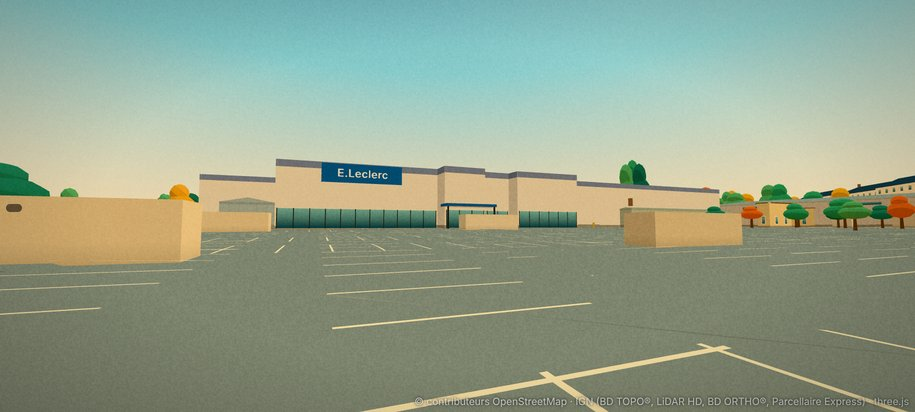

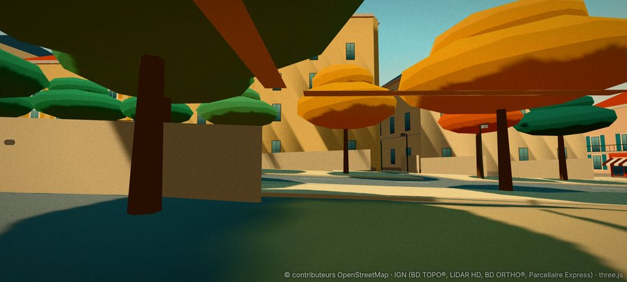
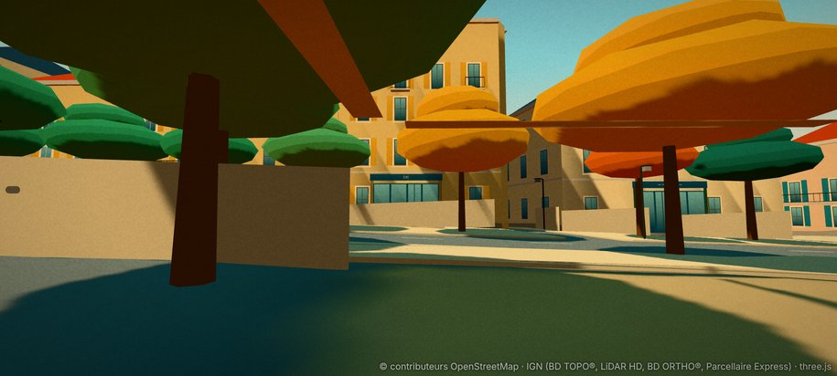

## 2026-10-30 — D121. Bâtiments d'après photos, étape 1 : les abris à chariots

**Demande de l'utilisateur** : améliorer des bâtiments d'après ses photos, en commençant par E.Leclerc. Photos fournies (captures Google Street View, non versionnées : elles servent seulement à décrire) : l'entrée nord, un abri à chariots, le côté est (2018). Ordre convenu : abris à chariots, puis l'entrée de Leclerc, puis son volume (toits à deux pentes du LiDAR, bardage).

**Constat** : devant l'entrée, six cubes beiges pleins de 2,3 × 8,2 m. Ce sont les abris à chariots, que la BD TOPO donne comme de petits bâtiments (hauteur 2,3 m, deux à 5,6 m : arbres voisins dans le LiDAR).

**Détection** (`tools/data/build_carts.py`, étape autonome après `build_kinds.py`, qui réécrit `kinds`) : emprise rectangulaire (≥ 85 % de son rectangle orienté), 1,8 à 3,2 m sur 6 à 12 m, sur un parking OpenStreetMap (à moins de 3 m), à moins de 60 m d'une grande surface sans y être collée ; seuls les types « rien », annexe ou hangar sont remplacés. Type `cart`, avec `open` : le milieu du petit côté le plus proche de la grande surface. **Règle prudente** : les six abris de Leclerc, rien d'autre ; les boîtes de 3 × 4,8 m près de Lidl et de Biocoop (120 à 240 m, plus courtes) restent des bâtiments faute de photo.

**Dessin** (`cartShelter`, `landmarks.ts`), d'après la photo : cadre d'acier anthracite (poteaux aux coins et tous les 2,8 m au plus, lisses haute, médiane et basse), toit plat clair débordant de 10 cm, petit côté ouvert avec bandeau jaune et noir, chariots bleus emboîtés sur les deux tiers de la longueur. Pas de vitres pleines : le verre clair de la photo laisse voir les chariots, des panneaux opaques auraient refait des boîtes. Les murs et le toit génériques ne sont plus dessinés (comme `hidden`) ; la collision reste celle de l'emprise. Coût : quelques centaines de triangles dans la géométrie des détails, aucun appel de dessin de plus.

**Pas encore** : les abris des autres enseignes (photos à venir) ; ils restent des boîtes dans les silhouettes lointaines (LOD).

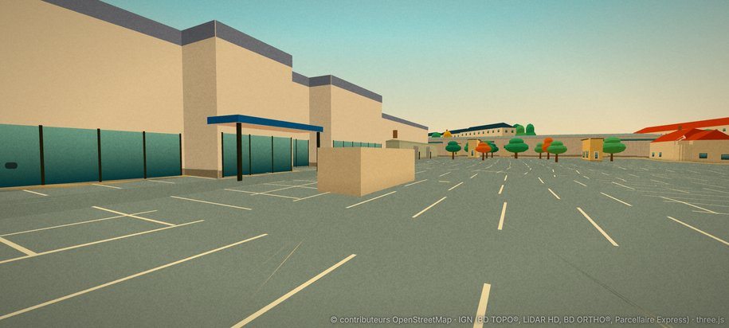
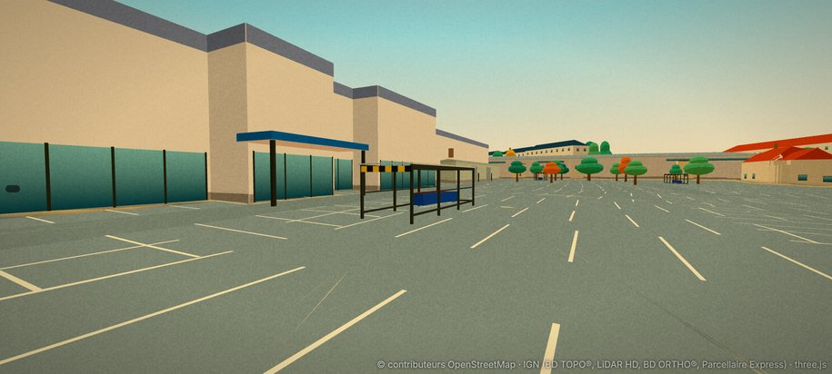

## 2026-10-30 — D122. Bâtiments d'après photos, étape 2 : l'entrée d'E.Leclerc

**D'après les photos de l'utilisateur** (entrée nord vue de face, de l'ouest et de l'est) : bloc d'entrée vitré à montants anthracite, sas surmonté d'une pyramide de verre clair, marquise anthracite continue sur poteaux fins, bandeau anthracite au-dessus, potelets inox au bord du trottoir, enseigne basse (lettres bleues sur mur blanc) juste à l'ouest du bloc, la marquise continuant le long du mur nord.

**Bloc d'entrée** (`entranceBlock`, `landmarks.ts`), quand une grande surface a des murs d'entrée vitrés (`frontWalls`, D120) : sur le sas et chacun de ces murs, vitrage jusqu'à 3,85 m avec traverse à 2,5 m et montants tous les 1,8 m environ ; marquise de 45 cm d'épaisseur dont le **bord avant est aligné** à 3,2 m devant le mur le plus avancé (les murs en retrait ont une marquise plus profonde : pas de trou aux décrochements), dessous clair, poteaux tous les 6 m au plus ; bandeau anthracite de 1,3 m au-dessus ; potelets inox (0,9 m) tous les 1,8 m, 0,6 m devant la marquise ; **pyramide** de verre clair (4,6 m de haut) sur le sas, de 1,2 m dans le mur jusqu'au bord de la marquise. Les faces de la pyramide sont orientées par le calcul (matériau à une face). Les grandes surfaces sans correction gardent l'entrée et l'auvent de D92.

**Marquise le long du mur nord** : la bande BD TOPO de 3,2 × 36 m et 4,3 m de haut collée au mur 11, dessinée en hangar, est la marquise. Nouveau : `kinds` dans `tools/data/manual.json` impose un type d'après photo ; `build_carts.py` l'applique après `build_kinds.py` (qui réécrit `kinds`) et corrige seulement les statistiques de l'index de ce qu'il change (build_kinds compte aussi la marge hors des tuiles). La bande devient un auvent `style: "marquise"` (`marquise`, `landmarks.ts`) : dalle anthracite de 45 cm, dessous clair, poteaux fins tous les 6 m au plus ; on passe dessous (auvent : pas de collision).

**Enseigne basse** : `signZ` dans `fronts` (fiche : `ground.signZ`) pose l'enseigne à tant de mètres du sol, panneau blanc et lettres à la couleur de l'enseigne, 1,4 m de haut ; Leclerc : 2,3 m.

**Pas encore** (étape 3) : le volume. Le bloc d'entrée réel est plus bas que la halle ; la halle a des toits à deux pentes (13 pans dans le LiDAR, égout 9,3 m, faîte 13,9 m), des pignons crème et un bardage vert-gris (photo du côté est, 2018), alors que les grandes surfaces sont dessinées en boîtes à toit plat (`ROOF_SCALE` 0).

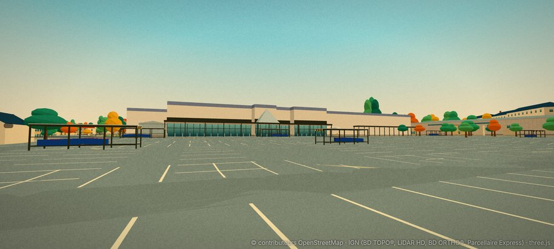
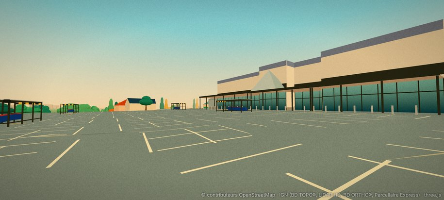
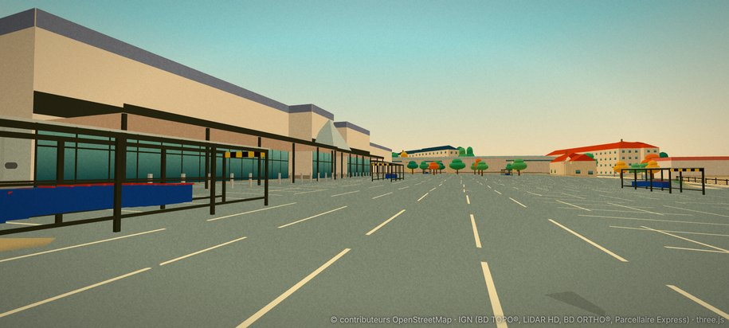

## 2026-10-30 — D123. Bâtiments d'après photos, étape 3 : l'hôtel de ville, volumes et toits

**Demande de l'utilisateur** : modéliser l'hôtel de ville d'après ses photos, en commençant par les volumes et les toits ; retirer l'inscription. Photo fournie (non versionnée, elle sert seulement à décrire) : la façade sur le Champ de Mars (sud-sud-est), de face, depuis la place un peu à l'ouest de l'axe. Lecture : 11 travées ; pavillons d'angle de 2 travées et avant-corps central de 3 travées, en légère saillie, à toits d'ardoise raides et tronqués (le central plus haut, avec paratonnerre) ; trois niveaux : soubassement en pierre blonde à bossages et arcades grillagées, étage noble clair à hautes fenêtres à frontons cintrés, étage en pierre blonde ; perron et portique au centre, balcon à balustrade, trois drapeaux aux baies du balcon, lucarne-fronton aux armes ; œils-de-bœuf, lucarnes, cheminées. Pas d'inscription.

**Constat** : la mairie était le volume générique (cinq niveaux de petites fenêtres identiques, un toit à croupes uniforme, D18), avec l'inscription « HÔTEL DE VILLE » et les drapeaux sur le plus long mur (nord-est), invisibles depuis la place.

**Mesures** (modèle de surface et de terrain LiDAR HD, WMS, fenêtre de 0,5 m autour du bâtiment ; hauteurs au-dessus de la place devant la façade, à −4,5 m) : façade de 44,6 m ; corps principal de 13,75 m de profondeur, corniche à 17,0 m, faîtage à 22,6 m (deux pans) ; pavillons d'angle de 8 m, plateau à 24,9 et 25,0 m ; pavillon central de 12 m, plateau à 27,9 m ; ailes autour de la cour (côtés et arrière) plus basses : égout à 14,4 m, faîtage à 19,5 m sur leur ligne médiane, croupes aux angles ; perron de 12 m de large dont le palier est à 4,5 m (le niveau de la cour, et le haut du soubassement). Les lucarnes relevées sur le pan avant (tous les 4 m, symétriques) confirment les 11 travées de 4,05 m.

**Données** : étape autonome `tools/data/build_monuments.py` (après `build_kinds.py`, qui réécrit `kinds`). La lecture de la photo est dans `monuments` de `tools/data/manual.json` (coin de départ de la façade dans le contour, travées, pavillons en travées, hauts du soubassement et de l'étage noble, `sign: false`) ; l'étape y ajoute les mesures (médianes sur les parties entre pavillons, qui écartent lucarnes et cheminées ; corniche = droite du pan avant ramenée au mur ; plateau des pavillons = cellules à moins de 0,6 m de leur 90ᵉ centile ; égout des ailes = pente entre 1,5 et 4,5 m du mur) et n'écrit que le champ `hall` du bâtiment dans `kinds/26_35.json`, en retirant l'inscription. La fenêtre LiDAR est gardée dans `.cache/shared/raw/monuments` ; une deuxième passe ne réécrit rien.

**Rendu** (`buildTownHall`, `src/render/monuments.ts`, dans le maillage plein de la tuile : aucun appel de dessin de plus, 1 566 triangles et 144 de vitres allumées) : murs, toit et façade génériques ne sont plus dessinés (comme pour un abri à chariots) ; la collision reste l'emprise. **Volumes à pans nets** : corps principal à deux pans (débord de 30 cm), pavillons en saillie de 35 cm à toits en tronc de pyramide jusqu'au plateau mesuré (zinc), ailes basses à deux pans dont le faîtage suit la ligne médiane entre contour et cour (croupes et noues aux angles, ce qui suit le contour irrégulier sans maillage du relevé) ; le pan sur cour de l'aile avant rejoint la corniche arrière du corps principal. **Niveaux** : soubassement et étage en pierre blonde, étage noble clair, bandeaux et corniche clairs ; travées régulières : arcades sombres au soubassement (sauf derrière le perron), fenêtres hautes à l'étage noble et plus courtes à l'étage, portes et baies en plein cintre dans l'avant-corps central ; fenêtres simples tous les 4 m aux mêmes niveaux sur les autres murs, là où elles tiennent entre le sol et la corniche. Plus d'inscription ni de drapeaux génériques.

**Pas encore** : le détail de la façade (bossages, frontons, chaînes d'angle, étape suivante), le portique, le balcon, les drapeaux et le perron (qui reste le talus en marches de D94), les lucarnes, œils-de-bœuf et cheminées, les autres façades d'après photo ; la silhouette lointaine (LOD) reste le volume générique.

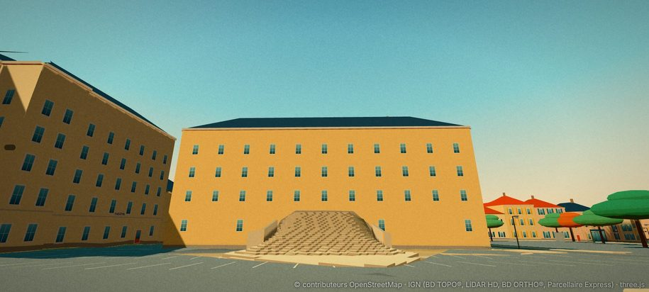
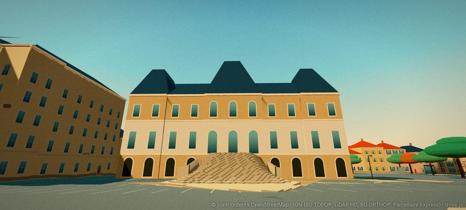
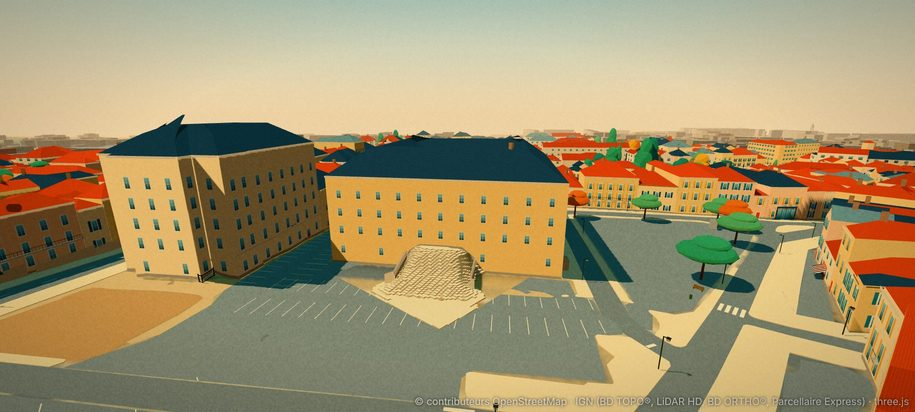
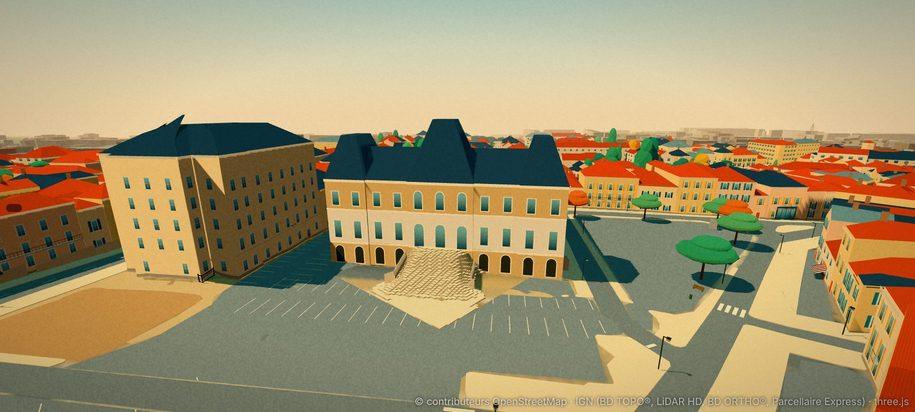
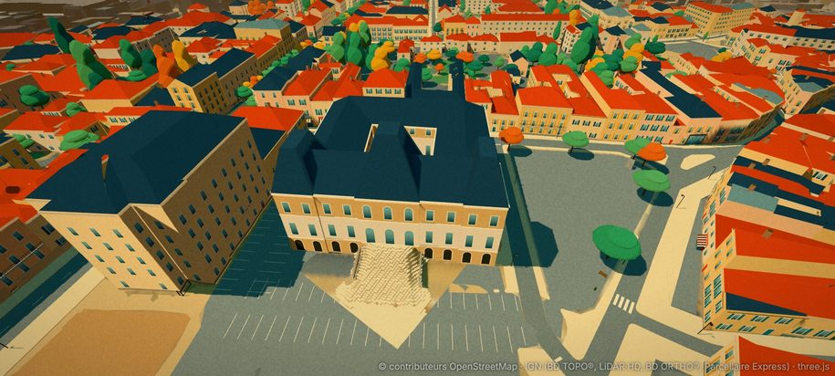

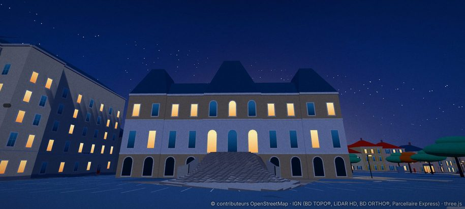

## 2026-10-30 — D124. Bâtiments d'après photos, étape 4 : l'hôtel de ville, détail de la façade

**D'après la photo de l'utilisateur** (façade sur le Champ de Mars, D123), le détail de la façade principale, toujours dans `buildTownHall` (`src/render/monuments.ts`), sans nouvelle donnée :
- **Soubassement à bossages** : refends horizontaux tous les 55 cm (joints creux sombres), clé saillante au sommet de chaque arcade, cordon saillant au-dessus.
- **Étage noble** : appui saillant, corniche et **fronton cintré** (segment de cercle de 2 m de corde, 42 cm de flèche, avec son épaisseur) au-dessus de chaque fenêtre hors de l'avant-corps central ; bandeau sous l'étage.
- **Étage** : appui et linteau saillant.
- **Chaînes d'angle** aux coins saillants des pavillons, de l'étage noble à la corniche : blocs de pierre blonde alternés (95 et 55 cm), en alternance d'une face à l'autre du coin.
- **Corniche moulurée** du corps principal : doucine, larmier de 42 cm de saillie, bandeau, et **modillons** tous les 90 cm sous le larmier côté façade. Les corniches et bandeaux sont prolongés de leur saillie aux deux bouts : les coins saillants se referment.
- Les ornements de quelques centimètres de saillie (chaînes, refends) n'ont que leur face avant : 3 654 triangles pour tout le monument (6 062 avec des pavés complets, sans différence visible).

**Pas encore** : portique, balcon, drapeaux et perron (étape suivante), lucarnes, œils-de-bœuf, cheminées, sculptures des baies centrales.

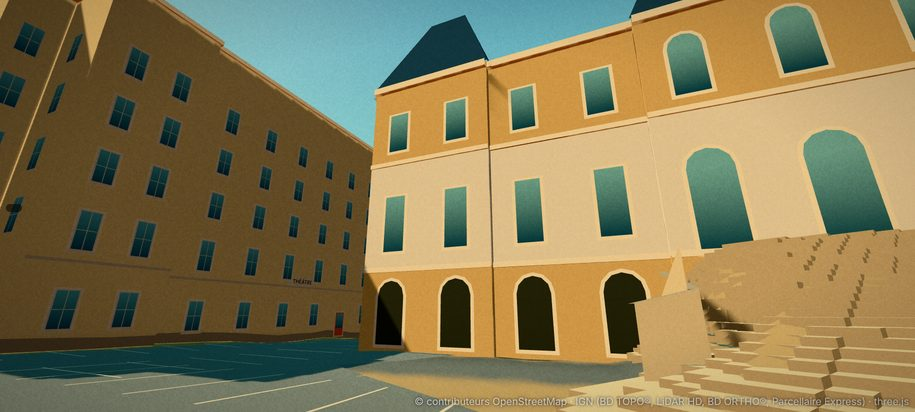
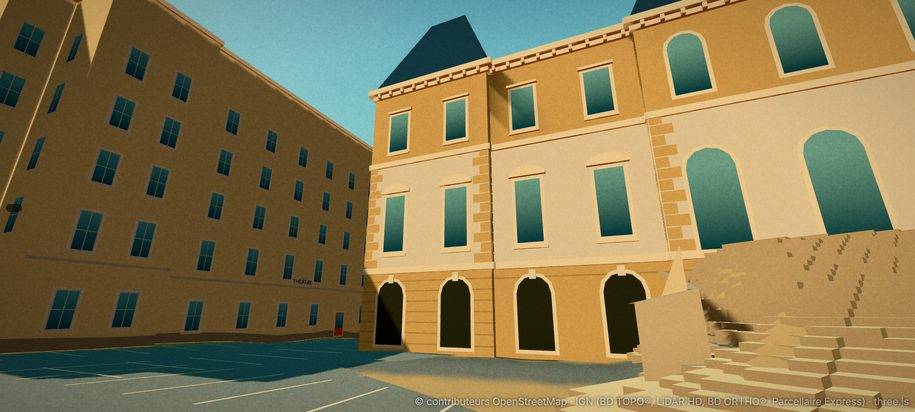

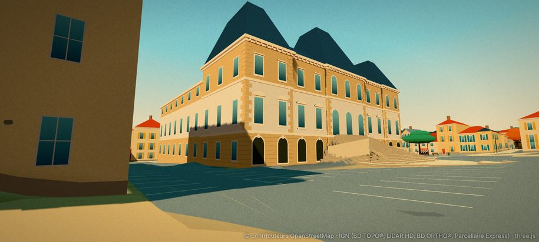

## 2026-10-30 — D125. Bâtiments d'après photos, étape 5 : l'hôtel de ville, portique, balcon, drapeaux et perron

**D'après la photo de l'utilisateur** : portique de colonnes devant les trois portes cintrées de l'avant-corps central, balcon à balustrade au-dessus, drapeaux aux baies du balcon, perron droit à rampes entre deux murs d'échiffre, lampadaires à deux lanternes sur des piédestaux au pied.

**Mesures** (`build_monuments.py`, même fenêtre LiDAR ; `perron` dans `monuments` de `manual.json` désigne l'escalier remplacé) : bord avant du balcon à 2 m de la façade (le modèle de surface y passe sous l'étage noble), haut de la balustrade à 12,2 m au-dessus de la place ; palier à 4,6 m (terrain sous le portique : le haut du soubassement), qui s'avance jusqu'à 2,25 m de la façade ; pied de la volée 9 m plus loin (terrain revenu à 10 cm du sol relevé 12 à 16 m devant, la place remonte de 30 cm devant le perron) ; volée de 11,25 m de large (terrain au quart de la hauteur, à mi-volée). Champs `portico`, `perron`, `stairs` du `hall` ; une deuxième passe ne change rien.

**Rendu** (`portico`, `src/render/monuments.ts`) :
- **Portique** : six colonnes octogonales (par paires aux bouts, une entre chaque porte) sur bases et sous chapiteaux carrés, entablement en trois assises (architrave, frise en pierre blonde, corniche), dessous clair.
- **Balcon** : plinthe, balustres tous les 32 cm, main courante, dés au-dessus des colonnes doubles.
- **Drapeaux** : tricolore à la baie du milieu, européen (fond bleu, couronne de douze étoiles) à droite, sur des hampes qui sortent du mur à 45° et penchent de côté pour être vus de face. La photo en montre un troisième, rouge et bleu, que l'utilisateur n'a pas encore identifié : il n'est pas dessiné.
- **Perron** : marches régulières (26 de 16 cm, 35 cm de giron) du palier au pied mesurés, posées 5 cm au-dessus du relief ; murs d'échiffre pleins du sol de la place au garde-corps (85 cm au-dessus des marches) ; deux rampes en fer qui partagent la volée en trois ; piédestaux et lampadaires à deux lanternes, allumées la nuit. **L'ancien escalier sur le relief** (`stairs` « hotel-de-ville », D94, colonnes de 50 cm arrondies à la marche) n'est plus dessiné quand un monument le remplace ; la zone reste interdite aux voitures, et l'on marche toujours sur le relief (pente régulière, sous les marches de moins de 20 cm : test).
- 4 896 triangles et 176 de lumières pour tout le monument.

**Pas encore** : sculptures des baies du balcon, lucarnes et œils-de-bœuf, lucarne-fronton aux armes, cheminées, épis et paratonnerre (étape suivante) ; silhouette lointaine.

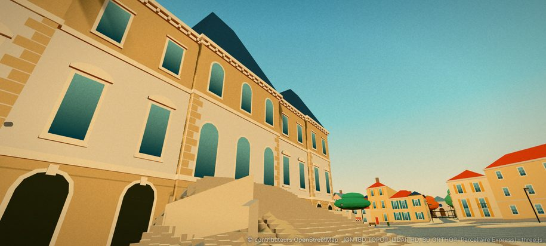
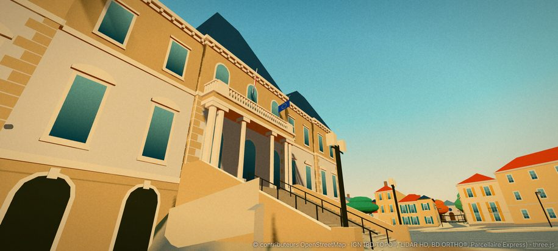
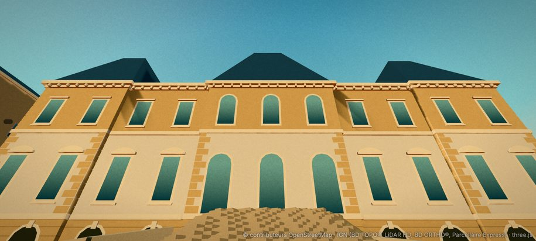
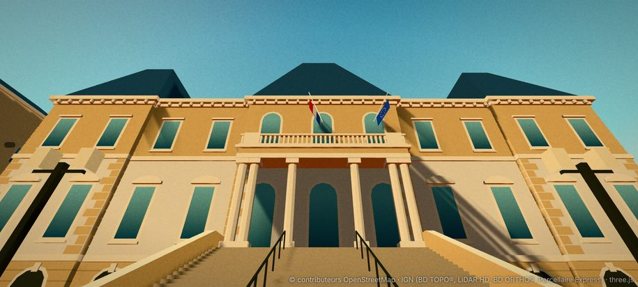
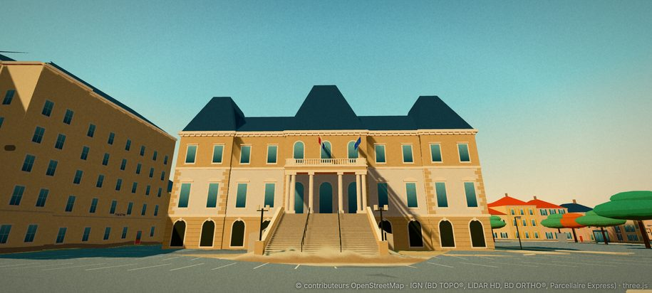
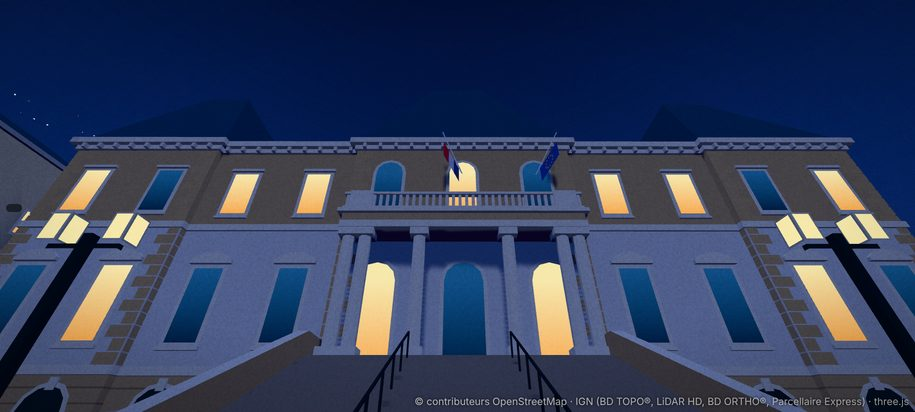

## 2026-10-30 — D126. Bâtiments d'après photos, étape 6 : l'hôtel de ville, toits et silhouette lointaine

**D'après la photo de l'utilisateur** : œil-de-bœuf à encadrement de pierre sur le pan avant de chaque pavillon d'angle, deux lucarnes rondes de chaque côté entre les pavillons, grande lucarne-fronton sculptée aux armes sur le pavillon central, épis sur les pavillons, paratonnerre au centre, crêtes de faîtage, cheminée de brique à droite.

**Mesures** (`build_monuments.py`) : lucarnes des travées 2, 3, 7, 8 (`dormers` dans `manual.json`) : haut = point le plus haut qui dépasse le pan avant de plus de 50 cm (15,95 m local, 3,45 m au-dessus de la corniche, pour les quatre) ; lucarne-fronton : modèle de surface à 0,75-1,75 m de la façade, là où il dépasse le pan raide du pavillon central (18,05 m, 5,5 m au-dessus de la corniche) ; paratonnerre : point le plus haut du plateau central (2,3 m au-dessus) ; les plateaux des pavillons d'angle n'ont pas de pointe mesurable (épis trop fins pour le LiDAR à 0,5 m : hauteur d'après la photo) ; cheminée : celle que la chaîne avait repérée (`chim` du bâtiment), derrière le faîtage à droite, là où la photo montre une cheminée de brique. Une recherche automatique des cheminées par les pics du modèle de surface a été essayée puis écartée : sur des pans raides et des faîtages, elle trouve surtout des arêtes. Les œils-de-bœuf des pavillons d'angle (`oculi`) suivent la photo (2 m de large, 4 m au-dessus de la corniche) : le relevé ne les distingue pas du pan raide.

**Rendu** (`src/render/monuments.ts`) : `dormer` dessine une lucarne sur n'importe quel pan (face verticale de contour donné, joues triangulaires jusqu'au pan, couverture en zinc qui rejoint le pan) ; lucarnes rondes (face à plein cintre, oculus cerclé) sur le corps principal, œils-de-bœuf plus grands à clé sur les pavillons d'angle, lucarne-fronton (panneau à fronton cintré, corniche, cartouche ovale, volutes) sur le pavillon central ; crête en fer autour des plateaux, épis, paratonnerre ; cheminée en brique coiffée d'une dalle. 5 431 triangles pour tout le monument.

**Silhouette lointaine** : `build_monuments.py` remplace le prisme unique du bâtiment dans `lod/26_35.json` par cinq (corps principal, trois pavillons, ailes basses), chacun avec son égout et son haut ; les autres entrées du fichier sont inchangées et une deuxième passe ne réécrit rien. De loin, la mairie garde ses trois toits plus hauts.

**Pas encore** : les autres façades et la cour d'après photo (aucune photo pour l'instant), la cheminée de pierre à gauche de la photo (non retrouvée dans le relevé), le troisième drapeau, les sculptures des baies du balcon.

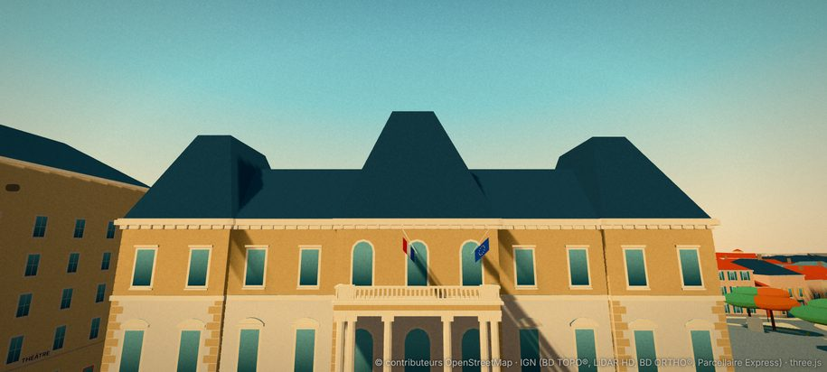
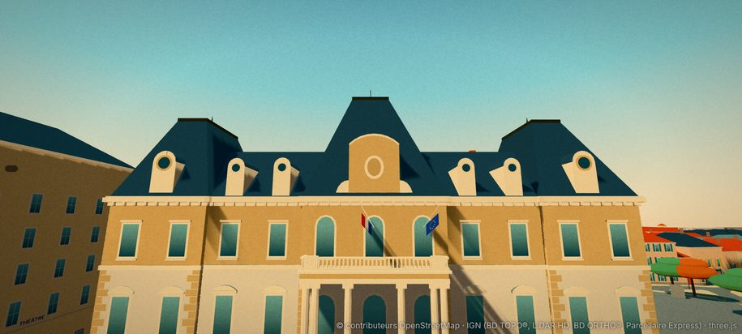
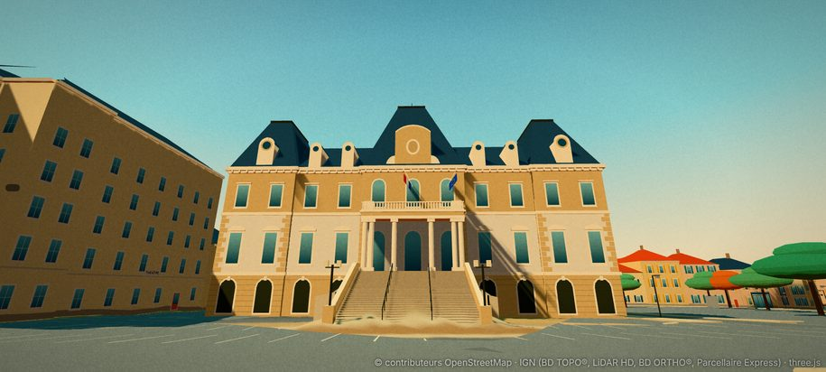
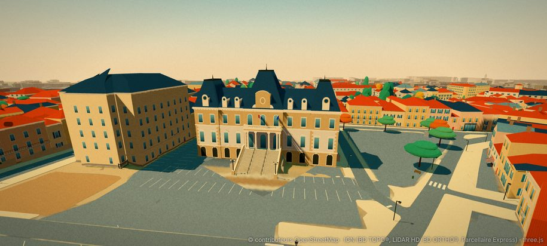
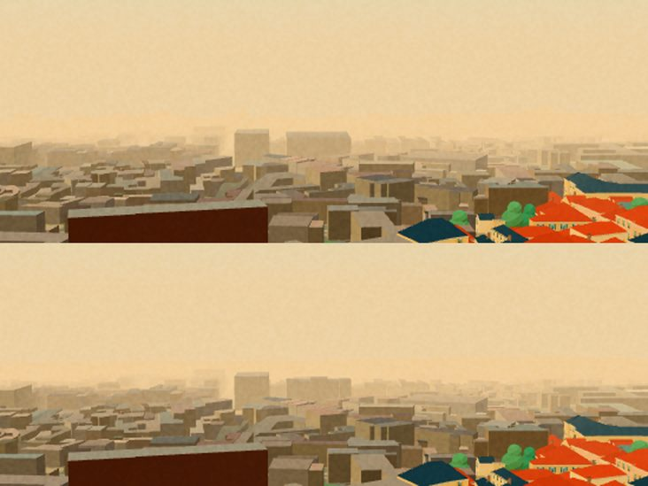

## 2026-10-30 — D127. Bâtiments d'après photos, étape 7 : la cathédrale Saint-Lazare, volumes mesurés

**Demande de l'utilisateur** : modéliser la cathédrale d'après ses photos, avec la même méthode que pour l'hôtel de ville. Photos fournies (non versionnées, elles servent seulement à décrire), points de vue confirmés par l'utilisateur : vue de drone au-dessus du chevet (sud-sud-est) vers la ville ; le chevet au sol depuis le sud-est ; le flanc est de nuit, flèche à gauche et tour est du porche à droite. Lecture : nef de 7 travées entre le porche (nord-nord-ouest) et la croisée, chapelles gothiques le long des bas-côtés (grandes baies, pinacles, balustrade), toits de tuiles plates brun-ocre ; abside polygonale, bloc carré au bout du bras ouest du transept et petite tourelle, couverts de tuiles vernissées en losanges ; tour de croisée à baies jumelles, galerie, flèche octogonale de pierre grise à gâbles, crochets et clochetons ; deux tours carrées au porche, à flèches de pierre ; portail roman au pignon du bras est. Plan validé : (1) volumes mesurés et couleurs, (2) chevet et tuiles vernissées, (3) tour de croisée et flèche, (4) flancs et porche.

**Constat** : la nef était le bâtiment générique (grand mur nu, œils-de-bœuf et portes de maison), `buildCathedral` (D95) y ajoutait des volumes approximatifs couverts d'ardoise bleue, flèche comprise ; de loin, le clocher lointain était un mât de 54 m (haut de la tour mal mesuré : l'anneau autour de la flèche prenait la flèche elle-même).

**Mesures** (`build_monuments.py`, modèle `cathedral`, dans le repère de `mon` de build_kinds : s le long de la nef vers le chevet, t vers l'est-nord-est ; profils médians du modèle de surface LiDAR, ce qui écarte pinacles et arbres ; murs = chutes de plus de 3 m entre deux échantillons de 0,5 m ; égouts = droite du pan ramenée au mur ; hauteurs au-dessus du sol du bâtiment) :
- porche de 13 m de large et 11,4 m de long, faîtage à 20,1 m ; nef de 38 m (7 travées de 5,5 m) et 14,5 m de large, égout 19,0 m, faîtage 30,0 m ;
- bas-côtés en appentis de 5 m (13,5 m contre la nef, 11,4 et 12,6 m au mur extérieur) ; chapelles par travée jusqu'au bord de l'emprise BD TOPO, plus basses à l'ouest (6 à 8 m) qu'à l'est (12 m, celles de la photo de nuit) ;
- transept de 14,5 m entre pignons à 46 m l'un de l'autre, égout 20,6 m, faîtage 25,1 m (plus bas que la nef) ; au bout du bras ouest, le bloc carré (11 × 15 m), égout 10,8 m, pointe du toit 25,4 m ;
- tour de croisée de 12,5 m de côté, corps à 40,3 m, flèche à 85,6 m ;
- chœur de 13,5 m de large, égout 20,0 m, faîtage 30,6 m ; abside de 6,75 m de rayon, corniche à 24,7 m (relevée à 75 cm du mur sur l'axe, plus haute que celle du chœur) ; elle finit au bout de l'emprise, le toit débordant d'1 m au-delà ; bas-côtés du chœur en appentis.
- **Tours du porche : le relevé ne les voit pas.** Aux coins avant du porche, le modèle de surface reste au niveau du sol (le parvis, 3 m plus bas que le bâtiment), alors que l'orthophotographie de l'IGN et les photos de l'utilisateur montrent deux tours carrées à flèche de pierre. Seule une arête fine de 30 à 32 m longe le bord ouest du porche (non identifiée). Côté pris sur l'emprise (6 et 5,3 m), hauteurs d'après les photos (corps à 26 m, pointe à 36 m, `towers` dans `manual.json`), les deux tours identiques (symétrie validée par l'utilisateur).

Champ `cath` du bâtiment dans `kinds/26_32.json` ; l'étape corrige aussi le clocher lointain (`tower` du bâtiment et son repère dans `kinds/index.json` : tour de 12,5 m jusqu'à 40,3 m, flèche à 85,6 m) et remplace le prisme unique de la silhouette lointaine (`lod/26_32.json`) par douze (porche, tours, nef, bas-côtés, transept, bloc, tour de croisée, chœur et abside, bas-côtés du chœur). `mon` reste (repère, et gabarit D95 des cathédrales sans modèle). Une deuxième passe ne réécrit rien.

**Rendu** (`buildSaintLazare`, `src/render/monuments.ts`, dans le maillage plein de la tuile : aucun appel de dessin de plus, 1 043 triangles) : murs, toit et baies génériques ne sont plus dessinés (comme pour la mairie) ; la collision reste l'emprise. Volumes à pans nets, murs qui suivent le relief (le sol monte de 5 m du parvis au chevet) ; toits de tuiles brun-ocre (nef, porche, transept, bloc, chœur, abside, bas-côté ouest), gris-vert sur le bas-côté est et toutes les chapelles (d'après l'orthophotographie) ; flèches en pierre grise. Baies sombres en plein cintre : fenêtres hautes de la nef par travée, grandes baies des chapelles, baies de l'abside, portail et grande baie au pignon est du transept, baies jumelles des tours, grand arc du porche.

**Pas encore** (étapes suivantes du plan) : les tuiles vernissées et la tourelle du chevet (étape 2), le détail de la tour de croisée et de la flèche (3), les chapelles gothiques, les fenêtres en arc brisé, les marches et le portail du porche (4) ; la fontaine Saint-Lazare au pied de la tour est (photo de nuit), à confirmer.

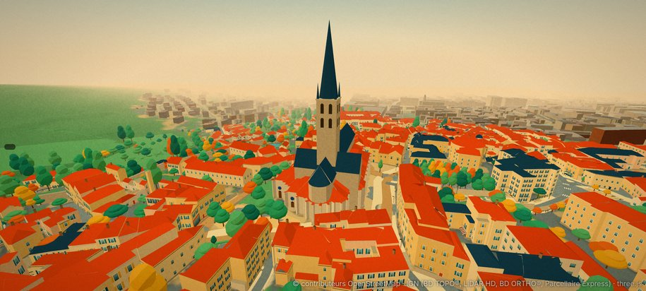
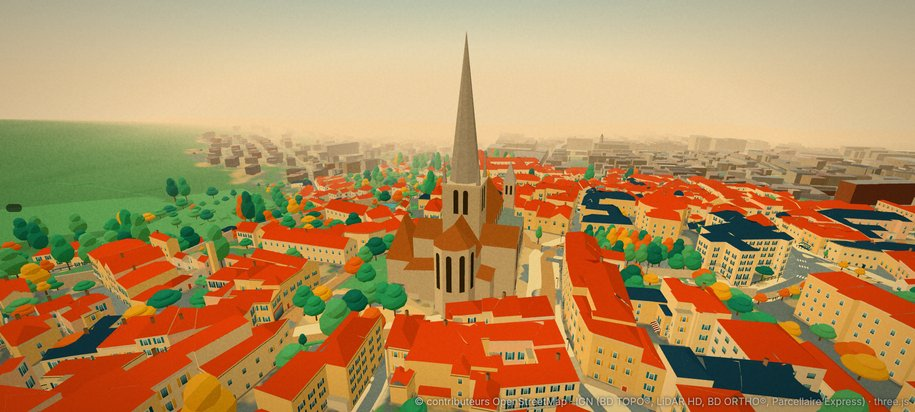
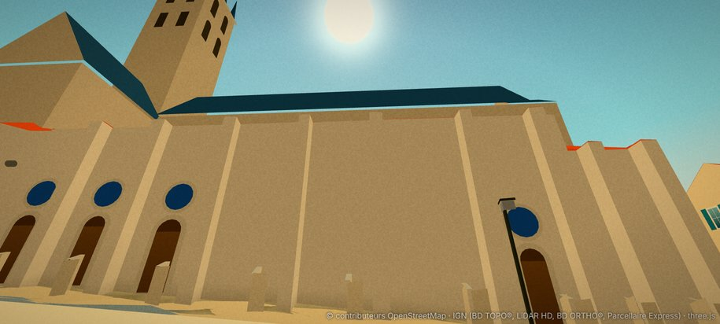
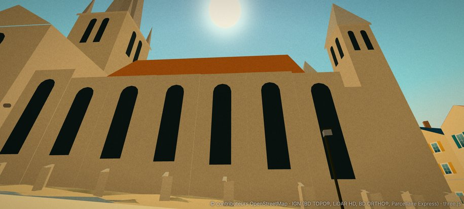
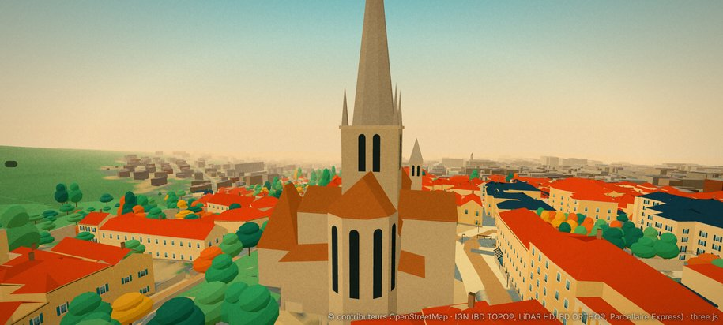
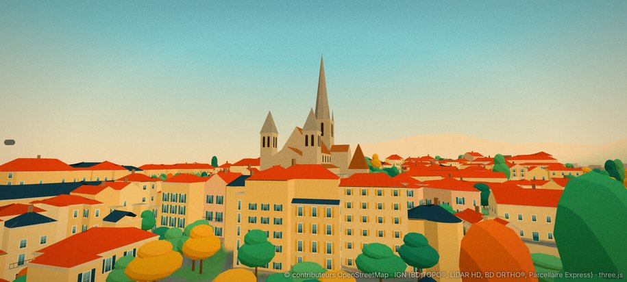
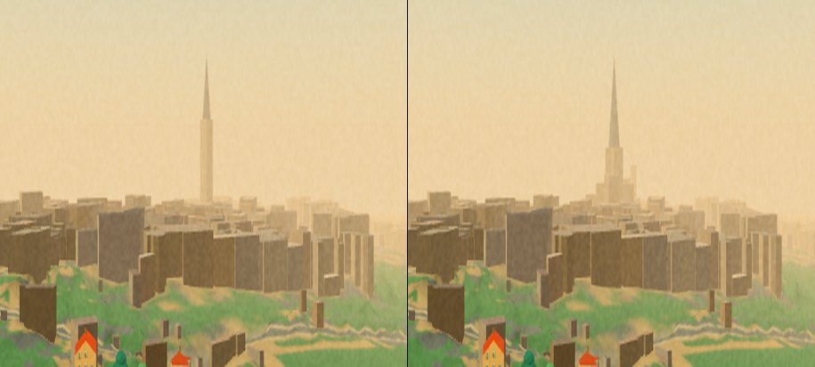

## 2026-10-30 — D128. Bâtiments d'après photos, étape 8 : la cathédrale, le chevet et ses tuiles vernissées

**D'après les photos de l'utilisateur** (drone au-dessus du chevet, chevet au sol depuis le sud-est) : l'abside polygonale à contreforts et hautes baies, le bloc carré au bout du bras ouest du transept et une petite tourelle entre lui et le chœur sont couverts de tuiles vernissées en losanges (jaune d'ocre, vert, brun-noir, rouge) ; le bloc a de grandes baies.

**Mesure** (`build_monuments.py`) : la **tourelle** se voit dans le modèle de surface (pointe à 22 m au-dessus du sol du bâtiment, au-dessus du bas-côté du chœur à 10-12 m et du toit du bloc) : point le plus haut juste derrière le transept, au coin du bloc ; centre = médiane des cellules à moins de 1,5 m de ce haut ; côté d'après la photo (3 m, `turret` dans `manual.json`). Champ `turret` de `cath` ; une deuxième passe ne change rien.

**Rendu** (`src/render/monuments.ts`) :
- **Tuiles vernissées** (`glazedPan`) : sur un pan quelconque (quadrilatère ou triangle), rangs de losanges en quinconce, chaque losange fait de deux triangles de part et d'autre d'une ligne de rang ; couleur selon les deux diagonales du réseau : tous les quatre losanges, une résille verte dans un sens et brun-noir dans l'autre, un losange rouge au cœur de chaque maille, fond jaune. En aplats, sans texture (D17). Sur le cône de l'abside, le toit en croupe du bloc et la pyramide de la tourelle (`hipRoof` accepte maintenant un dessin de pan).
- **Abside** : corniche saillante, contreforts à glacis aux angles du polygone, deux étages de baies en arc brisé par pan (hautes baies en haut, petites en bas).
- **Bloc** : deux grandes baies en arc brisé par face libre, contreforts d'angle. **Tourelle** : corps carré, corniche, baie, pyramide vernissée jusqu'à la pointe mesurée.
- `archOn` dessine aussi l'arc brisé équilatéral ; `buttress` pose un contrefort dans n'importe quelle direction.
- 2 643 triangles pour toute la cathédrale (1 043 à l'étape 1).

**Pas encore** : le motif exact de chaque toit (la photo du drone montre aussi des chevrons) est stylisé, le même pour les trois toits ; le détail de la tour de croisée et de la flèche (étape 3), les flancs et le porche (étape 4).

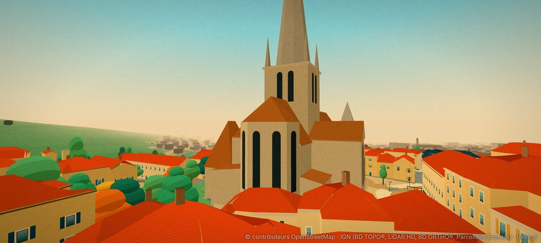
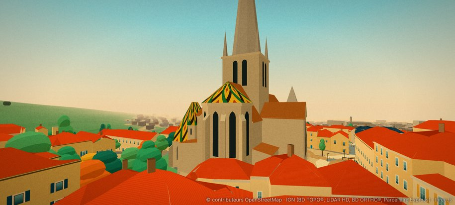
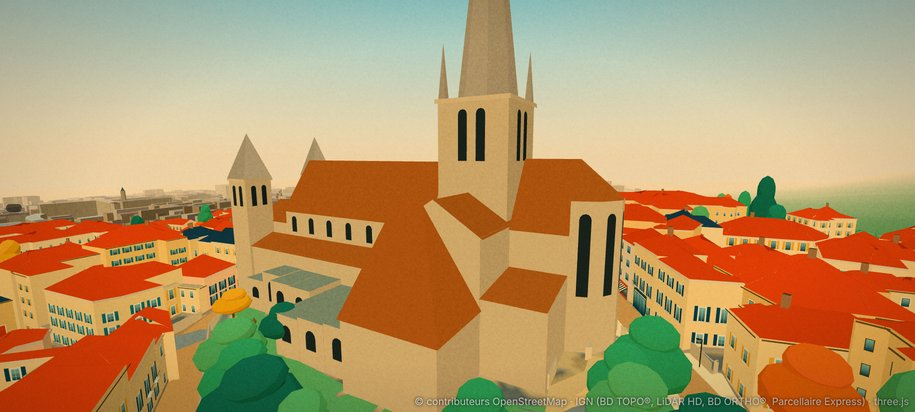
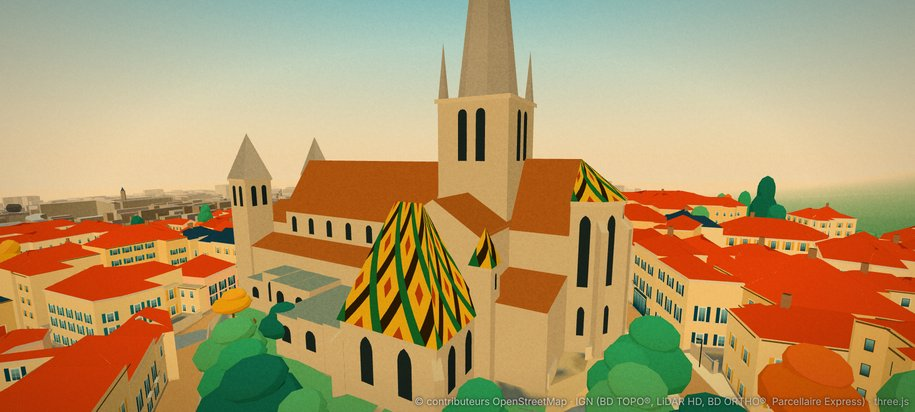
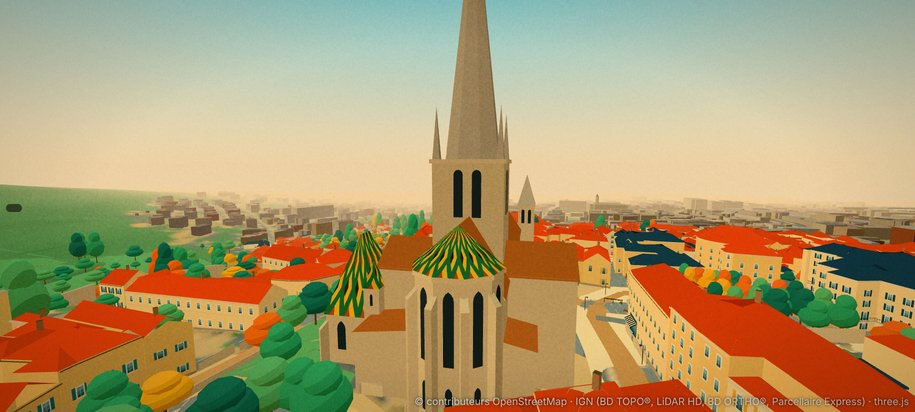

## 2026-10-30 — D129. Bâtiments d'après photos, étape 9 : la cathédrale, tour de croisée et flèche

**D'après les photos de l'utilisateur** (chevet au sol depuis le sud-est, drone) : tour carrée à contreforts d'angle, deux hautes baies jumelles en arc brisé par face, galerie à balustrade ajourée ; flèche octogonale de pierre grise à crochets sur les arêtes, gâbles ajourés au pied des faces, grands clochetons aux angles de la tour, croix.

**Mesures** (`build_monuments.py`) : **rayon de la flèche au pied**, 5,4 m (octogone presque aussi large que la tour de 12,5 m) : pour chaque altitude, rayon de l'octogone de même aire que les cellules du modèle de surface plus hautes ; droite en altitude entre 8 m au-dessus de la tour et 6 m sous la pointe (plus bas, gâbles et clochetons élargissent la coupe), ramenée au haut de la tour. Les **clochetons et les gâbles** sont trop fins pour le relevé à 0,5 m : un seul angle de la tour monte à 9,5 m au-dessus de la galerie, les trois autres à 4-5 m, et les gâbles ne se distinguent pas du cône de la flèche ; hauteurs d'après la photo (clochetons à 9 m au-dessus de la tour, ce que confirme l'angle mesuré ; gâbles de 6 m), dans `spire` de `manual.json`. Champs `tower` (rayon ajouté) et `spire` de `cath` ; une deuxième passe ne change rien.

**Rendu** (`src/render/monuments.ts`) : deux contreforts à glacis à chaque angle de la tour, au-dessus des toits ; par face, un arc de décharge en retrait et deux baies en arc brisé ; corniche et balustrade (parapet de 1,1 m percé de jours tous les 60 cm, `rectOn`) ; flèche au rayon mesuré, crochets tous les 2,8 m sur les huit arêtes (ailettes vues des deux côtés) ; quatre gâbles au pied des faces tournées vers la nef, le chœur et les bras, avec leur petit toit qui rejoint la flèche et une lucarne en arc brisé ; clochetons d'angle (fût carré et pyramide) ; croix en fer. 3 299 triangles pour toute la cathédrale.

**Pas encore** : les flancs (chapelles gothiques, fenêtres en arc brisé, pinacles et balustrade) et le porche (marches, portail, tours), étape 4.

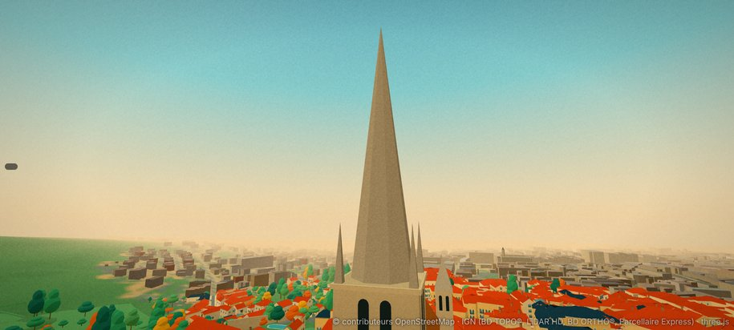
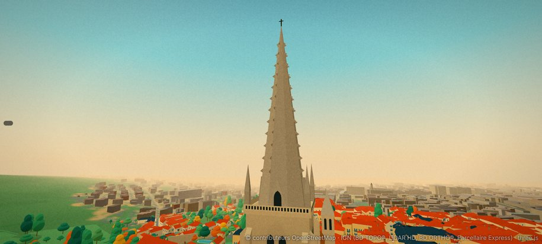

## 2026-10-30 — D130. Bâtiments d'après photos, étape 10 : la cathédrale, flancs et porche

**D'après les photos de l'utilisateur** : le flanc est de nuit (chapelles gothiques à grandes baies, contreforts surmontés de pinacles, balustrade ajourée le long des toits ; fenêtres hautes de la nef en plein cintre ; portail roman à petit pignon au bras est du transept ; tour est du porche à deux étages de baies jumelles, contreforts et flèche de pierre à clochetons) et la vue de drone (les deux tours du porche).

**Rendu** (`src/render/monuments.ts`, aucune donnée nouvelle) :
- **Chapelles** : grande baie en arc brisé à meneau par travée, contreforts à glacis entre les travées ; côté est seulement (photo de nuit), pinacles au-dessus des contreforts et balustrade ajourée (parapet de 90 cm, jours tous les 60 cm). Les chapelles de l'ouest, plus basses (6 à 8 m mesurés), n'ont pas de photo : baies et contreforts seulement.
- **Nef** : bandeau sous l'égout.
- **Transept** : avant-corps du portail au pignon est (6 m de large, petit pignon couvert de tuiles), voussure claire et porte.
- **Tours du porche** : deux étages de baies jumelles en plein cintre dans un encadrement en retrait sur chaque face, cordon entre les étages, contreforts aux angles extérieurs jusqu'au cordon, clochetons aux angles de la flèche.
- 4 163 triangles pour toute la cathédrale (1 043 à l'étape 1 ; la mairie en a 5 431). Le test borne le monument à 8 000.

**Pas encore** (faute de photo ou de validation) : la façade du porche (portail, marches depuis le parvis, plus bas de 3 m : le relevé ne montre pas de marches devant le porche), les chapelles de l'ouest, la fontaine Saint-Lazare au pied de la tour est ; l'éclairage de nuit de la cathédrale (la photo de nuit la montre illuminée, le jeu la laisse dans l'ombre comme les autres bâtiments).

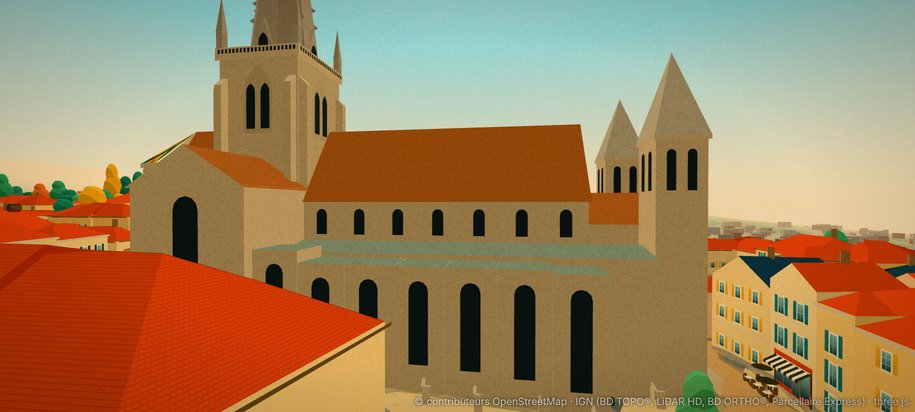
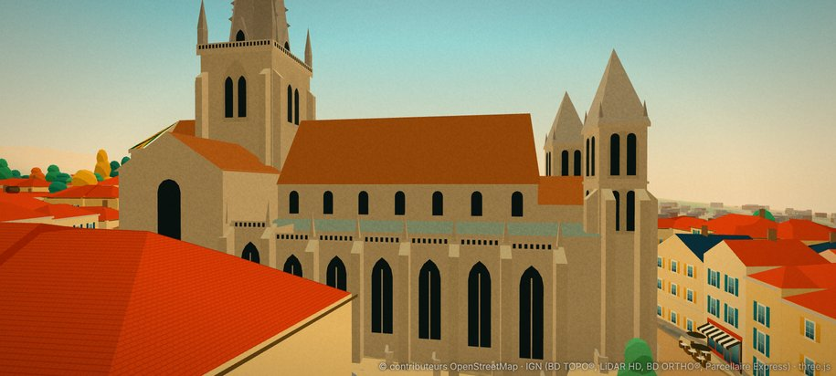
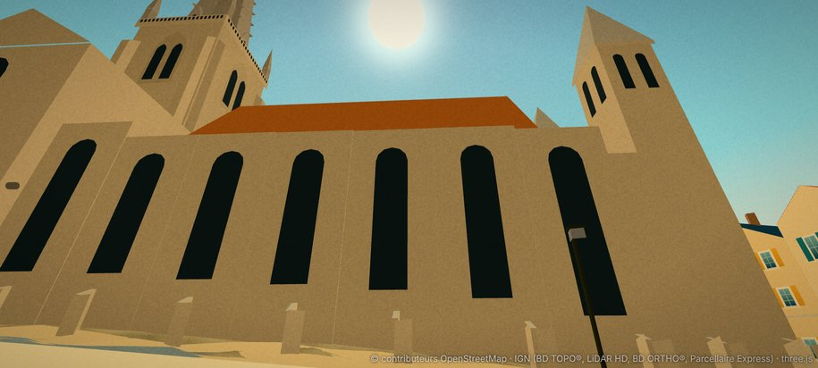
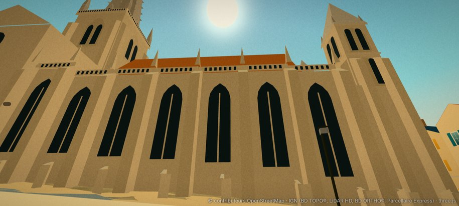
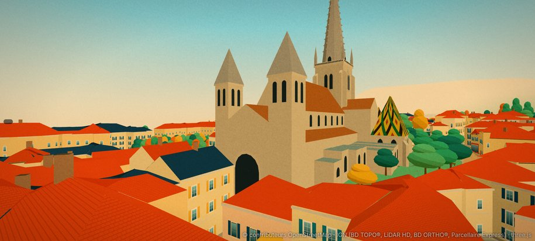
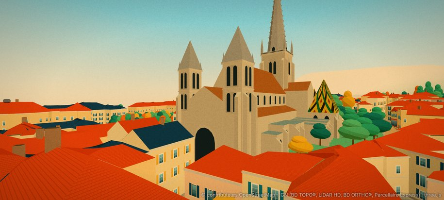
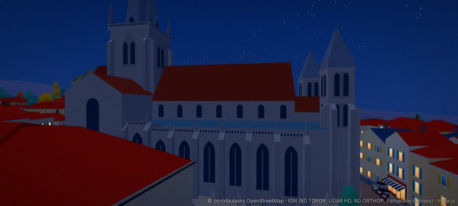
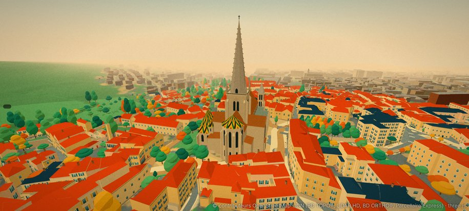

## 2026-10-30 — D131. Bâtiments d'après photos, étape 11 : le portail de la cathédrale et la fontaine Saint-Lazare

**Photos de l'utilisateur** (non versionnées) : le portail au fond du porche, de face ; la fontaine Saint-Lazare vue du nord-est, avec derrière elle les chapelles de l'est et le flanc du porche ; l'utilisateur confirme que c'est l'édicule vu au pied de la tour est sur la photo de nuit (D127). Lecture :
- **Porche et portail** : porche ouvert sous une voûte en berceau, arcs sur les murs latéraux, escalier jusqu'au seuil entre deux grilles à pointes ; deux portes de bois à panneaux, trumeau portant une statue, colonnes à chapiteaux dans les ébrasements, linteau sculpté, tympan du Jugement dernier (Christ en mandorle au centre, figures en registres), trois voussures dont une à médaillons. Sur le flanc du porche (photo de la fontaine), arcades jumelles en arc brisé et oculus.
- **Fontaine** : emmarchement et bassin bas à lobes en pierre sombre, vasque sur pied avec jet au centre, édicule Renaissance de pierre claire à quatre piles (piédestaux, colonnes cannelées), arcs en plein cintre sur chaque face, entablement à inscription, frontons, vases aux angles ; lanterne ronde à colonnettes et niche, coupolette, pélican au sommet.

**Mesures** (`build_monuments.py`, modèle `fountain` dans `monuments` de `manual.json`) : la fontaine est dans OpenStreetMap (mobilier `fountain` « Fontaine Saint-Lazare », 13 m à l'est de la tour est du porche, comme sur les photos). Sur le modèle de surface : centre de l'édicule (cellules à plus de 2 m au-dessus du sol), haut 8,3 m, bassin de 3,0 m de rayon (premier cercle où la médiane du relevé retombe à moins de 10 cm du sol) ; orientation de la cathédrale. Site `fountain` dans `kinds/26_33.json` (et le compte des sites de `kinds/index.json`) ; une deuxième passe ne change rien. Le porche n'a pas de nouvelle donnée : le seuil des portes est pris au sol du bâtiment (BD TOPO), faute de mesure possible sous le toit ; le pied de l'escalier est au plus haut point du relief du jeu, 4,2 m devant les portes, soit 11 marches.

**Rendu** (`src/render/monuments.ts`) :
- **Porche** : le mur avant est percé d'un vrai grand arc (`archWall`, intrados et piédroits `archSoffit`), ce qui laisse voir l'intérieur : voûte en berceau, murs intérieurs à arcs aveugles, escalier et grilles, **portail** (`portal`) sur le mur ouest de la nef. Le tympan est stylisé en aplats : demi-disque, mandorle plus sombre, Christ plus clair, deux registres de figures de part et d'autre, frise du linteau, médaillons de la voussure. Proportions d'après la photo (portes de 5 m sur 4,2 m, tympan de 6,4 m). La collision reste l'emprise : on ne monte pas dans le porche.
- **Fontaine** (`buildFountain`, dessinée par la tuile où elle se trouve) : modèle complet, hauteurs d'après la photo mises à l'échelle du haut mesuré. Le cylindre générique du mobilier n'est plus dessiné (même identifiant OpenStreetMap). Le bassin devient un obstacle de son rayon. Un arbre de la carte poussait au milieu : les arbres à l'intérieur du bassin ne sont plus ni dessinés ni des obstacles (`treesOutsideMonuments`).
- 5 275 triangles pour la cathédrale (4 163 avant), 1 112 pour la fontaine.

**Pas encore** : on ne peut pas entrer dans le porche (la collision suit l'emprise) ; la façade extérieure du porche n'a pas de photo (un seul grand arc) ; la navigation des passants garde l'ancien rayon de la fontaine (1 m) ; l'éclairage de nuit.

## 2026-10-30 — D132. Bâtiments d'après photos, étape 12 : la façade du porche, l'entrée dans le porche, la fontaine pour les passants, la cathédrale la nuit

**Demande de l'utilisateur** : traiter les quatre points laissés en D131, avec deux nouvelles photos (captures Google Street View d'août 2018, non versionnées) de la façade du porche, du parvis Chanoine-Denis-Grivot. Lecture :
- **Bas** : trois larges marches sur toute la façade, puis le palier sous le porche ; des grilles à pointes de part et d'autre de la volée qui monte au portail (passage ouvert au milieu) ; arcs plus bas sous les tours, fermés de grilles.
- **Haut** : grand arc à voussure moulurée sur colonnes engagées, contreforts massifs de part et d'autre, cordon au-dessus de l'arc, galerie de petites arcades dont trois ajourées, corniche et pignon bas ; deux tours carrées à baies jumelles.

**1. Façade du porche** (`src/render/monuments.ts`) : voussure (deux anneaux), colonnes engagées et chapiteaux du grand arc, cordon, galerie de cinq arcades aveugles dont trois percées, corniche, contreforts entre l'arc et les tours ; sous chaque tour, un arc ouvert en façade (62 % de la largeur de la tour, sommet aux deux tiers de celui du grand arc), avec intrados, fond sombre et grille.

**2. On entre dans le porche** (`porchLayout`, `porchDecks`, `cathedralWalls`, `src/core/landmarks.ts`) :
- **Niveaux** (`build_monuments.py`, champ `entry` de `cath`) : parvis = terrain LiDAR médian sur toute la largeur de la façade, 2,5 m devant elle (3,3 m sous le sol du bâtiment) ; palier = parvis + 3 marches de 16 cm (photo, `entrySteps` dans `manual.json`) ; seuil = sol du bâtiment (le relevé ne voit pas sous le toit). Une deuxième passe ne change rien.
- **Surface** : deux tabliers invisibles (comme les ponts, D93), enregistrés avec ceux de la tuile : les trois marches de la façade, puis le palier, la volée (17 marches de 16 cm) et le palier des portes. Le jeu prend toujours le plus haut du relief et du tablier ; au dessin, chaque marche est posée au-dessus des deux (le relief du jeu remonte par endroits sous le porche), la marche visible et le sol de marche restent à quelques centimètres.
- **Obstacles** : l'emprise BD TOPO n'est plus un obstacle devant le porche ; à sa place, les tours pleines, les piles du grand arc, les murs de la salle et le mur des portes (fermées), et les grilles de part et d'autre de la volée (1,2 m, on ne les escalade pas). Test : du parvis on va jusqu'aux portes, pas dans la nef ; les grilles barrent les côtés de la volée ; les tours sont pleines.

**3. Les passants et la fontaine** : la navigation actuelle contourne déjà la fontaine (les arêtes les plus proches passent à 3,5 et 3,8 m du centre, hors du bassin de 3 m). `build_nav.py` prend désormais le bassin mesuré (site `fountain`) comme rayon d'obstacle et écarte les arbres qui y poussaient, comme le jeu (D131). La navigation n'est pas régénérée : `build_nav.py` repart de tout OpenStreetMap et réécrirait toute la ville ; la correction s'appliquera à la prochaine génération.

**4. La cathédrale la nuit** (photo de nuit, D127) : pendant `buildSaintLazare`, murs, contreforts et flèches sont doublés dans le maillage des vitres allumées (visible la nuit seulement, aucun appel de dessin de plus), en dégradé chaud du pied (projecteurs) vers le haut. Les toits restent sombres. Les flancs des contreforts sont plus sombres que leur face pour qu'ils se détachent du mur. Les baies et encadrements sont redessinés dans le même maillage, après les murs : sans quoi, de loin, la lumière (tirée vers la caméra) les recouvrait. Les baies restent sombres.

**Coût** : 6 253 triangles pour la cathédrale (5 275 avant) et 2 378 d'éclairage, dessinés la nuit seulement (test : moins de 8 000 et 4 000).

**Pas encore** : l'intérieur de la nef (les portes restent fermées) ; les sculptures du portail restent en aplats ; la navigation des passants ne passe pas dans le porche.

## 2026-10-31 — D133. Bâtiments d'après photos, étape 13 : le théâtre romain, volumes mesurés

**Demande de l'utilisateur** : modéliser le théâtre romain d'après ses photos, avec la méthode de la cathédrale. Photos (non versionnées), points de vue confirmés : vue de drone depuis l'est au-dessus du stade ; du haut de l'extrémité nord vers le sud-sud-est ; depuis l'aile sud vers le nord. Lecture : cavea en demi-cercle ouverte à l'est-nord-est, une quinzaine de rangs restaurés en pierre grise derrière un podium bas, escalier central jusqu'à l'orchestre de terre battue, allée herbue au-dessus, partie haute en massifs de maçonnerie moussus séparés par des escaliers rayonnants (quelques coins à gradins restaurés, marches à traverses de bois), gros massifs ruinés aux extrémités, rideau de grands arbres au sommet, scène moderne sur le diamètre (plateau gris clair, marches, barrières), poteau d'éclairage, bancs. Pas de mur de scène ni de vomitoire lisible. Choix de l'utilisateur : gradins, précinction, coins du haut et escaliers praticables ; pas d'éclairage de nuit ; la piste du stade voisin en terre rouge-brun. Plan validé : (1) volumes mesurés, (2) ruines et détails, (3) jouabilité et passants, (4) scène et mobilier.

**Constat** : le théâtre était l'emprise BD TOPO `BATIMENT0000000035039419` (« Arène ou théâtre antique », 17,5 m), dessinée comme un immeuble en fer à cheval de six étages à toit plat qui couvrait toute la cavea ; au sol, on était dedans. Le relief LiDAR, lui, a bien la forme de la cavea.

**Mesures** (`build_monuments.py`, modèle `theatre`, site `theatre` de `kinds/29_36.json`) :
- **Centre et orchestre** : cercle ajusté sur le pied des gradins (premier rayon où le terrain dépasse l'orchestre de 60 cm), sur les directions où la pente monte de plus de 8 m : centre (857,7 ; 299,7), **rayon 26,5 m** (écart de quelques centimètres d'une direction à l'autre) ; orchestre à −15,2 m (quart bas du terrain dans 18 m, la scène et le pré occupant l'autre moitié). **Axe vers 201°** : la cavea s'ouvre vers l'est-nord-est ; pente mesurée sur 168°, dessinée en demi-cercle (les bouts, ruinés, sont sur le diamètre).
- **Le terrain (MNT) gomme tout** : gradins et ruines y deviennent une pente lisse de 1 pour 3, 2 à 3 m sous les ruines. Profil médian du **modèle de surface (MNS)** sur l'axe ± 50° : gradins restaurés jusqu'à 38,5 m (pente 0,48), **précinction** de 38,5 à 41 m (palier à −8,55 m), partie haute jusqu'à la **terrasse** (56,5 m, vers −1,2 m), **lisière des arbres** à 66,5 m, **sommet** à 78 m (+1,8 m, 17 m au-dessus de l'orchestre ; 148 m de diamètre au haut de la pente, comme dans les sources).
- **Gradins restaurés** : droite du MNS entre le pied et la précinction ; **15 rangs** (photos, le relevé à 0,5 m ne les sépare pas) de 77 cm et 35 cm ; podium de 50 cm d'épaisseur et 1,5 m de haut devant le premier rang. **Étendue sur l'orthophotographie** (pierre grise peu saturée entre 29 et 37 m) : de −58° à +61° autour de l'axe.
- **Escaliers** : voies `highway=steps` d'OpenStreetMap (API officielle, gardée dans `.cache`) : trois en bas (dont celui de l'axe, qui descend dans l'orchestre), six en haut (sept coins). Haut de chaque escalier du haut : terrain à la lisière.
- **Coins du haut** : hauteur médiane du MNS au pied, au début de la terrasse et à la lisière (quart bas du MNS et au plus 4 m au-dessus du terrain près des arbres, dont les cimes débordent) ; les deux coins extrêmes et les **massifs du bas au-delà des gradins** sont des ruines : profil en paliers (9 et 6 mesures).
- **Scène moderne** : contour OpenStreetMap (`building=scene`), dessus = médiane du MNS (1,5 m au-dessus de l'orchestre, de plain-pied avec le pré), marches côté orchestre jusqu'où le MNS atteint le dessus (5,5 m).
- Le bâtiment BD TOPO est masqué (`hidden`) et sa silhouette lointaine retirée : de loin, la cavea est le creux du relief. Une deuxième passe ne réécrit rien.
- **Piste du stade du Théâtre romain** : sans étiquette de revêtement dans OpenStreetMap ; d'après la photo de drone et l'orthophotographie, c'est une allée de terre rouge-brun. Correction `tracks` de `manual.json` (site `track` avec `s: "dirt"`), appliquée par `build_monuments.py`.

**Rendu** (`src/render/theatre.ts`, logique dans `src/core/theatre.ts`, dans le maillage plein de la tuile : aucun appel de dessin de plus) : orchestre de terre battue et dallage au pied du podium, posés sur le relief ; podium ; rangs de pierre grise ; précinction herbue ; coins du haut en pente nette (dessus d'herbe, flancs de maçonnerie), massifs ruinés en paliers ; escaliers à marches de pierre (demi-marches entre les rangs) ; scène (marches et plateau). Chaque morceau est un secteur d'anneau dont les bords descendent jusqu'à ce qui le jouxte (rang, escalier, relief) ; une marche plate ne passe jamais sous le relief. Les arbres de la carte dans la cavea, l'orchestre et sur la scène sont retirés (il y en avait un, dans le massif nord). **6 966 triangles** (test : moins de 12 000, pour les détails de l'étape 2).

**Jouabilité, déjà en place** (D93) : tabliers invisibles. Nouveau type de tablier, le **secteur d'anneau** (`DeckSector`, altitude linéaire en rayon, `Decks.addSectors`) : podium, chaque rang (exactement sur la marche dessinée), précinction, dessus des coins et des paliers des massifs ; les escaliers et les marches de la scène sont des rampes qui passent par le milieu des contremarches (à une demi-marche près, moins de 20 cm, test). On monte de l'orchestre au sommet par l'escalier de l'axe sans marche de plus de `STEP_UP` (test). **Obstacles** : le podium (on l'escalade, on voit par-dessus) sauf à l'escalier de l'axe, les bords des massifs et des coins plus hauts de plus d'1 m que ce qui les jouxte (escaladables jusqu'à 2,5 m, D106), les barrières des deux côtés de la scène.

**Pas encore** (étapes suivantes) : le détail des ruines (moellons, ruptures, coins du haut à gradins restaurés, marches de bois), la navigation des passants, les barrières dessinées de la scène, le poteau d'éclairage et les bancs.

## 2026-10-31 — D134. Bâtiments d'après photos, étape 14 : le théâtre romain, ruines et détails

**Suite du plan validé (D133), étape 2.** Ce qui se voit sur les photos de l'utilisateur et que l'étape 1 ne dessinait pas : les massifs des extrémités sont des blocs de maçonnerie cassés (pas de grandes marches régulières), deux coins de la partie haute ont retrouvé leurs gradins, les murs des voûtes affleurent dans l'herbe des autres coins, les escaliers du haut ont des marches d'herbe tenues par des traverses de bois.

**Coins restaurés : d'après les photos, la mesure ne suffit pas.** Recherche du rythme des rangs (période de 0,6 à 1 m) dans le profil radial de l'orthophotographie, coin par coin : les gradins du bas, restaurés, donnent un rapport de 0,31 ; seul le coin de 12° à 33° au sud de l'axe, sur sa pente (42 à 56 m), en donne autant (0,28), le coin de l'axe 0,12, les autres moins de 0,1. La photo de drone montre des gradins dans ces deux coins (au centre et au centre-gauche, vue depuis l'est). Choix : ces deux coins (`upperRows` de `manual.json`, indices 3 et 4 depuis l'extrémité nord) ; nombre de rangs = hauteur de la pente divisée par celle des rangs du bas, mesurée : **20 et 19 rangs** d'environ 35 × 78 cm, comme en bas (`build_monuments.py`, 5ᵉ valeur de chaque coin de `cun`).

**Morceaux** (`blockPieces`, `src/core/theatre.ts`) : chaque massif est découpé en morceaux (secteurs d'anneau) qui servent à la fois au dessin, aux tabliers invisibles et aux obstacles :
- **ruines** : blocs d'environ 7 m de large ; chaque palier mesuré est relevé ou abaissé de −0,5 à +0,3 m par un bruit déterministe (la maçonnerie est cassée, pas taillée en marches) ; au bout de la cavea, sur le diamètre, chaque bloc s'arrête 0 à 2 m en retrait (dents de scie, comme sur la photo de drone) ;
- **coins restaurés** : la pente devient des rangs (secteurs plats, exactement à la hauteur dessinée), la terrasse reste herbue ;
- **autres coins** : pente et terrasse herbues.

**Rendu** (`src/render/theatre.ts`) : maçonnerie en moellons (teinte nuancée d'une face à l'autre, assises sombres tous les 90 cm à hauteur absolue, alignées d'une face à l'autre, sur les faces de plus de 1,3 m) ; dessus moussus des ruines, jamais sous le relief ; murs rayonnants des voûtes en bandes de maçonnerie de 90 cm affleurant de 12 cm dans l'herbe des coins non restaurés (le relevé montre des bandes plus hautes dans chaque coin) ; escaliers du haut à marches d'herbe et contremarches de bois ; arcs dessinés tous les 5° (4° avant). **9 518 triangles** (6 966 à l'étape 1 ; borne du test : 12 000).

**Tests** : 39 rangs restaurés dans la partie haute, de 30 à 45 cm ; plus de 60 blocs de ruine, de hauteurs variées ; la surface du jeu est exactement le dessus de chaque rang et de chaque bloc (ou le relief s'il est plus haut).

**Pas encore** (étapes suivantes) : les passants (navigation), les barrières dessinées de la scène, le poteau d'éclairage et les bancs.

## 2026-10-31 — D135. Bâtiments d'après photos, étape 15 : le théâtre romain, les passants

**Suite du plan validé (D133), étape 3.** **Constat** : la navigation des passants (D40) ne passait pas dans la cavea. `build_nav.py` retire les voies OpenStreetMap qui traversent un bâtiment ; l'emprise BD TOPO du théâtre (masquée dans le jeu depuis D133) couvrait toute la cavea : il ne restait que le chemin du sommet (`249622262`), et l'escalier qui en descend près de la maison du gardien.

**Choix : une étape autonome, `tools/data/build_theatre_nav.py`, qui ne réécrit que la super-tuile du théâtre** (`nav/s7_9.json`) et son entrée dans `nav/index.json`. Régénérer la navigation repartirait de tout OpenStreetMap et réécrirait toute la ville ; et `build_nav.py` ne sait pas dessiner des chemins sur des gradins. Après une régénération, il suffit de relancer cette étape (README).
- **Ce qui est ajouté** (31 arêtes, aux mesures du site `theatre`) : l'**allée de la précinction** (chemin), d'un bout des gradins restaurés à l'autre ; l'**escalier de l'axe**, de la précinction à l'orchestre (escalier) ; les **six escaliers du haut**, jusqu'au chemin du sommet (raccord : l'arête la plus proche, à moins de 12 m, est coupée en deux ; les six le sont) ; un **carrefour au milieu de l'orchestre**, la **scène** (marches, plateau, sortie à l'est, contournée à 1,5 m) et une **sortie nord**, au-delà de l'extrémité des gradins (u < −90°, hors des massifs), jusqu'à l'escalier OpenStreetMap près de la maison du gardien. Fréquentation 140 sur 255 (lieu touristique), zone résidentielle (la même que le sommet). Les escaliers latéraux du bas, qui finissent sur le premier rang (le podium fait 1,5 m), ne sont pas dans le graphe.
- **Idempotente et réversible** : nœuds ajoutés marqués du drapeau 64 (inutilisé pour les piétons), arêtes ajoutées avec la référence de la voie OpenStreetMap du théâtre (`153779957`). Une passe retire d'abord ce qu'elle avait ajouté et recolle les arêtes coupées (la longueur d'origine est partagée entre les deux morceaux, le point de coupe disparaît au recollage), puis refait l'ajout : une deuxième passe ne change rien, et le retrait rend exactement le fichier de `build_nav.py` (vérifié).
- **Altitudes** : les passants prennent la surface du jeu avec leur altitude actuelle (D93) : ils montent sur les tabliers des gradins et de la scène comme le joueur.

**Vérifié en jeu** (150 passants demandés, 13 h, joueur dans la cavea) : 12 à 20 des 27 passants présents dans les 75 m du théâtre, sur l'allée de la précinction (à −8,55 m, l'altitude de son tablier), dans l'orchestre, sur la scène, à la sortie nord ; altitude des passants = surface du jeu.

**Tests** : le graphe du théâtre est relié au reste de la ville (plus de 500 nœuds atteints depuis l'orchestre) ; en suivant chaque chemin dans les deux sens, aucune marche de plus de `STEP_UP` ; aucun obstacle du théâtre ne coupe un chemin. Le test « files hors des bâtiments » ignore désormais les bâtiments masqués (l'ancienne emprise du théâtre).

**Pas encore** : les passants ne s'assoient pas sur les gradins (la simulation n'a pas de place assise) ; les barrières dessinées de la scène, le poteau d'éclairage et les bancs (étape 4).

## 2026-10-31 — D136. Bâtiments d'après photos, étape 16 : le théâtre romain, barrières, poteaux et arbustes

**Suite et fin du plan validé (D133), étape 4.** Mobilier moderne vu sur les photos de l'utilisateur.

**Correction de ma lecture des photos** : j'avais lu « des bancs le long de l'allée » sur la photo de drone (à droite, au nord-est). L'orthophotographie montre à cet endroit **quatre arbustes taillés en boule**, en rangée sur un îlot d'herbe entre deux allées, et pas de banc. Ce sont donc des arbustes. Aucun banc n'est visible ailleurs, ni dans OpenStreetMap.

**Mesures** (`build_monuments.py`, `poles` et `shrubs` du site `theatre`) :
- **Poteaux d'éclairage** : aucun n'est dans OpenStreetMap ni dans le mobilier des tuiles. Sur l'orthophotographie, deux ombres fines d'environ 13 m, sans couronne : leur pied donne la position (`poles` de `manual.json`). L'un au sud-est de l'orchestre (photo 2 : au-delà de la scène ; photo de drone : dans la pelouse au premier plan), l'autre près des arbustes (photo de drone, à droite). Hauteur : plus haut point du modèle de surface à moins d'1 m du pied, **9,2 m** pour le premier ; le second est trop fin pour le relevé (2,4 m) : il prend la hauteur du premier (ombres de même longueur). **Le premier était dans la carte comme un arbre** (couronne d'1,2 m de rayon, 10,4 m) : cet « arbre » n'est plus dessiné ni un obstacle.
- **Arbustes** : positions sur l'orthophotographie (`shrubs`), hauteur = plus haut point du modèle de surface à moins de 75 cm, bornée à 0,6-1,4 m (0,6 à 0,65 m).

**Rendu** (`src/render/theatre.ts`) :
- **Barrières de la scène** (photos) : barrières galvanisées le long de ses deux côtés, panneaux de 2,4 m, poteaux, lisses haute et basse, barreaux tous les 20 cm, au niveau des marches puis du plateau. Elles correspondent aux obstacles de D133 (1,1 m, escaladables).
- **Poteaux** : fût effilé, traverse et deux projecteurs tournés vers le milieu de l'orchestre ; **jamais allumés** (choix de l'utilisateur : le théâtre n'est pas éclairé la nuit).
- **Arbustes** : octogones qui se resserrent en haut, vert sombre.
- Poteaux (20 cm) et arbustes (70 cm) sont des obstacles ronds (`landmarkCircles`).
- **10 930 triangles** pour tout le théâtre (9 518 avant ; borne du test : 12 000).

**Tests** : deux poteaux de 7 à 12 m, quatre arbustes, tous obstacles ; l'arbre du pied du premier poteau est bien retiré.

**Bilan du théâtre (D133 à D136)** : cavea mesurée, gradins restaurés en bas et dans deux coins du haut, précinction, coins herbus et massifs ruinés, escaliers, orchestre, scène et ses barrières, poteaux, arbustes ; tout est praticable, les passants y entrent, la piste du stade est en terre. **Pas fait** : les sièges des passants sur les gradins (la simulation n'a pas de place assise) ; pas de mur de scène ni de vomitoire (rien de lisible sur les photos ni dans le relevé).

## 2026-10-31 — D137. Bâtiments d'après photos, étape 17 : la porte d'Arroux

**Demande de l'utilisateur** : refaire d'après ses photos les portes d'Arroux et Saint-André (D95), avec un modèle commun et ses variantes, puis modéliser le temple de Janus ; trois étapes séparées. Choix de l'utilisateur : rien de praticable en hauteur (on passe sous les arches), les trois monuments éclairés la nuit (pour ceux sans photo de nuit, un éclairage par en dessous comme à Arroux). Points de vue confirmés : porte d'Arroux de face depuis la rue côté ville (sud-sud-est), de jour et de nuit.

**Lecture de la photo** (`photo` de l'entrée `porte-arroux` de `manual.json`) : deux grandes arches au centre (archivoltes à claveaux moulurés, pile centrale à imposte), deux petites aux bouts, à demi enterrées ; grand appareil de calcaire gris clair ; parement perdu au-dessus des arches, de la droite de la grande arche gauche jusqu'au bout : blocage de moellons ocre-brun ; corniche, attique de deux assises ; **galerie conservée sur la partie gauche seulement** (7 arcades sur 10, pilastres à chapiteaux, entablement, bloc en saillie au sommet) ; bout gauche déchiqueté en gradins ; maison accolée à droite, haie et arceaux à vélos à gauche. La nuit, projecteurs chauds au pied.

**Mesures** (`build_monuments.py`, modèle `gate`, champ `gm` du site `gate` de `kinds/25_39.json`) :
- **Le relevé LiDAR ne contient qu'une partie de la porte** (comme les tours du porche de la cathédrale) : le MNS la voit sur une douzaine de mètres depuis la maison, à 8,8 m (médiane ; 9,4 m au plus haut) au-dessus de la rue, et rien au-dessus de sa partie ouest-sud-ouest, là où l'orthophotographie montre les arcades. La galerie n'y est pas.
- Ce qu'on mesure : **épaisseur du corps 4,25 m** et son décalage en travers (profil médian du MNS sur la partie relevée : le centre OpenStreetMap est 1,5 m trop au nord-nord-ouest) ; **rue à −32,4 m** au droit de la porte (médiane du MNT sur l'axe), −32,8 m côté faubourg et −32,1 m côté ville (elle monte vers la ville).
- **L'ombre sur l'orthophotographie est illisible** (enrobé sombre, arbres, ombres des maisons) : la hauteur de la galerie vient de la photo, prise de face et à niveau (verticales parallèles), donc à échelle constante sur le plan de la façade. Échelle : la longueur de la porte (18,7 m, D95) sur la largeur qu'elle occupe dans la photo. Lu ainsi : grandes arches de 3,7 m (naissance à 4,9 m), petites de 1,7 m (naissance à 1,5 m : elles sont enterrées), archivoltes de 0,95 m, corniche à 8,2-8,5 m, **attique à 9,55 m** (le relevé donne 8,8 à 9,4 m pour le haut du blocage : recoupement à moins d'1 m, test), arcades de 0,9 m au pas de 1,63 m, haut des arcs à 11,8 m, entablement de 12,1 à 12,9 m, bloc sommital à 13,55 m. Ces valeurs sont dans `manual.json`, en mètres depuis le bout gauche de la photo ; l'étape les place dans le repère de la porte d'après le côté de la photo (`photoFrom`).
- **La galerie est sur la face côté ville** : sur la photo, l'attique et la galerie sont dans le plan de la façade. Premier essai écarté : galerie en retrait au nord-nord-ouest, d'après le rang d'arcades claires au bord nord-ouest de l'orthophotographie ; en fait c'est l'orthophotographie qui penche (prise du sud-est, plus un point est haut, plus il est déporté vers le nord-ouest), et depuis la rue la galerie en retrait était presque cachée.
- Une deuxième passe ne réécrit rien.

**Modèle commun** (`gateLayout`, `src/core/landmarks.ts` ; rendu `src/render/gates.ts`, dans le maillage plein de la tuile) : il sert aussi au modèle par défaut de D95 (porte sans lecture de photo), et servira à Saint-André avec ses variantes (galerie complète, toit, tours). Corps percé des arches (passages voûtés sur toute l'épaisseur, piédroits, intrados), dessus suivant le profil ruiné (`top`, marches comprises), **blocage apparent** (zones `rubble`, sur les deux faces : moellons ocre-brun à lits sombres), **assises** du grand appareil tous les 62 cm, **archivoltes** à claveaux en relief nuancés un sur deux, **impostes**, **corniche** interrompue là où le parement est perdu, **galerie** des arcades conservées (pilastres à base et chapiteau sur les deux faces, entablement, bloc sommital). **2 372 triangles** (1 446 pour l'ancienne porte ; borne du test : 4 000).

**La nuit** : chaque pan est doublé dans le maillage des vitres allumées (visible la nuit seulement, comme la cathédrale, D132), en dégradé chaud du pied (projecteurs) vers le haut, modulé par la teinte de la pierre ; intrados et piédroits compris (les voûtes sont claires sur la photo). Autant de triangles que la porte, seulement la nuit.

**Silhouette lointaine** : les portes n'en avaient pas (elles disparaissaient au-delà du rayon de détail). La porte d'Arroux a maintenant deux prismes dans `lod/25_39.json` (corps, galerie conservée).

**Jeu** : rien ne change pour la circulation (D95) : seules les piles sont des obstacles ; une voiture passe au milieu de chaque grande arche (3,7 m), un piéton dans chaque petite (test). Les passants passent déjà par les deux petites arches (`nav_debug.py`).

**Tests** : épaisseur mesurée, attique et relevé concordants, 12 à 15 m de haut, 7 arcades, galerie du côté ville, passages libres ; budget de triangles et éclairage seulement pour une porte éclairée.

**Limites** : l'autre face (côté faubourg) n'a pas de photo : elle reprend la lecture de la face côté ville (blocage, corniche). La petite arche cassée contre la maison est dessinée entière.

## 2026-10-31 — D138. Bâtiments d'après photos, étape 18 : la porte Saint-André, sa tour et l'église Saint-André

**Suite de la demande de D137, étape 2.** Points de vue confirmés : photo de face depuis la rue côté ville (ouest-sud-ouest, de biais), vue de drone depuis l'est-nord-est. « Tour médiévale accolée » : les deux, d'après l'utilisateur (la tour de moellons au bout sud-sud-est et l'église à tour ronde au bout nord-nord-ouest).

**Lecture des photos** (`porte-saint-andre` et `BATIMENT0000000348848796` de `manual.json`) : même schéma qu'Arroux (deux grandes arches, deux petites, archivoltes moulurées), passages voûtés profonds ; **galerie complète de 10 arcades sur les deux faces**, couloir entre les deux sous un **toit de tuiles à faible pente** ; calcaire blanc-gris restauré ; au bout sud-sud-est, **tour de moellons bruns** un peu plus haute que la porte, à chapeau de tuiles ; au bout nord-nord-ouest, l'**église Saint-André** : nef à pignons en moellons et brique, porte claire au pignon ouest-sud-ouest, baie en plein cintre sur le long mur, et côté est-nord-est une **tour ronde à toit conique** plus basse que la nef.

**Mesures** (`build_monuments.py`) :
- **Le contour OpenStreetMap est décalé d'environ 2 m** le long de la porte. On mesure les bouts : **bout libre** (sud-sud-est) là où le MNS retombe à mi-hauteur sur l'axe, **bout contre l'église** là où l'axe entre dans son emprise BD TOPO (`ends`). Porte de **20,8 m** de la tour à l'église (19,1 m dans les sources, sans la tour), corps de **5,25 m** d'épaisseur, rue à −27,65 m.
- **Toit** : faîtage à **13,65 m** (90ᵉ centile du MNS sur le corps), égout au haut de l'entablement (photo, 12,9 m). **Tour** : depuis le bout, la partie du MNS plus haute que le faîtage de 40 cm (en passant le bord flou du relevé) : **2,75 m**, sommet à **14,4 m**.
- **Travées** : les deux photos sont de biais (largeurs déformées) ; proportions lues en largeurs de grande arche, ramenées à la longueur mesurée sans la tour : grandes arches de 3,34 m, petites de 2,17 m. Hauteurs sur la photo de face (verticales parallèles), à l'échelle du toit mesuré : naissances à 3,5 et 1,9 m, corniche à 7,5-7,9 m, attique à 8,2 m, arcades de 1,05 m jusqu'à 11,2 m, entablement de 11,6 à 12,9 m.
- **Église** (modèle `chapel`, dans le repère de la porte) : nef = rectangle de l'emprise BD TOPO (10,3 × 15,3 m), tour ronde = cercle ajusté sur les sommets de l'emprise côté est-nord-est (**5,3 m de rayon**) ; au MNS : égout de la nef 10,75 m, faîtage 12,9 m, égout de la tour 7,7 m, pointe de son toit conique 10,6 m (plus basse que la nef, comme sur la photo de drone). Porte et baies : photos.
- Le bâtiment BD TOPO sous la porte (son toit) reste masqué (D95). Une deuxième passe ne réécrit rien.

**Modèle commun, variantes** (`src/render/gates.ts`) : galerie sur une face (Arroux) ou sur les deux (`face: both`, couloir entre les deux, pilastres sur les faces extérieures), toit à croupes de la tour à l'autre bout, tour de moellons à lits sombres et chapeau de tuiles, teinte de la pierre ; longueur mesurée (`l`). **2 850 triangles** pour la porte (borne : 4 000), **202** pour l'église (borne : 2 000). L'église remplace murs, toit et façade génériques (oculi violets, deux portes) : nef à lits de brique, toit à deux pans, tour ronde, porte claire, baies à encadrement clair.

**La nuit** : porte, tour et église éclairées par en dessous, comme Arroux (choix de l'utilisateur : pas de photo de nuit, même éclairage) ; toits à peine éclairés.

**Silhouettes lointaines** : la porte (corps, galerie et toit, tour) et l'église (nef, tour ronde) remplacent le prisme générique.

**Jeu et passants** :
- La tour est un obstacle (elle déborde des faces), en plus des piles.
- Ici la rue ne passe pas sous la porte (elle la contourne ; la porte est sur une placette). Mais un chemin de la placette (OpenStreetMap) traversait la porte en biais par la pile centrale, et un nœud du trottoir d'Arroux tombait dans une pile du nouveau modèle. **Nouvelle étape `tools/data/build_monuments_nav.py`** : chaque arête piétonne qui traverse une porte hors d'une arche est détournée par le milieu de l'arche la plus proche, et un nœud dans une pile ou dans la tour est poussé devant la face ; seules les super-tuiles des portes sont réécrites, une deuxième passe ne change rien ; à relancer après `build_nav.py`. Test : aucun chemin ne traverse une pile ou une tour.
- La cache d'arme de la porte Saint-André (`pickups.ts`) tombait dans une pile : elle est au milieu de la grande arche ouest.

**Tests** : longueur, 10 arcades sur deux murs, toit, tour plus haute que le toit et au bout sud-sud-est, aucune arche sous la tour ; église plausible (tour ronde plus basse que la nef) ; chemins libres ; budgets.

**Limites** : le monticule devant la porte côté ville est dans le relief LiDAR (il était déjà là) ; les genévriers devant l'église ne sont pas dessinés.

## 2026-10-31 — D139. Bâtiments d'après photos, étape 19 : le temple de Janus

**Suite de la demande de D137, étape 3.** Points de vue confirmés : de l'extérieur depuis le sud-ouest, et de l'intérieur de la cella depuis le nord-est (lumière du matin). **Position** : la demande donnait (−834 ; 775), tuile 22_38, où il n'y a qu'un champ ; OpenStreetMap (`way/542936385`) et le LiDAR placent le temple à **(−795 ; 1211), tuile 22_40**.

**Constat** : le temple était le contour OpenStreetMap (`barrier=wall`), dessiné comme un mur fermé sur quatre côtés ; **trois « arbres » de 20 à 21 m** étaient posés sur ses murs : c'étaient les murs eux-mêmes vus par le LiDAR (comme le poteau du théâtre, D136).

**Lecture des photos** (`temple-de-janus` de `manual.json`) : cella carrée dont il reste les murs ouest et sud, en L, très épais ; en bas, grandes ouvertures cintrées traversantes (deux dans le mur ouest, une dans le mur sud) et niches ; à l'étage, trois baies par mur sous des arcs de brique gris-rose ; rangées régulières de trous de boulin ; petit appareil beige-rose couvert de lichen orange ; dessus ruiné et herbu, en paliers ; pré, clôture.

**Mesures** (`build_monuments.py`, modèle `janus`, site `janus` de `kinds/22_40.json`, fichier créé et ajouté à l'index) :
- **Murs debout** : les côtés du contour dont le MNS médian dépasse 6 m (ouest et sud) ; leur coin commun est l'origine du repère.
- **Faces** à mi-hauteur du profil médian en travers (le relevé à 0,5 m est flou) : murs de **2,5 et 2,25 m**, à ±25 cm près. **Longueurs** là où le dessus retombe sous la moitié de sa médiane (bouts cassés net) : **16,63 × 16,6 m**, comme dans les sources (16,6 m) ; le contour OpenStreetMap est plus petit (15 × 15,5 m) et décalé.
- **Dessus** : plus haut point de la section tous les 50 cm, médiane glissante sur 2,5 m, simplifié à 1,5 m près : **jusqu'à 21,7 m** (mur sud) et 20,4 m (mur ouest), avec des creux vers 14-15 m (premier essai écarté : simplifié à 60 cm, le dessus était hérissé de pointes).
- **Terre-plein** intérieur 0,8 m au-dessus du pré (le relief LiDAR l'a déjà, en pente douce : pas de tablier), **souches** des murs nord et est au ras du terre-plein (0,94 m).
- **Ouvertures** : photos (positions en mètres depuis le coin sud-ouest, ramenées à la longueur mesurée ; les photos de biais ne donnent que leur ordre et leur taille approchée).

**Rendu** (`src/render/janus.ts`, dans le maillage plein de la tuile) : chaque mur est une dalle percée (arches traversantes, baies traversantes à appui, intrados et piédroits) ; dessus en **paliers de 1,2 m** qui suivent le profil mesuré à ±40 cm (les photos montrent un dessus cassé en gradins), herbu ; arcs de brique sur les arches et les baies, niches sombres, trous de boulin en quinconce, plaques de lichen orange ; souches basses des murs nord et est. **La nuit**, éclairé par en dessous comme les portes (choix de l'utilisateur). **2 302 triangles** (borne du test : 6 000). Silhouette lointaine : deux prismes (les deux murs).

**Retraits sans réécrire la tuile** : le mur OpenStreetMap fermé n'est plus dessiné ni un obstacle (`wallsOutsideMonuments`, le site nomme la voie qu'il remplace) ; les arbres dans la cella et à moins d'1 m disparaissent (`treesOutsideMonuments`).

**Jeu** : les morceaux pleins des murs, entre les arches, sont des obstacles ; on passe par les trois arches ; on entre aussi par les côtés nord et est, ouverts. **Passants** : aucun chemin n'entrait ; `build_monuments_nav.py` ajoute une boucle (arche nord du mur ouest, milieu de la cella, arche du mur sud) raccordée aux chemins voisins à l'ouest et au sud, en passant devant le coin quand le raccord couperait la cella ; nœuds marqués et arêtes à la référence du temple : une passe retire d'abord ce qu'elle avait ajouté, une deuxième ne change rien, et le retrait rend exactement le fichier de `build_nav.py` (vérifié).

**Outil de capture** : `tools/shot.sh` (et `play.sh`, `proto.sh`, `sounds.sh`, `ui.sh`) lançait le serveur par `npx`, dont l'arrêt laissait le serveur `node` ouvert ; une capture suivante tombant sur le même port photographiait une ancienne construction (c'est arrivé ici pour une capture « avant », refaite). Le serveur est maintenant lancé directement, et son arrêt est effectif.

**Tests** : cella de 15,5 à 17,5 m, murs de 1,6 à 3 m, hauts de 18 à 24 m ; on passe par chaque arche, pas à travers un mur ; arbres et mur OpenStreetMap retirés ; la boucle des passants entre dans la cella sans traverser un mur ; budget de triangles et éclairage de nuit.

**Limites** : les positions des ouvertures sont approchées (photos de biais) ; les baies hautes sont toutes traversantes ; pas de clôture ni de panneaux autour.

## 2026-10-31 — D140. Petits éléments d'après photos, étape 1 : la maison du 7 allée de l'Acaron

**Demande de l'utilisateur** : intégrer d'après ses photos trois petits éléments, en trois étapes séparées : une maison (7 allée de l'Acaron), une boutique (21 rue Guérin), le rond-point de la Croix Verte. Points de vue confirmés : photo de drone basse depuis l'est-sud-est, face au mur de l'aile ; photo de drone haute depuis le sud-est, au-dessus de la terrasse, face à l'angle rentrant ; vue aérienne, nord en haut. Côtés sans photo : sobres, mêmes volets ; au jardin, la terrasse et l'allée seulement.

**Dans les données** : bâtiment BD TOPO `BATIMENT0000000348848724` (tuile 28_38, vers (703 ; 905)), en L, tourné de 45°. Il était dessiné comme une maison générique à deux niveaux : égout à 5,6 m, quatre fenêtres carrées, toit rouge à 35°.

**Lecture des photos** (`BATIMENT0000000348848724` dans `monuments` de `manual.json`) :
- plain-pied avec combles, enduit crème, soubassement clair ;
- toit raide de tuiles plates brunes tachées de lichen, croupes à chaque bout ; corps et aile à faîtages perpendiculaires ;
- deux lucarnes à croupe : volets fermés sur le pan sud-est du corps, fenêtre ouverte sur le bout de l'aile ;
- cheminée crépie à chapeau métallique, parabole ;
- entrée couverte dans l'angle rentrant : poteau de bois à jambe de force, porte au fond ;
- mur du corps : grande porte-fenêtre cintrée à quatre volets persiennés repliés ; mur de l'aile : petite fenêtre cintrée à un volet et porte-fenêtre cintrée à deux volets ; appliques, gouttières et descentes grises ;
- terrasse de dalles claires, allée gravillonnée claire le long de l'aile.
Les photos sont prises de biais : elles ne donnent que l'ordre et les proportions des ouvertures.

**Mesures** (`build_monuments.py`, modèle `house`, MNS et MNT LiDAR HD par WMS) :
- **Le contour BD TOPO est trop petit et décalé** : 12,4 × 6,7 m pour le corps, une aile de 5,7 m. Le toit relevé déborde de plus d'un mètre au sud-ouest et au sud-est. On ne garde du contour que l'orientation et le point de départ.
- **Deux temps**, parce qu'un bord flou se confond avec un débord plus large et plus bas :
  1. Les pans sont ajustés sur le seul haut du toit (plus de 3 m) : contour en L à 3 m de haut, six bords, et pente (moindres carrés robustes, puis chaque bord affiné à 10 cm près ; 94 % du haut du toit à 30 cm près).
  2. L'égout est la hauteur où le MNS vaut la moitié de celle des pans prolongés (mi-hauteur, médiane sur les quatre grands bords) : **2,6 m au bord du toit**.
  Premier essai écarté : un ajustement sur toute la fenêtre donnait un toit de 15 m sur 9,6 m, avec un égout à 2,1 m.
- **Murs** : le contour du toit moins le débord de la gouttière (0,4 m, photo). Corps de **13,3 × 7,7 m** ; aile de **7,8 m** de large qui avance de **3,15 m**.
- Égout au nu des murs **3,0 m**, pente **44°**, faîtages **6,6 et 6,7 m**. Le relevé donne 6,3 à 6,7 m sur la ligne de faîtage, flou compris.
- Sol −33,95 (médiane du terrain à 1,5-3 m du contour).
- **Cheminée** : trop fine pour le relevé à 0,5 m ; sa position et sa hauteur viennent de la photo.
- Une deuxième passe ne réécrit rien.

**Toit** : le toit d'un L à pente constante est le plus haut des toits à quatre pans de ses deux rectangles. `build_monuments.py` découpe les pans avec shapely : chaque pan est gardé là où il est au-dessus de l'autre toit. Les pans coplanaires (le long côté nord-est commun au corps et à l'aile) sont gardés par le premier rectangle. Une ouverture morphologique retire les pointes sans surface le long des arêtiers. Résultat : 7 pans, contour en (s, t) et plan, dans `kinds/28_38.json` (type `house`).

**Rendu** (`src/render/house.ts`, dans le maillage plein de la tuile) :
- murs enduits suivant le sol et soubassement ;
- pans triangulés, dessous du débord, un rang de tuiles tous les 32 cm de montée, taches de lichen à 30 cm au moins des bords, arêtiers et faîtages coiffés ;
- rive et gouttière, quatre descentes ;
- lucarnes à croupe (façade enduite, joues et toit de tuiles) ;
- cheminée à chapeau, parabole ;
- ouvertures à arc surbaissé, volets persiennés repliés contre le mur, appliques ;
- entrée couverte (porte au fond, poteau, sablières, jambe de force) ;
- terrasse de dalles et allée gravillonnée posées sur le relief.
**1 154 triangles** (borne du test : 4 000). La nuit, 40 triangles allumés : la porte-fenêtre et la petite fenêtre de l'aile, la lucarne de l'aile, l'imposte de la porte d'entrée, les appliques. Silhouette lointaine : deux prismes, corps et aile. La maison est trop petite pour se voir de loin.

**Jeu** :
- L'obstacle est celui des murs mesurés (`houseRing`), et non plus du contour BD TOPO décalé. On entre sous l'auvent jusqu'à la porte d'entrée ; le poteau est un obstacle.
- Aucun arbre, mobilier ni mur de la carte ne tombe dans la maison ou contre ses murs. Il n'y a pas de cache d'arme à moins de 200 m.
- La maison est dans un jardin privé : rien à changer pour les passants.

**Tests** : dimensions, égout, pente et faîtage plausibles ; les pans couvrent exactement le L et son débord, sans se chevaucher, entre l'égout et le faîtage ; obstacle aux murs mesurés, entrée et poteau ; ouvertures dans leurs murs ; rien de la carte dans la maison ; budget de triangles et éclairage de nuit.

**Limites** : ouvertures placées en proportions (photos de biais) ; côtés nord-ouest, nord-est et sud-ouest sans photo ; ni mobilier de jardin, ni voitures, ni haie.

## 2026-10-31 — D141. Petits éléments d'après photos, étape 2 : la boutique du 21 rue Guérin

**Suite de la demande de D140, étape 2.** Photo : capture Google Street View de l'utilisateur (juillet 2026), presque de face, depuis la rue, face à l'ouest. Le n° 19 est à gauche, au sud (confirmé). Nom confirmé : « L'Armoire de Julie », dépôt-vente de vêtements. La nuit, les vitrines sont allumées et la porte du 21 reste éteinte (choix de l'utilisateur).

**Dans les données** : bâtiment BD TOPO `BATIMENT0000000348856843` (tuile 26_36), mur 7 de sa fiche sur la rue Guérin : 7,88 m, face à l'est. La fiche était une habitation (porte et fenêtres à volets au rez-de-chaussée), sans commerce : la boutique n'est pas dans OpenStreetMap.

**Lecture de la photo** (`fronts` de `manual.json`, champ `shop`) : devanture en applique en bois peint bleu lavande sur toute la largeur. De gauche à droite :
- pilastre ;
- porte d'immeuble pleine à deux vantaux et panneaux, avec imposte ;
- pilastre portant le n° 21 ;
- grande vitrine « DEPOT VENTE » en lettres blanches ;
- pilastre ;
- porte vitrée du magasin, à imposte ;
- pilastre ;
- seconde vitrine à mannequins devant un fond vert ;
- pilastre.
Au-dessus : pilastres à chapiteaux, frise, corniche, bandeau haut. Panneau rouge décalé à droite, « L'Armoire de Julie » en italique blanc. Soubassements de pierre blanche à grecque. À l'étage : enduit blanc, fenêtres à petits bois blanches, pas de volets visibles.

**Mesures** :
- **Largeurs** lues sur la photo, presque de face, et ramenées à la longueur du mur (7,68 m de devanture, 10 cm de marge à chaque bout).
- **Hauteurs** à la même échelle : porte de 2,47 m et imposte, appui des vitrines 0,8 m, haut des baies 2,83 m, frise de 2,93 à 3,40 m, corniche à 3,52 m, haut du bandeau 4,37 m. La fiche donne 4,4 m au rez-de-chaussée.
- Seule la façade compte ici : rien à mesurer au LiDAR.
- Les proportions viennent d'une seule photo, prise presque de face.

**Données** : `build_shop_fronts.py` (D120) applique la correction (`apply_shop`). La fiche devient « shop » :
- son commerce est au milieu du mur ;
- la couleur de devanture vient de la photo ;
- la devanture est décrite telle quelle (`ground.devanture`, nouveau champ, ajouté au schéma des fiches) ;
- enduit, menuiseries et volets de l'étage suivent la photo ;
- `status` passe à `observed`, avec une source « photo ».
Seule la tuile 26_36 est réécrite ; une deuxième passe ne change rien.
Remarque : le cache OpenStreetMap de l'étape était vide et a été retéléchargé. Aucune autre fiche n'a changé (vérifié : une seule tuile réécrite).

**Rendu** (`src/render/devanture.ts`, placée par `planFacades` à la place des modules de vitrine génériques) :
- panneau de fond, frise, corniche et bandeau en saillie ;
- pilastres à base de pierre, fût à panneau, chapiteau ;
- porte d'immeuble à panneaux en creux, imposte, bouton de laiton ;
- porte du magasin ;
- soubassements à grecque ;
- vêtements en aplats : sur un rayon dans la première vitrine, sur des mannequins devant un fond vert dans la seconde ;
- enseigne rouge en avant de la corniche, nom en italique (l'atlas des noms accepte maintenant une écriture `script`) ;
- « DEPOT VENTE » sur la vitre, « 21 » sur le pilastre.
Pas de fenêtre générique au rez-de-chaussée derrière ; les étages restent générés, en blanc. Une fiche `observed` prend l'enduit de sa fiche, et non plus la palette de son époque (c'est la seule fiche `observed`). **398 triangles**, 8 allumés la nuit (vitrines, porte et imposte du magasin), devant lesquels restent les vêtements.

**Passants** : `build_monuments_nav.py` ajoute le point d'intérêt « commerce » que `build_nav.py` aurait posé (milieu du mur d'entrée, 80 cm devant, cap vers la file la plus proche), dans la seule super-tuile s6_9. Un point déjà à moins de 30 cm est remplacé : une deuxième passe ne change rien, et le reste de la super-tuile est identique (vérifié).

**Tests** : fiche « observed » et commerce, devanture contenue dans le mur, ordre des travées de la photo, enseigne au-dessus de la devanture ; la façade pose la devanture et aucune fenêtre ni porte générique au rez-de-chaussée de ce mur ; géométrie finie, coût borné, vitrines allumées ; point « commerce » des passants. 746 tests.

**Limites** :
- trottoir générique (la photo montre des pavés) ;
- l'étage a les fenêtres générées, sans photo de détail ;
- les voisins (n° 19, devanture verte au nord) restent génériques ;
- l'enseigne et les vêtements ne s'animent pas.

## 2026-10-31 — D142. Petits éléments d'après photos, étape 3 : le rond-point de la Croix Verte

**Suite de la demande de D140, étape 3.** Photo : capture Google Street View de l'utilisateur (juillet 2026) depuis le boulevard Mazagran (n° 34), à l'ouest-sud-ouest, en regardant l'îlot vers l'est-nord-est (confirmé). Choix de l'utilisateur : seulement l'îlot central, son arbre et ses fleurs (ni îlots séparateurs, ni abribus), pas d'éclairage de nuit pour le cèdre.

**Dans les données** : rond-point de la tuile 28_37, au centre vers (620 ; 642,5), super-tuile de navigation `s7_9`. Il était dessiné par `build_public_space.py` (D94) en pelouse irrégulière à bande de trottoir, avec **trois « arbres » génériques de 13 m** (c'est le cèdre vu en trois morceaux par le relevé LiDAR) et un lampadaire posé au bord de l'îlot, absent des photos.

**Lecture de la photo** (`roundabouts` de `manual.json`) : îlot rond en pelouse, légèrement bombé, bordure basse claire ; au centre un grand cèdre seul, couronne bleu-vert en plateaux étagés, très large, aux branches basses jusqu'au massif ; massif de fleurs rouges, jaunes, roses et orangées au pied, avec quelques arbustes bas ; pas de lampadaire sur l'îlot. Au premier plan : îlot séparateur à bord blanc, cédez-le-passage, abribus, long mur (hors de cette étape).

**Mesures** (nouvelle étape autonome `tools/data/build_roundabouts.py`, orthophotographie à 0,25 m et MNS/MNT LiDAR HD) :
- **Bordure** : sur 144 rayons tous les 2,5°, le pixel le plus clair entre 11 et 16,5 m, retenu s'il a de l'herbe juste à l'intérieur (les rayons dans l'ombre du cèdre n'en ont pas) ; cercle ajusté aux moindres carrés sur 100 rayons : **rayon 13,69 m** au milieu de la bordure, centre (619,82 ; 642,52), écart médian **6 cm**.
- **Bombé** : médiane du terrain dans l'îlot moins celle de la chaussée autour : **41 cm** (déjà dans le relief LiDAR, rien à poser).
- **Cèdre** : **13,7 m** au-dessus du terrain, couronne de **10,4 m de rayon** à 1,5 m de haut, 8,3 m à 5,5 m, 6,6 m à 10,5 m ; tronc à (620,8 ; 642,4), centre de la couronne sur ses deux premiers tiers (le sommet penche un peu).
- **Voitures** : les files du graphe routier passent à **16,95 m** au moins du centre, soit 3 m au-delà de la bordure : on ne les touche pas (la circulation, ses files et ses carrefours restent exactement ceux de D94).
- Une deuxième passe ne change rien.

**Pourquoi une étape à part** : `build_public_space.py` réécrit toutes les tuiles (≈ 15 min, puis la navigation et la carte) ; `build_roundabouts.py` n'écrit qu'un site `roundabout` dans `kinds/28_37.json` (et l'index), sans toucher aux tuiles. À relancer après `build_kinds.py`.

**Rendu** (`src/render/roundabout.ts`) :
- **Sols** (maillage des sols de la tuile) : pelouse jusqu'à la bordure, terre du massif en anneau autour du tronc ; elle recouvre la pelouse et le trottoir de D94 dans l'îlot (la bordure cache leur contour).
- **Bordure** : anneau bas (50 cm de large, 26 cm de haut) à faces intérieure et extérieure.
- **Massif** : des coussins de fleurs aux cinq couleurs de la photo, semés au hasard, et six arbustes bas en dômes à facettes.
- **Cèdre** : tronc conique, puis un étage de branches tous les 1,6 m à partir de 2 m, chacun fait de trois ou quatre plateaux irréguliers aux bords échancrés qui retombent, dont l'ensemble atteint le rayon mesuré à cette hauteur ; pointe arrondie.
- **1 956 triangles** pour l'îlot, le massif et le cèdre, 252 pour les sols (borne du test : 3 000). Pas d'éclairage la nuit.

**Retraits sans réécrire la tuile** : les arbres de l'îlot (`treesOutsideMonuments`) et le lampadaire posé au bord (`furnitureOutsideMonuments`, qui remplace la liste des objets remplacés de D131 : fontaine Saint-Lazare, lampadaire de l'îlot).

**Jeu** : l'îlot se traverse (bordure basse, comme avant) ; seul le tronc du cèdre est un obstacle (cercle de 45 cm). Aucun chemin de passants n'entre dans l'îlot (vérifié : leur file la plus proche reste hors de la bordure), donc rien à faire dans la navigation. Aucune cache d'arme n'est dans l'îlot.

**Tests** : rayon, écart d'ajustement et bombé plausibles ; cèdre de 11 à 16 m, couronne plus large en bas qu'en haut, tronc dans l'îlot ; trois arbres et un lampadaire retirés ; tronc bloquant, îlot franchissable ; files des voitures à plus de 2 m de la bordure ; aucune file de passants dans l'îlot ; aucune cache d'arme ; sommets finis et coût borné.

**Limites** : la couronne est une évocation à plateaux, pas un relevé (le LiDAR donne l'enveloppe, pas les branches) ; fleurs et arbustes d'après la photo, positions au hasard ; le massif n'est pas dans les données ; les îlots séparateurs, l'abribus et le long mur de la photo restent comme avant.

## 2026-10-31 — D143. Le Lidl de Saint-Pantaléon, sa pharmacie et son abri à chariots d'après photos

**Demande de l'utilisateur** : modéliser le Lidl (bâtiment, entrée, enseigne, abris à chariots, parking) d'après ses photos, en une seule étape, avec les gabarits existants (retail, `fronts` et `kinds` de `manual.json`, `build_carts.py`, `build_shop_fronts.py`) et un modèle dédié seulement si les gabarits ne suffisent pas ; puis, après le plan validé, traiter aussi la pharmacie voisine et confirmer que le petit bâtiment à l'entrée du parking est l'abri à chariots. Photos (captures Google Street View de juillet 2025, photo de presse, capture Google Maps ; non versionnées, elles servent seulement à décrire) : le Lidl vu du parking, deux fois ; la pharmacie et l'abri à chariots côte à côte.

**Dans les données** :
- Lidl : BD TOPO `BATIMENT0000000348858792` (tuile 30_40, 94 avenue de la République, 2016), le « Lidl » d'OpenStreetMap (way 124227036). Contour de 7 points, sol à −23,15 m, fiche « shop » estimée.
- Pharmacie : `BATIMENT0000002202684554`, un « bâtiment industriel » de 29 × 14 m pour BD TOPO, sans type commerce.
- Abri : `BATIMENT0000002101118190`, 5,0 × 6,8 m, haut de 1,8 m, laissé en bâtiment par D121 (règle prudente : abris de 1,8 à 3,2 m de large).
- Le Google Maps de la photo 1 place l'épingle « Lidl » à l'entrée du parking, pas sur le toit ; les étiquettes « H et N Market » et « Pharmacie » qui flottent sur le toit du Lidl ne le concernent pas.

**Lecture des photos** (`stores`, `fronts` et `kinds` de `manual.json`) :
- *Côté des photos* (déduit, plan validé) : prises du parking, au sud du coin sud du Lidl (point 1 du contour), en regardant vers le nord-nord-est. Indices : la tour de 12 étages à gauche est celle de (948 ; 1466) ; la zone hachurée jaune au sol est à droite du coin, le long du long mur sud-est (orthophoto : 20 m, de 4 m du coin jusqu'à 24 m, à 1,2 – 3,6 m du mur) ; le bâtiment bas à vitrage sombre à droite est la pharmacie. Le mur vitré à gauche est donc le **mur ouest** (arête 0, 33,3 m) et le mur plein à droite le **long mur sud-est** (arête 1, 70 m). Avant, le calcul « le plus de parking devant » (D120) avait mis l'entrée au milieu du long mur sud-est et laissé le mur ouest nu.
- *Lidl* : façade vitrée sur toute la longueur du mur ouest (baies de 2,2 m, montants et traverse sombres, jusqu'à 4,3 m), bande de bardage gris au-dessus (et sur tout le tour, à partir de 4,4 m), sas d'entrée en saillie à marquise plate près du coin sud (centre à 8 m du coin, 4,5 m de large, double porte), **deux panneaux « LIDL » perpendiculaires au mur** de part et d'autre du sas (carré bleu, disque jaune cerclé de rouge, lisibles de face depuis le mur de la photo), toit plat à acrotère et garde-corps tubulaire de 1,1 m. Long mur sud-est : enduit blanc, bardage gris en haut, deux grilles de ventilation, casier rose (point relais) à 4,5 m du coin, socle gris.
- *Pharmacie* : bâtiment bas à toit plat ; le mur de façade est l'arête 0 (29 m, face nord-ouest, vue de gauche à droite du coin nord-est au coin ouest) ; galerie couverte de 2,2 m à poteaux gris-bleu, vitrage en retrait (baies de 1,8 m), potelets inox devant, large bandeau gris avec l'inscription « Pharmacie de Saint-Pan » et des croix vertes, grande croix verte lumineuse sur le toit côté ouest, pignon ouest en enduit blanc plein.
- *Abri à chariots* : toit plat sombre sur poteaux gris, petits côtés vitrés, grand côté arrière plein avec le panneau Lidl, chariots gris emboîtés, ouvert sur le long côté est (vers le parking). Le panneau vert « point de rassemblement » et la poubelle de la photo ne sont pas dessinés.

**Mesures** (nouvelle étape autonome `tools/data/build_stores.py`, modèle de surface LiDAR HD à 0,5 m ; une deuxième passe ne réécrit rien) : plan du toit ajusté aux moindres carrés sur les cellules à plus de 1,5 m des murs (trois passes, écart retenu de 25 cm), acrotère = médiane de l'écart au plan sur une bande de 40 cm le long des murs (de 15 à 70 cm).
- **Lidl** : z = 0,03325·x − 0,06074·y + 34,177 (écart quadratique de **3 cm** sur 8 129 cellules). Le toit n'est pas plat mais **penche de 6,9 % vers le nord-ouest** : 5,3 m au-dessus du sol au mur nord-ouest, 7,5 m au coin sud ; acrotère à 15 cm (le minimum). Avant, le gabarit le mettait à plat à 8,6 m (égout BD TOPO + 0,8 m d'acrotère), soit 1,1 m trop haut au coin d'entrée et 3,3 m au mur nord-ouest.
- **Pharmacie** : toit **plat** (pente de 1,2 %, écart de 4 cm sur 1 149 cellules) à 3,3 m au-dessus du sol de la façade. Le sol descend d'environ 1 m vers le sud-est : le mur sud-est atteint 4,3 m (c'est la hauteur de BD TOPO).
- **Abri** : le LiDAR ne le voit pas (le toit est classé en sol, `MNS − MNT` ≈ 0) ; hauteur de 2,6 m d'après la photo (chariots d'un mètre).
- Les positions le long des murs (sas, panneaux, casier, grilles, poteaux, croix) sont lues sur des photos prises en perspective : elles sont plausibles à un mètre près, pas mesurées. La zone hachurée est lue sur l'orthophoto.

**Données** : `kinds` de `manual.json` impose la pharmacie en `retail` (« Pharmacie de Saint-Pan », croix verte) et l'abri en `cart` de style `lidl` (côté ouvert : le milieu du long côté est) ; `build_carts.py` les applique (et ne supprime plus les abris imposés à la main, qui n'étaient pas dans sa détection). `stores` décrit la lecture de chaque magasin ; `build_stores.py` ajoute `store` et `roof` (plan z = a·x + b·y + c et acrotère) à l'entrée du bâtiment dans `kinds`. `fronts` donne le mur d'entrée (Lidl : mur 5 de la fiche, soit l'arête 0 ; pharmacie : mur 2) et `poi: true`.

**Rendu** (`src/render/store.ts`, nouveau ; `reshapeBuilding` et `drawsWalls` dans `src/core/landmarks.ts` et `src/render/landmarks.ts`) : les gabarits ne suffisaient pas (un seul mur d'entrée à sas centré, toit toujours plat, pas de panneaux perpendiculaires ni de galerie), d'où un modèle dédié, mais court, qui réutilise les murs, le toit et les sinks existants :
- `reshapeBuilding(b, kind, roof)` : toit plat à plan mesuré (pans remplacés par ce plan, murs à plan + acrotère à chaque sommet) ; sans plan, comportement inchangé.
- **Lidl** : bardage gris et socle sur tout le tour, mur vitré en baies, sas en saillie de 1,3 m à marquise de 2,8 m, panneaux à deux faces (disque rouge, disque jaune, « LIDL » en lettres de l'atlas), garde-corps (montants tous les 4 m, une lisse), casier rose avec sa façade sombre, grilles à lames, zone jaune et noire hachurée posée sur le relief. Vitrages allumés la nuit.
- **Pharmacie** : les murs sont dessinés par le magasin (sinon le mur plein de façade aurait caché la galerie) : mur de fond en retrait de 2,2 m, retours, plafond et dallage de la galerie, six poteaux, vitrage allumé à 80 % la nuit, bandeau gris à filet sombre, nom, croix de la façade, potelets, croix verte du toit (face et dos, allumée la nuit).
- **Abri** : `lidlCartShelter` (toit, poteaux, fond plein à panneau Lidl, côtés vitrés, deux files de six chariots gris).
- **Coût** : Lidl 1 256 triangles (+ 34 allumés, 8 de lettres), pharmacie 298 (+ 30, 2), abri 356 (+ 2), soit environ **1 990 triangles** pour les trois, dans les maillages de la tuile : aucun appel de dessin de plus. Avant, le Lidl était la boîte générique des grandes surfaces, la pharmacie et l'abri deux boîtes simples.

**Jeu** :
- *Obstacles* (`storeCircles`) : le sas (trois cercles de 75 cm devant la porte) et le casier (65 cm) bloquent ; le mur vitré, la zone hachurée et les potelets se longent ; la pharmacie n'ajoute rien (sa galerie est dans son contour BD TOPO) ; l'abri garde l'emprise (D121).
- *Passants* : `build_monuments_nav.py` retire l'ancien point « commerce » du Lidl (sur le mur nord-ouest, qui n'a pas d'entrée) et pose celui du Lidl au milieu du mur ouest (975,5 ; 1372,7) et celui de la pharmacie au milieu de sa façade (1000,3 ; 1351,0), à 80 cm devant le mur, seule super-tuile s7_10 (c'est ce que `build_nav.py` poserait à sa prochaine régénération, d'après les fiches). Aucune file piétonne ne passe à moins de 2,9 m du sas ou du casier (vérifié) ; une deuxième passe ne change rien.
- *Caches d'armes* : aucune à moins de 3 m des trois bâtiments (test).
- *Parking* : les places, les arbres et les files de circulation restent ceux d'OpenStreetMap et de D94 ; seule s'y ajoute la zone hachurée devant le long mur.

**Tests** (+10, 757 au total) : plan de toit (pans et murs sur le plan, égout au plus bas, sans plan toit plat comme avant) ; Lidl (pente de 3 à 10 % vers le nord-ouest, hauteurs de 4,8 à 8,2 m, mur vitré de 31 à 35 m face à l'ouest-sud-ouest, sas de 3,5 à 6 m à 5 – 12 m du coin entre deux panneaux, zone hachurée dans le long mur) ; pharmacie (toit à moins de 2 % de pente, 2,9 – 4,2 m à la façade, face nord-ouest, galerie de 1,5 à 3 m) ; abri (emprise 4,3 – 7,5 m, côté ouvert sur le contour, style Lidl) ; obstacles ; point « commerce » unique par magasin, devant le mur d'entrée ; aucune cache d'arme ; géométrie finie, vitrages allumés, inscriptions, coût borné, tout à moins de 5 m du contour.

**Limites** : positions le long des murs à un mètre près (voir plus haut) ; ouvertures du Lidl vues d'un seul côté (rien sur le mur nord-ouest, qui reçoit seulement bardage, socle et garde-corps) ; poteaux de la pharmacie régulièrement espacés (la photo les montre irréguliers), vitrage uniforme (la photo distingue des locaux voisins) ; potelets sans obstacle (les passants les traversent, comme les terrasses de D92) ; pas de chariots devant l'entrée du Lidl ; pas de lumière pour les panneaux ni pour les croix de la façade (seulement la croix du toit de la pharmacie) ; silhouettes lointaines (LOD) inchangées ; `build_nav.py` complet n'a pas été relancé.

## 2026-10-31 — D144. La zone commerciale de Bellevue d'après photos : But, Bricomarché, Intermarché et Jardinerie d'Autun

**Demande de l'utilisateur** : modéliser d'après ses photos une partie de la zone commerciale de Bellevue (But, Bricomarché, Intermarché, Jardinerie d'Autun, qui remplace l'« Agri Sud Est » du jeu), en une seule décision, avec les gabarits existants et un modèle dédié seulement si nécessaire. Photos (captures Google Street View de juillet 2026, photos de l'utilisateur, photo aérienne de l'Intermarché, capture Google Maps ; non versionnées, elles servent seulement à décrire). Après l'enquête (rien n'était modifié), l'utilisateur a validé : photo du But prise du parking sud-est, magasin ouvert sans volets ni pylône, entrée du Bricomarché centrée sur son mur sud-ouest, abris solaires de l'Intermarché à modéliser, Jardinerie vue du nord-ouest.

**Dans les données** :
- Bricomarché : BD TOPO `BATIMENT0000000348847158` (tuile 18_43), « Bricomarché » d'OpenStreetMap (way 90417642), 3 851 m², mur d'entrée 4 de la fiche (arête 0, face sud-ouest, 58,6 m).
- Intermarché : `BATIMENT0000000348847156` (tuile 19_43), OpenStreetMap way 90417908, 3 038 m², mur d'entrée 0 (arête 2, face sud-ouest, 23,4 m). La fiche est « dwelling » (sans effet : `kinds` est juste).
- But : `BATIMENT0000000348852219` (tuile 18_44), OpenStreetMap way 90417654 (`shop=furniture`), 2 329 m². L'entrée de la fiche était sur la face sud-ouest (arête 2, 36 m) ; elle passe sur la face **sud-est** (arête 4, 31,4 m).
- **Ancien « Agri Sud Est »** : BD TOPO `BATIMENT0000000348847180` (tuile 19_42), 2 829 m², nom venu du way OpenStreetMap 90417693 (`shop=garden_centre`) ; un nœud OpenStreetMap du même bâtiment s'appelle « Jardinerie d'Autun ». `kinds` de `manual.json` lui impose le nom « Jardinerie d'Autun » (plus aucun « Agri Sud Est » dans `kinds`).
- Le petit bâtiment BD TOPO de 98 m² (5,4 m) collé au mur sud-ouest du Bricomarché, vers son bout sud-est (`…348852209`), était dessiné comme un second magasin à entrée vitrée. C'est un abri ouvert : il devient une marquise (`kinds` de `manual.json`), et son ancien point « commerce » disparaît.

**Lecture des photos** (`stores`, `fronts`, `kinds`, `carports` de `manual.json`) :
- *Côté des photos* (déduit, confirmé par l'utilisateur) : But du sud-est (la haie dense longe son côté nord-est puis continue vers le sud-est, à droite de la photo ; les marquages du parking sont au sud-est) ; Bricomarché et Intermarché du sud-ouest (le store rouge du Drive est au coin ouest de l'Intermarché, le Bricomarché est derrière à gauche sur la photo aérienne) ; Jardinerie du nord-ouest (le passage piéton rouge et blanc de la photo est celui de l'orthophoto devant l'arête 9).
- *Bricomarché* : bardage anthracite, auvent orange continu de 36 m et de 3,2 m de profondeur sur poteaux fins (de 13 à 49 m), mur vitré dessous (de 17 à 46 m), portique orange libre à 2,3 m devant les portes coulissantes centrées (29,3 m), enseigne « BRICO MARCHÉ » avec « MAISON - JARDIN » au bout nord-ouest du mur, six tondeuses autoportées (rouge, jaune, noir) alignées devant, deux piles de chariots jaunes à droite de l'entrée.
- *Intermarché* : murs latéraux noirs, bloc de lames verticales rouges sur toute l'arête 2 (23,4 m) à partir de 4,2 m de haut, vitrage à meneaux blancs et porte coulissante, enseigne blanche « Intermarché SUPER » allumée la nuit, store rouge du Drive (pyramide) au coin ouest (−1778,6 ; 1975,2), sans collision (une file piétonne passe dessous).
- *But* : magasin ouvert (vitrine allumée la nuit, ni volets ni affiches), bloc central anthracite (de 4 à 27,5 m) plus haut que les ailes blanches (+1 m, sur 5,5 m de profondeur), vitrine et portes au centre sous un auvent sombre à bandeau brun-rouge, enseigne carrée rouge « BUT » avec « Cosy » en dessous, triangles gris sur l'arête 3 et sur le début de l'arête 5. Ni pylône ni polygone orange (voulu par l'utilisateur).
- *Jardinerie* : mur crème en tôle, bannière blanche « Jardinerie D'AUTUN » (feuille verte sur un pot, bouts bruns) sur l'arête 7, deux pavillons vitrés à pignon de bois en saillie de 2,4 m : le grand (arête 9, 13 m, avec la porte) et le petit en retrait (arête 1, 12 m).

**Mesures** (`build_stores.py` étendue ; LiDAR HD, MNS à 0,5 m, une deuxième passe ne réécrit rien) :
- Plans de toit, ajustés aux moindres carrés : **Bricomarché plat** (pente de 0,4 %, 6,6 m au-dessus du sol ; BD TOPO le donne « à croupes » avec un faîtage 4,6 m plus haut, ce qui est faux), **Intermarché plat** (0,2 %, 7,7 m), **But plat** (0,2 %, 5,4 m au plan ; le profil monte de 0,5 m vers le milieu de la face sud-est), **Jardinerie** : la halle sud-est est plate à 6,7 m, la partie nord-ouest est 1 m plus basse (5,5 m) et un lanterneau monte à 8,9 m. Acrotère de 15 cm partout (le minimum).
- Pour la Jardinerie, un seul plan sur toute l'emprise donnait 2,7 % de pente (faux) : le champ `fit` (demi-plan) de `stores` limite l'ajustement à la halle sud-est (écart de 8 cm sur 3 248 cellules).
- **Abris de parking solaires** (`carports` de `manual.json`, six centres lus sur la photo aérienne) : mesurés par composante du MNS à 2,3 – 7,5 m au-dessus du sol hors bâtiments, rectangle orienté et plan du dessus. Ce sont six dalles en rangée devant la face sud-ouest, de 23,5 à 26,3 m de long sur 13,7 m pour quatre, 19 × 9,3 m et 25 × 9,2 m pour deux (le LiDAR le montre : ce ne sont pas des erreurs de détection), grand côté à 39 – 45° (repère x vers l'est), plan incliné de 11 à 15 % qui monte vers le nord-ouest (dessus à environ 4 – 6 m). Chaque abri est rangé dans le `store` du magasin de sa tuile (quatre dans celui du Bricomarché, deux dans celui de la Jardinerie).
- L'orthophoto ne montre pas ces abris (elle est antérieure) : seul le LiDAR les voit.

**Données** : `stores` (quatre styles de plus : `bricomarche`, `intermarche`, `but`, `jardinerie`), `kinds` (Jardinerie, marquise du Bricomarché), `fronts` (mur d'entrée de chacun et `poi: true`, plus `poiOffset` et `poiClear` pour les points « commerce » des passants), `carports`. Chaîne : `build_carts.py` (types imposés), `build_stores.py` (toits, abris), `build_shop_fronts.py` (murs d'entrée : le But passe du mur 0 au mur 2, la Jardinerie du mur 6 au mur 8), `build_monuments_nav.py` (passants). `build_kinds.py` et `build_nav.py` n'ont pas été relancés ; la chaîne rejouée trois fois donne les mêmes fichiers.

**Rendu** (`src/render/store.ts`, étendu ; `carportShape` et `storeCircles` dans `src/core/landmarks.ts`) : les gabarits ne suffisaient pas (entrées à auvent et portique, lames, bloc surélevé, pavillons à pignon, abris solaires), mais le modèle de D143 les accueille : même toit à plan mesuré (`reshapeBuilding`), mêmes murs, mêmes sinks.
- Aides communes : `storefront` (baies à meneaux, vitrage allumé la nuit), `slidingDoor`, `socle`, `face` (face plane à sens corrigé par une normale d'appui), `post`.
- Couleurs de murs et de toits par style (Bricomarché anthracite, Intermarché noir, But blanc, Jardinerie crème).
- **Coût** : Bricomarché 388 triangles (+ 24 allumés, 6 de lettres), Intermarché 288 (+ 20, 4), But 114 (+ 16, 4), Jardinerie 122 (+ 24, 4), plus 362 pour les six abris solaires : **environ 1 400 triangles** pour toute la zone, dans les maillages de la tuile ; aucun appel de dessin de plus. La vue d'ensemble reste à 290 000 – 355 000 triangles comme avant.

**Jeu** :
- *Obstacles* (`storeCircles`) : montants du portique du Bricomarché (2) et poteaux de son auvent (7), poteaux de l'auvent du But (2), angles des pavillons de la Jardinerie (4), poteaux des abris solaires (29, à 1,5 m du bord haut). Les tondeuses, les potelets, le store du Drive et les chariots se traversent.
- *Passants* : un seul point « commerce » par magasin, devant le mur d'entrée : Bricomarché (−1825,1 ; 2038,6), Intermarché (−1761,1 ; 1958,6), But (−1874,0 ; 2165,0) au milieu de la face sud-est, Jardinerie (−1741,0 ; 1877,4) à 3,2 m du mur, devant le pavillon. Les anciens points sont retirés : But (face sud-ouest), Jardinerie (mur nord-est), Intermarché (bosse nord-ouest, à 2,5 m du contour, d'où `poiClear`), Bricomarché (l'ancienne annexe). Les files du réseau piéton (hors grille des places, qui couvre tout le parking) passent à plus de 30 cm des poteaux ; un premier essai, poteaux au bord du plan, en avait seize sur ces files, d'où les 1,5 m d'écart.
- *Caches d'armes* : aucune à moins de 2 km (la plus proche est à la gare routière ; test à 3 m des contours).

**Tests** (+9, 766 au total) : toits plats de 0 à 3 % et hauteurs de 5 à 8 m ; « Agri Sud Est » remplacé ; côté et longueur de chaque mur d'entrée, entrée du Bricomarché au milieu ; six abris solaires de 17 – 28 × 8,5 – 15 m, pente de 8 à 20 % vers le nord-ouest, hors bâtiments, poteaux sous le bord haut ; obstacles (portique, tondeuses libres, liste de la tuile) ; un seul point « commerce » par magasin, bon mur, hors obstacles ; aucune cache ; géométrie finie, vitrages allumés, inscriptions, coût borné, rien ne dépasse de plus de 6 m du contour (But et Jardinerie, abris à part).

**Limites** :
- Positions le long des murs lues sur des photos en perspective, à un mètre près (auvent, bloc, bannière, sas, enseignes, pavillons, store du Drive) ; hauteurs de l'auvent, du portique, des tondeuses et des pavillons à 0,3 m près, d'après les photos.
- Le LiDAR ne voit pas les toits vitrés : les pavillons vitrés de la Jardinerie sont dessinés d'après la photo.
- But : les triangles gris des ailes et la différence de hauteur du bloc central (+1 m) sont lus sur la photo, le LiDAR n'en montre que la moitié (0,5 m) ; la photo laisse le doute sur la longueur du bloc (22 m retenus) ; pas de pylône, ni de volets ni d'affiches (demandé).
- Jardinerie : le toit n'a qu'un plan (celui de la halle) ; la partie nord-ouest, 1 m plus basse, est donc trop haute d'un mètre, et le lanterneau comme la serre sud-ouest, le patio clos et l'abri à chariots de la photo 6 ne sont pas dessinés ; le mur crème à bannière de la photo 5 est lu comme l'arête 7 (19 m), sans certitude.
- Bricomarché : la serre et la cour de vente du bout sud-est, absentes des photos, restent des volumes génériques ; le bardage est uni (pas de lames horizontales).
- Intermarché : le sas d'entrée n'est pas en saillie (la photo en montre un) ; la bande couverte le long de la façade vue sur l'orthophoto n'est pas dessinée ; les panneaux solaires sont un aplat bleu sans quadrillage ; les voitures garées sous les abris sont celles des places d'OpenStreetMap.
- Les sept petites boîtes de 9 m² (1,4 à 2,1 m, `wall=no` dans OpenStreetMap) dans les parkings, probablement des abris à chariots, ne sont pas traitées faute de photo : elles restent des boîtes beiges.
- Les silhouettes lointaines (LOD) ne changent pas ; `build_kinds.py` et `build_nav.py` complets n'ont pas été relancés.

## 2026-10-31 — D145. La zone commerciale nord-ouest de Bellevue d'après photos : deux galeries marchandes, GiFi et Action

**Demande de l'utilisateur** : modéliser d'après ses photos la partie nord-ouest de la zone commerciale de Bellevue (la partie sud-est est D144), par familles de gabarits, un style par famille et un modèle dédié seulement si nécessaire ; enquête d'abord (rien n'était modifié), puis plan validé (« Ok pour le reste ») : D145 traite les deux galeries, l'aile manquante, GiFi et Action ; D146 reprend Aubade et Norauto (photos reçues après le plan). Photos (captures Google Street View de juillet 2023 et juillet 2026, photos aériennes de l'utilisateur, capture Google Maps ; non versionnées, elles servent seulement à décrire).

**Constat de l'enquête (avant toute modification)** :
- Les enseignes des photos ne sont pas à x ≈ −2100 à −1900 mais plus au nord-ouest : deux galeries marchandes de part et d'autre d'un grand parking (OpenStreetMap 917804160), x de −2340 à −2160 et y de 2310 à 2545 ; GiFi et Action sont juste au sud-est de la première.
- **Une aile entière manque** : au LiDAR, la galerie nord-est a une aile de 50 × 34 m au nord-ouest (Centrakor) que ni BD TOPO ni OpenStreetMap ne connaissent (l'orthophotographie, plus ancienne, y montre du gravier). Le repère « Centrakor » de Google Maps tombe dessus.
- Les toits sont plats (pente de 0,1 à 0,3 %) ; les « croupes » de BD TOPO sont fausses (GiFi, galerie nord-est) et les hauteurs de BD TOPO sont de 0,5 à 2 m trop hautes. La bande de 4,6 m × 174 m « industrielle » de 10,4 m le long de la galerie sud-ouest est l'auvent vitré ; le jeu la dessinait en mur plein.

**Dans les données** :
- Galerie sud-ouest : BD TOPO `BATIMENT0000002222388078` (tuile 17_44, 8 sommets, 174 m en V de 25 m de large, 5 222 m², OpenStreetMap way 917804154 sans nom). Son auvent : `…2222388080` (789 m²), maintenant `hidden`.
- Galerie nord-est : `…2222388083` (17_45, 2 229 m²) et `…2479786224` (1 477 m², sa fiche dit « dwelling »), OpenStreetMap way 917804153 sans nom ; plus l'aile `BATIMENT0000EXTRA0145`, ajoutée (tuile 16_45).
- GiFi : `…0357310923` (17_44, 1 703 m², OpenStreetMap way 90417738). Action et ses voisins : `…0348857700` (17_44, 2 494 m² : Action way 661356779 de 956 m², way 90417761 de 1 514 m², nœud « Mangeons Frais »).
- Le mur d'entrée de la fiche n'est pas l'arête du contour (D144) ; la galerie sud-ouest avait son entrée sur le mur de bout nord-ouest ; elle passe sur ses deux longs murs nord-est (murs 0 et 1, `also`).

**Lecture des photos** (`stores`, `fronts`, `kinds`, `extra`) :
- *Côté des photos* (déduit, confirmé par « Ok pour le reste ») : P3 (Intersport, Gémo) et P1 (Générale d'Optique…) depuis le parking nord-est de la galerie sud-ouest, P1 près de son bout sud-est ; P2 et P4 depuis le parking sud-ouest de la galerie nord-est ; GiFi de l'est-sud-est (mur 2 du contour, 48,5 m, le bâtiment bleu à droite est Action) ; Action du sud-sud-est (mur 1, 71,4 m, Action au bout sud-ouest). Indices : le repère Google Maps d'Intersport tombe au coin nord-ouest du contour, ceux de Maxi Zoo et de Maison de la Literie sur la galerie nord-est dans le même ordre que sur les photos, l'aire de jeux de la photo 4 est devant Maxi Zoo sur l'orthophotographie.
- *Galeries* : bardage bois miel entre des piles gris anthracite, vitrines à meneaux sous des bandeaux d'enseigne colorés, auvent vitré continu (plus haut que le toit) sur poteaux fins verts. Enseignes, du sud-est au nord-ouest : Basic-Fit (carte seule, non vue sur photo), Générale d'Optique (vert), Studio Comme j'aime, SCHMIDT, Optical Center, une enseigne noire illisible, Chaussea (lecture douteuse), Gémo, Intersport (blanc, lettres bleues) ; du nord-ouest au sud-est : Centrakor (orange, d'après la carte), une unité sans enseigne lue, Maxi Zoo, Stokomani (vert), Maison de la Literie (bleu marine, lettres jaunes).
- *GiFi* : bardage gris à bande haute claire, tour d'entrée orange au centre du mur, enseigne « GiFi », auvent d'entrée sur deux poteaux, vitrage de part et d'autre.
- *Action* (photo de 2023) : bandeau bleu « ACTION » au bout sud-ouest, entrée sous l'enseigne, puis des vitrines, dont une condamnée par une planche.

**Mesures** (LiDAR HD, MNS à 0,5 m, une deuxième passe ne réécrit rien) :
- Plans de toit (`build_stores.py`) : tous plats à moins de 1 %, 5,5 à 6,7 m au-dessus du sol (galerie sud-ouest 6,6 m ; galerie nord-est 6,4 et 6,7 m ; aile 6,4 m ; GiFi 5,6 m ; Action 6,2 m). Acrotère de 20 cm imposé pour les deux galeries (`par` : l'auvent au bord du contour fausse la bande de mesure, 45 cm), 15 cm ailleurs.
- **Auvents vitrés** (profils perpendiculaires au mur, relevé à la main de l'enquête, reporté dans `arcade` de `manual.json`) : dessus plat à 8,3 – 8,6 m au-dessus du sol, 3 m de profondeur côté sud-ouest de la galerie sud-ouest (continu sur ses 174 m), 2,5 m côté nord-est de la galerie nord-est (le contour BD TOPO empiète de 1,2 m sur l'auvent). Le verre renvoie en partie le LiDAR : ± 0,3 m.
- **Aile manquante** : composante du MNS hors des contours BD TOPO ; 50,2 × 34 m (même profondeur que l'unité voisine), toit à 6,4 m ; deux sommets communs avec le mur nord-ouest de l'unité voisine.
- Aires de jeux : deux îlots de parking à tapis vert sur l'orthophotographie (centres (−2230 ; 2458) et (−2260,5 ; 2398)).

**Données** :
- Nouvelle étape `tools/data/build_extras.py` (`extra` de `manual.json`, avant `build_carts.py`) : ajoute le bâtiment et sa fiche à la tuile de son centre (16_45, dont le compte de bâtiments passe de 0 à 1 dans `world.json`, pour que les autres étapes la lisent). Une régénération des tuiles (`build_tiles.py`) la retire : relancer l'étape.
- `stores` : trois styles (`galerie`, `gifi`, `action`) et des champs (`units`, `arcade`, `play`, `tower`, `par`) ; `kinds` : l'aile (`retail`), l'auvent sud-ouest (`hidden`) ; `fronts` : murs d'entrée, `also`, et `pois` : un point « commerce » par unité (mur, abscisse en mètres).
- Chaîne : `build_extras.py`, `build_carts.py`, `build_stores.py`, `build_shop_fronts.py`, `build_monuments_nav.py` (étendue : `pois`). Rejouée deux fois : fichiers identiques (somme de contrôle de `public/data`). `build_kinds.py` et `build_nav.py` n'ont pas été relancés.

**Rendu** (`src/render/store.ts` étendu ; `arcadePosts`, `playLayout`, `playCircles`, `storeCircles` dans `src/core/landmarks.ts`) : les gabarits (retail) ne suffisaient pas (unités à enseigne, auvent vitré de 174 m, aires de jeux), mais le modèle de D143 et D144 les accueille (mêmes murs, mêmes toits à plan mesuré, mêmes aides `storefront`, `slidingDoor`, `socle`, `plate`, `box`, `post`) :
- `unitFronts` : sur chaque unité, vitrine à meneaux et porte coulissante (ou mur plein à porte étroite, ou vitrine condamnée d'une planche), bandeau d'enseigne coloré et son nom (allumé la nuit), piles anthracite entre les unités.
- `arcade` : dalle de verre teinté, dessous clair, nervures et poutre avant vertes, poteaux fins verts tous les 6 m au plus.
- `playground` : tapis vert, tour de jeux à toit vert et toboggan argenté, trampoline enterré, banc rouge.
- `gifi` (tour orange, enseigne, auvent sur deux poteaux), `action` (unités à bandeau bleu).
- **Coût** : galerie sud-ouest 890 triangles (+ 130 allumés, 16 de lettres), partie sud-est de la galerie nord-est 434 (+ 50, 4), partie centrale 234 (+ 38, 2), aile 258 (+ 34, 2), GiFi 128 (+ 22, 2), Action 194 (+ 56, 2), aires de jeux comprises : **environ 2 500 triangles** pour toute la zone, dans les maillages de la tuile ; aucun appel de dessin de plus.
**Jeu** :
- *Obstacles* (`storeCircles`) : poteaux des auvents (62 cercles de 20 cm), tour de jeux (90 cm) et banc (60 cm) des deux aires, deux poteaux d'entrée du GiFi. Le tapis, le toboggan et le trampoline se traversent ; on passe entre deux poteaux et sous l'auvent le long du mur.
- *Files des passants* : les files du réseau piéton (hors la grille des places de parking, classe 7, qui couvre tout le parking) passent à plus de 30 cm des 68 cercles (écart le plus faible : 1,2 m, vérifié par un script). Un premier essai, banc au milieu du bord du tapis, posait le banc sur le chemin qui traverse chaque îlot (− 0,5 m) : il est au coin du tapis.
- *Passants* : 18 points « commerce », un par entrée, à 80 cm devant le mur, hors des obstacles ; les anciens points (milieu du mur de bout, nœuds OpenStreetMap) sont retirés (`poiClear`).
- *Caches d'armes* : aucune à moins de 3 m des six bâtiments ni à moins de 8 m des aires de jeux (test).

**Tests** (+10, 776 au total) : aile ajoutée (aire, toit, sommets communs, idempotente) ; toits plats et hauteurs ; auvent masqué ; côté et longueur de chaque mur d'entrée ; unités contiguës, enseignes ; auvents (hauteur, profondeur, espacement des poteaux, longueur couverte) ; obstacles (listés dans la tuile, passage libre) ; un point « commerce » par entrée ; aucune cache ; géométrie finie, vitrages allumés, inscriptions, coût borné, rien ne dépasse de plus de 5 m.

**Limites** :
- Largeur et position de chaque unité le long du mur estimées à ± 5 m (lues sur des photos d'ensemble et sur les repères de Google Maps) ; plusieurs enseignes (Basic-Fit, Chaussea, Centrakor, l'unité noire et l'unité sans nom) sont des hypothèses ; couleurs de bandeau lues, sans logo ; Cuisinella (nœud OpenStreetMap au mur nord-ouest) non placé.
- Auvent : poteaux verticaux sans les jambes de force des photos ; profondeur et hauteur mesurées, mais sur trois profils seulement ; côté nord-est de la galerie nord-est, l'auvent est étroit de 1,2 m (le contour BD TOPO empiète dessus).
- Murs arrière et de bout : bardage miel comme la façade (les photos montrent de l'anthracite aux bouts) ; pas de bande haute sombre sous l'acrotère.
- Aires de jeux à l'orthophotographie (taille du tapis à 1 m près, structures de la photo 4 simplifiées).
- GiFi : tour de 7,6 m lue sur la photo ; Action : état de 2023, avec les mêmes vitrines pour tout le mur sud-ouest de son aile.
- Pas de LOD (silhouettes lointaines inchangées) ; l'aile n'est pas dans la navigation des passants (`build_nav.py` non relancé) ; le sol de la tuile 16_45 est celui du relief du jeu.

## 2026-10-31 — D146. Espace Aubade, Comptoir des Fers, rotonde d'entrée et Norauto d'après photos

**Demande de l'utilisateur** : après le plan de D145, photos d'Espace Aubade et de Comptoir des Fers (captures Google Street View de juillet 2026 depuis le parking nord-est, de juillet 2025 depuis la D978) et de Norauto (capture de juillet 2026 et photo de l'enseigne d'il y a un an ; non versionnées, elles servent seulement à décrire). Même méthode : gabarits `stores`, volumes mesurés au LiDAR, un modèle dédié seulement si nécessaire.

**Dans les données** :
- Espace Aubade : BD TOPO `BATIMENT0000000348852203` (tuile 18_43, 21 sommets, 2 915 m², 8,4 m « à croupes », OpenStreetMap way 90417719 « Espace Aubade » en (−1985 ; 2145)). Au LiDAR ce n'est **pas un seul toit** : un hangar et un Comptoir des Fers à **6,8 m**, une partie centrale à **5,5 m**, une salle arrondie à **4,2 m** (pentes de 0,1 à 1,2 %, écart de 8 à 14 cm). Le toit de 8,4 m de BD TOPO est faux de 1,6 à 4,2 m selon l'endroit.
- Rotonde d'entrée : `…348852221` (31 m², neuf sommets en arc, 6,6 m dans BD TOPO, 4,2 m au LiDAR), le « ENTREE » de la photo.
- Norauto : `…348852206` (18_43, 849 m², 40,4 × 21 m, OpenStreetMap way 90417895), toit **penché de 3,2 %** vers le nord-est (écart de 3 cm : 5,2 à 5,4 m au mur de façade, 6,0 m au fond ; BD TOPO le donne plat à 7,1 m).

**Lecture des photos** (`stores`, `fronts`, `kinds`, `extra`) :
- *Côté des photos* (déduit, certain à 90 %) : photo 1 prise du parking nord-est, regardant vers le sud-ouest (hangar anthracite à gauche, au sud-est ; rotonde et enseigne « Aubade » à droite, au nord-ouest : l'orthophotographie montre le hangar à toit sombre au sud-est et l'arc d'Aubade au nord-ouest) ; photo 2 prise de la D978, au sud-ouest (angle vitré d'Aubade à gauche, long mur anthracite à droite). Norauto : prises du parking à l'est-nord-est, face au long mur nord-est (arête 2) qui fait face au grand parking de l'Intermarché ; la forêt derrière la photo 3 est à l'ouest.
- *Espace Aubade et Comptoir des Fers* : hangar anthracite (porte à rayonnages ouverte), mur clair à ruban de bardage « COMPTOIR DES FERS » (lettres bleues, sur le mur nord-est comme sur le mur sud-ouest côté route), rotonde d'entrée (vitrage à poteaux bleus sous un bandeau blanc arrondi « ENTREE » à flèches bleues), mur blanc et enseigne « Aubade » bleue sur fond blanc, angle vitré arrondi côté route.
- *Norauto* : bardage blanc, bande bleu sombre au bord du toit, de gauche (sud-est) à droite : quatre portes d'atelier sectionnelles à hublots sous des bandeaux bleus (« Atelier » sur la deuxième), bloc d'entrée bleu un peu plus haut et en saillie (vitrage, porte coulissante, « Norauto » jaune), mur blanc à grand panneau bleu.

**Données** :
- Le bâtiment d'Aubade est **redécoupé en quatre volumes** (`extra`, étape `build_extras.py` de D145) : trois droites à 20° (par les jarrets du contour sud-ouest : (−1990,2110), (−1997,2139), (−2010,2160)) le coupent en hangar (1 121 m²), Comptoir (713 m²), partie centrale (585 m²) et salle arrondie (497 m²) ; la somme fait exactement l'ancienne emprise. Le bâtiment BD TOPO devient `hidden` (plus dessiné, plus d'obstacle) et chaque volume a son plan de toit mesuré (`build_stores.py`).
- `stores` : trois styles de plus (`comptoir`, `rotonde`, `norauto`) et des champs (`wall`, `roofc` : couleurs des murs et du toit d'un volume ; `panel`) ; deux modes d'unités (`garage`, `blank`, `bay`).
- `fronts` : un point « commerce » devant la rotonde et un devant l'entrée de Norauto ; le hangar (`pois` vide) ne sert qu'à retirer l'ancien point d'Aubade, posé sur son mur sud-ouest.
- Chaîne rejouée deux fois : fichiers identiques.

**Rendu** (`src/render/store.ts` étendu, mêmes aides) :
- `comptoir` : murs et toits à la couleur du volume (anthracite, gris clair, blanc), enseigne « COMPTOIR DES FERS » sur chaque long mur du Comptoir, « Aubade » sur la salle arrondie, six baies vitrées sur son arc, porte d'atelier du hangar.
- `rotonde` : vitrage allumé la nuit à poteaux bleus sur les sept côtés de l'arc, bandeau blanc au-dessus, « ENTRÉE ».
- `norauto` : bande sombre au bord du toit, quatre portes d'atelier (hublots allumés), bloc d'entrée en saillie de 50 cm et 90 cm plus haut, enseigne « Norauto » allumée, panneau bleu.
- **Coût** : environ **410 triangles de détails** (hangar 24, Comptoir 16, partie centrale 16, salle arrondie 134, rotonde 84, Norauto 136), plus les murs et les toits génériques de quatre volumes au lieu d'un ; aucun appel de dessin de plus.
**Jeu** :
- *Obstacles* : aucun nouvel obstacle (le bloc de Norauto et la rotonde se longent ; l'ancien contour d'Aubade ne bloque plus, les quatre volumes bloquent exactement la même emprise).
- *Passants* : un point « commerce » devant l'entrée de Norauto (à 80 cm du bloc, −1862,1 ; 1963,4) et un devant la rotonde ; l'ancien point d'Aubade (sur le mur sud-ouest du hangar) et celui de Norauto sont retirés. Celui de la rotonde est à 31 m de la file piétonne la plus proche (le parking d'Aubade n'a pas de trottoir dans la navigation) : comme avant pour ce commerce.
- *Caches d'armes* : aucune à moins de 3 m (test).

**Tests** (+6, 782 au total) : volumes d'Aubade (recouvrent l'emprise à 6 m² près, masqué, noms) ; niveaux de toit (6 – 7,5 ; 4,8 – 6,2 ; 3,5 – 5 m, hangar et Comptoir au même niveau) ; Norauto (pente de 2 à 4 % vers le nord-est, façade à 30 – 70°, quatre portes, bloc entre les portes et le panneau) ; obstacles et passants ; aucune cache ; géométrie finie, inscriptions, vitrages allumés, coût borné.

**Limites** :
- Les limites entre les quatre volumes d'Aubade sont déduites des jarrets du contour et des teintes de l'orthophotographie, à 2 m près ; les niveaux de toit sont mesurés, mais les teintes des murs sont lues sur des photos sans les couleurs exactes (un mur « gris clair » et un mur « blanc »).
- Pas de cube du logo Comptoir des Fers, pas de flèches bleues du bandeau, pas d'enseigne verticale « Aubade » à l'angle vitré, pas de rayonnages ni de racks du hangar ; la salle arrondie a six baies identiques ; la rotonde est un arc de sept petits pans (pas un cylindre) et son toit a une pente de 3,7 % (ajustement sur 30 m²).
- Norauto : la quatrième porte (cachée par un arbre sur la photo 3) vient de la photo de l'enseigne ; le bloc, de 10,5 m, et le panneau sont lus à 1 m près ; hauteur du bloc (+ 0,9 m) lue sur la photo ; pas de bande « www.norauto.fr », ni d'affiches, ni de bornes ; trois des bandeaux d'atelier n'ont pas leur liste de services.
- Aubade : le parking à l'arrière et les palettes de la photo ne sont pas dessinés ; silhouettes lointaines (LOD) inchangées (l'ancien volume de 8,4 m y reste) ; `build_nav.py` complet non relancé.

## 2026-10-31 — D147. Bellevue : jambes de force des auvents et silhouettes lointaines

**Demande de l'utilisateur** : continuer sans nouvelles photos. Deux restes de D145 et D146, faisables sans photo :
- **Jambes de force** : les photos aériennes des galeries montrent des jambes de force entre les poteaux et le mur. `arcade` (`src/render/store.ts`) les dessine : un ruban incliné du haut de chaque poteau (1,8 m plus bas que la dalle) au mur, visible des deux côtés, 4 triangles par poteau (62 poteaux, environ 250 triangles de plus pour toute la zone, soit environ 2 750). Elles sont au-dessus de la tête (6 m) : aucun obstacle de plus.
- **Silhouettes lointaines** : `build_extras.py` écrit aussi `lod/<tuile>.json` : l'aile Centrakor y entre (le fichier de la tuile 16_45 est créé, `lod` de `world.json` mis à jour) et l'ancien volume d'Aubade (8,4 m, un seul toit) en sort, remplacé par les quatre volumes (`replaces` dans `extra`), à leur hauteur mesurée. Chaîne rejouée deux fois : fichiers identiques.
- +1 test (783) : l'aile et les quatre volumes sont dans les silhouettes, l'ancien contour n'y est plus.

**Pas fait** : la navigation des passants (`build_nav.py` complet non relancé : l'aile n'y est pas, le point de la rotonde reste à 31 m de la file la plus proche) ; les silhouettes des galeries gardent les hauteurs BD TOPO (« croupes ») ; tout ce qui dépend de photos (unités des galeries, murs de bout, détails d'Aubade, autres bâtiments).

## 2026-10-31 — D148. Le lycée Bonaparte d'après photos, étape 1 : volumes et toits mesurés

**Demande de l'utilisateur** : refaire le lycée Bonaparte d'Autun d'après ses photos, en commençant par une enquête (rien n'était modifié), puis lot par lot. Photos (non versionnées, elles servent seulement à décrire) : 1, vue large depuis le parking de la place du Champ de Mars, vers l'ouest-sud-ouest (environ 240°), l'église à gauche, la grille au milieu, l'aile est à droite ; 2, gros plan de la grille dans l'axe du portail ; 3, capture satellite Google Maps, nord en haut. Réponses de l'utilisateur après l'enquête : inclure la petite église accolée (Notre-Dame, lot D150) ; le bâtiment du 2c rue Saint-Saulge, il ne sait pas ; site Leclerc hors périmètre ; grille fermée ; local de 19 m² : il ne sait pas (ignoré).

**Dans les données** (tuile 25_34) : l'ensemble est le BD TOPO `…853321` (1 618 m², 36 sommets, 35 murs de fiche, mur 0 = arête 15), l'aile de la rue aux Raz `…853307`, les annexes `…853490`, `…491`, `…506`, `…507`, deux petits socles `…913` et `…914`, le bâtiment `…470` (zone BD TOPO « Lycée Bonaparte » de 9 481 m², mais ni OpenStreetMap ni l'utilisateur ne le confirment) et l'église Notre-Dame `…854392` avec son bout sud-ouest `…854391` (typé « school »). Le contour OpenStreetMap du lycée (way 80175797, MH PA00113150) fait 6 978 m². Aucun bâtiment ne manque : les composantes du MNH hors BD TOPO sont des arbres.

**Mesures** (`build_monuments.py`, modèle `college` ; MNS à 0,5 m, WMS) : six ailes lues sur le contour (deux faces parallèles, demi-largeur 4,5 m) et sur l'axe du faîtage au LiDAR ; faîtage = médiane de la crête sur le milieu de l'aile, égout de chaque côté = droite ajustée sur la pente (de 1 m de l'axe à 0,7 m du mur, médiane le long de l'aile : les lucarnes sont écartées) prolongée jusqu'au mur.
- W1 pavillon ouest : faîtage 21,06, égouts 16,55 et 16,18 ; W2 aile sud-ouest : 21,05, 17,68 et 17,01 ; W3 aile centrale : 20,88, 15,87 et 15,28 ; W4 aile nord-est : 20,92, 16,20 et 16,05 ; **W5 aile est : 18,01, 14,61 et 13,88 ; W6 aile nord-ouest : 17,88, 12,86 et 13,77** (altitudes locales). Le sol va de −3 (rue aux Raz) à +1,7 (cours) : un seul toit à 21,3 m (BD TOPO) était faux de 3 m sur deux ailes.
- Aile de la rue aux Raz (`…307`, deux ailes S1 et S2) : deux pans bas, faîtage 10,86 / 10,91, égouts de 7,3 à 8,5 ; BD TOPO annonçait un faîtage 1,4 m trop haut.
- Annexes : plan de toit mesuré (`fit_roof` de `build_stores.py`) : `…490` plat, `…491` et `…507` à pente unique de 7 à 8 %. `…506` (37 m², toit à croupes : un plan ne convient pas) garde le toit générique.

**Modèle** (`buildCollege`, `src/render/monuments.ts`, champ `college` de `BuildingKind`, `CollegeSpec` et `CollegeWing` dans `src/data/types.ts`) : remplace murs, toit et façade génériques (comme la mairie) ; murs de pierre sur le contour BD TOPO, chacun montant à l'égout de l'aile dont il longe le toit, corniche, une rangée de fenêtres par niveau (3,3 m) tous les 3,2 m, alignées sur le sol local de chaque mur (une nuit sur trois allumée) ; un toit à deux pans par aile (tuiles brunes ; zinc gris pour la rue aux Raz), croupes ou pignons, bouts prolongés dans l'aile voisine. **2 536 triangles** et 282 de vitres allumées pour tout le collège (le rendu générique en coûtait plus : la vue d'ensemble passe de 438 000 à 430 000 triangles).
- `replaces`/`hide` : `replacesFacade` et la boucle des murs de `stylized.ts` connaissent `college` ; `reshapeBuilding` applique un plan de toit mesuré aussi aux bâtiments « school ».
- Silhouette lointaine : le prisme unique devient un prisme par aile, à son égout et son faîtage (`lod/25_34.json`).
- `…470` : l'enseigne « LYCÉE BONAPARTE » et les drapeaux disparaissent (`kinds` de `manual.json`, `main` et `n` retirés) faute de confirmation.
- Repère `?view=bonaparte` dans `src/game/viewer.ts` (`?view=lycee` regardait (250, 120), à 440 m).

**Chaîne** : `build_carts.py` → `build_stores.py` (il rétablit `store` et `roof` que `build_carts.py` retire aux types imposés) → `build_monuments.py`. Rejouée deux fois : `public/data` identique (somme de contrôle). Seuls `kinds/25_34.json` et `lod/25_34.json` changent. `build_nav.py` complet n'est pas relancé.

**Jeu** : les obstacles sont inchangés (le contour BD TOPO reste le collider ; test de collision contre la face est de l'aile centrale) ; aucune cache d'arme à moins de 3 m (la plus proche : Monument aux morts, ~95 m) ; aucun passant de plus pour l'instant (point « école » devant la grille : lot D149).

**Tests** (+6, 789 au total) : six ailes (quatre faîtages à 21 m, deux à 18 m), ailes sur le contour, plans de toit des annexes, `…470` sans enseigne, caches à plus de 3 m, collision, géométrie finie et faîtage de rendu égal au faîtage mesuré, moins de 6 000 triangles.

**Limites** :
- Demi-largeurs lues sur le contour (±0,3 m) ; bouts « ext », « hip » ou « gable » choisis à l'orthophoto et au profil du faîtage (le coin nord-est, où l'aile nord-est monte à 21 m contre l'aile est à 18 m, est une croupe d'après le profil ; à revoir sur photo).
- Pentes du toit (40 à 55°) déduites des profils, pas mesurées plan par plan ; le LiDAR ne dit ni la couleur ni le matériau : tuiles brunes lues à l'orthophoto, zinc gris pour l'aile de la rue aux Raz (hypothèse), le zinc des annexes `…491` et `…507` reste la couleur générique.
- Fenêtres génériques (1 × 1,7 m, travées de 3,2 m) : ni lucarnes, ni cheminées, ni frontons, ni pavillon « LYCÉE », ni inscription ni drapeaux (lot D151) ; murs plats sans soubassement.
- L'église (`…854392`, `…854391`), la grille, la cour d'honneur, les arbres taillés restent génériques (D149, D150).
- Le petit local de 19 m² vers (−133, −107) (3 à 8 m de haut, absent de BD TOPO et d'OpenStreetMap) n'est pas dessiné.

## 2026-10-31 — D149. Le lycée Bonaparte d'après photos, étape 2 : la grille d'honneur et ses arbres taillés

**Demande de l'utilisateur** : enchaîner après D148 (photos 1 et 2 : la grille dorée sur la place du Champ de Mars, vue de loin puis de face). Décidé avec lui : grille fermée, non escaladable ; point « école » des passants devant la grille.

**Lecture des photos** : soubassement bas de pierre ; barreaux de fer noir à fers de lance dorés ; bandeau doré à rosaces ; piles de pierre aux bouts, de part et d'autre du portail et au milieu de chaque côté, urnes dorées sur celles du portail ; deux vantaux fermés ; au-dessus, volutes dorées et grand écusson doré (bouclier bleu, blanc, rouge) sous une couronne ; derrière, de part et d'autre, des arbres taillés en rideau (tronc nu, couronne cubique ; nus l'hiver sur la photo 2, feuillus sur la photo 1).

**Dans les données** : le tracé est la clôture OpenStreetMap `252880289` (de (−86,97 ; −90,03) à (−70,99 ; −117,86), 32,2 m, 1,8 m dans le jeu), doublée par trois murs de parcelle `−900005310` à `−900005312` (2 m, pierre) : le rendu était un mur de pierre percé de claires-voies, que le joueur pouvait escalader (`CLIMB_MAX` 2,5 m). Les sept arbres de la carte derrière la grille ((−93,5 ; −101,5), (−98 ; −103,5), (−102 ; −105), (−106,5 ; −107), (−85 ; −116,5), (−92,5 ; −121,5), (−98 ; −125)) étaient des arbres génériques. Le sol monte de 0,8 à 2,2 m le long de la grille (LiDAR).

**Données** : `grille` dans l'entrée `…853321` de `monuments` (`manual.json`) : bouts, murs remplacés, arbres, portail [abscisse du milieu depuis `a`, largeur] = [16,1 ; 4,4]. `build_monuments.py` (`measure_grille`) vérifie que les murs et les arbres existent dans les tuiles (arrêt sinon) et écrit `college.grille` dans `kinds/25_34.json` (tuples des arbres recopiés). `build_monuments_nav.py` (`school_pois`) pose le point d'intérêt « école » (type 12) à 3 m devant le portail côté place, en (−76,4 ; −102,5), à 2,1 m de la file piétonne la plus proche, dans `nav/s6_8.json`. Chaîne `build_carts`, `build_stores`, `build_monuments`, `build_monuments_nav` rejouée deux fois : `public/data` identique (somme de contrôle) ; seuls `kinds/25_34.json`, `nav/s6_8.json` et `nav/index.json` changent.

**Rendu** (`buildGrille` dans `src/render/monuments.ts`, appelée par `buildCollege`) : repère le long de la grille, tout suit le terrain. Soubassement de 0,9 m par morceaux de 1 m, barreaux tous les 20 cm (2,9 m sur les côtés, 3,5 m aux vantaux), lisses, bandeau doré à rosaces, un fer de lance doré sur deux ; six piles de pierre ; urnes dorées sur les piles du portail ; volutes et écusson de 1,7 m de diamètre à couronne, sur le portail. Arbres taillés : tronc de 32 cm jusqu'à 2,6 à 3,5 m, couronne cubique de côté 1,8 fois le rayon de la carte. **1 830 triangles** pour la grille et les sept arbres.

**Jeu** :
- `wallsOutsideMonuments` retire les quatre murs et clôtures remplacés (rendu et obstacles) ; `treesOutsideMonuments` retire les sept arbres de la carte, dont `landmarkCircles` rend les troncs (cercles de 30 cm, comme avant) ; `addTileColliders` pose la grille (segment de 3,4 m, bas : on voit et on tire à travers, non escaladable, comme la grille de la cathédrale D132).
- Passants : un point « école » devant le portail, hors des obstacles. Les files piétonnes de la place (x ≈ −72) et leurs points sont inchangés. Aucune cache d'arme à moins de 3 m (test D148 conservé).

**Tests** (+5, 794 au total) : longueur de 32 m, portail au milieu et de 3,5 à 5,5 m de large, murs retirés ; sept arbres remplacés dont les troncs restent des obstacles ; la grille arrête le joueur de chaque côté, aux côtés comme au portail, sans escalade ; point « école » à 3 m devant le portail et hors obstacles ; coût de la grille entre 500 et 5 000 triangles, sommets finis.

**Limites** :
- Hauteurs, pas des barreaux, nombre et position des piles, forme des volutes et de l'écusson lus sur la photo 2, à 30 cm près ; les photos ne montrent pas les piles intermédiaires ni les extrémités, qui sont des hypothèses. Le portail est au milieu de la grille (les deux photos le montrent à peu près centré) ; sa largeur de 4,4 m est lue sur la photo 2.
- L'écusson est un aplat (bleu, blanc, rouge) : ni armes ni détail ; pas de drapeaux (D151, ils sont sur la façade) ; pas de cadenas ni de poignées.
- Les arbres taillés sont des cubes de 4 m environ, sans branches ; en hiver comme en été ils sont verts. Trois arbres du côté de l'église et quatre côté aile nord-est : l'un des deux groupes de la photo 2 est peut-être plus haut que dans les données.
- Le bassin de la cour d'honneur, visible à l'orthophotographie, n'est pas dessiné : le LiDAR ne voit rien et aucune photo ne le montre.
- La cour reste le sol générique ; façades, église et cour dans D150 et D151.

## 2026-10-31 — D150. Le lycée Bonaparte d'après photos, étape 3 : l'église Notre-Dame

**Demande de l'utilisateur** : inclure la petite église accolée au lycée (D150, après D149). Pas de nouvelle photo : la photo 1 (façade à gauche, clocheton derrière) et le relevé LiDAR.

**Dans les données** : Notre-Dame (OpenStreetMap way 80175793, « Église Notre-Dame », ancienne chapelle du collège des jésuites) est le BD TOPO `…854392` (755 m², type `church`, avec un clocher générique du gabarit des églises) et son chevet `…854391` (73 m²), typé « school » à tort. Le rendu était le gabarit d'église : oculi violets, deux portes, toit unique à croupes, clocher carré au mauvais endroit. Son point d'intérêt « lieu de culte » d'OpenStreetMap tombait au milieu de la nef, en (−85,5 ; −136,7).

**Mesures** (LiDAR, MNS à 0,5 m) : axe de la nef de la façade (milieu du mur nord-est du contour, (−65,7 ; −126,5)) vers le chevet, cap 240° ; ce qu'on prenait pour un transept plus bas est en fait une croix à deux faîtages égaux.
- Nef : 44 m, faîtage 25,60 m, égouts 19,5 et 20,7 m, pignon côté façade, croupe côté chevet. Transept : 23,2 m, faîtage 25,51 m, égouts 21,0 m, deux croupes ; les deux ailes de 11 m de large.
- Bas-côtés en appentis côté façade (jusqu'à la croisée, 18,9 m) : haut contre la nef 15,9 / 14,7 m, égout 13,3 / 12,9 m (droite ajustée sur la pente, à plus de 1,5 m du mur de la nef pour écarter le bord flou). Leurs faces extérieures sont lues sur le contour (−9,6 et +9,2 m de l'axe).
- Clocheton sur le faîtage, à 38 m de la façade ((−98,2 ; −144,0)) : sommet mesuré 34,20 m (le LiDAR donne l'épi).

**Données** : `monuments` de `manual.json` (`model: "notredame"` : axe, nef et transept à bouts et fenêtre de mesure, bas-côtés, étage bas de la façade à 16 m lu au MNS de la façade, clocheton, `part` : le chevet) ; `build_monuments.py` (`notredame`, réemploi de `measure_college`) écrit `nd` dans `kinds/25_34.json`, type le chevet `church` + `ndPart`, et remplace les prismes lointains par trois (nef, transept, bas-côtés). `build_monuments_nav.py` (`church_pois`) retire le point « lieu de culte » d'OpenStreetMap tombé dans l'emprise et en pose un à 3 m devant le milieu de la façade, en (−63,1 ; −125,0), à 1,1 m de la file la plus proche. Chaîne rejouée deux fois : `public/data` identique ; changent `kinds/25_34.json`, `lod/25_34.json`, `nav/s6_8.json`, `nav/index.json`.

**Rendu** (`buildNotreDame`, `src/render/monuments.ts`, champs `nd` et `ndPart` de `BuildingKind`, `NotreDameSpec` dans `src/data/types.ts` ; `stylized.ts` ne dessine plus ni murs ni toit génériques des deux bâtiments, `landmarks.ts` dispatch) : repère à la façade, tout suit le terrain ; réemploi des aides du collège et de la mairie (murs par bandes, corniches, baies, toits à deux pans et croupes).
- **Façade** (photo 1) : étage bas sur 19 m (quatre pilastres, trois portes en plein cintre, entablement), étage de la nef à deux baies, fronton dont la corniche rampante suit le pignon, cadran (disque sombre, fond clair, deux aiguilles), croix de 2,9 m au sommet, deux rampes de pierre qui relient les deux étages.
- **Flancs** : hautes baies en plein cintre sur la nef (au-dessus des bas-côtés et du chevet), baies plus basses sur les bas-côtés, baie à chaque bout du transept ; toits d'ardoise (nef, transept) et appentis des bas-côtés.
- **Clocheton** : lanterne octogonale à fentes, dôme d'ardoise en quatre anneaux, épi jusqu'au sommet mesuré.
- **Nuit** : une baie sur trois allumée. **932 triangles** et 72 de vitres (le gabarit en coûtait à peu près autant).

**Jeu** : obstacles inchangés (les contours BD TOPO des deux bâtiments restent les colliders, test) ; un seul point « lieu de culte » près de l'église, devant la façade ; aucune cache d'arme à moins de 3 m.

**Tests** (+4, 798 au total) : faîtages et égouts mesurés (nef et transept égaux à 25,5 m), bas-côtés plus bas, clocheton à 34 m ; chevet `ndPart` et deux obstacles ; point « lieu de culte » devant la façade, plus au milieu de la nef ; caches à plus de 3 m ; géométrie finie, sommet = clocheton, moins de 5 000 triangles, vitrages allumés.

**Limites** :
- La façade est lue sur la photo 1, vue de biais et de loin : nombre et position des pilastres et des portes, hauteur de l'étage bas (16 m, LiDAR), diamètre du cadran (2,7 m) à 50 cm près ; les volutes sont de simples rampes triangulaires (les enroulements de la photo ne sont pas dessinés) ; pas de niche, de statue ni de moulures.
- Les flancs ne sont pas sur photo : baies tous les 4 m, plein cintre, d'après le gabarit des églises et l'orthophotographie ; les faces nord-ouest et sud-est du transept, le chevet et le côté de la rue Saint-Saulge sont des murs lisses à baies régulières.
- Le clocheton est simplifié (la photo montre un dôme sombre à lanterne ; la lanterne de 3,2 m de large, le dôme et l'épi sont des hypothèses sur le LiDAR) ; pas de cloche ni d'horloge sur le clocheton.
- Ardoise grise lue à l'orthophotographie ; pierre blonde comme le lycée. Aucune enseigne ni inscription.
- L'étage bas de la façade fait 16 m au MNS à la façade, ce qui peut inclure un attique : à confirmer sur une photo de face.

## 2026-10-31 — D151. Le lycée Bonaparte d'après photos, étape 4 : façades, lucarnes, avant-corps « LYCÉE »

**Demande de l'utilisateur** : enchaîner sans photo de plus. Ce qui est fait vient de ce que lisent déjà les photos 1 et 2, du relevé LiDAR et de l'orthophotographie.

**Constat** : D148 avait des murs plats à fenêtres génériques, sans lucarnes ni soubassement ; l'axe du faîtage mesuré au LiDAR n'est **pas** au milieu du bâtiment : l'écart entre l'axe et les murs du contour BD TOPO va de 0,3 à 0,9 m selon l'aile (aile centrale : 5,15 m côté cour d'honneur, 4,13 m côté cour sud ; aile est : 4,18 et 5,39 m). Les demi-largeurs de 4,5 m de D148 étaient donc justes en moyenne mais fausses de 0,5 m sur un côté, de sorte qu'un avant-corps posé sur le mur disparaissait dedans.

**Mesures** (`build_monuments.py`, `measure_college` étendu) : demi-largeur de chaque côté = médiane de la distance de l'axe aux murs du contour parallèles à l'aile (à moins de 1,2 m de la lecture ; `wl` et `wr` séparés), égouts ajustés sur la pente jusqu'à ce mur. Résultats : W1 5,05 et 4,25 m, W2 4,09 et 4,92, W3 5,15 et 4,13, W4 4,80 et 5,44, W5 4,18 et 5,39, W6 4,42 et 4,56, aile de la rue aux Raz 4,1 à 4,7 m. Faîtages inchangés. Nouveau volume : **pavillon d'angle** `W5a` à l'angle nord-est (le LiDAR y monte à 21,6 m, 3,6 m au-dessus de l'aile est, sur 8 m) : pyramide à 21,07 m, égouts 16,2 m imposés (`eave` : l'aile est trop courte pour ajuster une pente).

**Lecture** (`dl` et `dr` des ailes de `manual.json`, `pavilions` de l'entrée) : lucarnes à fronton triangulaire (« ped ») sur les pans qui regardent la cour d'honneur, la cour sud et la place (aile sud-ouest et aile nord-est, côté sud, tous les 3,2 m ; aile centrale, côté cour d'honneur, tous les 6,4 m ; aile est, côté place, tous les 3,5 m : la photo 1 en montre trois, le LiDAR trois pics) ; chiens-assis (« rect ») sur les pans côté cour nord (aile sud-ouest et nord-est, tous les 3,2 m ; aile est, côté cour, tous les 3,5 m). Les pas viennent des pics du LiDAR (pas de 3,2 m = travée de la fiche, 6,4 m sur l'aile centrale) et de l'orthophotographie (fronton triangulaire de l'ombre, chien-assis blanc). Avant-corps de 6,4 m au milieu de la face est de l'aile centrale, dans l'axe du fronton cintré vu à l'orthophotographie (à 24 m du début de l'aile).

**Rendu** (`collegeDetails`, `lyceeLetters`, `src/render/monuments.ts` ; types `CollegePavilion`, `dl`, `dr` de `CollegeWing`, `pavilions` de `CollegeSpec`) :
- **Lucarnes** posées sur le pan par `dormer` (aide de la mairie, repère `slopeFrame` dont la normale sortante est −t) : fronton triangulaire de 1,25 m de large et de 2,3 m de haut, ou chien-assis de 1 m ; vitrage, une sur deux allumée la nuit ; pas de lucarne sous le toit d'une autre aile ni dans les croupes.
- **Murs** : soubassement de pierre grise de 1,5 m et bandeau entre le rez-de-chaussée et l'étage, par morceaux qui suivent le sol (faces seules : 5 cm de saillie).
- **Avant-corps** : saillie de 30 cm devant le mur, pierre claire, soubassement, bandeau et corniche, deux colonnes de baies en plein cintre à chaque étage, porte en plein cintre au rez-de-chaussée, **« LYCÉE »** (lettres de 80 cm tracées en traits de 12 cm, brun sombre, sur la frise sous la corniche), fronton cintré de 1,5 m de flèche à œil-de-bœuf, drapeaux tricolore et européen aux baies de l'étage.
- Coût : **5 124 triangles** et 302 de vitres allumées pour l'ensemble (grille d'honneur et arbres de D149 comprise : 1 830). Les faces planes seules du soubassement ont économisé 2 200 triangles par rapport à une première version.

**Chaîne** : `build_carts`, `build_stores`, `build_monuments`, `build_monuments_nav` rejouée deux fois : `public/data` identique ; seuls `kinds/25_34.json` et `lod/25_34.json` changent.

**Jeu** : aucun obstacle ni passant de plus (l'avant-corps est dans le contour ; la grille et les arbres sont ceux de D149) ; aucune cache d'arme à moins de 3 m.

**Tests** (+4, 802 au total) : lucarnes lues sur les bons pans, avant-corps au milieu de la face est et à moins de 12 m de la perpendiculaire à la grille, coût entre 300 et 4 000 triangles, rien au-dessus du faîtage de plus de 60 cm ; test des six ailes devenu sept (le pavillon d'angle, 21 m).

**Limites** :
- **Pas de cheminées** : un essai de détection au LiDAR (ce qui dépasse le faîtage de plus de 60 cm) prend les bosses de toit (pavillon d'angle, lucarnes) pour des souches ; je l'ai retiré plutôt que de poser des cheminées hasardeuses. La seule cheminée de BD TOPO, (−94,3 ; −87,3), est sous le sommet du pavillon d'angle et n'est pas dessinée.
- Les fenêtres sont des rectangles de 1 × 1,7 m à encadrement clair, toutes pareilles, sans linteaux cintrés ni volets (la photo 2 montre des linteaux cintrés et des encadrements bruns) ; le bandeau est à 3,1 m du sol local, pas à la hauteur réelle des planchers.
- L'avant-corps est lu sur l'orthophotographie (largeur de 6,4 m = deux travées) et la photo 2 (fronton, inscription, drapeaux) : sa largeur, la position des drapeaux et le tracé des lettres sont à 30 cm près ; son fronton est posé sur la corniche sans toit derrière (vu de haut, un bloc de pierre) ; l'inscription est de couleur unie, sans relief.
- Les lucarnes sont régulières ; certaines de la réalité manquent ou sont décalées, surtout aux angles ; leurs tailles sont une hypothèse (aucune mesure fine).
- Les façades des rues Bulliot et aux Raz, les cours nord et sud et l'aile de la rue aux Raz n'ont pas de photo : mêmes fenêtres que les autres murs.

## 2026-10-31 — D152. Le lycée Bonaparte d'après photos, étape 5 : sols des cours, zinc des annexes, nuit

**Demande de l'utilisateur** : enchaîner sans photo de plus. Ce qui est traité ne demande aucune lecture nouvelle : les sols se lisent sur l'orthophotographie, les annexes ont déjà leur toit mesuré (D148).

**Constat** : les cours (cour d'honneur, cour nord, cour sud) n'avaient aucune classe de sol : elles prenaient la couleur du relief. L'orthophotographie montre du gravier beige dans la cour d'honneur et la cour sud, de l'enrobé sombre dans la cour nord (où des voitures sont garées). Les annexes `…490`, `…491` et `…507` avaient la couleur de tuile ou d'ardoise de la fiche, alors que l'orthophotographie les montre en zinc gris.

**Données** :
- Nouvelle étape `tools/data/build_courts.py` (après `build_public_space.py`, qui réécrit les sols des tuiles ; avant `build_nav.py`) : l'enceinte (contour OpenStreetMap du lycée, way 80175797, dans `courts` de `manual.json`), moins les contours BD TOPO épaissis de 40 cm, moins la grille (80 cm), arrondie à 25 cm ; chaque cour est le morceau qui contient le point lu sur l'orthophotographie, rangé dans sa classe de sol (`plaza_gravel` : cour d'honneur 1 107 m² et cour sud 2 189 m² ; `plaza_asphalt` : cour nord 909 m²) dans `tiles/25_34.json`. Les polygones déjà posés sont retirés puis reposés : une deuxième passe ne change rien. `bytes` de la tuile est mis à jour dans `world.json`. Le client étend ce sol sur le relief comme celui des places.
- `annexRoof` de l'entrée `…853321` de `monuments` : `build_monuments.py` écrit `zinc` (`#8d989e`) dans les `kinds` des annexes à toit mesuré ; `landmarkRoofColor` le lit. `…506` (toit à croupes, tuiles) ne l'a pas.
- Chaîne `build_carts`, `build_stores`, `build_monuments`, `build_monuments_nav`, `build_courts` rejouée deux fois : `public/data` identique ; changent `kinds/25_34.json`, `tiles/25_34.json` et `world.json` (un nombre d'octets).

**Rendu** : les trois cours ont leur revêtement ; les trois annexes ont un toit de zinc gris ; la nuit, toutes les baies de l'avant-corps « LYCÉE » sont allumées (une sur deux avant), comme si le fronton était éclairé. La vue d'ensemble passe de 438 094 à 436 351 triangles (le gain vient surtout des faces planes du soubassement de D151).

**Jeu** : aucun obstacle ni passant de plus : `build_nav.py` complet n'est pas relancé, les places de la navigation ne contiennent donc pas les cours (elles sont fermées par la grille, les passants n'y vont pas).

**Silhouettes lointaines** : déjà à jour (D148 pour le collège et l'aile de la rue aux Raz, D150 pour Notre-Dame) ; je n'y ai rien changé.

**Tests** (+3, 805 au total) : chaque cour est un polygone de sa classe, à l'intérieur de l'enceinte (échantillon de points) ; aucune cour ne recouvre un bâtiment (échantillon à 1 m) ; les trois annexes ont du zinc, la petite annexe à croupes n'en a pas.

**Limites** :
- Les classes de sol sont lues à l'orthophotographie (gravier ou terre battue, enrobé), pas sur photo : les marquages, les carrés de terre des arbres, les pelouses, les bandes pavées du pourtour de la cour d'honneur ne sont pas dessinés. Le sol de la cour est un aplat.
- Le parking sud (vers (−122 ; −165)), séparé de la cour sud par les annexes, n'est pas un espace libre de l'enceinte : il garde son sol d'avant.
- Le **bassin** de la cour d'honneur n'est pas dessiné : le LiDAR ne voit rien (eau et sol au même niveau, hauteur nulle) et aucune photo ne le montre.
- Le zinc (`#8d989e`) est une teinte lue à l'orthophotographie (gris bleuté pâle) ; le zinc de l'aile de la rue aux Raz (`#8e999e`) en est proche mais distinct.
- Éclairage de nuit : celui des baies seulement ; ni lampadaires ni lanternes dans les cours (la photo 1 montre une lanterne murale vers l'angle de l'aile est, non dessinée).
- Façades des rues Bulliot et aux Raz, cour sud (arbres, sol réel), fenêtres à linteau cintré : toujours sans photo.

## 2026-10-31 — D153. Centre-ville, lot 1 : la chaussée de la place du Champ de Mars

**Demande de l'utilisateur** : revoir le centre-ville d'Autun d'après ses 17 images (plan : `docs/plans/centre-ville.md`, D153 à D158) ; après la phase A, « oui pour la rue Demetz, ajoute `--only s6_8`, enchaîne D153 ». Les autres questions du plan (largeur de l'avenue dans la navigation, clôtures du centre) n'ont pas reçu de réponse : voir les limites.

**Constat** (plan, §0.1) : `build_public_space.py` prenait toute voie nommée « Place du Champ de Mars » pour une allée de parking (`is_lot`). Les quatre tronçons `tertiary` de la route de la place (OSM 671039846, 1333715967, 671039850, 1343418270 ; 5,5 m, BD TOPO) n'avaient donc ni chaussée, ni axe, ni passages piétons, et des traits de places de stationnement étaient tirés le long de la route (on les voyait à l'entrée de la rue aux Cordiers, photos 1, 2, 4, 12). Les voitures de la circulation y passaient quand même : la navigation lit `streets_lib`.

**Mesure** : profil en travers de l'avenue Charles-de-Gaulle au MNT LiDAR (de 30 à 90 m de la place) : caniveaux à −3,5 m et +3,7 m de l'axe, soit **7,2 m** entre eux (le « 8 m » du plan était trop large : corrigé dans le plan). Le jeu a 6,5 m : l'écart est de 35 cm par côté, **rien n'est changé** à l'avenue. Les trottoirs de l'avenue côté sud sont en enrobé comme la chaussée (même teinte à l'orthophotographie) : le jeu les dessine en trottoir beige, non traité ici.

**Données** :
- `is_lot` ne garde plus que `service=parking_aisle` (`build_public_space.py`) : la prochaine régénération complète des sols donnera la bonne chaussée ; elle n'a pas été lancée (elle réécrit toute la ville).
- Nouvelle étape `tools/data/build_streetscape.py` et clé `streetscape` de `manual.json` (tuiles réécrites, identifiants OSM des voies) : pour chaque voie, chaussée `road_asphalt` à la largeur de `public/data/streets.json` (la même que pour la navigation), coupée aux bâtiments et lissée (1 m) ; elle est retirée des places `plaza_*` qu'elle traversait ; les traits fins de moins de 5,3 m qui touchent la chaussée (à 50 cm) sont retirés (34) ; axe discontinu sur la voie de 44 m et passages piétons du mobilier OSM à moins de 3 m (24 marques). Seule la tuile 26_35 change (575 m² de chaussée). Idempotente : deux passes, même somme de contrôle de `public/data` (`find public/data -type f | sort | xargs sha256sum | sha256sum`) ; vérifié aussi avec `build_nav.py --only s6_8` et `build_monuments_nav.py` rejoués par-dessus.
- `build_nav.py --only s6_8[,…]` (nouveau, demandé) : ne reconstruit que les super-tuiles demandées, avec les seuls blocs OpenStreetMap (téléchargés dans `.cache/shared/raw/osm`), tronçons BD TOPO (WFS sur l'emprise) et tuiles qui les touchent (marge 150 m) ; les autres fichiers et entrées de l'index sont intacts ; le graphe routier de la super-tuile n'est pas refait (celui du fichier existant est gardé). Contrôle des coutures sur toutes les super-tuiles : 0 portail sans jumeau ; les points « école » et « lieu de culte » de s6_8 sont effacés par la reconstruction, d'où un `build_monuments_nav.py` ensuite.
- **Le résultat de `--only s6_8` n'est pas gardé dans le dépôt.** Avec l'extrait OpenStreetMap d'aujourd'hui (voies redécoupées, classes et vitesses changées depuis la dernière régénération complète), le graphe routier refait faisait échouer cinq tests (itinéraire 56 % au lieu de 85 %, chocs de la circulation, poursuites) : d'où la règle « graphe routier gardé ». Même ainsi, les files des piétons refaites changent assez la foule pour que `police-soak` dépasse ses seuils (519 contre 500 à trois étoiles, 3 170 contre 2 700 à cinq), **avec ou sans** mes sols (vérifié en refaisant la navigation sur les anciennes tuiles) : c'est la fraîcheur d'OpenStreetMap, pas D153. Le dépôt garde donc la navigation de `main` pour s6_8 ; relancer `--only s6_8` puis `build_monuments_nav.py` quand on acceptera de recalibrer ces seuils.

**Rendu** : aucun code client ; `?cam=…` : voir les captures. La route de la place a sa chaussée, son axe et ses passages ; les traits parasites ont disparu. Le même gris que les places (`road_asphalt` contre `plaza_asphalt` plus clair de 12 %) : la chaussée se lit surtout par ses marquages.

**Jeu** : aucune file de voiture ne bouge. La navigation des piétons est celle de `main` : les passants peuvent donc encore flâner sur la route de la place (zone « place » de l'ancienne navigation). Aucun obstacle de plus.

**Coût** : +1 524 triangles sur les tuiles chargées de la vue d'ensemble (440 175 → 441 699), aucun appel de dessin de plus.

**Tests** (+6, `src/data/streetscape.test.ts`) : quatre tronçons présents ; chaussée sur l'axe et sur les deux bords (−40 cm) tous les 2 m ; aucune place de stationnement sous la chaussée ; aucun trait de stationnement à moins de 1,2 m ; axe et passages dans la chaussée ; plus de 100 places restantes. Les 811 tests passent avec la navigation de `main`.

**Limites** :
- La chaussée suit l'axe OpenStreetMap à 5,5 m. Sur l'orthophotographie, la route de la place est plus large (≈ 10 – 12 m dans la courbe, avec zébras et arrêt de bus) ; ni zébras, ni plateau en enrobé clair, ni rampes, ni flèches de présélection (OSM `turn:lanes` de 1163981589) : à faire avec des photos.
- Pas de bordure le long de la route (le sol ne dessine des bordures qu'aux trottoirs).
- Traits de stationnement de la place est (épis) laissés tels quels : ils seront refaits en D154.
- Rue du Champ de Mars, trottoirs en enrobé de l'avenue : reportés (D154 pour la rue du Champ de Mars, avec le parking qu'elle borde).
- Largeur de l'avenue dans la navigation : non touchée (question 3 du plan).
- Navigation des piétons non régénérée (voir plus haut).

## 2026-10-31 — D154. Centre-ville, lot 2 : les rangées du grand parking du Champ de Mars

**Demande de l'utilisateur** : enchaîner après D153 en gardant la navigation de `main` (aucun `build_nav.py`, même `--only`, n'est donc relancé ici ; le fichier `nav/s6_8.json` n'est pas touché).

**Constat** (plan, §0.2) : les places du grand parking (relation OSM 11356384) étaient des traits de 4,8 m tirés tous les 2,5 m le long d'allées OpenStreetMap : quelques dizaines de traits épars et mal orientés (D94). L'orthophotographie montre des rangées régulières, des doubles rangées dos à dos, une allée piétonne centrale.

**Lecture de l'orthophotographie** (20 cm, redressée de 32,7° : la rue du Champ de Mars devient horizontale, `u` le long d'elle vers le nord-est, `v` vers le sud-est ; repère d'origine (−45 ; −57)) :
- cinq rangées : **O1** (13 places le long de la rue, `v` −18,6 à −13,8), **O2** (double rangée, ligne de fond à `v` = −2,7), **O3** (double rangée, ligne de fond à `v` = 13,5) à l'ouest de l'allée piétonne ; **E1** et **E2** (même disposition) à l'est ; 94 places tracées.
- pas et phase de chaque rangée **ajustés sur les pics de lignes blanches** (profil le long de `u`, pics retenus à ± 35 cm d'une grille de pas libre : pas de 2,49 à 2,56 m, écart quadratique de 0,0 à 0,16 m selon la rangée) ; vérifié en superposant les traits à l'orthophotographie redressée ;
- allée piétonne centrale : `u` de 8,3 à 13,4 (5,1 m), `v` de −20,5 à 19,5, en dallage clair (`plaza_paving`) ; le LiDAR ne voit ni l'une ni l'autre, tout vient de l'orthophotographie.

**Données** : clé `lots` de `streetscape` dans `manual.json` (repère, zone de nettoyage, rangées {premier trait, pas, nombre, tronçons de traits, ligne de fond}, bandes de sol) ; `build_streetscape.py` : toutes les anciennes marques de la zone sont retirées (traits de stationnement, mais aussi des « passages piétons » de D94 posés en carrés blancs sur les allées du parking), remplacées par 116 polygones (traits de 4,7 m s'arrêtant à 7 cm de la ligne de fond, pour que les polygones fusionnés ne deviennent pas un peigne que `findStalls` ne reconnaît pas ; lignes de fond), et l'allée piétonne est retirée de l'asphalte pour être posée en dallage. L'asphalte des places est aussi débarrassé de ses recouvrements avec le dallage, le gravier et les trottoirs (de 0,1 à 12 m² dans les tuiles du centre, laissés par D94 : deux sols à la même hauteur se disputaient l'écran, d'où des taches beiges qui changeaient avec la triangulation). Quatre tuiles changent (25_34, 26_34, 25_35, 26_35). Idempotente : deux passes, même somme de contrôle de `public/data` ; ses propres marques sont retirées et reposées dans le même ordre.

**Jeu** : les voitures garées se posent sur les places par `findStalls` sans changer `vehicles.ts` ; 83 places sont retrouvées dans la zone (94 tracées : la limite des tuiles à x = −20 et y = −62 coupe quelques traits en dessous de 3,6 m, ce que `findStalls` ne retient pas, comme avant). Aucun obstacle de plus ; navigation inchangée.

**Tests** (+4, `src/data/streetscape.test.ts`) : entre 75 et 105 places dans la zone ; toutes perpendiculaires à la rangée (à 5°) ; aucune dans l'allée piétonne ; l'allée est en dallage et non en asphalte.

**Limites** :
- **Pas fait : le parking est** (OSM 80175800, épis à 60° dont les traits sont cachés par les voitures sur l'orthophotographie), **le parking devant la mairie** (80175794) et ses deux voisins : leurs anciens traits restent, y compris la fonction « épi » approximative de D94. Il faudra une photo ou une orthophotographie d'un jour sans voitures.
- Pas fait non plus : les **massifs** (angles ouest et est), les **zébras** et les **flèches** des allées (visibles sur l'orthophotographie), la **colonne de places de la bordure ouest** (stationnement longitudinal le long de la grille du lycée), la **rangée sud** le long des tilleuls, la **rangée basse de l'est** (lignes cachées par les voitures), la **barrière basse à croisillons** et les potelets de la photo 1 (leur position n'est pas lue). Bordures et horodateurs : aucune photo au sol.
- Les premières places de chaque rangée (sous les voitures) sont extrapolées au pas : à ± 20 cm.
- Pas de bordure autour du parking (le sol ne dessine des bordures qu'aux trottoirs).

## 2026-11-01 — D155. Centre-ville, lot 3 : les tilleuls en rideau et le kiosque à musique

**Demande de l'utilisateur** : « pas de photo du monument, enchaîne D155 sans lui ». Le monument aux morts reste donc le pavé générique de `props.ts` (voir les limites). Navigation de `main` gardée (aucun `build_nav.py`).

**Constat** (plan, §0.3) : les six blocs de tilleuls taillés de la promenade (rue Demetz) étaient 29 arbres ronds génériques ; le kiosque de l'orthophotographie (octogone de fonte) était le bâtiment BD TOPO `…854030` (56 m², « dwelling » de trois niveaux, toit à croupes de 8,2 m : une maison à volets sur les captures « avant »).

**Photos lues** : photo 8 (kiosque : banque d'images, vu du sud-est vers le nord-ouest) ; photos 3 et 15 (rue Demetz, troncs nus sous des couronnes serrées) ; photo 4 (rideau de la rue de Lattre, à gauche) ; orthophotographie à 20 cm (fente sombre au milieu de chaque bloc : deux files de troncs sous une couronne commune).

**Mesures** (`build_square.py`, LiDAR MNS − MNT à 0,5 m, WMS ; composante des cellules à plus de 2,5 m hors bâtiments BD TOPO, rectangle minimal orienté) :
- six rideaux de 40,5 × 9,5 m, 46,8 × 9,4, 20,5 × 9,1, 25,0 × 9,1, 21,1 × 9,8 et 21,1 × 9,5 m, cap de 35° à 38° (la rue Demetz : 37,8°), **haut de 6,5 à 6,8 m** au-dessus du sol (médiane loin des bords), remplissage de 81 à 89 % du rectangle (le reste : angles arrondis des couronnes et fente) ;
- kiosque : octogone de 4,46 m de rayon (cercle circonscrit du contour), terrain de 1,18 à 2,96 m sur le contour (1,8 m de pente), sommet de l'épi à 9,37 m (**6,2 m au-dessus du plancher** posé 15 cm au-dessus du terrain le plus haut), marches du côté bas (cap 105°).
- Lu sur photo, pas mesuré : hauteur des troncs nus (3,0 m), pas des troncs (4 m), épaisseur de la couronne (3,4 m), position des deux files (± 25 % de la largeur), tout le dessin du kiosque (huit colonnes, garde-corps, lambrequins, toit à huit pans, épi, plaque bleue, hauteur de l'égout à 3,5 m). Le LiDAR ne voit pas sous les couronnes.

**Données** : clé `square` de `manual.json` ; `build_square.py` (après `build_kinds.py`, `build_monuments.py` ; tuiles non touchées) écrit un site `curtain` par rideau et un site `bandstand` dans `kinds/<tuile>.json` (tuile 25_34 pour le kiosque et les rideaux ouest, 26_34 pour les rideaux est), le bâtiment du kiosque en `hidden` et sa silhouette lointaine (`lod/25_34.json`) en octogone. Idempotente : somme de contrôle de `public/data` identique après une deuxième passe.

**Rendu** (`src/render/square.ts`, dans le maillage plein de la tuile) : rideau = un tronçon de couronne par pas de troncs (le relief le suit), dessus chanfreiné de 50 cm, deux files de troncs de 30 cm ; kiosque = socle de pierre, volée de marches (nombre de degrés d'après la hauteur du plancher, 19 cm), huit colonnes de fonte, garde-corps sauf devant l'escalier, lambrequins crème, toit à huit pans de faible pente, épi, plaque bleue. Les arbres de la carte dans les rideaux ne sont plus dessinés (`treesOutsideMonuments`). **+984 triangles** pour tout (mesuré sur les mêmes vues, 436 581 → 437 565), aucun appel de dessin de plus.

**Jeu** : les troncs (60 environ, cercles de 25 cm) sont des obstacles à la place des arbres génériques ; le contour du kiosque (octogone de 4,46 m, le toit déborde du socle de 50 cm) est un obstacle (`landmarkRings`), comme l'était le bâtiment ; les passants : aucune file de s6_8 ni s6_9 ne passe à moins de 55 cm d'un tronc (30 cm de marge + son rayon, vérifié tous les 25 cm) ; aucune cache d'arme à moins de 3 m d'un rideau ou du kiosque.

**Tests** (+7, `src/render/square.test.ts`, 822 au total) : six rideaux plausibles (taille, haut, cap de la rue Demetz) ; arbres génériques retirés de l'affichage (au moins 15) et troncs obstacles ; files de troncs ; files des passants ; kiosque (rayon, bâtiment masqué, contour obstacle, 6 – 7 m du plancher à l'épi) ; caches d'armes ; géométrie finie et coût borné.

**Limites** :
- **Le monument aux morts n'est pas refait** (aucune photo de près, décision de l'utilisateur) : il garde son pavé générique de 1,9 m (le LiDAR lui donne 7,9 m).
- Le **rideau de la rue de Lattre** (56 × 7,4 m, 6,5 m) n'est pas traité : la photo 4 ne montre pas s'il a des troncs nus ou s'il descend jusqu'au sol (un massif plutôt qu'un rideau de tilleuls).
- Couronnes en pavés à dessus chanfreiné (comme les arbres taillés de D149), sans le détail des feuilles ; sol sous les rideaux inchangé (le gravier de la promenade n'est pas posé ; pelouse de la carte).
- On ne monte pas sur le kiosque (son contour est un obstacle) ; ni musiciens ni mobilier ; la lecture du nom sur la plaque (« Louis Renault ») est probable, pas sûre ; une seule photo, à un mètre près.
- Les troncs ne sont pas sur la grille réelle des arbres (pas supposé de 4 m).

## 2026-11-01 — D156. Centre-ville, lot 4 : rues piétonnes d'une façade à l'autre, plus de clôtures de parcelle

**Demande de l'utilisateur** : « je pense qu'il n'y a pas besoin de clôtures en centre-ville » ; zone proposée (300 m autour de la mairie, sauf ce que remplace un monument) acceptée (« Ok, continue ») ; pas de photo plus précise. Navigation de `main` gardée.

**Constat** (plan, §0.4, §0.5) : un ruban de 6 m sur l'axe OpenStreetMap, alors que les façades sont à 7,5 – 9,5 m l'une de l'autre rue aux Cordiers (6,2 – 7 m rue Saint-Saulge) ; 177 m de « clôtures de parcelle » (murs de 2 m, grilles de 1,5 m) devant les vitrines de la rue aux Cordiers (D94, `parcel_fences`), qui barraient l'accès aux portes.

**Photos lues** : 5, 6, 9, 10, 11 (rue aux Cordiers : pavés de granit gris clair, caniveau central légèrement courbe, potelets), 7 (rue Saint-Saulge : pavés de béton gris à bandes sombres), 3 et 4 (rue Demetz, rue de Lattre : béton clair balayé, zone de rencontre).

**Données** (`build_streetscape.py`, `pedestrian` et `fences` de `manual.json`) :
- sol des rues piétonnes : l'axe élargi de 5,2 m (rue aux Cordiers), 5,0 m (rue Saint-Saulge, Grande Rue Chauchien) ou 5,5 m (rues Demetz, de Lattre et du Lycée-Bonaparte), moins les bâtiments, la chaussée, les pelouses et les trottoirs, ouvert de 60 cm (coupe les filets entre les angles), ne garde que ce qui touche l'axe ; les groupes sont disjoints (le premier l'emporte aux carrefours : sans cela deux passes s'inversaient) ;
- nouvelles classes de sol `plaza_granite` (rue aux Cordiers), `plaza_pavers` (rue Saint-Saulge), `plaza_concrete` (rues Demetz, de Lattre, du Lycée) et `gutter` (caniveau de 30 cm sur l'axe de la rue aux Cordiers, lu sur la photo 6, invisible au LiDAR), retirées des anciens sols de place qu'elles recouvrent ; couleurs de jour et de nuit dans `style.ts` (`paving`), `ground.ts`, carte (`build_map.py`, à la prochaine régénération) ;
- clôtures de parcelle (identifiants −(900 000 000 + n)) retirées dans un rayon de 300 m autour de la mairie : **304 tronçons, 2 427 m, 9 tuiles** ; celles que la grille d'honneur du lycée remplace (D149 : `grille.walls`) restent dans les tuiles, `build_monuments.py` les vérifie ; les murs et grilles d'OpenStreetMap ne sont pas touchés. `build_public_space.py` ne trace plus de clôture dans ce rayon (`NO_FENCE_R`) pour la prochaine régénération complète ; il n'a pas été relancé. Aucune autre ville touchée.
- potelets (`bollard`) : fût marron et tête blanche (`props.ts`), comme sur les photos 2, 4 et 5 ; ceux d'OpenStreetMap seulement (aucune ajoutée : leurs positions ne sont pas lues).
- Idempotente : deux passes, même somme de contrôle de `public/data`.

**Coût** : **−1 600 à −3 500 triangles** selon la vue (mesuré sur les mêmes vues avant et après : les 304 clôtures retirées coûtaient plus que les sols ajoutés), aucun appel de dessin de plus.

**Jeu** : plus de clôture devant les vitrines ; aucun obstacle de plus ; navigation inchangée (ses files longent les façades comme avant) ; aucune cache d'arme touchée.

**Tests** (+4, `src/data/streetscape.test.ts`) : plus aucune clôture de parcelle à moins de 300 m de la mairie hors celles de la grille ; les murs d'OpenStreetMap restent ; le sol de chaque rue est dans sa classe de l'axe à 1,5 m de chaque côté (hors bâtiments), tous les 2 m ; caniveau sur 85 % de la rue aux Cordiers et nulle part ailleurs ; plus de dallage, de pavés ni d'asphalte de place sous les rues.

**Limites** :
- **Seuils de maisons : non faits.** Le plan en parlait, mais je n'ai pas de mesure de niveau du seuil : le terrain du LiDAR est la rue, et le niveau `datum` de chaque mur de la fiche est celui de cette rue.
- Pas de totems, bornes à feu rouge, arbre en bac à banc circulaire (photos 4 et 5), ni jardinières : leurs positions ne sont pas lues ; bandes sombres de bordure de la rue Saint-Saulge (photo 7) non dessinées.
- Les sols suivent le relief (pente de 3 à 5 %) sans marches ni bordures ; sous les rideaux de tilleuls de la rue Demetz, le sol est du béton clair, comme sur la photo 3, jusqu'à 5,5 m de l'axe seulement.
- Partie nord de la rue Saint-Saulge, rue du Lycée-Bonaparte, Grande Rue Chauchien : revêtement supposé identique (une seule photo de la rue Saint-Saulge), sans photo de la partie nord.
- `plaza_granite`, `plaza_pavers`, `plaza_concrete` sont des « places » pour la navigation à sa prochaine régénération (les files des passants s'étaleront alors) ; non fait ici.

## 2026-11-01 — D157. Centre-ville, lot 5 : les cafés de la rue du Champ de Mars sur la place

**Demande de l'utilisateur** : enchaîner (plan D157). Photos 12 (2024), 13 et 14 (juillet 2026), Street View.

**Constat** (plan, §0.6) : L'Augusto, Havas Voyages (et Le Commerce) avaient leur vitrine sur le mur arrière ou latéral de leur fiche (rôle « cour »), pas sur la place : mur 7 de `…854061` (5 m, face à 326°, côté rue de Rome) au lieu du mur 0 (13,6 m, face à 136°) ; Havas Voyages était aussi dans la fiche de L'Augusto (son nœud OpenStreetMap est sur la limite des deux bâtiments).

**Lecture des photos** (`fronts[…].shopWalls`, nouveau, de `manual.json`) :
- L'Augusto (photo 13) : grand store rouge, terrasse sur une estrade de dalles claires bordée de tonneaux plantés, parasols bordeaux à guirlandes ;
- Le Central (photo 14) : stores noirs, terrasse fermée de panneaux gris ajourés (panneaux découpés au laser), parasols noirs ;
- Le Commerce (photo 12, 2024) : stores rouges, parasols bordeaux (la terrasse a pu changer) ;
- couleurs lues sur les photos ; profondeurs des terrasses (2,4 à 2,8 m), position de L'Augusto sur son mur (7,4 m) et dimensions des bacs estimées.

**Données** (`build_shop_fronts.py`) : `shopWalls` donne, par identifiant OpenStreetMap, le mur du commerce, sa position `s` et sa `terrace` (ou `null` : le commerce n'est pas dans ce bâtiment) ; L'Augusto passe sur le mur 0 de `…854061` (« cour » → « rue »), Havas Voyages sur le mur 3 de `…854060` et quitte la fiche de `…854061`, Le Central garde son mur 0 et reçoit sa terrasse ; deux murs passent en rue. Seule la tuile 25_35 est réécrite ; une deuxième passe ne change rien.

**Rendu** (`shopfront.ts`, `styledTerrace`) : store de la couleur lue ; estrade de 10 cm de dalles claires de la largeur de la devanture, tonneaux plantés (bois et deux verts) tous les 90 cm sur son bord extérieur ou panneau gris de 1,1 m sur trois poteaux ; tables, chaises et parasols de la couleur lue posés dessus ; seulement sur sol libre (`free` : trottoir ou place), sinon on retombe sur la terrasse générique. Le coût de D157 et de D158 est mesuré ensemble (voir D158).

**Jeu** : la terrasse n'a pas d'obstacle (comme les terrasses de D92) ; **les points « commerce » des passants n'ont pas été déplacés** (`build_monuments_nav.py` aurait réécrit s6_8 : navigation de `main` gardée) : ils restent sur l'ancien mur.

**Tests** (+4, `src/render/terrace.test.ts`) : L'Augusto et Havas Voyages sur le mur qui regarde la rue du Champ de Mars (136° ± 6°), plus sur le mur arrière, Havas absent de la fiche voisine ; terrasses des fiches ; estrade à tonneaux (sommets finis, 100 à 900 triangles) ; sol non libre : repli.

**Limites** : Le Commerce reste sur le mur de l'avenue (terrasse d'angle non dessinée) ; Havas Voyages : seulement la devanture générique du gabarit (bandeau bleu « VOYAGES » non lu au détail) ; guirlandes, plaque et plantes réelles non dessinées ; les panneaux du Central sont pleins (l'ajourage n'est pas dessiné) ; photo 12 de 2024.

## 2026-11-01 — D158. Centre-ville, lot 6 : trois boutiques de la rue aux Cordiers

**Demande de l'utilisateur** : enchaîner (plan D158). Photos 9 (Carrefour City), 10 (La Promesse de l'Aube), 11 (Territoire d'Homme) ; Optic 2000 (photo 15) et la devanture de droite de la photo 10 ne sont pas faites (voir les limites).

**Dans les données** : `…853330` (11-13 rue aux Cordiers, mur 0 de 12,56 m face à 287°), `…853544` (30 rue aux Cordiers, mur 0 de 5,55 m face à 124°), `…853291` (20 rue aux Cordiers, mur 0 de 9,0 m face à 120°), tous dans la tuile 26_34 ; tous les contours sont anti-horaires, donc les travées lues de gauche à droite vu de la rue vont dans le sens des murs (vérifié sur Carrefour City : le sud, où est Diagonal Coiffure, est à droite).

**Lecture des photos** (`fronts[…].shop.devanture`, gabarit de D141) :
- La Promesse de l'Aube : devanture en applique rouge, porte entre deux vitrines, bandeau rouge sombre portant « LA PROMESSE DE L'AUBE » en lettres droites, pilastres aux bouts ;
- Territoire d'Homme : cadre blanc, bandeau blanc à lettres noires, grandes vitrines à mannequins de part et d'autre d'une porte vitrée, soubassement bas sombre ;
- Carrefour City : façade de pierre claire, grandes baies à cadre noir (vitrage clair), deux portes vitrées, lettres vertes « Carrefour city » posées sur la pierre sans panneau ; « Diagonal Coiffure » retiré de sa fiche (il est dans le bâtiment voisin `…853303`, qui garde son commerce) ;
- largeurs ramenées à la longueur de chaque mur, hauteurs à l'échelle de la porte : à ± 20 à ± 40 cm près, une photo par boutique (Carrefour City et Territoire d'Homme sont vues de biais).

**Nouvelles options du gabarit** (`devanture.ts`, `Devanture`) : `frame` (couleur des cadres de baies et de porte), `glass` (vitres plus claires), `display` (« none » : rien derrière les vitres ; « plain » : mannequins devant un fond neutre), `sign.bg` vide (lettres posées sans panneau) et `sign.script` (lettres droites ou italique). Les devantures D141 sont inchangées.

**Données** : `build_shop_fronts.py` applique (`apply_shop`) ; trois fiches deviennent `observed` ; seule la tuile 26_34 est réécrite ; une deuxième passe ne change rien.

**Coût** : **+1 820 triangles pour D157 et D158 ensemble**, mesuré sur les mêmes vues (435 571 → 437 391), les deux changent les mêmes tuiles ; aucun appel de dessin de plus.

**Tests** (+4, `src/render/boutiques.test.ts`) : fiches observées, seules dans leur fiche, devanture dans le mur d'entrée (travées, enseigne, corniche) ; Diagonal Coiffure dans le bâtiment voisin ; cadres noirs et lettres sans panneau ; sommets finis, coût borné, vitrines allumées la nuit.

**Limites** :
- **Optic 2000** (angle arrondi de `…853987`, quatre murs de 0,5 à 2,3 m) et **La Promesse de l'Aube (jeux)**, **La Manufacture** (`…853545`, question 5 du plan restée sans réponse), **Diagonal Coiffure**, Kalista, James, Chantal & Co, Crêperie des Remparts, Orange : pas refaits (photos de biais, trop anciennes, ou pas de photo de face).
- Enseigne drapeau verte et vitrophanie à dessins de ville de Carrefour City, caisse bleue, vêtements de Territoire d'Homme : pas dessinés ; les vitrines de Carrefour City et de La Promesse sont vides.
- L'étage de ces trois bâtiments reste celui de la fiche générée (pas de volets blancs à persiennes, balcons de fer forgé, n° 30, de la photo 10).
- Les points « commerce » des passants restent ceux de `main` (navigation non régénérée).

## 2026-11-01 — D159. Les croix de pharmacie : soin à 100 %, ramassage automatique, façade de la Grande Pharmacie Bonaparte

**Demande de l'utilisateur** : un système de restauration de santé (un objet ramassable devant les pharmacies, la croix verte, qui remet la santé à 100 %) ; refaire la façade de la Grande Pharmacie Bonaparte d'après deux photos ; se demander si la croix doit être une enseigne perpendiculaire à la façade ; et, en cours de route, **ramasser tous les objets au sol en marchant dessus**, sans bouton.

**Pharmacies de la carte** (5, pas 2) : Grande Pharmacie Bonaparte, Pharmacie de l'Arbalète (43 m plus loin), de la Gare, de la Croix Blanche (OpenStreetMap), et Pharmacie de Saint-Pan, modélisée en D143 mais **absente de `places.json`** : ajoutée (`MANUAL_PHARMACIES` de `build_map.py`, et le fichier généré à la main, l'étape a besoin du réseau). « E.Leclerc Parapharmacie » est un rayon de supermarché : exclu.

**Choix validés** (propositions de l'assistant, acceptées) : la croix revient **120 s** après avoir été prise (les caches d'armes : 300 s) ; à **santé pleine** elle reste là et n'est pas prise ; **Saint-Pan** garde sa croix de toit de D143 (pas de drapeau sans photo).

**Soin** (`src/core/pickups.ts`) : un objet au sol a un `kind` (`weapon` ou `heal`) ; `HEAL_SITES` : cinq points de la navigation piétonne, en face de la devanture, dégagés sur 50 cm (test) : Bonaparte (60,5 ; −32,7, au milieu de la place, à 4,5 m de la porte : les jardinières et potelets sont plus près), Arbalète, Gare (à 7,5 m : le trottoir devant la porte n'est pas dégagé), Croix Blanche, Saint-Pan (3,5 m devant la galerie, pas sous elle). `take` appelle `health.heal(MAX_HEALTH)`, pas `restore()` (qui sert à la reprise après la mort) ; une croix ne soigne ni un mort ni un joueur en pleine santé. La régénération s'arrête toujours à 50 % : l'hôpital et les pharmacies sont les seuls moyens de remonter à 100 %.

**Ramassage automatique** (tous les objets, armes comprises) : `Pickups.collect(x, y, inventaire, santé)` prend ce qui est à moins de **1,3 m** (avant 1,8 m avec bouton) et ramassable ; une arme qu'on n'avait pas passe dans la main (la sélection est dans `take`) ; une arme blanche déjà possédée ou une réserve de balles pleine restent au sol. À pied seulement, vivant et debout. **Plus de bouton « Ramasser »** : `act()` ne ramasse plus, l'étiquette du bouton d'action ne la propose plus. Carillon de soin (`heal` du catalogue et de `GameAudio`).

**Rendu** : dans `fx.ts`, la croix est deux barres vertes qui tournent à hauteur de ceinture avec un faisceau vert (le même maillage instancié : aucun appel de dessin de plus) ; sur la minimap, une croix verte à la place du losange orange des armes.

**Enseigne perpendiculaire** : la question était déjà réglée en partie : `pharmacyCross` posait une croix en drapeau (0,76 m). Elle devient `crossFlag` : croix grecque de **0,85 m** (mesurée sur la photo de face : 104 px à 0,8 cm par pixel, l'échelle étant celle du rez-de-chaussée de 4,15 m), épaisse de 22 cm, corps vert sombre, face vert vif encadrée de sombre comme l'enseigne à diodes de l'image fournie, potence de fer. Les quatre pharmacies génériques la reçoivent ; Saint-Pan garde ses croix de façade et de toit (D143).

**Façade de la Grande Pharmacie Bonaparte** (`fronts` de `manual.json`, mur 9 de la fiche, 18,5 m) : la photo de face montre une façade moderne, pas une devanture en applique : nouveau dessin `devanture-modern.ts`, choisi par l'option `modern` du gabarit (`ModernFront`). Mur d'enduit ocre-brun sur le rez-de-chaussée, étage crème à balcons de fer forgé (`fiche.balcony`, nouveau) ; de gauche à droite La Poste (vitrine, décalcomanie « Bienvenue à La Poste », logo jaune et « LA POSTE » sur le mur), pilier à interphone, pharmacie (baie à bandeau « MATÉRIEL MÉDICAL », porte du guichet de garde, pilier à panneau d'horaires, baie à bandeau « ORTHOPÉDIE » et porte à disque rouge Mediprix), pilier, porte pleine grise ; menuiseries d'aluminium gris ; lettres blanches posées « GRANDE PHARMACIE BONAPARTE » dont PHARMACIE en vert (un mot par couleur), « MEDIPRIX » dessous, six projecteurs, croix verte en drapeau à gauche des lettres. La nuit, vitres et croix s'allument (maillage lumineux). Le bandeau jaune « La Poste » que `civic()` collait sur l'étage (le bâtiment est typé « poste ») disparaît quand la fiche a une devanture d'après photo.

**Mesures** : échelle de la photo de face tirée de la hauteur du rez-de-chaussée (4,15 m) ; largeurs à ± 30 cm ; **la moitié gauche** (Poste, mur plein) est lue sur la capture Street View, de biais : ± 60 cm. La fiche d'OpenStreetMap place La Poste à 5,9 m et la pharmacie à 12,1 m du début du mur : cohérent avec les travées dessinées (Poste à 6,6 m, pharmacie à 13,6 m).

**Données** : `build_shop_fronts.py` (`apply_shop`, qui gère maintenant `balcony`) ; seule la tuile 26_35 est réécrite ; `world.json` : l'octet de cette tuile.

**Tests** (+9) : `pickups.test.ts` (ramassage automatique, arme déjà possédée, soin, réapparition, santé pleine, mort, cinq sites sur la navigation et près d'une pharmacie de la carte) ; `pharmacie.test.ts` (fiche observée, devanture dans le mur, ordre des travées et de l'enseigne, croix de 0,85 m au-dessus des vitrines, sommets finis, coût borné, vitrines allumées, croix perpendiculaire). 843 tests au total.

**Limites** : le texte des enseignes n'est pas allumé la nuit (comme toutes les enseignes du jeu) ; les croix des pharmacies génériques ne s'allument pas la nuit (pas de maillage lumineux dans les extras de devanture) ; la gauche de la façade (3,6 m de mur plein) est une lecture ; pas de vitrophanie intérieure, de moquette ni de mobilier derrière les vitres ; la place devant Bonaparte a des jardinières et un bassin qui ne sont pas ceux de la photo (autre sujet).

## 2026-11-01 — D160. Véhicules : mobilier urbain cassable, voitures plus solides, saut hors d'une voiture en marche

**Demande** (le joueur, après essais) : (1) foncer dans un lampadaire ou un feu ne doit plus arrêter net la voiture comme un mur ; (2) un choc à partir d'une certaine vitesse met la voiture directement en feu : la renforcer ; (3) pouvoir descendre d'une voiture en marche : normalement à faible vitesse, avec une chute au-dessus. **Choix validés** : les poteaux cassés n'ont pas besoin d'être conservés (ils reviennent quand la zone est rechargée) ; les autres mobiliers légers sont inclus. Seuil de sortie : 8 km/h (proposé, non contredit).

**1. Mobilier cassable** (`src/core/breakables.ts`). Lampadaires, feux, poubelles, boîtes aux lettres, potelets et bornes à eau ont un rayon, un **seuil de vitesse de choc** (6 m/s pour un lampadaire, 6,5 un feu, 5 une boîte aux lettres, 4 un potelet et une borne, 3 une poubelle) et une masse effective. Le véhicule **du joueur** (ou sa voiture qui roule seule après un saut), d'au moins **500 kg**, qui les touche à ce seuil ou au-delà les **arrache** ; la circulation, la police et les passants ne cassent rien (paramètre `breaker` de `stepVehicle` : l'essai de poursuite à cinq étoiles dérivait quand la police arrachait les lampadaires, 2 865 pas de contact en une minute contre 2 700 permis) ; pour eux tout reste plein comme avant : le cercle de collision disparaît (`Colliders.breakCircle`), la voiture ne rebondit pas, garde `m/(m+masse)` de sa vitesse (84 % contre un lampadaire pour une citadine de 1 350 kg), et le choc compte pour 0,63 de sa vitesse d'impact (≈ moitié moins de points de dégâts). Sous le seuil, ou en vélo, trottinette ou moto : obstacle plein, comme avant. Bancs, fontaines, mémoriaux, toilettes et arbres restent pleins.
  - **Les feux n'étaient pas des obstacles** (aucun cercle). Les rendre pleins pour tout le monde a fait coincer la circulation (le test d'interblocage de la place : 1 111 pas de contact par minute contre 700 permis) : ils sont donc des obstacles **réservés aux voitures du joueur** (`CAR_ONLY`, dans `Fleet.carOnly` comme les escaliers) ; la circulation et les passants les traversent comme avant. Le cycle des feux (`Signals`) est indépendant du mât : un feu arraché n'est plus dessiné, mais les voitures de la circulation lui obéissent encore.
  - **Rendu** : le mobilier cassable a ses maillages à part par tuile (`mobilier`, `lanternes`, `halos`) pour qu'on puisse en retirer un sans refaire la tuile ; `TileManager.breakProp(id)` refait ces trois petits maillages (quelques centaines de triangles). Coût : **jusqu'à deux appels de dessin de plus par tuile qui a du mobilier cassable** (`mobilier` sorti de `bati`, `lanternes` sorti de `vitres`). `FallingProps` (`src/render/falling-props.ts`) fait basculer l'objet autour de son pied dans le sens de la marche du véhicule (0,9 s pour un poteau, 0,4 s pour le petit mobilier), le laisse couché 20 s puis le retire ; 24 objets au plus.
  - **Rechargement** : un poteau arraché revient quand sa tuile est déchargée puis rechargée (obstacle et dessin sont liés à la tuile) ; rien n'est enregistré dans la sauvegarde.

**2. Voitures plus solides** (`DAMAGE` de `damage.ts`). Coefficient 1,0 → **0,85** et **plafond d'un choc : 75 points** (`maxPerHit`). Un choc seul, même à 200 km/h, ne met donc jamais une voiture neuve en feu : au pire fumée noire (25 points restants) ; le feu demande un second choc, des balles ou une explosion. Mur de face pour une voiture de solidité 1 : 50 km/h → 29 points (35 avant), 70 → 55 (64), 90 → 75 plafonné (101 : feu avant), 110 → 75 (142 : feu avant). Balles et explosions inchangées. **Seuil de choc gardé à 3,3 m/s** : proposé à 4 m/s (relevé), mais l'essai de poursuite à cinq étoiles (`police-soak`) a montré qu'une voiture de police collée au fugitif ne s'usait plus (2 865 pas de contact en une minute contre 2 700 permis) : les frottements à basse vitesse sont ce qui débloque les voitures coincées. Le coefficient est aussi réglé par cet essai : 0,75 le fait échouer, 0,8 et 0,85 passent (0,85 pour garder de la marge).

**3. Saut hors d'une voiture en marche** (`game.ts`, `health.ts`). Le délai « on freine d'abord puis on descend » (`leaving`) disparaît. À **8 km/h ou moins** (`canStepOut`) : on descend aussitôt, comme à l'arrêt. **Au-delà** : un deux-roues tombe comme avant (`fall`, D98) ; une voiture est quittée **en sautant** (`bailOut`) : le joueur est projeté par la portière à 60 % de la vitesse, dans le sens de la marche, reste au sol `DOWN_TIME` et perd `0,4 × (km/h − 8)` points (17 à 50 km/h, 33 à 90, jamais mortel : `bailOutDamage`). La voiture, sans conducteur, **finit sa course sur son élan** (`rolling`, frein léger, chocs et dégâts comptés, jamais plus de 25 s) puis se gare où elle s'arrête ; on ne peut pas la reprendre tant qu'elle roule.

**Tests** (+18, 861 au total) : `breakables.test.ts` (core : seuils, voiture contre lampadaire et contre mur, dégâts réduits, vélo/trottinette/moto, rechargement de tuile, obstacles d'une tuile) ; `damage.test.ts` (barème, plafond, second choc) ; `health.test.ts` (seuil de sortie, blessure) ; `render/breakables.test.ts` (séparation du mobilier, lanternes et halos retirés avec le poteau, chute et durée de vie) ; `vehicles.test.ts` (feux réservés aux voitures du joueur). Vérifié dans le jeu (`?ride=citadine`, voiture lancée à 50 km/h vers un lampadaire dégagé) : le lampadaire cesse d'être un obstacle, la voiture passe de 50 à 42 km/h et poursuit sa route avec 7 points de dégâts (mesure faite avec un coefficient de 0,7 ; ≈ 11 avec 0,85).

**Limites** : la chute du poteau et le saut hors de la voiture ne sont pas vérifiés à l'image (le rendu logiciel de l'environnement est trop lent pour une capture lisible) : à regarder sur ton appareil ; pas de son propre au poteau arraché (le bruit de choc est celui de la voiture) ; un feu arraché ne s'éteint pas dans la logique de circulation ; pas de blessure de la voiture sans conducteur sur les passants.

## 2026-11-01 — D161. Deux sites hospitaliers : réveil au plus proche, croix de soin à chaque site

**Demande de l'utilisateur** : le Centre hospitalier d'Autun a deux sites (Latouche et Parpas) ; après une mort, le personnage doit se réveiller au plus proche ; ajouter un objet de santé près de chaque point de réveil ; revoir les bâtiments et façades des deux sites d'après photos (lots 3 et 4, à suivre).

**Choix validés** (propositions acceptées) : distance **à vol d'oiseau** (la navigation piétonne ne couvre pas la cour de Latouche) ; **croix verte réutilisée** pour l'hôpital.

**Lot 1, réveil** (`src/core/health.ts`) : `HOSPITAL_SPAWN` devient la liste `HOSPITALS` (`latouche`, `parpas`) et `nearestHospital(x, y)` (à égalité, Latouche : déterministe) ; `HOSPITAL_SPAWN` reste un alias de Latouche. `die()` (`game.ts`) choisit le site d'après la position du joueur à sa mort ; le bandeau dit « Réveil à l'hôpital de Latouche / de Parpas ». La médiatrice des deux sites passe vers x ≈ −87 m : mairie, centre-ville et est vont à Latouche, l'ouest à Parpas. Les sites sont à 604 m l'un de l'autre.
- **Latouche** : point historique (211,4 ; 216,6), la cour d'accueil devant l'entrée principale, cap 0.
- **Parpas** : (−354 ; 130), le trottoir devant la façade de 18 m du faubourg Saint-Andoche (mur de (−353,8 ; 118,9) à (−363,5 ; 134,3)), dégagé sur 3 m et sur la navigation ; cap vers la rue (1,01 rad). **Position déduite des emprises BD TOPO et des rues, pas d'une vue du jeu** : à contrôler en jeu avec les photos de l'entrée.

**Lot 2, croix de soin** : deux entrées de plus dans `HEAL_SITES` (7 au total), à 6-7 m du réveil : Latouche (217,0 ; 221,0), Parpas (−355 ; 136). On se réveille à pleine santé : la croix ne se ramasse pas au réveil, elle sert à un blessé qui revient à pied (comme celles des pharmacies, 120 s de réapparition). Aucune logique nouvelle.

**Tests** (+2, 863 au total) : chaque site dégagé sur 2 m et dans la zone ; site le plus proche de part et d'autre de la médiatrice, sur la médiatrice, au centre-ville, à l'est et à l'ouest ; croix à 4-10 m du réveil, qui ne soigne qu'un blessé. Le test des croix de pharmacie ne demande plus de file piétonne pour Latouche (la cour est hors navigation) ni de pharmacie voisine pour les croix d'hôpital.

**Limites** : pas de façade nouvelle dans ce lot (lots 3 et 4 : Parpas d'après photos, puis Latouche) ; l'écran de réveil ne montre pas le site, seulement le bandeau.

## 2026-11-01 — D162. Centre hospitalier, site Parpas : façade d'après photos (lot 3 de D161)

**Demande de l'utilisateur** : refaire les bâtiments et façades des deux sites d'après photos ; ici Parpas (deux photos de face, une vue satellite, un plan).

**Ce que les données cachaient** : BD TOPO coupe le site en deux bâtiments sur la rue du Faubourg Saint-Andoche. **…093** (le gros bâtiment, 2 175 m²) porte le **bloc vitré** sur son mur 30 (7,3 m) ; **…094** (156 m², 3 niveaux, 10,3 m) est l'**aile crème** qui longe la rue sur un mur de 38,8 m (mur 9), accolée au mur 32 de 093 (qui est « party » : une devanture posée dessus, ma première tentative, disparaissait derrière 094). Le décrochement de 1 m entre les deux plans de façade est celui de la photo.

**Façade** (gabarit moderne de D159, `devanture-modern.ts`, étendu ; `fronts` de `manual.json` pour les deux bâtiments, appliqués par `build_shop_fronts.py`) :
- **Bloc vitré (093, mur 30)** : rez-de-chaussée de 3,4 m d'enduit gris clair, portes automatiques vitrées entre deux baies, panneau blanc à **emblème** (croissant rouge, H bleu), « centre hospitalier » et « site Parpas » en bleu ; au-dessus, un **mur-rideau** de trois niveaux (ossature d'aluminium gris-bleu, allèges claires, vitrage bleu-gris, allumé la nuit).
- **Aile crème (094, mur 9)** : enduit crème, rez-de-chaussée plein avec un **passage couvert** (ouverture sombre à encadrement de pierre) vers les urgences et le parking, **sens interdit** à sa droite ; étages de petites fenêtres à encadrement de pierre, cordon et corniche (volets roulants blancs : le jeu ne les dessine pas).
- Nouveautés du gabarit : travée `passage`, aplats `tint`, `emblem`, `curtain` (types `Devanture` et `ModernFront`) ; `apply_shop` accepte `era` et un bloc `facade` (largeur de travée, fenêtres, volets, corniche, cordon, soubassement) pour régler les étages d'après photo.

**Murs retirés** : OpenStreetMap place devant l'entrée un muret de 2 m, une grille de 1,5 m et un second mur de 2 m, absents des photos (barrières basses et trottoir) ; ils cachaient tout le rez-de-chaussée. Nouvelle entrée `dropWalls` de `manual.json` (identifiants de `walls` des tuiles), appliquée par `build_shop_fronts.py` ; le trottoir devant l'hôpital est libre (le réveil de Parpas, D161, y est).

**Mesures** : échelle prise sur les portes (≈ 2,5 m) et le rez-de-chaussée (3,4 m, donnée de la fiche) ; largeurs et position du passage lues sur des photos de biais : **± 1 m**. La partie vitrée est un rectangle de 7,3 m, deux plans, sans retrait ni bandeau saillant. Les photos de l'utilisateur ont été prises à peu près du même endroit (nord-nord-ouest, ouest-sud-ouest, sud-sud-est) : ce sont celles de Latouche.

**Données** : seule la tuile 24_35 est réécrite (fiches de 093 et 094, murs) ; `world.json` : l'octet de cette tuile. `pip install pyproj shapely tifffile` suffit à lancer le script pour ces deux fiches ; la chaîne complète demande le réseau (OpenStreetMap).

**Tests** (+5, 868 au total) : `hopital.test.ts` (fiches observées, murs d'entrée et largeur des travées, emblème au-dessus des portes, mur-rideau sous l'égout, passage et sens interdit, murs retirés, sommets finis, coût borné, vitres allumées).

**Limites** : l'aile crème est dessinée sur 18 m, mais ses fenêtres et sa couleur s'étendent aux 38,8 m du mur (maisons voisines comprises) ; ni colonnade en retrait ni auvent sur piliers ronds (la photo 2) ; ni barrières vertes, panneau « arrêt autorisé 5 minutes » ni passage piéton peint devant l'entrée ; le passage est une ouverture noire sans profondeur ; pas de vitrophanie. Le bloc vitré et l'aile sont rendus par le même gabarit que la Grande Pharmacie Bonaparte (D159).

## 2026-11-01 — D163. Centre hospitalier, site Latouche : bâtiments d'après photos, réveil devant l'entrée principale (lot 4 de D161)

**Demande de l'utilisateur** : refaire les bâtiments de Latouche d'après trois photos prises du même point (capture : 46,951935 ; 4,301921, soit (241,9 ; 196,6) dans le repère du jeu) vers le nord-nord-ouest, l'ouest-sud-ouest et le sud-sud-est, plus la capture Street View de la loge.

**Qui est qui** : la carte de l'utilisateur est tournée de 33° (le boulevard Latouche descend presque à la verticale) ; j'ai redessiné les emprises BD TOPO tournées de même et reconnu les formes une à une.
- **…48848381** (554 m²) : le bâtiment blanc à auvent de la photo 1 ; son **mur 3 (46,3 m)**, de normale sortante vers le parking, est la façade photographiée (la largeur mesurée sur la photo, 46 m, tombe juste).
- **…48848382** (29 m², « 5 m » de haut) : **c'est l'auvent d'entrée**, que BD TOPO compte comme un bâtiment (un rectangle de 10,4 × 2,9 m collé au mur 3) ; il s'affichait comme une petite maison à toit rouge devant l'entrée.
- **…48844713** : le bloc de trois niveaux à bandeaux (photos 2 et 3). **…48844702** : l'aile de briques jaunes (photo 3). **…48844714** : l'ancien bâtiment de pierre derrière (photos 1 à 3). **…48848386** : la loge d'entrée du boulevard.

**Façades** (`fronts` et nouveau `fiches` de `manual.json`, appliqués par `build_shop_fronts.py`) :
- **Accueil (…381)** : enduit blanc crème, deux niveaux de fenêtres à volets roulants (`levels` 2 : la photo en montre deux ; BD TOPO en compte trois et 10,4 m de mur, contre ≈ 7 m vus sur la photo, d'où un bandeau de mur plein au-dessus), rez-de-chaussée vitré (deux portes entre deux baies) sous un **auvent** de béton clair (13 m, sur cinq poteaux fins, nouveau champ `canopy` du gabarit moderne). Échelle prise sur la porte (2,1 m) : 25 px/m, largeurs ± 0,5 m.
- **Bloc à bandeaux (…713)** : enduit blanc cassé, bandeaux horizontaux de vitrage gris-bleu (fenêtres de 3,2 m sur 0,95 m) séparés par des allèges, toit-terrasse. **Aile de briques (…702)** : briques jaune ocre, une rangée de petites fenêtres carrées. **Ancien bâtiment (…714)** : pierre gris-blanc, hautes fenêtres à six carreaux et encadrement de pierre, corniche moulurée, ardoise, aucun volet. **Loge (…386)** : enduit ocre-beige, petites fenêtres, bord de toit débordant.
- `apply_overrides` (refonte de `apply_shop`) accepte maintenant `levels`, `storeys` et `materials` ; `fiches` règle un bâtiment sans devanture.

**Bâtiment retiré** : nouvelle entrée `dropBuildings` de `manual.json`, appliquée par `drop_buildings` de `build_shop_fronts.py` (bâtiment, fiche, type de `kinds/`, silhouette de `lod/`, compteurs de `world.json`) : …382 disparaît, l'auvent de la devanture le remplace.

**Réveil et croix de soin déplacés** : l'ancien point (211,4 ; 216,6) était **derrière** le bâtiment d'accueil (côté nord-ouest, dans la cour de l'ancien bâtiment). Le réveil de Latouche est maintenant **devant l'auvent**, sur le parking : (237 ; 204), à 6 m du mur 3 en face des portes (s ≈ 28 m), cap vers le parking (2,6 rad) ; la croix de soin à (231,5 ; 201,5), 6 m plus loin. `HOSPITAL_SPAWN` suit.

**Données** : tuiles 26_35, 26_36, 27_35, 27_36, `kinds/27_36`, `lod/27_36` et `world.json`.

**Tests** (+3, 871 au total) : cinq bâtiments observés, mur d'accueil de 46 m, auvent sur le mur et au-dessus des portes, bâtiment 382 retiré, réveil à l'air libre, devant l'auvent, croix à moins de 10 m (+ les tests existants : dégagement de 2 m du réveil).

**Limites** : la hauteur et la toiture des bâtiments viennent de BD TOPO / LiDAR (toits à pans, alors que les photos montrent des toits-terrasses ; l'accueil est plus haut que sur la photo) ; façades des autres bâtiments du site et côtés non photographiés restent des estimations ; pas de porte latérale ni d'inscription sur l'accueil ; les autres murs de l'ancien bâtiment partagent le même style ; les arbres et la pelouse au conifère de la photo 3 ne sont pas vérifiés.

## 2026-11-01 — D164. L'Hexagone, lot 0 : relevés (plan `docs/plans/hexagone.md`)

**Demande de l'utilisateur** : option B (modèle dédié), ordre par défaut, lancer le lot 0 ; deux photos de plus (la façade principale vue de plus loin, la face nord-est).

**Aucun changement du jeu** : un script de relevé (`tools/data/survey_hexagone.py`, MNS/MNT LiDAR HD à 25 cm, orthophotographie à 10 et 20 cm, téléchargés dans `.cache/`), le §8 du plan et deux vues annotées (`docs/captures/hexagone-lot0-*.jpg`).

**Résultats** (détail au §8 du plan) :
- Toit : **pyramide régulière à 12 pans**, sommet +9,17 en (383,63 ; 183,57) (12,8 m au-dessus du sol), pied à 16,5 m (+4,4), **pente 0,205** (le jeu : 0,70, faîtage 3,6 m trop bas), arêtes à 20° + 30°·k. La phase des arêtes est lue à l'œil (l'ajustement LiDAR concorde mais ne la discrimine pas).
- Murs : six murs aux normales 35° + 60°·k, à 19 à 30 m du sommet, dessus de la couronne à +1,1 (ouest, nord-ouest), −0,7 (sud-ouest), −0,5 (est), **+2,2 (nord-est : l'étage en bardage sombre de la photo 5)**. **Façade principale : normale 275°**, milieu (353,5 ; 186,2), ≈ 34,6 m (ma lecture du plan, 250°, était fausse). Mur est non mesuré (la fenêtre atteint un immeuble voisin).
- Parking : sept blocs de places, traits à 143° ± 4°, pas 2,49 m ; aucun décompte (voitures).

**Limites** : phase des arêtes et direction des blocs ± 3° ; mur est, souche, lanterneaux, largeur de l'étage sombre et nombre de portes restent à fixer aux lots 1 et 2 ; aucun nouveau test (aucun code de jeu touché).

## 2026-11-01 — D165. L'Hexagone, lot 1 : volumes et toit (plan `docs/plans/hexagone.md`, §9)

**Demande de l'utilisateur** : « Continue » après le lot 0 (D164).

**Constat** : le toit du jeu (14 plans, pente 0,70, faîtage à 9,2 m) et son bâtiment à façade générique ne ressemblaient pas au LiDAR (pyramide à 12 pans, 12,8 m).

**Modèle** (`HexagoneModel`, `src/data/types.ts` ; mesures recopiées de `survey_hexagone.py` dans `manual.json`, modèle `hexagone` ; `hexagone()` de `build_monuments.py` écrit le champ `hex` et la silhouette lointaine) :
- pyramide régulière à 12 pans : sommet +9,17 en (383,63 ; 183,57), arêtes à 20° + 30°·k, pente 0,21 jusqu'à 14 m du sommet (z +6,2), puis jupon à 0,72 jusqu'au pied (16,5 m, z +4,4) ; tambour de 12 pans entre la terrasse et le pied (bleu-gris sombre : proche du liseré d'égout des photos, provisoire) ;
- couronne : contour BD TOPO (le même que les collisions), six secteurs de normales 35° + 60°·k ± 30° aux niveaux +2,2 / −0,3 / −3,0 / −0,7 / +1,1 / +1,1, dessus en quadrilatères radiaux entre le mur et le pied, acrotère de 45 cm, marches entre secteurs voisins ; annexe sombre à l'est (toit +3,1) ;
- `src/render/hexagone.ts` (rendu), `hexagoneShape` / `hexagoneFootAt` dans `src/core/landmarks.ts` ; l'ancien volume n'est plus dessiné (`stylized.ts`), `replacesFacade` mis à jour.

**Données** : seulement `kinds/27_35.json` (le bâtiment …694) et `lod/27_35.json` (deux prismes : couronne, pyramide au lieu d'un). Rien d'autre n'a changé.

**Tests** (+9, 880 au total, `src/render/hexagone.test.ts`) : sommet à 12,8 ± 0,5 m, pente du plan entre 0,17 et 0,24, jupon plus raide, douze arêtes à 20° + 30°·k, façade principale à 30 m et NE le côté le plus haut, contour = emprise BD TOPO, moins de 15 000 triangles, point le plus haut au sommet, douze pans vers le haut et l'extérieur, silhouette lointaine (sommet, pied à 4,4, contour).

**Limites** : façade lisse (lot 2) ; bord extérieur des bandeaux (jusqu'à 1,8 m plus loin que le mur à l'ouest) non dessiné ; lanterneaux, souche et bardage sombre du nord-est absents ; le tambour de 3 m au-dessus des terrasses vient du LiDAR mais les photos 4 et 5 montrent le toit presque posé sur le bandeau haut : à contrôler au lot 2 ; une marche étroite au sud-est paraît très sombre sur la vue aérienne ; collisions et navigation inchangées (la porte d'entrée doit rester accessible).

## 2026-11-01 — D166. L'Hexagone, lot 2 : façades ouest et nord-est (plan `docs/plans/hexagone.md`, §10)

**Demande de l'utilisateur** : « Continue avec le lot 2 ».

**Mesures nouvelles** (coupes LiDAR) : la façade ouest est un mur droit d'environ 32 m (s de −15 à +17 dans son repère, ligne à 26,4 m du sommet) avec un auvent central de 10,5 m saillant de 2,2 m ; la face nord-est a son dessus à +2,2 m sur 21 m, en porte-à-faux de 2-3 m sur le contour BD TOPO. Cela corrige le §8.2 (qui lisait des bandeaux débordants sur toute la façade).

**Rendu** (`hexagone-facade.ts`, `buildFront`, `buildNorthEast`) :
- ouest : vitrage en travées de 2 m, piliers tous les 4 m, cinq portes doubles à cadre clair, bandeau bas / bandeau-fenêtre sombre / bandeau haut de part et d'autre de l'auvent, auvent plein portant l'enseigne « HEXAGONE » ; niveaux −0,85 / 0,15 / 1,0 / 1,55 (4,7 à 5,15 m au-dessus du sol) ;
- nord-est : rez-de-chaussée enduit (portes vitrées), étage en bardage à lattes alternées sur 5 poteaux de 14 cm, oriel à stores, fenêtre ;
- `buildHexagone` reçoit maintenant les `LandmarkSinks` (solide, lumière, texte) ; les pièces du contour dans une face ne sont plus dessinées et un tablier de 4,5 m comble l'écart avec la ligne de la façade.

**Données** : champs `front` et `ne` et quatre couleurs de plus dans `hex` (`kinds/27_35.json`), lus de `manual.json` ; la silhouette lointaine ne change pas.

**Tests** (+5, 885 au total) : dimensions de la façade (32 m, auvent 10 m saillant de 2 m, hauteur 4,7-5,3 m), ligne de façade proche du contour (le joueur s'arrête à moins de 3 m des vitres), portes (au moins quatre, trois sous l'auvent, sans chevauchement), face nord-est (la plus haute, au moins 4 poteaux, tous ses éléments dans son étendue), enseigne « HEXAGONE » une fois, vitrages allumés, moins de 15 000 triangles.

**Limites** : collisions et navigation inchangées (l'emprise BD TOPO reste de 1 à 3 m en retrait de la façade, donc le joueur s'arrête avant les vitres) ; positions des portes (cinq) et de l'oriel estimées sur les photos 2, 4 et 5 (± 1 m) ; autres côtés, lanterneaux, souche et liseré d'égout non faits ; vitrage et bardage sont des teintes moyennes.

## 2026-11-01 — D167. L'Hexagone, lot 3 : le parvis (plan `docs/plans/hexagone.md`, §11)

**Demande de l'utilisateur** : « Continue avec le lot 3 ».

**Constat** : le parvis n'avait presque aucune couche de sol (le terrain nu apparaissait), une bande d'asphalte de 322 m² recouvrait le motif d'ardoise, et des murets de 2 m barraient la place sur les captures du lot 2.

**Les murets** : clôtures de parcelle de `build_public_space.py` (ids −9000042xx, kind `wall`, 2,0 m, D94) ; D156 les avait retirées au centre-ville seulement (disque de 300 m autour de l'origine). Retirées aussi dans un disque de 50 m (centre (335 ; 172)) : **20 tronçons, 173 m**, tuiles 27_35 et 27_36. Le mur de 3,5 m d'OSM (id 249413461) n'est pas touché.

**Dallage** : trois classes de sol nouvelles, `plaza_filet` (fond clair et filets, #e4dac8), `plaza_brick` (brique rose, #cf9483), `plaza_slate` (ardoise, #74808a) ; couleurs de jour et de nuit dans `T.paving` (7 teintes au lieu de 4), classes déclarées dans `ground.ts` (relevées à 6,5-7,2 cm au-dessus du relief pour ne pas être percées par ses bosses) et `build_map.py`. Elles comptent comme sol libre pour les terrasses (`plaza_*`). `build_plaza.py` (nouveau, idempotent) lit `plazas` de `manual.json`, retire l'emprise des couches `road_asphalt`, `walk`, `lawn`, `plaza_*`, pose les polygones coupés par tuile et recalcule `bytes` de `world.json`. Les formes sont dessinées à la main d'après l'orthophotographie (± 1 m) : la classification automatique (`survey_plaza.py`) n'a servi que de référence.

**Données** : `tiles/27_35.json`, `tiles/27_36.json`, `world.json` (bytes) ; navigation inchangée (`build_nav.py` non relancé).

**Tests** (+5, 890 au total, `src/data/plaza.test.ts`) : trois classes d'étendues plausibles, brique autour de la sphère et motifs sans recouvrement (grille de 0,5 m), au moins deux hexagones d'ardoise, aucun sommet de dallage dans l'emprise du bâtiment et aucune autre couche sous la brique, plus de clôture de parcelle commençant à moins de 50 m (le mur OSM reste).

**Limites** : positions des motifs à ± 1 m, nombre d'éléments simplifié (12 pièces d'ardoise contre une trentaine sur l'orthophotographie) ; moitié ouest du parvis (dallage clair à filets) non dessinée ; les clôtures retirées comprennent peut-être de vraies grilles de propriété dans le disque de 50 m ; relancer `build_public_space.py` les remettrait (relancer ensuite `build_streetscape.py` et `build_plaza.py`) ; navigation non régénérée.

## 2026-11-01 — D168. L'Hexagone, lot 4 : le mobilier du parvis (plan `docs/plans/hexagone.md`, §12)

**Demande de l'utilisateur** : « Continue avec le lot 4 ».

**Choix** : le mobilier est dans le modèle de l'Hexagone (`hex.props`), non dans les `furniture` des tuiles ni dans un site de plus : un seul endroit à relire (`manual.json`), même chaîne que la façade, collisions ajoutées à `landmarkCircles` (comme le poteau de la maison, D140). Les `furniture` d'OpenStreetMap (un lampadaire et une boîte aux lettres près du parvis) ne changent pas.

**Objets** (`HexagoneProp`, `buildHexagoneProps`) : sphère (pied tronconique de pierre, sphère de 1,25 m à bandes horizontales sur dix bandes), colonne Morris (socle gris, affiches de couleurs alternées par pan, coiffe verte), lampadaire (mât de 5,2 m, plaque triangulaire inclinée, dessous allumé la nuit), mâts de 7,5 m à drapeaux double face (France en trois bandes, Europe à douze étoiles, un troisième bicolore), bacs hexagonaux (30 à 42 cm, gravier sombre) à quatre topiaires en spirale (étages de dômes décalés), arceaux (deux poteaux et une barre).

**Positions** (repère local) : sphère (340,4 ; 175,2), lampadaire (335,4 ; 176,4), bacs (343,8 ; 183) et (350 ; 165,6), colonne (341,5 ; 186,4), drapeaux (347 ; 186,2), (348,2 ; 185,6), (349,4 ; 185), arceaux (344 à 345,6 ; 186,9).

**Données** : `props` du modèle (`manual.json` -> `kinds/27_35.json` par `build_monuments.py hexagone`) ; aucune autre donnée ; navigation inchangée.

**Tests** (+4, 894 au total) : composition (une sphère proche de la position lue, trois drapeaux de variantes 0 à 2, au moins deux bacs et trois arceaux), tout hors du bâtiment et à plus de 3 m de la façade, sans chevauchement, collisions (cercles aux positions, rayons attendus, arceaux franchissables), maillage (plus de mille triangles de plus, moins de 15 000 en tout, couleurs finies, lueur de nuit en plus).

**Limites** : positions de la colonne, des drapeaux et des arceaux estimées (± 3 m) ; pas de corbeille ni de bancs ; ces objets ne sont pas cassables (D160) ; la sphère est plus petite que sur les photos (2,5 m pour environ 1,1 fois la largeur d'une porte, soit ≈ 2,6 m : à vérifier) ; la haie et les arbres taillés des photos 1 et 2 manquent.

## 2026-11-01 — D169. L'Hexagone, lot 5 : les rangées du parking (plan `docs/plans/hexagone.md`, §13)

**Demande de l'utilisateur** : « Continue avec le lot 5 ».

**Constat** : comme le Champ de Mars avant D154, les traits étaient posés au hasard le long d'allées OpenStreetMap (236 marques dans la zone, orientations variées).

**Lecture** : orthophotographie à 20 cm redressée de 37° (traits verticaux : la mesure par bloc du lot 0, 143° ± 4°, n'était qu'un bruit de mesure). Six rangées, pas et phase affinés sur les traits blancs visibles (`tools/data/survey_parking.py`) :

| Rangée | Premier trait u | Pas | Traits | Tronçons v (m) | Places |
|---|---|---|---|---|---|
| N (bord nord) | 11,26 | 2,480 | 9 | −39,6 à −34,8 | 8 |
| R1 (nord-est, double) | 1,35 | 2,480 | 18 | −27,0 à −17,0, fond −22,0 | 34 |
| R2 (devant le bâtiment) | −9,42 | 2,500 | 20 | −10,3 à −5,0 | 19 |
| R2b (sa seconde moitié, ouest) | −9,74 | 2,510 | 8 | −5,0 à −0,6 | 7 |
| R3 (ouest, double) | −15,22 | 2,490 | 10 | 5,9 à 16,2, fond 11,0 | 18 |
| R4 (sud-ouest, double) | −27,40 | 2,500 | 13 | 21,8 à 32,0, fond 27,0 | 24 |

**Données** : clé `parkings` de `manual.json` (repère, zone de nettoyage, rangées, couches de sol où poser les traits) ; `build_parking.py` (nouveau, idempotent) retire toutes les marques de la zone (236), pose 123 polygones (traits de 5 m à 7 cm de la ligne de fond, lignes de fond), les découpe aux bâtiments (marge 30 cm) et à l'asphalte de la tuile ; tuile 27_36 et `bytes` de `world.json` ; navigation inchangée.

**Jeu** : les voitures garées utilisent ces places par `findStalls` sans changer `vehicles.ts` : 110 places retrouvées dans la zone (les marques voisines, hors zone, restent : 55 places de plus à moins de 60 m).

**Tests** (+4, 898 au total, `src/data/parking-hexagone.test.ts`) : entre 99 et 121 places retrouvées, sans doublon ; toutes à 143° ± 3° ; pas de 2,4 à 2,6 m entre voisines (plus de 80 mesures) ; plus aucune ancienne marque (toutes les marques de la zone sont des traits à 143° ou des fonds à 53°) ; aucun trait dans un bâtiment.

**Limites** : les places dont les traits sont cachés (voitures, ombre) sont extrapolées au pas, à ± 20 cm ; hachures, flèches et passage piétons non faits ; les marques des 55 places hors zone (le long de la route, au nord-est) n'ont pas été relues ; navigation non régénérée.

## 2026-11-01 — D170. L'Hexagone, lot 6 : toits-terrasses de deux barres voisines (plan `docs/plans/hexagone.md`, §14)

**Demande de l'utilisateur** : vérifier avant d'agir, puis « lot 6 réduit aux deux barres, avec les édicules ».

**Vérification** : comparaison, pour 23 bâtiments à moins de 150 m, du relief du toit dessiné et du MNS LiDAR. Seules …848387 (relief LiDAR 0,16 m contre 1,2 m dessiné) et …848377 sont plates en réalité ; aucun bâtiment n'est plat dans le jeu en étant pentu au LiDAR. Mon premier critère (pente d'un plan ajusté) était invalide pour les toits symétriques ; …377 est en plus à **deux niveaux** (+8,43 et +7,28), ce que la comparaison par tranches de 2 m a révélé.

**Changements** : toit plat (`roofKind` « flat ») aux niveaux mesurés, une face par niveau, huit sommets d'emprise (deux paires de part et d'autre du redan, la seconde à 2 cm de la première), mur de raccord de 1,15 m, murs montés à leur niveau, fiche en matériau « terrasse », silhouette lointaine au niveau du toit, 3 + 12 édicules (`Building.rooftop`, `rooftopBox`). `stylized.ts` dessine les raccords de toit plat dès 40 cm (1,5 m pour un toit à pans, inchangé).

**Données** : `tiles/27_36.json`, `lod/27_36.json`, `world.json` (bytes) ; `flatRoofs` dans `manual.json` ; `build_flat_roofs.py` laisse intact un bâtiment qui porte déjà `rooftop`. Navigation inchangée.

**Tests** (+5, 903 au total, `src/data/flat-roofs.test.ts`) : niveaux et faces de …387, deux niveaux et redan de …377 (sommets au bon niveau selon leur côté de la droite, aucun côté de longueur nulle), édicules (nombre, 3 m² au moins, dans l'emprise, posés sur leur niveau, moins de 3 m), matériau et silhouette, jumeau …380 inchangé, géométrie d'un édicule.

**Limites** : les édicules sont des pavés (ni lanterneaux ni garde-corps), leur hauteur est mesurée à 50 cm près ; l'angle de la barre …377 (5,7°) n'est pas suivi par les édicules alignés sur les axes ; le redan est supposé perpendiculaire à l'axe ; trois autres bâtiments ont un toit trop haut (voir §14 du plan), non traités.

## 2026-11-01 — D171. Collège du Vallon, lot 0 : relevés (plan `docs/plans/college-vallon.md`)

**Demande de l'utilisateur** : option B (modèle dédié), grille « fermée », camion pizza sur les places de parking au repère donné, pas de passants à la grille ; une photo de la cour est (photo 8) avec son repère, cap indiqué est-sud-est ; lancer le lot 0.

**Aucun changement du jeu** : un script de relevé (`tools/data/survey_college.py`, MNS/MNT LiDAR HD à 25 cm, orthophotographie à 10 cm, dans `.cache/college/`), le §9 du plan et quatre vues (`docs/captures/college-lot0-*.jpg`).

**Résultats** (détail au §9) :
- **Bloc principal** : ailes tournées de 17,5° ; barre sud à **13,6 m (4 niveaux)**, ailes ouest, est et bloc nord à **7,7 m (2 niveaux)**, **préau à 3,8 m** (BD TOPO `…848974`, toit en quatre berceaux). BD TOPO `…848973` : 9,3 m partout, faux ; type `culture` à corriger.
- **Gymnase** `…848924` : toit à deux pentes de pente ≈ 0,2, égout 3,0 m, faîtage 5,3 m ; le jeu le dessine en croupes, faîtage 9,0 m (3,7 m trop haut). `…849030` (photo 4) : 4,3 m, BD TOPO 7,1 m.
- **Photo 8** : le repère tombe en (670,6 ; 1125,3) ; les ailes visibles indiquent un cap d'environ **250°**, pas 112° (à confirmer). Photo 3 supposée prise dans la cour ouest vers l'est : façade d'entrée = face ouest de l'aile ouest.
- **Entrée** : tablier (522 ; 1072) à (546 ; 1087), 5 à 6 m de large, grille vers (547 ; 1087). **Parking** : N ≈ 42 (décompte visuel, à refaire au lot 6), repère du camion dans la rangée nord. **Terrains** : enrobé gris sombre, quatre panneaux de basket, pas de grillage ; sol rouge et bleu du jeu faux.

**Limites** : cap de la photo 8 et orientation de la photo 3 sont des lectures ; la détection automatique des traits du parking a échoué (décompte à la main, ± 6) ; hauteur des parapets non mesurable à 25 cm ; **la lecture de « grille fermée » est une hypothèse** (j'avais recommandé « toujours ouverte »), posée en question au §6. Aucun test (aucun code de jeu touché).

## 2026-11-01 — D172. Collège du Vallon, lot 1 : volumes et toits (plan `docs/plans/college-vallon.md`, §10)

**Demande de l'utilisateur** : « Oui, lance le lot 1 » (après confirmation du cap de la photo 8 et de la grille fermée hors heures de classe).

**Données** : modèle `vallon` (`VallonModel`, `src/data/types.ts`) écrit par `build_monuments.py` (modèle `vallon` de `manual.json`) dans `kinds/28_39.json` pour `…848973` (six ailes), `…848974` (préau à quatre voûtes) et `…848924` (gymnase en trois bandes) ; `…848973` passe de `culture` à `school`. Silhouettes lointaines par aile et par bande. `…849030` : toit plat à 4,3 m du sol (`flatRoofs`, 7,1 m avant). `world.json` : octets de la tuile 28_39 seulement.

**Rendu** (`src/render/vallon.ts`) : ailes dans le repère tourné de 17,5° (murs suivant le relief, acrotère de 0,45 m), voûtes du préau (six segments par voûte), gymnase découpé en bandes (murs et dessus suivent le toit, marche entre bandes). Murs unis ; `stylized.ts` et `landmarks.ts` les excluent des murs génériques.

**Corrections de relevé** : aile est à 8,9 m (pas 7,7) ; pente du hall du gymnase 0,12 (pas 0,2) ; noyau d'escalier en u 1 à 8 (le §9.1 l'avait décalé).

**Tests** (+14, 917 au total, `src/render/vallon.test.ts`) : repère, hauteurs de toit contre le LiDAR, ailes dans l'emprise BD TOPO à 3 m, ailes jointives, bandes du gymnase et pente, découpe en bande, `…849030`, bloc ouest inchangé, triangles (ailes < 6 000, préau < 1 500, gymnase < 1 500, ensemble < 9 000).

**Limites** : façades unies ; préau fermé ; la cage extérieure est (toit posé à −26,1, le LiDAR donne 9,0 m au-dessus du sol) est à reprendre avec l'escalier au lot 2 ; hauteur de l'acrotère (0,45 m) supposée ; `build_nav.py` non relancé.

## 2026-11-01 — D173. Collège du Vallon, lot 2 : façades (plan `docs/plans/college-vallon.md`, §11)

**Demande de l'utilisateur** : « Oui, lance le lot 2 ». Pas de photo de plus : lecture des photos 3 (cour ouest) et 8 (cour est).

**Données** : `faces` (style par face : `bands`, `curtain`, `blank`, `clad`, `stairs`, `plain`) et `bury` (le préau, qui masque le pied de l'aile ouest) dans le modèle `vallon` de `…848973` (`manual.json`, `build_monuments.py`) ; `open` (côtés sans mur) dans le préau `…848974`. `kinds/28_39.json` seulement.

**Rendu** (`src/render/vallon-facade.ts`, appelé par `landmarks.ts` après `buildVallon`) : repère de face (`faceGeom`), parties masquées par un voisin (`buriedParts`), bandes de fenêtres par étage, mur-rideau à panneaux bleu-vert, mur aveugle à joints, bardage du noyau, escalier extérieur ; poteaux, poutres et plafond du préau dans `vallon.ts`. `Draw` de `hexagone-facade.ts` est exporté et réutilisé. Façade d'entrée = face ouest de l'aile ouest.

**Tests** (+9, 926 au total, `src/render/vallon-facade.test.ts`) : normales des quatre faces (162,5°, 72,5°, 342,5°, 252,5°), longueurs, retombée sur le mur, parties masquées (aile ouest contre bloc nord et contre le préau, barre libre), maillage fini et moins de 12 000 triangles, rien au-dessus de l'acrotère, préau ouvert.

**Limites** : les collisions gardent l'emprise BD TOPO (le préau reste infranchissable) ; teintes lues sur photo, à valider à l'écran en été ; faces sans photo au style par défaut ; volées d'escalier dessinées en plans inclinés sombres, sans marches ; `build_nav.py` non relancé.

## 2026-11-01 — D174. Collège du Vallon, lot 3 : l'entrée (plan `docs/plans/college-vallon.md`, §12)

**Demande de l'utilisateur** : « Enchaîne avec le lot 3 » (grille fermée en dehors des heures de classe, confirmé avant le lot 1).

**Constat** : l'enceinte OSM (`249352113`) passait à travers le bout du pont, à 1,2 m du tablier : l'entrée était un mur plein de 3,5 m, hauteur due à des arbres et bâtiments voisins pris pour le mur par le LiDAR.

**Données** : `tools/data/build_school_gate.py` (`schoolGate` de `manual.json`) coupe l'enceinte en deux tracés à la grille, la ramène à 1,8 m, élargit le tablier d'accès à 6,0 m (`tiles/28_39.json`, `structures/28_39.json`, octets de `world.json`) ; champ `gate` du modèle `vallon` de `…848973` (`kinds/28_39.json`).

**Logique** (`src/core/school-gate.ts`) : grille ouverte de 7 h 30 à 18 h ; disposition le long de la grille (poteaux, vantail de 4,4 m, portillon de 1,1 m, pilier) ; `syncGate` pose ou retire l'obstacle étiqueté `school-gate` selon l'heure (ligne de 6,8 m, haute de 2,4 m, ajourée). `landmarkCircles` ajoute poteaux, pilier et lampadaires.

**Rendu** : partie fixe cuite dans la tuile (`vallon-gate.ts`, `buildGatePosts`) ; vantaux fermés en un maillage à part (`buildGateLeaves`) que `src/game/school-gate.ts` montre ou cache, appelé à chaque image depuis `game.ts`.

**Tests** (+12, 938 au total ; `src/core/school-gate.test.ts`, `src/render/vallon-gate.test.ts`) : horaires, disposition sans trou, grille dans l'axe du pont à 1,5 m et perpendiculaire à 8°, enceinte coupée et à 1,8 m, passage du pont à l'esplanade libre ouverte et arrêté fermée (collisions réelles de la tuile), obstacle posé et retiré sans doublon, passage libre de 3 m, maillages finis et bornés.

**Limites** : le portail n'est pas animé ; heures fixes (le jeu n'a pas de calendrier : ni week-end ni vacances, D116) ; barrière à chevrons, panneau « P » et marquage de la chaussée non faits ; `build_nav.py` non relancé.

## 2026-11-01 — D175. Collège du Vallon, lot 4 : la cour et les abords (plan `docs/plans/college-vallon.md`, §13)

**Demande de l'utilisateur** : « Oui, lance le lot 4 ».

**Données** : `build_courts.py` accepte une seconde entrée, `courtsVallon` (`manual.json`), à plusieurs morceaux de contour (`sites`) ; `build_courts.py courtsVallon` pose un polygone d'enrobé de 6 872 m² dans `tiles/28_39.json` (octets de `world.json`). Champ `props` du modèle `vallon` de `…848973` (`kinds/28_39.json`).

**Rendu** (`src/render/vallon-props.ts`) : marches et palier, bacs, rochers (icosaèdres déformés), haie, bouleau pleureur. Constantes et obstacles ronds dans `src/core/vallon-props.ts` (`landmarkCircles` les ajoute).

**Constat** : `build_courts.py` sans argument réécrit la tuile 25_34 (lycée) à l'identique de son code mais pas du fichier : la tuile a dérivé depuis D152 ; elle n'est pas touchée ici, à reprendre séparément.

**Tests** (+9, 947 au total ; `src/render/vallon-props.test.ts`) : marches face à la porte du mur-rideau, bacs et rochers au sud, haie et bouleau au nord, aucun obstacle sur le mur-rideau ni dans le couloir de 3 m de la porte, enrobé dans les quatre cours et pas dans les bâtiments, la pelouse ni sur le pont, maillage fini (150 à 2 000 triangles), palier à trois marches de haut.

**Limites** : clôture de l'avenue conservée faute de preuve ; bouleau feuillu (photo hivernale) ; marches traversables ; `build_nav.py` non relancé.

## 2026-11-01 — D176. Collège du Vallon, lot 5 : les terrains de sport (plan `docs/plans/college-vallon.md`, §14)

**Demande de l'utilisateur** : « Continue » (après le lot 4).

**Données** : `pitches` de `manual.json` (revêtement, rectangle de jeu, paniers lus à l'orthophotographie à 7 cm) ; `build_monuments.py` les pose dans les sites `pitch` de `kinds/28_39.json` (champs `surf`, `court`, `hoops` du type `Site`).

**Rendu** : `pitchPolys` lit `surf` et `court` ; `buildHoops` (`src/render/hoops.ts`) dessine les paniers ; constantes et poteau dans `src/core/hoops.ts`, obstacles ronds ajoutés par `landmarkCircles`.

**Tests** (+5, 952 au total ; `src/render/hoops.test.ts`) : trois plateaux gris, cinq paniers tournés vers leur terrain et à moins de 26 m de son centre, poteau à 1,2 m derrière le panneau et obstacle de la tuile, panneau à 2,9 m et anneau à 3,05 m, moins de 150 triangles par panier.

**Limites** : tracés du gabarit (pas ceux, croisés et effacés, du grand plateau) ; aucun grillage (aucun visible) ; paniers au 1/10 de mètre près ; `build_nav.py` non relancé.

## 2026-11-01 — D177. Collège du Vallon, lot 6 : le parking et le camion pizza (plan `docs/plans/college-vallon.md`, §15)

**Demande de l'utilisateur** : « Oui, lance le lot 6 » ; décision antérieure : le camion sur les places de parking, comme sur son repère.

**Données** : quatre entrées `parkings` dans `manual.json` (colonne ouest, îlot central, bloc est, rangée nord : leurs traits n'ont pas la même direction), lues à l'orthophotographie à 5 cm par pixel ; `build_parking.py` accepte `arrows` (flèches de sens) et `furniture` (lampadaires) ; la première entrée porte la zone de nettoyage (39 anciens traits retirés). Champ `props` du modèle `vallon` : panneau « P » (`psign`). `uniques.ts` : le camion passe de (503,5 ; 1105, cap 242°) à (499,1 ; 1102,3, cap 165°).

**Résultat** : 33 places retrouvées par `findStalls` (12 + 7 + 8 + 6), quatre flèches, trois lampadaires, un panneau « P » ; le camion est sur la place de la rangée nord centrée sur le repère, dans le sens des traits, le dos à l'avenue, sa voisine de gauche libre (`keepClear`).

**Tests** (+8, 960 au total ; `src/data/parking-vallon.test.ts`) : 30 à 37 places sans doublon, direction de chaque bloc à 3°, aucune place dans un bâtiment, lampadaires à plus de 2 m des places, quatre flèches, panneau « P », camion à moins de 1 m d'une place de la rangée nord et du repère, cap des traits et dos à l'avenue, place voisine libre à 2,3-2,7 m.

**Limites** : traits droits dans leur bloc (éventail réel de l'ouest non reproduit) ; sens de circulation des flèches supposé ; marquage « Rue de l'Acaron » sur la chaussée, petit bloc du coin nord-est et coin sud-est non faits ; lampadaires de 4,4 m (mâts de 10 m sur les photos) ; `build_nav.py` non relancé.

## 2026-11-01 — D178. Boutiques d'après photos : rue Mazagran, boulevard Mazagran, rue des Fusiliers Marins

**Demande de l'utilisateur** : intégrer de nouvelles façades de boutiques d'après huit captures Google Street View (juillet 2025 et juillet 2026) ; identifier le bon endroit de chacune, proposer un plan, demander en cas de doute. Réponses : Festival des Pains **ouverte comme avant**, sans le panneau « La Maison des Gourmandises » posé au sol ; terrasse de Benzaabar : version à estrade acceptée.

**Qui est qui** (les adresses affichées sur les captures sont celles du point de prise de vue, pas des boutiques) :
- photos 5 et 6 : Maison Benzaabar, `…348856879` (tuile 26_36), mur 0 de 16,1 m sur la rue Mazagran ;
- photos 7 et 8 : Guinness Irish Pub, `…348856897` (26_36), mur 0 de 5,4 m ; OpenStreetMap lie ce pub aussi à `…901` (pierre de taille, porte cochère verte, photo 7 à droite) : lien retiré ;
- photo 4 : restaurant Les Remparts, `…348848399` (26_37), mur 8 de 10,2 m ; l'étage a trois travées à 3,4 m comme la photo (3 volets) ;
- photos 2 et 3 : Point Plus « Le Marigny » (même boutique, de loin puis de près), `…348848405` (27_37), mur 0 de 24,8 m sur le boulevard Mazagran ; l'ordre Benzaabar, Les Remparts, Point Plus d'ouest en est colle avec les photos 4 à 6 ;
- photo 1 : Festival des Pains, `…348848798` (28_38), mur 0 de 12 m face au carrefour rue des Fusiliers Marins / rue du Faubourg Saint-André ; la rue des Fusiliers Marins n'est pas dans `streets.json` (seulement dans `places.json`).

**Données** (`manual.json`, `fronts[…].shop`, gabarit « moderne » de D159) : cinq devantures lues sur les photos (travées, couleurs, enseignes) ; `build_shop_fronts.py` copie `terrace` du commerce (`apply_shop`). Largeurs ramenées à la longueur de chaque mur : ± 30 à 60 cm, une ou deux photos de biais par boutique. Deux murs OpenStreetMap qui cachaient la façade du pub (−900008728 et −900008869, sur son alignement) sont retirés (`dropWalls`, comme en D161). Seules les tuiles 26_36, 26_37, 27_37 et 28_38 sont réécrites.

**Rendu** :
- `devanture.ts` : **store banne** (`Devanture.awning`) : toile unie inclinée, lambrequin lettré, mot sur la pente, guirlande de fanions bleu-blanc-rouge ;
- `devanture-modern.ts` : couleur des cadres (`frame`) et de la porte pleine (`doorColor`), **losange en drapeau** (`lozenge`, « PRESSE ») ;
- `shopfront.ts` (`styledTerrace`) : bord en **barrière de fer ajourée** avec bacs (`planters: "fence"`) ou **rangée de bacs plantés** (`"boxes"`), `tables: false`, `parasol: "none"`, `span` (tronçon du mur), `unchecked` ; une terrasse n'exige plus que son bord extérieur soit sur un trottoir (une bande de 1 m au pied de la façade n'est pas classée « walk » dans les données) ; `facades.ts` dessine désormais la terrasse d'une boutique à devanture (avant, seul le gabarit générique en avait une).

**Coût** : 6 tests de plus, 966 au total (`src/render/boutiques-mazagran.test.ts`) ; la terrasse de Benzaabar et les bacs ajoutent quelques centaines de triangles (aucun appel de dessin de plus : même maillage de tuile).

**Limites** :
- les volets de l'étage viennent de la palette de l'époque (la couleur de la fiche n'est pas lue) : Benzaabar a des volets rouges au lieu de persiennes grises, le pub des volets bleu-vert au lieu de verts ;
- Festival : perron de trois marches, panneau « À VENDRE » et logo « Festival » en script non dessinés ; la hauteur du rez-de-chaussée dans les données (4,4 m) est plus grande que sur la photo (≈ 3,2 m) : une bande de mur plein au-dessus de l'enseigne ;
- Point Plus : affiches de la vitrine, pictogrammes de l'enseigne et boutique voisine de gauche non dessinés ; Les Remparts : seule la façade sur la rue Mazagran est refaite, pas le retour sur le boulevard ;
- Benzaabar : porte de garage et panneaux en teinte unie, logo en relief non dessiné ; terrasse de Benzaabar et des Remparts sur un trottoir qui n'est pas vérifié pour Les Remparts (`unchecked` : la façade est dans une tuile, son trottoir dans la voisine) ;
- le bâtiment voisin du pub (`…901`) garde une devanture générique sans nom (comme Havas Voyages en D157) ; le local gris vide à gauche du pub n'est pas refait ;
- `build_nav.py` non relancé (points « commerce » des passants inchangés) ; `build_shop_fronts.py` réécrit aussi la tuile 24_35 (`front` d'un bâtiment de Parpas en moins) : remise à l'état d'origine.

## 2026-11-01 — D179. Boutiques d'angle : une devanture sur chacun des deux murs du coin ; Les Remparts et Point Plus corrigés

**Demande de l'utilisateur** : les boutiques en angle doivent avoir leur façade sur les deux murs qui font le coin (cas de Les Remparts et de Point Plus « Le Marigny ») ; photo de l'autre façade des Remparts (« 23 bd Laureau », juillet 2026).

**Constat** : une devanture d'après photo ne se posait que sur un seul mur (`front`) ; `frontWalls` ne sert qu'aux grandes surfaces (vitrage générique). Un comptage sur les fiches : **23 commerces sur 240** ont leur porte à moins de 4 m d'un coin avec un mur de rue voisin (Le Commerce et Optic 2000 déjà signalés en D157 et D158 ; les autres n'ont qu'une devanture générique sur un seul mur).

**Erreur de D178 corrigée** : j'avais posé Point Plus sur le long mur du boulevard Mazagran, à 5-10 m du coin. En refaisant la géométrie (sens de lecture gauche-droite d'un mur vu de la rue) : la photo 3 (22 bd Laureau) montre le **mur 8** (10,7 m, face au sud-ouest), porte et losange « PRESSE » vers le coin ; la photo 2 montre le retour sur le **mur 0** (24,8 m), juste après le coin.

**Concept** : `ground.corner` = `{ wall, devanture, terrace? }` (`FacadeFiche`, `docs/facade-fiche.schema.json`) : la devanture du même commerce sur le mur voisin de `front`, avec la même forme que `devanture`. Dans `manual.json`, `fronts[…].shop.corner` ; `build_shop_fronts.py` le copie (`apply_shop`) et classe ce mur en « rue ». Rendu : `facades.ts` pose la devanture sur ce mur (clé `dev|id|c`, lue par `stylized.ts`), la terrasse éventuelle aussi ; aucun appel de dessin de plus.

**Les Remparts** (mur 9, 10,6 m, face au boulevard Laureau) : grande fenêtre à petits carreaux et cadre bleu-gris de 4,1 m, à 3,1 m du coin, bac fleuri dessous, pas de store ; cordon d'étage (`stringCourse`) sur toute la maison.

**Point Plus** : principale sur le mur 8 (bandeau noir « POINT PLUS / LE MARIGNY », petits mots à gauche et à droite, panneau d'horaires, porte vers le coin, losange « PRESSE » au coin), retour sur le mur 0 depuis le coin (vitrine et bandeau noir « POINT PLUS »). Le texte du bandeau est posé en `texts` : `words` du gabarit moderne passait derrière une plaque de bandeau (7,5 cm contre 10 cm).

**Tests** (+1, 967 au total, `boutiques-mazagran.test.ts`) : les deux murs sont voisins dans le contour (la fin de l'un est le début de l'autre), en rue, la devanture d'angle tient dans son mur ; Point Plus : principale sur le mur court, retour sur le long ; retour des Remparts sans store.

**Limites** :
- colombage de l'étage des Remparts (poutres bleu-gris, photo) non dessiné ; l'étage a des fenêtres à volets de la palette ;
- lecture du retour de Point Plus de biais (± 60 cm), affiches de vitrine non dessinées ;
- les 21 autres commerces d'angle gardent leur devanture générique sur un seul mur (à décider : étendre automatiquement ?).

## 2026-11-01 — D180. Boutiques d'angle génériques et façade de la brasserie Le Commerce sur la place

**Demande de l'utilisateur** : « Tu peux traiter les 21 autres » (commerces d'angle de D179) ; une photo de la façade manquante de la brasserie Le Commerce (« 2-6 av. Charles de Gaulle », Street View, juillet 2026) « pour la faire aussi correctement ».

**Boutiques d'angle génériques** (`build_shop_fronts.py`, `corner_wrap`) : un commerce nommé, à moins de 4 m du coin de son mur, reçoit sa vitrine générique aussi sur le mur de rue voisin si : l'angle des deux murs est de 55° à 125° ; le mur voisin est de rue (pas de cour : une vitrine sur une cour changerait la fonction du mur), long d'au moins 5,5 m et sans autre vitrine à moins de 6 m ; la fiche n'a pas de devanture d'après photo ; ce n'est ni une grande surface ni un hôtel. La vitrine est centrée à 3,2 m du coin. Donnée : `Shop.corner = { wall, s }` (le mur passe en « rue ») ; le commerce n'est pas dupliqué (compteurs, navigation inchangés). Rendu (`facades.ts`) : les vitrines d'angle des murs voisins s'ajoutent aux commerces du mur, avec leur nom, leur enseigne et leur store (pas de terrasse).

**Résultat** : **11 vitrines d'angle** (le comptage de D179, 23, comprenait des commerces sur des murs de cour, une grande surface, un commerce sans nom et des vitrines qui se chevauchaient) : Pulsat, Le Pacha, Boulangerie Dupallut, Antiquités Merinis, La Trattoria, Bouygues Telecom, Passionail's, Flammenkeuche (deux fiches), Hôtel-Restaurant Ibis (restaurant) et Le Fairway. Chez Nico, L'ideal Coffee, Alain Afflelou et Calipage Walpi restent d'un seul côté (vitrines trop proches ou mur voisin trop court) ; Le Petit Creux (E.Leclerc), Hair Création, Nella Butti et Le Djudjura (murs de cour) aussi.

**Le Commerce** (`…348854064`, tuile 25_35) : la photo montre le **mur 0** (7 m, face à la place du Champ de Mars), vu de face ; la façade de l'avenue (mur 1, 20,7 m, D157) ne change pas. Le mur 0 passe en rue (`corner` de `fronts`, sans `shop` : nouvelle forme, la fiche garde son commerce OpenStreetMap et sa terrasse) :
- enduit crème, grand store bordeaux sombre portant « BRASSERIE LE COMMERCE BAR » ;
- rez-de-chaussée, de gauche à droite : jambage 0,75 m, baie à cadre brun foncé (2,05 m) sur panneau brun, pilastre, porte vitrée à deux vantaux (0,97 m), pilastre, seconde baie sur panneau brun, jambage ;
- à l'étage, « LE COMMERCE » peint entre les deux fenêtres ; largeurs lues sur la photo à 93 px/m (± 20 cm).

**Tests** (+4, 971 au total) : `src/render/boutiques-angles.test.ts` : une dizaine de vitrines d'angle nommées et sans devanture photo ; mur voisin de rue, sommet commun, longueur, milieu à 3,2 m du coin ; pas de chevauchement dans une fiche ; Le Commerce (mur 0 en rue, store lettré, façade de l'avenue inchangée, géométrie finie et bornée).

**Limites** :
- la fiche de Le Commerce a un balcon filant (pour l'avenue) qui se dessine aussi sur le mur 0, où la photo n'en a pas ; la véranda vitrée et la terrasse sur la place (photo, à gauche) ne sont pas dessinées ; le toit à croupes et la lucarne ne sont pas retouchés ;
- les vitrines d'angle génériques sont des vitrines types (comme les autres commerces sans photo), sans terrasse ;
- `build_shop_fronts.py` réécrit aussi la tuile 24_35 (`front` de Parpas en moins) : remise à l'état d'origine.

## 2026-11-01 — D181. Six boutiques d'après photos : Saigon, tabac, Crédit Agricole, cordonnerie, Le Faro, pâtisserie d'Aurélien

**Demande de l'utilisateur** : sept photos de commerces (dont Optic 2000, traité en D182) ; réponses aux doutes : la pâtisserie est au **15 rue Guérin** (en face du 14, photo prise vers la rue Jeannin) ; le tabac est au **1 rue Guérin** ; la cordonnerie (11) à l'estime ; Le Faro donne sur la **place pavée**, avec terrasse possible.

**Où** (aucun de ces commerces, sauf Saigon, n'est dans OpenStreetMap ; les adresses viennent des légendes des captures, de l'utilisateur et de pages publiques — Wanderlog pour Le Faro, Mappy pour la cordonnerie, credit-agricole.fr pour l'agence) :
- Saigon : `…348856847` (12 rue Guérin), mur 3 de 7,8 m, face à l'ouest ; la façade lue fait 7,8 m à 118 px/m ;
- tabac : `…348854366` (1 rue Guérin), mur 0 de 6 m, face à l'est ; ce bâtiment (39 m de long) passe à trois niveaux ; « Aux trésors des dines » (OpenStreetMap) quitte cette fiche ;
- Crédit Agricole : `…348854348` (8 rue de Lattre de Tassigny), mur 3 de 18,2 m (le bâtiment de BD TOPO réunit l'agence et ses voisins : devanture posée à 3,3 m du début, à l'estime ± 1 m) ;
- cordonnerie : `…348854372` (11 rue de Lattre de Tassigny), mur 7 de 10,2 m ; trois niveaux ;
- Le Faro : `…348854049` (18 rue de Lattre de Tassigny), mur 8 de 6,6 m face à l'ouest, sur la place pavée (« plaza_asphalt » des données) ; trois niveaux (la fiche en avait un) ;
- pâtisserie : `…348856865` (15 rue Guérin, îlot entre les deux chaussées), mur 3 de 7,4 m face à la chaussée est ; trois niveaux.

**Dessin** (`manual.json`, `fronts[…].shop`, gabarit moderne) : Saigon (travertin rosé, porte rouge, baie à cadre rouge, panneau orange « Restaurant SAIGON ») ; tabac (porte « 1 », bande FDJ bleue, bandeau brun « tabac cadeaux », carotte rouge en drapeau) ; Crédit Agricole (piliers blancs, entrée et deux baies, carré « CA » vert ; les arcs ne sont pas dessinés) ; cordonnerie (bandeau bordeaux, deux vitrines, double porte blanche, porte cochère verte) ; Le Faro (store blanc, poteaux jaunes, « LE FARO » noir, tables grises sur la place) ; pâtisserie (devanture gris bleu, bandeau « LES GOURMANDISES D'AURÉLIEN », grand store rouge « Aurélien & Virginie Ferré »). Les étages suivent les photos autant que les fiches le permettent (niveaux, enduit, persiennes, balcons) ; **les couleurs des volets viennent de la palette du jeu** (limite connue de D178).

**Limites** : la pâtisserie est lue sur une photo oblique de 2018 (± 50 cm) ; la devanture du Crédit Agricole est à l'estime sur son mur ; la cordonnerie : portail de fer forgé de gauche, perron et vinyles de vitrine non dessinés ; Saigon : panneau plus bas en vrai (2,1 m) que dessiné (0,8 m) pour ne pas cacher les fenêtres de l'étage ; Le Faro : terrasse de tables seulement (pas de bacs).

## 2026-11-01 — D182. Optic 2000 : façade courbe (devantures sur plusieurs murs consécutifs)

**Demande de l'utilisateur** : Optic 2000 n'est pas un commerce d'angle classique car son angle est arrondi (capture du « 1 rue de l'Arbalète », juillet 2026).

**Constat** : `…348853987` a, entre ses murs 1 (10,4 m, face à l'est) et 7 (11,7 m, face au nord), **cinq petits murs** (1,1 ; 0,8 ; 0,5 ; 1,9 ; 2,3 m) qui forment la courbe. D158 l'avait laissé de côté.

**Concept** : `ground.corners` (en plus de `corner`, D179) = liste de devantures sur d'autres murs consécutifs du contour, chacune dessinée comme une devanture normale (clé `dev|id|c|n° du mur`). Optic 2000 : devanture principale sur le mur 1, `corners` sur les murs 2 à 7. Un même bandeau sombre (mêmes couleur et hauteur, 2,85 à 3,4 m) se raccorde d'un mur au suivant ; une baie par petit mur (un pilastre sur le plus court) ; « Optic 2000 » en blanc sur les murs 1 et 7 ; cadres noirs, rez-de-chaussée jaune pâle ; étages beige à persiennes et garde-corps filants. `apply_shop` accepte `keepOsm` : « Le Gourmet » (voisin, OpenStreetMap) est gardé dans la fiche.

**Tests** (+5, 976 au total, `src/render/boutiques-lattre.test.ts`) : les sept boutiques d'après photos (statut, nom, devanture dans son mur de rue, hauteurs) ; emplacements (tabac au n° 1, Faro 6,6 m avec terrasse et trois niveaux, pâtisserie au n° 15) ; stores lettrés ; **Optic 2000 : murs 2 à 7 consécutifs dans le contour (fin de l'un = début du suivant), tous en rue, bandeau identique, voisin conservé** ; géométrie finie et bornée.

**Limites** : la courbe est approchée par les cinq petits murs des données (arrondi lisse non dessiné) ; vitrines vides (mannequins, écrans et lunettes de la photo non dessinés) ; les deux logos de la photo sont ramenés à un texte ; l'étage garde le balcon filant de la fiche.

## 2026-11-01 — D183. Huit boutiques d'après photos : rue Jeannin, avenue Charles de Gaulle, rue Guérin

**Demande de l'utilisateur** : six captures Street View (adresses de prise de vue : 1 rue Guérin, 13 et 15 rue Jeannin, 13 et 3 avenue de Gaulle). Réponses aux doutes : Le Cyrano au **11 avenue de Gaulle** seulement (le doublon du 13 est retiré), la **porte cochère grise** appartient au restaurant, terrasses dessinées pour **les deux** (restaurant et boulangerie), et on dessine aussi Jardin d'Intérieur, l'agence Premier Immobilier et la façade de BNP Paribas (pas « le journal »).

**Où** (adresses de prise de vue ≠ commerces ; plan à plat des anneaux et des indices de mur, sens anti-horaire : `s` croît de gauche à droite vu de la rue) :
- Le Châteaubriant : `…348854275` (14 rue Jeannin), mur 10 de 9,1 m ; la boulangerie `…348854277` (13 rue Jeannin) est à sa droite, mur 0 de 8,1 m (la fin de l'un est le début de l'autre) ;
- Le Cyrano : `…348854312` (11 av. de Gaulle), mur 3 de 5,4 m ; Premier Immobilier : `…348854313` (13), mur 1 de 6,8 m, à sa droite ;
- Surplus Eduen : `…348852378` (3 av. de Gaulle), mur 7 de 4,9 m, qui finit au sommet où commence le mur 7 de BNP Paribas `…348852379` (5), de 18,1 m ;
- Jardin d'Intérieur : `…348854265` (2 rue Jeannin), mur 0 de 6 m ; « Aux trésors des dines » : `…348854266` (1 rue Jeannin), mur 4 de 6,4 m, dans son prolongement ; les deux donnent sur la rue Guérin.

**Dessin** (`manual.json`, `fronts[…].shop`, gabarit moderne) :
- restaurant : ocre doré, quatre panneaux vert sapin (à la place des baies en arc, non dessinables) dont la porte vitrée à la troisième, plaque brune « RESTAURANT », store vert « Restaurant Le Chateaubriant », porte cochère grise à droite (2,15 m), terrasse sur gazon synthétique à barrière verte, sans parasol (la photo n'en a pas) ;
- boulangerie : bandeau mauve-gris « Artisan Boulanger / Maison Benzaabar » **au-dessus** d'un grand store blanc, vitrine à cadres noirs, porte d'immeuble brune, terrasse à barrière verte (`unchecked` : le test « sol libre » refuse ce trottoir) ;
- Cyrano : bois brun, grand store bordeaux « TABAC LE CYRANO COTE CADEAUX », rideau sombre, carotte rouge ; Premier Immobilier : pilastre, vitrine, porte verte à plaque, plaque verte ;
- Surplus Eduen : porte cochère en passage couvert (2,47 m), bandeau blanc « SURPLUS EDUEN », deux banderoles vertes « MILITAIRE & LOISIRS », moellons (`materials.wall.kind = rubble`) ; BNP : pilastre gris, grand panneau bleu marine, porte bleu nuit, bandeau gris et carré vert du logo (les 7 premiers mètres) ;
- Jardin d'Intérieur : bandeau vert à panneaux, grande vitrine, porte verte, rideau blanc, petit store ; « Aux trésors des dines » : bandeau blanc à lettres rouges, guirlande verte, piliers rouges, bannières « WELCOME » et fleurie.

**Textes d'enseigne** : les noms sont posés par `texts` et non par `words` (limite connue : un texte à moins de 10 cm du mur passe derrière une plaque ; constaté ici sur quatre enseignes avant correction).

**Tests** (+9, 985 au total, `src/render/boutiques-jeannin.test.ts`) : statut, nom, type, devanture dans son mur de rue ; devantures voisines consécutives (fin du mur = début du suivant) ; doublons retirés (Cyrano, Jardin d'Intérieur) ; restaurant (9,1 m, porte cochère en dernière travée, terrasse sans parasol) ; boulangerie (store sous le bandeau) ; Surplus (passage de 2,47 m, moellons) ; Cyrano, Premier Immobilier, BNP ; rue Guérin ; géométrie finie et bornée.

**Limites** :
- couleurs des volets de l'étage prises dans la palette du jeu ; arcs du restaurant et du Surplus non dessinables (baies droites, passage rectangulaire) ; l'arrière-boutique vitrée du Surplus est noire ;
- Châteaubriant : le portail blanc de fer forgé de gauche (8 av. de Gaulle) et la terrasse qui tourne au coin ne sont pas dessinés ; les largeurs sont lues sur des photos très obliques (± 30 à 50 cm) ; la photo de 2018 montre la porte cochère verte, celle de 2026 grise (grise ici) ;
- BNP : seuls les 7 premiers mètres du mur de 18,1 m sont dessinés (pas de photo du reste) ; Premier Immobilier : les 1,5 m de droite sont du pilastre ; « le journal » (9 av. de Gaulle) garde sa devanture générique ;
- Jardin d'Intérieur : enseigne en lettres droites (cursives sur la photo) ; Aux trésors des dines : l'échelle de la photo varie d'une boutique à l'autre, mannequins non dessinés (vitrines vides) ;
- `build_shop_fronts.py` réécrit aussi la tuile 24_35 : remise à l'état d'origine.

## 2026-11-01 — D184. Sept boutiques d'après photos : avenue de Gaulle, avenue de la République, rues des Ormes et de l'Arquebuse

**Demande de l'utilisateur** : neuf captures Street View (prises aux 10, 16, 32 et 53 av. de Gaulle, 1 rue Pernette, 20 av. de la République, 53 rue de la Grille, 33 rue des Ormes, 9 rue de l'Arquebuse). Réponses aux doutes : Kebab Autun **au milieu** du mur de 30,7 m ; boucherie HN **vers le nord-est** de la bande de 42 m ; hôtel : **les deux murs** (façade et retour rue de la Grille), le commerce garde le nom « Le Côté à Côté » ; Au Royaume des Fleurs lu comme proposé (nom et porte sur l'avenue, grande vitrine sur le carrefour).

**Où** (adresses de prise de vue ≠ commerces ; plan à plat des anneaux, indices de mur ; sources : [Kebab Autun, 17b av. de Gaulle](https://www.bourgogne-tourisme.com/restaurants/kebab-autun), [Hôtel du Commerce, 20 av. de la République](https://www.hotelducommerce-autun.fr/en_GB/)) :
- Kebab Autun : `…348854304` (17bis av. de Gaulle, 25_35), mur 2 de 30,7 m, classé « cour » par les données, passé en rue ; devanture de 10,7 m de s 10 à 20,7 ; absent d'OpenStreetMap ;
- Au Royaume des Fleurs : `…348854245` (21ter, 25_35), boutique d'angle : mur 11 (20,3 m, avenue, nom, porte) et mur 10 (11,8 m, carrefour, grande vitrine), en `shop.corner` (D179) ;
- Emmaüs en ville : `…348856222` (32, 25_36), mur 4 de 12,3 m : la façade lue (≈ 12 m) y correspond ;
- Tabac Presse de la Gare : `…348856228` (53, 24_37), mur 8 de 16,9 m : City Kebab (gardé, `keepOsm`) à gauche, le tabac aux 5,5 derniers mètres (s 11,35 à 16,9), Allo Pizza à droite ; le doublon d'OpenStreetMap sur le 22 av. de la République (`…348856295`) est retiré (`shopWalls` à `null`) ;
- hôtel : `…348856297` (20 av. de la République, 24_37), **pas** rue de la Grille : façade principale sur le mur 6 (13 m) et retour sur le mur 7 (30,4 m, rue de la Grille) en `shop.corner` ;
- boucherie & épicerie HN : `…348858747` (33 rue des Ormes, 30_40), bande d'un niveau de 42,2 m, devanture de s 24 à 40,65 ; La Poste (OpenStreetMap, à 6 m de l'autre bout) est gardée ;
- Morvan Pêche : `…348854022` (9ter rue de l'Arquebuse, 26_35), mur 1 de 13,5 m : la façade lue (≈ 13,5 m) y correspond.

**Outil** : `shop.s` (facultatif, `build_shop_fronts.py`) : abscisse du commerce quand sa devanture n'est pas au milieu du mur (le nom et la navigation suivent la devanture). Les plaques, textes et losanges (`modern`) sont à l'abscisse **du mur**, pas de la devanture : un test le vérifie (trois devantures décalées de ce lot avaient d'abord leurs plaques au début du mur).

**Dessin** (gabarit moderne) :
- Kebab Autun : trois corbeaux de pierre, frise bleue, bandeau « Kebab Autun » et « Spécialité Grecque » en lettres dorées, grande vitrine, porte, seconde vitrine, soubassement noir à liseré bleu ;
- Fleurs : bandeau sombre « au royaume des Fleurs » à orchidée rose, grands stores gris-beige sur les deux murs, bacs de fleurs sur le trottoir ;
- Emmaüs : bandeau bordeaux « emmaüs en ville » (plaque plane), trois baies à cadres bruns, porte vitrée, porte de bois ; balcon filant à l'étage ;
- tabac : devanture noire, bandeau vert à deux plaques dorées « TABAC » et « PRESSE », logo FDJ, losange jaune en drapeau ;
- hôtel : boiseries brunes, deux baies, porte à double vantail, auvent blanc « HOTEL RESTAURANT / DU COMMERCE », terrasse à claustras noirs sans parasol ; retour rue de la Grille en soubassement orange (`tint`), bandeau rose pâle, fenêtres, porte vitrée, porte de garage blanche ;
- boucherie : deux bandeaux rouges de part et d'autre d'un panneau blanc « H boucherie & épicerie N », vitrines à cadres noirs ; Morvan Pêche : passage de garage sous un panneau noir « MORVAN PÊCHE », bandeaux noirs « NAUTISME » et « PÊCHE », porte à interphone.

**Tests** (+8, 993 au total, `src/render/boutiques-gaulle.test.ts`) : statut, nom, type, devanture dans son mur de rue (il a trouvé une devanture d'Emmaüs trop large de 10 cm) ; plaques et textes dans la devanture ; Kebab (mur de 30,7 m, s 10) ; boutiques d'angle (sommet commun, stores, terrasses, `tint`, auvent) ; tabac (bout du mur, City Kebab gardé, doublon retiré) ; boucherie (La Poste gardée) ; Emmaüs et Morvan Pêche ; géométrie finie et bornée.

**Limites** :
- **hauteurs de BD TOPO** : Emmaüs (7,8 m) et Morvan Pêche (7,7 m) sont plus bas que sur les photos (deux ou trois niveaux) : le moteur ne pose pas de fenêtres au-dessus de l'égout, donc Emmaüs et Morvan Pêche n'ont qu'un mur plein au-dessus de la devanture (pas de balcon, pas de fenêtres) ; l'hôtel ne montre que deux rangées sur trois (égout à 9,7 m) ; il faudrait pouvoir corriger la hauteur d'un bâtiment ;
- couleurs des volets de la palette ; arcs (Kebab, auto-école, baies du restaurant de l'hôtel, passage de Surplus), auvent courbe et enseigne en drapeau « HOTEL » non dessinés ; les carreaux sont sombres même là où la photo montre des vitrines claires ;
- Kebab Autun : sa position sur le mur de 30,7 m est un choix (la photo est prise de l'autre côté de l'avenue) ; onglerie et auto-école voisines non dessinées ; Fleurs : orchidée en simple disque ; tabac : affiches de vitrine non dessinées ;
- hôtel : le mur 7 n'est dessiné que sur ses 17 premiers mètres (largeurs à ± 50 cm, vues obliques) ; boucherie : toit de bac acier, étal de bois et pharmacie voisins non dessinés, devanture lue à ≈ 70 px/m (± 40 cm) ;
- `build_shop_fronts.py` réécrit aussi la tuile 24_35 : remise à l'état d'origine.

## 2026-11-01 — D185. Hôtel Saint-Louis, La Trattoria, Le Lutrin, Chez Daddy et la fresque d'Autun

**Demande de l'utilisateur** : sept captures (hôtel Saint-Louis et de la Poste, La Trattoria en deux vues, la maison à colombages du Lutrin, Chez Daddy en deux vues, la fresque du mur est). Réponses aux doutes : l'hôtel en **façade seule, sans commerce** ; La Trattoria au **4 rue des Bancs**, bout nord du mur 5 ; Le Lutrin : **rez-de-chaussée en pierre + enseigne, étages crème** ; la fresque en **fausses fenêtres en plaques + lettres** (retirées ensuite, voir limites).

**Où** (plan à plat ; sources : [Hôtel Saint-Louis, 6 rue de l'Arbalète](https://fr.wikipedia.org/wiki/H%C3%B4tel_Saint-Louis_et_de_la_Poste)) :
- hôtel : `…348853299` (26_34), 6 rue de l'Arbalète, classé « monument » ; la façade est le **mur 5** (27,3 m), le seul qui donne sur la rue (la « place » triangulaire du plan est une cour intérieure) ; huit travées de 3,415 m ;
- La Trattoria : `…348852942` (4 rue des Bancs, 26_33), mur 5, s 4,9 à 9,0 ; OpenStreetMap la met aussi sur le 2 (`…348852941`, nœud 3371630550) : retirée, et ce bâtiment passe en `dwelling` (plus de vitrine générique) ; Don Cabillaud est gardé ;
- Le Lutrin : `…348853042` (1 place du Terreau), angle nord-ouest : mur 5 (29,8 m, face à la place, restaurant, s 0,4 à 8) et mur 4 (11,3 m, face à la rue, porte de garage), en `shop.corner` ;
- Chez Daddy : `…348854035` (3 rue de l'Arquebuse, 26_35), mur 2 (26,6 m) : entrée de l'immeuble (s 15,9 à 18,3), café aux cinq baies (s 18,3 à 26,2, OpenStreetMap le place à 14,6 m) ; mur 3 (11,5 m, face à l'est, parking de l'Arquebuse) en `shop.corner` pour la fresque.

**Outils** (`build_shop_fronts.py`) : `shop.noShop` (façade d'après photo sans commerce : la devanture reste, les commerces disparaissent, sauf `keepOsm`) ; `fronts[…].dwelling` (le bâtiment perd ses commerces et sa vitrine générique : cas où le commerce d'OpenStreetMap était dans le voisin) ; `terrace` est ignorée quand il n'y a pas de commerce.

**Dessin** (gabarit moderne) :
- hôtel : rez-de-chaussée taupe, persiennes closes (plaques claires), porte d'entrée à deux lanternes, portes de garage grises, lettres dorées « HOTEL St LOUIS / ET DE LA POSTE » entre le premier et le deuxième étage ; enduit beige pâle à persiennes ;
- Trattoria : devanture de bois vert foncé, porte, ardoises noires « PIZZAS », bandeau « La Trattoria », guirlande de verdure, terrasse à canisses (`screen`), balcon filant ;
- Lutrin : pilier d'angle de pierre, vitrines et porte, panneau blanc « TERRASSE OMBRAGÉE / SALLE CLIMATISÉE / le Lutrin », porte de garage grise sur la rue ; étages crème à fenêtres rouge sombre (colombages non dessinables) ;
- Chez Daddy : rez-de-chaussée pêche, entrée à porte vitrée et encadrement blanc (`tint`), cinq baies sous un store jaune, « Chez Daddy » et « PLUS QU'UN CAFÉ ! » ; mur est : vitrines peintes ocre, porte verte, pilastres gris, balcon noir, « LA FRESQUE D'AUTUN ».

**Tests** (+6, 999 au total, `src/render/boutiques-terreau.test.ts`) : devantures dans leur mur de rue, plaques et textes dans la devanture ; hôtel (8 travées, sans commerce) ; Trattoria (voisin gardé, doublon retiré, `dwelling`) ; Lutrin (sommet commun entre murs 4 et 5) ; Chez Daddy (café à droite, fresque sur le mur voisin) ; géométrie finie et bornée.

**Limites** :
- **fresque** : le moteur n'a pas de peinture murale. Des plaques bleu-gris posées pour les huit fausses fenêtres se superposaient aux fenêtres de la fiche : retirées ; les fenêtres de la fiche tiennent lieu de fausses fenêtres, sans personnages ; seuls le balcon, le texte, les vitrines peintes et la porte sont dessinés ;
- **hôtel** : colombages peints, lanternes en relief et enseigne en lettres creuses non dessinés ; le bâtiment fait 9 m de haut dans BD TOPO (trois niveaux au lieu de quatre) ; fermé depuis 2013 : sans commerce ni navigation ;
- **Lutrin** : colombages, encorbellement et pignon non dessinables ; nom lu sur la photo approximatif (« le Lutrin » dans les données) ; une seule photo, très oblique (± 50 cm) ;
- **Trattoria** : seul le côté de la rue des Bancs est dessiné, pas les citrons de la guirlande ni le panneau en potence ; la canisse est un mur plein de 1,6 m ;
- **Chez Daddy** : cinq baies à stores uniques (la photo a six petits stores) ; l'entrée de l'immeuble est une porte droite (arc non dessinable) ;
- `build_shop_fronts.py` réécrit aussi la tuile 24_35 : remise à l'état d'origine.

## 2026-11-02 — D186. Images collées sur les murs : la vraie fresque d'Autun, les colombages du Lutrin, lettres de l'hôtel agrandies

**Demande de l'utilisateur** (retours sur D185) : le Lutrin est à revoir, quitte à refaire le bâtiment sur toute la hauteur ; l'enseigne de l'hôtel Saint-Louis est trop peu visible (l'agrandir, changer un peu la couleur) ; on ne voit pas la fresque : « coller une image de la vraie fresque sur le mur ».

**Concept : le décalque** (`Decal`, `ModernFront.decals`) : une image PNG de `public/decals/`, étirée sur un mur de l'abscisse `s[0]` à `s[1]` et de l'altitude `z[0]` à `z[1]`, posée à 9 cm du mur (derrière les plaques de la devanture, devant le mur). Les pixels transparents laissent voir le mur (silhouette d'un pignon, ciel). `bare: true` : plus de fenêtres de la fiche sur ce tronçon (`bareSpans`, `facades.ts`), l'image les porte. Une devanture qui porte un décalque perd son soubassement et sa corniche (la corniche coupait la fresque d'une ligne). Rendu (`stylized.ts`) : un maillage `decal|<fichier>` par image et par tuile, une matière par fichier (`decalMat`, chargée une fois par `TextureLoader`, sans ombre portée) ; `buildDevanture` reçoit un `DecalSink` facultatif. Les images se fabriquent avec `tools/data/build_decals.py`.

**La fresque** (`fresque.png`, 640 × 801) : recadrée dans la photo de l'utilisateur (mur est de Chez Daddy, juillet 2026), du sol au faîte ; ce qui est hors du mur (ciel, bords) est transparent. Le mur fait 11,49 × 15,2 m, l'image 628 × 786 px avant réduction : mêmes proportions (écart de 5 %), sans redressement de perspective (la photo coupe le bas des deux côtés du mur). Elle remplace les plaques, le texte et la porte de D185 ; le mur 3 n'a plus de fenêtres de la fiche.

**Le Lutrin** (`lutrin-long.png` 640 × 627, `lutrin-pignon.png` 722 × 729) : deux façades à colombages **tracées** (plâtre crème de teinte variable, poutres et lisses rouge sombre, croix de Saint-André, fenêtres sombres à petit bois, combles à petites fenêtres) ; la photo, oblique, n'est pas redressable. Le long pan sur la place (mur 5) porte 10 m de colombages sur trois niveaux, de 3,6 à 13,4 m ; le pignon sur la rue (mur 4) les 11,3 m du mur, de 3,6 à 15 m. La fiche passe à 4 niveaux de 3,6 m. Le rez-de-chaussée de pierre et le panneau « TERRASSE OMBRAGÉE » sont inchangés (le panneau reste devant l'image).

**L'hôtel** : bandeau crème de 0,9 m au-dessus du rez-de-chaussée, lettres brun foncé de 0,85 m (elles étaient de 0,5 m, dorées, entre deux rangées de fenêtres) ; le bandeau se lit à l'ombre, ce que ne faisaient ni le doré ni le noir.

**Tests** (+4, 1003 au total, `src/render/decalques.test.ts`, et `boutiques-terreau.test.ts` adapté) : chaque image référencée existe, est un PNG, et son rectangle est valide ; `bareSpans` rend les bons tronçons (Lutrin murs 5 et 4, fresque mur 3, rien sur le mur 2 de Chez Daddy) ; un quadrilatère (2 triangles) par image, coordonnées de texture dans [0, 1] ; sans récepteur d'images la devanture se dessine, et le soubassement et la corniche disparaissent avec une image.

**Limites** :
- les décalques sont des images plates : la fresque ne reçoit pas de relief (balcon, encadrements), et sa perspective de photo (verticales qui convergent légèrement) reste ; la nuit, ils ne s'éclairent pas ;
- les colombages du Lutrin sont **tracés**, pas photographiés : poutres régulières, pas d'encorbellement ni de pignon à pans ; le toit est celui des données ;
- l'image du pignon est tendue sur tout le mur 4, y compris au-dessus de la porte de garage (rez-de-chaussée de pierre en dessous) ;
- chaque image ajoute un appel de dessin et une texture par tuile qui la porte (≈ 0,2 à 0,8 Mo de PNG chacune) ;
- `build_shop_fronts.py` réécrit aussi la tuile 24_35 : remise à l'état d'origine.

## 2026-11-02 — D187. Passage Balthus, lot 1 : le couloir s'ouvre (plan `docs/plans/passage-balthus.md`, §4)

**Demande de l'utilisateur** : « Ok pour le bleu et or, commence le lot 1. » Le plan (D186 + lot 0) proposait un modèle dédié en quatre lots ; ce premier lot ouvre le passage (emprises, sol, marches, linteaux, obstacles) sans encore décorer la galerie. État retenu pour la suite : consoles bleu et or (photos 4 à 6).

**Données** (`tools/data/build_passage.py`, `passage` de `manual.json` ; à relancer après `build_shop_fronts.py` et `build_streetscape.py`, avant `build_nav.py` ; une deuxième passe ne change rien, une régénération des tuiles rend les bâtiments entiers) :
- **Découpe** : une bande de 5 m sur l'axe OpenStreetMap (way 80940956, prolongée de 1,5 m à chaque bout) est retirée des quatre bâtiments BD TOPO qu'elle recouvre (12 et 12 bis rue Demetz : 356 → 229 et 364 → 221 m² ; 28 et 26 rue aux Cordiers : 74 → 46 et 66 → 43 m²). Contour, haut des murs, pans de toit (coupés par la bande), cheminées, murs de la fiche, boutiques (`wall` et `s` refaits : Tabac Presse, La Promesse de l'Aube, La Manufacture gardés), mur d'entrée et silhouette lointaine suivent. Les murs du couloir sont des murs mitoyens sans fenêtres (le décor est le lot 2). Les contours découpés sont aussi les obstacles : aucun code de collision de plus.
- **Toits du 12 et du 12 bis aplatis à 13,21 m** (médiane du modèle de surface à moins de 6 m de l'axe) : les faîtages de BD TOPO tombaient sur l'axe, à 15,8 m, 2,5 m trop haut. La correction du plan (§2) : les égouts de BD TOPO (13,6 m) étaient justes, c'est le faîtage qui ne l'était pas. Les toits du 28 et du 26 (quatre étages, croupes) restent ceux de BD TOPO.
- **Relief aplani** : sous un bâtiment, le LiDAR est interpolé et remonte de 10 à 40 cm vers les murs ; avec un maillage de 2,5 m, le sol du couloir bombait par-dessus tout ce qu'on y posait. Les 378 cases de 1 m du couloir (et 1,5 m de plus de chaque côté), de s = 1 à 46,7 m, sont mises à 3,98 m dans `terrain/25_34.bin` et `26_34.bin`. Les sols vectoriels (2 polygones) qui recouvraient le couloir sont retaillés (`25_34` et `26_34`).
- **Site `passage`** dans `kinds/26_34.json` : repère de l'axe (départ, cap), longueur 64,26 m, demi-largeur 2,5 m, sol de la galerie 3,98 m (médiane du MNT de s = 12 à 44), palier de la rue aux Cordiers 6,42 m, volée (s de 46,2 à 51,6 m, 15 marches de 15,7 cm), 17 linteaux.
- **Linteaux** : là où le bâtiment passe au-dessus du couloir (pavillon de la rue Demetz, s de 0 à 8 ; porche et escalier de la rue aux Cordiers, s de 46,6 à 64,2), des tranches de 1,5 m bouchent la découpe, de 4,0 m (rue Demetz) ou 3,6 m (rue aux Cordiers) au-dessus du sol jusqu'au toit mesuré au LiDAR par tranche (de 11,6 à 21,6 m).

**Jeu** (`src/core/landmarks.ts`, `src/render/passage.ts`) :
- `passageDecks` : un tablier invisible (comme le porche de la cathédrale, D132) suit le seuil de la rue Demetz, la galerie (dalle de 8 cm, `PASSAGE_SLAB`), la volée et le palier : le relief interpolé de la rue aux Cordiers (de 4,0 à 6,4 m sur 18 m) est sous le sol réel, et les pas sont portés à la hauteur du sol dessiné.
- `buildPassage` : sol de la galerie en mailles de 1 m, 15 marches avec contremarches, palier pavé, linteaux (façade, toit, plafond). Dans le maillage plein de la tuile : aucun appel de dessin de plus, 736 triangles.

**Tests** (+6, 1009 au total, `src/core/passage.test.ts`) : site et niveaux mesurés ; aucun des quatre bâtiments ne recouvre le couloir (tous les 50 cm, à t = 0 et ± 2,3 m) ; marche d'une rue à l'autre avec un cercle de 35 cm, sans un choc ; les murs du couloir bloquent ; sol plat à 5 cm près dans la galerie, volée et palier à la bonne hauteur ; linteaux sans trou et à plus de 3,5 m au-dessus du sol. Le test de triangulation des toits a servi : mes premiers pans, avec un trou parasite, ne se triangulaient pas.

**Limites** :
- **Les linteaux sont des blocs unis** : pas d'arc, ni de grille, ni de fronton, ni de plaque ; leur dessus est en gradins (une tranche de 1,5 m par hauteur mesurée) et ne suit pas les croupes voisines. C'est le lot 3.
- **Pas de verrière** : le couloir est ouvert au ciel de s = 8 à 46,5 m (lot 2). Les murs sont nus, de 9 m de haut.
- **Position de la volée à ± 1,5 m** (le toit bas du LiDAR commence à s = 46,7) ; 15 marches d'après la photo 2, la hauteur du palier (6,42 m) est mesurée.
- **Les quatre marches de la façade de la rue Demetz** ne sont qu'une rampe (le relief a lissé 3,2 → 3,98 m sur 2 m).
- **Les passants ne traversent pas encore** (`build_nav.py` non relancé : il repartirait de tout OpenStreetMap) ; lot 4.
- Les bords du sol laissent voir par endroits le maillage du relief (quelques centimètres).
- **Sous l'ombre le sol paraît verdâtre** (le beige y prend la teinte froide des ombres du jeu) ; au soleil il est beige.

## 2026-11-02 — D188. Passage Balthus, lot 2 : le décor de la galerie (plan `docs/plans/passage-balthus.md`, §4)

**Demande de l'utilisateur** : « Continue » après D187, décor bleu et or confirmé. Lecture des photos 2, 4 et 5 : devantures vitrées à cadres blancs entre des pilastres à consoles bleu et or, globes sur potences, frise blanche de rinceaux, colonnes blanches à chapiteaux dorés devant des fenêtres à l'étage, corniche dorée, verrière à deux pans sur fermes fines.

**Rendu** (`src/render/passage-gallery.ts`, appelé par `buildPassage`) : la galerie va d'un linteau à l'autre (s de 8,0 à 46,6 m) et se divise en 13 travées de 2,97 m, de chaque côté.
- *Rez-de-chaussée* : pilastre crème, console bleue à chapiteau doré, globe (aussi dans le maillage des vitres allumées : il brille la nuit) ; entre eux, verre sombre, soubassement, meneau central, cadre et imposte blancs.
- *Frise* : bandeau blanc à deux rosaces par travée. *Étage* : colonne blanche à chapiteau doré à chaque pilastre, fenêtre sombre sur appui, cordon doré le long de toute la galerie (haut à 13,11 m).
- *Verrière* : une ferme à chaque pilastre et au milieu de chaque travée (deux arbalétriers du cordon à la faîtière, un tirant), faîtière à 14,5 m et deux pannes ; sol à carreaux beige et beige foncé (mailles de 1 m).
- **Pas de verre** : le jeu n'a pas de matière transparente qui ne porte pas d'ombre ; des plaques opaques feraient un tunnel sombre (le verre existant, `glass` de `store.ts`, porte ombre). Les fermes se lisent comme des meneaux, le ciel passe entre elles. Un vrai verre demanderait un appel de dessin de plus et une matière à part (à décider).
- Coût : environ 5 000 triangles de plus dans le maillage plein de la tuile 26_34, aucun appel de dessin de plus.

**Tests** (+3, 1012 au total, `src/render/passage.test.ts`) : la galerie va d'un linteau à l'autre et ses travées font 2,7 à 3,2 m ; géométrie finie, coût entre 2 000 et 9 000 triangles, globes allumés ; altitudes entre le sol et 23 m.

**Limites** :
- les rinceaux de la frise sont des rosaces en aplat (pas de relief sculpté), les chapiteaux des boîtes dorées, les consoles des boîtes ; les couleurs sont lues sur les photos 4 à 6, sans pipette ;
- les pilastres et les colonnes ne sont pas des obstacles (ils font 20 à 30 cm de saillie et on passe dedans), de même que les vitrines : on ne peut pas entrer dans les boutiques ;
- le nombre de travées (13) est une hypothèse (longueur de la galerie divisée par la largeur lue sur la photo 2) ; l'enseigne et le contenu des boutiques ne sont pas modélisés ; la statue du chien et les entrées sont aux lots suivants ;
- le sol paraît verdâtre à l'ombre (teinte froide des ombres du jeu).

## 2026-11-02 — D189. Passage Balthus, lot 3 : les deux entrées, les boutiques de la rue aux Cordiers et le chien

**Demande de l'utilisateur** : le magasin « Chaussures M… » n'existe plus, c'est une extension de La Promesse de l'Aube ; photo de la rue aux Cordiers (devanture de l'extension, entrée du passage, autre partie du magasin) ; nouvelle photo de la statue du chien, plaque entière ; grilles ouvertes de 7 h à 20 h (traité au lot 4 avec les passants).

**Boutiques** (`fronts` de `passage` dans `manual.json`, appliqués par `build_passage.py` avec `apply_shop` de `build_shop_fronts.py`, sur le mur de rue de ce que la découpe laisse des bâtiments) :
- 28 rue aux Cordiers (à gauche de l'arc) : devanture rouge de La Promesse de l'Aube, 3,5 m, laissant 0,9 m de pierre contre l'arc ;
- 26 rue aux Cordiers (à droite) : l'extension, grande devanture rouge en applique de 3,9 m (grande baie, porte vitrée, enseigne « LA PROMESSE DE L'AUBE »), 0,95 m de pierre contre l'arc ; **La Manufacture disparaît** de la fiche (le magasin de la photo 1 de D158 n'est plus d'actualité). Une deuxième passe ne change rien.

**Entrées** (`src/render/passage-entries.ts`) : un arc segmentaire en pierre à chaque bout : remplissage entre l'arc et le linteau, archivolte plus claire, piédroits de 45 cm ; rue Demetz, flèche 1,4 m, pierre blonde ; rue aux Cordiers, flèche 0,9 m, pierre miel, plaque bleue « PASSAGE BALTHUS » sur le piédroit gauche (lettres de l'atlas).

**Le chien** : un briard assis en bronze sur un socle de pierre (base, fût, corniche), plaque « ŒUVRE DE P. LATOUCHE, 1922 PARIS 1956, BRIARD » (lue sur la photo : « Œuvre de Paulette Latouche, Autun 1922 – Paris 1956, Briard, don des parents de l'artiste »), à s = 16 m, côté sud-ouest ; obstacle de 55 cm de rayon (`landmarkCircles`).

**Tests** (+2, 1014) : plaque et plaque du chien écrites ; le chien est un obstacle, pas le milieu de l'allée.

**Limites** : l'arc est pris à la largeur du couloir (5 m ; l'ouverture réelle de la photo 1 semble plus étroite) ; pas de grille, d'imposte en éventail, ni de fronton (photo 3) ; la porte vitrée rouge à imposte au fond du porche de la rue aux Cordiers n'est pas dessinée ; l'emplacement du chien est une estimation (milieu de la galerie sur les photos, côté droit en venant de la rue Demetz) ; plaque de la rue aux Cordiers et textes du socle en petit (illisibles de loin).

## 2026-11-02 — D190. Passage Balthus, lot 4 : les grilles de 7 h à 20 h et les passants (plan `docs/plans/passage-balthus.md`, §4)

**Demande de l'utilisateur** : « Enchaîne sur le lot 4 » ; horaire donné avant : grilles ouvertes de 7 h à 20 h.

**Grilles** (même principe que la grille du collège, D174) : `src/core/passage-gate.ts` (logique pure : horaire, deux lignes d'obstacle étiquetées, retirées à l'ouverture), `src/render/passage-gate.ts` (barreaux de fer tous les 14 cm, trois lisses, traverse à pointes : un maillage à part de 700 triangles environ), `src/game/passage-gate.ts` (montrées et posées de 20 h à 7 h, d'après `atmosphere.hour`). Une grille est à 1,2 m de l'arc de la rue Demetz, l'autre à 1,2 m de celui de la rue aux Cordiers. **Elles ne se ferment pas sur le joueur** qui est resté dans le couloir : la fermeture attend qu'il en sorte (sans quoi il y passerait la nuit, soit neuf minutes réelles). Constantes (axe, niveaux) copiées du site mesuré, avec un test qui les compare aux données.

**Passants** (`tools/data/build_passage_nav.py`, sur le modèle de `build_theatre_nav.py`, dont il reprend le graphe) : une file droite sur l'axe, trois arêtes (galerie, volée en escalier, porte cochère) de 4,6 m de large, raccordée de chaque bout à l'arête piétonne la plus proche (à moins de 14 m) ; nœuds au drapeau 128, arêtes de la voie OpenStreetMap 80940956 ; deuxième passe identique. Vérifié dans le jeu : un passant marche dans la galerie, de jour. Pas de point « commerce » (les passants n'entrent pas dans les boutiques) ; ils n'évitent pas la grille fermée (la nuit, ils sont presque absents).

**Tests** (+5 : `src/core/passage-gate.test.ts` : horaire, concordance avec le site, grilles fermées et ouvertes, attente du joueur ; `src/render/passage.test.ts` : maillage des grilles). **Trois essais d'endurance changent**, parce que le graphe piéton est différent et qu'ils sont chaotiques (une graine fixe, un millier de décisions aléatoires) :
- `traffic.test.ts` (« 30 voitures et 100 passants à l'arrêt ») : la graine 7 donne une minute à 1 102 pas de contact, puis plus rien (série : 5, 2, 0, 322, 1, 0, 40, 1 102, 5). Mesuré sur huit graines : le pire de chaque partie va de 5 à 419 pas avant, de 22 à 373 après, sauf la graine 7. L'interblocage que le test garde (D69) durait 1 000 à 2 300 pas **chaque** minute : le critère devient la durée (jamais deux minutes de suite à 700 pas ou plus, jamais plus de 1 500 pas) ;
- `combat-soak.test.ts` : un passant renversé par une voiture 52 s avant la fin laissait un cadavre « de trop » (graine 11). Le test compte maintenant les morts survenues après les meurtres (`restDeaths`) : les cadavres restants ne peuvent venir que d'elles ;
- `police-soak.test.ts` (cinq étoiles) : le départ 5 se coince deux minutes de suite (2 990 et 3 039 pas sur 3 600), alors que sur sept départs mesurés avec le nouveau graphe il est le seul à dépasser 2 700 (avant : 798 au pire). Les départs deviennent 6 et 8 ; **c'est un changement de graines, pas de critère**, comme en D94. Un graphe réduit à l'île du passage, non raccordée, produit déjà le même écart : le graphe pris pour un tout, sans le passage, n'est pas en cause.

**Limites** : pas de verre (D188) ; les passants ne vont pas dans les boutiques ; la grille fermée est dessinée mais ne se ferme pas devant un passant ; le sol de la galerie dans les grilles est celui des données (3,98 et 6,42 m).

## 2026-11-02 — D191. Passage Balthus : le verre de la verrière

**Demande de l'utilisateur** : « Ok, continue » (reste de D190 : le verre de la verrière).

**Matière** (`StyleResources.glassMat`, `src/render/stylized.ts`) : un `MeshBasicMaterial` à couleurs de sommets, translucide (opacité 0,3), sans écriture de profondeur, double face ; le maillage `verrieres` ne porte ni ne reçoit d'ombre de plus que les autres (`castShadow` faux, comme `vitres`). C'est ce qui manquait en D188 : les plaques de verre du jeu sont opaques et portent ombre, ce qui aurait fait un tunnel sombre ; ici le soleil passe. `LandmarkSinks.glass` est facultatif (les gabarits qui n'en ont pas n'ont rien à changer).

**Rendu** (`passage-gallery.ts`) : 104 triangles, un panneau par demi-travée et par pan, de la corniche à la faîtière, dégradé bleuté (du pied du pan à la faîtière). **Un appel de dessin de plus**, dans la seule tuile 26_34.

**Test** (+1, 1020) : le nombre de triangles du verre (deux par panneau, deux pans, 26 demi-travées) et leur finitude.

**Limites** : le verre est très discret vu de l'intérieur (translucide à 30 %, on voit surtout le ciel et les fermes) ; pas de reflets, ni de saleté ; la nuit il ne s'éclaire pas.

## 2026-11-02 — D192. Passage Balthus : l'imposte en éventail et le fronton de la rue Demetz

**Demande de l'utilisateur** : « Continue avec l'imposte et le fronton » (restes de D190 et D191).

**Imposte** (`fan`, `src/render/passage-entries.ts`) : au-dessus de chaque grille (photo 4), dans la fente entre le haut des barreaux (3 m) et l'archivolte, des rayons de fer partis du milieu du haut de la grille (13 au plus) et une bande qui suit l'arc ; les rayons que l'arc ne dépasse pas ne sont pas tirés. Fixe (elle se voit grille ouverte), dans le maillage plein : une centaine de triangles.

**Fronton** (`pediment`) : au-dessus de l'arc de la rue Demetz (photo 3), à la hauteur du linteau mesuré : corniche en bloc de 14 cm de saillie, triangle de pierre de 1,35 m de haut, tympan plus sombre en retrait, cadre mouluré le long des rampants, œil-de-bœuf octogonal.

**Limites** : la photo 3 montre le fronton entre deux lucarnes et des balcons de fer forgé à l'étage, qui ne sont pas dessinés (les fenêtres sont celles des fiches des deux immeubles) ; le fronton est à l'échelle de l'arc (6,6 m), non mesuré ; l'imposte rue aux Cordiers est à peine visible (fente de 55 cm).

## 2026-11-02 — D193. Passage Balthus : la façade de la rue Demetz

**Demande de l'utilisateur** : « Oui, réalise la façade de la rue Demetz » (photo 3 : façade de pierre blonde, grand arc, boutique de chaque côté, balcons de fer forgé à l'étage, fronton entre deux lucarnes, toit d'ardoise).

**Pavillon à toit en pente** (`flatFrom` de `passage`, `build_passage.py`) : en D187 j'avais aplati les toits du 12 et du 12 bis à 13,21 m sur toute leur longueur, ce qui arasait aussi le pavillon de la rue Demetz, que le LiDAR montre en pente (12,9 à 16,1 m le long de l'axe). L'aplatissement ne commence plus qu'à 8,5 m de la façade ; devant, les pans de BD TOPO sont gardés (coupés par le couloir), avec un sommet ajouté là où les murs changent de loi et un mur de raccord (`steps`) sur la limite. Les cheminées du pavillon reviennent. Une passe depuis les bâtiments d'origine donne ce résultat ; une deuxième ne change rien (les tuiles d'origine : `git show e7b6ef3:public/data/tiles/26_34.json`, puis relancer l'étape).

**Façade** : enduit de pierre blonde (`#dccfae`), balcons individuels de fer forgé à l'étage, fenêtres à cadre blanc sans volets, sur les deux immeubles ; une devanture de part et d'autre de l'arc (`fronts` de `passage`) : à droite le Tabac Presse (bandeau vert sombre, enseigne), à gauche une boutique sans enseigne (la photo montre des affiches, pas de nom lisible : le commerce n'est pas inventé), 0,5 m de pierre contre l'arc.

**Au-dessus de l'arc** (`src/render/passage.ts`) : le toit du linteau n'est plus en gradins mais une rampe qui suit les hauteurs mesurées (de 12,9 à 16,1 m), en ardoise, avec ses flancs et son extrémité côté galerie ; **lucarnes** : deux volumes à fenêtre sombre et toit à deux pans, posés sur les pans en pente de chaque côté (`dorm` du site : abscisse, distance à la façade, altitude du toit lue sur les pans), un fronton (D192) au milieu.

**Tests** : inchangés (1020) ; les tests existants couvrent le contour (rien ne recouvre le couloir), la triangulation des toits, le rendu et le site.

**Limites** : le fronton et les lucarnes sont à l'échelle de la photo, pas mesurés ; les lucarnes sont de simples volumes (pas d'encadrement, ni de volets) ; les balcons sont ceux du générateur de façades (garde-corps standards), pas le dessin de la photo ; le rez-de-chaussée à gauche n'a pas de nom ; pas de marches devant l'arc (la rampe du relief les remplace).

## 2026-11-02 — D194. Ville vivante, lot 1-1 : le calendrier du jeu (plan `docs/plans/ville-vivante.md`, § 1)

**Demande de l'utilisateur** : réaliser tout le plan « ville vivante », sous-lot par sous-lot, dans l'ordre du § 12. Premier sous-lot : le calendrier, dont dépendent la météo, les saisons et la semaine.

**Module** (`src/core/calendar.ts`, logique pure) : la seule valeur enregistrée est `date`, le nombre de jours de jeu écoulés depuis le début de la partie. Jour de la semaine `date % 7` (0 = lundi) ; saison `floor(date / L) % 4` (`L` = 7 jours par défaut, 14 en option) ; avancement dans la saison `t` (avec l'heure) ; jour astronomique `doy = 79 + (saison + t) × 91,25`, que `sunPosition` reçoit sans changer. Fêtes du tableau du plan (`activeFeasts`), placées par jour de saison avec leurs heures (la fête de la musique déborde jusqu'à 1 h) ; une fête d'un jour reste d'un jour quand la saison dure 14 jours, une plage (illuminations) s'étire.

**Branchements** :
- `Atmosphere` garde `date` (au lieu de `day`) et un accesseur `calendar` ; `day` reste en lecture (jour astronomique arrondi) pour le son et les notes de lieu.
- **Sauvegarde version 5** : `clock: { hour, date }`. Les versions 1 à 4 (`day` = jour de l'année) sont migrées vers le lundi de la saison qui contient ce jour (`dateFromDoy`) : on garde la saison, le jour de la semaine n'existait pas.
- **Nouvelle partie** : été, 1er jour (un lundi), 16 h. Le soleil de départ est celui du 21 juin environ (avant : 19 juillet, jour 200), écart invisible à 16 h.
- **Réglages** : « Durée d'une saison » (7 ou 14 jours) et « Saison » (« Qui passe » ou l'une des quatre). Changer la durée garde la saison, l'avancement et le jour de la semaine (`rescaleDate`) ; une saison figée garde le soleil du milieu de la saison et laisse tourner la semaine (ses fêtes reviennent chaque semaine, lundi = 1er jour).
- **Interface** : « Lun. · Été, 1er jour » sous l'horloge, en lettres crème cernées d'encre (comme le bandeau du véhicule) ; masqué en conduite, où le compteur occupe la place. La figure en cours (`#stunt`) descend de 4 px.
- **URL** (dans `FORCING_PARAMS`, ils coupent la sauvegarde) : `?date=N`, `?season=printemps|ete|automne|hiver` (1er jour de la saison), `?weekday=1..7`. `?day=` reste accepté et converti comme une ancienne sauvegarde.

**Écarts au plan** : (1) la saison figée prend le **milieu** de la saison pour le soleil (le plan disait « ceux du jour figé », ambigu : le milieu donne la saison la plus franche) ; (2) l'audio reçoit toujours le jour astronomique par `atmosphere.day` (le jour de la semaine viendra au lot 2 avec les cloches du dimanche) ; (3) la date est masquée en conduite.

**Tests** (+13, 1033 au total) : `calendar.test.ts` (semaine, saisons de 7 et 14 jours, jour astronomique, saison figée, texte, fêtes et leurs heures, nouvelle partie, conversion d'un jour de l'année, changement de durée, paramètres d'URL) ; `save.test.ts` (version 5, migration de la version 4) ; `atmosphere.test.ts` (la date avance à minuit, le calendrier suit).

**Limites** : les anciennes captures prises avec `&day=` ont un soleil légèrement différent (le jour est ramené au lundi de sa saison) ; rien d'autre ne change à l'écran pour l'instant (la météo, les saisons et la semaine sont les sous-lots suivants). Le rendu ne change pas : pas de mesure au banc.

## 2026-11-02 — D195. Ville vivante, lot 1-2 : la météo, partie logique (plan `docs/plans/ville-vivante.md`, § 2)

**Module** (`src/core/weather.ts`, logique pure, rien à enregistrer) :
- **Épisodes** de 2 à 4 heures de jeu, tirés d'une graine dérivée de la date (`dayEpisodes`) : la même partie retrouve la même météo après un rechargement. Genre tiré selon le tableau du plan pour la saison du jour ; **un épisode sur deux garde le genre du précédent** (le temps dure un peu ; cela ne change pas les parts du tableau). Ajout au plan, qui ne disait rien de l'enchaînement : sans cela, beau, pluie et beau s'alternaient toutes les deux heures.
- **Contraintes** : l'orage ne commence qu'entre 15 h 30 et 21 h 30 (et finit avant minuit), la brume entre 4 h 30 et 8 h (et finit à 10 h 30) ; dans leur fenêtre, leur part est relevée (×4 et ×5) pour garder à peu près celle du tableau sur la journée (mesuré sur 4 000 jours : orage 2 à 3 % des heures d'été, brume 2 à 4 % en automne) ; pas de neige au printemps ni en été ; jamais deux jours de pluie complets d'affilée (re-tirage).
- **Transitions** de 20 à 40 minutes : vers un temps plus humide, les nuages se forment d'abord, la pluie tombe ensuite ; vers un temps plus sec, la pluie cesse avant que le ciel se dégage (chaque moitié dure la transition, l'épisode dure au moins 2 h : pas de transition coupée).
- **État continu** (`weatherAt`) : `{ kind, cloud, rain, fog, snowfall, snow, wet, storm }`, entre 0 et 1. Écart au plan : la neige est séparée en **neige qui tombe** (`snowfall`) et **neige au sol** (`snow`), dont le rendu a besoin séparément. Le sol mouillé est le plus mouillé des 1 h 30 passées, diminué du temps écoulé ; la neige au sol suit une moyenne d'une heure de chute (une heure blanchit le sol) et fond en 5 heures ; **givre** l'hiver par temps clair, de 5 h à 10 h (au plus fort vers 7 h, `snow` ≤ 0,25). Coût : 0,03 ms par calcul, fait avec l'ambiance (environ deux fois par seconde).
- **`?weather=beau|nuageux|pluie|orage|brume|neige`** impose et fige la météo, sol compris (`fixedWeather`), coupe la sauvegarde (`FORCING_PARAMS`) et sert au banc (`&weather=`). Le banc et le viewer sont **par beau temps** sans ce paramètre, pour que leurs mesures restent comparables.

**Effets sur le jeu** :
- **Adhérence** : `setSurfaceGrip` (`vehicle.ts`) multiplie l'adhérence des pneus de tous les véhicules (sec 1, mouillé 0,8, neige 0,6), appliquée en un seul endroit, au début de `stepVehicle` (fiche dérivée gardée en mémoire tant que l'adhérence ne change pas).
- **Passants** : `crowdTarget` × facteur météo (pluie 0,45 à pleine pluie, orage 0,3, neige 0,6 à 0,7, brume 0,9) ; allure +20 % sous une pluie pleine.
- **Circulation** : `trafficTarget` × 0,8 sous la pluie ou sur la neige ; conducteurs plus prudents (`setDriverCaution` : vitesse de croisière et accélération latérale de confort × 0,9), pris en compte quand ils recalculent leur tracé.
- `?debug` affiche la météo (genre, nuages, pluie, sol mouillé…).

**Tests** (+14) : `weather.test.ts` (durée des épisodes, déterminisme, fenêtres, parts sur 4 000 jours, pas deux jours de pluie, continuité minute par minute et à minuit, sol qui sèche, neige qui tient, nuages avant la pluie, `?weather=`, facteurs ; une voiture freine plus long sur sol mouillé et enneigé). Les tests existants (endurance de la circulation, des passants, de la police) gardent la météo neutre : aucun n'a changé.

**Limites** : rien ne se voit encore à l'écran (lot 1-3) ; la météo est la même dans toute la ville ; l'adhérence ne dépend pas du revêtement (pavés, herbe) ; le joueur n'a aucun indicateur de météo hors `?debug` (le ciel le dira au lot 1-3). Pas de mesure au banc : le rendu ne change pas.

## 2026-11-02 — D196. Ville vivante, lot 1-3 : la météo à l'écran (plan `docs/plans/ville-vivante.md`, § 3)

**Sol mouillé, flaques, neige au sol** (`src/render/weather-fx.ts`, fait en premier comme le demandait le plan) : `weatherize(matière, surface)` ajoute quelques lignes aux nuanceurs du sol vectoriel, du relief, du bâti, des toits, du feuillage, des silhouettes lointaines et des clochers lointains. Toutes lisent **les mêmes uniformes** (`uWet`, `uSnow`, `uSkyTint`) : changer la météo ne recompile rien et ne touche aucune matière (test). Chaque sorte de surface a sa clé de programme (`customProgramCacheKey`), sans quoi deux nuanceurs enchaînés différents auraient partagé un programme. Aucune texture : un bruit en coordonnées du monde.
- *Mouillé* : faces tournées vers le ciel plus sombres (−32 %) ; **flaques** au sol seulement (taches de 2 à 3 m, qui s'étendent un peu avec la pluie), plus sombres, avec le **reflet du bas du ciel à jour frisant** (lumière émise, terme de Fresnel). Écart au plan : il parlait de rugosité plus basse ; les matières du style « affiche » (toon, Lambert) n'ont pas de reflets, l'émission en tient lieu. Premier essai : flaques larges et claires, qu'on prenait pour de la neige ; corrigé (plus petites, sombres, reflet seulement de loin).
- *Neige* : par plaques (bruit), puis partout, sur les faces tournées vers le ciel (seuils propres au sol, aux toits en pente, au bâti et au feuillage) ; givre = neige faible du matin (D195).
- Dans le nuanceur, tout est sauté (`if`) par beau temps sec : il ne reste qu'un passage de deux vecteurs entre sommet et fragment.

**Ciel et lumière** (`Atmosphere`, `sky.ts`) : couleurs du ciel, du brouillard et de la lumière d'ambiance tirées vers leur propre luminance selon la couverture (le gris suit donc le jour et la nuit) ; soleil voilé (jusqu'à −78 %), lumière d'ambiance relevée (+30 %) : ombres plus douces ; disque solaire et étoiles cachés par un ciel couvert ; **nuages du ciel** (déjà dans le nuanceur, jamais allumés) : le seuil baisse avec la couverture, ils s'étendent et grisent. Brouillard : pluie et neige rapprochent l'horizon (−35 % et −30 %), la brume le ramène à 170 m. Fenêtres et lampadaires s'allument plus tôt par temps très couvert.

**Pluie et neige qui tombent** (`src/render/precipitation.ts`) : 6 000 gouttes (traits de 55 cm) ou 4 500 flocons (disques de 5 cm qui flottent), dans une boîte qui suit la caméra ; tout est calculé par le nuanceur (chute, vent, repli dans la boîte), **un appel de dessin** par sorte, et aucun quand il ne pleut pas. La densité choisit combien de gouttes sont dessinées.

**Orage** : éclairs de 0,18 s (deux fois sur dix, un second) qui éclairent la lumière d'ambiance (×3,5) et les nuages ; tonnerre décalé selon une distance tirée (0,4 à 5,4 km : 1 à 16 s), claquement sec seulement de près.

**Sons** (`synth.ts`, `voices.ts`, page `?sounds` et `tools/sounds.sh`) : pluie (crépitement de bruit blanc, grondement sourd sous l'averse), tonnerre (claquement, roulement de bouffées graves), vent qui forcit par temps couvert, oiseaux qui se taisent et grillons couverts par la pluie, **essuie-glaces** en voiture sous la pluie (toutes les 1,2 s, 0,8 s sous l'averse). Hors ligne : pluie crête −8,6 dB, tonnerre proche −10,4 dB, lointain −16,6 dB, essuie-glaces −23,4 dB.

**Phares** (`Atmosphere.headlights`) : allumés aussi de jour dans la brume, sous une forte pluie ou sous la neige (circulation et véhicule du joueur).

**Mesure** (`?bench=court`, rendu logiciel : appels de dessin et triangles exacts, durées sans portée) : à l'arrêt sur la place, beau 150 appels et 1 415 k triangles, pluie 151 et 1 428 k, neige 151 et 1 425 k ; la durée médiane d'une image (où le rendu logiciel paie surtout les fragments) ne bouge pas au-delà du bruit (1 166, 1 183 et 1 150 ms). **Le coût réel des nuanceurs sur le téléphone reste à mesurer** : `?bench=1` puis `?bench=1&weather=pluie` et `&weather=neige`.

**Tests** (+9, 1056) : `weather-fx.test.ts` (chaque ligne remplacée existe dans les nuanceurs toon, Lambert et standard de Three.js ; uniformes partagés ; flaques au sol seulement ; nuanceur d'origine gardé ; clés de programme distinctes ; changer la météo ne change pas la version des matières ; une goutte = deux triangles ; invisible sans pluie ; densité) ; `atmosphere.test.ts` (soleil voilé, horizon rapproché, phares, éclairs suivis du tonnerre).

**Limites** : la pluie tombe aussi sous les abris (passage Balthus, porches) et traverse les toits quand on est dessous ; pas d'éclaboussures ni de gouttes sur l'écran ; les murs ne ruissellent pas ; les flaques ne reflètent que la couleur du ciel (pas les façades) ; la neige ne s'accumule pas sur les voitures garées, les personnages ni le mobilier à part (ils n'ont pas la matière patinée) ; le son de la pluie n'est pas plus fort sous un abri (prévu « si c'est simple » : il faudrait savoir qu'on est sous un toit) ; les éclairs n'éclairent pas d'un coup les ombres portées. La neige reste blanche au crépuscule (elle suit la lumière, pas le ciel).

## 2026-11-02 — D197. Ville vivante, lot 1-4 : les saisons à l'écran (plan `docs/plans/ville-vivante.md`, § 4)

**Ce que la saison change** (`src/core/seasons.ts`, logique pure) : six valeurs de 0 à 1 tirées de la saison et de l'avancement, **arrondi à l'heure de jeu** (le décor change au plus une fois par heure) : vert tendre (printemps), couleurs d'automne (dès le début de l'automne), arbres nus (fin de l'automne, hiver, et encore au tout début du printemps), herbe jaunie (fin de l'été), herbe terne (hiver), feuilles mortes au sol (mi-automne au début de l'hiver). Une saison figée prend le milieu de la saison.

**Arbres** (nuanceur du feuillage, mêmes uniformes partagés que la météo, D196 : aucune couleur d'instance réécrite, aucune reconstruction) :
- chaque arbre tire un nombre de sa position (la profondeur de l'instance, commune à ses deux boules) : **un sur huit est persistant** (reste vert) ; les autres changent avec un décalage propre (pas tous le même jour) et prennent l'une de trois couleurs d'automne (jaune, orangé, rouge), puis brunissent ;
- **arbre nu** : la couronne rétrécit de 30 % et s'ajoure (trous tirés d'un bruit, `discard`), brun-gris ; l'**ombre portée suit** (matière de profondeur propre aux couronnes, `crownDepthMaterial`), sinon un arbre nu aurait porté l'ombre d'un arbre feuillu ;
- **écart à l'existant** : la palette des arbres avait des couronnes orangées toute l'année (D17) ; elles sont maintenant **vertes au printemps et l'été**, l'orangé est réservé à l'automne. Dis-moi si tu veux garder quelques arbres orangés l'été ;
- les **tilleuls taillés** de la place du Champ de Mars (D155) suivent aussi les saisons (ils passent dans un maillage « feuillage » à part : +1 appel de dessin dans la tuile de la place), jaunes à l'automne, bruns et ajourés l'hiver, sans rétrécir ; le **cèdre** de la Croix Verte (D142) n'est pas touché (il reste vert).

**Sol** : l'herbe (repérée à sa couleur : le vert domine) jaunit à la fin de l'été et se ternit l'hiver ; **feuilles mortes** en taches orangées et brunes, sur l'herbe surtout, tirées d'un bruit sur tout le sol tourné vers le ciel. Écart au plan : il les voulait « près des arbres » ; il aurait fallu donner au sol la position des arbres (données ou texture de plus) : à faire si les taches loin des arbres gênent.

**Passants** (`dress.ts`) : la fraîcheur qui choisit les tenues (D46) dépend maintenant de la saison (moyennes de 3 °C l'hiver à 18 °C l'été) et de la pluie (−3 °C) ; par grand froid, une partie des vestes et des pulls devient un manteau. **Parapluies** : une pièce du kit (`umbrella`, portée par la tête pour rester au-dessus quel que soit le geste du bras, couleur du sac), donnée à la naissance à 20 à 75 % des passants selon la pluie (pas aux sportifs) ; un passant né sous la pluie garde son parapluie jusqu'à sa disparition. Toujours **un seul appel de dessin** pour la foule. La galerie `?view=characters` accepte `&season=` et `&weather=`. Le joueur ne change pas de tenue (son apparence est celle du menu).

**Mesure** (`?bench=court`, rendu logiciel : appels de dessin et triangles exacts, durées sans portée) : l'été 153 appels et 1 416 k triangles à l'arrêt sur la place, l'hiver 174 et 1 498 k. **L'écart ne vient pas des arbres** : le banc tourne à 16 h, et le premier jour de l'hiver (solstice) le soleil n'y est plus qu'à 1,4° : fenêtres, lanternes et halos s'allument (un maillage par tuile), comme n'importe quel soir. Les arbres nus n'ajoutent ni appel ni triangle ; l'ajourage (`discard`) a un coût de fragments qu'il faut **mesurer sur le téléphone** : `?bench=1&season=hiver&h=12` contre `?bench=1&h=12`. Les tilleuls taillés ajoutent un appel de dessin dans la tuile de la place.

**Tests** (+6) : `seasons.test.ts` (calendrier des arbres et du sol, arrondi à l'heure), `dress.test.ts` (froid selon la saison et la pluie, manteaux l'hiver, parapluies), `weather-fx.test.ts` (nuanceurs du feuillage et de l'ombre), `character-kit.test.ts` (le parapluie prend la couleur du sac).

**Limites** : les arbres nus sont des couronnes ajourées, pas des branches ; le haut de la couronne d'un arbre nu reste une forme ronde ; les feuilles mortes sont partout, pas seulement sous les arbres ; le parapluie ne suit pas la main (il est porté par la tête) et reste ouvert quand la pluie cesse ; les tenues ne changent qu'à la naissance du passant ; les arbres de la silhouette lointaine (au-delà du rayon de détail) n'existent pas, rien à y changer.

## 2026-11-02 — D198. Ville vivante, lot 1-5 (1) : des passants qui s'assoient, marchent en groupe, regardent leur téléphone (plan `docs/plans/ville-vivante.md`, § 5)

**Places assises** (`src/core/seats.ts`) : chaque tuile déclare ses places en se construisant (`render/seat-sink.ts`) : trois par **banc** (64 dans OpenStreetMap, orientés comme le dessin les pose, dos au dossier) et une par **chaise de terrasse** (calculée avec les devantures, face à la table) ; 352 places autour du centre au départ. Le jeu les rassemble (`Seats`, `TileManager.onSeats`) ; un passant **réserve** sa place (une personne par place).

**Nouvel état `sit`** (`pedestrians.ts`) : en fin de file, 3 chances sur 10, un passant seul va à une place libre à moins de 9 m (sans mur entre elle et lui, d'après les murs des obstacles), en marchant ; il s'assoit (pose `sitPose`, tirée de celle du train, D119, mais en angles comme les autres poses de la foule : cuisses à l'horizontale, mains sur les cuisses), reste, puis se relève et rejoint sa file en glissant doucement. Bancs ouverts de 7 h à 21 h 30, terrasses de 8 h à 23 h 30, personne dehors sous la pluie ; au plus 30 % des passants assis. Il **se lève et fuit** à une alarme ou s'il a peur ; renversé par un véhicule, il tombe et sa place se libère.
- Écart au plan : « 2 à 15 minutes de jeu », c'est 2 à 12 s réelles (une journée dure 20 min) : on ne les verrait pas s'asseoir. **20 à 90 s réelles** sur un banc, 35 à 120 s en terrasse.
- **Au chargement**, 4 chaises de terrasse sur 10 et un banc sur 4, les plus proches du joueur d'abord, sont déjà occupés (des passants « déjà là ») ; ensuite, un passant sur cinq naît directement assis à une place libre hors de vue (jusqu'à 40 m). Sans cela, les terrasses vues en arrivant étaient vides, le temps que les passants viennent.
- **Défaut trouvé en chemin** : les états « à terre » se repèrent par `mode >= stumble` ; `sit` est donc numéroté **avant** `stumble` (un passant assis est debout au sens des chocs et des alarmes). Les numéros de `stumble`, `down` et `dead` changent (4, 5, 6 → 5, 6, 7) ; rien ne les écrivait en dur.

**En groupe** : un passant sur huit naît avec un ou deux compagnons qui marchent à sa hauteur (à 55 cm de côté, même file, mêmes décisions) ; quand il s'arrête, ils se tournent les uns vers les autres et parlent avec les mains (`talkPose`). Un meneur ne va pas s'asseoir ; s'il tombe, fuit ou disparaît, ses compagnons redeviennent seuls. L'évitement les ignore entre eux.

**Téléphone en main** (7 % des passants, à pied ou à l'arrêt, `phonePose`) : la main droite tient le téléphone devant la poitrine, la tête penchée dessus. Écart au plan (« une main à l'oreille ») : avec les seuls angles des os, la main à l'oreille faisait plutôt un salut ; regarder son téléphone est un geste aussi courant et se lit mieux.

**Joggeurs** : de 7 h à 9 h et de 18 h à 20 h 30, sans pluie, 30 % des passants nés sur un chemin (parcs, bords de l'eau) et 6 % ailleurs courent à 2,7 à 3,3 m/s, en tenue de sport.

**Réactions douces** : au klaxon, au-delà de la distance d'esquive (12 m au plus), on **tourne la tête** vers le véhicule au lieu de sursauter ; en fin de file, trois fois sur dix, on regarde une fontaine, un monument ou un lieu de culte à moins de 18 m. Tête tournée de 70° au plus (`CrowdState.look`).

**Pour les essais** : tout cela s'active avec l'option `life` de `PedSim` (le jeu, le banc ; `&life=0` au banc pour comparer). Ses tirages viennent d'un hachage à part : **les essais d'endurance existants (circulation, combat, police) ne changent pas** (ils tournent sans `life`). La galerie accepte `&pose=sit|phone|talk`.

**Mesure** (`?bench=court&crowd=100&sim=1`, avec et sans `&life=0`, rendu logiciel) : simulation de 100 passants de 0,19 à 0,30 ms par image avec la vie de quartier, de 0,25 à 0,34 ms sans : pas de différence mesurable (la recherche de place, le suivi des groupes et les têtes tournées ne coûtent presque rien). Les poses assise, téléphone et discussion se calculent comme la marche : même coût par personnage.

**Tests** (+7, `pedestrians-life.test.ts`) : des passants s'assoient, une personne par place, à la place même, sans valeur absurde ; une alarme les fait lever et fuir, places libérées ; un passant assis renversé tombe et libère sa place ; des groupes se forment ; joggeurs le matin plus qu'à 13 h 30 et seulement avec la vie de quartier ; au klaxon de loin, des têtes tournées et moins de sursauts ; sans `life`, rien de tout cela.

**Limites** : 64 bancs seulement (OpenStreetMap) ; on se lève d'une terrasse fermée de bacs en glissant à travers eux ; les places ne sont pas montrées sur la carte ; personne n'entre dans les cafés ; les groupes ne traversent pas toujours ensemble (ils copient la file du meneur, pas son attente au passage) ; le téléphone n'est pas dessiné (seulement le geste) ; la tête tournée l'est aussi pour les passants éloignés (sans coût : c'est un angle de plus) ; le chien en laisse est la suite (D199).

## 2026-11-02 — D199. Ville vivante, lot 1-5 (2) : le chien en laisse (plan `docs/plans/ville-vivante.md`, § 5.5)

**Qui** : 5 % des passants (pas les sportifs ni les joggeurs) promènent un chien ; ils marchent un peu moins vite (1,15 m/s au plus). Vie de quartier seulement (`life`, D198). 24 chiens au plus à la fois.

**Simulation** (`src/core/dogs.ts`, logique pure) : le chien vise une place un peu derrière et à côté de son maître (côté tiré une fois), au pas, au trot ou au galop selon l'écart ; il s'arrête de temps en temps **renifler** un point à côté (tête baissée) ; la **laisse** (2 m) le ramène s'il s'éloigne ; maître **assis** : il s'assoit à ses pieds ; maître **en fuite** : il court avec lui, sans flâner ; maître à terre ou mort : il disparaît avec lui (la laisse lâchée). Taille (0,7 à 1,25, soit 35 à 63 cm au garrot) et pelage (six couleurs) tirés de la graine du maître : un passant a toujours le même chien.

**Dessin** (`src/render/dogs.ts`) : **un appel de dessin pour tous les chiens** (maillage instancié de boîtes : corps, tête, museau, oreilles, queue, quatre pattes ; 132 triangles), le trot des pattes, la queue qui remue, la tête baissée et l'assise calculés par le nuanceur à partir d'un attribut d'instance (phase, allure, pose) ; **un appel pour toutes les laisses** (segments de la main du maître au collier). Aucun appel quand il n'y a pas de chien. La galerie accepte `&dogs=1`. Ce modèle servira aux chiens seuls (lot 2-3) et au geste « caresser » (lot 3).

**Tests** (+5) : le chien suit sans dépasser la laisse et à l'allure du maître ; il s'assoit aux pieds d'un maître assis et court sans renifler avec un maître qui fuit ; même maître, même chien ; géométrie (sept parties, au sol, tournée vers −z) ; un seul maillage pour les chiens et un pour les laisses, invisibles sans chien.

**Limites** : le chien traverse les murs et les voitures (il suit la laisse, sans obstacles) ; il n'aboie pas encore (sons au lot 2-3) ; la main du maître est estimée (côté du chien, à hauteur de hanche), pas celle du squelette ; les passants ne l'évitent pas ; le pelage est uni.

## 2026-11-02 — D200. Ville vivante, lot 1-6 : les lumières de la ville (plan `docs/plans/ville-vivante.md`, § 6)

**Principe** : chaque sommet du verre allumé, des halos et des rideaux de fer porte une **étiquette** (`aTag`, posée à la construction de la tuile : `MeshBuilder(true)`), et trois uniformes partagés (`render/city-lights.ts`) disent ce qui est allumé. Aucune tuile à reconstruire, aucune recompilation en cours de partie. Étiquettes : 0 toujours allumé avec la nuit (globes, lanternes du passage) ; ]0, 1[ une fenêtre (son seuil d'allumage, tiré de sa position) ; [1, 2[ un lampadaire (1 + son seuil, tiré de son identifiant) ; 2 + i un commerce d'horaire type i.

**Fenêtres une à une** (`core/city-lights.ts`) : la part des fenêtres « habitées » allumées passe de 25 % à la tombée de la nuit à 90 % à 21 h, redescend de 22 h à 1 h jusqu'à 12 % (allumées toute la nuit), remonte à 40 % de 6 h à 7 h (le réveil, en hiver quand il fait encore nuit). Une fenêtre s'allume quand cette part dépasse son seuil.

**Lampadaires** : chacun s'allume à son tour pendant la tombée de la nuit (tous allumés aux deux tiers), son halo au sol avec lui ; le matin, dans l'ordre inverse.

**Heures d'ouverture** (`core/opening.ts`) : douze horaires types à la française (boulangerie 7 h-19 h 30 et le dimanche matin ; café 7 h-minuit ; bar 11 h-1 h ; restaurant midi et soir, fermé le lundi ; restauration rapide 11 h-23 h ; boutique 9 h 30-19 h, le lundi après-midi seulement, fermée le dimanche ; supérette 8 h 30-20 h et le dimanche matin ; pharmacie avec coupure de midi ; tabac 7 h-19 h 30 et le dimanche matin ; services 9 h-12 h et 14 h-18 h du mardi au samedi ; hôpital toujours ; local vacant jamais). Le genre OpenStreetMap de chaque commerce donne son horaire. **Écart au plan** : les horaires réels d'OpenStreetMap (`opening_hours`) ne sont pas repris : la chaîne de données ne les garde pas et ne se relance pas ici (aucun des 243 commerces des tuiles n'en a) ; à faire avec la prochaine régénération des boutiques.
- **Vitrines** : allumées le soir seulement si le commerce est ouvert (vitrines génériques et devantures d'après photo ; la croix des pharmacies des devantures modernes aussi).
- **Rideaux de fer** baissés devant les vitrines et les portes quand le commerce est fermé (tôle grise, un maillage « rideaux » par tuile à commerces). Ce maillage n'est montré que si l'un de ses commerces est fermé : sinon il ne coûte rien.

**Correction** : en D196, j'avais allumé les nuages du ciel ; la nuit, ils sortaient clairs (couleurs du jour) puis, assombris, en taches brunes. Ils sont maintenant à peine plus clairs que le ciel la nuit (la lune), et presque absents par nuit claire.

**Pas fait** (plan § 6.5) : les passants ne vont pas vers les commerces ouverts (les points « commerce » de la navigation n'ont pas de genre) ; le monde de la rue suit déjà l'heure et le quartier (D39). À reprendre avec le marché et les écoles (lot 2-1) si tu le juges utile.

**Mesure** (`?bench=court`, rendu logiciel, appels et triangles exacts) : à l'arrêt sur la place, un lundi à 16 h, 157 appels (153 avant : les rideaux des restaurants et des services, fermés le lundi, un maillage par tuile concernée) et 1 417 k triangles ; un dimanche à 16 h (`&weekday=7`), 161 appels et 1 453 k triangles (+5 %) : presque tout est fermé. Le coût des fenêtres et des lampadaires est un test par fragment de verre allumé, la nuit seulement.

**Tests** (+10) : `opening.test.ts` (boulangerie, boutique, bar après minuit, restaurant, pharmacie, genres inconnus) ; `city-lights.test.ts` (part des fenêtres sans saut sur 24 h, lampadaires ; étiquettes d'un maillage ; nuanceurs du verre et des rideaux ; chaque vitrine générique connaît son horaire ; une devanture dessine ses rideaux avec la bonne étiquette).

**Limites** : les enseignes peintes (bandeaux) ne s'éteignent pas ; la carotte de tabac des devantures génériques n'est pas lumineuse (elle ne l'était pas) ; un rideau de fer descend d'un coup (pas d'animation) ; les vitrines n'ont pas d'intérieur ; le lundi matin, les boutiques ont leur rideau (c'est voulu, à juger).

## 2026-11-02 — D201. Ville vivante, lot 2-1 : le rythme de la semaine, sans les élèves (plan `docs/plans/ville-vivante.md`, § 7)

**Module** (`src/core/week.ts`, logique pure) : marché, jours d'école, dimanche.

**Le marché** : mercredi et vendredi matin sur le grand parking du Champ de Mars (rangées de D154). Installation de 5 h à 7 h (les étals apparaissent un à un), plein de 7 h à 12 h 30, remballage jusqu'à 13 h 30.
- **Étals** (`render/market-stalls.ts`) sur 8 places de stationnement sur 10 (jusqu'à 85 étals ; tréteaux, plateau à nappe, six cagettes garnies, bâche rayée de six couleurs) : **deux appels de dessin** pour tout le marché (structure et bâches), aucun hors marché. L'étal tourne le dos à sa voisine des rangées doubles (il regarde l'allée). Les étals sont des obstacles.
- **Voitures** : celles garées sur le marché (à leur place d'origine, intactes, non conduites) s'en vont dès l'installation et reviennent au remballage (`game/market.ts`).
- **Marchands** : une place « debout » derrière chaque étal (sorte `market` des places de D198), occupée comme un banc par un passant, qui y reste 1 min 30 à 5 min, face à l'allée.
- **Foule** deux fois et demie plus dense autour du marché (la cible des passants est multipliée, à 160 m elle redevient normale) ; **brouhaha** (bruit dans la bande des voix, qui enfle et retombe), à son plus fort au milieu des étals.
- Écarts au plan : pas de marché sous les halles de la mairie le vendredi (rien n'y est modélisé pour y poser des étals) ; pas de camionnettes de marchands garées derrière ni de cris des marchands (lot 2-4 pour les camionnettes).

**Les écoles** : la grille du collège du Vallon (D174) est ouverte les jours de classe (lundi, mardi, jeudi, vendredi de 7 h 30 à 18 h ; mercredi jusqu'à 12 h 30) et fermée le week-end. **Les élèves ne sont pas faits** : leurs proportions sont à décider avec toi (plan § 7).

**Le dimanche** : volée des cloches de Saint-Lazare à 10 h 15 (la messe de 10 h 30), parvis animé à la sortie (11 h 30 à 12 h, foule deux fois et demie plus dense autour de la cathédrale), promeneurs plus nombreux l'après-midi dans les parcs et au bord de l'eau (zone « nature », ×2,2) ; les boutiques sont fermées (D200) ; **moins de voitures** le samedi (×0,85) et le dimanche (×0,6).

**Écart au plan** : les camionnettes de livraison en double file (6 h à 10 h) passent au lot 2-4, avec le camion poubelle : ce sont les mêmes nouveaux comportements de circulation (s'arrêter en double file, repartir).

**Tests** (+7) : `week.test.ts` (marché et ses heures, emprise : plus de 60 places de stationnement, école, foule du marché, de la messe et du dimanche, voitures du week-end, volée), `market.test.ts` (rien hors marché ; au plus fort, étals, obstacles, marchands, voitures parties, deux maillages ; au remballage, tout revient).

**Limites** : les étals sont posés droit sur chaque place (pas d'allées marchandes redessinées) ; les clients ne s'arrêtent pas devant les étals (ils marchent, comme les autres) ; le marché n'existe que si les tuiles du parking sont chargées ; le joueur qui part de la place un matin de marché peut naître contre un étal.

## 2026-11-02 — D202. Ville vivante, lot 2-2 : les fêtes (plan `docs/plans/ville-vivante.md`, § 8)

Les fêtes sont celles du calendrier (D194), lues par l'ambiance (`Atmosphere.feasts`) ; `game/feasts.ts` les met en scène.

**Illuminations de Noël** (automne j7 → hiver j3, `render/feast-lights.ts`) : des **guirlandes d'ampoules** tendues à 5,6 m entre les lampadaires qui se font face dans le centre (chaque lampadaire relié au plus proche voisin entre 7 et 18 m, à moins de 450 m entre la mairie et la cathédrale) et un **sapin illuminé** de 9 m dans l'allée centrale du parking du Champ de Mars (obstacle). Deux appels de dessin, seulement pendant les illuminations ; les ampoules brillent avec la nuit. Écart au plan : les guirlandes ne sont pas posées rue par rue (Grande Rue Chauchien, rue aux Cordiers) mais entre les lampadaires d'OpenStreetMap, faute de tracé des rues à portée ; il y en a donc là où il y a des lampadaires.

**Marché de Noël** (hiver j1 et j2, de 14 h à 22 h) : un tiers des places du marché portent des **chalets** de bois à toit rouge ou vert et guirlande (variante des étals, D201), avec leurs marchands, la foule doublée autour (le soir surtout, puisqu'il fait nuit tôt l'hiver). Pas de son de vin chaud (le brouhaha du marché ne joue que le mercredi et le vendredi : à brancher si tu le veux).

**Fête de la musique** (été j1, de 18 h à 1 h) : quatre groupes de trois musiciens (place du Champ de Mars, place du Terreau, parvis de Saint-Lazare, rue aux Cordiers), places « scène » tenues par des passants qui viennent les occuper (ils jouent avec les mains, `talkPose` : pas de pose ni d'instrument dédiés) ; chaque groupe joue une **boucle de quatre accords** dans sa tonalité (basse, accord, mélodie, synthèse), qu'on entend à 150 m ; foule doublée autour. Les marchands du marché sont appelés de la même façon (chaque seconde, une place libre reçoit le passant seul le plus proche, à moins de 30 m).

**14 juillet** (été j3) : **feu d'artifice au-dessus du plan d'eau du Vallon** (`core/fireworks.ts`, `render/fireworks.ts`) : fusées tirées de ± 60 m autour du centre du lac, gerbes de six couleurs qui éclatent entre 90 et 160 m, étincelles freinées par l'air qui retombent en s'éteignant, bouquet final ; **un appel de dessin** pour toutes les particules (2 400 au plus) et un pour leur **reflet** dans l'eau ; détonations décalées selon la distance (le son à 343 m/s). Foule triplée au bord du lac à partir de 22 h. Le jeu va vite : le spectacle dure l'heure de 23 h à minuit, soit 50 s réelles.

**Essais existants** : deux essais de circulation (`traffic-sim.test.ts`, 30 voitures pendant 2 minutes ; `traffic.test.ts`, remplissage de la couronne) dépassaient parfois la limite de 5 s sous la charge de toute la suite (3 s seuls, même durée avant et après ces changements) ; ils ont maintenant 20 s. Aucun critère ne change.

**Tests** (+4) : feu (rien hors spectacle, éclatements au-dessus du lac, tout retombe et s'éteint), foule des fêtes, guirlandes (paires de lampadaires), illuminations (deux maillages, montrés seulement pendant la fête).

**Limites** : le feu n'est pas visible depuis le centre-ville (le lac est à 1,3 km, au-delà de la distance d'affichage de 1,2 km) : il faut aller au bord du lac ; les musiciens n'ont pas d'instruments ; les guirlandes n'existent que dans les tuiles chargées au moment où les illuminations commencent ; les feuilles mortes de fin d'automne couvrent aussi l'asphalte du parking.

## 2026-11-02 — D203. Ville vivante, lot 2-3 : les animaux (plan `docs/plans/ville-vivante.md`, § 9)

**Logique** (`src/core/animals.ts`) et **jeu** (`src/game/animals.ts`) : chaque espèce naît hors du champ de vision autour du joueur (une naissance par espèce et par demi-seconde au plus), selon l'heure, la saison et le lieu, et disparaît quand on s'éloigne (150 m à terre) ou que son heure passe. Plafonds : 6 chiens, 8 chats, 18 canards, 3 hérons, 30 martinets, 14 chauves-souris. **`?animals=0`** les coupe tous.
- **Chiens seuls** (modèle de D199, `DogView`) : de 7 h à 20 h, dans les quartiers d'habitation et la périphérie (zones du graphe piéton) ; ils trottent d'un point à l'autre et reniflent ; le joueur passe à moins de 7 m : ils s'arrêtent, le regardent et **aboient** (aussitôt, puis toutes les 4 à 7 s).
- **Chats** (même nuanceur, géométrie à oreilles pointues et queue dressée, six robes) : la nuit, au pied des façades, assis ou qui marchent un peu ; ils **détalent** à 5 m/s quand on approche à moins de 6 m. Écart au plan : pas sur les murets, les capots ni les marches (il faudrait leurs hauteurs) : au sol.
- **Canards** : en groupes de 3 à 5 sur l'eau (polygones d'eau des tuiles, rivières et plan d'eau du Vallon) ; le premier choisit sa route, les autres le suivent ; ils restent toujours sur l'eau, s'écartent du joueur, cancanent de temps en temps.
- **Hérons** : sur la rive (sommets des polygones d'eau), immobiles, ailes repliées ; ils **s'envolent** quand on approche à moins de 18 m (battements d'ailes, son).
- **Martinets** : l'été de 18 h à 21 h 30, en bande qui tourne vite au-dessus de la cathédrale (entre 18 et 55 m), quand on est à moins de 700 m ; cris stridents.
- **Chauves-souris** : au crépuscule (sauf l'hiver), en vol zigzagant serré autour des tours de la cathédrale. Écart au plan : pas autour des remparts (pas de tracé à portée).

**Dessin** : **un appel de dessin par espèce présente** (maillages instanciés ; `render/birds.ts` pour les canards, hérons, martinets et chauves-souris, dont les ailes battent dans le nuanceur). La galerie accepte `&animals=1` (un spécimen de chaque).

**Sons** (`animalCall`, page `?sounds`) : aboiement, coin-coin, envol, cri du martinet.

**Tests** (+7) : heures et saisons de chaque espèce ; le chien flâne puis aboie près du joueur ; le chat détale, le héron s'envole ; les canards restent sur l'eau et suivent leur meneur ; martinets et chauves-souris tournent autour de leur centre, à leur hauteur ; géométries ; un maillage par espèce, invisible sans animal.

**Mesure** : rien au banc (il ne fait pas vivre les animaux) ; au plus six appels de dessin de plus, quelques centaines de triangles, et une simulation de moins de 80 animaux (quelques opérations chacun).

**Limites** : les animaux traversent les murs et les voitures (pas d'obstacles) ; les chats ne grimpent nulle part ; à 45 m et plus, un chien ou un chat est petit à l'écran (on les voit surtout en passant près d'eux) ; les canards ne s'envolent pas ; pas de pigeons nouveaux (ceux de J2 restent).

## 2026-11-02 — D204. Ville vivante, lot 2-4 : les véhicules de service (plan `docs/plans/ville-vivante.md`, § 10)

**Ce qui est fait** : trois sortes de véhicules de service dans la circulation, selon le jour et l'heure (`servicesWanted` dans `src/core/week.ts`) :
- **Bus urbain** (« Navette Éduenne », bleu à bande claire), du lundi au samedi de 6 h 30 à 20 h 30 : il roule dans la circulation et **s'arrête une dizaine de secondes** quand il passe à moins de 9 m d'un arrêt de bus d'OpenStreetMap (points `bus_stop` déjà dans les données de navigation), puis repart (pas de nouvel arrêt pendant 25 s).
- **Camion poubelle** (benne blanche à liseré vert), le mardi et le vendredi de 5 h à 8 h : il **s'arrête 5 s tous les 30 m**, comme pendant une tournée.
- **Camionnettes de livraison** (deux, du lundi au samedi de 6 h à 10 h) : une fois entrées dans le centre, elles **s'arrêtent 35 s ou plus** sur la chaussée, une fois par trajet, puis repartent ; les voitures derrière attendent ou doublent comme pour un véhicule arrêté.

**Comment** : un arrêt est un compte à rebours `holdT` sur la voiture simulée (`traffic-sim.ts`) : tant qu'il court, le conducteur freine et reste à l'arrêt (même entrée que pour une voiture qui abandonne). Les véhicules de service sont des entrées du catalogue marquées `service` : la circulation ordinaire ne les tire jamais, le contrôleur de circulation (`updateServices`) en fait apparaître hors de vue, comme les autres voitures, tant qu'il en manque. Fiche de conduite : celle du grumier (porteur bridé à 90 km/h) ; carrosseries dans `car-model.ts`, sons dans `sound-model.ts`.

**Écarts au plan, et pourquoi** :
- **Pas de ligne de bus en boucle ni de montée et descente de passants** : la boucle suppose un itinéraire fixe dans le graphe routier, que la circulation actuelle (trajets tirés au hasard autour du joueur, véhicules qui disparaissent au loin) ne sait pas suivre ; et faire monter des passants demande de les faire marcher jusqu'à une porte puis de les retirer. J'ai préféré un bus qui s'arrête aux vrais arrêts qu'il croise : on le voit faire son travail sans changer la circulation. La boucle et les passagers restent à faire.
- **Pas de scooters, motos ni cyclistes dans la circulation** : la circulation ne connaît que des voitures (dépassements, gabarits, collisions à quatre roues) et les deux-roues demandent un pilote assis animé par véhicule (plusieurs appels de dessin chacun aujourd'hui). C'est un chantier à part entière ; je le note pour plus tard plutôt que de livrer des deux-roues sans pilote.
- **Pas de tracteur ni de TER** : le TER demande les passages à niveau et l'arrêt en gare (voie ferrée D93) ; le tracteur n'a pas de modèle. Laissés pour plus tard.
- Le camion poubelle et les livraisons, prévus au lot 2-1, sont faits ici (ce sont des véhicules de la circulation).
- Le camion poubelle n'a pas d'éboueurs à l'arrière (il faudrait des personnages accrochés au véhicule).

**Tests** (+2, et deux adaptés) : un bus qui croise un arrêt s'y arrête puis repart ; la benne s'arrête tous les 30 m ; les véhicules de service ne sortent jamais dans la circulation ordinaire ; performances (fourchette poids lourd) et dimensions des carrosseries comme le grumier.

**Mesure** : rien au banc (il ne fait pas rouler les véhicules de service) ; trois véhicules de plus au plus, du même coût qu'une voiture de la circulation.

## 2026-11-02 — D205. Tir, lot T1 : mode visée, caméra à l'épaule, balles en hauteur, tirs dans la tête

**Demande** : remplacer la seule visée assistée par un vrai système de tir (viser où l'on veut), et à terme un fusil de précision avec lunette. Choix de l'utilisateur : se déplacer au joystick pendant qu'on vise (le doigt droit vise), **garder le tir à la hanche**, bouton Viser **à bascule**, **tirs dans la tête**. Découpage proposé : T1 (ce lot) base de la visée ; T2 aide à la visée réglable (ralentissement et aimant sur une cible), hanche resserrée ; T3 fusil de précision et lunette ; T4 pas de côté animés, témoins autour de la victime, indicateur de la direction d'un tir.

**Ce qui est fait** :
- **Deux façons de tirer**. À la hanche (bouton de tir seul) : inchangé, visée assistée dans le cône de ±40° (`GUN_ASSIST_ANGLE`). En visée : **bouton Viser** (`#aim`, à gauche du bouton de tir, arme à feu en main, à pied ; ou V, ou clic droit) qui entre en visée et en sort ; on en sort tout seul en montant dans un véhicule, en changeant pour une arme de mêlée, à terre ou mort.
- **Caméra à l'épaule** : en visée, la caméra tourne autour d'un point 0,55 m à droite de la tête (raccourci s'il y a un mur de ce côté), à 1,55 m au lieu de 3,6 m, champ de vision serré de 18 %, et elle regarde **dans l'axe du regard** au lieu de regarder le joueur : le **viseur** (`#crosshair`, crème cerné de sombre, rouge brique sur une personne) est au centre de l'écran. Fondu de 0,1 à 0,2 s. On regarde plus haut en visée (jusqu'à 49° au-dessus de l'horizon) ; en changeant de mode, un regard hors des nouvelles bornes y revient doucement.
- **Corps** : en visée, il reste tourné vers le point visé (`MoveInput.face`) ; le joystick fait marcher de côté et à reculons, à 75 % de l'allure, sans courir. Pas d'animation de pas de côté (les jambes marchent vers l'avant) : T4.
- **Pouce droit** : en visée, **glisser le doigt posé sur le bouton de tir tourne aussi le regard** (on tire et on ajuste sans lever le pouce) ; la moitié droite de l'écran tourne toujours le regard. Nouveau réglage **« Sensibilité en visée »** (×0,3 à ×1,5, défaut ×0,6), multiplié par la sensibilité de la caméra.
- **Balles en hauteur** (`src/core/gun.ts`, `trace`) : le rayon a une altitude. En visée, un rayon part de la caméra par le viseur (à partir de son point le plus proche du tireur : rien derrière lui n'est visé), le premier obstacle est le point visé, puis la balle part de l'arme (1,35 m, à l'épaule) vers ce point. Le relief est suivi tous les 1,5 m (une butte ou une pente arrête la balle) ; une balle plus haute que 1,55 m au-dessus du sol passe par-dessus une voiture ; un passant a une hauteur (`PedSim.span` : sa taille debout, 0,75 assis, 0,8 en trébuchant, 0,45 m à terre) : une balle peut **passer au-dessus d'une tête** ou d'une personne à terre et toucher quelqu'un derrière. En visée, la dispersion est **divisée par deux**.
- **Tirs dans la tête** : les 28 cm du haut d'un corps debout ; **dégâts ×3** (un passant meurt d'une balle de pistolet, deux du fusil d'assaut). `GunResult.heads` les compte.
- **À la hanche avec la hauteur** : la balle part vers la poitrine de la cible assistée (une cible en contrebas ou sur une butte est touchée) ; sans cible, le tir reste à plat et sans hauteur comme avant (sinon, un tir droit devant en montée finirait dans la pente à 13 m).
- Traits et étincelles partent et arrivent à la bonne hauteur (`Shot.z0`, `z1`).

**Ce qui ne change pas** : le banc et le tireur automatique (`combat-bot.ts`) tirent à plat (sans `view`), comme avant ; les gendarmes tirent comme avant (leurs tirs sont des chances de toucher, pas des rayons).

**Limites** : les murets (`low`) ne retiennent toujours pas les balles (ni à plat ni en hauteur) ; les bâtiments sont des murs sans fin (on ne tire pas par-dessus un toit) ; la hauteur d'un gendarme est celle du passant de son emplacement ; aucune aide à la visée en mode visée (T2) : à juger sur le téléphone.

**Tests** (+7) : en visée, la balle va au viseur et non à la personne la plus proche, le tireur se tourne vers le point visé ; tête (dégâts ×3, un tir de pistolet tue), au-dessus de la tête rien n'est touché ; au-dessus d'une personne à terre, la personne debout derrière est touchée ; un talus arrête la balle ; une balle au-dessus du toit d'une voiture continue, plus bas la voiture la prend ; à la hanche, la balle descend vers une cible en contrebas ; le corps tourné vers le cap voulu en marchant de côté et à reculons. Capture : `tools/ui.sh <dossier> aim`.

## 2026-11-02 — D206. Tir, lot T2 : aide à la visée réglable, tir à la hanche resserré

**Ce qui est fait** :
- **Aide à la visée du mode visée** (`src/core/aim-assist.ts`, `AimAssist`), réglage **« Aide à la visée »** : Aucune, **Légère** (par défaut), Forte. Deux effets, seulement quand la caméra est à l'épaule :
  - **le viseur colle** : près de la poitrine d'un passant visible, le geste du doigt est freiné (jusqu'à 35 % en Légère, 55 % en Forte, au centre ; rien au bord de la zone) : on ne dépasse plus la cible d'un coup de pouce ;
  - **il est attiré** vers la poitrine (3 et 7 par seconde au centre de la zone), **seulement si l'on tourne ou qu'on marche** : sans geste, rien ne bouge tout seul ; l'attraction ne dépasse jamais la cible.
  - **Zone** : un cercle de 0,9 m (Légère) ou 1,4 m (Forte) autour de la poitrine, ramené en angle à la distance de la cible (bornes 1,7° à 9° et 2,9° à 14°) : large de près, étroite de loin. La plus proche du viseur est choisie, parmi les passants debout à portée de l'arme, sans mur entre eux et le tireur.
  - **Jamais la tête** : l'aide vise la poitrine ; un regard posé sur la tête est ramené vers le bas dès qu'on tourne. Le tir dans la tête reste au joueur.
- **Tir à la hanche resserré** : cône de visée assistée ramené de ±40° à **±20°** (`GUN_ASSIST_ANGLE` 0,35) et dispersion **+40 %** (`HIP_SPREAD`). Viser devient plus précis que tirer à la hanche ; la hanche reste utile de près et pour se défendre.

**Choix** : l'aide part de la caméra de l'image précédente (une image de retard, invisible) ; elle ne touche pas au tir lui-même (la balle va toujours au viseur). Le tireur automatique du banc se tourne vers sa cible : le cône plus étroit ne le gêne pas, seule la dispersion élargie peut lui faire rater quelques balles de plus (à relire au prochain banc).

**Tests** (+5, et deux adaptés) : sans cible ou réglée sur Aucune, rien ne change ; freinage plus fort en Forte qu'en Légère ; attraction en marchant sans dépasser, rien sans geste ; vers la poitrine et non la tête ; hors de la zone ou derrière un mur, rien, et la cible la plus proche du viseur est choisie ; cône de la hanche à ±20° ; dispersion élargie à la hanche.

## 2026-11-02 — D207. Tir, lot T3 : fusil de précision et lunette

**Ce qui est fait** :
- **Fusil de précision** (`WEAPONS.sniper`, septième arme, touche 7) : 120 points par balle (**un tir dans le corps tue** un passant ou un gendarme), portée **150 m** (au-delà, le brouillard de 110 à 150 m cache tout), **0,8 tir par seconde** (culasse : on entend le réarmement), chargeur de 5 balles, rechargement 2,6 s, réserve de 30. Dispersion presque nulle dans la lunette (≈ 22 cm à 150 m), énorme à la hanche (`hipSpread` 0,1 rad, ±10 m à 100 m) : il est fait pour viser.
- **Cache à la Pierre de Couhard** (choix de l'utilisateur) : c'est la même pyramide que la cache du fusil d'assaut (« Pyramide de Couhard », D84). Le fusil de précision est donc posé **à 10 m de lui**, au pied de la pyramide (point d'une file piétonne, dégagé, 70 m au-dessus de la ville), 15 balles.
- **Lunette** (`src/core/scope.ts`) : avec le fusil de précision, le bouton Viser ouvre la lunette au lieu de la caméra à l'épaule. **Vue à l'œil** (personnage caché), **grossissement ×5** (champ divisé par 5), **cache noir** autour d'un cercle avec un réticule fin gradué et un point rouge (`#scope`, en CSS et SVG, aucun coût de rendu). Rotation au doigt divisée par le grossissement (le réticule bouge à l'écran comme sans lunette), en plus de la sensibilité en visée.
- **Souffle** : le regard dessine lentement un petit huit (± 2 mrad, ≈ 30 cm à 150 m), trois fois plus ample juste après un tir, de retour en 1,2 s. **Recul** : le regard monte de 2° au tir. On tire là où le réticule est **à l'instant du tir** (le rayon du viseur part de la caméra, souffle compris).
- **On ne marche pas dans la lunette** : le joystick gauche **balaie lentement** (0,12 rad/s à fond, ×5) ; c'est le seul endroit où un joystick sert à viser (D205 : plus précis au doigt ailleurs). **Pas d'aide à la visée** dans la lunette.
- **Détail des passants au loin** : dans la lunette, les passants **dans son champ** gardent le détail complet jusqu'à 28 × 5 = 140 m (`CrowdScope`, `crowd.ts`) ; ailleurs rien ne change. Le champ est étroit (≈ 14° de large), donc peu de passants en plus ; le coût n'est pas mesuré : à vérifier sur le téléphone (`?debug`, nombre de personnages proches).
- **Véhicules touchés au loin** : la balle cherche les véhicules jusqu'à sa portée (170 m au plus) au lieu de 80 m.
- Pièce du kit `weaponSniper` (crosse en bois, canon long, lunette) : 62 pièces sur 66 ; son (`gunshot` « sniper » : claquement sec, souffle long, écho fort) ; vibration de 55 ms ; trait violet ; icône.

**Limites** :
- Les passants n'existent qu'autour du joueur : au-delà de ≈ 140 m il n'y a souvent personne à viser, même dans la lunette.
- **Un meurtre de loin n'a pas de témoin** : les témoins sont cherchés à 25 m du tireur, pas de la victime. Tirer au fusil de précision reste un coup de feu entendu à 40 m du tireur (alarme et police comme avant). Prévu en T4.
- Un seul grossissement ; pas de souffle retenu ; le recul n'a pas d'animation à la 3ᵉ personne différente du fusil d'assaut (même pose).

- Dans la lunette, pas d'éclair de bouche et le trait du tir commence à 6 m (l'arme est sous l'œil : sinon un faisceau barre la lunette).

**Tests** (+4, un adapté) : un tir dans le corps tue à 140 m dans la lunette, chargeur de cinq, culasse lente ; dispersion à la hanche contre dans la lunette ; balancement (petit au repos, ×3 après un tir, retour) ; balayage au joystick divisé par le grossissement ; caches (le fusil de précision existe, loin du départ). Capture : `tools/ui.sh <dossier> scope`.

## 2026-11-02 — D208. Tir, lot T4 : témoins autour de la victime, pas de côté, arcs des tirs reçus

**Ce qui est fait** :
- **Témoins autour de la victime** : une personne touchée **à plus de 25 m** du tireur (`FAR_VICTIM`, `farImpacts` dans `gun.ts`) a ses propres témoins. Les passants à moins de 25 m d'elle **s'enfuient**, et s'il en reste un debout (la victime blessée compte, une victime tuée non), il appelle : agression ou meurtre **signalé à l'endroit où elle est tombée**, par la police si elle voit cet endroit. La zone de recherche est donc autour de la victime, **pas du tireur**, qu'aucun témoin n'a vu : un tireur à 120 m est souvent hors du cercle (80 à 240 m de rayon selon les étoiles) et perd la piste plus vite. Ce qui existait reste : les témoins autour du tireur (25 m) et le coup de feu entendu à 40 m de lui.
- **Pas de côté et à reculons** (`strafePose`, `walksBackward` dans `character-rig.ts`) : quand le corps ne suit pas la marche (en visée, ou en tirant à la hanche), le bassin et les jambes se tournent vers la marche (au plus 57°), le buste d'autant dans l'autre sens (l'arme reste sur le viseur) ; à reculons (au-delà de ≈ 100° du regard), le cycle de marche se joue **à l'envers**. La direction est lissée. En balade, rien ne change.
- **Arcs des tirs reçus** (`src/core/threat.ts`, `#threats`) : chaque balle d'un gendarme laisse au bord d'un cercle centré sur l'écran un **arc rouge brique tourné vers le tireur** (selon le regard de la caméra), vif si elle a porté, pâle si elle a manqué, qui s'éteint en 1,6 s ; les tirs d'une même direction (à moins de 20°) ravivent le même arc ; quatre arcs au plus. En CSS (bord d'un cercle masqué à ±25°), aucun coût de rendu.

**Limites** : pas de vraie animation de pas chassés (les jambes font le cycle de marche, tourné) ; les témoins d'une victime lointaine ne décrivent pas le tireur (la police ne sait pas d'où venait le tir) ; les arcs ne montrent que les tirs des gendarmes (aucun autre tireur dans le jeu).

**Tests** (+5) : impacts lointains (seulement au-delà de 25 m, un par victime) ; bassin tourné vers la marche et buste face au regard, demi-torsion à demi-vitesse ; à reculons, jambes vers l'avant et biais arrière ; arcs (direction à l'écran, plus vif quand la balle porte, regroupement, extinction, quatre au plus). Capture : `tools/ui.sh <dossier> strafe`.

**Bilan du chantier Tir** (D205 à D208) : mode visée (caméra à l'épaule, viseur, balles en hauteur, tête ×3), aide à la visée réglable et hanche resserrée, fusil de précision et lunette, témoins de la victime, pas de côté, arcs des tirs reçus. 1 137 tests.

## 2026-11-03 — D209. Chutes et bousculades, lot 1 : fondus, corps posé au sol, variantes

**Constat** (analyse demandée par l'utilisateur, mouvement jugé rigide lors des chutes et des bousculades) : toute la chute tenait dans un seul curseur (debout → couché en 0,35 s, puis la même interpolation à l'envers pour se relever) ; la pose de choc partait de zéro (`a.fill(0)`), d'où un **saut d'une image à l'autre** au choc et au retour à la marche ; au sol, le corps était une **planche inclinée à 80°, à 20 cm du sol** (bassin à 24 cm, tête à 34 cm, coudes à 41 cm sur le dos, mesuré avec le squelette de référence) ; tous les passants tombaient et mouraient dans **la même pose**. Plan retenu en quatre lots : (1) fondus, pose au sol, variantes ; (2) chute en plusieurs temps et vrai relevé ; (3) direction réelle du choc et intensités ; (4) trébuchement avec de vrais pas. Un ragdoll léger (points pesants reliés) ne sera décidé qu'après le lot 2 ; un moteur physique complet est écarté (lourd pour le téléphone, disproportionné pour 13 os).

**Ce qui est fait (lot 1)** :
- **Fondus** (`blendPose`, `HIT_BLEND` = 0,16 s) : la pose de choc part de la pose d'avant le choc : la marche ou la course du passant (vitesse au choc gardée dans `CrowdState.poseV`, phase figée), celle du gendarme (relevée par `setExternal` au passage à la pose de choc), et pour le joueur **la dernière pose dessinée** (sur le deux-roues, à la portière). Les poses de choc reviennent maintenant à **la pose debout immobile** (la marche à vitesse nulle, `standPose`) et non à zéro ; le passant repart de l'arrêt (sa vitesse remonte en ≈ 0,3 s au lieu de reprendre d'un coup à mi-vitesse) : plus de saut ni au choc ni au retour.
- **Contact avec le sol** (`lowestPoint`) : point le plus bas du corps pour une pose, d'après des volumes qui reprennent ceux du kit (tronçons à section elliptique pour bassin, buste et membres, ellipsoïde pour la tête, talon et pointe des pieds), mis à l'échelle comme la géométrie. Debout il vaut 0 (vérifié aussi en marchant, à 3 cm près). **Pendant toute la chute, ce point touche le sol** : le corps bascule sur les pieds, puis repose à plat ; le bassin n'est plus fixé à 24 cm.
- **Poses au sol** (`lyingPose`) : corps à plat sur le dos ou sur le ventre, bassin à 90°, coudes et genoux pliés **à plat sur le sol** (rotation `rz`, l'axe `ry` d'une cuisse tournant autour du bassin et non de la cuisse), tête tournée (joue au sol à plat ventre), pieds tournés vers l'extérieur. **Six variantes par côté** : trois poses écrites (sur le dos : bras en croix et un genou levé ; bras le long du corps et une jambe pliée sur le côté ; un bras au-dessus de la tête et les deux jambes tombées du même côté ; à plat ventre : un bras replié près de la tête et une jambe repliée ; bras le long du corps ; bras en avant), chacune aussi **en miroir**. Variante tirée par chute (`poseVar`, d'après la graine du passant et le compte des chocs ; gendarmes d'après l'emplacement et la position ; joueur au hasard). Les morts gardent la pose au sol de leur chute (`LYING_T`) : plus de cadavres identiques.
- **Galerie** : `?view=characters&pose=down` (et `stumble`), `&t=` (temps depuis le choc), `&side=1|-1`, `&look=` (hauteur visée, pour regarder de haut) ; le n-ième personnage est dans la n-ième variante.

**Coût** : un calcul de squelette de plus par image pour chaque personnage **en train de tomber ou à terre** (pour le contact avec le sol), et la pose de marche recalculée pendant les 0,16 s du fondu. Quelques passants à la fois (huit cadavres au plus) : négligeable devant le dessin. Mémoire : deux tableaux de plus dans l'état de la foule (5 octets par emplacement).

**Limites (pour les lots suivants)** :
- La chute et le relevé restent **une seule interpolation** entre debout et couché : le corps bascule d'un bloc sur les pieds et se relève par le même chemin (lot 2). Les pieds glissent de près d'un mètre pendant la bascule (le bassin reste à la position du personnage) ; le recul du choc le masque en partie.
- Toujours deux côtés de chute (dos ou ventre), même pose quelle que soit la violence du choc (lot 3) ; le trébuchement est inchangé, sinon qu'il part de la marche et y revient sans saut (lot 4).
- Le sol est supposé plat sous le corps : sur une pente ou une bordure de trottoir, une partie du corps peut s'enfoncer ou flotter de quelques centimètres. Un sac à dos traverse le sol sous un corps couché sur le dos.

**Tests** (+3, trois adaptés) : au sol, pour chaque variante et chaque côté, bassin sous 16 cm, tête sous 18 cm, point le plus bas au sol ; debout au début et à la fin d'une chute, debout immobile à la fin d'un trébuchement ; debout et en marchant, le point le plus bas est au sol ; fondu (pose d'avant au choc, pose de choc après `HIT_BLEND`) ; variantes distinctes et symétriques. Capture : `tools/proto.sh <dossier> "dos:view=characters&pose=down&side=1&n=6&gap=2.0&turn=1.5708&eye=2.4&look=0&dist=2.6"` (et `side=-1`).

## 2026-11-03 — D210. Chutes et bousculades, lot 2 : chute en plusieurs temps, vrai relevé, mains posées

**Constat** (suite de D209) : la chute restait une seule interpolation entre debout et couché, tous les os au même rythme : le corps basculait d'un bloc sur les pieds, comme une planche, et se relevait par le même chemin, à l'envers.

**Ce qui est fait** :
- **Suites de clés** (`FALL_BACK`, `FALL_FRONT`, `fallPose`) au lieu d'un curseur : chaque chute passe par des poses écrites, lissées par une courbe d'Hermite (tangentes de Catmull-Rom à demi-tension : les membres gardent leur élan sans dépasser les poses de contact) ; les poses tenues (debout, au sol) sont atteintes sans dépassement.
  - **Sur le dos** (choc de face, 0,85 s) : le buste est rejeté en arrière, la tête suit en retard, les bras partent en avant ; les genoux lâchent, le corps descend en arrière et les mains partent se rattraper derrière ; les fesses touchent, puis le dos ; les jambes et la tête rebondissent, puis tout se pose dans la variante au sol (D209).
  - **À plat ventre** (choc par derrière) : le bassin part en avant, le buste et la tête restent en arrière, un pas pour se rattraper, puis les genoux lâchent et les bras partent en avant ; à genoux sur les mains, les coudes plient, la poitrine touche (la tête se relève), tout se pose.
- **Retard de chaque os** (`BONE_LAG`) : les jambes lâchent les premières (de 0,01 s : la chaîne bassin, cuisse, jambe doit rester d'un bloc quand elle porte le corps), puis le bassin, le buste (0,025 s), les bras (0,045 s), les avant-bras (0,075 s), la tête en dernier (0,07 s : elle fouette). Moitié moins au relevé ; les retards s'effacent à l'instant du choc et à la fin, pour partir et revenir exactement debout.
- **Vrai relevé** (1,5 s au lieu de 0,9 ; durée totale inchangée, 3,6 s, donc ≈ 1,25 s immobile au sol) : **du dos**, il s'assoit en appui sur les mains derrière lui, ramène les pieds sous lui (accroupi, une main sur le genou), se redresse ; **du ventre**, il pose les mains sous les épaules, fait une pompe, passe à quatre pattes, avance un pied (genou plié), un genou à terre et une main sur l'autre genou, puis debout.
- **Respiration** au sol : le buste se soulève doucement (± 0,03 rad, 2,6 s). Un mort a le temps figé (`LYING_T`, 1,25 s) : il ne respire pas.
- **Mains posées** (`plantHands`) : le corps repose sur son point le plus bas **sans les bras** ; une main qui passerait sous le sol plie le coude pour s'y poser (cinématique inverse à deux os dans le plan du corps), ou, pour un bras écarté qui glisse à plat sur le sol, se déplie juste assez (dichotomie). Les bras ne peuvent soulever le corps de plus de 3 cm. Sans cela, entre deux clés, un bras qui tourne passe par des angles où il est « trop long » et le corps flottait de 30 à 50 cm sur une main (mesuré).
- **Galerie** : `&t=` accepte une liste (un instant par personnage : pellicule d'une chute), `&var=` (même variante pour tous), `&rows=1` (une seule rangée, de profil avec `turn=1.5708`).

**Coût** : ≈ 10 µs sur PC par personnage à terre ou en train de tomber, par image (contre ≈ 2 µs pour une pose de marche) : on ne calcule que les clés voisines de l'instant, un seul calcul de squelette en plus quand aucune main n'est à poser. Avec huit cadavres et quelques chutes, ≈ 0,1 ms sur PC. **À vérifier sur le téléphone** (`?debug`, coût du dessin de la foule) après un carnage.

**Limites (pour les lots suivants)** :
- Toujours deux chutes (dos, ventre), les mêmes quelle que soit la violence du choc (lot 3) ; trébuchement inchangé (lot 4).
- Le bassin reste à la position du personnage : en tombant sur le dos, les pieds glissent vers l'avant d'environ un mètre (le recul du choc le masque en partie) ; au relevé, les pieds glissent sous le corps.
- En se relevant du genou, il passe un instant (≈ 0,2 s) sur la pointe du pied arrière. Le dessus des pieds à quatre pattes reste à quelques centimètres du sol.
- Le sol est supposé plat sous le corps (D209).

**Tests** (+4, un adapté) : à chaque centième de seconde de la chute, pour chaque variante et chaque côté, quelque chose touche le sol (jamais de corps qui flotte) et rien ne s'y enfonce ; la tête suit le buste avec retard, le bassin descend avant de toucher ; relevé du dos assis sur les mains, du ventre à quatre pattes puis un genou à terre ; respiration faible, mort immobile. Captures (une rangée de profil, un instant par personnage) : `tools/proto.sh <dossier> "chute:view=characters&pose=down&rows=1&n=5&gap=1.6&turn=1.5708&eye=1.4&look=0.5&dist=4.6&var=0&side=1&t=0.06,0.14,0.24,0.32,0.4"`.

## 2026-11-03 — D211. Chutes et bousculades, lot 4 (avancé) : trébuchement réaliste

**Constat** (retour de l'utilisateur après D210) : la chute complète et le relevé sont plus cohérents, mais **un passant bousculé ou frappé sans tomber** gardait un mouvement très rigide. Le trébuchement (tous les chocs sous 3,5 m/s : bousculade à pied, coups de poing et de couteau, véhicule au pas, gendarmes compris) était un balancement symétrique sur place (`sin(πt)`), pieds plantés, toujours vers l'avant ou l'arrière, le même quelle que soit la force du choc. Le lot 4 passe donc avant le lot 3.

**Ce qui est fait** (`stumblePose`) :
- **Direction réelle de la poussée** (`CrowdState.poseDir`, `pushDir` : 0 poussé vers l'avant, π vers l'arrière, ± π/2 sur le côté), et **intensité** (`poseAmp`, la vitesse donnée par le choc, m/s). Pour les gendarmes, `setExternal` reçoit leur poussée (`kx`, `ky`) au passage à la pose de choc, et en tire aussi le côté d'une chute (qui n'était pas transmis : ils tombaient toujours à plat ventre).
- **Pas de rattrapage** : un ou deux pas courts (cycle de marche raccourci à 55 %) dans le sens de la poussée, la phase avançant **avec le chemin réellement parcouru** (la poussée décroît en e^(−4t), `knockedStep`) : les pieds ne glissent pas ; à reculons si la poussée vient de face, bassin tourné vers la poussée si elle vient du côté (`strafePose`). Le premier pas part de la phase de marche au choc.
- **Buste en ressort amorti** (`sway`) : il penche dans le sens de la poussée (au plus vers 0,15 s), revient en dépassant un peu dans l'autre sens, puis se pose. **La tête suit avec 0,08 s de retard** (elle reste en arrière au choc, puis rattrape) ; **les bras partent en balancier** (écartés, portés en avant, le bras du côté de la chute plus haut, l'un après l'autre) ; **les genoux amortissent** (flexion brève). Tout est proportionnel à la poussée (de 35 % à 130 % d'une poussée de 2,2 m/s) et s'éteint à 0,9 s : debout immobile, exactement, d'où la marche reprend sans saut (D209).
- Les pieds restent au sol (`lowestPoint`) à chaque instant.
- **Galerie** : `?view=characters&pose=stumble&dir=…&amp=…&t=…` (pellicule avec `rows=1`).

**Coût** : ≈ 8 µs sur PC par passant qui trébuche, pendant 0,9 s.

**Limites** : la poussée des gendarmes décroît en e^(−3t) et non e^(−4t) : leurs pas sont un peu courts pour le chemin parcouru (les pieds glissent légèrement). Un choc pendant un trébuchement est toujours ignoré (comme avant). Pas encore de chute dont la forme dépend de la violence du choc (lot 3).

**Tests** (+3, un remplacé) : la tête part dans le sens de la poussée (avant, arrière, droite) puis revient en dépassant ; pieds au sol à chaque instant ; debout immobile à la fin ; des pas d'au moins 30 cm, plus marqués quand la poussée est forte ; direction d'une poussée quel que soit le cap.

## 2026-11-03 — D212. Chutes et bousculades, lot 3 : intensité et direction du choc, pieds fixes

**Constat** (plan de D209) : une chute se faisait toujours sur le dos ou le ventre, de la même façon et pour la même durée quel que soit le choc (une batte comme une voiture à 60 km/h) ; un choc de côté faisait tomber en avant ou en arrière ; les pieds glissaient d'environ un mètre pendant la bascule (le bassin restait à la position du personnage).

**Ce qui est fait** :
- **Trois intensités** (`downTier`, d'après la poussée du choc, m/s) :
  - **légère** (moins de 5 m/s : batte, coup de poing final, voiture à moins de ≈ 18 km/h) : il tombe **assis** en appui sur les mains (choc de face) ou **à genoux sur les mains** (par derrière), sans s'étaler, et se relève en **2,2 s** ;
  - **forte** (5 à 7,5 m/s : voiture de ≈ 18 à 31 km/h) : la chute de D210 (3,6 s) ;
  - **violente** (au-delà : voiture rapide, chute de moto rapide) : **fauché** (jambes emportées, bras qui s'envolent), **vol plané** à l'horizontale (25 à 55 cm du sol selon le choc, de 0,06 à 0,42 s), gros rebond, il **tourne sur lui-même en glissant** (jusqu'à 3,2 rad), et reste plus longtemps à terre (**4,6 s**).
  Les simulations comptent la durée de la chute correspondante (`downTime`) ; le joueur aussi (poussée 0,7 × v + 1,5, de 4 à 9 m/s, comme un passant renversé). **Un mort tombe au moins comme une chute forte** (il finit couché, `lyingTime`), y compris le coup de grâce sur un passant tombé assis (la pose passe alors directement à la chute forte : saut de pose, rare).
- **Quart de tour** (`fallTurn`) : poussé de côté, il pivote vers la poussée (jusqu'à un quart de tour) puis tombe sur le dos ou le ventre. Les simulations tournent le cap au choc ; le rendu part de l'ancien cap et rejoint le nouveau pendant la chute (0,45 s ; 1,1 s pour une chute violente, qui y ajoute sa rotation). Les gendarmes gardent la direction de la poussée d'avant ce quart de tour (`Officer.pushDir`, `pushAmp`) et la transmettent à `setExternal`, qui fige aussi lui-même la pose couchée d'un mort.
- **Pieds fixes** (`fallShift`) : en basculant, le corps s'éloigne de l'endroit où étaient ses pieds (en arrière sur le dos, en avant à plat ventre) ; les simulations (passants, gendarmes, joueur, murs compris) le déplacent d'autant. Les pieds restent à moins de 12 cm de leur place (≈ 90 cm avant) ; il se relève là où son corps était couché. Rien pour une chute violente (le choc l'emporte).
- **Petits défauts corrigés** : en se relevant du genou, il ne passe plus sur la pointe du pied arrière (nouvelle pose `F_RISE`, il pousse sur le pied de devant) ; les gendarmes freinent un trébuchement comme les passants (e^(−4t)) : leurs pas de rattrapage suivent leur chemin ; le rebond du dos levait le buste dans le mauvais sens (il l'enfonçait) ; les mains posées (D210) vérifient aussi le coude, et le repli du bras vers le sol n'est tenté que sur un corps couché.
- Code : les poses écrites sont nommées (`B_…`, `F_…`, `V_…`), le relevé est une fonction de son instant de départ (`backGetup`, `frontGetup`), une suite de clés par intensité et par côté (`TIERS`).

**Test de poursuite** (`police-soak`, « Dense ») : le départ 10 coince maintenant le fugitif quatre minutes parmi les voitures de police (2 719 à 3 499 pas de contact par minute, seuil 2 700) : la poursuite est chaotique et les passants ne tombent plus de la même façon. Mesuré : les départs 11 à 13 donnent exactement les mêmes minutes avant et après, et le départ 13 dépassait déjà le seuil avant (3 445). Remplacé par le départ 12, comme le départ 5 en D190.

**Limites** :
- Le sol est toujours supposé plat sous un corps couché (sur une pente, quelques centimètres s'enfoncent ou flottent). Ce serait une inclinaison du corps selon le terrain, que la foule ne connaît pas aujourd'hui (seulement la hauteur sous le personnage).
- Une chute de côté reste un pivot puis une chute sur le dos ou le ventre : pas de chute sur le flanc à proprement parler, ni de roulade d'un côté sur l'autre.
- Une chute violente n'est pas reliée à la vitesse verticale réelle : le vol plané est une hauteur dessinée, pas une trajectoire.

**Tests** (+5, un départ changé) : intensités (seuils, durées, un mort couché, assis ou à quatre pattes sans jamais se coucher, debout à la fin) ; contact avec le sol à chaque instant, vol plané seulement en chute violente ; quart de tour (sens, rendu qui part de l'ancien cap) ; pieds fixes ; simulation (durée au sol selon le choc, cap tourné, mort couché).

## 2026-11-03 — D213. Relevé sans saut (passants et gendarmes)

**Constat** (retour de l'utilisateur après D212, en jeu) : après une chute ou un trébuchement, au moment de se relever, les passants sautaient parfois, comme téléportés. Trois causes, mesurées par un test (déplacement et rotation d'une image à l'autre autour du relevé) :
- **Place** : au relevé, la simulation raccrochait le passant au point le plus proche de sa file piétonne et remettait à zéro tous ses écarts (`jx`, `jy`, `ox`, `oy`, `lat`) : il sautait sur l'axe de la file, **jusqu'à 3,15 m d'un coup** (mesuré). Le choc, la glissade et, depuis D212, le déplacement de la chute l'en écartent d'un à plusieurs mètres. Le défaut existait avant D212 (trébuchement compris), D212 l'a agrandi.
- **Cap** : en marchant, le corps suit le sens de la file ; au relevé, il pivotait d'un coup du cap de sa chute (tourné d'un quart de tour, jusqu'à plus d'un demi-tour pour une chute violente, D212) à celui de sa file. Même chose pour un gendarme, dont le cap de poursuite est recalculé à chaque pas.
- **Allure** : les passants simplifiés (palier au-delà du premier) passaient de l'arrêt à leur allure (souvent pressée après un choc) d'une image à l'autre : la pose de marche sautait de debout à la grande foulée.

**Corrections** :
- Au relevé, le passant **garde sa place** : l'écart avec sa file devient un écart d'esquive (`jx`, `jy`), qui revient vers la file **en marchant**, pas plus vite qu'un pas de côté à son allure (0,5 × vitesse + 0,1 m/s ; cela vaut aussi pour le retour après une esquive de klaxon, auparavant jusqu'à 1,5 × l'écart par seconde). Le corps **fait face à son vrai chemin** (en biais, ± 0,6 rad, lissé) et ses pas suivent sa vraie vitesse.
- Au relevé, il **se tourne vers sa file** depuis le cap de sa chute (`yawOff`), à 6 rad/s au plus.
- Les passants simplifiés **accélèrent** (3 m/s²) au lieu de passer de l'arrêt à leur allure ; ils ralentissent toujours d'un coup.
- Gendarmes : hors chute, le corps dessiné **rejoint son cap** en quelques centièmes de seconde (`setExternal`, constante 0,1 s) au lieu d'y sauter ; pendant une chute, le cap exact (la pose fait elle-même le quart de tour). La simulation de poursuite n'est pas touchée.
- Le joueur n'avait pas ce défaut (place et cap continus au relevé).

**Résultat mesuré** : au plus 4 cm et 0,11 rad par image autour du relevé (chutes légère, forte, violente, trébuchement), contre 3,15 m et un quart de tour avant.

**Tests** (+2) : relevé sans saut de place ni de cap pour quatre chocs ; gendarme qui se tourne sans sauter hors chute, cap exact pendant une chute.

## 2026-11-03 — D214. Toits praticables, lot 1 : le socle (surfaces de toit, murs à hauteur)

**Demande de l'utilisateur** : après un tremplin, la voiture s'arrêtait en plein vol au-dessus d'une maison, comme contre un mur. Plan validé : `docs/plans/toits.md` (5 lots). Ce lot pose le socle ; **rien ne change encore en jeu**.

**Cause** : les collisions sont en 2D ; un bâtiment était le contour de son emprise, sans hauteur, donc un mur infini.

**Mesures sur les données** (8 170 bâtiments, toutes les tuiles) :
- Les pans de toit (`Building.faces`, après `reshapeBuilding`, comme au rendu) couvrent **99,97 %** de l'emprise ; aucun bâtiment n'est sans pans (567 ont des pans de secours, `q.fallback`, mais couvrants).
- Un point à 40 cm à l'intérieur d'un mur : le pan y est en moyenne 26 cm plus haut que le mur (pente de 35° partant de l'égout) ; 99 % à moins de 70 cm. Les toits plats à acrotère (grandes surfaces) sont, comme voulu, jusqu'à 80 cm sous le haut du mur.
- **Pentes** : tous les pans font au plus 35°, et la plupart exactement 35°. Avec le seuil de glissade de 30° prévu au plan, **presque tous les toits en pente feraient glisser** : à trancher avec l'utilisateur avant les lots 2 et 3.
- Mur le plus bas : 2,26 m au-dessus du sol ; **780 bâtiments** ont au moins un mur de 2,5 m ou moins (côté bas d'une pente, annexes) : prises pour l'escalade du lot 3.
- Bâtiments mitoyens : 11 061 côtés partagés exactement, seulement 171 laissent une fente de 10 à 80 cm (dans une tuile).
- Seule **1 maison** est modélisée d'après photo (D140) : elle garde ses murs mesurés, infinis (son toit est celui de son modèle).

**Décisions** :
- **Toits** (`src/core/roofs.ts`) : `Roofs`, pans rangés dans une grille de 8 m, chargés et déchargés avec la tuile (tenus par `Colliders.roofs`, retirés par `removeTag`). `planeAt` / `surface` : le pan le plus haut sous le point, mais pas plus de **`ROOF_STEP` = 1,5 m** au-dessus de l'altitude de qui demande (comme les tabliers, D93) ; au-delà, on est dans la rue au pied du mur. Cours intérieures : pas de toit. `withRoofs(terrain, roofs)` : le relief avec les toits, pour le joueur et son véhicule seulement (lots 2 et 3) ; le relief nu ne change pas.
- **Murs à hauteur** (`collision.ts`) : un segment de bâtiment porte l'altitude absolue de son haut à chaque bout (`topA`, `topB` ; un pignon suit le rampant). `resolve` reçoit en option l'**altitude des pieds** (`feet`) : un mur dont le haut est à moins de **`WALL_STEP` = 0,3 m** au-dessus est ignoré. **Sans `feet`, le mur reste infini** : circulation, passants, gendarmes et, pour l'instant, le joueur ne voient aucune différence.
- **Bâtiments concernés** (`walkableRoof`, `landmarks.ts`) : ceux dont le rendu dessine le toit générique (`drawsGenericRoof`, condition sortie de `stylized.ts` pour qu'elle serve aux deux), sauf églises, chapelles, clochers (`tower`), cathédrale (`mon`) et auvents. 8 128 bâtiments sur 8 170 ; les autres gardent des murs infinis.
- **Obstacles sur les toits** : cheminées (côté d'au moins 0,5 m, comme au rendu) et édicules (D170) deviennent de petits contours à leur hauteur. Raccords entre pans (`steps`, 3 dans toute la ville) : murs à hauteur entre 0,3 et 4 m de dénivelé.
- `pointInRing` passe dans `src/core/ring.ts` (réexporté par `collision.ts`) pour éviter un cycle entre `collision.ts` et `roofs.ts`.

**Coût** : 39 579 pans en mémoire pour toute la ville ; environ **0,2 µs** par recherche d'altitude ; 2 727 cheminées et 15 édicules en plus dans la grille des obstacles.

**Tests** (+15, `roofs.test.ts`) : pans, rue au pied du mur, essieu plus haut sur le pan, cour intérieure, redan, déchargement ; murs à hauteur (pignon, `WALL_STEP`, obstacles bas inchangés, mur infini sans `feet`) ; sur la vraie ville : part des toits praticables, monuments infinis, couverture et identité des pans avec le rendu, continuité entre bord du toit et haut du mur, hauteur des murs, coût.

## 2026-11-03 — D215. Toits praticables, lot 2 : la voiture (et le joueur) sur les toits

**Demande de l'utilisateur** : lot 2 du plan `docs/plans/toits.md`, avec le choix du seuil de pente tranché : **le véhicule glisse au-delà de 30°, le piéton tient debout** (option 3, après la mesure de D214 : tous les pans à 35° au plus, presque tous à 35°).

**Ce qui change en jeu** :
- **Le bug constaté est corrigé** : après un tremplin, la voiture du joueur passe au-dessus d'une maison moins haute que son vol, ou se pose sur son toit, au lieu de rebondir en plein ciel. Un immeuble plus haut que le vol l'arrête toujours.
- Elle **roule sur les toits** et **tombe de leur bord** (vol, puis réception avec choc), sans se téléporter dans la rue. Sur un **pan de plus de 30°**, elle **glisse** vers le bas du pan et finit par tomber.
- **Descendre du véhicule sur un toit** pose le joueur sur le toit ; au bord du vide, il garde son altitude et tombe (dégâts de chute habituels). Chute d'un deux-roues et saut hors d'une voiture qui roule : idem.
- Le **joueur à pied marche sur les toits** (dans ce lot plutôt qu'au lot 3, sinon descendre du véhicule sur un toit l'aurait enfermé dans le bâtiment) : il passe sur un toit voisin de même hauteur, bute contre un voisin plus haut, tombe du bord. Il tient debout sur les pans à 35°.
- La **caméra** ne bute plus sur les murs du bâtiment sous les pieds (avancée du lot 4 : sans elle, la conduite sur un toit était impossible à regarder). Les tirs et la vue des gendarmes restent en 2D (lot 4).
- Une **partie enregistrée sur un toit** reprend sur le toit, et un véhicule laissé sur un toit y reste : la sauvegarde ne garde que x et y, et un point dans l'emprise d'un bâtiment ne peut être que sur son toit, d'où la surface la plus haute au chargement.
- Circulation, passants, gendarmes, pigeons : rien ne change, ils trouvent les murs infinis.

**Décisions** :
- `game.ts` : `surface = withRoofs(terrain, colliders.roofs)` sert au véhicule conduit et aux voitures abandonnées qui roulent (`stepVehicle`), au joueur (`stepPlayer`, `slidePlayer`, création), aux véhicules garés (`Fleet`), aux traces de pneus et à la caméra. `footZ` pose le joueur après une descente de véhicule (au-dessus du vide : il garde son altitude).
- `stepVehicle` : avec `fly` (véhicule du joueur), le **bas des roues** (`s.z`, moins le cabrage) est passé aux collisions comme altitude des pieds (D214). Sans `fly`, rien ne change.
- **Glissade** (`slideOnRoof`, `vehicle.ts`) : sur un pan plus raide que **`ROOF_SLIP` = 30°**, roues au sol, les pneus ne tiennent plus : pesanteur vers le bas du pan, frottement de Coulomb (0,35 × l'adhérence de la fiche, moins que tan 35° ≈ 0,7), le reste comme en vol (élan, rotation qui s'amortit ; ni moteur, ni freins, ni direction). Un premier essai (adhérence réduite et pesanteur en travers dans le modèle de pneus) ne glissait qu'à 0,2 m/s : à basse vitesse, le modèle de pneus annule la vitesse latérale.
- **Un toit n'est pas un tablier** (`onDeck`, `shore.ts`) : `HeightField.roofless` (la surface sans les toits) permet de les distinguer ; sans cela, au bord d'un toit, la voiture et le piéton auraient rejoint la rue d'un coup, comme au bout d'un pont.
- `HeightField.roofAt` : le pan sous le point (pour la glissade).
- **Glissade au sol d'un pilote tombé** (`slidePlayer`) : un dénivelé de plus de 0,6 m l'arrête (bord d'un toit, mais aussi d'un quai, où il passait d'un coup en bas ; changement mineur).
- **Caméra** : `Colliders.raycast` reçoit en option l'altitude du rayon à ses deux bouts ; un mur de bâtiment que le rayon passe par-dessus ne l'arrête pas.
- Mesuré sur la ville réelle : une voiture posée sur le toit plat d'une grande surface en descend par-dessus son acrotère quand il est bas (relevé LiDAR de 20 cm, sous `WALL_STEP`) ; sur une maison à 35°, elle glisse et tombe (choc de réception 4 m/s).

**Pas encore** : escalade des bâtiments bas, saut long en course, tolérance aux fentes entre toits mitoyens (lot 3) ; tirs et vue des gendarmes en 3D (lot 4) ; gendarmes qui attendent au pied du bâtiment (lot 5). Une voiture en travers d'un pan n'est pas inclinée de côté (le relief non plus ne fait pas pencher les voitures en travers).

**Tests** (+11, `roofs-play.test.ts`) : le cas constaté (tremplin à 90 km/h, maison de 3 m), immeuble de 15 m toujours bloquant, circulation inchangée, atterrissage sur un toit plat puis chute du bord, glissade à 35° et tenue à 20° ; joueur : mur depuis la rue, marche sur le toit et chute avec hauteur comptée, toit voisin de même hauteur ou plus haut, tenue sur un pan à 35° ; un toit n'est pas un tablier ; caméra sur un toit et dans la rue ; rayon avec altitudes. Essai dans le jeu (navigateur sans écran) : départ sur un toit de maison, marche jusqu'au faîtage, caméra correcte, aucune erreur.

## 2026-11-03 — D216. Toits praticables, lot 4 : vue et tirs en 3D

**Demande de l'utilisateur** : lot 4 du plan `docs/plans/toits.md`, choisi avant le lot 3. Après D215, deux trous : sur un toit, **les gendarmes ne voyaient ni ne touchaient le joueur** (le mur du bâtiment sous ses pieds, infini en 2D, les cachait : une cachette parfaite), et **le joueur ne pouvait pas tirer depuis un toit** (ses balles s'arrêtaient sur les murs de son propre bâtiment).

**Décisions** :
- **Ligne de vue en 3D** (`Colliders.sight`) : entre deux points (x, y, altitude), ni mur de bâtiment que le rayon ne passe pas par-dessus (`raycast` avec altitudes, D215), **ni toit** (`Roofs.blocks` : on suit le rayon tous les mètres, sans les 0,6 premiers et derniers mètres ; un point sous un pan est caché). Effets : de la rue, on voit le joueur au bord d'un toit plat, pas au milieu (le bord le cache, d'autant moins qu'on est loin) ; on voit le pan tourné vers soi, pas celui de derrière le faîtage.
- **Gendarmes** : yeux à **1,5 m** au-dessus du sol (relief et ponts, sans les toits : ils ne montent pas), visée au **milieu du corps** du joueur (1,1 m au-dessus de ses pieds). En 3D : la vue (étoiles, fouille : `policeSees`), le tir des gendarmes à pied (`Officers`, nouveau paramètre `ground`) et en voiture, la décision de faire descendre un équipage, les infractions vues par la police (`crime` reçoit l'altitude de l'auteur quand il est le joueur : vol, agression, coups de feu). `PolicePlayer.z` et `Suspect.z` portent l'altitude du joueur ; sans elle (essais, anciens appels), tout reste en 2D.
- **Conduite des voitures de police : reste en 2D** (`chase.ts`) : elle décide s'il faut foncer droit sur le fugitif ; vers un toit, la voiture ne peut pas y aller, les murs infinis sont la bonne réponse. Idem pour les déplacements des gendarmes à pied (lot 5).
- **Tirs du joueur** (`gun.ts`) : `ShootWorld.wall` reçoit en option l'altitude de la balle à ses deux bouts ; le relief de `ground` devient la surface avec les toits (une balle s'arrête dans un toit) ; la visée assistée vérifie la ligne de tir de l'arme à la poitrine de la cible. Tir « à plat » (essais, banc) : inchangé.
- La caméra en visée (épaule) teste son décalage à hauteur de tête.

**Inchangé** : la conduite des voitures de police, les passants (témoins à moins de 25 m, en 2D), les obstacles ronds (voitures garées, troncs) qui restent des colonnes sans fin pour les lignes de tir. Le tracé lumineux d'une balle de gendarme qui manque le joueur reste horizontal.

**Pas encore** : les gendarmes à pied foncent toujours vers le joueur et s'arrêtent contre le mur ; ils l'attendront au pied du bâtiment au lot 5.

**Tests** (+7, `roofs-combat.test.ts`) : vue entre la rue et un toit plat (bord, milieu, de près et de loin), un toit à deux pans (pan visible, pan caché derrière le faîtage), deux personnes au sol de part et d'autre d'une maison ; `policeSees` en 3D et en 2D ; gendarme armé qui tire sur le joueur au bord du toit, pas au milieu ; joueur qui touche une cible dans la rue depuis le bord du toit (et ne la touchait pas avant), cible au pied du bâtiment cachée par le bord du toit. Essai dans le jeu : démarrage sur un toit sans erreur (les combats n'y ont pas été joués).

## 2026-11-03 — D217. Toits praticables, lot 5 : la police attend au pied du bâtiment

**Demande de l'utilisateur** : lot 5 du plan `docs/plans/toits.md` (« ils attendent en bas »). Avant : les gendarmes à pied fonçaient en ligne droite vers le joueur perché et s'arrêtaient contre le mur ; un gendarme collé au mur pouvait même l'**arrêter à travers le toit** (contact compté en 2D).

**Décisions** (`src/core/officers.ts`) :
- **Joueur perché** (`Officers.perched`) : ses pieds à plus de **`PERCH` = 1,5 m** au-dessus du sol sous lui (relief et ponts, sans les toits ; sur un pont, il n'est donc pas perché).
- **Postes** : tous les 0,75 s (ou dès que le joueur a bougé de 2 m), 16 directions depuis le joueur ; dans chacune, on sort du toit (plus de pan sous le point, pas de 0,5 m), puis on essaie des postes à **3, 8, 15 et 25 m** du bord, dans la rue : pas sous un autre toit (un autre bâtiment barre la direction), pas contre un obstacle. On note si le joueur s'y voit (ligne de vue 3D, D216).
- **Répartition** : chaque gendarme debout prend le poste le moins coûteux : sa distance, **+25 m** si l'on n'y voit pas le joueur, **+40 m** par collègue posté à moins de 4 m. Les gendarmes **reculent donc pour voir** quand c'est possible (toit de 20 × 20 m : invisible du pied du mur, visible à 25 m), et se répartissent autour du bâtiment.
- Arrivé (à 0,7 m de son poste), le gendarme **s'arrête et regarde le joueur** ; armé, il tire s'il le voit (D216), sinon il attend. Le déplacement ne suit plus le cap du corps mais la direction du but (sans quoi le gendarme qui se tourne vers le joueur avançait vers lui) ; changement invisible ailleurs.
- **Pas d'arrestation à travers un toit** : le contact ne compte que si le joueur est à moins de 1,5 m au-dessus du sol sous le gendarme.
- Le joueur redescendu, les postes sont oubliés et la poursuite reprend.
- **Poings et armes de contact** : perché, le joueur n'atteint personne (`game.ts`, les passants et gendarmes sont en bas ; le corps à corps se calculait à plat).
- Inchangé : les voitures de police (conduite en 2D, D216), la règle des étoiles (hors de vue, la recherche retombe comme ailleurs : un toit d'où personne ne voit le joueur reste une cachette, mais les gendarmes y restent postés).

**Limites** : les gendarmes vont en ligne droite vers leur poste (il n'y a pas de chemin calculé pour eux, comme avant) ; un bâtiment entre eux et leur poste les arrête. Le poste le plus proche est en général de leur côté.

**Mesure sur téléphone** (`?bench=1`) : à faire par l'utilisateur ; le chantier ajoute du calcul (0,2 µs par altitude, quelques centaines de recherches de toit par poste recalculé), pas de rendu.

**Tests** (+3, et un test de D216 adapté : les gendarmes se déplacent désormais pour voir) : postés autour du bâtiment, hors de l'emprise, à l'écart les uns des autres, tournés vers le joueur, sans arrestation ; poursuite et arrestation reprises quand le joueur redescend ; armés, tir au bord, attente sans tir au milieu d'un toit de 40 × 40 m, recul pour voir et tirer sur un toit de 20 × 20 m.

## 2026-11-03 — D218. Toits praticables, lot 3 : escalade, saut long, fentes entre toits

**Demande de l'utilisateur** : dernier lot du plan `docs/plans/toits.md` (fait après les lots 4 et 5).

**Décisions** :
- **Escalade des bâtiments bas** : un mur de bâtiment s'escalade comme un muret (pousser contre lui et appuyer sur Sauter, ou l'attraper en retombant) quand son haut dépasse d'au plus **`BUILDING_CLIMB` = 2,5 m** le sol, ou le toit, d'où l'on part. La règle se mesure depuis là, pas depuis les pieds en l'air : sans cela, un saut aurait fait attraper des murs de 3,6 m. Même règle d'un toit à l'autre : on monte sur un voisin plus haut d'au plus 2,5 m. L'escalade vise le haut du mur en altitude absolue (`topA`, `topB`, le long du segment), puis le joueur passe par-dessus et retombe sur le toit. `resolve` signale ces murs (`wall`) quand ils sont à moins de 2,5 m au-dessus des pieds ; le joueur vérifie la règle depuis son sol.
- Sur la vraie ville : **54 essais sur 60** réussis au pied d'annexes dont le mur fait 1,8 à 2,3 m au milieu du côté ; les 6 autres sont en pente, où le mur dépasse 2,5 m au point touché (comportement voulu).
- **Saut long** : un saut pris à plus de 90 % de la vitesse de course porte la vitesse horizontale à **`LONG_JUMP_SPEED` = 7,4 m/s** (5 m/s avant) : environ **4,7 m** sur le plat (3,2 m avant), à la même hauteur. Une clôture de 1,6 m arrête toujours. En l'air, la commande infléchit la course sans ramener la vitesse à celle de la course (sans quoi le saut long perdait la moitié de son élan) ; un saut ordinaire est inchangé. **Chiffre à régler avec l'utilisateur en jouant** (plan, § 4).
- **Fentes entre toits mitoyens** : sans toit sous le point, la surface du joueur et de son véhicule regarde aussi à **`ROOF_GAP` = 30 cm** autour (huit points). Une fente de quelques centimètres à 30 cm (171 côtés dans la ville, D214) ne fait plus tomber ; le bord d'un toit « dépasse » d'autant, moins que le rayon du joueur (35 cm).

**Tests** (+5, `roofs-play.test.ts`) : escalade d'un garage de 2,4 m puis de la maison voisine 2 m plus haute, pas d'un mur de 3 m ; portée du saut long et du saut en marchant ; clôture de 1,6 m toujours infranchissable ; d'un toit à l'autre au-dessus d'une ruelle de 4 m en courant, chute dans la ruelle sans élan ; fente de 25 cm traversée sans tomber.

**Chantier « toits praticables » terminé** (D214 à D218).

## 2026-11-03 — D219. Dessous des ponts : le sol des rues n'est plus relevé jusqu'au tablier

**Constat de l'utilisateur** : sous les ponts, on passe (le jeu garde l'altitude de qui marche, D93), mais l'affichage montre un mur ou une montée. Cause : chaussées, trottoirs, places et marquages étaient posés sur la surface la plus haute (`heightAt` sans indication), donc sur le tablier ; la route du bas, sous l'emprise, était relevée jusqu'au tablier, et les triangles qui rejoignaient le relief à côté faisaient rampe ou mur (limite déjà notée en D93, jugée cachée dans l'ouvrage : elle ne l'était pas). Relevé sur les 44 tabliers : 8 enjambent une voie où l'on passe ; 5 montraient le défaut nettement (rue du Faubourg Saint-Andoche sous les trois ponts-rails, boulevard Xavier Pauchard sous le pont-rail, voie ferrée sous la rue de Paris, boulevard Pauchard sous la dernière arche du pont Saint-Andoche, pont sans nom du carrefour de la Légion) ; les ponts sur l'Arroux et les ruisseaux en avaient une version moindre sur leurs bords.

**Décisions** :
- **Tronçons qui enjambent une voie** (`deckGaps`, `src/core/bridges.ts`) : le complément des parapets (`pc`, D93) entre les deux bouts du tablier. Les tabliers invisibles des monuments (identifiants négatifs : escaliers, paliers, gradins) n'en ont pas.
- **Sol des rues** (`Decks.pave`, `TiledTerrain.paveAt`, `fillOnTerrain` et les bordures de `src/render/ground.ts`) : sur un tablier, le tablier ; sous un tronçon qui enjambe une voie, rien (NaN) ; ailleurs, le relief. Un triangle (ou un bout de bordure) à cheval sur deux niveaux est recoupé jusqu'à 30 cm, et les morceaux qui iraient du tablier au relief ou passeraient sous le tronçon restent vides (le côté du tablier les cache). Au ras des culées, où tablier et relief se rejoignent à 50 cm près, rien n'est recoupé.
- **Dessus du tablier** (`src/render/structures.ts`) : sur ces tronçons, un pont routier porte lui-même sa chaussée (enrobé) et, à partir de 7 m de large, deux trottoirs de 2,2 m avec bordure.
- **Piles** (`deckPiers`) : une pile qui tombe dans la voie du bas est poussée juste avant ou après le tronçon (côté le plus proche, à plus de 3 m d'une autre pile), sinon supprimée. Pont Saint-Andoche : la pile de 67 m passe à 63,7 m, la dernière arche s'ouvre au-dessus du boulevard.
- **Relief sous ces tronçons** (`Decks.carve`, dans `TiledTerrain.groundAt`, donc pour le dessin comme pour le jeu) : le modèle de terrain bouchait le passage sous le pont-rail du boulevard Pauchard (bosse de 4 m : le LiDAR y a pris le tablier pour le sol). Sous l'emprise élargie de 3 m de chaque côté, le relief ne dépasse plus la plus basse de cinq droites tirées en biais autour de la perpendiculaire au tablier (la voie du bas passe souvent en biais), sans descendre à plus de 4 m sous le tablier ; fondu sur 1 m aux bouts du tronçon, prolongé d'1 m au-delà quand le tronçon va jusqu'au bout du tablier (l'axe OpenStreetMap est souvent plus court que l'ouvrage). Effet mesuré : 7 tabliers, de 1,5 à 4,7 m creusés sur 35 à 175 m² chacun ; les vallées sous les ponts hauts ne bougent pas.

**Vérifié par captures** avant et après aux cinq endroits : plus de rampe ni de mur, l'arche du pont Saint-Andoche est ouverte, le passage du boulevard Pauchard est plat (−30 m de part en part au lieu d'une bosse à −25,7 m).

**Limites** :
- Sous ces tronçons, la route du bas n'a plus son enrobé ni ses marquages dessinés sur quelques mètres : on voit le relief, teinté d'enrobé par les poids de sol.
- Le pont sans nom du carrefour de la Légion n'a pas de voie du bas dans les données (parapets continus) : sa pile centrale reste à côté de la file piétonne, et elle n'est toujours pas un obstacle (D93). Traité en D220.
- Boulevard Pauchard : le tablier OpenStreetMap (6 m) est plus court que le remblai ferroviaire ; le passage est dégagé, mais le remblai reste visible de part et d'autre. Traité en D220.
- (Signalé ici à tort : les traits blancs sur l'Arroux près du pont de la route de Saulieu ne sont pas des marquages de chaussée mais les rides de l'eau, D93.)

**Tests** (+6) : tronçons et piles (`decks.test.ts`) ; sol posé sous un pont qui enjambe une voie, sans sommet entre les deux niveaux, rien au niveau du tablier au-dessus de la route du bas, route du haut sur le tablier ailleurs (`ground.test.ts`).

## 2026-11-03 — D220. Piles qu'on ne traverse plus, tabliers trop courts prolongés

**Demande de l'utilisateur** : corriger les limites laissées par D219.

**Décisions** :
- **Piles en obstacle** (`pierRings`, `src/core/bridges.ts` ; `addTileColliders`) : chaque pile dessinée devient un contour d'obstacle dont le haut est le dessous du tablier (`topA`, comme les murs de bâtiment de D214), marqué `under` (`Segment.under`, `src/core/collision.ts`). Il arrête qui donne son altitude et passe dessous (joueur à pied, véhicule conduit, caméra, tirs et vues en 3D) ; d'en haut (sur le tablier, pieds au-dessus), il est franchi. **Sans altitude** (passants, gendarmes à pied, voitures de la circulation, recherche de place), il est ignoré : un mur infini, comme les bâtiments, les aurait arrêtés sur le pont. On ne l'escalade pas (on se retrouverait dans le tablier). Pas d'obstacle sous un tablier à moins de 1,5 m du relief. Dessin et obstacle partagent l'épaisseur du tablier et des piles (`deckThickness`, `pierHalf`).
- **Tabliers trop courts** (`spanDeck`, appliqué au chargement des ouvrages, `loadTile`, et dans les données de test) : un tablier sans aucun parapet (il enjambe une voie sur toute sa longueur) plus court que ce que `build_structures.py` réserve à la voie croisée (sa largeur plus 4 m de chaque côté) est prolongé à plat dans l'axe, autant aux deux bouts. Pont-rail du boulevard Xavier Pauchard : 6 → 13 m ; le relief est corrigé sous toute la longueur (D219) et le passage s'ouvre à travers le remblai. La rue de Paris (15 → 19,4 m) suit la même règle ; les autres tabliers ne changent pas. À reporter dans `build_structures.py` à la prochaine régénération (le prolongement au chargement deviendrait alors sans effet).

**Écarté** : un masque d'eau sous le sol des rues, essayé pour des « marquages sur l'Arroux » près du pont de la route de Saulieu : c'étaient les rides de l'eau (D93), dessinées exprès.

**Limites** : les passants traversent toujours les piles (ils n'ont pas d'altitude dans `resolve`) ; leurs files contournent en général les ouvrages. La pile du carrefour de la Légion reste à sa place (aucune voie du bas dans les données pour la déplacer), mais on ne la traverse plus.

**Tests** (+2, `decks.test.ts`) : une pile arrête qui passe dessous, pas qui est sur le tablier ni qui ne donne pas son altitude, arrête les tirs sous le pont et pas au-dessus, absente sous un tablier trop bas ; prolongement d'un tablier de 6 m à 13 m, à plat, et rien pour un tablier avec parapets.

## 2026-11-04 — D221. Limite d'images par seconde (60 par défaut)

**Constat** (mesures de l'utilisateur, téléphone Android à Adreno 840, écran 120 Hz) : le téléphone chauffe en jouant, pas pendant le banc. Le banc tourne à 60 i/s, le jeu à 115-121 i/s (`?debug`) : l'écran passe à 60 Hz quand on ne le touche pas, à 120 Hz en jouant, et la boucle (`requestAnimationFrame`) dessine à chaque rafraîchissement, sans limite. Les réglages pèsent aussi (batterie : 4 à 5 % en 10 minutes en réglages hauts, ~3 % en réglages bas ; les ombres doublent les triangles), mais la cadence double tout le travail.

**Décisions** :
- **Réglage `fps`** (`src/core/settings.ts`) : 30, 60 ou 0 (sans limite), 60 par défaut ; ligne « Images par seconde » du menu pause ; `?fps=` l'impose (0 : sans limite ; jusqu'à 45 : 30 ; au-delà : 60).
- **`FrameLimiter`** (`src/core/frame-limit.ts`), en tête de la boucle du jeu : un appel arrivé trop tôt est sauté sans rien simuler ni dessiner (le pas de temps suivant couvre l'intervalle entier). L'échéance avance d'un intervalle fixe, pas de « maintenant + intervalle » : 60 i/s de moyenne aussi sur un écran à 90 ou 144 Hz ; tolérance de 2 ms pour ne pas perdre d'image sur un écran à 60 Hz ; après une longue image, on repart sans rafale.
- Le banc (`?bench=1`), les galeries et `?proto=` restent sans limite : ils mesurent ce que le rendu peut tenir.

**Limites** : gain sur la chauffe et la batterie non encore mesuré sur le téléphone (refaire le test de 10 minutes en réglages hauts). Réglages par défaut (définition ×2,5, ombres fines) inchangés pour l'instant.

**Tests** (+7) : cadence obtenue sur des écrans à 60, 90, 120 et 144 Hz, horodatages irréguliers, sans limite, reprise après une longue image (`frame-limit.test.ts`) ; lecture du réglage et `?fps=` (`settings.test.ts`).

## 2026-11-04 — D222. La Pierre de Couhard

**Constat** (plan : `docs/plans/couhard.md`, relevés : `tools/data/survey_couhard.py`) : la pyramide n'existait pas dans le jeu, mais sa forme si, en herbe. Le classement du LiDAR HD range la maçonnerie en « sol » : le MNT, donc le relief, portait un cône vert de 23 m à sa place. Le nuage de points suffit pour la forme (sommet à +22,8 m au-dessus du pré, pied de 9 à 12,5 m de rayon, mur raide jusqu'à +10 m, ressaut, cheminée) et montre la cavité (aucun retour de +6 à +8 m au sud-sud-est) ; les quatre photos de l'utilisateur donnent la matière et les abords.

**Décisions** :
- **Site `couhard`** (`build_monuments.py couhard`, entrée `pierre-de-couhard` de `manual.json`) : nuage LiDAR lu à distance (dalle COPC, requêtes partielles, fenêtre de 70 m, cache `.cache/shared/raw/monuments`) ; pré = plan ajusté sur le sol à 13-16 m de l'axe ; axe = centroïde de la section à +10 m ; **sections** : un rayon par secteur de 15° tous les mètres (90ᵉ centile), secteurs vides interpolés, surplomb limité à 20 cm (aucun au-dessus de +18 m), pied prolongé du talus (12,5 m au plus).
- **Relief** : jusqu'à 1,5 m au-delà du pied, le relief fin de la tuile 30_32 devient le plan du pré ; de 1,5 à 4 m, il est écrêté sous une pente de 20 % depuis ce plan (un `min` : une deuxième passe ne change rien). Le relief grossier (8 m) et lointain (4 m) gardent leur bosse lissée, cachée sous le modèle.
- **Modèle** (`src/render/couhard.ts`) : maillage tendu entre les sections (secteurs de 6°, niveaux de 1 m, demi-niveaux autour de la cavité), blocage de ± 12 à 18 cm (± 6 cm dans la cheminée) ; moellons gris-brun et mortier beige, bandes plus claires, base restaurée plus claire au sud-est (photo 2), touffes sur les replats ; **creux concave** autour d'un **trou ovale sombre** (1,9 × 2,4 m, milieu à +6,8 m, cap 152°) ; sommet à la pointe mesurée ; neuf touffes et petits bouleaux sur les ressauts (photo 4). 4 218 triangles.
- **Abords** : piquets en bois tous les 4 m à 1,6 m du pied (photo 4, choix par défaut), deux panneaux « Interdit de pénétrer — Chute de pierres » (caps 215° et 165°), panneau d'information à l'ouest (photo 1).
- **Obstacles** : le pied (on ne gravit pas le talus), les piquets et le pupitre. Les caches d'armes (D84, D207, à 14,6 et 16,4 m de l'axe) et le sentier qui fait le tour à 14-16 m restent libres ; aucun arbre de la carte sur la maçonnerie.
- **Éclairage de nuit** (demande de l'utilisateur : comme les bâtiments déjà éclairés, l'éclairage sera revu) : le même mécanisme que le temple de Janus (`light`, dégradé chaud du pied vers le haut dans le maillage éclairé, 3 720 triangles). Le trou, les touffes et la clôture restent sombres. Quand l'éclairage des monuments sera revu, la pyramide suivra.
- **Silhouette lointaine** : quatre anneaux étagés (+10, +13, +17 m et sommet) dans `lod/30_32.json`.

**Limites** : la face nord-est (côté bois) n'est pas photographiée (même matière que les autres) ; la profondeur du trou n'est pas mesurée (le laser n'en voit pas le fond : un ovale sombre peint au fond du creux) ; la silhouette lointaine est en gradins ; clôture en piquets de bois choisie par défaut (la photo 1 montre un grillage sur poteaux métalliques : à confirmer).

**Tests** (+1, +1 bloc) : sections, sommet, profil, cavité au sud-sud-est, relief aplani sous le pied, pied en obstacle, piquets, caches d'armes, panneau et sentier dehors, arbres retirés (`landmarks.test.ts`) ; géométrie finie, moins de 6 000 triangles, éclairage de nuit (`monuments.test.ts`).

## 2026-11-04 — D223. Bâtiments d'après photos : le théâtre municipal, volumes, toits et travées

**Demande de l'utilisateur** : intégrer correctement le théâtre municipal (place du Champ de Mars) d'après ses photos. Photos fournies (non versionnées, elles servent seulement à décrire) : la façade de face (Wikimedia Commons), deux vues anciennes de trois quarts, trois vues Google Street View de juillet 2026 (depuis la place côté hôtel de ville, l'arrière depuis la rue Jeannin et depuis la rue Jondeau). Pas de photo rapprochée de l'ornement au sommet du pignon arrière. Lecture : avant-corps central de trois travées (portes rouges en plein cintre au-dessus d'un perron de six marches, fenêtres jumelées à l'entresol, balcon, trois grandes baies cintrées) entre deux pavillons d'une travée, dont le retour fait une travée sur les côtés ; corniche à modillons, attique sculpté, inscription « THEATRE », toit d'ardoise ; côtés à quatre rangs de baies, arcades rouges au rez-de-chaussée ; derrière, une cage de scène plus haute, enduite de gris, à deux pans et pignons à rampants.

**Constat** : le théâtre était un immeuble générique de cinq niveaux à petites fenêtres, coiffé d'un toit à croupes uniforme (type « culture », inscription générique). L'emprise BD TOPO est décalée : plus étroite d'environ 1,2 m côté hôtel de ville, et sa saillie de 2,5 m au milieu de la façade est en fait le perron (le relevé montre un mur de façade droit).

**Mesures** (modèle de surface et de terrain LiDAR HD, WMS à 0,5 m ; nouveau modèle `playhouse` de `build_monuments.py`, entrée du bâtiment dans `monuments` de `manual.json`) : repère sur l'arête BD TOPO la plus longue tournée vers `faces` (sud-est) ; bords = passage du modèle de surface au-dessus de 8 m, médianes par ligne, murs 30 cm en dedans (saillie de la corniche). Façade de 23,7 m ; retour des pavillons sur 7,9 m, puis côtés en retrait de 1,0 m (gauche) et 0,5 m (droite) ; cage de scène de 19,2 m au mur arrière (30,5 m), ce dernier trouvé au seuil de 16 m pour ignorer les bâtiments accolés. Hauteurs au-dessus de la place (sol devant, hors du perron) : haut de l'attique 17,6 m ; **toit brisé à croupes** : pans raides (pente 0,8) jusqu'à 23,1 m à 7,6 m du mur, puis pans faibles (0,46) jusqu'au faîtage à 24,6 m ; **cage de scène** à deux pans le long de l'axe : égout 22,4 m, faîtage 27,4 m. Niveaux de la photo de face, mise à l'échelle du relevé : sol du perron 1,4 m, cordon 5,8 m, bandeau du balcon 9,2 m, corniche de 15,3 à 16,1 m ; pavillons : 28,75 % de la largeur chacun. Champ `play` du bâtiment dans `kinds/26_35.json` ; une deuxième passe ne change rien.

**Rendu** (`buildPlayhouse`, `src/render/playhouse.ts`, dans les maillages de la tuile : aucun appel de dessin de plus, 2 057 triangles et 98 de vitres allumées) :
- murs en pierre claire (rez-de-chaussée un peu plus soutenu, refends sur la façade et les retours), corniche (doucine et larmier) qui court aussi le long de la cage de scène, cordon, bandeau du balcon, attique à couronnement et face intérieure ; au-dessus de la corniche, la cage de scène est enduite de gris ;
- façade : fenêtre cintrée, fenêtre et fenêtre haute dans chaque pavillon (et sur leurs retours), trois portes cintrées (imposte vitrée), six fenêtres jumelées à l'entresol, trois grandes baies cintrées à l'étage noble ; côtés : travées d'environ 3,3 m sur quatre rangs, arcades jusqu'au sol ; menuiseries rouges, encadrements clairs ; une baie sur trois environ allumée la nuit ;
- inscription « THEATRE » en lettres dorées sur un panneau de l'attique, au milieu ;
- toits d'ardoise : fond plat derrière l'attique, toit brisé à croupes à 45° (brisure et faîtage soulignés de zinc), cage de scène à deux pans avec débord, pignons avant et arrière à chaperons relevés et piles d'angle ;
- perron simple de six marches devant l'avant-corps (il recouvre le talus du relief, auparavant caché dans l'emprise).

**Obstacle** : les murs mesurés (`playhouseRing`, comme la maison de D140) au lieu de l'emprise BD TOPO ; le perron n'est plus dans le bâtiment. **Silhouette lointaine** : trois prismes (avant, corps à toit brisé, cage de scène) dans `lod/26_35.json`. Vue `?view=municipal` (de face depuis la place).

**Pas encore** (étapes suivantes, comme pour l'hôtel de ville) : détail de la façade (bossages, pilastres et colonnes de l'avant-corps, frontons cintrés et mascarons des pavillons, modillons, panneaux sculptés de l'attique, fronton central) ; balcon, consoles, petits balcons des pavillons, perron à rampes et lanternes ; lucarnes à oculus des pavillons, pots-à-feu, épis, ornement du pignon arrière (sans photo rapprochée : forme approchée), escalier de secours de l'arrière ; chaînes d'angle de la cage de scène. On marche encore sur le talus sous les marches dessinées.

**Tests** (+3 : `playhouse.test.ts`) : volumes plausibles, obstacle proche de l'emprise BD TOPO et façade tournée vers le sud-est, géométrie finie et bornée, inscription. `world.test.ts` : le test « on n'entre pas dans un bâtiment » prend les murs mesurés du théâtre comme le jeu.

## 2026-11-04 — D224. Le théâtre municipal, étape 2 : détail de la façade

**D'après la photo de face de l'utilisateur** (D223), toujours dans `buildPlayhouse` (`src/render/playhouse.ts`) :
- **Pilastres** à base et chapiteau (gorgerin, corbeille, abaque) : aux deux bords de chaque pavillon, doublés contre l'avant-corps, du cordon aux chapiteaux (13,9 m) ; entre les grandes baies de l'avant-corps, au-dessus du bandeau du balcon ; aux deux bouts des retours. Architrave continue au-dessus des chapiteaux.
- **Clés d'arc** saillantes aux portes, aux fenêtres cintrées des pavillons et aux arcades des côtés, et, plus grandes, aux trois baies de l'étage noble ; **guirlandes** en feston de part et d'autre de chaque clé, entre les chapiteaux.
- **Pavillons** (façade et retours) : appuis, corniche et **fronton cintré** au-dessus de la fenêtre haute, **mascaron** dans le tympan (visage ovale, chevelure, yeux et bouche en creux) ; appuis des fenêtres de l'entresol.
- **Corniche à modillons** (tous les 60 cm sur la façade et les retours, 90 cm ailleurs) ; côtés : appuis et corniches des fenêtres de l'étage noble.
- **Attique** : dés au-dessus des pilastres, panneaux sculptés entre eux (cadre, fond en creux, guirlande).
- **Fronton central** : massif plus haut que l'attique, corniche, fronton cintré jusqu'au haut **mesuré** (`fronton`, 90ᵉ centile du modèle de surface sur 2 m au milieu de la façade : 19,8 m au-dessus de la place, la photo donne 19,6 m), cartouche, volutes de chaque côté ; l'inscription « THEATRE » passe sur un panneau de ce massif.
- **Chaînes d'angle** de pierre aux coins arrière de la cage de scène, dans l'enduit.
- 5 251 triangles pour tout le théâtre (2 057 à l'étape 1), aucun appel de dessin de plus.

**Pas encore** : balcon et consoles, petits balcons des pavillons, perron à rampes et lanternes (étape 3) ; lucarnes à oculus des pavillons, pots-à-feu, épis, ornement du pignon arrière, escalier de secours (étape 4). Le mascaron et les guirlandes restent des formes simples, lisibles à la distance de jeu.

**Tests** : le fronton est au-dessus de l'attique et sous le faîtage (`playhouse.test.ts`).

## 2026-11-04 — D225. Le théâtre municipal, étape 3 : balcon, perron et lanternes

**D'après la photo de face de l'utilisateur** (D223), dans `buildPlayhouse` (`src/render/playhouse.ts`) :
- **Balcon de l'avant-corps** : dalle de 1 m de saillie sur toute la largeur de l'avant-corps, au bandeau du balcon (9,2 m), portée par **quatre consoles à volute** aux axes des pilastres (de 7,2 à 9 m) ; balustrade à balustres en poire tous les 28 cm, main courante, retours jusqu'au mur, dés au-dessus des consoles.
- **Petits balcons des pavillons** (façade et retours) : dalle de 42 cm sur deux petites consoles, balustrade sur trois côtés, sous la fenêtre haute.
- **Lanternes** suspendues à des potences entre les portes, sur les axes des pilastres (6,95 m) : cage de fer, vitres claires, chapeau en pyramide ; vitres allumées la nuit.
- **Perron mesuré au relief** (`perron` du champ `play`, `build_monuments.py`) : palier = terrain contre le mur, sol = terrain 6 à 8 m devant, pied = premier point revenu à 10 cm du sol, largeur = terrain au-dessus du quart de la hauteur à mi-volée. Mesure : 13,0 m de large, 2,5 m de profondeur, **palier à 0,89 m** au-dessus du sol (la photo laissait croire à 1,4 m : on garde la mesure, sur laquelle on marche). Six marches de 15 cm, plus larges vers le bas comme sur la photo ; les portes partent du palier. **Rampes** en fer (main courante et barreaux) le long des deux bouts, jusqu'au mur.
- On marche sur le relief, qui suit les marches à moins de 25 cm (test). Le sol vert-gris devant le perron est le dallage de la place (`plaza_paving`) tel que le dessine la palette, déjà là avant.
- 7 895 triangles et 114 de vitres allumées pour tout le théâtre (5 251 à l'étape 2).

**Pas encore** (étape 4) : lucarnes à oculus des pavillons, pots-à-feu, épis, ornement du pignon arrière (forme approchée, pas de photo rapprochée), escalier de secours de l'arrière.

**Tests** (+1) : perron mesuré au milieu de la façade, hauteur plausible, relief sous chaque marche à moins de 25 cm de son dessus (`playhouse.test.ts`) ; plafond de triangles relevé à 12 000.

## 2026-11-04 — D226. Le théâtre municipal, étape 4 : ornements du toit, escalier de secours

**D'après les photos de l'utilisateur** (façade de face, vues Street View de l'arrière), dans `buildPlayhouse` (`src/render/playhouse.ts`) :
- **Lucarnes des pavillons** : petit édicule de pierre posé sur l'attique au-dessus de chaque pavillon (2,1 m de large, haut à 18,8 m au-dessus de la place, lu sur la photo), fronton triangulaire à corniche, toit en zinc à deux pans, **oculus** cerclé (l'un des deux allumé la nuit).
- **Pots-à-feu** (socle, vase à panse et col, flamme) aux deux coins de la façade et sur les dés doublés entre pavillons et avant-corps, et sur les quatre piles d'angle des pignons de la cage de scène (photos de l'arrière).
- **Épis** au-dessus des pavillons, sur le pan avant (tiges fines jusqu'à 20,5 m, bagues) ; **paratonnerre** à la pointe du pignon avant de la cage de scène.
- **Ornement du pignon arrière** : aucune photo rapprochée ; sur les vues Street View, une forme ajourée sombre en éventail. Dessiné comme une **lyre rayonnante** de métal sombre (bras courbes, cordes, neuf rayons) sur un socle de pierre, environ 3 m au-dessus de la pointe : **forme approchée**, à corriger si une photo la montre.
- **Escalier de secours** sur le pignon arrière, près du coin sud-ouest (photo de la rue Jondeau) : quatre paliers de caillebotis de 8,5 à 19 m, volées alternées (limons, marches, main courante), garde-corps et consoles, au-dessus des bâtiments accolés.
- 10 311 triangles et 126 de vitres allumées pour tout le théâtre, toujours sans appel de dessin de plus.

**Le plan du théâtre municipal est terminé** (D223 à D226). Restent possibles plus tard : la vraie forme de l'ornement du pignon arrière (avec une photo), l'intérieur (hors du jeu pour l'instant).

**Tests** : la hauteur maximale admise passe au faîtage de la cage de scène + 3,5 m (lyre, paratonnerre) (`playhouse.test.ts`).

## 2026-11-04 — D227. Le monument aux morts de la place du Champ de Mars

**Demande de l'utilisateur** : intégrer correctement le monument aux morts, d'après cinq photos (deux de face, une de trois quarts, une de dos depuis l'allée des tilleuls, une de dos au crépuscule). Il restait le pavé générique de 0,7 × 0,5 × 1,9 m de `props.ts` (D155, faute de photo).

**Mesures** (`measure_memorial`, `tools/data/build_square.py`, site `memorial` de `kinds/26_35.json`) :
- **Centre** (29,8 ; −52,7), à 0,7 m du point OpenStreetMap 943859188 : barycentre des cellules du modèle de surface LiDAR à plus de 2 m au-dessus de la place.
- **Place** : plan ajusté sur le relief à 3,8 – 5,5 m du point (écart de 11 cm au 90ᵉ centile) ; **esplanade** posée au plus haut de ce plan sous le contour du degré du bas (2,44 m) ; **sommet** du génie ailé 8,57 m au-dessus (le plan disait 7,9 m : c'était au-dessus du MNT, qui contient une bosse).
- **Relief** : le MNT contenait une bosse de 0,85 m sous le monument (le pied de l'esplanade classé en sol), qui aurait percé les degrés. Le relief fin (`terrain/26_35.bin`) devient le plan de la place sous l'esplanade élargie de 60 cm, et il est écrêté sous une pente de 15 % sur 2,5 m autour (un `min` : une deuxième passe ne change rien).
- **Orientation** : face avant au nord-est, au cap des rideaux de tilleuls est (37,8°, en radians dans `a`). Les photos de face montrent les deux rideaux derrière le monument ; la photo de dos est prise dans l'allée entre eux, et l'axe de cette allée passe à moins de 1,5 m du centre mesuré (test).

**Modèle** (`buildMemorial`, `src/render/square.ts`), proportions lues sur les photos de face et recalées sur la hauteur mesurée (à 30 cm près ; valeurs dans `memorial` de `manual.json`) :
- **Esplanade** à deux degrés de 20 cm (5,2 × 4,8 m puis 4,4 × 4,0 m), plaque sur pied devant, à droite.
- **Socle** de 2,9 × 3,3 × 1,8 m : plinthe, corniche ; **plaques de noms** sur les quatre faces (six panneaux sur les faces avant et arrière, comme sur les photos ; noms en lignes gravées) ; bandeau « AUTUN À SES ENFANTS MORTS POUR LA PATRIE 1914-1918 » sur la face avant (mots en aplat).
- **Guirlande** au pied du fût (glacis et boutons de feuillage), socle du fût.
- **Fût** à quatre piliers d'angle et **quatre niches cintrées** (intrados, fond plus sombre) : femme et enfant devant et derrière, femme voilée sur les côtés, en personnages drapés simplifiés.
- **Chapiteau** évasé, plinthe, puis le **génie ailé** portant un homme contre lui, grandes ailes repliées jusqu'au sommet mesuré.
- Calcaire blanc-crème ; 1 672 triangles, dans le maillage plein de la tuile (aucun appel de dessin de plus).

**Jeu** :
- Le pavé générique (mobilier OpenStreetMap) n'est plus dessiné ni obstacle ; l'« arbre » de 7,9 m que le relevé avait posé au milieu (c'était la statue) non plus.
- **L'esplanade est un obstacle** (contour du degré du bas), comme le kiosque. **Écart avec ce qui était prévu** : on ne monte pas sur les marches. Un tablier invisible les aurait rendues praticables, mais le sol dessiné de la place suit les tabliers ; avec des degrés de 20 cm, il aurait formé des rampes autour de l'esplanade. À reprendre si l'on veut y monter.
- La cache d'arme « Monument aux morts » passe de (30,8 ; −48,0), à 1,2 m de l'esplanade, à (34,5 ; −49,0), devant les marches (plus de 3 m, sur la file piétonne).
- Passants : le point d'intérêt « monument » d'OpenStreetMap était au milieu du monument ; il est posé à 1,4 m devant le degré du bas, cap vers le monument (`memorial_pois`, `build_monuments_nav.py`, appliqué seul : relancer tout le script réécrirait aussi des points « commerce » d'autres super-tuiles qui ne sont plus à jour sur `main`, hors de ce lot). Aucune file piétonne ne passe sur l'esplanade (test).

**Limites** : personnages et statue simplifiés (silhouettes drapées, pas de visages ni de plis) ; textes en aplat, illisibles ; nombre de panneaux des faces latérales et détail de la guirlande lus sur une seule photo de biais ; pas de massifs de fleurs ni d'éclairage la nuit.

**Tests** (+6, `square.test.ts`) : mesure et orientation (allée des tilleuls) ; pavé générique remplacé et esplanade obstacle ; arbre parasite retiré ; relief sous le degré du bas ; caches et files piétonnes hors de l'esplanade ; point d'intérêt devant les marches ; géométrie finie, sommet au sommet mesuré, moins de 3 000 triangles.

## 2026-11-04 — D228. La gare d'Autun, étape 1 : volumes mesurés, toits et façades d'après photos

**Demande de l'utilisateur** : intégrer correctement la gare (bâtiment, parking et quais), en trois étapes : le bâtiment, puis les quais, puis le parvis et le parking. Photos fournies (non versionnées, elles servent seulement à décrire) : la façade sur le parvis de face (une photo ancienne à l'enseigne SNCF, une d'octobre 2025 « GARE D'AUTUN », qui fait foi), le côté des voies avec la marquise, des vues Google Street View (parvis et avenue, juillet 2023 et juillet 2025 ; parking en gravier à l'est, octobre 2022), la marquise du quai 1, le quai central et son abri parapluie, une vue aérienne. Lecture : pavillon central à deux niveaux et cinq travées en pierre claire (chaînes d'angle en harpe, bandes de l'avant-corps de trois travées, cinq arcades vitrées à allèges blanches au rez-de-chaussée, bandeau à l'inscription, cinq fenêtres à balconnets à l'étage, corniche, fronton à horloge sur le parvis et à œil-de-bœuf côté voies, toit de tuiles à croupes, épis, souches de cheminée) ; ailes basses enduites de crème, à croupes, baies cintrées dans des tables entre pilastres plats, soubassement de pierre ; aile en retour vers le parvis au bout est ; cartouche « AUTUN » sur les pignons.

**Constat** : la gare était un gabarit générique en L (type `station`) : mur continu à petites fenêtres à volets, porte vitrée au milieu, nom et horloge sur les deux grands murs, sans pavillon ni fronton. L'emprise BD TOPO est **décalée d'environ 1,2 m vers les voies** (et de 0,8 m vers l'ouest) par rapport au relevé ; le reste du plan (pavillon en saillie, retour à l'est) est juste.

**Mesures** (modèle de surface et de terrain LiDAR HD, WMS à 0,5 m ; nouveau modèle `station` de `build_monuments.py`, entrée du bâtiment dans `monuments` de `manual.json`) : repère sur l'arête BD TOPO la plus longue tournée vers `faces` (sud-est, le parvis) ; bords des toits = passage du modèle de surface au-dessus de 2,5 m (ailes, retour) ou à mi-hauteur de la marche entre l'égout des ailes et la corniche du pavillon, médianes sur les tronçons dégagés ; murs 35 cm (débord des ailes) et 30 cm (corniche du pavillon) en dedans. Corps de **57,7 × 8,7 m** le long des voies ; pavillon de **15,4 × 9,9 m** à 17,7 m du pignon ouest, qui déborde de 0,6 m sur le parvis et sur les voies ; retour de 7,8 m de large, 14,5 m devant la façade. Hauteurs au-dessus du parvis : ailes, égout **5,1 m** et faîtage 7,7 m ; pavillon, haut de la corniche **9,0 m**, faîtage 11,9 m (de 3,5 m à 3,7 m des bouts : croupes plus raides que les long-pans) ; frontons, pointe **11,1 m**, demi-largeur 4,1 m à la base. Niveaux de la photo de face, mis à l'échelle de la corniche mesurée : baies du rez-de-chaussée de 0,15 à 3,75 m, bandeau de 4,8 à 5,1 m (à la hauteur de la corniche des ailes, comme sur la photo), fenêtres de l'étage de 5,55 à 7,6 m, bas de la corniche 8,55 m. Cinq travées par aile sur le parvis (photo 2 et Street View de juillet 2023). Champ `sta` du bâtiment dans `kinds/24_37.json` ; une deuxième passe ne change rien.

**Rendu** (`buildStation`, `src/render/station.ts`, dans les maillages de la tuile : aucun appel de dessin de plus, **5 606 triangles** et 90 de vitres allumées ; la classe de dessin du théâtre municipal, `Draw`, est exportée et partagée) :
- **toits** : union de toits à croupes (chaque toit est le plus bas de ses plans, plusieurs toits accolés le plus haut d'entre eux, découpé en morceaux convexes à plat) : les ailes et le retour se rejoignent en **noue**, le toit des frontons meurt dans les croupes du pavillon ; chéneau de zinc et sous-face du débord ; tuiles mécaniques brunies ;
- **pavillon** : soubassement, bandeau, corniche, chaînes d'angle en harpe, bandes de l'avant-corps ; cinq arcades vitrées (allèges blanches, petits bois, clés), la porte au milieu, sur le parvis et sur les voies ; cinq fenêtres à appui, linteau et **balconnet** de fer ; panneau blanc « GARE D'AUTUN » en lettres bleu nuit sur le bandeau ; frontons à tympan de pierre et corniches rampantes, **horloge** (cadran blanc, cercle bleu, aiguilles) sur le parvis, **œil-de-bœuf** côté voies ; épis aux bouts du faîtage, trois souches de brique (deux à l'ouest, comme sur la photo) ;
- **ailes** : enduit crème sur soubassement de pierre, corniche ; sur le parvis, **tables entre pilastres plats** et une baie cintrée par table (menuiseries blanches, allèges), la plus proche du pavillon à l'ouest est une porte ; côté voies, portes et grandes fenêtres alternées tous les 3,5 m ; pignon ouest à deux baies et **cartouche « AUTUN »** ;
- **retour** : face est d'après la vue du parking en gravier (une porte, deux grandes baies, trois petites, le cartouche « AUTUN » du pignon est) ; face ouest et bout sur l'avenue sans photo : tables comme les ailes.

**Obstacle** : les murs mesurés (`stationRing`, comme le théâtre) au lieu de l'emprise BD TOPO ; on longe la façade sur le parvis sans heurter le mur décalé. **Silhouette lointaine** : trois prismes (corps, retour, pavillon) dans `lod/24_37.json`. Vue `?view=gare` (de face depuis le parvis).

**Pas encore** (étapes suivantes) :
- **Quais (étape 2)** : la **marquise** sur consoles en fonte (sa couverture translucide n'apparaît pas au LiDAR : à dessiner d'après les photos), le panneau « AUTUN » suspendu, l'**abri parapluie** du quai central (c'est le « bâtiment industriel » BD TOPO de 4 m posé entre les voies, `BATIMENT0000000035041726`, aujourd'hui une boîte à portes), la traversée à niveau (dalles, bandes jaunes et noires), le petit abri vitré.
- **Parvis et parking (étape 3)** : allée de pavés, marquage des places (à l'ouest, les traits retrouvés partent dans tous les sens), gare routière (places en zigzag jaune, abris de bus), abri de parking en bois, mur blanc du quai, lampadaires doubles, massif.
- La navigation n'est pas régénérée : un chemin de passant s'arrête 70 cm dans la façade du pavillon (au droit d'une arcade).
- Face ouest et bout sud du retour, pignon est : sans photo, approchés. L'aile est sur le parvis, à moitié cachée par un tilleul, prend le rythme de l'aile ouest.

**Tests** (+3 : `station.test.ts`) : volumes plausibles, obstacle proche de l'emprise BD TOPO et façade tournée vers le sud-est, on ne traverse pas la façade du pavillon mais on la longe ; géométrie finie et bornée, inscriptions.

## 2026-11-04 — D229. La gare d'Autun, étape 2 : les quais

**D'après les photos de l'utilisateur** (D228 : la marquise du quai 1 vue de dessous et le long du quai, le quai central et son abri parapluie, la traversée à niveau, le petit abri vitré au loin).

**Constat** : le quai 1 d'OpenStreetMap, décalé comme l'emprise BD TOPO, s'arrêtait à 1 m du mur (une bande de terre en contrebas le long de la gare) ; les deux quais étaient posés **55 cm au-dessus du relief**, alors que le relief LiDAR les porte déjà (le dessus des quais est au niveau du parvis, 40 cm au-dessus des voies) ; un abri générique (quatre poteaux, toit bleu) au milieu de chacun ; l'abri parapluie du quai central était un « bâtiment industriel » BD TOPO de 17 × 8,6 m, une boîte à portes posée en travers d'une voie (`BATIMENT0000000035041726`) ; pas de marquise.

**Mesures** (`measure_station_quais`, `build_monuments.py`, champ `quai` du modèle `sta` ; entrée `quai` de la gare dans `monuments` de `manual.json`) :
- **Bords des quais** lus sur le modèle de terrain tous les 4 m (mi-hauteur de la marche entre le dessus du quai et le fond des voies, médiane glissante sur trois points) : quai 1 de **4,6 m** depuis le mur, quai central de **7,0 m**. Les deux contours de `structures/24_37.json` sont redessinés au bord mesuré, le quai 1 **jusqu'au mur** (prolongé à l'ouest et à l'est de la gare), **sans abri générique** (`bare`), le contour OpenStreetMap gardé à côté (`osm`) pour qu'une deuxième passe ne change rien. Leur hauteur au-dessus du plus haut de leurs sommets (là où le jeu pose la dalle) est juste assez pour couvrir le relief à l'intérieur : 3 cm (quai 1), 34 cm (quai central, dont les sommets tombent au milieu de la marche).
- **Abri parapluie** : toit au-dessus de 2,2 m dans l'emprise BD TOPO élargie : **17,5 × 9,2 m**, plus large que le quai (il déborde au-dessus des voies, comme sur la photo), rive à 4,4 m et faîte à 4,7 m au-dessus du parvis. Le bâtiment BD TOPO est masqué (type `hidden` : ni murs, ni toit, ni obstacle).
- **Marquise** : sa couverture translucide n'apparaît pas au LiDAR. Lue sur les photos : 3,5 m de saillie, 4,45 m au mur et 4,15 m au bord, sous la corniche des ailes.
- **Traversée à niveau** : au bout ouest de l'abri (photo prise sous la marquise), du bord du quai 1 au bord du quai central mesurés à cette abscisse. **Petit abri vitré** au milieu du quai central, 25 m à l'ouest du pignon (au loin sur la photo).

**Rendu** (`buildQuais`, `src/render/station.ts` ; **8 596 triangles** pour toute la gare, 5 606 à l'étape 1, aucun appel de dessin de plus) :
- **Marquise** sur toute la longueur du corps (au droit du pavillon, elle part de son mur) : tôle laiteuse (dessus et sous-face), chevrons et pannes de fonte crème, **consoles** tous les 3,5 m environ (montant contre le mur, ferme du mur à la rive, arc cintré, jambe de force), chéneau de zinc, **lambrequin à festons** sur la rive et les deux retours ; deux panneaux « AUTUN » suspendus (cadre bleu, deux faces, lisibles le long du quai) de part et d'autre du pavillon.
- **Abri parapluie** : toit de tôle à faible pente, sous-face sombre, bandeau de rive rouillé qui remonte vers les angles (rive cintrée de la photo) ; **deux files de colonnes** de fonte à 1,1 m de l'axe, environ tous les 4,5 m (socle, chapiteau), consoles cintrées vers les rives, poutres sous la tôle ; panneau « AUTUN » au milieu.
- **Traversée** : dalles grises entre les quais, à 20 cm au-dessus du fond des voies ; bandes jaunes et noires en biais au bord des deux quais.
- **Abri vitré** : cadre sombre, parois de verre (fond et côtés), toit plat, banc.

**Obstacles** (`stationCircles`, dans `landmarkCircles`) : les colonnes de l'abri parapluie, l'abri vitré (trois cercles) ; on passe sous la marquise et sous l'abri.

**Réglage** : la tôle de la marquise dans le verre translucide du jeu (D191) était invisible ; elle est opaque et claire. **À relancer** : `build_monuments.py station` après `build_structures.py` (qui réécrit les quais).

**Pas encore** : les rails ne sont pas déplacés (deux files OpenStreetMap à 3 m l'une de l'autre entre les quais ; la photo n'en montre qu'une, herbue) ; la traversée ne descend pas en pente (on saute du quai comme ailleurs) ; signalétique (« Sortie », « Direction Étang-sur-Arroux, quai 1 »), bancs et composteur du quai 1, lampadaires des quais. **Étape 3** : le parvis et le parking.

**Tests** (+1 : `station.test.ts`) : largeurs des quais, marquise sous la corniche ; on marche sur les quais à la hauteur du parvis ; abri plus large que le quai, colonnes sur le quai ; le bâtiment masqué ne bloque plus, les colonnes bloquent ; traversée d'un quai à l'autre.

## 2026-11-04 — D230. La gare d'Autun, étape 3 : le parvis et le parking

**D'après les photos de l'utilisateur** (D228 : la façade de face avec l'allée et la vasque, les vues Street View du parvis, de la gare routière depuis l'avenue, du parking en gravier à l'est avec l'abri en bois) **et l'orthophotographie IGN** (20 cm, redressée dans le repère de la gare ; les traits des places sont illisibles à cette résolution et cachés par les voitures).

**Constat** : tout le parvis était couvert de traits de stationnement retrouvés en tous sens par D94 (201 marques), y compris sur la gare routière, où il n'y a pas de places ; ni allée, ni gare routière, ni mobilier ; l'abri de parking était une boîte « industrielle » BD TOPO à porte (`BATIMENT0000002101118231`).

**Lecture** (repère de la gare : s le long de la façade, t vers les voies) :
- **Places**, d'après les voitures de l'orthophotographie, au pas de 2,5 m et 4,8 m de profondeur : deux rangées dos à dos à l'est (s 37,8 à 50,3, t −18,8 à −28,4, ligne de fond commune), une rangée le long de l'avenue (s 40,3 à 60,3), six places sous l'abri de parking (dans le repère de son bord bas) ; 24 places en tout.
- **Allée devant la porte** : cadre de brique de 8,75 m (s 21,25 à 30) jusqu'à l'avenue, cinq panneaux clairs de 6 m ; deux vasques rondes sur son axe ; un banc de métal rouillé (photo).
- **Gare routière** à l'ouest : zigzag jaune de 14,4 m le long d'un quai de bus (axe lu sur l'orthophotographie, à −31,5° de la façade), l'abri de bus au bout du quai (cadre brun, parois de verre, photo de l'avenue) ; mur blanc entre la gare routière et le quai (s −48 à −8).
- **Gravier** le long de la face est du retour (le parking de la photo d'octobre 2022).
- **Lampadaires doubles** : deux de part et d'autre du pavillon (photo de face), un sur la gare routière (orthophotographie).
- **Abri de parking** mesuré au LiDAR (`measure_station_parvis`, `build_monuments.py` : cellules de 1,3 à 4,9 m au-dessus du sol, rectangle orienté réduit du flou du relevé, plan du toit en trois passes) : **16,1 × 7,6 m**, à 45° de la façade, toit incliné de 2,4 m (côté parking) à 4,4 m (côté haie) ; BD TOPO en faisait une boîte, masquée (`hidden`).

**Données** :
- `parkings` de `manual.json`, deux entrées « Parvis de la gare » (`build_parking.py`) : zone de nettoyage du parvis (toute ancienne marque y est retirée), rangées de places ; nouveau dans `build_parking.py` : **`grounds`** (bandes de sol posées dans leur classe, rectangle ou polygone du repère, retirées des autres sols, dans l'ordre : brique, panneaux clairs `plaza_concrete`, gravier, quai de bus `walk`, asphalte sous l'abri) et **`yellow`** (polylignes peintes en jaune, nouvelle couche `marks_yellow` dessinée par `src/render/ground.ts`). Les bâtiments masqués ne coupent plus les traits. Une marque déjà posée n'est pas remise (une rangée qui sortait de la zone se dédoublait à chaque passe).
- `parvis` de l'entrée de la gare dans `monuments` (mobilier lu sur les photos, point de départ de la mesure de l'abri, bâtiment à masquer) → champ `parvis` du modèle `sta`.

**Rendu** (`buildParvis`, `src/render/station.ts` ; **10 156 triangles** pour toute la gare, 8 596 à l'étape 2, aucun appel de dessin de plus) : abri de parking en bois (deux files de poteaux sur socles, jambes de force en Y, poutres, chevrons, sous-face de bois, panneaux solaires sombres à cadre clair, rives) ; abri de bus (cadre brun, verre, toit débordant, banc, panneau d'horaires) ; lampadaires doubles (fût vert, crosse, deux lanternes allumées la nuit) ; vasques de pierre à fleurs ; banc en acier rouillé ; mur blanc à chaperon.

**Obstacles** : lampadaires, vasques, banc, abri de bus, poteaux de l'abri de parking (`stationCircles`), mur blanc (polyligne, `stationWall`). Les voitures garées du jeu (`findStalls`) prennent les 24 places.

**Pas encore** : la navigation n'est pas régénérée (les passants ne savent rien du mur blanc, de l'abri de bus ni de l'allée) ; pas de bus garé à l'arrêt ; le dépôt de matériaux à l'ouest de la gare routière, la haie de l'avenue et le massif taillé restent ceux des données ; la photo ancienne montrait un parterre fleuri devant la porte, l'actuelle une vasque : on garde l'actuelle. **Le plan de la gare est terminé** (D228 à D230).

**Tests** (+4 : `parvis-gare.test.ts`, `station.test.ts`) : 22 à 26 places retrouvées, toutes à l'est ; plus d'ancienne marque dans le parvis ; brique, panneaux, gravier et zigzag au bon endroit ; abri de parking mesuré, obstacles du mobilier, mur blanc infranchissable.

## 2026-11-04 — D231. Le parc des expositions l'Eduen, étape 1 : volumes mesurés

**Demande de l'utilisateur** : intégrer correctement l'Eduen (parc des expositions de l'Autunois, route de Chalon et avenue André Frenaud), son bâtiment et son parking, en trois étapes : les volumes, puis les façades, puis le parking et les abords. Photos fournies (non versionnées, elles servent seulement à décrire) : une vue de drone du sud-est, une vue de face depuis le parking (été), des vues Google Street View (route de Chalon, juillet 2025 ; avenue André Frenaud, juillet 2026), le logo sur le pignon (septembre 2019), une vue satellite du parking. Lecture : grande salle à toit plat au bardage rouge-orange à joints verticaux, soubassement gris clair, couvertine blanche, deux rangées de lanterneaux ; trois blocs bas en béton contre chaque grand côté (panneaux d'affichage côté route, édicules techniques et portes grises côté parking), entrée sous un auvent bas côté parking ; hall en quart de cercle contre le petit côté sud-est : mur de béton, bandeau vitré continu sous un toit-auvent courbe à rive blanche (brise-soleil à lames sur la vue de drone) ; annexe en béton plus basse au nord du hall, à dalle débordante ; trois mâts à drapeaux devant le hall.

**Constat** : l'Eduen était cinq bâtiments BD TOPO génériques (bâtiment d'habitation crème à trois rangs de fenêtres et une vitrine à store rayé, hall en couronne beige à petites fenêtres), découpés autrement que les volumes réels. L'emprise principale est **décalée d'environ 1 m vers le nord-ouest** par rapport au relevé.

**Mesures** (modèle de surface et de terrain LiDAR HD, WMS à 0,5 m ; nouveau modèle `eduen` de `build_monuments.py`, entrée du bâtiment dans `monuments` de `manual.json`, champ `edu` du bâtiment dans `kinds/32_37.json`) :
- **salle** : direction du grand côté par le rectangle d'aire minimale des cellules à plus de 9 m au-dessus du terrain (la plus grande composante : les arbres au nord-ouest sont écartés), redressée sur les droites des deux grands murs ; murs = passage à 80 % de la hauteur du toit, médianes sur les lignes. **55,75 × 39,38 m**, acrotère **10,8 m** au-dessus du sol médian ; 13 lanterneaux (bosses de plus de 15 cm sur le toit lissé), caissons de 2,1 m ;
- **blocs** : leurs bouts (s) sont lus une fois sur le modèle de surface (`blocks` de l'entrée : une segmentation automatique coupait les blocs à édicules en morceaux) ; profondeur = premier passage sous 1,6 m au-dessus du terrain depuis le mur (médiane), toit = 30ᵉ centile du modèle de surface sur le bloc, hors de la bande de 1,25 m où le relevé bave depuis le mur de la salle. Côté route : **3,1 m** (12 m de long), **4,1 m**, raccord de 3,1 m, **4,1 m** ; côté parking : 3,3 m, 3,1 m, 4,5 m, et l'auvent de l'entrée à **2,2 m** (moins de 2,8 m : une dalle sur poteaux, on passe dessous). Deux édicules d'environ 6 m (sur le premier et le troisième bloc côté parking) : cellules à plus de 0,7 m au-dessus du bloc, d'au moins 1,2 m de côté (les panneaux d'affichage plaqués côté route sont plus minces) et de moins de 45 % du bloc ;
- **hall courbe** : bord de l'auvent sur des lignes de t (passage sous le toit du hall moins 2 m), cercle ajusté (deux passes, écarts de plus de 0,6 m retirés) : rayon **53,9 m**, centre au-delà du parking, presque le même que le cercle des sommets BD TOPO de l'arc (50,6 m : le mur) ; mur **3 m** en retrait (bande blanche de l'orthophotographie) ; bord nord-est : droite ajustée sur les passages en t. Toit **7,7 m**, rive **7,9 m** ; annexe à **6,2 m**, de la salle à s = 65,4 m et au nord de t = 45,1 m (lus sur le modèle de surface).
Une deuxième passe ne change rien.

**Rendu** (`buildEduen`, `src/render/eduen.ts`, dans les maillages de la tuile : aucun appel de dessin de plus, **2 296 triangles** et 28 de vitres allumées) : salle au bardage rouge-orange à joints tous les 3 m, soubassement gris clair de 1,3 m, couvertine blanche saillante, toit en membrane grise sous l'acrotère, lanterneaux en caissons blancs à bulle ; blocs en béton clair à couvertine, édicules métalliques ; auvent de l'entrée sur deux poteaux ; hall : mur de béton, **bandeau vitré horizontal** de 2,7 m sous l'auvent (montants tous les 1,6 m, la moitié des pans allumés la nuit), toit-auvent à rive blanche relevée et sous-face claire, annexe en béton à dalle débordante d'1 m, ressauts entre les deux toits.

**Obstacles** : la salle, ses blocs (pas l'auvent de l'entrée) et le contour du hall et de l'annexe à leurs murs (`eduenRings`), au lieu des emprises BD TOPO. **Masqués** (`hide` de l'entrée, sans silhouette lointaine) : les quatre bâtiments BD TOPO du hall courbe, de l'annexe, d'un bloc de l'annexe et d'un bloc côté route. **Silhouette lointaine** : la salle, les blocs et le toit du hall (contour non convexe) dans `lod/32_37.json`. Vues `?view=eduen` (depuis le parking, comme la photo de face), `eduen-haut` (drone, du sud), `eduen-route` (route de Chalon), `eduen-hall` (avenue André Frenaud).

**Pas encore** (étapes suivantes) :
- **Façades (étape 2)** : le logo « parc des expos de l'Autunois – l'éduen » sur le pignon, les portes grises et les fenêtres des blocs, l'entrée « ENTRÉE », le détail du bardage, les brise-soleil à lames de l'auvent, les entrées vitrées du hall, les panneaux d'affichage côté route, le bardage gris à bande violine de l'annexe, les mâts et drapeaux, les projecteurs du toit.
- **Parking et abords (étape 3)** : marquage des places (épi, places PMR bleues), piste en lacets au nord-est, talus enherbés, chemin de tour, clôture verte, barrière, mâts d'éclairage, arbres d'alignement.
- La navigation n'est pas régénérée : les passants suivent encore les anciens contours.
- Le pignon nord-ouest (vers les arbres) et le dessous de l'auvent de l'entrée sont sans photo, approchés.

**Tests** (+3 : `eduen.test.ts`) : volumes plausibles et bâtiments BD TOPO masqués, obstacles proches de l'emprise et grand côté tourné vers le sud-ouest (on n'entre ni dans la salle ni dans le hall, on passe sous l'auvent de l'entrée), géométrie finie et bornée.

## 2026-11-04 — D232. Le parc des expositions l'Eduen, étape 2 : les façades

**D'après les photos de l'utilisateur** (D231 : vue de face depuis le parking, Street View de la route de Chalon de juillet 2025 et de l'avenue André Frenaud de juillet 2026, vue de drone, logo sur le bardage en septembre 2019). Tout est dans `buildEduen` (`src/render/eduen.ts`) ; les mesures de D231 ne changent pas.

- **Logo** « parc des expos de l'Autunois – l'éduen » en gris ardoise, d'après la photo rapprochée : cadre en équerre ouvert en haut à droite, cadre intérieur décalé, arc, crochet, quatre rayons, trois lignes de texte et « l'éduen » en gros. **3,6 m** de côté (mis à l'échelle sur la photo : de la couvertine au haut du bloc voisin), **1 m** sous la couvertine, à **1,2 m** du coin sud, sur le grand côté de la route de Chalon (Street View 2019 et 2025). La vue de drone, plus ancienne, en montre un aussi sur le pignon sud-est : il n'y est plus sur la vue de l'avenue de juillet 2026, on ne le dessine pas. Lettres de l'atlas des enseignes (pas la police du logo).
- **Côté parking** : une porte sectionnelle grise de 4,2 m dans chaque intervalle entre deux blocs (deux), une porte de service près du coin nord, une par bloc ; deux petites fenêtres hautes sur le bloc près de l'entrée ; **entrée** vitrée à deux battants sous l'auvent bas, rive sombre à l'inscription « ENTRÉE » ; cinq projecteurs en haut du mur (deux sur le pignon).
- **Côté route** : trois **panneaux d'affichage** de 4 × 3 m sur deux poteaux devant les blocs (deux sur le bloc du milieu, un sur le bloc est, comme sur la vue Street View et les minces saillies du relevé). Les affiches sont simplifiées (un titre : « SALON DE LA MAISON », « AUTUN », « ITINÉRANCE CULTURELLE »).
- **Hall courbe** : l'auvent n'est plus une dalle pleine : toit plein jusqu'à 50 cm devant le mur, puis **brise-soleil** à lames blanches tous les 45 cm jusqu'à la rive (radiales le long de l'arc, perpendiculaires au bord nord-est), comme sur la vue de drone ; **mur-rideau toute hauteur** sur la partie de l'arc de 50 % à 85 % depuis la salle (l'entrée, vue de l'avenue et vue de drone), traverse à 2,6 m, portes vitrées au milieu, éclairé la nuit ; ailleurs, grilles de ventilation basses dans le béton.
- **Entre la salle et l'annexe** : bardage blanc à joints et **bande violine** (vue du parking) ; annexe : porte de service et bouche ronde à l'ouest, porte au nord.
- **Trois mâts** blancs de 10 m sur le gazon au-delà du bout nord-est du hall (`eduenMasts`), drapeaux du parc (blanc à trois touches de couleur, forme approchée), de la France et de l'Europe ; les mâts sont des obstacles.

**Coût** : **4 530 triangles** (2 296 à l'étape 1), 38 de vitres allumées, 8 inscriptions ; aucun appel de dessin de plus. Vues `?view=eduen-logo` (le logo depuis la route) et `eduen-entree` (l'entrée côté parking).

**Pas encore** (étape 3) : marquage du parking, piste en lacets, talus, chemin de tour, clôture verte, barrière, mât d'éclairage à quatre projecteurs, arbres d'alignement ; panneau européen à l'entrée de l'avenue. Les affiches sont figées.

**Tests** (`eduen.test.ts`, mis à jour) : un seul logo, l'inscription « ENTRÉE » et les trois affiches ; les mâts arrêtent les déplacements ; géométrie bornée (mâts compris).

## 2026-11-04 — D233. Le parc des expositions l'Eduen, étape 3 : le parking et les abords

**D'après l'orthophotographie IGN** (20 cm, **redressée dans le repère de la salle** : s le long de la route de Chalon, t vers le parking ; à cette résolution les traits du parking sont nets) **et les photos de l'utilisateur** (vue de face depuis le parking, Street View de la route de Chalon et de l'avenue André Frenaud, vue de drone, vue satellite).

**Constat** : le parking portait 658 traits retrouvés en tous sens par D94 ; la piste en lacets au nord était un aplat d'asphalte ; ni clôture, ni haie, ni barrière, ni mât d'éclairage ; les trois mâts à drapeaux de D232 étaient au-delà du bout du hall, sur l'herbe de l'avenue.

**Lecture** (repère de la salle) :
- **Places** : pics de blanc le long des rangées (contraste local de plus de 35 sur l'image redressée à 10 cm) : **pas de 2,5 m** partout, ce qui confirme le repère ; une rangée simple au nord (ligne de fond à t = 101,5 m), deux doubles rangées (lignes de fond à t = 85 et 68,2 m), une rangée à l'ouest de la salle (t 45 à 50) ; des allées de 6 m (s ≈ −33,7 à −27,7 et −1,7 à 4,3 m), des passages piétons d'un mètre bordés de places de 3,5 m (s 30,25 à 31,25) ; **places PMR** de 3,2 à 3,3 m au sud-est de la rangée sud (onze). Les traits mesurent 5,2 à 5,6 m sur l'image (la double ligne de fond compte) ; ils sont tracés à **5 m** depuis la ligne de fond, la longueur d'une place, que le jeu sait lire (`findStalls` refuse les traits de plus de 5,3 m).
- **Piste en lacets** au nord : trois bandes engazonnées (vert de l'image) de 3 m, à t = 154 à 157, 141,8 à 144,8 et 124,9 à 127,6 m, sur 97 à 123 m de long.
- **Mâts** : les bases de leurs **ombres** (longues lignes sombres de l'image) : trois mâts à drapeaux sur la bande verte entre l'allée de service et l'avenue (s 65,8 à 68,2, t 66,2 à 75,8 ; l'ordre parc, France, Europe vient des photos de face et de l'avenue), le mât d'éclairage au bout de l'îlot (s 54, t 84,2).
- **Îlot** : haie taillée courbe de l'entrée du parking jusqu'au chemin qui longe la salle (bord blanc côté parking sur l'image).
- **Barrière** : en travers de l'allée de service, au droit des hachures blanches de l'entrée (t = 80,5 m, bras de 7 m).
- **Clôture verte** : à peine visible à 20 cm : **tracé approché** entre le trottoir et le gazon, le long de la route de Chalon (t = −17 m, depuis s = −28 m), autour du rond-point puis le long de l'avenue (s = 79,5 m), jusqu'au poteau de la barrière, d'après les vues Street View (elle tient le chemin qui fait le tour de la salle à l'intérieur).

**Données** :
- `parkings` de `manual.json`, entrée « Parking de l'Eduen (D233) » (`build_parking.py`, tuiles 32_37, 33_37 et 32_38) : repère de l'Eduen (u = s, v = −t), zone de nettoyage du parking et de la piste, 31 groupes de traits (un par série régulière), bandes `lawn` de la piste et de la bande verte des mâts. **148 places tracées, 133 retrouvées par le jeu** (les places PMR, plus larges, et les cases d'un mètre des passages ne le sont pas : les voitures du jeu ne s'y garent pas). Une deuxième passe ne change rien.
- `site` de l'entrée de l'Eduen dans `monuments` (mâts, mât d'éclairage, haie, clôture, barrière), recopié tel quel dans le champ `edu` par `build_monuments.py`.

**Rendu** (`buildEduen`, **8 736 triangles** pour tout l'Eduen, 4 530 à l'étape 2 ; aucun appel de dessin de plus) : mâts à drapeaux à leur place ; **mât d'éclairage** gris de 15 m à quatre projecteurs (allumés la nuit) ; **haie** de 1,3 m et 1,6 m de large ; **clôture** de panneaux soudés vert sombre (poteaux tous les 2,5 m, quatre lisses, fils verticaux tous les 40 cm, deux faces), 1,8 m ; **barrière** à poteau blanc et bras rayé rouge et blanc à 1 m.

**Obstacles** : clôture et bras de la barrière en obstacles bas transparents aux rayons (on voit à travers ; la clôture de 1,8 m ne s'escalade pas, la barrière si), haie pleine, pieds des quatre mâts. Vues `?view=eduen-mats` (mâts, haie, barrière depuis l'avenue) et `eduen-parking` (le parking vu d'en haut).

**Pas encore** : le pictogramme et le bleu des places PMR (la couche de marques n'a que le blanc et le jaune) ; les bandes des passages piétons (barres larges) ; les flèches de sens ; le panneau européen et le panneau STOP de l'allée de service (le STOP des données est conservé) ; les conteneurs près de l'annexe ; la navigation n'est pas régénérée (les passants ignorent la haie, la clôture et la barrière). **Le plan de l'Eduen est terminé** (D231 à D233).

**Tests** (+2 : `src/data/parking-eduen.test.ts`) : environ 140 places, toutes dans les rangées ; mâts sur la bande verte ; on est repoussé par la clôture, la haie et la barrière ; `eduen.test.ts` : la géométrie tient abords compris, sous la tête du mât d'éclairage.

## 2026-11-04 — D234. Le McDonald's et le bowling de la route de Chalon, étape 1 : volumes mesurés

**Demande de l'utilisateur** : intégrer correctement le McDonald's et le bowling Strike Bowl (route de Chalon, D680, en face du plan d'eau du Vallon), leurs bâtiments et leurs parkings, en trois étapes comme l'Eduen : les volumes, puis les façades, puis les parkings et les abords. Photos fournies (non versionnées, elles servent seulement à décrire) : six vues Google Street View de juillet 2026 (McDonald's depuis l'entrée sur la route, depuis le parking et depuis le drive ; bowling depuis le McDonald's, depuis la route et depuis le parking nord), une photo de la terrasse du bowling (2022), une vue satellite. Lecture :
- **McDonald's** : corps au bardage façon bois brun-orangé sur soubassement gris, sous une mansarde brune à bandes blanches et M jaunes ; véranda vitrée à toit de zinc à croupes côté route (inscription « McDonald's »), terrasse à parasols verts devant ; drive à l'est (portique 2,75 m, panneaux du menu), places PMR côté parking ;
- **bowling** : aile basse gris clair à acrotère (panneaux « STRIKE BOWL » et « CAVE À BIÈRE », bandeau « BOWLING · BAR · CAVE À BIÈRE »), halle à pignons rouges : celui de la route en auvent sur deux poteaux devant un mur vitré, sur une terrasse au gazon synthétique ; celui du parking au-dessus des portes « bowling » et « bar restaurant » ; pergola blanche au sud-est.

**Constat** : le McDonald's était une boîte BD TOPO de 3,4 m (type « industrial »), sans mansarde ni véranda ; le bowling, une boîte de 4,8 m (« Bowling du Lac » d'OpenStreetMap) et, collée à son aile ouest, une petite maison à toit rouge (un second bâtiment BD TOPO). Les emprises BD TOPO ne couvrent ni la véranda, ni les ailes du bowling.

**Mesures** (modèle de surface et de terrain LiDAR HD, WMS à 0,5 m ; nouveaux modèles `mcdo` et `bowling` de `build_monuments.py`, entrées des deux bâtiments dans `monuments` de `manual.json`, champs `mcd` (kinds/31_38.json) et `bowl` (kinds/31_37.json)) :
- **repères** : direction du petit côté du rectangle d'aire minimale des cellules hautes (faîte de la mansarde à plus de 4,7 m, faîtage de la halle à plus de 6,5 m), s le long de la route, t vers l'intérieur ; pour le bowling, axe redressé sur la ligne de faîtage ;
- **McDonald's** : faîte de la mansarde = maximum des profils en travers, de chaque côté ; murs des côtés libres (est et nord) au passage sous 1,5 m au-dessus du terrain ; largeur de la bande (faîte–mur) reportée sur les côtés de la véranda. Corps de **17,2 × 27,5 m**, égout **2,7 m**, faîte **5,5 m** (bande de 3,06 m : pans à 42°), toit plat **3,6 m**, trois édicules de 5,2 à 6 m. Véranda : bord extérieur, faîtage et pied contre le corps lus une fois sur le modèle de surface (croupe en L de 3,2 m côté ouest et 3,6 m côté route, pan coupé vers le drive) ; égout **2,9 m**, faîtage **3,9 m**, noue **3,4 m** ;
- **bowling** : halle aux bords des pans (passage sous 4,8 m), **17,3 × 28 m**, égout **5,3 m**, faîtage **7,6 m** ; ailes, bande basse et pergola : rectangles approchés dont les bords libres sont lus sur le modèle de surface (passage sous 1,5 m) et les autres recollés au bord du voisin (à moins de 2,5 m) : aile ouest en L de 25 × 26 m, acrotère **4,2 m** (noue vers 3,6 m) ; aile est de 5,8 × 25,4 m, **4,6 m** ; bande basse de 2,7 × 21,9 m, **3,1 m** ; pergola de 9,5 × 7 m, **3,35 m**. Auvent du pignon sud : mur vitré 2 m en retrait, dans l'alignement de l'aile ouest (photo de la terrasse).
Une deuxième passe ne change rien.

**Rendu** (`buildMcdo` et `buildBowling`, `src/render/roadside.ts`, dans les maillages de la tuile : aucun appel de dessin de plus) :
- McDonald's : bardage brun-orangé sur soubassement gris, mansarde brune à arêtiers (débord de 30 cm), toit plat gris et édicules ; véranda : murs vitrés à montants anthracite tous les 1,5 m (éclairés la nuit), toit de zinc à croupes (pans du bord au faîtage, du faîtage à la noue, croupe du bout nord), rive de zinc ;
- bowling : halle en enduit beige, deux pans de tôle rouge à rives blanches, pignons à bardage rouge (joints tous les 50 cm) ; au sud, auvent sur deux poteaux, sous-face blanche, mur vitré éclairé la nuit ; ailes en panneaux gris clair (ou enduit) à acrotère et toit en membrane, bande basse à toit rouge ; pergola blanche sur poteaux gris.

**Obstacles** : le corps et la véranda du McDonald's ; la halle à ses murs (on passe sous l'auvent du pignon sud), les ailes et la bande basse, les poteaux de l'auvent et de la pergola (on passe sous la pergola). **Masqué** : la boîte BD TOPO collée à l'aile ouest du bowling (`hide`). **Silhouettes lointaines** : corps et véranda du McDonald's, halle et ailes du bowling (lod/31_37.json, lod/31_38.json). Vues `?view=mcdo` (côté parking), `mcdo-route` (depuis l'entrée), `mcdo-drive`, `bowling` (route de Chalon), `bowling-parking`, `bowling-terrasse`, `route-chalon-haut` (les deux vus d'en haut).

**Pas encore** (étapes suivantes) :
- **Façades (étape 2)** : bandes blanches, persiennes et M jaunes de la mansarde, inscription « McDonald's » sur le zinc, portes et entrée, totem M, portique 2,75 m et panneaux du drive ; enseigne et panneaux « STRIKE BOWL », « CAVE À BIÈRE », bandeau « BOWLING · BAR · CAVE À BIÈRE », logo du pignon, portes du parking, store de la terrasse. Le nom d'OpenStreetMap (« Bowling du Lac ») reste dans la fiche : l'enseigne dira « Strike Bowl ».
- **Parkings et abords (étape 3)** : marquage des deux parkings, places PMR, flèches et « McDRIVE » au sol, voie du drive, terrasse et parasols, barrières, gros pot rouge, haie de la D680, terrasse au gazon du bowling.
- La navigation n'est pas régénérée : les passants suivent encore les anciens contours.
- L'arrière du McDonald's (cour de service) et le côté est du bowling sont sans photo, approchés.

**Tests** (+6 : `roadside.test.ts`) : volumes plausibles, bâtiment BD TOPO masqué, obstacles (on n'entre ni dans le McDonald's ni dans les ailes ; on passe sous l'auvent et sous la pergola), géométrie finie et bornée.

## 2026-11-04 — D235. Le McDonald's et le bowling de la route de Chalon, étape 2 : les façades

**D'après les photos de l'utilisateur** (D234 : Google Street View de juillet 2026, photo de la terrasse du bowling). Tout est dans `buildMcdo` et `buildBowling` (`src/render/roadside.ts`) ; les mesures de D234 ne changent pas. Relecture des photos : la vue « depuis le parking » regarde le **long côté ouest** du McDonald's (parking ouest aux places PMR, la véranda à droite, côté route), pas le côté du drive.

**McDonald's** :
- bardage : joints sombres des lames tous les 1,2 m ;
- mansarde du long côté ouest (photos du parking) : deux bandes blanches de l'égout au faîte autour de chaque **M jaune** (deux M, à t = 8,5 et 20 m), persiennes brunes entre les deux (lames plus sombres tous les 35 cm) ; le M est tracé en traits dans le plan du pan (jambes droites, deux hautes arches, creux au milieu) ;
- côté parking : entrée vitrée à deux battants sous un auvent sombre, deux fenêtres ; côté drive (est) : deux guichets vitrés sous de petits auvents ; nord : deux portes de service ; vitres éclairées la nuit ;
- **« McDonald's »** en lettres blanches sur le pan du zinc côté route (zinc un peu foncé pour le contraste) ;
- abords des façades (`site` de l'entrée, recopié dans `mcd`) : **totem M** près de l'entrée sur la route (fût habillé de bardage, caisson sombre de 2,2 × 2 m à M jaune sur ses deux faces, 8 m ; pied sur un objet isolé de 5 m du modèle de surface, à l'endroit de la vue de l'entrée), **portique de 2,75 m** au-dessus de la voie du drive (poteau gris, montant habillé de bois, poutre rayée noir et blanc, panneau « 2.75 »), deux **panneaux du menu** tournés vers la voie. Le portique, trop mince, n'est pas dans le relevé : placé d'après la photo du drive, entre le pan coupé de la véranda et le bowling.

**Bowling** :
- pignon ouest de l'aile (vers le McDonald's) : panneau noir carré au **logo rond « STRIKE BOWL »** (disque blanc cerclé de rouge, « BOWLING », « STRIKE », « BOWL », « CAVE À BIÈRE ») ; issue de secours ;
- long côté de la route : peinture **« CAVE À BIÈRE »** (lettres crème sur fond gris sombre, une chope ocre) au bout ouest, bandeau **« BOWLING · BAR · CAVE À BIÈRE »** jusqu'à la halle ;
- pignon de la route : logo rond dans le triangle rouge, **store gris** sur le mur vitré de la terrasse, portes vitrées au milieu ;
- pignon du parking : portes vitrées **« bowling »** (à l'est) et **« bar restaurant »** (à l'ouest), plaques blanches au-dessus ; issue de secours sur l'aile.

**Obstacles** : en plus de D234, le fût du totem, les deux poteaux du portique (on passe dessous) et les panneaux du menu. Vues `?view=mcdo-parking` (le long côté ouest, comme la photo) et `bowling-mcdo` (le pignon ouest de l'aile vu du McDonald's).

**Pas encore** : le nom d'OpenStreetMap (« Bowling du Lac ») reste celui de la carte et des fiches (le renommer demande de refaire `build_map.py` et `build_shop_fronts.py`) ; le panneau « DRIVE → » et le panneau « BOWLING ← CAVE À BIÈRE » plantés au bord de la route, la terrasse et ses parasols, les marquages au sol, la haie : étape 3. La mansarde des autres côtés reste unie (pas de photo de près), l'affiche de Noël du parking n'est pas reprise.

**Tests** (`roadside.test.ts`, mêmes 6 tests, complétés) : inscriptions demandées à l'atlas (« McDonald's », « 2.75 » ; deux logos, la peinture, le bandeau, les deux plaques), obstacles du totem et passage sous le portique, coût borné, rien au-dessus du caisson du totem.

## 2026-11-04 — D236. Le McDonald's et le bowling de la route de Chalon, étape 3 : les parkings et les abords

**D'après l'orthophotographie IGN** (déjà en cache à 10 cm, **redressée dans le repère du McDonald's**, puis dans des repères tournés pour les rangées qui ne lui sont pas parallèles) **et les photos de l'utilisateur** (D234).

**Constat** : les deux parkings portaient les traits retrouvés en tous sens par D94 ; la rangée nord du McDonald's était coupée de moitié (l'asphalte des données s'arrêtait à 2,5 m de sa bordure) ; ni places PMR, ni terrasse, ni haie le long de la D680 ; la dalle du bowling était couverte de places qui n'existent pas.

**Lecture** :
- **McDonald's, parking ouest** : rangée nord de cinq places, traits au pas de 2,5 m (pics de blanc le long de la rangée : −19,75, −17,25, −14,75, −12,25 m ; les deux bouts sous des voitures, extrapolés), places de 5 m depuis la bordure nord (t = 33,9 m) ; **places PMR** : fond bleu (masque de couleur) de t 11,7 à 18,9 m devant le long côté, deux places de 3,6 m perpendiculaires au mur ; **rangée sud-ouest** le long de la haie : sept traits au pas de 2,5 m dans un repère tourné de −38° (contraste stable d'une bande à l'autre), places de 5 m depuis la haie. Non repris, faute de lecture sûre : la colonne en épi le long de la voie tout à l'ouest et la zone basse à traits serrés (hachures ?) au sud-ouest ; leurs anciens traits restent.
- **Voie du drive** : anciens traits retirés, deux flèches de sens vers le nord (photo du drive).
- **Terrasse du McDonald's** : les parasols carrés vert sombre couvrent s −5,8 à 9,6 m, t −3 à −8,8 m sur l'orthophotographie ; quatre en rangée, de 3,6 m (les photos de l'entrée et du drive en montrent quatre) ; sol pavé, garde-corps gris à barreaux, lanternes aux coins ; le **gros pot rouge** et le **panneau « DRIVE → »** sur l'îlot de l'entrée, près du totem (photo de l'entrée).
- **Bowling** : la dalle du parking nord est en **béton clair sans aucun marquage** (orthophotographie et photo du parking) : 53 anciens traits retirés, dalle posée en `plaza_concrete` (contour par seuil de clarté). Devant le pignon de la route, la **terrasse au gazon synthétique** (photo de la terrasse) ; devant l'aile ouest, derrière la haie, une **aire gravillonnée** (beige sur l'orthophotographie). **Haie taillée** le long de la D680 (bande vert sombre à t ≈ −9 m, de s −29 à 29 m) et retour devant l'aile ouest ; **panneau « BOWLING ← CAVE À BIÈRE »** au coin ouest de la haie (vue depuis le McDonald's).

**Données** :
- `parkings` de `manual.json`, cinq entrées « D236 » (`build_parking.py`, tuiles 31_37 et 31_38) : rangée nord (avec une bande d'asphalte sous la rangée), places PMR (repère tourné d'un quart de tour, nouveau champ `blue`), rangée sud-ouest (repère de la haie), voie du drive (flèches, sol pavé de la terrasse), bowling (sans rangée : nettoyage de la zone, dalle, gazon synthétique, gravier). **13 places tracées**, la rangée nord retrouvée par le jeu (`findStalls`). Une deuxième passe ne change rien.
- **Nouvelle couche de sol `marks_blue`** (fond des places PMR) : posée par `build_parking.py` (`blue`, retirée puis reposée dans la zone), dessinée par `src/render/ground.ts` juste sous les traits blancs. Elle manquait à l'Eduen (D233) : elle peut maintenant servir partout.
- `site` des deux entrées de `monuments` (terrasse, pot, panneau ; haie, terrasse, tables, panneau), recopié dans `mcd` et `bowl` par `build_monuments.py`.

**Rendu** (`src/render/roadside.ts`, dans les maillages de la tuile) : parasols à toile en pyramide basse et bavolet, garde-corps (poteaux tous les 1,5 m, main courante, lisse basse, barreaux), lanternes allumées la nuit, pot rouge et arbre taillé, panneau « DRIVE → » ; haie de 1,6 m en blocs de 2,5 m qui suivent le relief (un seul bloc de 58 m suivait son point le plus haut et masquait le bowling depuis la route), jardinières de béton plantées, tables à pied central et chaises, panneau noir et rouge.

**Obstacles** : garde-corps des terrasses en obstacles bas transparents aux rayons (on voit à travers, on les enjambe), haie pleine, pieds des parasols et des lanternes, pot, poteaux des panneaux, tables. Vue `?view=bowling-terrasse` déplacée sur l'aire gravillonnée (elle tombait dans la haie).

**Pas encore** : le nom de la carte et des fiches (« Bowling du Lac », d'OpenStreetMap) ; « McDRIVE » et « PARKING » écrits au sol (la couche des marques n'a que des polygones) ; les pictogrammes PMR ; le « 14 juillet » et la sucette publicitaire du bord de la route ; la navigation n'est pas régénérée (les passants ignorent la haie, les terrasses et les nouveaux volumes). **Le plan du McDonald's et du bowling est terminé** (D234 à D236).

**Tests** (+3 : `parking-roadside.test.ts` ; `roadside.test.ts` complété) : rangée nord retrouvée par le jeu (cinq places), fond bleu devant le long côté, aucun trait sur la dalle du bowling, béton et gazon synthétique là où il faut, haie et garde-corps qui arrêtent, vue à travers le garde-corps ; inscriptions et bornes de la géométrie avec les abords.

## 2026-11-04 — D237. Le McDonald's : « McDRIVE » et « PARKING » peints au sol

**Demande de l'utilisateur** : écrire au sol « McDRIVE » et « PARKING », comme sur la photo du drive (D234 : à l'entrée depuis la route, une inscription par voie, avec des flèches).

**Lecture** (orthophotographie redressée dans le repère du McDonald's) : l'entrée depuis la D680 se partage en **deux voies vers le nord**, celle du parking à s ≈ 13,4 m et celle du drive à s ≈ 16,9 m, chacune avec **deux flèches** (t ≈ −11,2 et −19,6 m) ; **deux flèches vers l'ouest** devant la terrasse (vers le parking). Les inscriptions ne se lisent pas à 20 cm : posées entre les deux flèches de chaque voie (t = −15,4 m), « PARKING » à gauche et « McDRIVE » à droite, comme sur la photo.

**Données** : `paint` du `site` de l'entrée du McDonald's dans `monuments` (texte, centre, largeur le long de s, hauteur le long de t), recopié dans `mcd` ; entrée « voie du drive » de `parkings` : zone de nettoyage étendue à toute l'entrée (s 8 à 24,5 m, t −25 à 14 m ; l'éventail de traits de D94 qui traînait dans la gorge d'entrée est retiré) et six flèches de plus.

**Rendu** (`buildMcdo`) : les inscriptions sont des textes de l'atlas posés **à plat**, 10 cm au-dessus du relief (juste au-dessus des marques), dans une case de 3 × 2,6 m lue par le conducteur qui entre (vers +t) : l'atlas étire les lettres dans le sens de la marche (lettres d'environ 2,1 m), comme les inscriptions routières. Pas de polygone dans la couche des marques : `findStalls` n'a rien à confondre. Vue `?view=mcdo-entree` (depuis la route, comme la photo).

**Tests** (`roadside.test.ts`) : les deux inscriptions demandées à l'atlas, après celles des façades.

## 2026-11-05 — D238. La gendarmerie de l'avenue André Frenaud : bâtiment, annexe, logements, cour et reprise après arrestation

**Demande de l'utilisateur** : intégrer correctement la gendarmerie (4 avenue André Frenaud) : le bâtiment principal, la cour et son parking, et les habitations, qui sont des logements de la gendarmerie ; revoir ou confirmer la reprise après une arrestation, qui doit se faire à cette gendarmerie. Photos fournies (non versionnées, elles servent seulement à décrire) : une vue du sud-ouest par-dessus la pelouse (clôture verte, panneau « ← ACCUEIL GENDARMERIE »), trois vues Google Street View de juillet 2026 (le portail de la cour depuis l'avenue, avec le mât au drapeau et la borne d'appel ; le long côté sud depuis la rue Lazare Carnot, avec le poste de transformation, l'inscription « …E NATIONALE » et le pylône d'antennes ; le collectif de logements à toit-terrasse suivi des maisons du lotissement), une vue satellite. **Les deux sources se contredisent sur la façade** (bardage bois orangé à panneaux de couleur sur la vue du sud-ouest, enduit beige et bandeaux brique sur le Street View) : **l'utilisateur retient l'enduit beige et brique du Street View** (question posée).

**Constat** : le bâtiment principal était un bâtiment BD TOPO à toit à croupes rouge (le vrai est à toits plats) et un petit bâtiment collé ; l'annexe au nord de la cour, trois bâtiments à toits rouges ; le collectif de logements, une boîte générique ; la cour n'avait aucun sol (de la terre) ; des clôtures de parcelle noires (Parcellaire Express, D94) suivaient le tracé de la vraie clôture verte. **Le point `GENDARMERIE` (D105) tombait dans le bâtiment**, et la reprise après arrestation (`ARREST_SPAWN`) était sur le bord de l'avenue, sans rapport avec le portail.

**Mesures** (`tools/data/survey_gendarmerie.py`, modèles de surface et de terrain LiDAR HD à 0,5 m) dans le repère du bâtiment principal (origine à son coin nord-ouest, s le long de son long côté nord vers l'est-sud-est, t vers la cour ; l'annexe et les logements lui sont parallèles) : bords des volumes au passage à 1,5 m sous le toit (0,3 m pour l'annexe, dont les toits ne diffèrent que de 0,3 à 0,8 m), médiane de six profils ; toit : médiane du modèle de surface ; bord commun à un voisin de même hauteur ou plus haut : recollé au voisin.
- **bâtiment principal** : accueil à l'ouest, 5,8 × 13,4 m, **3,1 m** ; corps de 19,4 × 10,7 m (et un ressaut de 1,6 m côté cour), **6,2 m, deux niveaux** ; aile est de 13,5 × 11,3 m, **3,2 m** ;
- **annexe** au nord de la cour, de plain-pied : trois toits à **3,7, 3,4 et 3,2 m** (usage non vérifié : portes de garage dessinées sur la cour) ;
- **collectif de logements** au sud (photo de la rue Lazare Carnot) : deux volumes décalés de 11,8 × 12 m et 13,7 × 11,9 m, **5,7 m, deux niveaux**.
Une deuxième passe de `build_monuments.py` ne change rien.

**Rendu** (`buildGendarmerie`, `src/render/gendarmerie.ts`, dans les maillages de la tuile : aucun appel de dessin de plus ; **8 698 triangles** abords compris, dont une bonne part pour la clôture, et 50 de vitres allumées) : toits plats en membrane derrière un acrotère à couvertine ; enduit beige, soubassement gris, bandeau d'étage et acrotère en enduit brique ; fenêtres à menuiseries blanches (une sur trois allumée la nuit), sauf contre un volume voisin ; **hublot** au bout ouest de l'étage du corps, au-dessus de l'accueil (photo du portail) ; **« GENDARMERIE NATIONALE »** en bleu marine sur l'acrotère du long côté sud (photos du sud-ouest et de la rue Lazare Carnot) ; porte vitrée et plaque « ACCUEIL » de l'accueil sur la cour ; garde-corps métalliques sur les toits de l'accueil et de l'aile est (photo du portail) et du collectif ; portes sectionnelles grises de l'annexe ; logements : un hublot entre deux fenêtres sur trois, porte d'entrée côté nord.

**Maisons du lotissement** (logements de la gendarmerie, rue Lazare Carnot) : huit bandes de maisons à deux pans de tuiles, réglées par `fiches` de `manual.json` (D163) : enduit beige clair, menuiseries blanches, sans volets, tuile mécanique. Elles restent dessinées par le gabarit générique (leurs volumes BD TOPO sont justes) ; la fiche est appliquée à la tuile comme le ferait `build_shop_fronts.py`.

**Abords** (`site` de l'entrée de `monuments`, dans le même repère) :
- **clôture de panneaux soudés verts** de 1,9 m (poteaux tous les 2,5 m, lisses, fils tous les 50 cm, deux faces) **sur le tracé des clôtures de parcelle**, qu'elle remplace (`walls` : quatorze clôtures retirées du dessin et des obstacles par `wallsOutsideMonuments`) : le long de l'avenue, du coin sud-ouest de la pelouse jusqu'au nord de l'annexe, et le long du bord sud de la pelouse, avec leurs ouvertures ;
- **portail coulissant fermé** sur l'avenue (t 8,9 à 15,5 m, barreaux tous les 12 cm, panneau « stationnement interdit »), **petit portail** fermé du parking sud (s 29,6 à 34,6 m), passage libre de la rue Lazare Carnot ;
- **borne d'appel** au « G » devant le pilier sud du portail, **mât au drapeau tricolore** de 8 m derrière (photo du portail) ;
- **pylône d'antennes** en treillis de 18 m au nord-est de l'aile est : il n'est pas dans le relevé (trop mince) ni dans l'ombre de l'orthophotographie ; **position et hauteur approchées** d'après les trois photos où il paraît.
Clôture et portails : obstacles qu'on voit et qu'on escalade (1,9 m, comme les grilles) ; pied du pylône, mât, borne : obstacles.

**Cour** (`parkings` de `manual.json`, deux entrées « D238 », `build_parking.py`, tuile 33_37 ; orthophotographie redressée dans le repère du bâtiment) : enrobé de la cour et de l'entrée du portail, bande pavée claire le long du long côté nord ; **rangée nord** : bouts blancs des traits lus à t = 21,5 m (s 2,0 à 16,85 m, **pas de 2,475 m**), places de 5 m ; **rangée le long du bâtiment** approchée au pas de 2,5 m (ses traits ne se lisent pas ; voitures garées sur l'orthophotographie) ; **deux places PMR** sur fond bleu devant l'accueil (s 7,0 à 13,7 m). **15 places tracées.**

**Reprise après arrestation (revue)** : on reprend **sur le trottoir de l'avenue, devant le portail** (à 5 m de lui et de la borne), dos à la cour, tourné vers l'avenue : `ARREST_SPAWN` = (1 761,4 ; 616,6), cap −1,09 ; le bandeau dit toujours « Reprise à la sortie de la gendarmerie ». Le point n'est pas dans la cour, parce que la cour est fermée côté avenue (portail fermé) : la reprise se fait à la porte, comme à la sortie de la garde à vue. Le point des renforts `GENDARMERIE` passe **au milieu de la cour** (1 787,9 ; 612,9), hors des bâtiments. Les tests du jeu le vérifient : sur la carte de navigation (le trottoir de l'avenue), sans obstacle, hors de la clôture, à hauteur du portail, à moins de 30 m de la cour, tourné vers l'avenue.

**Vues** : `?view=gendarmerie` (le portail depuis l'avenue, comme la photo), `gendarmerie-sud` (du sud-ouest, par-dessus la pelouse), `gendarmerie-carnot` (le long côté sud depuis la rue Lazare Carnot), `gendarmerie-logements`, `gendarmerie-cour`, `gendarmerie-haut`.

**Pas encore** :
- le panneau « ← ACCUEIL GENDARMERIE » accroché à la clôture, le poste de transformation (resté la boîte BD TOPO de 2 m), les cars et voitures de service garés dans la cour ;
- l'emplacement réel du pylône ; l'usage de l'annexe ; les façades des côtés sans photo (l'est du bâtiment, le nord de l'annexe) sont approchées ;
- la navigation n'est pas régénérée : les passants suivent encore les anciens contours ;
- un éclairage de la cour la nuit.

**Tests** (+4 : `src/render/gendarmerie.test.ts`) : volumes plausibles et bâtiments BD TOPO masqués, on bute contre chaque volume, la clôture remplace les clôtures de parcelle et coupe l'accès depuis l'avenue (portail compris), reprise et renforts, géométrie finie et bornée, inscriptions demandées à l'atlas.

## 2026-11-05 — D239. L'eau de la ville, lot 0 : relevés (plan `docs/plans/eau.md`)

**Demande de l'utilisateur** : l'eau est une surface dure sur laquelle on marche et on roule, partout. Il veut **nager dans l'eau de la ville** (pas en mer, qui reste une limite), qu'une **voiture coule et tombe en panne**, qu'une voiture passe un gué peu profond (freinée, elle cale au-delà de 0,5 m), que **la police attende au bord sans tirer**, pas d'endurance à la nage, pas de plongée. La profondeur réelle est inconnue et sans importance, tant que ça ressemble à un vrai lac. Ordre retenu : l'eau d'abord, le décor du plan d'eau du Vallon ensuite, dans un plan à part.

**Constat** : l'eau de la ville est un aplat posé sur le relief nu (`buildWater`). Sous l'eau, le relief LiDAR est la surface de l'eau (le laser ne la traverse pas) : le jeu n'y voit qu'un sol. La mer (D105) a déjà la bonne mécanique (fond creusé, niveau, règle de profondeur de `src/core/shore.ts`) : l'eau de la ville la reprendra, avec un niveau par plan d'eau.

**Aucun changement du jeu** : le plan, un script de relevé (`tools/data/survey_water.py`, sur les données publiées, noms par l'API OpenStreetMap), ses chiffres (`tools/data/water_survey.json`) et trois captures « avant » (`docs/captures/eau-avant-*.jpg`).

**Résultats** (détail au §9 du plan) :
- 62 plans d'eau, 48,2 ha. **Plan d'eau du Vallon** : 20,85 ha, niveau −25,41 (écart 0,15 m), berges en pente douce à 71 %, aucun pont. **L'Arroux** (quatre polygones, 20,3 ha en ville) : niveau de −42,9 à −37,5, 35 % de bords hauts dans la traversée de la ville, dont un de 496 m sans sortie, quatre ponts dont une passerelle à 0,34 m de l'eau. **Le Ternin**, un étang en amont du Vallon, 31 petits plans d'eau, dont des étangs perchés dans les collines du sud.
- La mer ne garde que la bande de 40 m près de la côte : l'Arroux et le Ternin sont de l'eau de la ville presque partout.
- L'ajustement d'un plan incliné est trop bruité (le Vallon sort avec 0,6 m/km de pente, comme l'Arroux) : on prendra la médiane par morceau de tuile, et un seul niveau pour un plan d'eau fermé.
- 67 arbres dans le polygone du Vallon (queue sud), 266 dans l'Arroux : ils resteront sur des hauts-fonds. Aucun mobilier, mur ni bâtiment dans l'eau.
- Rivières en ruban de 6 m : l'Acaron (2,5 km, lit déjà visible 0,4 à 1,5 m sous les rives) et des bouts du Ternin ; pas creusées.
- **Deux défauts trouvés** : la carte et la minimap ne peignent pas l'eau de la ville (`build_map.py` lit la couche `water` des sols, vide depuis que l'eau est dans `structures/`), et l'eau lointaine (au-delà des tuiles détaillées) n'est pas dessinée. Ajoutés au lot 1.

**Limites** : profondeurs inventées ; classement des berges sur le relief à 1 m (un mur fin peut passer pour une pente) ; « eau hors contour » est un indice, pas une mesure. Aucun test (aucun code de jeu touché).

## 2026-11-05 — D240. L'eau de la ville, lot 1 : le fond et le niveau (plan `docs/plans/eau.md`, §3 et §10)

**Demande de l'utilisateur** : lancer le lot 1 (D239).

**Données** (`tools/data/build_water.py`, nouvelle étape juste après `build_coast.py`, idempotente, sur les données publiées) :
- Chaque polygone d'eau de `structures/` est découpé au premier passage en partie « ville » et partie « côte » (à moins de 40 m de la côte : la mer s'en charge). Nouveau champ `wz` : un plan `[a, b, c]` par polygone (z = a·x + b·y + c), `null` pour une partie « côte » (posée sur le relief, comme avant).
- **Niveau** : un seul pour un plan d'eau fermé (`closed` dans `manual.json` pour le Vallon, ou moins d'1 ha, ou morceaux d'accord à 0,4 m près : médiane du relief) ; pour une rivière, le quart bas du relief de chaque morceau de tuile, puis un plan qui passe par ses coutures avec ses voisins (pente bornée à 4 m/km). Écart aux coutures : 4 mm en médiane, 9 cm à 90 %, 25 cm au pire. Vallon : **−25,41**. Arroux : de −42,8 à −37,5.
- **Fond** : `niveau − min(P, s·d)`, d la distance à la cellule sèche la plus proche ; cellules d'eau : dans le polygone et à moins de 0,3 m au-dessus du niveau ; une cellule à moins de 2,5 m d'un arbre est sèche (les arbres restent sur des hauts-fonds) ; lissage de 1,5 m. P et s par plan d'eau (`water` de `manual.json`, profondeurs inventées) : Vallon 3 m, pente 0,25, queue sud en marais à 0,4 m ; Arroux 1,6 m, pente 0,2 ; bassins à bords hauts 1 m ; autres 1,5 m (0,8 m sous 0,2 ha). 52 plans d'eau, 379 000 cellules creusées, 93 blocs de relief fins réécrits ; relief grossier inchangé. Un creux d'origine (trou du LiDAR, 1 à 5 m sous le niveau) dans l'anse nord-ouest du Vallon est gardé.
- **`water.json`** (44 ko) : toutes les parties « ville » (simplifiées à 0,3 m) et leur plan.
- **Carte** : `build_map.py` lit l'eau dans `structures/` (la couche de sol `water` était vide) ; `--images` refait seulement les images de fond, sans OpenStreetMap ni `places.json`. Le lac, l'Arroux et les étangs sont sur la carte et la minimap.

**Jeu** :
- `Waters` (`src/core/waters.ts`) : registre des morceaux, index par carrés de 25 m, `levelAt(x, y)`. Chargé avec le relief (`loadWorldBase`) ; `HeightField.waterAt` (relief, relief nu, relief avec toits).
- `shore.ts` : la profondeur compte la mer et l'eau de la ville, **mesurée sous la surface où l'on se tient** (`zHint`) : nulle sur un tablier de pont, celle du fond dessous. Le piéton (1 m), la voiture (0,5 m) et le deux-roues (0,35 m) gardent les règles de la mer : freinage puis arrêt au bord, en glissant le long de la berge.
- Dessin : l'eau d'une tuile détaillée est posée à plat à son niveau (`planeField`), liseré et rides compris ; l'**eau lointaine** est un seul maillage pour toute la ville (`src/render/inland-water.ts`, un appel de dessin, 4 cm sous la surface des tuiles détaillées).
- Canards à la surface ; hérons avec 30 cm d'eau aux pattes au plus ; reflet du feu d'artifice au niveau du Vallon.

**Vérifié** : dans le navigateur, on entre dans le lac jusqu'à la taille et on s'arrête à 1 m de fond (y = 635,2 depuis la berge nord) ; la voiture lancée à 25 km/h est retenue roues dans l'eau ; le lac est entier vu de haut ; la minimap le montre. Une seconde passe de `build_water.py` redonne les mêmes fichiers. Aucun sol dessiné (rue, trottoir, place) n'est dans l'eau creusée.

**Tests** (+9, 1 256 au total, `src/core/waters.test.ts`) : registre (trou, plan incliné), eau lointaine plate sous la surface, profondeur sous la surface tenue (pont), piéton et voiture arrêtés au bord d'un étang, données publiées (niveau et fond du Vallon, marais de la queue sud, berge nord, Arroux, profondeur nulle sur le tablier d'un pont de l'Arroux, mer inchangée).

**Pas encore** (lot 2) : nager ; sorties aménagées sur les deux longs bords hauts de l'Arroux ; passerelle basse (0,34 m) en obstacle ; police qui attend au bord. Le contour OSM de l'Arroux ne suit pas partout l'eau réelle (D239).

## 2026-11-05 — D241. L'eau de la ville, lot 2 : la nage (plan `docs/plans/eau.md`, §4 et §11)

**Demande de l'utilisateur** : continuer (lot 2). Choix déjà faits (D239) : nage dans l'eau de la ville seulement, pas en mer ; la police attend au bord sans tirer ; pas d'endurance.

**Le nageur** (`src/core/player.ts`, `PlayerState.swim`) :
- On se met à nager quand l'eau de la ville dépasse **1,2 m** (on perd pied en marchant, ou on plonge d'un quai ou d'un pont : l'eau amortit la chute, aucune blessure) ; on se remet debout sous **1,0 m**. À pied, seule la mer arrête encore (`holdShore(…, seaDepth)`) : en mer, rien ne change (D105).
- **Brasse à 1,2 m/s, crawl à 1,9 m/s** (bouton de course), accélération et freinage doux (on glisse), virages plus lents ; pieds à 0,45 m sous la surface ; pas de saut.
- **Sortir** : là où l'on a pied, on se remet debout (berge en pente) ; un bord jusqu'à **0,8 m** au-dessus de l'eau (quai, passerelle au ras de l'eau), on s'y hisse avec le geste de l'escalade ; plus haut, c'est un mur qu'on longe. Sous un pont haut, on passe dessous.
- Sauvegarde : un départ dans l'eau profonde se fait à la nage (`createPlayer`).

**Dans le jeu** (`src/game/game.ts`) : à la nage, l'arme est rangée (reprise en sortant), pas de coup ni de tir, on ne monte dans aucun véhicule ; la caméra vise la tête au ras de l'eau et ne passe jamais sous la surface (`solveCamera`, partout) ; sons « plouf » (plus fort pour un plongeon) et brasse (`src/audio/synth.ts`, galerie de sons).

**Dessin** (`swimPose`, `swimPitch` dans `src/core/character-rig.ts`, `setSwim` du modèle du joueur) : brasse (bras tendus devant puis ramenés, jambes en grenouille), crawl en nageant vite (bras alternés, battements), surplace à l'arrêt (bras écartés qui godillent, pédalage) ; le corps est basculé vers l'avant (de 0,45 rad en surplace à 1,3 rad en nageant), la tête toujours 0,22 m au-dessus de l'eau.

**La police** (`src/core/officers.ts`) : un gendarme à pied s'arrête quand l'eau lui arrive à la taille (`OFFICER_WADE` = 1 m, mer et eau de la ville) ; il ne vise ni ne tire sur un nageur, et ne l'arrête pas dans l'eau. La recherche continue normalement.

**Sorties aménagées** (`build_water.py`) : une suite de bords à plus de 0,8 m au-dessus de l'eau (à 1,5 m du bord), longue de plus de 150 m, reçoit une rampe tous les 100 m (3 m de large, pente 0,3). Trois rampes, sur le bras nord de l'Arroux. Le plus long bord haut du lot 0 (496 m) longe un bras étroit à moins de 0,6 m de fond : on n'y nage pas. Une seconde passe ne change rien.

**Vérifié** : dans le navigateur, depuis la berge nord du Vallon, on nage (brasse, crawl, surplace) ; tête et épaules hors de l'eau à l'arrêt.

**Tests** (+11, 1 267 au total, `src/core/swim.test.ts`) : on perd pied puis on nage à la surface, pas de saut, sortie par une berge en pente, se hisser sur un bord bas et longer un bord haut, nager sous un pont haut et plonger d'un pont sans se blesser, se hisser sur une passerelle au ras de l'eau, pas de nage en mer, pose finie, caméra au-dessus de l'eau, gendarmes qui attendent au bord sans tirer ni arrêter, aller-retour dans le Vallon sur les données publiées. Le test du lot 1 « on entre jusqu'à la taille » devient « on finit par nager ».

**Pas encore** : rides derrière le nageur et gerbe visible (seulement le son) ; les véhicules qui coulent (lot 3).

## 2026-11-05 — D242. L'eau de la ville, lot 3 : les véhicules qui coulent (plan `docs/plans/eau.md`, §5 et §12)

**Demande de l'utilisateur** : lancer le lot 3. Choix déjà faits (D239) : une voiture coule et tombe en panne ; un gué peu profond se passe ; l'épave reste au fond et disparaît quand on s'éloigne.

**Physique** (`wade`, `src/core/vehicle.ts`) : dans l'eau de la ville, plus d'arrêt au bord (la mer garde le sien, D105). L'eau freine (comme avant) ; **gué** jusqu'à `CAR_DEPTH` (0,5 m) ; au-delà de `STALL_DEPTH` (0,7 m), **moteur noyé** (`state.drowned`) ; au-delà de `SINK_DEPTH` (0,8 m), la voiture **coule** (`state.sink`, temps passé à couler) : elle flotte, bas de caisse `FLOAT_DRAFT` (0,6 m) sous la surface, nez qui plonge (0,15 rad), freinée doucement (elle dérive), puis s'enfonce de `SINK_RATE` (0,35 m/s) jusqu'au fond, sans vol ni choc de réception ; posée au fond, l'eau l'arrête. **Deux-roues** : au-delà de `BIKE_DEPTH` (0,35 m), moteur noyé et chute.

**Panne** (`VehicleDamage.drown`) : fin « breakdown » marquée `drowned`, sans feu ni fumée, idempotente ; `repair` l'efface.

**Dans le jeu** : la voiture conduite se noie ; au bout de 2,2 s à couler (l'eau aux vitres), on en sort tout seul, à la nage (plouf, aucune blessure) ; d'un deux-roues, on tombe à l'eau de même, l'engin reste couché. Une voiture partie seule (sautée en roulant) se noie aussi. **L'épave** se pose au fond (`Fleet.park`) sans obstacle (on nage au-dessus) ; une **tache sombre** la signale à la surface (un disque translucide par épave) ; elle disparaît au-delà de la distance des épaves (`EXPLOSION.vanishDistance`) ; elle n'est **pas enregistrée** (une voiture de stationnement revient intacte à sa place).

**Vérifié** dans le navigateur : depuis la berge nord du Vallon, accélérateur tenu, la voiture entre dans le lac, son moteur se noie (y = 633), elle flotte en dérivant puis s'enfonce ; on en sort à la nage (y = 627) ; la tache de l'épave est visible.

**Tests** (+5, 1 272 au total, `src/core/sink.test.ts`) : gué de 30 cm passé sans noyer le moteur ; entre 0,7 et 0,8 m, moteur noyé sans couler ; dans l'eau profonde, la voiture flotte, nez qui plonge, coule jusqu'au fond sans choc et s'arrête ; deux-roues qui tombe ; panne définitive sans feu, idempotente. Le test du lot 1 « la voiture s'arrête au bord » devient « elle y entre et coule ».

**Non traité** : la circulation et la police restent sur la route et n'entrent jamais dans l'eau ; un véhicule garé poussé à l'eau par un choc reste où il s'arrête (il n'est pas simulé en roulant).

## 2026-11-05 — D243. Le plan d'eau du Vallon, lot 0 : relevés (plan `docs/plans/vallon-lac.md`)

**Demande de l'utilisateur** : intégrer correctement le plan d'eau du Vallon avec le chemin qui en fait le tour. Photos fournies (non versionnées, elles servent seulement à décrire) : une vue satellite, cinq vues Google Street View de juillet 2026 (route de Chalon, base nautique, toilettes, skatepark) et sept photos 360° de juin 2025 sur le chemin (rive est et sa clôture, aire de jeux, pêcheurs, parking du robinet, pelouse au bord, allée ombragée, ponton de pêche). Réponses : pêcheurs toujours là ; bateaux posés et amarrés, et voiliers sur l'eau en été ; sud sauvage avec modération, tout le tour restant facilement praticable ; lots dans l'ordre du plan (chemin, base nautique, pontons et cale, équipements, vie du lac).

**Constat** : la boucle existe dans OpenStreetMap (allée Marcel Lucotte) mais aucune étape ne la peint au sol : le jeu montre une pelouse jusqu'à l'eau, et les piétons qui la suivent (arêtes « chemin » de la navigation) marchent dans l'herbe. Les cinq pontons d'OSM (`man_made=pier`) ne sont lus par aucune étape. Le nord du lac est une digue : la route est 1,9 m sous le niveau de l'eau, la crête 1,5 m au-dessus.

**Aucun changement du jeu** : le plan, un script de relevé (`tools/data/survey_vallon.py` : OSM par l'API, orthophotographie à 20 cm, modèle de surface LiDAR HD à 0,5 m, relief publié), ses chiffres (`tools/data/vallon_survey.json`), une vue annotée de l'orthophotographie (`docs/captures/vallon-lac-osm.jpg`) et quatre captures « avant ».

**Résultats** (détail au §12 du plan) :
- Boucle de 1 905 m, 191 stations ; chemin visible à 70 % des stations (le reste sous les arbres). Axe OSM à 0,3 m du milieu du chemin en médiane (1,1 m à 90 %, 4,3 m au pire, 14 stations à plus de 1 m) : on le garde, recalé là où il s'écarte.
- Largeur : 3,2 m au sud et à l'ouest, 3,8 m à l'est (élargissements compris), **2 m sur la crête de la digue**. Chemin clair (stabilisé) partout où il se voit, même là où OSM dit `asphalt` ; l'enrobé ne se distingue pas de l'herbe grillée sur cette orthophotographie.
- Jamais à moins de 2,8 m de l'eau ; au plus bas 0,28 m au-dessus du lac ; dévers de 6 à 11 % sur la digue (crête étroite) ; un seul arbre de la carte sur le chemin.
- Pontons : le LiDAR ne mesure pas leur hauteur (il ne voit pas l'eau) ; hauteurs prises sur les photos (0,3 m flottant, 0,45 m fixe). Le ponton de pêche des photos est celui de la rive ouest (passerelle de 8 m, ponton de 40 m parallèle à la rive). Un sixième ponton, non cartographié, au sud-ouest de la base. La base a une **darse** fermée par un quai, avec une quinzaine de dériveurs rangés, et trois volumes à toits gris.
- Captures : pelouse uniforme jusqu'à l'eau, base générique à toit en croupe, clôture de la rive est en barreaux noirs (un grillage vert sur les photos).

**Limites** : matière lue sur la seule couleur de l'orthophotographie (un été sec) ; emplacements des photos déduits de leur contenu ; le ponton vers l'île n'est vu ni d'en haut ni sur les photos. Aucun test (aucun code de jeu touché).

## 2026-11-05 — D244. Le plan d'eau du Vallon, lot 1 : le chemin du tour du lac (plan `docs/plans/vallon-lac.md`, §3 et §13)

**Données** : `tools/data/build_vallon_path.py`. `--trace` recale l'axe OSM de la boucle sur le milieu du chemin mesuré au lot 0 (médiane glissante, bornée à 4,5 m) et écrit `tools/data/vallon_path.json` (versionné, le tracé ne dépend plus d'OSM) ; la pose (d'après `vallonPath` de `manual.json`) écrit la couche de sol `path_gravel` (6 535 m², 9 tuiles), pousse 11 arbres hors du chemin, pose 16 lampadaires sur la rive est (identifiants −(871 000 000 + n)), passe la clôture de la rive est (w247999124) en grillage de 1,8 m (`look: "mesh"`), écrit les roseaux (`reeds`, 686 m) dans les ouvrages des tuiles et élargit 29 arêtes piétonnes. Idempotente. Puis `build_map.py --images` (couleur `path_gravel`). Largeurs : 3,2 m, 2 m sur la digue ; allées du sud 2,5 et 1,2 m.

**Rendu** : couche `path_gravel` (`src/render/ground.ts`, couleur `paving[7]` des thèmes, 4 cm au-dessus du relief) ; roseaux en touffes de lames fines dessinées des deux côtés (`src/render/reeds.ts`, appelé par `stylized.ts`) ; grillage vert (`meshFenceMaterial`, maillage « grillages » à part des barreaudages, poteaux plats verts).

**Pas fait** : aplanir la crête de la digue (inutile en capture) ; le gué en pas japonais (lot 4) ; l'herbe plus haute du sud (lot 5). Sur la carte, le chemin de la digue se lit mal sur le papier.

**Coût** : environ 45 000 triangles de plus sur la vue de la rive est (174 000 → 219 000), cinq appels de dessin de plus.

**Tests** (+10, 1 282 au total ; `src/data/vallon-path.test.ts`) : boucle refermée et longueur, largeurs, axe hors de l'eau à plus de 2 m du bord, surface du sol hors de l'eau, aucun arbre sur le chemin, lampadaires côté terre et crosse vers le chemin, roseaux au bord et hors des zones exclues, maillage des roseaux fini et borné, grillage, arêtes piétonnes.

## 2026-11-05 — D245. Le plan d'eau du Vallon, lot 2 : la base nautique (plan `docs/plans/vallon-lac.md`, §4 et §14)

**Mesures** (`tools/data/survey_nautique.py`, LiDAR HD 0,5 m) dans le repère du hangar du sud (coin sud-ouest BD TOPO (1306,7 ; 553,4), s à 18,4° au nord de l'est, t vers le nord-nord-ouest ; tous les murs BD TOPO lui sont parallèles) : neuf volumes à un niveau, forme du toit lue sur les profils du modèle de surface (plat : médiane ; un pan : plan ajusté ; deux pans et pavillon : égout au 10e centile, faîtage au 97e). Hangar en pavillon (égout 3,2 m, sommet 5,7 m), porche 3,0 m, aile ouest 4,1 m, corps central en trois toits plats (3,1 / 4,7 / 3,6 m), volume du milieu à deux pans (3,5 / 5,7 m), liaison 3,6 m, bloc nord-est à un pan (5,1 m à l'ouest, 3,4 m à l'est).

**Données** : modèle `nautique` de `manual.json` (`monuments`, …847357), champ `naut` (`NautiqueModel`) écrit par `build_monuments.py nautique` dans `kinds/31_37.json` ; petit bâtiment du porche (…847358) masqué ; silhouette lointaine. Idempotent.

**Rendu** (`src/render/nautique.ts`) : murs en enduit beige sur soubassement gris jusqu'au toit (pignons et murs sous un pan compris), bac acier gris avec débords de 35 cm et rive, fenêtres hautes (une sur trois allumée la nuit), portes de hangar sur le lac, porte vitrée du porche, baies ouvertes à kayaks côté darse, banderole « COMMUNE SPORTIVE / BOURGOGNE-FRANCHE-COMTÉ » ; abords : toilettes en béton gravillonné (plaque « Toilettes »), mât au drapeau, barrière levante baissée, potelets bois, rochers, panneau d'information. Dans les maillages de la tuile, aucun appel de dessin de plus.

**Collisions** (`src/core/nautique.ts`, `world.ts`) : chaque volume, les toilettes, le mât, les rochers, les potelets ; la barrière en ligne d'obstacle d'1 m (on l'enjambe, on voit à travers).

**Constat** : le quai de la darse est au niveau de l'eau d'après le LiDAR ; on en sort à la nage partout, rien à construire.

**Pas fait** : le saule pleureur, les dériveurs sur le quai (lot 3), la navigation des passants (ancien contour). Abords placés d'après les photos et l'orthophotographie : positions approchées.

**Tests** (+5, 1 287 au total ; `src/render/nautique.test.ts`).

## 2026-11-05 — D246. Le plan d'eau du Vallon, lot 3 : les pontons et la cale (plan `docs/plans/vallon-lac.md`, §5 et §15)

**Demande de l'utilisateur** : lot 3. Choix : ponton de l'île raccourci au bord des arbres (OSM le dessine sur 23 m vers le large, rien ne se voit sur l'orthophotographie) ; abri du sixième ponton sur poteaux ; pente de la cale telle que mesurée (0,15 à 0,18, et non 0,08) ; deux bateaux amarrés au ponton de la base. Photos de l'utilisateur (non versionnées) : le ponton de pêche est sur pieux, avec une passerelle légèrement inclinée depuis la berge.

**Données** : `tools/data/build_vallon_piers.py`, réglages `vallonPiers` de `manual.json` (tracés recalés sur l'orthophotographie à 10 cm, positions approchées à 0,5 m près). Sept tabliers `k: "foot"`, `st: "pier"` (identifiants −(872 000 000 + n)) : base (25 m, flottant, 0,3 m), pêche (passerelle de 11 m puis T de 62 m, sur pieux, 0,35 m), sud-ouest (L de 71 m depuis la berge, flottant), île (13,5 m, pieux, 0,45 m), sixième ponton absent d'OSM (21 m, flottant) et sa passerelle de 7,6 m sous l'abri. Un ponton accroché à la rive part de la berge et rejoint sa hauteur en 2 m. Abri (`shelters`), 29 bateaux (`boats` : 27 posés sur le quai, comptés sur l'image ; 2 amarrés, approchés), couches de sol `slipway` (cale, 102 m², sur le relief mesuré) et `quay` (quai de la darse en enrobé, 443 m², jusqu'ici en herbe). Idempotente. Ordre : après build_water.py, avant build_vallon_path.py et build_map.py --images.

**Le lac en partie à sec (corrigé)** : sur 17 % du Vallon (3,5 ha, surtout un triangle entre l'île et la rive ouest), le relief publié était jusqu'à 0,9 m au-dessus de l'eau : le LiDAR, qui ne voit pas l'eau, y interpole une nappe entre les rives, et build_water.py (D240) ne creuse que les cellules à moins de 0,3 m au-dessus du niveau. On voyait de l'herbe au milieu du lac. Nouveau réglage `flood` (par plan d'eau) : à plus de 3 m du bord du polygone, tout est de l'eau ; reste 0,4 % de cellules sèches, au bord. Nouveau réglage `extend` : contour ajouté à l'eau d'OSM, réuni au morceau qu'il touche (la darse s'arrêtait 5 m avant la cale). Les deux sont idempotents. Les roseaux, échantillonnés le long du contour du lac, se décalent un peu (686 → 684 m).

**Rendu** : `src/render/piers.ts` : planches grises en travers tous les 16 cm, jours sombres, rives, sans garde-corps ; flotteurs sombres sous les pontons flottants (8 cm hors de l'eau), pieux carrés jusqu'au fond sous les fixes ; coques à bouchains (dériveur ponté à cockpit, kayak fermé, barque à bancs), mât et bôme du dériveur amarré ; abri à toit plat blanc sur quatre poteaux. Dans le maillage de détail de la tuile : aucun appel de dessin de plus.

**Collisions** : les pontons sont des tabliers (`Decks`) : on y marche, on y monte depuis l'eau (à 0,3 m on en sort en marchant ; à 0,35 et 0,45 m on se hisse, `HOIST` = 0,8 m) ; ils comptent comme un sol, on ne passe donc pas dessous et on n'y reste pas coincé. Bateaux : obstacles bas de 0,7 m qu'on enjambe (`src/core/piers.ts`) ; poteaux de l'abri.

**Pas fait** : le saule pleureur ; les passants ne vont pas sur les pontons ; la partie de l'abri au-dessus de la berge est supposée ; le ponton de l'île est dans le marais du sud (0,4 m de fond, D240) : on l'atteint en marchant, pas à la nage.

**Tests** (+14, 1 301 au total ; `src/data/vallon-piers.test.ts`) : tabliers, hauteurs et longueurs ; chaque ponton parcouru à pied de la berge au bout (le T de pêche et le ponton de l'abri jusqu'à leurs deux bouts) ; nageur qui monte sur trois pontons flottants et se hisse sur le ponton fixe ; ponton de l'île rejoint en marchant ; nageur placé sous le ponton fixe qui en sort, et qui longe ses pieux sans s'arrêter ; dessin fini et borné ; cale (surface, pente, eau à son pied) ; sortie à pied par la cale ; voiture qui descend la cale et coule ; bateaux hors des pontons, obstacles enjambables ; passage libre sous l'abri. `terrain.test.ts` : la comparaison du relief grossier au relief fin écarte les points sous l'eau de la ville (le fond n'est creusé que dans le relief fin, D240).

## 2026-11-06 — D247. Le plan d'eau du Vallon, lot 4 : les équipements (plan `docs/plans/vallon-lac.md`, §6 et §16)

**Demande de l'utilisateur** : lot 4 (aire de jeux, skatepark, pump track, agrès, gué du Brisecou). Photos de l'utilisateur (non versionnées) : skatepark depuis le parking (modules en béton clair, grillage, ganivelle de châtaignier), aire de jeux (deux structures à toboggans, jeux à ressort, banc, gravillons).

**Données** : `tools/data/build_vallon_leisure.py`, réglages `vallonLeisure` de `manual.json` (orthophotographie à 5 cm, photos, OSM). Tabliers `k: "foot"` (identifiants −(873 000 000 + n)) : cinq modules de skatepark (`st: "skate"`) et trois boucles de pump track (`st: "pump"`, 164 m). Équipements (`equip` des ouvrages, 25) : deux structures de jeux, deux jeux à ressort, banc, trois tables, trois agrès, trois panneaux (OSM), barre de glisse, deux grillages, deux ganivelles, cinq pierres du gué et la rigole ; un objet à moins de 1,2 m du bord du chemin en est écarté (deux, de 1 m). Sols : `skate` (dalle), `play_gravel`, `play_mat`. Idempotente.

**Le LiDAR contient les équipements** : le relief porte les modules du skatepark (bosses jusqu'à 1 m) et les bosses du pump track (±0,3 m). Les modules sont posés à la place et à la hauteur des bosses mesurées ; le relief fin est aplani sous la dalle au plan mesuré avant aplanissement (`slabPlane`, `--plan` le recalcule), blocs `terrain/*.bin` réécrits comme le fait build_water.py ; le pump track est posé 15 cm au-dessus du plus haut des quatre points de relief voisins, sans bosses inventées. Le terrain de sport générique (sites `pitch` et `track` de build_kinds.py) et la pelouse de sport (couche `pitch` de build_public_space.py) du skatepark et du pump track sont retirés (`replaces`) : ils recouvraient la dalle et la piste (et la piste était rouge, comme une piste d'athlétisme). Ordre : après build_kinds.py, build_public_space.py, build_vallon_piers.py et build_vallon_path.py ; puis build_map.py --images.

**Rendu** (`src/render/leisure.ts`) : modules en béton clair, flancs pleins, rebord en acier ; pump track en enrobé, flancs enherbés ; tours de jeux (poteaux, plate-forme, garde-corps pleins, toits à deux pans), toboggans, jeux à ressort, banc, tables, agrès en bois et acier, panneaux, grillage (fils verticaux et lisses), ganivelle (lattes de châtaignier et fils), pierres, rigole. Dans le maillage de détail de la tuile.

**Collisions** (`src/core/leisure.ts`) : flancs des modules en murs à hauteur (`skateSides`) ; structures de jeux pleines ; bancs, tables, agrès, panneaux, barre, grillage et ganivelle en obstacles bas qu'on escalade et à travers lesquels on voit.

**Pas fait** : la surface turquoise grillagée de la photo du skatepark (absente de l'orthophotographie : question posée) ; agrès et jeux exacts (formes génériques). Vu sans rapport avec ce lot : des panneaux bruns flottent au-dessus du talus du rempart vers (990 ; 255).

**Tests** (+11, 1 312 au total ; `src/data/vallon-leisure.test.ts`).

## 2026-11-06 — D248. Le plan d'eau du Vallon, lot 4 bis : l'aire de glisse rénovée (plan `docs/plans/vallon-lac.md`, §17)

**Demande de l'utilisateur** : la surface turquoise de sa photo est l'aire de glisse urbaine rénovée ; deux photos aériennes et le plan de conception fournis (non versionnés). L'orthophotographie et le LiDAR montrent l'ancienne dalle : le skatepark de D247 est remplacé.

**Données** (`build_vallon_leisure.py`, `vallonLeisure` de `manual.json`) : placement d'après les photos, dans le repère de l'ancienne dalle, positions approchées à 1 ou 2 m près. Piste d'éducation routière et terrain multisport (`equip` `court`, 32 × 17 m) ; bande de skate (couche `skate`, évidée au bowl) avec quarter, funbox, ledge, plan incliné (tabliers `skate`) et barre ; bowl (`equip` `bowl`, 9 × 13 m, 1,8 m, coins de 3 m). Relief fin aplani sur toute l'aire au plan `slabPlane` puis creusé pour le bowl (même profil que `bowlDepth`). Grillage de l'ancienne dalle retiré. Idempotente.

**Rendu** (`src/render/leisure.ts`) : piste peinte (îlots, rond-point, tirets, passages piétons, flèches, places, tracés orange, bordure en bois) ; bowl en béton sur une grille de 40 cm, margelle brune, rebord en acier, pourtour en béton à plat ; ligne verte du pump track.

**Creux d'affichage** (`Pits`, `src/data/terrain.ts` ; `bowlPit`, `src/core/leisure.ts`) : le relief proche est affiché par carreaux de 2,5 m, qui coupaient les parois du bowl jusqu'à 0,9 m au-dessus. Sous le bowl, le relief affiché (`TiledTerrain.displayAt`, utilisé par `TerrainView` pour les morceaux proches) est abaissé de 4 m ; marche, véhicules et sols suivent le vrai relief. Le pourtour en béton (4,2 m, plus que la diagonale d'un carreau) cache l'abaissement. Les creux sont enregistrés au chargement de la tuile (`TileManager`) ; `TerrainView` reconstruit les morceaux proches qu'ils touchent.

**Pas fait** : forme exacte du bowl, garde-corps, panneaux ; marquages simplifiés.

**Tests** (14 + 1 dans `src/data/vallon-leisure.test.ts`, adaptés à l'aire rénovée).

## 2026-11-06 — D249. Le plan d'eau du Vallon, lot 5 : la vie du lac (plan `docs/plans/vallon-lac.md`, §7 et §18)

**Demande de l'utilisateur** : lot 5. Choix déjà faits (§11) : pêcheurs toujours là, voiliers sur l'eau l'été, sud sauvage avec modération.

**Données** (`tools/data/build_vallon_life.py`, `vallonLife` de `manual.json`) : `life` des ouvrages (4 biwys, 5 supports à cannes, 4 pêcheurs, dont un posé sur le ponton de pêche, `z`) ; `sail` (trois boucles de 32 points, vérifiées : l'étape s'arrête si une boucle sort de l'eau navigable) ; `tall` (herbes hautes du sud, 5 400 m², polygones par tuile). Idempotente.

**Jeu** : voiliers (`src/core/sailing.ts` : nombre selon la saison, l'heure et le jour ; position et cap d'après le temps de jeu, 1,6 m/s ; `src/render/sailboats.ts` : cinq maillages au plus, dans le jeu et la caméra libre). Promeneurs : `crowdVallon` (`src/core/week.ts`) multiplie la foule dans l'emprise du lac (×1,5, ×1,6 le week-end après-midi, ×1,3 l'été en fin de journée, ×0,7 l'hiver) ; plus de joggeurs sur ses sentiers. Pêcheurs : biwys, supports à cannes, pêcheurs assis (`src/render/leisure.ts`), obstacles bas. Herbes hautes : `buildTallGrass` (`src/render/reeds.ts`).

**Pas fait** : pêcheurs immobiles ; voiliers sans vent ni collision ; pas de son.

**Tests** (+8, 1 324 au total ; `src/data/vallon-life.test.ts`). Le pêcheur du ponton est assis au bord, son emprise réduite au siège : la traversée du ponton (test du lot 3) reste libre.

## 2026-11-06 — D250. Les remparts, lot 1 : le tracé complété et la forme mesurée (plan `docs/plans/remparts.md`, §4)

**Demande de l'utilisateur** : lancer le lot 1 après la première série de photos (§1 bis du plan). Décisions déjà prises (§1) : ne rien montrer des portions disparues ; promenade sur le dessus seulement là où on marche en vrai (lot 4) ; critère « ce qui est debout aujourd'hui », quelle que soit l'époque (§2).

**Constat** : 14 murs OSM (3,1 km), tous en boîte de 6 m × 1,3 m posée sur le relief. Les deux tiers sont des murs de soutènement (ville au niveau du haut, 5 à 10 m côté extérieur) ; le MNT range le parement en « sol » : un talus d'herbe de 5 à 10 m, surmonté d'une boîte qui flotte.

**Données** (`tools/data/build_ramparts.py`, `ramparts` de `manual.json`) : mêmes sources et caches que le relevé (`survey_remparts.py`).
- Pointe sud absente d'OSM, retrouvée au LiDAR (plus forte marche du sol le long du segment de la tour des Ursulines à la rue Chaffaut) : 128 m en trois morceaux ; rien entre (105 ; −876) et (141 ; −828), où des maisons sont bâties contre le mur. Un raccord de 13 m (deux bouts sans rue entre eux) ; les autres trous sont des rues.
- Profils tous les 4 m lissés (médiane sur 5) ; stations à moins de 0,8 m du sol des deux côtés retirées. Sommet : au moins 0,5 m au-dessus du sol le plus haut (parapet), au plus 12 m au-dessus du plus bas (au-delà : bâtiments adossés). Boulevard Laureau : 5,5 m au-dessus du sol extérieur d'après les photos 11 et 12 (restauré après le vol LiDAR).
- Calage : là où un côté est plus haut de 2 m ou plus, la face basse est posée sur la marche mesurée du sol LiDAR (le trait OSM suit à peu près la face, à 0,25-0,75 m près, pas l'axe), l'axe une demi-épaisseur (1 m) derrière ; décalage lissé sur 20 m. Là où une face toucherait une chaussée dessinée, l'axe recule (1,5 m au plus) : 22 m² de mur sur les chaussées avant, 4 après.
- Tuiles : les `rampart` deviennent des polylignes à profil (`top`, `gl`, `gr` : sommet et sol à gauche et à droite, par sommet), 21 murs, 3 141 m. Identifiants −(860 000 000 + n).
- Relief fin écrêté de chaque côté, de l'axe jusqu'à 12 m au-delà de la face, sous le sol mesuré de ce côté plus une pente de 25 %, et en éventail autour des angles saillants. Idempotente (une deuxième passe ne change rien).

**Jeu** (`src/core/ramparts.ts`) : rendu en deux faces qui descendent chacune sous le sol de son côté, dessus et bouts fermés (`buildRampart`, `src/render/props.ts`) ; collisions sur le contour des deux faces (mur de 2 m, infranchissable comme avant).

**Creux d'affichage** (`rampartPits`) : le relief proche est affiché par carreaux de 2,5 m, plus larges que le mur ; un triangle reliait le haut au bas à travers la face et la perçait de pointes d'herbe. Comme pour le bowl (D248) : du côté haut, sous le mur et jusqu'à 3,6 m de la face, le relief affiché est abaissé au sol bas ; une bande de relief fin (`Pit.cover`, mailles de 1 × 0,8 m sur 7,2 m, au vrai relief) est ajoutée au maillage du relief proche (`TerrainView.addCovers`), avec sa matière : elle cache le creux. Marche, véhicules et sols suivent toujours le vrai relief.

**Pas fait** : aspect (une seule teinte, lot 2) ; tours (lot 3 : celle du boulevard Laureau est encore le bâtiment BD TOPO à toit rouge) ; promenade (lot 4) ; relief lointain (`coarse.bin`) inchangé : le talus se voit encore au-delà de 300 m ; trois angles de plus de 30° ajoutés au tracé par le calage (49 contre 48 dans le dessin OSM).

**Test en échec** : `src/core/chase.test.ts`, « quatre gendarmeries… ne s'empilent pas » : 6,5 % des pas avec deux voitures de police à moins de 3 m, pour un plafond de 4 % (3,1 % avant). Au tirage 3, le fugitif simulé sort de la chaussée au débouché de la rue du 19 Mars 1962 sur le boulevard des Résistants Fusillés et se coince contre le rempart (déjà avant, contre l'ancien trait) ; la face est maintenant 1 m plus près, à sa place mesurée, et il y reste plus longtemps : la police s'empile autour (20 % des pas de ce tirage contre 7 %). Le seuil n'est pas relevé : décision laissée à l'utilisateur, qui choisit de rendre le fugitif capable de se dégager (D251).

**Tests** (+9, 1 333 au total ; `src/core/ramparts.test.ts`) : profil partout, parapet et plafond, plus de 2 km de soutènement, pointe sud, relief écrêté au pied (plus de 200 points), faces, contour, creux et bande, collisions.

## 2026-11-06 — D251. Le fugitif simulé se dégage quand il est coincé

**Demande de l'utilisateur** : après D250, rendre le fugitif simulé capable de se dégager plutôt que relever le seuil du test de poursuite.

**Constat** : au tirage 3 de « quatre gendarmeries… ne s'empilent pas » (`src/core/chase.test.ts`), le fugitif sort de la chaussée au débouché de la rue du 19 Mars 1962 et reste contre le rempart, accélérateur enfoncé, jusqu'à être déclaré bloqué (8 s) ; la police converge et s'empile. Le fugitif simulé n'existe que dans les essais : dans le jeu, c'est le joueur, qui reculerait.

**Jeu** (`src/core/driver.ts`) : `Driver.unstick` (désactivé par défaut). À l'arrêt sans raison d'attendre depuis 1,5 s, le conducteur recule 1,6 s (le frein à l'arrêt fait reculer), roues braquées à l'opposé du cap voulu pour que le nez pivote vers le tracé, puis repart ; trois essais au plus, remis à zéro dès qu'il roule à plus de 3 m/s ; jamais s'il y a quelqu'un juste derrière (`blockedBehind`, désormais partagé avec le `Chaser`). Au-delà, la règle d'avant (bloqué au bout de 8 s).

**Pas pour la circulation ni la police** : essayé d'abord pour toutes les voitures, le dégagement changeait le cours chaotique des poursuites (le test d'endurance à cinq étoiles, `src/game/police-soak.test.ts`, passait à 3 176 pas de contact dans une minute, plafond 2 700) ; les voitures civiles coincées disparaissent toujours, et la police en poursuite garde la marche arrière du `Chaser` (qui ne joue qu'en accélérant ; trois voitures de police qui s'attendent l'une l'autre ne se défont pas : vu au tirage 3, laissé tel quel). Seuls les fugitifs de `chase.test.ts` l'activent ; le test d'endurance garde sa remise sur la voie au bout de 10 s.

**Résultat** : 3,7 % des pas avec deux voitures de police à moins de 3 m (6,5 % en D250, 3,1 % avant D250 ; plafond 4 %). Tirage 3 : 9,2 % (20,4 % en D250).

**Tests** (+2, 1 335 au total ; `src/core/driver.test.ts`) : contre un mur posé en travers de sa voie, il recule (plus de 0,8 s de marche arrière voulue) ; sans `unstick`, jamais (le rebond du choc n'est pas une marche arrière).

## 2026-11-06 — D252. Remparts : le bout de mur de la rue de la Maladière (photo 7)

**Demande de l'utilisateur** : précision sur la photo 7 (« 4 rue de la Maladière ») : rue de la Maladière, à l'est du cimetière, prise du nord-est vers le sud-ouest, au niveau du sud de l'aire de camping-cars.

**Lecture** : l'aire de camping-cars de la rue de la Maladière (OSM) est en (947 à 987 ; 72 à 121), le cimetière juste à l'ouest. Balayage LiDAR le long de toute la rue (`maladiere_rue`) : aucun mur de plus de 3 m au bord de la chaussée le long du cimetière (une marche de 1 m, déjà dessinée par les murets de 1,1 m) ; de R02 à R05, la rue est en haut du mur (9 m de chute côté est, vers le plan d'eau) ; entre y = 150 et 190, un mur de 3 à 4,4 m borde le côté ouest de la rue. C'est le trou de 66 m du tracé OSM entre R05 et R06 : la bordure du plateau du lycée militaire, en marche nette, prolonge R06 vers le nord-est. Vue du nord-est vers le sud-ouest, c'est la photo 7 (le mur à droite de la rue, les bâtiments du lycée au-dessus). L'appareil était sans doute un peu au nord de l'aire.

**Données** : tracé `maladiere` dans `traces` de `ramparts` (`manual.json`) : 41 m, de (924 ; 162) à (952 ; 191), 5 à 6 m côté rue. Raccords (`joins`) : plus de raccord pour un bout qui touche déjà l'autre mur (à moins de 1,5 m de son tracé) ; sans cela, un raccord doublait le départ de R06. 22 murs, 3 181 m.

**Pas fait** : entre la fin du morceau et R05 (la rue y monte sur le plateau), rien : pas de marche au LiDAR. Le mur est à environ 4 m du bord de la chaussée dessinée, plus loin que sur la photo (la chaussée des données est peut-être décalée).

**Tests** (+1, 1 336 au total ; `src/core/ramparts.test.ts`).

## 2026-11-06 — D253. Les remparts, lot 2 : l'aspect (plan `docs/plans/remparts.md`, §1 bis et §4)

**Demande de l'utilisateur** : continuer (lot 2 après D250 à D252).

**Données** (`looks` de `ramparts`, `manual.json` ; champ `look` des murs `rampart`, `build_ramparts.py`) : cinq aspects, attribués par mur OSM ou tracé. D'après photo : `rubble` (moellons gris-brun d'origine, lierre, chaperon clair : boulevard des Résistants Fusillés, photos 1 à 3), `restored` (petit appareil beige restauré : rue de la Maladière, photos 7 et 8), `bright` (boulevard Laureau, restauré récemment, photos 11 et 12), `schist` (plaquettes de schiste brun foncé, herbe au sommet : rue du Vieux Colombier, photos 9 et 10), `garden` (mur bas noyé dans les jardins, couvertine enduite, haie au-dessus : rue Gaston Joliet, photos 13 et 14). **Par continuité, sans photo** : boulevard Mac Mahon et pointe sud en `rubble` (comme l'autre côté du Château) ; murs du lycée militaire (R01, R04, R09) en `rubble` ; R02 à R12 en `restored` (comme leur départ de la photo 7) ; rue Blanche, rue de Breuil et R20 en `schist` (suite de la rue du Vieux Colombier) ; R15 à R17 en `garden` (comme R13-R14). Longueurs : `rubble` 1 388 m, `restored` 768 m, `schist` 507 m, `garden` 310 m, `bright` 208 m.

**Rendu** (`src/render/ramparts.ts`, le dessin des remparts sort de `props.ts`) : comme les portes romaines (D137) et Couhard (D222), en géométrie colorée. Chaque face est découpée en blocs : assises horizontales en altitude absolue (alignées d'un segment à l'autre), joints décalés d'une assise sur deux, teinte tirée de la palette du type (écarts de ±2 %, sinon les blocs font des planches) ; bande plus sombre au pied (60 cm, remontées d'humidité) ; plaques de lierre (cinq lanières, bord bas déchiqueté, 3 m de chute au plus) sur la face la plus haute d'une part des segments (30 % `rubble`, 8 % `restored`, 6 % `schist`, 10 % `garden`) ; chaperon de la couleur du type ; haie de 1,2 m sur les murs de jardin. Assises et blocs : 0,6 × 1,5 m (`rubble`), 0,5 × 1,4 m (`restored`, `garden`), 0,55 × 2 m (`bright`), 0,4 × 1,2 m (`schist`). Gris plus froids que les photos : l'éclairage du jeu les réchauffe.

**Coût** : 126 000 triangles pour toute l'enceinte (pieds au sol mesuré), 25 000 au plus dans une tuile ; un premier essai à blocs plus fins en faisait 205 000 (41 000 par tuile), trop pour un téléphone.

**Pas fait** : tours (lot 3) ; grillage du terrain de sport au-dessus du boulevard des Résistants Fusillés (photo 1), escalier et construction au sommet de la rue du Vieux Colombier (photo 10), barbacanes (lot 4) ; aspect de nuit (pas d'éclairage des remparts).

**Tests** (+2, 1 338 au total ; `src/render/ramparts.test.ts`) : un aspect par mur, celui des photos là où il y en a une ; sommets finis et moins de 150 triangles par mètre dans le pire cas (relief plat au plus bas).

## 2026-11-06 — D254. Les remparts, lot 3 : les tours (plan `docs/plans/remparts.md`, §9 et §10)

**Demande de l'utilisateur** : photos de la tour des Ursulines (une photo personnelle, deux captures du 10 et 11 boulevard Mac Mahon, la statue de près) et des deux premières priorités : tours du boulevard Mac Mahon (8 boulevard Mac Mahon, deux captures) et du boulevard des Résistants Fusillés (14, prise vers le sud-sud-est) ; « la plupart des tours se ressemblent assez ».

**Lecture des photos** : la tour des Ursulines n'est pas carrée mais **octogonale** : moellons beige-brun, chaînes d'angle en pierre de taille claire, pied élargi, fenêtre double romane sous un arc vers le haut (côtés ouest et sud), fenêtre double à mi-hauteur, meurtrières ; balustrade claire, petit toit de zinc gris, Vierge blanche aux bras ouverts sur un socle de zinc. Annexe carrée à toit en croupe contre elle (bâtiment BD TOPO voisin, gardé). Tours rondes : semi-circulaires, en moellons, à peu près au ras du mur, socle plus large en bas, cordon vers le tiers de la hauteur, petits trous de boulin ; lierre sur certaines, reprise plus claire au pied (photo du boulevard des Résistants Fusillés). Le boulevard Mac Mahon est bien en moellons d'origine (`rubble`, déduit en D253 : confirmé).

**Données** (`towers` de `ramparts`, `manual.json` ; champ `towers` des tuiles ; `build_ramparts.py`) :
- **Tour des Ursulines**, mesurée au LiDAR (la BD TOPO la donnait à 13 m, toit à quatre pans) : centre (9,9 ; −950,8), apothème 5,44 m, faces à 5° du nord puis tous les 45° (orientation la plus régulière des points hauts), pied à 49,0 côté boulevard et 56,0 côté ville, terrasse à 78,6, balustrade à 79,5, toit à 81,0, statue jusqu'à 88,0 : **près de 30 m de maçonnerie côté boulevard**. Bâtiment BD TOPO `…348856003` masqué (`hidden` dans `kinds/26_31.json`), silhouette lointaine refaite en octogone.
- **Douze tours rondes** (certitude d'au moins 85 % à l'inventaire) : cinq boulevard des Résistants Fusillés et cinq boulevard Mac Mahon (bosses du dessin OSM), deux boulevard Laureau (LiDAR). Contre la station de mur la plus proche : face, normale extérieure, sol bas, sommet du mur ; largeur et avancée mesurées au LiDAR devant la face (rayon de 3 à 4,5 m) ; sommet au ras du mur, ou plus haut si le LiDAR le montre.

**Rendu** (`src/render/ramparts.ts`) : tours rondes en arc de cercle coupé par la face, en blocs (même aspect que leur mur), socle de 1,4 m débordant de 30 cm avec son rebord, cordon clair, trous de boulin sur trois rangs, lierre sur une tour sur trois, dessus ; tour des Ursulines : fût octogonal en blocs, pied élargi, chaînes d'angle claires, baies sombres (deux fenêtres doubles romanes sous arc, une fenêtre double, des meurtrières), corniche claire, balustrade, toit de zinc en pyramide, socle, Vierge (robe large, buste, tête, bras ouverts) de 4,5 m au plus (photo 1 ; le reste de la hauteur mesurée est le socle). Collisions : pied de chaque tour (`towerOutline`).

**Coût** : 2 500 triangles au plus par tour ronde, environ 5 100 pour la tour des Ursulines (Couhard : 4 218).

**Pas fait** : tours incertaines de l'inventaire (rue Saint-Pancrace, rue de la Maladière, rue du Vieux Colombier, rue Blanche : photos à venir) ; balustres et bras de la statue schématiques ; tours qui dépassent le mur (photo 3) : la hauteur suit le LiDAR, sans couronnement particulier ; éclairage de nuit.

**Tests** (+4, 1 342 au total ; `src/render/ramparts.test.ts`).

## 2026-11-06 — D255. Les remparts, lot 4 : grillage, barbacanes, sols ; pas de promenade

**Demande de l'utilisateur** : continuer ; il n'est pas sûr qu'on puisse marcher sur les remparts.

**Promenade** : aucune (règle du 6 novembre : seulement là où l'on marche en vrai ; rien ne le montre). Le dessus des murs reste
infranchissable ; le sentier OSM qui suit le haut de R10-R11 (lot 0) n'est pas confirmé.

**Grillage** (`fences` de `ramparts`, `manual.json` ; `top_fences`, `build_ramparts.py`) : grillage vert à poteaux plats (`mesh`, D244) de
2,5 m sur le bord intérieur du mur, là où la face haute borde le terrain de sport (sol `pitch` de 1 523 m², centré en (−181 ; −286)) au-dessus
du boulevard des Résistants Fusillés (photos 1 et 2) : 39 m, la longueur du terrain dans les données (les photos en montrent plus : la cour
voisine n'est pas un terrain dans les sols). Identifiants −(862 000 000 + n), remplacés à chaque passe.

**Barbacanes** (`src/render/ramparts.ts`) : petites ouvertures sombres à 70 cm au-dessus du sol, tous les 2 m environ (une sur quatre
omise), sur la face haute des murs de plus de 2,5 m (photo 10).

**Sols** : rue de la Maladière (R03-R05), la rue est sur le haut du mur et son trottoir et une petite place débordaient par-dessus l'arête ;
posés sur le relief écrêté au pied (D250), leurs triangles ressortaient de la face en plaques (les « panneaux » qui flottaient vers
(990 ; 255), notés en D247 : ce n'étaient pas des panneaux). Les sols de chaque tuile (sauf les chaussées, dont le mur s'écarte déjà) sont
découpés le long de l'emprise des remparts (`cut_ground`) ; découpe répétée jusqu'à stabilité, testée sur une bande rétrécie de 3 cm pour
qu'un bord arrondi ne soit pas redécoupé : une deuxième passe de l'étape ne change rien.

**Pas fait** : escalier extérieur et petite construction au sommet du mur de la rue du Vieux Colombier (photo 10) : leur emplacement
exact n'est pas connu (question posée) ; éclairage de nuit des remparts.

**Tests** (+2, 1 344 au total ; `src/core/ramparts.test.ts`) : grillage au-dessus du terrain ; aucun sol autre qu'une chaussée sur l'axe
des murs (plus de 500 points).

## 2026-11-06 — D256. La tour des Ursulines éclairée la nuit

**Demande de l'utilisateur** : éclairage de nuit, seulement pour la tour des Ursulines (pas les autres tours ni les murs).

**Rendu** (`src/render/ramparts.ts`) : comme les portes romaines (D137) et Couhard (D222), la tour est redessinée dans le maillage éclairé
(`glow`, allumé la nuit) par un « pinceau de nuit » (`FloodBuilder`) : chaque face reprise en dégradé chaud du pied vers le haut (projecteurs
au sol, mêmes teintes que les portes), modulé par la teinte de la surface (la statue blanche et la corniche claire ressortent, le zinc reste
sombre). Les tours rondes et les murs restent sombres. Silhouette lointaine non éclairée (comme les autres monuments).

**Tests** (+1, 1 345 au total ; `src/render/ramparts.test.ts`) : la tour des Ursulines a son double éclairé, plus chaud au pied qu'en haut ;
les tours rondes n'en ont pas.

## 2026-11-06 — D257. Rue du Vieux Colombier : le mur de la rue et son escalier (photo 10)

**Demande de l'utilisateur** : vue satellite avec le repère de l'escalier de la photo 10 (46.943671, 4.301656), soit (236,9 ; −721,4)
dans le repère du jeu, au bord ouest de la rue du Vieux Colombier.

**Constat** : le rempart du jeu le plus proche était à 42 m (le tracé OSM R21-R24, parallèle, plus à l'ouest). Le balayage LiDAR de la rue
montre, côté ouest, un **mur de soutènement de 3,5 à 4,5 m** à 3 à 5 m de l'axe de la rue, de (230 ; −747) à (278 ; −613) : le mur des photos
9 et 10, absent d'OSM ; le jeu n'y avait que des murets et des haies de parcelle de 1,1 à 1,5 m. Rempart romain ou mur de terrasse plus
tardif : non tranché (le critère reste « ce qui est debout »).

**Données** (`build_ramparts.py`, `ramparts` de `manual.json`) :
- tracé `vieux-colombier` (même méthode que la pointe sud) : 101 m en trois morceaux (une maison adossée entre le premier et le dernier),
  aspect `schist` (photos 9 et 10) ;
- clôtures, murets et haies de parcelle (identifiants −900 000 000 et au-delà) dont le milieu tombe dans l'emprise d'un rempart : retirés ;
- escalier (`towers`, `k: "stair"`) : contre la face basse, au droit du repère, montée vers le sud (photo 10 prise du nord, l'escalier
  s'éloigne en montant), du sol (19,1) au sommet du mur (24,9).

**Rendu** (`src/render/ramparts.ts`, `buildStair`) : marches pleines de 18 × 28 cm, 1,1 m de large, en maçonnerie de schiste ; rampe en fer
(poteaux, main courante) ; au sommet, petite construction en moellons de 2,4 × 2 m et 2,6 m de haut, avancée au-dessus de l'escalier et portée
par un massif, dessus plat, porte face à la dernière marche ; lanterne murale. Pas d'éclairage de nuit (D256 : la tour des Ursulines seule).
Collisions : emprise de l'escalier et du massif (on ne monte pas l'escalier : la porte est fermée).

**Pas fait** : montée de l'escalier à pied ; sens de montée déduit de la photo (à confirmer).

**Tests** (+1, 1 346 au total ; `src/render/ramparts.test.ts`).

## 2026-11-06 — D258. Le Lycée militaire, lot 1 : volumes et toits mesurés, tuiles vernissées, cour d'honneur

**Demande de l'utilisateur** : intégrer le Lycée militaire d'après ses photos ; enquête faite (`docs/plans/lycee-militaire.md`, lot 0). Réponses :
tout inclure ; grand portail de l'avenue du 2e Dragons fermé, entrée de la rue Gaston Joliet ouverte ; « vas-y » sur le plan et les choix par
défaut des questions (cour d'honneur ouverte par le passage voûté, horloge au milieu de l'aile sud-est côté cour, bassin plein, entrée à pied et en
voiture, pas de passants, lots dans l'ordre).

**Avant** : `…844252` (5 683 m², deux trous) était un seul volume générique, égout à 8,3 m et faîtage à 12,9 m au-dessus du sol, fiche « 1920,
enduit, ardoise, commerce » : 7 m trop bas.

**Relevés** (LiDAR HD à 25 cm, `tools/data/survey_militaire.py`) : faîtages ajustés sur la crête (écart de 0,2 m) ; bord du toit côté cour là où
le MNS tombe sous 28 m (4,75 à 5,5 m du faîtage), galeries basses lues sur le palier à 22 m.

**Modèle** (`college` de D148, quatorze ailes dans `manual.json`) :
- trois grandes ailes à deux pans (nord-est, sud-ouest, sud-est ; faîtage 36,2 à 36,4, égouts 30,3 à 31,6, soit 20 m et 14 m au-dessus de la
  cour), raccordées à leurs faîtages ; l'aile sud-est finit en croupe au sud-ouest ;
- deux pavillons en pyramide aux bouts nord-ouest (faîtages 38,2 et 38,8) ;
- galerie nord-ouest à terrasse (22,1 ; 14 m de profondeur) et cloître de 1,5 à 5 m sur les trois autres côtés de la cour (21,8) ;
- annexe sud-ouest autour de la petite cour : cinq ailes (toit de tuiles brunes le long de la rue, ardoise ailleurs, terrasse au sud).

**Nouveau dans le modèle `college`** (`CollegeWing`, `buildCollege`, `measure_college`) :
- demi-largeurs imposées (`wl`, `wr`), toits plats mesurés (`flat`) ;
- murs hors du contour (`il`, `ir`) : façades sur cour au-dessus du cloître ;
- tuiles vernissées (`g`) : losanges jaunes à cœur vert ou rouge, en quinconce, sur fond brun ;
- couverture par aile (`c`), pierre (`stone`) ;
- murs des trous du contour : la cour d'honneur et la cour sud-ouest ont leurs façades.

**Coût** : 8 074 triangles, dont 4 332 pour les losanges, et 290 de vitres allumées la nuit. La silhouette lointaine (`lod/28_35.json`) passe
d'un prisme à quatorze, un par aile.

**Jeu** : obstacles inchangés (contour BD TOPO et ses deux trous) ; la cour d'honneur reste fermée jusqu'au passage voûté (lot 6). Enseigne
générique « LYCÉE MILITAIRE D'AUTUN » retirée par le modèle dédié : les lettres iront sur l'arc du grand portail (lot 3). Repère `?view=militaire`.

**Pas fait** : façades (pierre, baies à petits carreaux, lucarnes, balustrade, passage voûté, horloge, cheminées : lot 2), entrées (lot 3), jardins
(lot 4), autres bâtiments (lot 5).

**Tests** (+5, 1 351 au total ; `src/render/militaire.test.ts`).

## 2026-11-07 — D259. Le Lycée militaire, lot 2 : façades

**Demande de l'utilisateur** : « continue » après D258 (lot 2 de `docs/plans/lycee-militaire.md`).

**Relevés** (LiDAR HD à 25 cm, bosses de plus de 0,9 m au-dessus des pans modélisés en D258) :
- **lucarnes** au ras de l'égout (sommet vers 33,5 m), sur les deux pans des trois grandes ailes, au pas de 7 à 9,6 m (7,4 en moyenne) ;
- **cinq cheminées** près des faîtages, sommets de 37,6 à 38,0 m ;
- **galerie nord-ouest** parfaitement plate à 22 m, sans bosse au milieu : l'horloge n'y est pas.
- **L'axe** grand portail → passage voûté coupe l'aile sud-est à 30,4 m de son coin est, exactement sur la lucarne du milieu de son pan côté cour
  (30,9 au LiDAR, entre ses voisines à 23,5 et 38,2) : c'est la lucarne à horloge de la photo 1, vue par-dessus la galerie. La question 2 du plan
  est tranchée par la mesure.

**Façades** (champ `mil` de `CollegeSpec`, `manual.json`) :
- travées de 3,7 m, fenêtres de 1,2 × 2,1 m à petits carreaux (un montant et des traverses blancs) ;
- soubassement gris, bandeau au-dessus du rez-de-chaussée, corniche, **chaînes d'angle** sur les coins saillants de plus de 8 m ;
- **lucarnes** à fronton triangulaire (`ped:7.4`) sur les deux pans des trois grandes ailes ;
- **galerie d'entrée** : baies cintrées de 1,5 m au pas de 3,2 m, **passage voûté** de 3,6 × 4,4 m sur l'axe du grand portail (dessiné fermé,
  arc sombre et clé saillante : on le passera au lot 6), même ordonnance côté cour ; **balustrade** sur les deux bords de la terrasse, d'une
  grande aile à l'autre, avec dés et **pots-à-feu** ;
- **cloître** : arcades sombres en plein cintre sur la cour ;
- **lucarne à horloge** à fronton cintré, cadran blanc éclairé la nuit, mât et drapeau tricolore, à la place de la lucarne ordinaire de sa travée ;
- façades sur cour au-dessus du cloître au même gabarit.

**Coût** : 14 307 triangles pour le bâtiment, dont 6 213 pour les façades, et 328 de vitres allumées la nuit (plafond du plan : 20 000).

**Pas fait** : le passage voûté reste un obstacle (lot 6) ; pas d'inscription « GS » sur le toit (non confirmée) ; façades de l'annexe sud-ouest au
même gabarit, sans les encadrements rouges de la photo 3 (lot 3, avec l'entrée).

**Tests** (+3, 1 354 au total ; `src/render/militaire.test.ts`).

## 2026-11-07 — D260. Le Lycée militaire, lot 3 : les entrées

**Demande de l'utilisateur** : « continue » après D259 (lot 3 de `docs/plans/lycee-militaire.md`). Décidé à l'enquête : grand portail de l'avenue
du 2e Dragons fermé, entrée de la rue Gaston Joliet ouverte (à pied et en voiture).

**Données** (`tools/data/build_militaire_gates.py`, `militaireGates` de `manual.json` ; après `build_tiles.py`, avant `build_nav.py`, idempotent) :
- **avenue** : le mur plein de 3,5 m (`249238889`, « mesuré 7 » : les arbres) devient une grille de 2,6 m (`fence`, non escaladable) sur un
  muret de 0,8 m (deux murets, `−880000003` et `−880000004`) ; le tracé est coupé au grand portail (sommet du nœud OSM `4256085551` retiré),
  entre ses deux piles (502,3 ; 102,7) et (508,5 ; 109,4) ; la seconde partie est `−880000002` ;
- **rue Gaston Joliet** : la clôture `249238898` est coupée sur 5,7 m autour du portail OSM (544,3 ; −30,6) ; la seconde partie est `−880000001` ;
- **bâtiment blanc** de l'entrée (`…844665`) : enduit blanc, rez-de-chaussée d'habitation (plus de vitrine), fiche « observed ».

**Rendu** (`gates` et `red` de `MilitaireFacade`, `militaireGates`) :
- **grand portail** : piles de pierre de 1 m à pots-à-feu, deux vantaux de barreaux à pointes (2,9 m), montant central ; **arc en fer forgé**
  (flèche 1,4 m, deux fers cintrés) portant « LYCÉE MILITAIRE » en lettres de fer, lisibles depuis l'avenue ;
- **entrée Gaston Joliet** : piles à boule, vantaux ouverts rabattus vers l'intérieur, barrière levante relevée (lisse rouge et blanche),
  panneau triangulaire « danger » ;
- annexe de la rue Gaston Joliet : **encadrements de brique rouge** aux fenêtres (Street View 3).

**Jeu** : le grand portail est un obstacle non escaladable (comme la grille d'honneur du lycée Bonaparte, D149 : on voit et on tire à travers) ;
piles, poteau de la barrière et du panneau en cercles ; l'entrée Gaston Joliet est libre (test : un piéton passe dans l'axe, 3 m de part et d'autre).
La navigation des passants n'est pas relancée (convention D154 ; pas de passants dans l'enceinte, réponse à l'enquête).

**Coût** : 1 426 triangles pour les deux portails (15 733 pour tout le modèle). Les barreaux de la grille de l'avenue sont ceux, texturés, des clôtures.

**Pas fait** : barrières en X (chevrons rouges et blancs) de la photo 2, qui bloqueraient les voitures ; drapeaux de la grille ; massifs, ifs
taillés et talus de lierre de l'avenue (lot 4).

**Tests** (+4, 1 358 au total ; `src/core/militaire-gates.test.ts`).

## 2026-11-07 — D261. Le Lycée militaire, lot 4 : jardins, place d'armes, bassin

**Demande de l'utilisateur** : « continue » après D260 (lot 4 de `docs/plans/lycee-militaire.md`). Choix par défaut de l'enquête : bassin plein.

**Relevés** (orthophotographie à 8 cm) : **parterres** symétriques par rapport au milieu de la façade nord-est, en quatre compartiments de gazon
(deux petits aux bouts, deux grands) dans une bande de gravier de 13,5 m ; chacun porte un ovale de gravier bordé de buis (grands : 8,8 × 6,6 m ;
petits : 5,8 × 4,4 m) ; allée au milieu. Place d'armes : stabilisé jusqu'aux parterres. Bassin : 28,5 m de diamètre intérieur, vide sur
l'orthophotographie récente, plein sur la photo aérienne.

**Sols** (`tools/data/build_militaire_grounds.py`, `militaireGrounds` de `manual.json` ; après `build_courts.py` et `build_militaire_gates.py`,
avant `build_nav.py`) :
- stabilisé clair (`path_gravel`) : place d'armes, découpée à la tuile (28_35, 29_35) et autour des bâtiments ; allée de 5 m du grand portail au
  passage voûté ;
- gravier (`plaza_gravel`) : cour d'honneur, cour sud-ouest, bande des parterres et intérieur des ovales ;
- gazon (`lawn`) : les quatre compartiments ;
- buis : quatre haies de 45 cm autour des ovales (`−880000010` à `−880000013`).
Polygones posés notés dans `tools/data/militaire_grounds.json` (retirés et reposés à chaque passe : le script est idempotent).

**Rendu** (`garden` de `MilitaireFacade`, `militaireGarden`) :
- **ifs taillés** : deux cônes de 3,2 m derrière le grand portail (Street View), quatre cônes aux coins des parterres (arbustes OSM), deux dômes
  de 4,2 m de part et d'autre du passage voûté (photo 1, placés à l'estime) ;
- **mât de drapeau** de 11 m (nœud OSM `5853910529`) sur l'axe de la façade nord-est, drapeau tricolore ;
- **bassin** : margelle de pierre de 50 cm posée 45 cm au-dessus du point haut de son pourtour, eau plate 15 cm dessous ; la fontaine OSM reste
  au milieu.

**Jeu** : ifs et mât en cercles ; la margelle arrête le piéton (on ne se baigne pas : l'eau n'est pas dans `water.json`), on voit et on tire
par-dessus. Le buis se saute.

**Coût** : 830 triangles (16 563 pour tout le modèle).

**Pas fait** : massifs fleuris et talus de lierre devant la grille de l'avenue ; alignements d'arbres taillés en rideau (les arbres de la carte
restent) ; le chemin OSM du glacis, légèrement décalé, croise l'allée axiale près de la façade.

**Tests** (+4, 1 362 au total ; `src/core/militaire-garden.test.ts`).

## 2026-11-07 — D262. Le Lycée militaire, lot 5 : les bâtiments modernes de l'enceinte

**Demande de l'utilisateur** : « continue » après D261 (lot 5 de `docs/plans/lycee-militaire.md`).

**Constat** : les 21 autres bâtiments de l'enceinte avaient des croupes génériques à 35° (faîtage = égout + 4,6 m) alors que le LiDAR voit surtout
des toits plats : 3 à 6 m de trop sur les bâtiments d'enseignement ; les deux bâtiments à patios (1920) ont des toits végétalisés plats ; et,
classés « commerce et services » par BD TOPO, sept d'entre eux avaient des vitrines.

**Mesure** (`fit_roof` de `build_stores.py` : part des cellules du toit à 25 cm d'un plan unique ; plus petit rectangle englobant) :
- **13 toits plans** (`roofplane`, nouveau modèle de `build_monuments.py`) : plan ajusté quand il explique au moins la moitié du toit (58 à 100 %),
  sinon toit plat à la médiane du MNS (`…844705`, 3 % ; `…844707`, 14 %) ; couverture lue à l'orthophotographie : membrane blanche pour les
  bâtiments d'enseignement (`…844705`, `…844706`, `…844707`), toit végétalisé pour les deux bâtiments à patios (`…844655`, `…844704`), gris pour
  le bâtiment triangulaire et les petits bâtiments ; silhouette lointaine en prisme plat ;
- **6 toits à deux pans** (modèle `college` à une aile, sur l'axe du rectangle englobant) pour les emprises rectangulaires à toit en pente (écart
  de 1,6 à 5,7 m) : `…844449`, `…844653`, `…844656`, `…844251` (plat au relevé), `…844665` (pignons, enduit blanc), gymnase `…844708`
  (pignons, bac acier gris) ; égout imposé au bas du toit pour `…844449` (carré : l'axe n'est pas défini) et le gymnase (un pan descendait sur
  un arbre).
- **Fiches** (`build_militaire_gates.py`, `fiches`) : les cinq bâtiments à toit plan qui avaient une vitrine passent « d'après-guerre », sans
  vitrine, porte vitrée.

**Pas fait** : façades propres de chaque bâtiment (sans photo : génériques) ; tours d'escalier et édicules des toits plats ; le mur d'escalade du gymnase.

**Tests** (+4, 1 366 au total ; `src/core/militaire-modern.test.ts`).

## 2026-11-07 — D263. Le Lycée militaire, lot 6 : le passage voûté ouvert, l'enceinte fermée

**Demande de l'utilisateur** : « continue » après D262 (lot 6, le dernier, de `docs/plans/lycee-militaire.md`). Choix par défaut de l'enquête :
on entre dans la cour d'honneur par le passage voûté.

**Passage voûté** (`militairePassage` de `src/core/landmarks.ts`, `openWall` et `passageTunnel` de `src/render/monuments.ts`) :
- obstacles : le contour BD TOPO et le trou de la cour d'honneur sont coupés sur 3,6 m au droit du passage (sur l'axe du grand portail) et
  deviennent des polylignes ouvertes ; deux murs de 14,3 m bordent le passage, à travers la galerie ; la cour sud-ouest reste fermée ;
- rendu : les deux façades de la galerie sont percées (pans pleins de part et d'autre, tympan au-dessus de l'arc), piédroits et archivolte de
  pierre claire, claveau ; tunnel en berceau (piédroits, voûte en dix pans, dallage clair) dans une pierre plus sombre ;
- la balustrade de la terrasse est visible des deux côtés (elle ne l'était que du dehors).

**Enceinte** : balayage de sa limite OpenStreetMap (`enceinte` de `militaireGates`, way 80374605) tous les 50 cm, rayon de 8 m en travers :
deux trous de 3 m, que le joueur passait, sont fermés par `build_militaire_gates.py` (`closures`) : entre la fin de la clôture de la rue
Gaston Joliet et l'annexe (clôture de 1,8 m, comme elle), et au portillon privé de la place Anatole de Charmasse (grille de 2,6 m, comme
l'avenue). Le trou soupçonné au nord-est, près de la piste, n'existe pas (le bâtiment `…848396` ferme l'angle). Seule l'entrée de la rue
Gaston Joliet reste ouverte.

**Laissé tel quel** : les murs de la cour suivent le trou BD TOPO, à 1 à 2 m du bord du cloître relevé au LiDAR. Le cloître, ses toits et ses
murs sont bâtis sur ce même trou et restent cohérents entre eux ; les recaler voudrait dire refaire le cloître pour un écart qu'on ne voit pas.

**Coût** : 17 175 triangles pour tout le modèle, 328 de vitres allumées.

**Tests** (+4, 1 370 au total ; `src/core/militaire-passage.test.ts` : coupe, traversée à pied, murs du passage, fermeture de l'enceinte).

## 2026-11-07 — D264. Le Lycée militaire, finitions : angles des toits, massifs, lierre, arbres en rideau, drapeaux, barrières en X

**Demande de l'utilisateur** (après la fusion de la PR #84) : traiter les trois premiers restes du plan (massifs et talus de lierre de l'avenue ;
arbres taillés en rideau du glacis ; barrières en X et drapeaux de la grille) et corriger les angles extérieurs des toits, qui débordaient sur sa
capture (`?view=militaire&h=14`, pavillons).

**Angles des toits** : comparaison de chaque mur du contour avec le bord du toit de l'aile la plus proche. Sur toute la **face nord-est** (aile
nord-est et pavillon nord), le mur BD TOPO passait à 1,1 à 2,9 m du faîtage, alors que le LiDAR met le bord du toit à 4,75 m des deux côtés :
le toit débordait de 2 à 3 m, et ses angles pointaient au-delà des coins des murs. Les six sommets de cette face sont portés à 4,6 m du faîtage
(`ringMoves` de `militaireGates`, `build_militaire_gates.py`) ; la mesure retrouve alors cette demi-largeur sur le contour, et les égouts de l'aile
deviennent symétriques (30,85 et 30,25). Pavillon ouest : son toit commençait 2,3 m avant sa façade nord-ouest (ici BD TOPO et LiDAR concordent) :
il part maintenant de la façade, égout égalisé à 31,3 m. Les coins extérieurs des deux pavillons sont à moins de 0,6 m des coins des murs.

**Avenue du 2e Dragons** (Street View 5 à 8) :
- **massifs fleuris** devant la grille, de part et d'autre du parvis du grand portail : 46 touffes de feuillage fleuries (rouge, rose, jaune,
  violet, blanc) en deux rangs sur 12 et 14 m, un if taillé en cône au bout de chacun ;
- **talus de lierre** : haie basse de 0,7 m le long de l'intérieur de la grille, côté nord-est (−880000007, `closures`) ;
- **drapeaux** : six tricolores sur des poteaux de la grille, trois de chaque côté du parvis.

**Glacis** : les 56 arbres de la carte à moins de 2 m des quatre alignements OpenStreetMap (`938815394` à `…397`) sont **taillés en rideau** :
tronc nu jusqu'à 3 m, couronne en pavé de 5 × 2,6 m dans l'axe des alignements (les couronnes se touchent presque) ; retirés des arbres
génériques, leurs troncs restent des obstacles.

**Entrée de la rue Gaston Joliet** : deux **barrières en X** rayées rouge et blanc, l'une en travers du côté nord-ouest de l'entrée, l'autre rangée
le long de la haie : 3,2 m restent libres pour les voitures (la barrière levante est relevée). On les enjambe ; une voiture s'y arrête.

**Coût** : le modèle passe à 20 217 triangles ; le plafond des tests est relevé de 20 000 à 24 000 (les arbres en rideau remplacent des arbres
génériques qui coûtaient aussi).

**Tests** (+4, 1 374 au total ; `src/core/militaire-finish.test.ts`).

## 2026-11-07 — D265. Agrandir la carte sans refabriquer la ville (Croix de la Libération, lot 1)

**Demande** : la Croix de la Libération (plan `docs/plans/croix-liberation.md`) exige d'agrandir la carte au sud (la RD 256, la route d'accès, le parking).
Une régénération complète est exclue : avec un extrait OpenStreetMap plus récent, elle change la circulation et les passants partout (D153).

**Deux découvertes** :
- `build_coast.py` est **destructif** : il plafonne le relief et retire arbres, bâtiments, mobilier en mer, sans garder l'état d'avant. Quand la côte
  recule, chaque tuile publiée dont le rivage change doit être **refabriquée depuis les sources**, pas seulement les tuiles neuves.
- **La côte bougerait partout** : `coast_lib.land()` rééchantillonne tout le contour, et la grille du champ de distance se cale sur l'emprise de la terre.
  Avec les 9 tuiles de la croix, la côte se déplaçait **jusqu'à 3,6 m** loin de l'extension (20 % des sommets de plus de 25 cm).

**La terre figée** (`coast_lib.py`) : `land.json`, à côté de `region.json` (ou de `AUTUN_REGION`), porte le contour de la terre et le coin d'origine du
champ de distance (`anchor`) ; absent, tout se calcule comme avant (`compute_land`, inchangé). Le champ ancré est identique au champ publié (vérifié).
Une extension = l'ancienne terre, plus la terre de la nouvelle région **dans l'anneau d'une tuile autour des tuiles ajoutées**, raccordée par une
fermeture de 12 m limitée à ce voisinage. Pour la croix : 29 sommets sur 635 déplacés, tous près de l'extension ; ailleurs, plafond du rivage identique.

**Fabrication locale** (`config.py`, quatre variables d'environnement, sans effet si absentes) : `AUTUN_OUT` (dossier de sortie), `AUTUN_REGION`
(autre région et sa terre), `AUTUN_TILES` (ne fabriquer que ces tuiles : emprise du bloc, dalles LiDAR et cache `.cache/blocks/<bloc>-<empreinte>` réduits ;
les tuiles de `keep` demandées sont refabriquées), `AUTUN_SCOPE` (emprise des sources régionales ; cache IGN à part, `.cache/shared/ign_scope/`).
`pack.py`, en fabrication restreinte, ne remplace le relief grossier et les super-tuiles de sol que sous les tuiles fabriquées.

**`tools/data/extend.py`** : `plan` (nouvelle région, terre figée, tuiles à refabriquer : celles où le plafond du rivage change, plus les neuves ;
anneau de contexte), `sandbox` (copie de `public/data` dans `.cache/extend/<nom>/out`, `world.json` réduit à l'emprise, empreinte des fichiers publiés),
`build` (blocs restreints, puis ouvrages, types, espace public, côte, eau dans le bac à sable), `graft` (fichiers des tuiles refabriquées ; dans
`world.json`, `coarse.bin`, les super-tuiles de sol, les index des types et des ouvrages et `water.json`, leur part seulement, en gardant l'ordre et
l'écriture de la chaîne), `check` (refuse tout fichier changé hors de l'extension). `compare_tiles.py` compare deux dossiers tuile par tuile.

**Essai à blanc** (`extensions/essai.json` : aucune tuile ajoutée, `22_27` et `22_28` refabriquées, greffe sur une copie) : ≈ 25 min, surtout des
téléchargements (4 dalles LiDAR, 1,15 Go ; la BDNB de la commune). Résultat : **mêmes arbres aux mêmes places** (54 et 838), même mobilier, mêmes sols
(aires identiques ; seul l'ordre des sommets change), relief fin identique **sauf 6 et 64 cellules sur 64 516, à 1 cm** (arrondi), sols fins différents
sur 0,1 à 0,2 % des pixels ; `check` : 8 fichiers changés, **aucun hors de l'extension** ; `world.json` et les index inchangés.

**`build_coast.py` n'est pas idempotent à l'octet** (constat antérieur à D265, vérifié avec le code d'avant et d'après : mêmes octets) : relancé sur
`public/data`, il ne retire ni arbre ni bâtiment et n'abaisse aucun point, mais il **redécoupe les sols déjà découpés** (polygones plus lourds, même forme :
`plaza_asphalt` de `22_27` 458 → 646 octets) et réécrit ≈ 200 tuiles, des super-tuiles de sol et `world.json`. Il ne faut donc jamais le relancer sur
`public/data` : `extend.py` ne le lance que dans le bac à sable, où les tuiles refabriquées sont fraîches (découpées une seule fois, comme dans la chaîne).

**Fichier versionné écrit par une étape globale** : `build_public_space.py` réécrit `tools/data/measured_widths.json` (largeurs de chaussée par voie,
lues aussi par la navigation) avec les seules voies de son emprise ; l'essai l'avait vidé de 53 lignes (restauré, rien de publié). Dans un bac à sable,
`streets_lib.MEASURED` est maintenant à côté du bac à sable (copie faite par `sandbox`) ; `graft` sur `public/data` n'ajoute au fichier de la ville que
les largeurs des voies qu'il ne connaissait pas.

**Plan de la croix** (`extend.py plan croix`) : 9 tuiles jouables et 11 de bordure neuves, **17 tuiles publiées à refabriquer** (rangées 27 et 28, des
colonnes 20 à 28), 34 tuiles fabriquées dans les blocs (2, 3) et (3, 3), emprise de 49 tuiles.

**Pas encore** : la greffe de la navigation (les super-tuiles de 1 km mêlent ville et extension ; on ajoutera les voies nouvelles sans refaire celles
de la ville) et les images de la carte ; puis la publication (lot 2).

## 2026-11-07 — D266. La carte agrandie jusqu'à la Croix de la Libération (lot 2)

**Fait** (`tools/data/extend.py`, D265) : `plan`, `sandbox`, `build` (blocs (2, 3) et (3, 3) restreints, puis ouvrages, types, espace public, côte, eau),
`nav`, `graft-nav`, `graft`, puis `region.json` et **`land.json`** installés dans `tools/data`, `map`, `check`. Environ 50 min, surtout le LiDAR
(5 dalles de plus, 1,5 Go) et la BDNB.

**Résultat** :
- **34 tuiles** : 17 neuves (9 jouables, dont la RD 256, la route d'accès et le parking, et la bordure où passe la nouvelle côte), 17 publiées
  refabriquées le long de l'ancienne falaise (rangées 27 et 28, colonnes 20 à 28). 443 tuiles en tout ; `zone` descend à y = −2 812.
- Dans les tuiles refabriquées : **mêmes bâtiments, fiches, types, ouvrages** ; murs et mobilier identiques (genre et place) et **mêmes identifiants**
  (87 repris ; les objets nouveaux reçoivent des numéros libres, aucun n'en partage un avec le reste de la ville) ; la forêt revient là où la falaise
  l'avait retirée (rangée 27 : de 43 à 912 arbres par tuile).
- La croix est à **347 m de la côte** (143 m avant) ; le relief au sud suit le LiDAR (592 m à 120 m au sud, au lieu de 287 m).
- **`check`** : 160 fichiers changés, **aucun hors de l'extension** ; aucune autre tuile, aucun autre fichier de navigation, aucune autre image de carte.

**Navigation** (`tools/data/nav_graft.py`) : le graphe publié reste tel quel (mêmes nœuds, mêmes arêtes, même ordre) ; on ajoute à la fin des
tableaux les morceaux d'arêtes du bac à sable **que le graphe publié n'a pas** (à 4 m près pour les routes, 2,5 m pour les files, de préférence la même voie)
et **seulement dans les tuiles refabriquées** ; leurs bouts ouverts sont raccordés au nœud publié le plus proche (impasse de la même voie d'abord).
Première version (« hors de l'ancienne terre ») abandonnée : la route d'accès traverse, près de la croix, un morceau de l'ancienne terre où la ville
publiée n'avait aucune route, et se trouvait coupée en deux. Retenu : **156 arêtes, 12,1 km, 11 raccords** (10 sur la même voie), deux super-tuiles
(`s5_6`, `s6_6`) modifiées, **0 portail sans jumeau** (1 266). Un point d'intérêt ajouté (le banc). Contrôlé : de la cathédrale au parking de la croix
**en voiture et à pied**.

**Défaut trouvé par les essais** : la greffe réécrivait `nav/index.json` avec les super-tuiles **triées par nom** (`s5_10` avant `s5_6`) au lieu de
l'ordre de `build_nav.py` (par indices). Les essais de poursuite tirent leurs départs « un sur cinq » dans cet ordre : trois échouaient (`chase`,
`police-soak`) avec un tirage décalé. Corrigé : même ordre que la chaîne ; les 453 arêtes de départ sont **identiques, dans le même ordre**,
avant et après l'extension. Essayé et écarté : resserrer la règle des départs dans `testing.ts` (les deux bouts dans la zone, ou les super-tuiles de
la zone) : elle donnait les mêmes départs avec et sans l'extension, mais **différents de ceux d'avant**, et `chase` échouait aussi sur les anciennes
données (3 sur 6 au lieu de 5) : les scénarios étalonnés en dépendent ; on n'y touche pas.

**Carte** (`extend.py map`) : `build_map.py --images` sur les données greffées ; seuls les 5 kilomètres touchés (`s5_6`, `s5_7`, `s6_6`, `s6_7`,
`s7_6`), la vue d'ensemble et l'index changent ; les 70 autres images sont remises telles quelles (refaites, trois images de la ville bougeaient de
150 à 2 600 pixels : des retouches de tuiles plus récentes que la dernière carte). `places.json` n'est pas refait : la croix y était déjà.

**Largeurs de chaussée** : une voie nouvelle ajoutée à `measured_widths.json`, aucune autre changée.

**Essais** : 1 377 (164 + 1 fichier) ; `src/data/croix-extension.test.ts` : relief sans falaise et côte à plus de 300 m de la croix, itinéraire en
voiture de la cathédrale au parking, voie piétonne près de la croix.

**Captures** : `croix-apres-haut.jpg` (l'aire de décollage, la croix et la forêt qui continue au sud), `croix-apres-parking.jpg` (le parking, là où
la caméra était dans la falaise), `croix-apres-lacets.jpg` (un lacet de la RD 256), `croix-apres-acces.jpg` (la route d'accès).

**Défauts connus, pour les lots suivants** : le parking est un enrobé gris (c'est de la terre et du gravier clair), son contour est celui d'OpenStreetMap
(plus petit que la clairière réelle) ; la RD 256 a une ligne médiane et un accotement clair continu (photos : ni l'un ni l'autre) ; la croix n'est pas
dessinée ; la vue reste dans le brouillard (lot 4).

## 2026-11-07 — D267. La Croix de la Libération (lot 3) : la croix, sa plate-forme, le parking, la route de Montjeu

**Demande** : dessiner la croix d'après les photos de l'utilisateur (plan `docs/plans/croix-liberation.md`, §7 à §9) et corriger les abords laissés
par la fabrication de l'extension (D266) : parking en enrobé au contour OpenStreetMap, RD 256 avec ligne médiane et trottoirs.

**Mesures** (modèle `croix` de `build_monuments.py`, entrée `croix-de-la-liberation` de `manual.json`, nuage LiDAR HD lu à distance) :
- **axe** (−840,88 ; −1 809,25), à 0,6 m du point OpenStreetMap ; **bras au cap 125°** (la croix regarde le cap 35°, la cathédrale) ;
- **dessus de la plate-forme** 589,2 m, au niveau du parking ; dessus de u −3,0 à +3,5 et de t −3,0 au mur nord (t = 4,75) ;
  chutes au sol : 1,15 m (ouest), 1,12 m (est), 0,97 m (sud), 1,19 m (nord) ;
- **sommet à 10,1 m** au-dessus du dessus ; **bras de 4,0 m** d'envergure, de 6,1 à 8,1 m.
- Lu sur les photos (`manual.json`) : talus de 2 m, mur nord à couvertine, marche de 3 × 2,7 × 0,5 m, fût de 1,7 × 1,65 m, bras de 1,9 m d'épaisseur,
  escaliers de six marches aux angles nord, trois plaques au sud et une au nord, deux mâts d'éclairage, neuf rochers.

**Relief** : le MNT avait adouci la plate-forme (bosse de 0,6 m) et monté en rampe devant le mur nord. Le relief fin devient la surface dessinée
(dessus plat, talus, rampes sous les marches) ; sur 3 m devant le mur, il est abaissé au sol pris au-delà. Les blocs de deux tuiles se recouvrant,
une deuxième passe interne stabilise le résultat : un lancement suivant ne change rien.
**Creux d'affichage** (`croixPits`, mécanisme de D248) : le relief est affiché par carreaux de 2,5 m ; au pied des talus et devant le mur, ces
carreaux passaient au-dessus du vrai relief (des triangles d'herbe perçaient les talus). Sous l'emprise de la plate-forme, le relief affiché passe
2 m sous le dessus ; la marche et les sols suivent toujours le vrai relief.

**Modèle** (`src/render/croix.ts`, dans le maillage plein de la tuile, aucun appel de dessin de plus) : dalles du dessus, talus de pierre en assises
(onglets aux angles sud), maillés tous les 50 cm et posés au-dessus du relief ; mur nord à couvertine dont le haut suit la pente des talus à ses
bouts (photos 12 et 13), ouvert aux deux escaliers ; murs d'échiffre ; marche ; fût et tête en assises de hauteurs inégales ; bras plus épais que le
fût, dessous dessiné ; carré en relief à la croisée sur les deux faces ; plaques (texte en lignes rouges, croix de Lorraine sur celle du nord) ;
mâts à projecteur ; rochers à pans irréguliers. Granite gris éclairci (le gris moyen tirait au brun au soleil de l'après-midi). **Éclairée la nuit**
(même dégradé que les portes romaines) : croix, marche, dalles. Moins de 4 000 triangles. Silhouette lointaine : plate-forme et fût
(`lod/22_28.json`, créé).

**Jeu** : obstacles (`croixRings`, `croixCircles`) : la marche du fût, le mur nord et les murs d'échiffre ; **on monte sur la plate-forme** par les
escaliers et les talus, contrairement au monument aux morts (D227) ; mâts et rochers. Aucun arbre sur la plate-forme ; aucune file piétonne ne
traverse un obstacle (vérifié, puis test). Point d'intérêt « monument » des passants sur l'allée sud, tourné vers la croix (`build_croix.py`).

**Abords** (`tools/data/build_croix.py`, nouvelle étape, après `build_monuments.py croix`) :
- **parking** : la clairière lue sur l'orthophotographie (pixels peu colorés, clairs au soleil ou gris-bleu à l'ombre de la lisière, sans arbre au
  LiDAR, au sud de la plate-forme) : **1 254 m²**, à la forme de la vraie clairière (le contour OSM était un rectangle décalé). Première version
  (pixels clairs seulement) : 691 m², toute la moitié à l'ombre manquait. Sol « stabilisé clair » (celui du chemin du plan d'eau, D244), pas le
  gravier jaune des places ;
- **allée** d'enrobé de 2 m autour des talus, gravier de 2,5 m devant le mur nord ; sous la plate-forme, plus aucun sol de la carte ;
- **RD 256 et route d'accès** (photos 6 à 9) : 413 marquages retirés (ligne médiane et rives) à moins de 5 m de leur axe, 1,33 ha de trottoirs changés
  en accotements herbeux à moins de 9 m (15 tuiles, dont le bas de la RD 256 dans la ville, sans trottoir non plus sur la photo 7).
Une deuxième passe ne change rien. Carte refaite sur les kilomètres de l'extension (`extend.py map croix`).

**Vues** : `?view=croix` (depuis le parking, comme la photo 1), `croix-nord` (depuis l'aire de décollage), `croix-haut`.

**Tests** (+5, `src/render/croix.test.ts`) : mesures, relief (dessus plat, marche franche au mur nord, creux d'affichage), obstacles, abords (arbres,
files piétonnes, point « monument »), modèle (fini, sommet au sommet mesuré, moins de 4 000 triangles, éclairage). 1 382 essais.

**Limites** : texte des plaques en lignes (illisible, comme au monument aux morts) ; forme exacte des escaliers (recessés dans les angles, six marches)
et position des mâts lues sur des photos prises de loin ; la plaque du mur nord est placée au milieu (deux photos la montrent de part et d'autre du
milieu) ; le « gravier » devant le mur nord paraît en pente vu d'en bas (l'aire de décollage descend à 21 %). La vue reste dans le brouillard (lot 4).

## 2026-11-07 — D268. Le panorama : depuis la Croix de la Libération, on voit la ville (lot 4)

**Demande** : la vue depuis la croix (photos 3, 15 à 17 de l'utilisateur) : la ville entière, la cathédrale, le plan d'eau, la plaine.
**Constat** : trois limites se cumulaient : le brouillard (opaque à 800 m de jour), le relief et les silhouettes (construits jusqu'à 1 300 m), et le
plan lointain de la caméra (**1 200 m**). Depuis la croix, la ville (1,2 à 3,5 km) était dans le brouillard (`croix-avant-vue.jpg`).
Pousser ces portées pour tout le monde aurait coûté des centaines d'appels de dessin (un morceau de relief et une silhouette par tuile de 250 m).

**Panorama** (`src/render/vista.ts`, `TerrainView.updateVista`) :
- **belvédère** : hauteur de la caméra au-dessus du relief alentour (premier quartile du relief grossier sur un cercle de 1 km, la mer comptant pour
  son niveau) ; part `k` de 0 à 1 entre **90 et 200 m** (lissée sur 1,2 s en jeu, immédiate dans le viewer). Mesuré : croix 308 m, lacets de la
  RD 256 236 m, carrefour 294 m (panorama entier) ; Pierre de Couhard 96 m (à peine) ; cathédrale 45 m, tour des Ursulines 47 m, lycée militaire 39 m (rien) ;
- **brouillard** (`Atmosphere.setVista`) : de celui de l'heure vers une portée de **7 km** (voile à partir du quart) ; la pluie le rapproche,
  **la brume le ferme toujours à moins de 200 m** (comme en vrai) ; plan lointain de la caméra de 1 200 m à 7,7 km ;
- **relief lointain** : au-delà du relief proche, une super-tuile de 1 km par maillage (pas de 25 m, mêmes sols grossiers et même matière que le
  relief grossier), évidée dans un disque de 1 200 m autour du joueur et enfoncée de 3 m là où elle chevauche le relief proche (pas plus loin : la
  plaine de l'Arroux, à 285 m, passait sous la mer du monde) ; construite des plus proches aux plus lointaines, trois par image ;
- **silhouettes lointaines** : celles des tuiles à plus de 1 300 m, regroupées par super-tuile (même dessin que par tuile) ; celles de `TileManager`
  au-delà de 1 300 m sont masquées (`lodCutoff`), sans doublon ;
- en roulant : le centre suit le joueur par pas de 150 m ; le relief lointain est remplacé morceau par morceau sans disparaître, et seules les
  super-tuiles dont la liste de tuiles change refont leurs silhouettes ; redescendu en ville, tout est libéré après 20 s ;
- `?vista=0` (jamais), `?vista=1` (toujours) ; vue `?view=croix-vue` (la terrasse nord, vers la cathédrale) ; `CAPTURE_WAIT` (ms) pour
  `tools/capture.cjs`.

**Défauts trouvés en route** : une super-tuile tout entière dans le trou donnait un maillage vide, jamais mis en mémoire : reconstruite à chaque image,
elle prenait le budget de toutes les suivantes (12 sur 40 construites) ; tant qu'une super-tuile manquait, la mer du monde (282,5 m) se voyait par le
trou (plaques bleues autour de la ville) : ordre du plus proche au plus lointain, trois par image.

**Coût mesuré** (viewer, rendu logiciel, même vue depuis la croix) : **61 → 114 appels de dessin**, 1,26 → 1,39 million de triangles
(relief lointain ≈ 60 000, silhouettes regroupées le reste). Au sol, rien ne change (`k` = 0 : mêmes portées, mêmes appels). **À mesurer sur le
téléphone** : `?at=-838,-1803&debug`, puis la même chose avec `&vista=0` ; comparer images par seconde et appels de dessin, regarder vers la ville.

**Limites** : la ville lointaine n'a pas de lumières la nuit (seules les tuiles détaillées en ont) ; pas d'arbres au-delà de 1 300 m (la forêt n'est
qu'un assombrissement du sol) ; **les terrils des Télots ne sont pas dans la carte** (le relief du jeu ne dépasse pas 308 m dans toute la zone des
Télots : ils sont au-delà du bord ouest du monde, dans la mer) — *erreur, corrigée en D269 : ils sont dans la carte, en pleine zone jouable* ; à l'ouest et au nord, l'horizon est la mer qui entoure le monde (D105), là où la
photo montre la plaine et le Morvan.

**Tests** (+2, `src/render/vista.test.ts`) : brouillard inchangé au sol, éloigné en belvédère, fermé par la brume ; belvédère reconnu à la croix,
pas sur le parvis de la cathédrale, la place du Champ de Mars ni l'avenue de la gare. 1 384 essais.

## 2026-11-07 — D269. Les terrils des Télots : schiste rose et noir, petits arbres, sentiers en lacets, vue au sommet

**Demande** : intégrer correctement les deux terrils de l'ancienne mine des Télots (fermée en 1957), et pouvoir monter et rouler dessus. Décisions
de l'utilisateur : sentiers en lacets (pour monter à vélo), montée « arcade » des voitures gardée, vue au sommet si ce n'est pas trop complexe.
Plan et lecture des photos : `docs/plans/terrils-telots.md`.

**Constat** : les terrils sont dans la carte (D268 se trompait) : le relief LiDAR à 1 m les contient, 393,5 m et 381,9 m NGF, en forme de goutte
(arête de déversement vers le nord-ouest), flancs à 35-37°. Ils étaient deux cônes verts. Pas d'extension de la carte : tout se fait sur quatre
tuiles (`26_49`, `27_49`, `26_50`, `27_50`, plus les arbres de `28_50`) et deux super-tuiles de sols.

**Étape `tools/data/build_terrils.py`** (`--trace` puis sans option ; une deuxième passe ne change rien) :
- **Lacets** (`--trace`, figés dans `tools/data/terrils.json`) : un marcheur part du sommet et descend en suivant la pente à 9 % (tangente au flanc
  plus une part de descente) ; hors d'un secteur (terril est : 165° ± 62°, la face rose vers le pré et l'étang ; terril ouest : 250° ± 55°, vers la
  rue des Télots), il repart dans l'autre sens, en virage de 3,5 m de rayon au plus ; sous 22 m du sommet, il tourne autour de la pointe. Le sens
  du demi-tour se décide sur la tangente, pas sur le cap (sinon il rebasculait à chaque pas pendant le virage et le sentier descendait tout droit).
  **Profil** : moyenne de deux profils gloutons qui respectent la pente (l'un depuis le sommet, en remblai ; l'autre depuis le pied, en déblai),
  lissée : déblai et remblai de 2 m au plus (un seul profil depuis le sommet laissait le sentier 8 à 10 m au-dessus du sol après les virages) ;
  16 % au plus, 5 % dans les virages (le vélo coupait la corde, plus raide, et calait). 806 m (est) et 719 m (ouest), 12 à 13 % en moyenne.
- **Relief creusé** : à plat sur la demi-largeur (1,25 m, 3,25 m dans les virages : un replat où l'on tourne sans monter sur le talus), talus
  à 45° jusqu'à rejoindre la pente ; replat de 3 m au sommet. 1,9 ha touchés, 6 m au plus.
- **Sols d'après l'orthophotographie** (0,5 m) : face nue = densité sur 7 m de pixels clairs, rouge ≥ vert > bleu (moyenne mesurée (171, 165, 152) :
  un beige à peine rosé sur l'orthophoto, rose saumon sur les photos), sans arbre au MNS − MNT, à moins de 20 m des terrils OSM ; schiste noir = gris
  bleuté clair (145, 146, 152), peu saturé. Sols `schist_red` (1,74 ha), `schist_black` (0,25 ha), `path_schist` (sentiers, 0,54 ha), découpés dans
  les autres sols. Couleurs (`T.paving[8..10]`) : rose saumon, gris anthracite, terre rose tassée plus sombre. Triangles de 1,5 m au plus pour ces
  sols (5 m ailleurs) : sur les pentes et talus, ils passaient sous le relief.
- **Arbres** : 122 retirés à moins de 3 m des sentiers ; **95 petits arbres** ajoutés sur la face rose (taches vertes de 1 à 14 m² sur l'orthophoto,
  absentes du relevé LiDAR, trop basses) ; altitudes recalées aux abords creusés seulement.
- **Poids des sols** (vu de loin, super-tuiles) : schiste rose en ocre, schiste noir en gris assombri (la palette des poids n'a pas de rose).
- **Sites `sentier`** dans `kinds` (axe, altitude, demi-largeur ; un site par suite de segments d'une tuile) : le relief proche est affiché par
  carreaux de 2,5 m, trop grands pour un replat de 2,5 m dans une pente à 35° (le carreau cachait le sentier côté déblai). `sentierPits`
  (`src/core/landmarks.ts`) : creux d'affichage sous le sentier et son talus de remblai, recouvert d'une bande de relief fin, comme les remparts
  (D250), par morceaux de 12 m.
- **Lieu** « Terrils des Télots » (point de vue) dans `map/places.json`.

**Vue au sommet** : le sommet ne domine le relief alentour que de 111 m (seuil du belvédère : 90 à 200 m, part ≈ 0,1). Points de vue explicites
(`LOOKOUTS`, `src/render/vista.ts`) : à moins de 70 m d'un sommet et à moins de 20 m sous lui, la domination est augmentée de 110 m, en douceur ;
le panorama s'ouvre, la ville se découpe à 4 km. À mi-pente et au pied, rien ne change.

**Monter** (mesuré) : à vélo, en VTT et en voiture (25 km/h au plus), on monte les deux sentiers jusqu'au sommet (`src/core/terrils.test.ts`) ;
le vélo y roule à 6 à 9 km/h. Hors sentier, motos et voitures montent toujours les faces à 35° avec de l'élan (arcade, décision de l'utilisateur) ;
vélos et trottinettes calent dès 15 à 20°.

**Vues** : `?view=telots` (des champs du sud, photo 2), `telots-etang` (photo 3), `telots-haut` (du sommet vers la ville), `telots-lacets`,
`telots-sentier`.

**Coût** : une vue rapprochée d'un virage passe de 684 000 à 743 000 triangles (sols de 1,5 m, bandes de relief fin) ; appels de dessin inchangés.

**Tests** (+3) : sentier sans remontée ni pente au-delà de 16,5 % ; montée à vélo, en VTT et en voiture sur le vrai relief ; belvédère aux
sommets, pas à mi-pente. 1 387 essais.

**Limites** : pas de photo du sommet ni de la vue d'en haut (sommet et vue lus au LiDAR) ; les passants ne prennent pas les sentiers (pas de
file piétonne ajoutée) ; les images de la carte (`build_map.py --images`) ne montrent pas encore le schiste ; `build_kinds.py` réécrit `kinds` :
relancer `build_terrils.py` après lui ; quelques éclats sombres aux bords des sols sur les talus.

## 2026-11-07 — D270. Passants sur les sentiers des terrils ; la carte retrouve ses couleurs (et le schiste)

**Demande** : des passants sur les sentiers des terrils (D269) ; les autres points restés en suspens, s'ils sont cohérents.

**Passants** (`tools/data/build_terrils_nav.py`, après `build_terrils.py --trace` et après `build_nav.py`) : les deux lacets deviennent des files
piétonnes (chemin de 2,5 m, un sommet tous les 2 m) dans la seule super-tuile `s6_12`, sur le modèle de `build_passage_nav.py` (graphe et
raccords de `build_theatre_nav.py`). Raccords : le sommet est au chemin OpenStreetMap qui y monte déjà par la face nord-est (`way/1497939637`,
qui finit à 8 m du sommet) ; le pied ouest à la piste de la rue des Télots (`way/250361755`, à 11 m) ; le pied est au pied ouest par un chemin
le long du pied sud (130 m, une bosse de 6 m). Fréquentation 140 sur 255 (les chemins OSM voisins sont à 0 : les passants n'y apparaîtraient
presque jamais), zone « périphérie ». Un point d'intérêt « monument » à chaque sommet, tourné vers la cathédrale : les passants s'y arrêtent
pour regarder la vue. Nœuds au drapeau 32, arêtes à la référence du terril est (907818795) : une nouvelle passe retire puis refait ; une
deuxième passe ne change rien.

**La carte** (`build_map.py --images`) : les sols de terril y sont dessinés (schiste rose, noir, sentiers). En le faisant, un défaut ancien est
apparu : la palette commune des images (D33 : 96 couleurs) était tirée du **seul premier kilomètre**, presque tout en mer et en papier depuis
D105 : **5 couleurs** pour toute la carte (bâtiments vert pâle, chaussées et rues bleu-vert, pas de monuments rouges ni de terrains orange).
Corrigé : la palette contient d'abord toutes les couleurs nommées, exactes (papier, bâtiments, bord, monuments, chaque sol), puis le découpage
médian d'une mosaïque de tous les kilomètres pour les mélanges des bords (un premier passage fait les vignettes, qui servent aussi à la vue
d'ensemble). Une image n'est réécrite que si ses couleurs changent. Toutes les images changent cette fois (81 fichiers) ; 1,5 → 2,2 Mo en tout
(la minimap ne lit que les images à 2 m par pixel). Trois kilomètres (`s6_8`, `s7_8`, `s7_9`) n'avaient pas été refaits depuis des lots
précédents : ils suivent maintenant leurs tuiles.

**Non fait** : les petits éclats sombres aux bords des sols sur les talus (D269) : peu visibles, le coût d'une correction (sols plus fins
encore, ou recoupe au relief) ne le vaut pas ; la mesure sur téléphone reste à faire de ton côté.

**Tests** (+1, `src/core/terrils.test.ts`) : cinq arêtes ajoutées ; chaque sommet est relié à des files d'origine à plus de 300 m ; un point
de vue par sommet. 1 388 essais.

## 2026-11-07 — D271. La citadine refaite d'après photos (premier essai de « véhicules plus réalistes »)

**Demande** : rendre les véhicules plus réalistes en s'appuyant sur des photos fournies ; essai sur la citadine (Éduen Moineau), d'après cinq photos
d'une citadine française cinq portes des années 2010, en plusieurs couleurs. « Réaliste » veut dire ici fidèle et reconnaissable, dans le style « affiche » (D17) :
pas de texture, toujours le générateur de carrosserie (D52, D107). Marque et nom restent fictifs, aucun logo recopié (écusson rond neutre).

**Générateur** (`src/render/car-body.ts`), options nouvelles, toutes facultatives (les autres voitures ne changent pas) :
- `beltRise` (ceinture qui monte vers l'arrière) et `roofDrop` (toit fuyant) ;
- phares `swept` (étirés, qui remontent sur l'aile), calandre `band` (bandeau noir brillant d'un phare à l'autre, filet chromé, écusson), feux `wrap` (enveloppants) ;
- pare-chocs `blend` (couleur de caisse, fondus dans les coins au lieu d'une lame qui dépasse) ;
- `lowerGrille` (grande grille basse, antibrouillards), `hiddenRearHandles` (poignées arrière cachées : allure de trois-portes), `doorBlade` (creux noir et jonc chromé
  au bas des portes), `tailChrome`, `diffuser` ;
- `spokes` : jantes à branches, en pièces plates sur le flanc du pneu, seulement sur la face extérieure d'une roue garée (la circulation garde sa roue commune).

**Citadine** : 4,06 × 1,73 × 1,45 m (au lieu de 3,98 × 1,74 × 1,42), empattement inchangé (2,60 m, celui du modèle réel), cinq portes, pare-brise très couché,
hayon fuyant avec becquet, jantes 5 branches. Palette d'après les photos : rouge, argent, gris titane, blanc, bleu, plus noir et orange (couleurs du même modèle).
Caméra de poursuite : la référence suit les nouvelles mesures. **Budget** : 932 triangles de détails et roues pour une voiture garée (limite 1 000), 1 160 au repos (limite 1 300).

**Reste** : la face et les feux sont des volumes simples ; les feux arrière débordent un peu des épaules vus de trois quarts. À juger sur le téléphone.

## 2026-11-07 — D272. Citadine sculptée : une vraie carrosserie, les pièces posées sur sa surface

**Retour sur D271** : formes encore sommaires, et mal réalisées par endroits (feux arrière qui débordaient des épaules, pare-chocs en lame). Le
générateur à sections octogonales (D52, D107) ne peut pas faire mieux : huit facettes par section, des pièces en boîtes collées sur la caisse.

**Choix** : un second moteur, réservé aux modèles faits d'après photos (`src/render/car-sculpt.ts`), et la citadine décrite avec lui (`src/render/car-citadine.ts`) :
- **profil relevé point par point** (en s, mètres depuis le nez) : dessus du capot et ceinture, bas de caisse, demi-largeur en plan, hauteur et largeur du toit.
  Il en sort une trentaine de sections arrondies (flanc plein, épaule, dessus presque plat), avec de **vrais passages de roue** : le bas de caisse remonte
  en arc au-dessus de chaque roue, un dessous sombre ferme l'ouverture ;
- **vitres = faces de l'habitacle** (pare-brise, lunette, vitres de flanc, custode noire), choisies par tronçon et par bande de la section : elles ne peuvent
  ni dépasser ni être mangées par la peinture. Montant central et jonc chromé en tubes ;
- **phares, feux, grilles, plaques, lignes de portes : des décalcomanies** dessinées en contour (côté droit, miroir à gauche) ; chaque point est projeté sur
  la caisse par un rayon et soulevé de 1 à 3 cm selon sa normale. Les phares et les feux s'enroulent ainsi autour des coins sans jamais déborder (le rayon
  tourne de la face vers le flanc le long du contour). Phares et feux ont un contour sombre qui les détache de la peinture.

Rien ne change pour le reste du jeu : la caisse sculptée passe par les mêmes fonctions (`bodyPaintGeometry`, `bodyDetailGeometry`, `lampSpots`), donc garée,
dans la circulation, conduite, abîmée (D110, D112), éclairée la nuit. Les mesures de `CAR_BODIES.citadine` servent encore aux essieux, à la caméra et à la fumée.

**Coût** (exemplaire garé) : 878 triangles de peinture, 1 032 de détails et roues, **1 910 au total** (contre 1 160 en D271, 700 à l'origine) ; une moto routière
en compte 2 044 (D108). Plafonds du test pour une caisse sculptée : peinture < 1 000, détails < 1 200, total < 2 100. **À mesurer sur l'Honor** : si les
voitures garées coûtent, faire une forme allégée au-delà de 40 à 60 m (la caisse D271 peut servir).

**Reste** : face arrière encore assez plate ; le capot et les flancs restent à facettes (style « affiche », D17). Les autres voitures gardent le générateur
D107 ; chacune peut passer à la caisse sculptée dès qu'on a ses photos.

## 2026-11-07 — D273. La compacte sculptée d'après photos (compacte française des années 2020)

**Demande** : refaire la compacte (Éduen Arroux) comme la citadine (D272). L'utilisateur pensait envoyer une 307 ; les photos montraient la génération
actuelle du modèle suivant (et, pour deux d'entre elles, la version restylée 2025 et le break). Choix de l'utilisateur : la génération actuelle, d'après les
trois photos qui la montrent (trois-quarts avant, face, arrière). Marque et nom restent fictifs ; écusson en blason neutre, sans logo ni lettrage.

**Caisse** (`src/render/car-compacte.ts`, moteur D272) : 4,37 × 1,85 × 1,44 m (au lieu de 4,25 × 1,80 × 1,46). La fiche de conduite (`COMPACT`) n'a pas bougé :
même empattement (2,64 m, à 3 cm du vrai), même tenue de route, même coque de chocs ; poursuites et circulation inchangées. Capot long et bas, pare-brise
très couché, toit fuyant et becquet. Avant : grande calandre noire en trapèze (maillage suggéré), écusson, phares fins qui filent sur l'aile, et les « crocs »,
lames de feux de jour qui descendent de chaque phare, à côté d'une prise d'air noire ; grille basse et plaque. Flancs : deux poignées, jonc noir au bas des
portes, rétroviseurs noirs. Arrière : bandeau noir brillant d'un feu à l'autre, trois griffes rouges dans chaque feu, diffuseur noir et deux sorties chromées.
Jantes sombres à six branches. Palette d'après les photos : bleu vif, vert olive, bleu canard, rouge, blanc, gris, noir.

**Coût** (exemplaire garé) : 874 triangles de peinture, 814 de détails et roues, **1 688 au total** (plafonds D272). **Reste** : la gendarmerie garde sa caisse D107
(mesures de l'ancienne compacte) ; on pourra lui donner cette caisse avec sa livrée. Arrière encore un peu massif, griffes des feux petites de loin.

## 2026-11-08 — D274. Berline et break sculptés d'après photos

**Photos** : berline, quatre photos d'une même berline électrique « fastback » des années 2020 (trois-quarts avant, arrière, face) : toutes retenues. Break : sur
cinq photos, une seule montrait un break (profil, génération 2024) ; une autre, la berline de la même génération (même face, retenue pour l'avant) ; deux,
la grande berline de la même marque (2025 : même dessin des feux et du diffuseur, retenu pour l'arrière, adapté à un hayon) ; une, la génération précédente
(face différente : écartée). Marques et noms fictifs, emblèmes neutres.

**Moteur D272** : deux options de vitrage, `windows.roof` (toit de verre, noir) et `windows.blackFrame` (encadrement des vitres en noir brillant) ;
`cabinEdge` donne aussi le bord du toit (barres de toit).

**Berline** (`src/render/car-berline.ts`) : 4,72 × 1,85 × 1,44 m. Pas de calandre : nez bas et lisse, phares très fins, fente noire en bas du bouclier ;
pare-brise immense, toit de verre et encadrements noirs ; lunette très couchée sur un coffre court ; feux fins en crochet ; poignées affleurantes ;
rétroviseurs couleur caisse ; jantes à sept branches. 1 668 triangles garée.
**Break** (`src/render/car-break.ts`) : 4,83 × 1,86 × 1,45 m. Capot long, grande calandre noire en octogone, prises d'air verticales aux coins, phares fins ;
long toit, barres de toit argent, becquet, encadrement chromé des vitres jusqu'au montant arrière ; trait rouge d'un feu à l'autre, feux en segments,
diffuseur noir souligné d'argent, deux sorties trapézoïdales ; rétroviseurs et bas de caisse noirs ; jantes à dix branches. 2 058 triangles garé
(plafond 2 100 : le plus cher des modèles sculptés).

Fiches de conduite (`SEDAN`, `WAGON`) inchangées (empattement 2,82 m pour les deux). Palettes d'après les photos.

## 2026-11-08 — D275. Le petit SUV sculpté d'après photos (SUV compact français restylé des années 2020)

**Photos** : neuf photos d'un même SUV compact français haut de gamme, en deux générations. Choix de l'utilisateur : la **version restylée** (face :
trois-quarts avant et face, deux photos) ; la silhouette vient du profil et du trois-quarts arrière de la première version, dont la caisse n'a pas changé
au restylage. Marque et nom restent fictifs (Éduen Morvan) ; emblème neutre en losange, sans logo ni lettrage.

**Gabarit** : le modèle réel est un SUV du segment C, pas un petit SUV. Sur décision de l'utilisateur, le catalogue passe de 4,25 × 1,80 × 1,60 m à
**4,59 × 1,89 × 1,62 m** (le nom « Petit SUV » reste). La fiche de conduite (`SUV`) n'a pas bougé : empattement de 2,62 m (le vrai fait 2,74 m, d'où
des porte-à-faux un peu longs), même tenue de route. Les roues dessinées passent à 0,36 m de rayon (au lieu de 0,34) pour remplir les passages de roue
comme sur les photos : c'est du dessin seulement, la physique garde le rayon de la fiche.

**Caisse** (`src/render/car-petit-suv.ts`, moteur D272) : face haute et droite, long capot plat. Avant : très grande calandre noire qui monte jusqu'aux
phares, avec des pointes de diamant suggérées par des traits croisés plus clairs ; phares très minces juste sous le bord du capot, avec trois modules de
diodes ; aux coins, la signature du restylage, quatre lames de feux de jour verticales sur une niche sombre ; prise d'air basse et lame chromée.
Flancs : ceinture qui monte vers l'arrière ; jonc chromé autour des vitres qui finit en pointe sur le gros montant arrière (une pièce peinte recouvre le
bout de la vitre) ; montants noirs, barres de toit sombres ; passages de roue et bas de caisse noirs ; rétroviseurs noirs. Arrière : lunette presque droite
sous un becquet ; feux horizontaux sombres à écailles rouges qui tournent sur l'aile, reliés par un jonc chromé ; plaque sur le hayon ; bas noir avec
deux sorties trapézoïdales. Jantes sombres à huit branches. Palette d'après les photos : vert-gris, bleu encre, rouge rubis, cuivre, argent, noir, blanc nacré.

**Coût** (exemplaire garé) : 856 triangles de peinture, 1 152 de détails et roues, **2 008 au total** (plafonds D272).
**Reste** : les bandes noires des passages de roue laissent un mince liseré couleur caisse au bord de l'ouverture : la caisse s'y enroule vers l'intérieur,
et une bande posée plus près de l'ouverture se déchirait. La caisse fait un pli au-dessus des roues (le défaut est commun aux caisses sculptées).

## 2026-11-08 — D276. Une supercar unique, garée au parking de la Croix de la Libération

**Photos** : sept photos d'une même supercar italienne à V12 central des années 2010, en quatre versions. Choix de l'utilisateur : la version la plus
radicale (trois-quarts avant et arrière, arrière de face, profil), le profil de la version cabriolet pour la silhouette, la face de la première version
pour les phares et le capot (communs aux versions). Nom fictif : **Augusta Bibracte** (la marque de la Janus ; Bibracte, l'oppidum éduen du mont
Beuvray). Emblème neutre en hexagone, aucun lettrage.

**Pourquoi un nouveau véhicule** : la fiche de la sportive (Augusta Janus, 190 kW, 0 à 100 km/h en 4,9 s) est celle d'une sportive accessible ; y
mettre cette supercar aurait donné « une supercar qui roule comme une GT », et une supercar garée au hasard dans les rues aurait été invraisemblable.
Choix de l'utilisateur : un nouveau véhicule **unique** (D114), et la Janus gardée pour une sportive plus juste (une berlinette française, photos à venir).

**Fiche** (`SUPERCAR`, `src/core/vehicle-specs.ts`, avec l'accord de l'utilisateur) : 1 550 kg, ≈ 420 kW aux roues, empattement réel 2,70 m, poids sur
l'arrière, pneus très larges, centre de gravité à 0,40 m ; **0 à 100 km/h en 3,2 s** (la Janus : 4,9 s). Elle reste **plafonnée à 200 km/h** comme
toutes les voitures (D50) : l'utilisateur voulait 300 km/h, mais au-delà de 200, ni le chargement des tuiles ni les chocs (traversée des murs) ne sont
vérifiés ; on relèvera le plafond commun après une mesure sur le téléphone. Son V12 (12 cylindres, 8 700 tr/min, 7 rapports, pétarades).

**Place** (`src/core/uniques.ts`) : sur le parking de la Croix de la Libération (D267), au nord de la clairière (−853 ; −1830), le nez tourné vers la
ville en contrebas. Il n'y a pas de golf dans la zone du jeu (premier lieu proposé par l'utilisateur) — *erreur, corrigée en D286 : le golf
d'Autun (26 ha) est dans la carte, le long du chemin des Ragots, dessiné jusqu'ici comme une pelouse ordinaire*.

**Caisse** (`src/render/car-supercar.ts`, moteur D272) : 4,94 × 2,03 × 1,14 m. Coin très bas et très large, capot plongeant, phares anguleux avec
feu de jour en Y, grandes prises d'air noires aux coins, lame avant en carbone ; pare-brise immense, cabine étroite, vitre de flanc dont le bas monte
vers l'arrière, énorme prise d'air noire derrière la porte, bas de caisse en carbone, rétroviseurs sur pied ; capot moteur à persiennes en V, grand
aileron noir sur un mât ; à l'arrière, feux minces au-dessus d'une grille noire barrée d'une arche couleur caisse, deux grosses sorties rondes en haut,
diffuseur à ailettes. Vert vif, comme sur deux des photos ; jantes gris anthracite à cinq branches.
**Moteur D272** : le dessous sombre qui ferme les passages de roue montait à 0,71 m et perçait ce capot à 0,54 m ; il s'arrête maintenant sous le
point le plus bas du dessus, avec une boîte de plus au droit de chaque roue. Les autres caisses sculptées ne changent pas (leur dessus est plus haut).

**Coût** : 900 triangles de peinture, 988 de détails et roues, 1 888 au total (plafonds des véhicules uniques).
**Tests** : la sportive reste la plus vive des voitures ordinaires, la supercar l'est nettement plus (une seconde au moins), toutes deux plafonnées.
**Reste** : les sections arrondies du moteur adoucissent les arêtes vives du vrai modèle ; prises d'air avant un peu morcelées de près.

## 2026-11-08 — D277. La sportive sculptée d'après photos (berlinette française) ; la supercar en six couleurs

**Supercar (D276)** : demande de l'utilisateur, plusieurs couleurs tirées au hasard d'après ses photos. Palette : vert, bleu, rouge, jaune, noir mat,
orange. À chaque apparition ou réapparition d'un véhicule unique, une couleur de sa palette est tirée au hasard (`game.ts`) ; elle est gardée dans la
sauvegarde comme pour les autres véhicules. Les autres véhicules uniques n'ont qu'une couleur : rien ne change pour eux.

**Sportive (Augusta Janus)** : la fiche `SPORT_CAR` (sportive accessible, D50, D97) garde la Janus, dessinée maintenant d'après une berlinette
française à moteur central (choix de l'utilisateur parmi des modèles proposés). **Photos** : cinq ; quatre montrent la première version (2017 :
trois-quarts avant, profil, arrière, trois-quarts arrière), retenues ; une montre une version radicale de 2024 (capot à prises d'air, aileron), écartée.
**Gabarit** : 4,18 × 1,80 × 1,25 m (au lieu de 4,45 × 1,88 × 1,25), les vraies mesures. Fiche inchangée : empattement 2,60 m (le vrai fait 2,42 m),
d'où des porte-à-faux un peu courts.

**Caisse** (`src/render/car-sportive.ts`, moteur D272) : capot bas et plongeant ; de face, **quatre feux ronds** : deux phares en goutte sur les ailes,
cerclés de diodes, et deux feux ronds plus bas avec une croix ; grande bouche noire basse à lames, plaque au-dessus, fentes verticales devant les roues,
emblème neutre en losange. Toit en bulle, grande lunette encadrée de noir, vitre de custode en pointe (une pièce peinte recouvre le bout de la vitre),
creux le long des portes, rétroviseurs couleur caisse sur pied. Arrière arrondi : feux minces et sombres à croix rouges, plaque sur le bouclier,
diffuseur noir à ailettes et une seule sortie trapézoïdale au milieu. Jantes claires à dix branches. Palette : bleu, blanc, noir, gris, orange, bleu nuit.

**Coût** (exemplaire garé) : 924 triangles de peinture, 892 de détails et roues, 1 816 au total (plafonds D272).
**Reste** : les ailes avant ne se détachent pas du capot (une seule hauteur de dessus par section) ; la face arrière reste assez droite.

## 2026-11-08 — D278. La vieille voiture sculptée d'après photos (berline française des années 1980, première version)

**Demande** : refaire la vieille voiture (Éduen Pétrolette) d'après photos, comme les modèles D272 à D277. **Photos** : six. Trois montrent la
première version civile (1982-1986 : trois-quarts avant, trois-quarts arrière, profil), retenues. Deux montrent des versions sportives de la
deuxième version (bouclier à antibrouillards, bas de caisse, aileron), écartées. La sixième, un profil de deuxième version trop petit, n'a servi
qu'aux proportions. Il manquait une vue de face et une vue de l'arrière bien droites : l'avant et l'arrière sont tirés des trois-quarts.

**Gabarit** : 4,23 × 1,66 × 1,36 m (au lieu de 4,10 × 1,68 × 1,40), les vraies mesures, avec l'accord de l'utilisateur. Fiche `OLD_CAR` inchangée :
empattement 2,55 m (le vrai fait 2,655 m), d'où des porte-à-faux un peu longs (0,93 m devant, 0,75 m derrière). Dessinée : 1,70 m de large
rétroviseurs compris (le carénage arrière déborde un peu des pneus), nez à 4 mm du catalogue.

**Moteur** (`car-sculpt.ts`), deux options : `section`, une section du bas de caisse propre au modèle (ici flancs droits et épaule vive, la caisse
au cordeau) ; `rearSpat`, la hauteur à laquelle le bas de caisse ferme le passage de roue arrière (carénage, 0,46 m ici : la roue n'est vue que
par-dessous), avec une section de plus à chaque bout de son bord. Les autres modèles n'en ont pas : rien ne change pour eux.

**Caisse** (`src/render/car-vieille-voiture.ts`) : long capot plongeant qui finit en lame au-dessus de phares rectangulaires (barrette sombre),
mince calandre noire à deux lames, emblème neutre (losange chromé) décalé à gauche ; gros bouclier gris foncé qui contourne les coins, clignotants
orange aux angles, prise d'air et plaque. Jonc noir le long des portes jusque sur le carénage, bas de caisse sombre, lignes de portes, poignées,
montant central noir, encadrements de vitres noirs, custode noire en triangle au-dessus de cinq ouïes. Grande lunette plate sur une lèvre noire,
malle en coin, feux rectangulaires aux angles (orange et blanc en haut, rouge en bas), plaque, serrure, bouclier arrière rayé de noir.
Rétroviseurs noirs triangulaires. Enjoliveurs clairs à dix ajours. Signature (D107) : phares rectangulaires, calandre en bandeau,
feux verticaux, boucliers en plastique. Palette d'époque un peu passée : vert-de-gris, bleu glacier, gris clair, bleu ardoise, rouge, beige.

**Coût** (exemplaire garé) : 854 triangles de peinture, 976 de détails et roues, **1 830 au total** (plafonds D272).
**Reste** : le bouclier est une décalcomanie, il ne dépasse pas de la caisse ; la deuxième version n'est pas faite ; le tableau de bord ne se voit pas.

## 2026-11-08 — D279. La camionnette sculptée d'après photos (fourgon compact français, version de 2021)

**Demande** : refaire la camionnette (Couhard Mulet) d'après photos, comme les autres modèles. **Photos** : six.
- **Retenues** :
  - trois montrent la version restylée de 2021 en empattement court : trois-quarts avant, face, profil ;
  - pour l'arrière, deux trois-quarts arrière, l'une nette mais d'une version longue (L2), l'autre floue. Les détails de l'arrière en sont tirés, pas la longueur.
- **Écartée** : un trois-quarts avant de la version d'avant 2021 (autre face).
- **Manque** : une vue de l'arrière bien droite.

**Gabarit** : 5,08 × 1,96 × 1,97 m (au lieu de 4,90 × 1,95 × 1,95), les vraies mesures de la version de 2021 en empattement court (de mémoire, non
vérifiées en ligne), avec l'accord de l'utilisateur. Fiche `VAN` inchangée : empattement 3,00 m (le vrai fait 3,10 m), porte-à-faux de 1,00 et 1,06 m.

**Rétroviseurs** (choix de l'utilisateur) : les vrais font 2,22 m d'un bord à l'autre, pour 1,96 m de caisse. Ils sont dessinés à leur taille et
mis à part (`Sculpt.mirrors`) : le test du gabarit mesure la caisse sans eux (2,00 m dessinés, 4 cm de plus que le catalogue). Un autre test vérifie
qu'ils débordent de moins de 20 cm par côté. Le catalogue garde 1,96 m : rien ne change pour les chocs, le stationnement ni la circulation.

**Moteur** (`car-sculpt.ts`), deux options de plus :
- `cabinFoot` : le pied de l'habitacle sur l'épaule (0,965 ici au lieu de 0,885), pour que les flancs du fourgon montent d'aplomb jusqu'au toit ;
- `mirrors` : les rétroviseurs mis à part (voir plus haut). `bodyDetailGeometry` et `parkedDetailGeometry` prennent un paramètre `withMirrors`.

**Caisse** (`src/render/car-camionnette.ts`) :
- **Face** : nez court et incliné ; phares en C, boîtier sombre étiré sur l'aile, filet de diodes en haut ; jonc chromé de l'emblème (disque neutre)
  aux phares ; calandre noire en trapèze à quatre lames ; gros bouclier noir jusque devant les roues, grille basse, plaque, poches d'angle.
- **Flancs** : pare-brise très couché, vitre de porte qui plonge vers le rétroviseur, flancs d'aplomb, nervure sous la ceinture, bas de caisse noir
  et son jonc alu, porte avant et porte coulissante (les deux pièces spéciales `cargo` et `rearDoors` sont gardées et dessinées sur la caisse),
  rail de la porte coulissante, emboutis de la tôle, poignée.
- **Arrière** : deux portes battantes avec leur joint et leur poignée, montants noirs aux angles avec les feux verticaux (rouge, recul),
  troisième feu stop, plaque dans son logement noir, bouclier-marchepied noir qui revient sur les flancs, catadioptres.
- **Autres** : grands rétroviseurs noirs sur bras, jantes tôle claires.
- **Palette** : blanc (trois fois sur sept), gris argent, gris bleuté, bleu foncé, rouge. Pas de livrée d'artisan (choix de l'utilisateur).

**Coût** (exemplaire garé) : 924 triangles de peinture, 1 052 de détails et roues, **1 976 au total** (plafonds D272).
**Reste** : le bouclier avant est une décalcomanie, sans relief ; les emboutis de la tôle sont de simples traits ; la grille basse se perd
dans le noir du bouclier.

## 2026-11-08 — D280. Une deux-chevaux unique (Éduen Bourdon), place Cardinal-Perraud, avec une version en deux tons

**Demande** : un nouveau véhicule unique d'après photos, comme la supercar (D276). Nom choisi par l'utilisateur : **Éduen Bourdon** (identifiant
`deuche`). **Photos** : six.
- **Retenues** (choix de l'utilisateur) : les quatre de la première version, années 1950-1960 : trois-quarts avant, profil, deux trois-quarts arrière.
- **Écartées** : les deux de la dernière version (deux tons bordeaux et noir, série spéciale de 1976), qui ont une autre calandre, une troisième vitre
  de côté et d'autres phares.

**Fiche** (`DEUCHE`, `src/core/vehicle-specs.ts`, neuve) : celle de la dernière version (choix de l'utilisateur), sur la silhouette de la première.
- 660 kg avec le conducteur, ≈ 18 kW aux roues : **0 à 100 km/h en ≈ 27 s**, 115 km/h. La première version, plus lente (≈ 90 km/h, de mémoire), aurait
  été presque immobile dans la circulation.
- Empattement réel (2,40 m), poids sur l'avant, pneus étroits (adhérence 0,85), direction lente.
- Freins à tambour **sans ABS** (roues bloquées au freinage à fond, 40 m depuis 80 km/h).
- **Suspension très souple** : roulis de 0,03 rad par m/s², borné à 0,14 rad au lieu de 0,08 (nouveau champ facultatif `maxBodyRoll` de la fiche ;
  les autres véhicules ne changent pas).
- Tests (`vehicle-specs.test.ts`) : fourchette du 0 à 100 km/h (22 à 40 s), vitesse maximale, freinage sans ABS, roulis nettement plus fort que la
  citadine. Elle est écartée du test de freinage avec ABS, comme la vieille voiture.

**Son** (`sound-model.ts`) : bicylindre à plat qui monte haut dans les tours (7 000 tr/min), quatre rapports, son sec et nasillard.

**Place** (`src/core/uniques.ts`) : place Cardinal-Perraud, près de la cathédrale (choix de l'utilisateur parmi trois). Elle occupe la dernière place
de la rangée sud-est (153,7 ; −464,7), dans l'axe des traits. Le sol y est un parking en enrobé, avec le marquage des places. Comme pour les autres
uniques, le jeu ne gare aucune voiture ordinaire à moins de 3,4 m d'elle.

**Version en deux tons** (demande de l'utilisateur) : deux des sept couleurs (bordeaux, jaune) ont les ailes et le bas des portes en virgule noirs.
- Le catalogue indique ces variantes (`twoTone`), et le modèle dessiné porte alors le suffixe `#deux-tons`, comme `#dent` pour la forme abîmée.
- La caisse sculptée a un lot de pièces de la seconde teinte (`Sculpt.tone`). Elles sont peintes comme la caisse, sauf dans la version en deux tons,
  où elles passent dans les détails avec la teinte fixe.
- Fichiers touchés : `drawnModel`, `buildModel` et la préparation des modèles garés (`vehicles.ts`), et la galerie des véhicules.

**Moteur** (`car-sculpt.ts`) : l'option `frontArch: false` supprime le passage de roue avant découpé dans la caisse, puisque les roues avant sont sous
des ailes rapportées. Elle économise une centaine de triangles.

**Caisse** (`src/render/car-deuche.ts`) : la caisse sculptée n'est que la coque centrale ; les pièces sont rapportées, comme sur la vraie.
- **Coque** : capot étroit à nervures, ouïes sur ses flancs, habitacle à pare-brise presque droit, dos rond en escargot, petite lunette,
  toit de toile sombre.
- **Avant** : quatre ailes bombées (sections elliptiques), les ailes arrière cachant le haut des roues ; phares ronds dans leur coquille couleur caisse,
  sur une barre au-dessus des ailes ; petite calandre en trapèze à cadre chromé et emblème neutre (losange).
- **Flancs** : portes avant ouvrant vers l'avant (poignées au bord avant), clignotant orange, jonc chromé du bas de caisse, garde-boue noirs.
- **Arrière** : malle nervurée et son contour, petits feux ronds cerclés de chrome, plaque.
- **Pare-chocs** : fins, en aluminium, avec deux butoirs à l'avant.
- **Palette** : gris, bleu glacier, vert-gris, beige, bordeaux ; bordeaux et jaune en deux tons.

**Gabarit** : 3,78 × 1,48 × 1,60 m, les vraies mesures. **Coût** (exemplaire garé) : 984 triangles de peinture, 1 082 de détails et roues, **2 066 au
total**, 2 162 en deux tons (plafonds des véhicules uniques).

**Reste** :
- Les ailes sont des sections elliptiques assez grossières de près.
- Les roues gardent l'enjoliveur à croix du générateur.
- Le toit de toile est une simple surface sombre, sans le rouleau de la capote ouverte.
- La dernière version de la voiture n'est pas dessinée.

## 2026-11-08 — D281. La gendarmerie sculptée d'après photos (SUV à sept places) ; le gyrophare s'allume au bouton du klaxon

**Photos** : quatre.
- **Retenues** : la première version (2017-2020) d'un SUV français à sept places, en trois-quarts avant et trois-quarts arrière, avec le profil
  d'une miniature de la version suivante (silhouette inchangée).
- **Écartée** : la face de la version suivante, trop petite.
- **Manque** : une face et un arrière bien droits.

**Gabarit** : 4,64 × 1,84 m, 1,65 m de caisse, **1,77 m rampe comprise** (au lieu de 4,25 × 1,80 × 1,58 m, la caisse de la compacte), avec l'accord
de l'utilisateur. La fiche `POLICE_CAR` ne change pas : empattement 2,64 m (le vrai fait 2,84 m), conduite de la compacte gonflée. Les gendarmes
sont maintenant nettement plus gros. Les rétroviseurs sont mis à part du gabarit, comme ceux du fourgon (D279) : la caisse fait 1,87 m dessinée.

**Livrée** : exception au refus du lettrage réel, à la demande de l'utilisateur.
- Bleu nuit, triple bande blanche sur les flancs, coupée sur la porte avant par le mot **GENDARMERIE**, écrit à l'endroit de chaque côté.
- Les lettres sont tracées en traits posés sur la caisse, avec une petite police à bâtons de huit lettres (`car-gendarmerie.ts`).
- Chevrons rouges sur fond jaune à l'avant du capot et sur le bas du hayon, avec un bandeau bleu nuit sur le hayon.
- Le mot n'est pas écrit sur le hayon, faute de triangles (plafond de 1 200 pour les détails) : il est sur les flancs.

**Caisse** (`src/render/car-gendarmerie.ts`) :
- **Avant** : face haute, phares effilés qui remontent sur l'aile, calandre noire à barrettes, emblème neutre (losange), gros bouclier à prise d'air,
  antibrouillards dans des écrins chromés.
- **Silhouette** : long toit plat à barres claires, jonc chromé au-dessus des trois vitres de côté, montants noirs, hayon presque droit.
- **Arrière** : feux en griffes reliés par un bandeau noir.
- **Autres** : passages de roue et bas de caisse noirs, jantes claires à cinq branches, rampe bleue sur l'avant du toit.

**Coût** (exemplaire garé) : 868 triangles de peinture, 1 190 de détails et roues, **2 058 au total** (plafonds D272).

**Gyrophares** :
- **Explicites** : une caisse peut donner ses feux qui clignotent (`CarBodyParams.beacons`). La gendarmerie en a quatre : deux moitiés de rampe et
  deux feux bleus dans la calandre. Les voitures en poursuite les font clignoter comme avant (`traffic-models.ts`), à la place de la rampe générique.
- **Dans la voiture que l'on conduit** : le bouton du klaxon devient « Gyrophare » (pictogramme de gyrophare, bouton bleu quand il est allumé).
  - Un appui allume les feux, qui clignotent en alternance (`VehicleModel.setBeacon`), et le deux-tons (`GameAudio.siren`). Un autre appui les éteint.
  - Allumé, le gyrophare vaut un coup de klaxon toutes les 1,2 s : les voitures devant se rangent, les passants s'écartent.
  - Il s'éteint quand on descend.
- **Vérifié en jeu** : dans une gendarmerie, touche H, la rampe et le bouton s'allument (capture).

**Tests** : le modèle articulé ne compte que ses maillages visibles (les gyrophares sont cachés tant qu'ils sont éteints), et une voiture de police
en poursuite a quatre feux qui clignotent au lieu de deux.

**Reste** : les gendarmes en berlinette de sport, à faire d'après les visuels que l'utilisateur fournira (D282).

## 2026-11-08 — D282. Des gendarmes en berlinette, en renfort à partir de trois étoiles

**Photos** : cinq, toutes de la berlinette française d'après laquelle la sportive est déjà sculptée (D277) : trois-quarts avant (deux), profil
(version plus sportive, même caisse et même livrée), trois-quarts arrière, arrière d'une miniature. Toutes retenues ; il n'y a pas de nouvelle
caisse à faire.

**Véhicule** : nouvelle entrée `gendarmerie-alpine` (Augusta Janus Gendarmerie), avec la caisse de la sportive dans la livrée de la gendarmerie
(`src/render/car-gendarmerie-alpine.ts`) et la fiche de la sportive (`SPORT_CAR`, inchangée). Gabarit : 4,18 × 1,80 m, 1,33 m gyrophare compris.
Un nouveau drapeau du catalogue, `police`, désigne les deux gendarmeries : jamais garées ni tirées dans la circulation, pictogramme de gendarmerie,
écartées du banc d'essai et de la galerie des sons.

**Livrée** (lettrage réel, même exception que D281) :
- Bleu de France, double bande blanche sur le capot et le toit.
- Triple bande blanche sur les portes, coupée par le mot GENDARMERIE, à l'endroit des deux côtés.
- Chevrons rouges et jaunes sous les phares, qui tournent sur l'aile, et sur tout le bouclier arrière.
- Un seul gyrophare rond sur le toit, qui clignote (`beacons`) chez les poursuivants comme chez le joueur qui la vole (bouton du klaxon, D281).
- Le mot n'est **pas sur le capot**, faute de triangles : les détails de la sportive prennent déjà une bonne part du plafond de 1 200.
- La police à bâtons est maintenant partagée (`car-lettering.ts`), avec un G et un R plus carrés, moins coûteux, ce qui allège aussi la gendarmerie
  de D281 (1 122 triangles de détails au lieu de 1 142).

**Coût** (exemplaire garé) : 924 triangles de peinture, 1 168 de détails et roues, **2 092 au total** (plafonds D272).

**En jeu** :
- **Nombre** (`ALPINES`, `src/core/police.ts`) : aucune avant trois étoiles, une à trois étoiles, deux à quatre et cinq.
- **Apparition** : seulement en renfort (un renfort sur trois, tant qu'il en manque, `traffic.ts`), jamais en patrouille ordinaire.
- **Bridée en poursuite** : 110 kW aux roues au lieu de 190 (`ALPINE_PURSUIT`, champ `pursuitSpec` du catalogue).
  - À pleine puissance, dans l'essai de poursuite (`chase.test.ts`), elle rattrapait le fugitif sur les 6 départs, mais le touchait une fois arrêté
    sur 2 d'entre eux. Bridée, elle s'arrête près de lui sur 5 départs sur 6, le seuil de la gendarmerie ordinaire.
  - Elle reste plus vive que le SUV (95 kW, adhérence moindre).
  - Volée par le joueur, elle a la fiche entière de la sportive.

**Tests** :
- Les berlinettes ne naissent que parmi les poursuivants et jamais au-delà du nombre admis (`traffic.test.ts`).
- La berlinette en poursuite rattrape et s'arrête sans toucher (`chase.test.ts`).
- Elle a son profil sonore (celui de la sportive) et sa fourchette du 0 à 100 km/h.
- L'endurance à cinq étoiles (`police-soak.test.ts`) passe aux départs 8 et 9 : avec les berlinettes, le départ 6 coince le fugitif une minute
  (3 188 pas de contact) ; sur les départs 4 à 11, c'est le seul au-delà de 2 700, les autres vont de 783 à 1 851 au pire.

**Reste** : une berlinette rappelée (le niveau de recherche baisse) finit sa route comme une patrouille ordinaire jusqu'à sortir de la circulation ;
pas de mot sur le capot ni sur le bouclier arrière.

## 2026-11-08 — D283. Plafond des voitures relevé à 300 km/h : la sportive à 240, la supercar à 300

**Demande** : à la revue des véhicules, la sportive (240 km/h sur sa fiche) et la supercar (300 voulus en D276) restaient bridées à 200 km/h
(`SPEED_CAP`, D50, maintenu en D57 « jusqu'à la commune entière et après essai au volant »). Choix de l'utilisateur, sur recommandation :
plafond des voitures à 300 km/h, supercar limitée à 300 (350 réels), gendarmes bridés à 200 en poursuite, moto sportive inchangée (210).
On assouplit donc D57 sans attendre l'étape C.

**Pourquoi c'est possible maintenant** :
- Le monde fait 18,9 km² depuis D105 (l'anneau de 3 km de D50 n'existe plus). Lignes droites mesurées sur le graphe routier (écart latéral
  sous 4 m) : **2,1 km**, 1,7 km et 1,4 km sur l'axe nord (x ≈ −300, y de 1 770 à 3 900), 1,2 km à l'ouest (y ≈ 700 à 900).
- Collisions : sous-pas adaptés à la vitesse (D51), voiture sûre jusqu'à ≈ 350 km/h ; nouveaux tests contre un mur fin à 300 km/h (citadine,
  supercar) et 240 km/h (sportive).
- Chargement des tuiles : 0 image en retard à 200 km/h sur le téléphone (D57). **Pas encore mesuré à 300** : c'est la réserve de cette décision.

**Mesures** (simulateur, à fond sur le plat) :

| Voiture | Avant | Après | 200 km/h atteints en | Freinage depuis la vitesse max. |
|---|---|---|---|---|
| Sportive | 196 km/h | ≈ 238 km/h | 16 s, 580 m | ≈ 200 m |
| Supercar | 198 km/h | ≈ 297 km/h | 8 s, 250 m (280 km/h : 16 s, 790 m) | ≈ 270 m |

**Changements** (`src/core/vehicle-specs.ts`) :
- `SPEED_CAP.car` : 200 → 300 km/h. Berline (215) et break (205) roulent à leur vraie vitesse.
- `PURSUIT_CAP` (200 km/h) : la gendarmerie ordinaire et la berlinette en poursuite (`ALPINE_PURSUIT`) gardent 200 km/h, comme avant ;
  volée, la berlinette a la fiche entière de la sportive (240).
- **Sportive** : sa traction s'éteint entre 236 et 240 km/h (225 à 240 avant). Libérée sans ce réglage, la traînée l'arrêtait à 231 km/h.
- **Supercar** : `limited(…, 300 km/h, 0.02)` : limiteur court (2 % sous le plafond, 6 % par défaut), sinon elle restait à 291 km/h.
  Nouveau paramètre `fade` de `limited`, 6 % par défaut (la moto sportive ne change pas).
- **Supercar, stabilité** : rigidité de dérive arrière 150 000 → 165 000 N/rad. Avec son poids sur l'arrière (1,54 m de l'essieu avant,
  1,16 m de l'arrière), elle était survireuse : vitesse critique ≈ 320 km/h (Cf·Cr·L² / (m·(a·Cf − b·Cr)), analogie : une flèche lestée à
  l'arrière, qui veut se retourner). Braquée 1 s puis relâchée à 300 km/h, elle gardait 2 m/s de dérive au bout de 4 s (test « tenue de route
  à la vitesse maximale ») ; à 165 000 (b·Cr > a·Cf), elle est à peine sous-vireuse et se remet droite comme la sportive.
- **Traits de vitesse** (`src/core/feel.ts`) : pleins à 300 km/h au lieu de 200 (rien sous 100).
- Son : les rapports imaginaires suivent la vitesse maximale, donc ils s'allongent ; `tools/sounds.sh` ne signale ni saturation ni silence.

**Constat non corrigé** : lever le pied plein braquage à haute vitesse fait partir l'arrière en grosse glisse (≈ 30 m/s de vitesse latérale
pour la sportive à 200 comme à 240, ≈ 40 pour la supercar à 300) ; c'était déjà le cas avant, la voiture se rattrape seule en 2 à 3 s.

**Reste de ton côté** :
1. Mesure du téléphone : `?bench=1&crowd=100&sim=1&fleet=1&fast=300`. Objectif : « chargement en retard » = 0 au trajet à 300 km/h.
   S'il y a du retard, on redescend `SPEED_CAP.car` (250 par exemple) : une seule constante.
2. Essai au volant : `?ride=supercar` puis l'axe nord ; dire si 300 km/h reste jouable.

**Mesure du téléphone** (8 novembre 2026, Honor Magic 8 Pro, Adreno 840, Chrome 156, version `adb78de`, paysage 898 × 298 px, ombres 4096,
détail 300 m, `?bench=1&crowd=100&sim=1&fleet=1&fast=300`) :

| Phase | i/s | 1 % le plus lent | Images > 33 ms | > 50 ms | Pire image | Tuiles construites | En retard |
|---|---|---|---|---|---|---|---|
| Arrêt (trois phases) | 60,3 à 60,5 | 47 à 55 | 0 | 0 | 27 ms | 0 | – |
| Rues à 50 km/h | 59,9 | 33,8 | 10 | 4 | 133 ms | 15 | **0** |
| Rues à 90 km/h | 59,8 | 27,5 | 13 | 1 | 53 ms | 22 | **0** |
| Rues à 300 km/h | 57,3 | 16,4 | 28 | 10 | 99 ms | 52 en 31 s | **0** |

- **Le plafond tient** : aucune image où la tuile sous le véhicule, ou celle qu'il atteint dans 1 s, n'a pas ses obstacles, même à 300 km/h.
  `SPEED_CAP.car` reste à 300.
- **Mais la conduite à 300 km/h saccade** : environ une image de plus de 33 ms par seconde (28 en 31 s), dont 6 seulement pendant une construction
  de tuile. Une tuile, `23_36`, prend à elle seule une tranche de 69 à 82 ms d'un bloc (budget : 4 ms), à 50 comme à 300 km/h : c'est le
  `JSON.parse` d'une grosse tuile (D23), pas la vitesse.
- **Dégradation générale depuis D57**, à toutes les vitesses : 1 % le plus lent à 50,7, 49,0 et 44,8 i/s en D57 (50, 90 et 200 km/h, monde de 9 km²),
  contre 33,8 et 27,5 aujourd'hui à 50 et 90 km/h. Elle n'est donc pas due à D283. Le monde, les tuiles et les détails ont beaucoup grossi depuis.
- **Pistes, à faire séparément** : (1) découper ou alléger la tuile `23_36` et les plus grosses tuiles, ou les lire hors du fil principal ;
  (2) trouver les 22 saccades à 300 km/h qui ne coïncident avec aucune construction (ramasse-miettes, naissances de passants : 557 en 31 s,
  jusqu'à 4,5 ms) ; (3) refaire `fast=200` sur la même version pour séparer l'effet de la vitesse de celui de la version.

**Seconde mesure, même version, `fast=200`** (8 novembre 2026, 15 h 52) : les phases à 50 et 90 km/h redonnent les mêmes chiffres (1 % le plus
lent 34,0 et 27,7 i/s ; la mesure est reproductible).

| Trajet rapide (même parcours de 2,6 km) | Durée | 1 % le plus lent | Images > 33 ms | > 50 ms | Pire image | Tuiles | En retard |
|---|---|---|---|---|---|---|---|
| 200 km/h | 47 s | 22,7 i/s | 17 (0,36 par s) | 2 | 66 ms | 49 | **0** |
| 300 km/h | 31 s | 16,4 i/s | 28 (0,9 par s) | 10 | 99 ms | 52 | **0** |

- **La vitesse coûte** : sur le même parcours et presque autant de tuiles, 300 km/h donne 1,6 fois plus d'images lentes et 5 fois plus d'images
  de plus de 50 ms qu'à 200. À 300 km/h, une tuile commence toutes les 0,6 s (0,95 s à 200) alors que chacune se construit en 100 à 260 ms
  sur 20 à 45 images : les constructions se suivent sans répit.
- **La version coûte plus encore** : à 200 km/h, 1 % le plus lent à 22,7 i/s contre 44,8 en D57 ; la fluidité a été divisée par deux depuis D57,
  vitesse égale. La plupart des saccades (16 sur 17 à 200 km/h, 22 sur 28 à 300) ne coïncident avec aucune construction de tuile.
- **Décision** : le plafond reste à 300 km/h (rien n'est en retard, et l'on ne roule à 300 que sur quelques lignes droites de la périphérie).
  Le chantier de fluidité est à mener à part et profitera à toutes les vitesses : d'abord trouver la cause des saccades sans construction
  (régression depuis D57), puis la tuile `23_36` (tranche de 52 à 93 ms d'un bloc, à toutes les vitesses).

## 2026-11-08 — D284. Fluidité, lot 1 : la tuile 23_36 ne bloque plus, et le banc dit d'où viennent les images lentes

**Demande** : chantier « fluidité » ouvert après les mesures de D283 (une image lente par seconde à 300 km/h, 1 % le plus lent divisé par deux
depuis D57, à vitesse égale).

**Tuile 23_36** (le pire bloc de construction, 52 à 93 ms d'un coup sur le téléphone, à toutes les vitesses) :
- **Cause**, trouvée au profileur (Chromium, jeu réel, `?at=-645,313`) : ce n'est pas la lecture du fichier (119 Ko seulement), c'est le sol.
  Un polygone de chaussée de 5 150 m² (185 sommets, 6 trous) passe sous le pont-rail du boulevard Xavier Pauchard. Ses triangles sont recoupés
  jusqu'à 0,3 m le long du tablier (D93), et chaque morceau examiné demande une vingtaine d'altitudes. Sous ce pont, chaque altitude coûte cher :
  la correction du relief sous les tabliers (`Decks.carve`) relit le relief 10 fois par tronçon. Or `buildGroundSteps` ne rendait la main
  qu'entre deux polygones : 56 ms d'un bloc sur PC.
- **Corrections** (le sol produit est identique au sommet près : positions, normales et couleurs comparées sur 6 tuiles) :
  - `fillOnTerrainSteps` (`src/render/ground.ts`) : le découpage récursif devient une pile explicite, et rend la main tous les 100 morceaux
    examinés (posés, recoupés ou écartés), même au milieu d'un triangle. `fillOnTerrain` reste, pour les autres appelants.
  - Chaque point (sommet ou milieu de côté) n'est évalué qu'une fois par polygone (altitude dessinée et relief nu, mémorisés par coordonnées).
  - `Decks.carve` : les tronçons prolongés aux bouts du tablier et les cosinus des directions sont calculés une fois, plus à chaque appel.
- **Mesure sur PC** (médiane de 7 constructions du sol, jeu réel) :

  | Tuile | Pire bloc avant | après | Total avant | après |
  |---|---|---|---|---|
  | 23_36 | 56 ms | 2,3 ms | 129 ms | 71 ms |
  | 24_36 | 16 ms | 3,1 ms | 69 ms | 51 ms |
  | 26_33 | 13 ms | 1,4 ms | 59 ms | 40 ms |
  | 23_35 | 12 ms | 2,1 ms | 39 ms | 30 ms |
  | 26_32 | 21 ms | 4,0 ms | 66 ms | 54 ms |

**Le banc dit d'où viennent les images lentes** (`src/game/bench-hitches.ts`) : la plupart des saccades de D283 (16 sur 17 à 200 km/h, 22 sur 28
à 300) tombaient hors de toute construction de tuile, et seul le téléphone mesure juste (sur PC, le rendu logiciel fausse tout). Pour chaque
image de plus de 33 ms, le banc garde maintenant :
- le temps de chaque partie de sa boucle : tuiles, flotte, navigation, circulation, décor, minimap, passants, pigeons, foule, rendu ;
- ce qui ne tombe dans aucune (« hors mesure » : ramasse-miettes hors de nos fonctions, attente du GPU, composition de la page) ;
- les « Long Animation Frames » de Chrome : tout le code qui a tourné pendant l'image, y compris hors de la boucle (fichier reçu, promesse),
  avec la fonction et sa position dans le fichier construit (à retrouver dans le code avec la même version construite et ses sourcemaps).
Le rapport texte ajoute deux à sept lignes par phase ; le JSON garde les 40 images les plus lentes de chaque phase.
Vérifié sur PC (banc court dans Chromium) : le rapport sort, Chrome y signale bien ses images longues ; les chiffres, eux, ne valent rien en rendu
logiciel (une image de rendu dure ≈ 2 s, tout passe en « hors mesure »).

**Reste de ton côté** : une fois la branche fusionnée et le site reconstruit, `?bench=1&crowd=100&sim=1&fleet=1&fast=300` sur le téléphone, et
m'envoyer le JSON. On y lira (1) si la tranche la plus longue de `23_36` est tombée sous ≈ 10 ms, (2) où partent les saccades hors construction
de tuile : rendu (envoi au GPU, compilation d'un nuanceur, envoi d'une texture), passants, ou « hors mesure » (ramasse-miettes, GPU).

## 2026-11-08 — D285. Fluidité, lot 2 : le relief se construit par tranches

**Mesure du téléphone après D284** (Honor, version `93145cb`, `?bench=1&crowd=100&sim=1&fleet=1&fast=300`) :

| Phase | Images > 33 ms (D283 → D284) | > 50 ms | 1 % le plus lent |
|---|---|---|---|
| 50 km/h | 10 → 5 | 4 → 4 | 33,8 → 36,7 i/s |
| 90 km/h | 13 → 9 | 1 → 2 | 27,5 → 27,0 i/s |
| 300 km/h | 28 → 16 | 10 → 4 | 16,4 → 20,3 i/s |

- La tuile `23_36` ne bloque plus : sa plus longue tranche passe de 52 à 93 ms à **7 à 12 ms**.
- Le nouveau détail des images lentes (D284) désigne le suivant : à 300 km/h, **504 ms sur 660** passés dans les images lentes tombent dans la
  partie « décor » de la boucle, par blocs de 30 à 60 ms, sans construction de tuile. Chrome ne voit rien hors de la boucle d'image.

**Cause** : la partie « décor » comprend la mise à jour du relief (`TerrainView.update`). Elle reconstruit jusqu'à deux morceaux par image
(changement de niveau de détail en roulant), chacun d'un bloc. Un morceau proche (pas de 2,5 m sur 250 m) compte 10 201 sommets et demande
≈ 51 000 altitudes : 8 à 11 ms sur PC. Rejoué dans Chromium sur le parcours du banc, mise à jour du relief seule : 69 mises à jour de plus de
8 ms à 300 km/h (pire 39 ms), 64 à 90 km/h (pire 50 ms).

**Correction** (`src/render/terrain.ts`) :
- `buildSteps` calcule la géométrie d'un morceau en rendant la main toutes les 8 lignes de la grille ; `apply` remplace le maillage quand
  elle est prête. L'ancien maillage, plus grossier, reste affiché jusque-là : jamais de trou.
- `work` avance le morceau en cours puis les suivants, dans 3 ms par image (au plus deux commencés par image, comme avant). Si le morceau sous
  le joueur attend son niveau, la tranche monte à 8 ms. Un morceau qui ne veut plus ce niveau, ou dont les creux d'affichage (D248) ont
  changé, est abandonné.
- `settle` (chargement) construit toujours tout d'une traite. Le maillage produit est le même qu'avant.

**Mesure sur PC** (mise à jour du relief seule, parcours du banc de 2,6 km, image par image) :

| Vitesse | Mises à jour > 8 ms, avant → après | Pire | Morceau sous la voiture pas encore fin |
|---|---|---|---|
| 300 km/h | 69 → 20 | 39 → 15 ms | 0 → 10 images sur 1 883, au plus 2 de suite |
| 90 km/h | 64 → 61 | 50 → 13 ms | 0 → 27 images sur 6 275, au plus 2 de suite |

À 90 km/h, le nombre de mises à jour de plus de 8 ms ne baisse pas (ce sont surtout les tranches de 8 ms du morceau sous le joueur) ; ce qui
compte, c'est la pire, divisée par quatre.

**Ce qui reste** (lu dans le même rapport du téléphone) :
- Des images de 41 à 50 ms où la boucle n'a travaillé que 7 à 9 ms (tuiles 4 ms, rendu 2 à 4 ms) : le temps manquant est hors de nos
  fonctions (GPU, ramasse-miettes, composition). Il faudrait mesurer le GPU (requêtes de temps WebGL) pour aller plus loin.
- Quelques tranches de construction de tuile de 20 à 33 ms (`24_37`, `29_35`, `28_35`, `26_33`) : à découper comme le sol en D284.

**Reste de ton côté** : après fusion, `?bench=1&crowd=100&sim=1&fleet=1&fast=300` sur le téléphone ; la partie « décor » des images lentes
devrait presque disparaître.

## 2026-11-08 — D286. La route de Chalon jusqu'au chemin des Ragots, et le golf à terre (extension « chalon »)

**Demande** : sur la route de Chalon, juste avant le croisement avec le chemin des Ragots (la route du golf), la route est coupée et descend
le long de la falaise ; ajouter un peu de carte pour que la route soit correctement intégrée. Choix de l'utilisateur : l'agrandissement « B »
(cinq tuiles, golf compris) plutôt que le minimum (deux tuiles).

**Constat** (profil du relief publié tous les 20 m le long de la route) : la route traversait deux tuiles de bordure.
- **L'anse** : à 400 m avant le carrefour (vers x 2 056 à 2 127, y 290 à 250, tuile `34_36`), la mer venait à 31 m de la route ; le plafond
  du rivage (D105) faisait tomber le sol de 328 m à 288 m sur 90 m (falaise, plage, falaise). C'est la petite baie au nord de la route sur la carte.
- **Le carrefour** (2 493 ; 86, tuile `36_35`) : 13 m au-delà de la zone jouable, à 129 m de la côte ; la route finissait 130 m plus loin
  au bord d'une falaise de 65 m.
- **Le golf d'Autun** (OpenStreetMap, relation 6332293, 26 ha) : presque tout dans la zone jouable, mais la chaîne ne lit pas
  `leisure=golf_course` : il était dessiné en pelouse ordinaire. Environ 7 ha au sud-est étaient en mer ou dans la falaise.

**Fait** (`tools/data/extend.py`, D265, `tools/data/extensions/chalon.json`) : cinq tuiles jouables ajoutées (`34_36`, `35_36` : l'anse ;
`36_35` : le carrefour ; `35_34`, `36_34` : le sud-est du golf), sept de bordure (`35_37`, `36_33`, `36_37`, `37_33` à `37_36`).
`plan`, `sandbox`, `build` (bloc (4, 4) restreint, puis ouvrages, types, espace public, côte, eau), `nav`, `graft-nav`, `graft`, `region.json` et
`land.json` installés, `map`, `check`. Environ 1 h 30, surtout le LiDAR (4 dalles, 680 Mo) et la BDNB.

**Tuiles greffées : 16 sur les 22 du plan.** Le plan comptait six tuiles publiées de plus (`33_36`, `33_37`, `34_34`, `34_35`, `35_35`,
`35_38`), parce que la côte bouge à moins de 150 m d'elles (`CAP_REACH`). Leur relief refabriqué est **identique au centimètre** :
le plafond du rivage n'y coupait rien, avant comme après. La fabrication restreinte y dérivait pourtant : teintes de toit lues à
l'orthophotographie au centième près, fiches sans leur mur d'entrée de vitrine (`front`, `build_shop_fronts.py`), et surtout la
gendarmerie (`33_37`, D238) sans son modèle, ses bâtiments masqués, ni la cour et les places PMR de `build_parking.py`. Ces six tuiles
sont donc **retirées de la greffe** (`plan.json`, `keptPublished`) et gardent leurs octets publiés : rien n'y change. Règle pour les
prochaines extensions : ne greffer une tuile publiée que si son relief ou sa terre changent vraiment (`compare_tiles.py` d'abord).

**Après la greffe** : `roadside.py` sur les seules tuiles greffées (le sol de chaussée vient de `build_public_space.py`, après le passage
de `roadside.py` dans `build_tiles.py`), puis un tronc retiré à la main dans `36_36` : posé pile sur le bord d'une chaussée coupée à la
frontière de deux tuiles (y = 188,0), `roadside.py` le « déplaçait » de zéro mètre.

**Résultat** :
- Route de Chalon : le relief monte sans creux de 321 m (rond-point de l'Eduen) à 350 m (chemin des Ragots) ; la côte est à plus de 240 m
  de la route sur tout ce trajet (31 m dans l'anse avant). Le carrefour est à 244 m de la côte (129 m avant).
- Golf : 26 ha à terre, tous à plus de 37 m du rivage (hors plage et falaise). Il reste dessiné en pelouse : le golf lui-même est l'étape suivante.
- 450 tuiles (443 avant), terre 23,84 → 24,20 km² ; `zone` s'étend à x = 2 980. Données publiées : 105 Mo.
- `check` : 98 fichiers changés, **aucun hors de l'extension**. Murs et mobilier identiques par genre et place (17 identifiants repris,
  24 nouveaux numéros libres) ; arbres des tuiles déjà publiées aux mêmes places, plus ceux des terres neuves.
- Navigation (`nav_graft.py`) : 15 arêtes, 1,3 km, 6 raccords (5 sur la même voie), trois super-tuiles (`s8_8`, `s9_8`, `s9_9`), 0 portail
  sans jumeau (1 270). Carte : les kilomètres `s8_8`, `s8_9`, `s9_8`, `s9_9` et la vue d'ensemble ; `places.json` n'est pas refait (comme en D266).
- Largeurs de chaussée : une voie nouvelle ajoutée à `measured_widths.json`.

**Essais** : `src/data/chalon-extension.test.ts` (relief sans creux de l'Eduen au chemin des Ragots, côte à plus de 200 m de l'anse et du
carrefour, golf à terre, itinéraire en voiture de l'Eduen au chemin des Ragots). Le test du relief échoue sur les données d'avant (288 m dans l'anse).

**Captures** : `d286-route-avant.jpg` et `d286-route-apres.jpg` (au volant dans l'anse, vers le sud-est : avant, la route plonge vers la
plage), `d286-haut-avant.jpg` et `d286-haut-apres.jpg` (au-dessus de la route, vers le carrefour et le golf).

**Défauts connus, pour la suite** :
- La route de Chalon continue 320 m après le chemin des Ragots et finit au bord de la nouvelle falaise (vers x 2 816) : c'est l'étape des
  routes qui finissent à la mer (`docs/plans/routes-impasses.md`).
- Le golf n'est pas dessiné (pelouse ordinaire) : étape suivante, d'après les photos de l'utilisateur.
- `places.json` (noms et tracés des rues de la carte) s'arrête à l'ancienne côte (route de Chalon jusqu'à x 2 620) : à refaire avec l'étape des impasses.

## 2026-11-08 — D287. Les routes qui finissent à la mer : raccourcies, fermées par une barrière

**Demande** : retirer les bouts de route qui ne mènent à rien, au bord de la carte, vers la falaise et la mer ; choix « a + b » (raccourcir à ce
qu'elles desservent, puis une vraie fin de route). Les questions du plan (`docs/plans/routes-impasses.md`) ont été laissées à mon jugement, avec
une seule exigence : **aucune route dont la seule issue est une descente vertigineuse de la falaise vers la mer**.

**Outil** (`tools/data/build_dead_ends.py`) :
- `plan` lit le graphe routier publié (super-tuiles recousues aux portails) et cherche les bouts coupés par la côte : impasse à moins de 300 m
  du trait de côte, et soit la terre n'est plus utilisable 20 m plus loin dans l'axe, soit la rue continue dans OpenStreetMap jusqu'au rivage
  (le graphe s'arrête au dernier nœud utilisable, `build_nav.trim_to_land`, parfois 100 m avant), soit, droit devant à moins de 150 m, le
  rivage après une descente de plus de 10 m. Pour chacun, la branche va du dernier carrefour au bout ; elle est coupée 25 m après la dernière chose
  desservie (bâtiment à moins de 35 m, place ou parking de plus de 150 m² à moins de 15 m, chemin ou escalier piéton qui s'y raccorde), et jamais
  à moins de 15 m du bout quand il donne sur une falaise. Une branche qui ne dessert rien est retirée jusqu'à son carrefour ; un fragment relié
  à rien entre deux bouts de côte est raccourci des deux côtés à ce qu'il dessert (route du Carreau). Une branche dont le bout est à moins de
  8 m au-dessus de l'eau (plage) est gardée. Résultat écrit dans `tools/data/dead_ends.json` (avec `overrides` pour corriger à la main, vide).
- `apply` : zone retirée = la branche au-delà de la coupe, prolongée par la **suite réelle de la route** jusqu'à la côte (tracé de la carte : la
  chaussée publiée va parfois 200 m plus loin que le graphe), élargie de la demi-chaussée + 8 m, moins les autres routes (+ 3 m). Dans la zone :
  chaussée, trottoirs, bordures et marquages coupés, lampadaires, feux et panneaux retirés, sols fins et super-tuiles de sol repeints en herbe ;
  arêtes routières de la branche et files piétonnes (pas les chemins ni les sentiers) coupées, le nouveau bout marqué impasse, sans renuméroter
  les autres arêtes ; rues de la carte coupées ; images de carte des kilomètres touchés refaites.
- **Fin de route** : aire de retournement en enrobé (rayon 7 m, bordée de trottoir) là où la chaussée est dessinée et fait au moins 4,5 m,
  barrière seule ailleurs ; **barrière rouge et blanche** (mur `barrier`, 1 m, poteaux blancs, lisse à bandes de 0,5 m) juste au-delà du bout
  (les conducteurs simulés vont jusqu'au bout du graphe sans la toucher) ; on l'enjambe à pied, une voiture s'y arrête ; **panneau « voie sans
  issue »** (C13a, mobilier `dead_end`) à droite en entrant dans la branche quand il en reste plus de 60 m. Rendu : `buildRoadBarrier` et
  `dead_end` dans `src/render/props.ts` ; collisions : `barrier` escaladable, mât du panneau (`src/core/world.ts`).
- La route de Chalon après le chemin des Ragots manquait aux rues de la carte (fabriquées avant D286) : ajoutée (`PLACES_ADD`, voie OpenStreetMap
  155064508 coupée au trait de côte).

**Résultat** : **33 branches** : 27 raccourcies (16 aires de retournement, 11 barrières seules), 5 retirées (chemin du Vieux Moulin, chemin de
la Maison Forestière Feuillée, trois petits tronçons isolés), 1 gardée (avenue du Commandant de Neuchèze, qui descend doucement à la plage).
28 barrières, 19 panneaux, 56 lampadaires et panneaux retirés, 5 arbres retirés des aires ; 1,6 km de graphe routier en moins, et la chaussée
au-delà jusqu'à la côte ; 49 tuiles, 10 super-tuiles de navigation, 0 portail sans jumeau (1 252). Contrôle : sur toutes les routes gardées, aucun
point qui était sur la chaussée ne l'a perdue, sauf un, au bord même de la coupe de la route d'Arnay. Un fragment isolé que la règle de la zone
étalonnée (ci-dessous) garde entier n'est raccourci d'aucun côté (sinon la chaussée disparaissait sous une arête gardée).

**Exception imposée par les essais** : les scénarios de poursuite et de conduite (`testing.ts`, `SCENARIO_ZONE`) partent d'arêtes tirées dans
l'ordre des fichiers et roulent 200 s au hasard : retirer une arête dans la zone décale tous les départs, et **déplacer un bout de route juste
hors de la zone change déjà l'issue des poursuites** (essai carré par carré : `s4_7` et `s4_8` faisaient échouer `chase`). Les branches dont le
carrefour est dans la zone ou à moins de 300 m (route Corps Franc Pommiès, route de Broye, route de Pierrefitte, route du Bois de Sapin) gardent
donc leur bout et toute leur navigation ; seule la chaussée au-delà est retirée, et une barrière ferme la route. Les 453 départs des scénarios
sont identiques, dans le même ordre. Recaler ces scénarios sur un graphe raccourci serait une autre étape.

**Essais** : `src/data/dead-ends.test.ts` : toute impasse routière à moins de 150 m d'une descente de plus de 10 m vers la côte (droit devant,
jusqu'à la surface de l'eau) est fermée par une barrière (14 vérifiées ; sur les données d'avant, le test échoue) ; barrières et panneaux posés ;
seule l'avenue de Neuchèze est gardée ; la route de Chalon s'arrête au bout de la piste forestière, barrière comprise. 1 419 essais.

**Captures** : `d287-chalon-avant.jpg`, `d287-chalon-apres.jpg` (la route de Chalon après le chemin des Ragots), `d287-beaune-avant.jpg`,
`d287-beaune-apres.jpg` (la route de Beaune, vers la mer), `d287-panneau.jpg` (le panneau au carrefour de la route de Beaune),
`d287-broye-apres.jpg` (la route de Broye, au-dessus d'une falaise de 170 m).

**Limites connues** :
- Les voitures de la circulation ne font pas demi-tour dans les aires : arrivées au bout, elles sont retirées comme avant (D64).
- Les routes non carrossables pour le jeu (rue des Mineurs aux Télots, tronçon ouest de la route de Pierrefitte) gardent leur chaussée : elles
  descendent à une plage.
- `build_dead_ends.py apply` s'applique une fois, sur les données d'avant ; pour le relancer : `git checkout public/data`, puis `plan` et `apply`.

## 2026-11-08 — D288. Le golf municipal, lot 1 : les sols du parcours

**Demande** : refaire le golf d'Autun (chemin des Ragots) d'après les photos de l'utilisateur ; plan accepté : 1. sols du parcours, 2. club-house
et entrée, 3. practice, 4. finitions et golfeurs. On reste sur le golf (pas les services techniques voisins). Photos : vue de drone, green avec la
cathédrale, club-house vu du ciel, entrée et parking (captures Google Street View, non versionnées), practice, terrasses, greens ; vue satellite
Google Maps : elle sert seulement à situer (D4), rien n'en est tracé.

**Sources** : OpenStreetMap n'a que le contour du golf (relation 6332293, 26 ha) et le restaurant « Le Fairway ». Greens, départs et bunkers
sont relevés sur l'orthophotographie de l'IGN (été : greens arrosés vert vif sur l'herbe sèche, bunkers de sable clair), à 25 cm.

**Relevé** (`tools/data/build_golf.py --trace` → `tools/data/golf.json`) :
- **14 greens** : un point posé à la main au centre de chacun (`GREEN_SEEDS`), puis la tache grandit autour de lui jusqu'à la moitié du contraste
  de vert entre le point et son voisinage (26 m), lissée ; 380 à 790 m². Le tout-automatique (seuil de vert unique) échouait : les couronnes
  d'arbres sont aussi vertes, et la teinte des greens varie d'un trou à l'autre.
- **10 départs** : petites taches vert vif (40 à 300 m²) à plus de 8 m d'un green, réduites à leur rectangle.
- **22 bunkers** : taches claires et compactes (12 à 600 m²), hors bâtiments, chaussées et places (un champ sec du sud passait pour du sable).

**Pose** (`build_golf.py`) : fairways = le golf moins 8 m de bord, moins les bâtiments (+ 3 m), chaussées, trottoirs, places et eau (+ 2 m), moins
3 m autour de chaque arbre ; découpés en **un trou par green** (cellules de Voronoï des greens), tondus en **bandes de 9 m** parallèles à l'axe
du green au départ le plus loin de sa cellule (à défaut, au point le plus loin) ; deux couches alternées (`golf_fairway`, `golf_fairway2`). Le rough
est le sol d'origine (bord, pied des arbres, liseré autour des greens et des bunkers). Couches `golf_green`, `golf_tee`, `golf_bunker`, sur le relief
nu comme les pelouses (`src/render/ground.ts`) ; couleurs du thème (`paving` 11 à 15, `src/render/style.ts`) et de la carte (`build_map.py`).
**Drapeau** sur chaque green (mobilier `golf_flag` : mât blanc à bandes rouges de 2,2 m, fanion jaune, comme sur la photo), un peu décentré ;
pas de collision (un mât de golf plie). 9 tuiles, images de carte `s8_8`, `s8_9`, `s9_8`. Fairways 18 ha, greens 0,8 ha, bunkers 0,15 ha.

**Essais** : `src/data/golf.test.ts` (14 drapeaux, chacun sur un green ; toutes les couches présentes). 1 421 essais.

**Captures** : `d288-golf-haut.jpg` (vue de drone, comme la photo de l'utilisateur), `d288-golf-fairway.jpg`, `d288-golf-green.jpg`.

**Limites** : l'appariement départ-green est géométrique (cellules de Voronoï), pas le vrai plan des trous ; certains départs, à l'ombre ou
jaunis, ne sont pas relevés ; les greens ne sont pas surélevés (relief LiDAR tel quel). Suite : lot 2 (club-house et entrée).

## 2026-11-08 — D289. Le golf, lot 2 : le club-house, sa terrasse et l'entrée

**Photos** : le club-house vu de drone (toits à croupes de tuiles brun-gris, cheminées, terrasse pavée avec une tente blanche et des tables),
les terrasses face au green (tables carrées en bois, chaises en résine tressée, parasol, haie fleurie), l'entrée sur le chemin des Ragots (muret
de béton, panneau vert « Bienvenue – Golf municipal de la ville d'Autun », deux mâts à drapeaux, petit bâtiment d'accueil à toit de tôle vert).
Orthophotographie de l'IGN pour les positions : le club-house (deux volumes BD TOPO), la tente collée à l'ouest, côté green (BD TOPO la compte
comme un bâtiment de 74 m²), le bâtiment d'accueil et le parking au nord-est, l'allée d'entrée vers x 2 155.

**Fait** (`build_golf.py`, fonction `club`, à chaque pose) :
- Toits du club-house en **tuile brune** (nouveau matériau `tuile_brune`, `#7d675c` ; thèmes, schéma des fiches, silhouettes lointaines) ; toit de
  tôle (`zinc`) pour le bâtiment d'accueil.
- **Tente** : le bâtiment BD TOPO caché (`k: "hidden"`), remplacé par son rectangle (103 m²) : côtés blancs de 2,3 m, toit à deux pans, faîtage à
  3,7 m ; solide (anneau de collision).
- **Terrasse** de 390 m² côté ouest (couche de sol `golf_terrace`, pavés rouge brique), bordée d'une **haie** fleurie de 1,1 m (deux murs `hedge`,
  passage vers le parcours) ; **8 tables** carrées avec 4 chaises chacune, réparties sur toute la terrasse hors de la tente, **4 parasols** blancs.
- **Entrée** : muret de béton de 9 m et 1,2 m à l'est de l'allée (mur `wall`), **panneau** vert à cadre blanc (balle et clubs croisés, lignes de
  texte suggérées, comme les enseignes du jeu) posé devant, **deux mâts** de 6 m à oriflamme blanche et rouge devant le bâtiment d'accueil.
- Rendu : `src/render/golf.ts` (site `golf` des types, `GolfSite`) ; collisions : tente, tables, parasols et mâts (`src/core/landmarks.ts`).

**Essais** : `golf.test.ts` (site, tables, tente cachée, toits, terrasse, haies et muret). 1 422 essais.

**Limites** : le texte du panneau est suggéré (traits), pas lisible ; les murs du club-house restent ceux d'une maison générique (fenêtres,
enduit crème) ; pas de massif de fleurs roses distinct de la haie. Suite : lot 3 (practice).

## 2026-11-08 — D290. Le golf, lot 3 : le practice

**Photos** : la rangée de tapis verts sur dalles de béton, avec une allée de gravier derrière, dans la pente qui descend vers le plan d'eau ;
le long abri à charpente bois et toit à un pan ; les filets verts sur poteaux ; les cibles dans le terrain. **Orthophotographie** : la ligne des
tapis de (2 071 ; −56) à (2 120 ; −14), l'abri au-dessus des 25 derniers mètres, le terrain au nord-ouest, deux lignes de filets (côtés sud-ouest et
nord-est), trois cibles rondes.

**Fait** (`build_golf.py`, champ `practice` du site `golf`) : **22 postes** de 3 m (dalle de béton de 2,4 m, tapis vert de 1,5 m), l'**abri** sur
24,5 m (poteaux de bois tous les 4 m, pannes, toit à un pan plus haut côté terrain, gris dessus, clair dessous), une **allée de gravier** de 2 m
derrière les dalles (couche `golf_path`), **trois cibles** (anneau blanc vertical de 1,2 m de rayon, fanion rouge), **deux filets** de 5 m
(murs `fence` d'aspect grillage vert, trop hauts pour être escaladés). Le terrain garde la tonte en bandes du lot 1. Géométrie partagée par le
rendu et les collisions dans `src/core/golf.ts` (poteaux de l'abri et des cibles solides).

**Limites** : pas de balles ni de seaux sur les tapis ; les filets sont en barreaudage de grillage, pas en maille souple. Suite : lot 4 (golfeurs).

## 2026-11-08 — D291. Le golf, lot 4 : les golfeurs

**Demande** : des golfeurs sur le parcours (photos : groupes de trois ou quatre sur les greens, chariots à roues, sacs).

**Trous** (`build_golf.py`, champ `holes` du site) : pour chaque green, son départ (le départ relevé le plus loin dans sa cellule de Voronoï,
sinon le point du golf le plus loin du green dans la cellule, à 15 m du bord au moins) et son drapeau ; une tournée part du trou le plus proche
du club-house et va chaque fois au départ le plus proche du green joué. 14 trous de 57 à 152 m, ≈ 1,5 km joués.

**Logique** (`src/core/golfers.ts`, `GolfRound`, pure) : **quatre groupes** de deux à quatre joueurs, répartis sur le parcours. Un groupe marche du
départ au green à 1,05 m/s (au pas d'un chariot), s'arrête 14 s au départ et 9 s tous les 70 m (les coups), se rassemble en cercle à 3 à 5 m du
drapeau (30 s, les chariots laissés au bord), puis va au départ suivant. Au **practice**, trois joueurs sur les tapis sous l'abri, face au terrain.

**Dans le jeu** (`src/game/golfers.ts`, `GolfersController`) : une petite foule à part, dessinée par le moteur des passants (recettes tirées comme
eux, ombres selon le réglage), et un **chariot** par joueur qui marche (roues, châssis, sac bleu marine, poignée), en une seule instance : deux
appels de dessin. Actifs **de 8 h à 20 h, hors pluie**, quand le joueur est à moins de 1,2 km du premier départ ; sinon ni simulation ni dessin.
Le site arrive par les données de tuile chargées (`TileExtras.golf`), comme les voiliers du Vallon.

**Essais** : `src/core/golfers.test.ts` : nombre de joueurs ; au pas, sans saut ; en quatre heures, un groupe passe par les 14 drapeaux ; au practice,
on regarde le terrain. Vérifié en jeu (`tools/play.sh`, 11 h, beau temps) : un groupe autour du drapeau du green près de la terrasse, un joueur
poussant son chariot. 1 425 essais.

**Limites** : pas de geste de swing (ils se tiennent debout aux coups), pas de balle ; tenues de passants ordinaires (pas de casquette ni de polo
dédiés) ; les golfeurs ne réagissent ni au joueur ni aux tirs (ils ne sont pas des passants du jeu) ; pas de piquets blancs ni de massifs de fleurs
(finitions du lot 4 laissées de côté).

## 2026-11-08 — D292. Une supercar des années 1980 unique (Augusta Sacrovir), au golf municipal

**Demande** : un nouveau véhicule unique d'après photos, comme la Bibracte (D276), garé sur le parking du golf. **Photos** : six d'une supercar
italienne à V8 biturbo central de la fin des années 1980.
- **Retenues** (choix de l'utilisateur : la version de route) : trois-quarts arrière, profil en mouvement, arrière de face.
- **Seulement pour les volumes** : les deux photos de la version course (aileron plus haut, jantes de course, slicks).
- **Écartée** : une vue arrière d'une autre voiture, moderne, qui s'en inspire (trois sorties dans un diffuseur, logo « V »), sans doute un rendu.
- **Nom** (choix de l'utilisateur) : **Augusta Sacrovir**. Julius Sacrovir, noble éduen, souleva Augustodunum contre Rome en 21 apr. J.-C. :
  un rebelle pour la voiture la plus brute de la ville. Identifiant `sacrovir`. Emblème neutre en losange, aucun lettrage.

**Fiche** (`SACROVIR`, `src/core/vehicle-specs.ts`) : 1 300 kg avec le conducteur, ≈ 300 kW aux roues, empattement réel 2,45 m, poids sur
l'arrière (42 / 58), centre de gravité à 0,42 m. **0 à 100 km/h en 4,1 s** (la vraie : ≈ 4,1 s), entre la sportive (4,9 s) et la Bibracte (3,2 s).
324 km/h réels, **limitée à 300 km/h** comme la Bibracte (D283, limiteur court) : elle atteint ≈ 296 km/h.
- Plus brute que la Bibracte : antipatinage plus faible en virage (0,82 contre 0,7 : l'arrière part plus volontiers sous les gaz), moins d'aide
  au contre-braquage (0,3 contre 0,45), glisse permise plus large (0,8 rad).
- **ABS gardé**, bien que la vraie n'en ait pas : le frein du téléphone est tout ou rien, il bloquerait les roues à 300 km/h. À revoir si
  l'utilisateur veut la version sans.
- Tests : fourchette du 0 à 100 km/h (3,6 à 4,6 s), place entre la sportive et la Bibracte, 293 km/h au moins, plus brute que la Bibracte ;
  freinage avec ABS ; ne traverse pas un mur fin à 300 km/h.

**Son** (`sound-model.ts`) : V8 à vilebrequin plat, 7 750 tr/min, cinq rapports, son rauque et sec, pétarades.

**Caisse** (`src/render/car-sacrovir.ts`, moteur D272) : 4,36 × 1,97 × 1,12 m, les vraies mesures.
- **Avant** : nez bas et pointu, phares fixes sous une glace aux coins (un feu blanc, un orange), contour des phares escamotables sur le capot,
  deux prises NACA et une ouïe grillagée devant le pare-brise, grande bouche noire basse grillagée, deux prises de frein, lame noire.
- **Profil** : pare-brise très incliné, petite cabine, longue poupe en pente douce ; fine ligne noire tout autour de la caisse ; prise d'air
  sur le haut de l'aile arrière, prise basse devant la roue, quatre ouïes verticales derrière ; rétroviseurs couleur caisse sur pied.
- **Poupe** : capot moteur en plexiglas gris clair, tout en persiennes ; grand aileron couleur caisse porté par les ailes arrière.
- **Arrière** : quatre feux ronds (rouges dedans, clairs cerclés d'orange dehors) et la plaque dans un bandeau noir, trois sorties au centre
  dans une coque noire, deux catadioptres.
- Jantes claires à cinq branches. **Rouge** seulement, comme presque toutes les vraies.
- Coût : dans les plafonds des véhicules uniques (`car-body.test.ts`) ; les profils partagent leurs abscisses pour rester sous 1 000
  triangles de peinture.

**Place** (`src/core/uniques.ts`) : au golf (2118 ; −47), sur le gravier à l'ouest du bâtiment d'accueil et de ses mâts, le nez vers le
chemin des Ragots. **Il n'y a pas de parking dessiné au golf** : D289 n'a relevé le parking qu'à l'orthophotographie, sans le poser. Le sol
y est un mélange de gravier et de terre. Tracer le parking (enrobé ou gravier, places) serait un lot du golf à part.

**Reste** : sections arrondies du moteur, plus douces que les arêtes vives de la vraie ; contour des phares escamotables un peu marqué.

## 2026-11-09 — D293. L'hôtel de ville : côtés, arrière, cour, drapeaux et inscriptions

**Demande de l'utilisateur** (suite de la revue, point 2) : finir l'hôtel de ville. Photos fournies (non versionnées, elles servent seulement
à décrire) : la façade de face (Wikimedia Commons) et une photo récente en contre-plongée ; cinq vues Google Street View de juillet 2026 :
le côté est depuis le parking de la place, l'arrière depuis les deux coins de la rue Jeannin (9 et 12 rue Jeannin), le côté ouest depuis le
5 et le 1 rue de l'Hôtel de ville (la rue entre la mairie et le théâtre). Pas de photo de la cour.

**Lecture des photos** (repère D123 : `s` le long de la façade, de l'ouest vers l'est ; `t` vers l'intérieur) :
- **Flancs du corps principal** (13,75 m, trois travées, est et ouest) : baies cintrées au soubassement, fenêtres à fronton cintré à l'étage
  noble, petites fenêtres d'entresol sous le bandeau côté est, cartouches sculptés côté ouest, fenêtres à linteau au dernier étage.
- **Ailes est et ouest** (huit travées de 4 m) et **aile arrière** (onze travées) : trois niveaux plus bas que le corps principal
  (corniche à 14,4 m, D123). Baies en plein cintre à clé au rez ; premier étage aux fenêtres sur appui à deux consoles, sous une corniche ;
  bandeau ; second étage aux fenêtres à petit garde-corps en fer ; corniche à modillons ; chaînes d'angle harpées aux coins arrière ;
  descentes d'eau en zinc. Étages clairs sur les côtés, tout en pierre blonde à l'arrière. Toits : cinq œils-de-bœuf sur chaque aile
  latérale, une lucarne de pierre à fronton cintré au milieu de l'aile arrière.
- **Relief** (relevé du jeu) : la rue Jeannin est 2 m plus bas que la place et que la cour. D'où le haut soubassement de l'arrière, ses
  deux portes grises de service au niveau de la rue (deuxièmes travées depuis chaque coin), et l'**entrée arrière** : porte vitrée cintrée
  dans la travée du milieu, au niveau de la cour, devant laquelle un palier et deux volées droites le long du mur descendent vers l'est et
  vers l'ouest (13 marches de 18 cm), garde-corps en fer.
- **Cour** (sans photo) : les travées des ailes, sans garde-corps ni descentes.
- **Drapeaux** (photo récente) : européen à gauche, **tricolore au milieu sur un mât droit posé sur le balcon**, et **le troisième drapeau
  est celui de la Bourgogne** (écartelé : semé de lis d'or sur azur à bordure componée blanc et rouge ; bandé d'or et d'azur à bordure
  rouge). Les deux drapeaux latéraux sortent des trumeaux sur des hampes inclinées.
- **Inscriptions** : « LIBERTE », « EGALITE », « FRATERNITE » dans les lunettes claires des trois baies du balcon (sans accents, comme
  sur la photo) ; « ASCENSEUR » et « HALLES » sur des plaques gravées, à l'imposte des trumeaux entre les arcades à gauche du perron.

**Code** :
- `src/core/townhall.ts` (nouveau, logique pure) : disposition de l'entrée arrière (`rearLayout`, constantes `REAR` : seuil à 0,3 m et
  rue à −2 m du sol devant la façade, relevés une fois sur le relief et vérifiés par un test), obstacle de l'escalier arrière
  (`hallObstacles`, 2,4 m, non franchissable : la porte est fermée).
- `src/render/monuments.ts` : murs du bâtiment étiquetés par côté (`HallWall.side`) ; `hallFlank` (flancs), `hallWing` (ailes et cour),
  `hallRear` (entrée arrière), `wingDormers` (lucarnes des ailes, dans un repère propre à chaque mur), `flagCloth` (étoffe des trois
  drapeaux, des deux côtés), lunettes et inscriptions (`wallLabel`, atlas des noms : `buildTownHall` reçoit l'atlas, absent dans les
  tests). Le dessin générique des autres murs (une fenêtre tous les 4 m) disparaît.
- Coût : **13 468 triangles** pour tout l'hôtel de ville avec le perron de D294 (5 431 avant), dans le maillage de la tuile, sans appel de
  dessin de plus ; plafond du test relevé à 16 000.

**Tests** (`src/core/townhall.test.ts`) : façade arrière à l'opposé de la façade, porte au niveau de la cour, rue 2 m plus bas, hauteur des
marches de l'entrée arrière, escalier arrière infranchissable ; plafond de triangles (`monuments.test.ts`).

**Limites** : la cour est dessinée sans photo ; les plaques et panneaux de stationnement des murs ne sont pas dessinés ; on ne monte pas
l'escalier arrière (la porte est fermée).

## 2026-11-09 — D294. L'hôtel de ville : le perron d'après photos, on marche sur les marches

**Demande de l'utilisateur** : l'escalier de l'hôtel de ville, noté « encore anguleux » à l'étape 4.1 puis refait en D125 sans photo
rapprochée. Deux photos de l'utilisateur (de face, et en contre-plongée récente).

**Écarts relevés entre les photos et D125** : les cinq marches du bas s'élargissent au-delà des murs d'échiffre et contournent deux gros
piédestaux, à coins arrondis ; les murs d'échiffre s'arrêtent à ces piédestaux, qui portent des **candélabres en fonte vert sombre à cinq
globes blancs** (quatre bras courbes et un globe au sommet), et non des lanternes carrées ; les rampes sont en **fer forgé** (barreaux,
volutes) et s'enroulent en crosse au pied ; des **jardinières fleuries** sur le parapet contre le portique et une suspension sur chaque
candélabre. Surtout, on marchait sur le relief lisse sous les marches (le talus du LiDAR).

**Disposition** (`perronLayout`, `src/core/townhall.ts`, partagée par le dessin, les tabliers et les obstacles) : palier et pied mesurés en
D125 (`perron`) ; pied à 0,45 m au-dessus du sol devant la façade (`PERRON.foot`, relief au pied : 0,47 m) ; 26 marches de 16 cm et
35 cm de giron ; les cinq du bas débordent de 3,0 m (marche du bas) à 1,2 m (cinquième) de chaque côté de la volée, coins avant arrondis
(rayon 0,9 m), fond derrière les piédestaux ; piédestaux de 1 × 1 m, 1,9 m au-dessus de la cinquième marche, face intérieure dans
l'alignement de la volée ; murs d'échiffre de 45 cm, parapet à 85 cm au-dessus des marches.

**On marche sur les marches** : deux tabliers invisibles (`hallDecks`, comme au théâtre romain et au porche de la cathédrale) : une rampe
sur les nez de marche entre les murs d'échiffre, prolongée par le palier jusqu'aux portes ; une rampe plus large sur les marches évasées.
Les pieds restent à moins d'une demi-marche du dessus de la marche dessinée. **Obstacles** (`hallObstacles`, `world.ts`) : murs
d'échiffre et piédestaux, 3 m, non franchissables (du dehors, ils font jusqu'à 5 m) ; on entre sur le perron par le bas et par les
marches évasées.

**Creux d'affichage** (`hallPits`, comme sous la Croix de la Libération, D267) : le relevé LiDAR forme sous le perron un talus lisse qui
débordait à côté des murs d'échiffre (bosse contre les arcades, vue de biais). Sur l'emprise du perron et des marches évasées, le relief
affiché **et le dallage de la place** sont plafonnés à 0,3 m au-dessus du sol devant la façade : nouvelle option `pave` des creux
(`Pit.pave`, `TiledTerrain.paveAt`), que seul ce creux active (les autres creux n'abaissent que le relief, comme avant). Le sol où l'on marche
ne change pas : à côté des murs d'échiffre, le joueur monte encore un peu sur la bosse du relevé, sous le dallage dessiné. Le creux va jusqu'à 1,5 m sous le bâtiment : le relief affiché est un maillage de 2 à 2,5 m, dont le point
contre le mur gardait la hauteur du talus et tirait une pente devant l'arcade.

**Dessin** (`portico`, `candelabra`, `globe`, `flowers`) : marches évasées en prismes à coins arrondis, marches de la volée en contremarches
et girons ; globes doublés dans le maillage des vitres allumées (ils s'allument la nuit) ; fleurs roses, magenta et blanches toute l'année
(les jardinières ne suivent pas les saisons).

**Tests** (`src/core/townhall.test.ts`, +4) : pied mesuré, hauteur de marche, cinq marches évasées de plus en plus larges vers le bas,
piédestaux hors de la volée, relief sous chaque marche ; montée par les tabliers en pente régulière jusqu'au palier, marches évasées
praticables ; murs d'échiffre et piédestaux qui arrêtent le joueur dans le monde réel, volée libre ; creux d'affichage sur l'emprise du
perron et ses abords, pas au-delà.

## 2026-11-09 — D295. Panneaux de signalisation tirés du graphe routier

**Demande de l'utilisateur** (suite de la revue, point 2, idées de rue) : poser les panneaux que le graphe routier connaît déjà.

**Données** : `tools/data/build_signs.py`, étape autonome (à relancer après `build_nav.py`) qui lit le graphe routier publié
(`public/data/nav/*.json`, nœuds fusionnés par coordonnées entre super-tuiles) et écrit `public/data/signs/<tuile>.json` et `signs/index.json`,
sans toucher aux tuiles. Les vitesses du graphe mélangent les limitations d'OpenStreetMap et les vitesses moyennes de BD TOPO (5, 15, 35,
45 km/h…, D40) : seules les premières sont des panneaux. L'étape garde donc l'étiquette `maxspeed` des 1 208 voies du graphe dans
`tools/data/maxspeed.json` (versionné, rempli par l'API d'OpenStreetMap avec `--fetch` : 262 voies étiquetées, dont 214 à 50 km/h).

**Règles** :
- **Stop et cédez-le-passage** : sur chaque approche dont OpenStreetMap donne le sens (D61) ; sans sens, sur les approches des voies moins
  importantes que la plus importante du carrefour (aucune si toutes se valent). Les feux restent ceux d'OpenStreetMap.
- **Sens interdit** : au bout de sortie d'une voie à sens unique, quand une autre voie arrive à ce carrefour ; ni dans les ronds-points
  (sens giratoire), ni dans les allées de parking et voies de service.
- **Limitation** : au début (4 m) d'une voie dont OpenStreetMap donne une vitesse réglementaire (20 à 110), quand on y entre depuis une
  voie dont la vitesse diffère (50 km/h sans étiquette : la règle en ville) ; pas sur les voies de moins de 8 m ni dans les zones de
  rencontre.
- **Pose** : sur le trottoir, à droite du conducteur visé, à 60 cm du bord de la voie (largeur du graphe), tourné vers lui ; recul depuis
  le carrefour : la moitié de la plus large voie qui s'y croise plus 1,5 m. Si le point tombe sur la chaussée dessinée (bouche de
  carrefour plus large que la voie) ou dans un bâtiment, le panneau s'écarte vers le trottoir (jusqu'à 2,5 m) puis recule (jusqu'à 3 m) ;
  sans place, il est écarté (34 sur 446). Doublons fusionnés (même nature à moins de 2 m).
- Résultat : **412 panneaux dans 116 tuiles** : 113 stops, 92 cédez-le-passage, 112 sens interdits, 95 limitations (30, 50, 70, 80).

**Jeu** : `loadTile` ajoute les panneaux de la tuile à son mobilier (nature `sign_stop`, `sign_give_way`, `sign_no_entry`, `sign_speed`,
vitesse dans `name`, `rot` : direction de la face, comme le panneau « voie sans issue » de D287). Dessin (`buildFurniture`) : mât de
2,3 m, plaque à 2 m, face et dos gris ; stop octogonal rouge à bande blanche, cédez-le-passage en triangle pointe en bas, sens interdit
rouge à barre blanche, limitation à couronne rouge et chiffres noirs (afficheur à sept segments). 30 à 70 triangles par panneau, dans le
maillage du mobilier. **Cassables** comme les feux (D160) et seulement pour les voitures du joueur (`CAR_ONLY`) : ils sont au bord des
trottoirs, où passent les files des passants et où la circulation se coincerait.

**Tests** (`src/data/signs.test.ts`, +4) : fichiers et index, natures, identifiants, vitesses réglementaires ; chaque panneau dans sa
tuile, hors des bâtiments et de la chaussée dessinée ; cassables, traversables à pied ; dessin fini et borné.

**Limites** : pas de panonceaux (« sauf riverains »), ni de panneaux de fin de limitation, d'entrée d'agglomération, de zone 30 ou de sens
unique ; les stops sans sens connu entre voies de même importance n'ont pas de panneau ; les conducteurs du jeu suivent toujours le
graphe (D61), pas les panneaux.

## 2026-11-09 — D296. Stationnement le long des trottoirs : relevé automatique essayé, point en pause

**Demande de l'utilisateur** : voitures garées en file le long des trottoirs ; même taux d'occupation que les parkings (30 %), plus pleines la
nuit dans les quartiers et le jour au centre si ce n'est pas trop complexe ; marquage au sol possible.

**Constats** :
- OpenStreetMap ne décrit pas le stationnement à Autun : une seule voie sur 1 208 (avenue Jules Basdevant, `parking:right=lane`).
- Les voitures garées se voient bien sur l'orthophotographie IGN à 20 cm (millésimes 2018, 2020, 2023 disponibles).
- **Chaussée dessinée** : dans certaines rues elle est plus étroite que la vraie ou décalée (D94) : rue de Lattre de Tassigny, les voitures
  garées sont sur ce que le jeu dessine en trottoir.
- **Circulation** : sur une voie à double sens, les conducteurs roulent au quart de la largeur (`laneOffset`) ; une file garée de 2 m ne
  laisse passer qu'à partir d'environ 12,8 m de chaussée : il faudra décaler la voie des conducteurs là où l'on stationne.
- Largeurs du graphe (hors service et parkings, 105 km) : double sens < 5 m 35,7 km, 5 à 6,5 m 29,7 km, 6,5 à 8 m 16,3 km, ≥ 8 m 10,6 km ;
  sens unique < 5 m 9,6 km, ≥ 5 m 3,5 km.

**Relevé automatique** (`tools/data/survey_curbs.py`, versionné ; orthophoto en cache dans `.cache/shared/ortho20`) : bandes de 2 m le long
de la bordure dessinée et au-delà, comparées à l'enrobé et à la couleur du bord de rue, végétation écartée, bandes limitées à la chaussée
et au trottoir dessinés, côtés bordés de bâtiments seulement. Trois passages : 12 000 voitures sur 118 km (bas-côtés), 2 300 sur 30 km
(lignes de rive), 1 400 sur 18 km (murs et entrées de cour dans les rues de village). Correct au centre (rue Jeannin, rue Eumène, rue de
l'Arbalète, rue des Cités, avenue Charles de Gaulle) mais des files manquées ; ailleurs, environ la moitié de faux. La comparaison de deux
millésimes échoue (ombres et dévers des bâtiments trop différents). **Le plan produit n'est pas versionné** : pas assez fiable.

**Options proposées** : (1) règles plutôt que relevé (rues de ville bordées de maisons, assez larges ou à trottoir), le relevé ne
confirmant que le centre ; (2) relevé à la main rue par rue au centre (comme D169, D230) ; (3) les deux. **Point mis en pause par
l'utilisateur.**

## 2026-11-09 — D297. Éclairage des monuments revu, lot 1 : projecteurs, porte d'Arroux (et porte Saint-André)

**Demande de l'utilisateur** : revoir l'éclairage de nuit des monuments. « Les monuments illuminés ressortent simplement entièrement
lumineux, presque surnaturels. Or les éclairages sont des lumières du dessous éclairant vers le haut, et tous les coins du monument ne
sont pas forcément couverts. » Sept photos de nuit (non versionnées) : hôtel de ville et théâtre municipal (1), porte Saint-André (2, 3),
porte d'Arroux (4, 5), cathédrale (6), temple de Janus (7).

**Réponses de l'utilisateur** : une teinte unique pour toute la ville ; Couhard, la Croix et les Ursulines sans photo, éclairés par
projecteurs placés d'office (la Croix par ses deux mâts) ; le théâtre romain reste éteint ; **allumé toute la nuit** (pas d'heure
d'extinction) ; projecteurs visibles au sol ; ponts à revoir plus tard ; d'abord la porte d'Arroux, à valider avant de passer aux autres.

**Ce qui n'allait pas** : chaque face du monument était recopiée dans le maillage allumé (`glow`, matière sans éclairage, opaque la nuit)
avec un dégradé figé du pied vers le haut, qui ne dépendait que de la hauteur (`flood` de `monuments.ts`, `GateDraw.flood`, `FloodBuilder`
des remparts). Toutes les faces recevaient la même lumière, quelle que soit leur orientation ; aucun coin dans l'ombre ; le monument se
découpait comme un aplat. L'intensité suivait déjà la tombée de la nuit (opacité de `glowMat`, soleil de 3° à −6°).

**Mécanisme commun** (`src/render/floodlight.ts`) :
- **Projecteurs** : position de la lentille, axe, ouverture (pleine lumière jusqu'à `inner`, rien au-delà de `outer`), puissance, portée.
  Un sommet reçoit la somme de ce qui l'atteint : il faut que la face regarde le projecteur (incidence adoucie : 0,3 + 0,7 cos), qu'il
  soit dans le faisceau, et la lumière baisse avec la distance (1 / (1 + (d / portée)²)). Un projecteur posé à 1 m du pied et pointé vers
  le haut éclaire fort le bas, moins le haut ; les faces tournées ailleurs (flancs, dos, dessus des corniches) ne reçoivent rien.
- **Voile** : la copie n'est plus opaque. `MeshBuilder` porte une opacité par sommet (`alphas`, `triColors`) ; si l'une des parties d'un
  maillage en a, il est assemblé en couleurs à quatre composantes (three.js s'en sert seul). Couleur : celle de la pierre dans la teinte
  des projecteurs (`FLOOD_TINT`, blanc chaud), un peu plus claire où la lumière est forte ; opacité : la lumière reçue (1 − e^(−1,4 e),
  plafonnée à 0,95). Là où rien n'arrive, la copie est transparente et l'on voit le vrai mur de nuit, sans couture.
- **Découpe** : les faces sont coupées en carreaux de 0,5 m près d'un projecteur à 3 m loin (30 % de la distance) ; un carreau dont les
  trois sommets sont presque transparents n'est pas recopié.
- **Projecteurs visibles** (`drawProjectors`) : boîtier gris sombre de 36 cm, lentille allumée (maillage allumé), tache chaude au sol de
  1,8 m qui s'efface vers le bord (maillage des halos des lampadaires, avec opacité par sommet).
- **Aucun appel de dessin de plus** : le voile va dans le maillage allumé de la tuile, les taches dans les halos (`LandmarkSinks.halo`,
  gardé dans `TileMeshes.siteHalo` et refondu avec les halos quand un lampadaire est arraché). Une tuile qui aurait un monument éclairé
  et aucun lampadaire gagnerait le maillage des halos (pas le cas des portes).
- Les monuments pas encore passés aux projecteurs gardent l'ancien dégradé (`GateDraw` sans `fl`).

**Portes romaines** (`buildGate`, `gates.ts`) : un projecteur au pied de chaque pile pleine (et des deux bouts), sur chaque face, à 1 m du
mur, pointé vers la pile à 3,2 m de haut ; ouverture 0,5 à 0,95 rad, puissance 1,5, portée 6 m. La porte Saint-André suit (même fonction) ;
son église garde l'ancien dégradé jusqu'au lot 2. Réglages lus sur les captures : un premier essai (puissance 2,4, portée 7 m) saturait
toute la face jusqu'à l'attique.

**Coût** : porte d'Arroux 3 395 triangles de voile (2 372 de dégradé avant), plus 96 pour les boîtiers ; test : moins de 5 000.

**Pas encore** (lots suivants) : église Saint-André, cathédrale, temple de Janus, Couhard, Croix, Ursulines, puis hôtel de ville et théâtre
municipal ; ombres portées des corniches ; ponts (à revoir).

**Vues** : `?view=arroux&h=22` (de face, comme la photo 4), `?view=arroux-pres&h=22`, `?view=andre&h=22`.

## 2026-11-09 — D298. Éclairage des monuments revu, lot 2 : église Saint-André, cathédrale, Janus, Couhard, Croix, Ursulines

**Suite de D297**, après validation de l'utilisateur (« cela me semble mieux, continue la suite »). Tous les monuments éclairés passent aux
projecteurs ; l'ancien dégradé du pied vers le haut n'est plus employé que par le chemin `GateDraw` sans projecteurs (plus aucun monument).

**Placement des projecteurs** :
- **Porte Saint-André** : même placement qu'Arroux, plus puissant (2,1 au lieu de 1,5) : sur la photo 2, toute la face est claire jusqu'à
  la galerie.
- **Église Saint-André** (photo 3) : deux projecteurs au pied de la tour ronde, de part et d'autre de son axe (à ±43°), à 1 m ; un plus
  faible devant le pignon d'entrée (il reste dans la pénombre sur la photo). Les toits ne reçoivent rien.
- **Cathédrale** (photo 6) : projecteurs **posés d'office** au pied des murs qui partent du sol. Un premier passage de `buildSaintLazare`
  relève les murs (`wallST`, mur entier, hors salle du porche) ; `projectorsAlong` en pose un tous les 10 m environ, à 1,5 m devant le mur,
  pointé à 25 % de sa hauteur (6 m au plus), puissance 1,9, portée 9 m (premier essai à 2,6 et 11 m : flanc presque uniformément clair
  jusqu'en haut, pied plus sombre que la mi-hauteur) ; une place qui tombe derrière un autre mur relevé (dans le bâtiment) ou contre un mur est
  écartée. 37 projecteurs. Les baies et encadrements redessinés la nuit (D132) passent par le même voile (`VeilBuilder`) : baies sombres,
  encadrements un peu plus sombres que la pierre. La flèche ne reçoit presque rien (trop haute), comme sur la photo.
- **Temple de Janus** (photo 7 : lumière franche venue de devant, arêtes dans l'ombre) : deux projecteurs à 3 m devant chaque face
  extérieure (sud et ouest), un plus faible devant chaque face intérieure de la cella.
- **Pierre de Couhard** (sans photo) : quatre projecteurs au pied, entre la pierre et la clôture, pointés vers 6 m. Premier essai : un
  damier, chaque pan du blocage ayant sa propre orientation. La lumière y est calculée avec une **normale lissée** (tirée de l'axe, un peu
  levée, 15 % de celle du pan : option `smooth` de `Floodlight`), et les projecteurs sont plus puissants (3,4, portée 12 m).
- **Croix de la Libération** : les projecteurs des deux mâts (déjà dessinés), à leur sommet, faisceau étroit vers la croisée ; la
  plate-forme prend aussi leur lumière. Pas de boîtier au sol.
- **Tour des Ursulines** (sans photo) : quatre projecteurs au pied du fût, à 2 m, faisceau serré (0,25 à 0,6 rad) pointé vers le milieu
  de la hauteur, portée 24 m (premier essai : le haut du fût restait presque noir) ; deux sur la terrasse, de part et d'autre, pointés vers
  la statue. Le `FloodBuilder` des remparts (D256) est remplacé par le `VeilBuilder`.
- **Croix, vue du parking** : les mâts sont côté ville, derrière la croix pour qui arrive du parking ; la face tournée vers le parking reste
  donc sombre (seuls les flancs des bras et la plate-forme prennent la lumière). C'est le choix de l'utilisateur (« la Croix par ses deux
  mâts ») ; un projecteur côté parking est possible s'il le souhaite.

**Vitres éteintes** : une couleur bleue (b > 1,1 r) ne prend que 15 % du voile : le verre ne renvoie pas la lumière des projecteurs, et
bleu × chaud tournait au vert (vu sur l'hôtel de ville, D299).

**Réglage par monument** : `Floodlight` prend un grain de découpe (taille des carreaux rapportée à la distance au projecteur ; 0,3 pour les
portes, 0,4 pour les petits monuments, 0,5 pour la cathédrale) pour tenir le coût.

**Coût** (triangles de voile, avant → après) : cathédrale 2 378 → 6 365 (test : moins de 7 000) ; Janus 2 266 → 3 054 (moins de 4 500) ;
Couhard 3 720 → 3 429 ; Croix 288 → 208 ; église Saint-André 178 → 701 ; porte Saint-André 4 472 → 4 477 ; plus les boîtiers (10 triangles
par projecteur) et les taches au sol (16 par projecteur, dans les halos). Aucun appel de dessin de plus (la tuile de Couhard et celle des
Ursulines ont déjà des halos de lampadaires ; une tuile qui n'en aurait pas gagnerait un maillage).

**Vues** : `?view=andre&h=22`, `cathedrale-loin`, `cathedrale-est`, `janus`, `couhard`, `ursulines`, `croix-nord` (avec `&h=22`). La vue
`cathedrale` ne cadre plus la cathédrale (laissée telle quelle).

## 2026-11-09 — D299. Éclairage des monuments revu, lot 3 : hôtel de ville et théâtre municipal

**Demande de l'utilisateur** (D297) : éclairer l'hôtel de ville et le théâtre municipal s'ils le sont en vrai. La photo de nuit 1 (place
du Champ de Mars) le montre : les deux façades sur la place sont éclairées par en dessous, en lumière chaude et douce (le rez-de-chaussée
et les pilastres du théâtre plus clairs), toits noirs. Jusqu'ici, seuls leurs fenêtres, lanternes et candélabres s'allumaient (D125, D225,
D294).

**Mécanisme** (`src/render/floodlit.ts`, `floodlit`) : la fonction qui dessine le bâtiment est appelée trois fois.
1. **Relevé** (`WallRecorder`, un `MeshBuilder` qui ne garde que les quads verticaux dont le bas touche le sol à 1 m près et qui montent
   d'au moins 2 m) ; les morceaux d'un même mur (travées, trumeaux) sont fusionnés par orientation (5°), par plan (40 cm) et par proximité
   (1,5 m). Seuls les murs tournés vers la place (normale à moins de 45° de la façade, côté −t du repère du bâtiment) et hauts de plus de
   3 m reçoivent des projecteurs ; les autres servent d'obstacles (une place derrière eux est écartée : `projectorsAlong`, `avoid`).
2. **Projecteurs** tous les 6 m environ, à 1 m du mur, puissance 1,6, portée 8 m ; boîtiers et taches au sol comme les monuments.
3. **Voile** (`VeilBuilder`) dessiné dans le maillage allumé **avant** le bâtiment : ses fenêtres allumées, dessinées ensuite dans le même
   maillage (sans écriture de profondeur), passent par-dessus. Aux passages 1 et 3, les vitres allumées, inscriptions et lettres du
   bâtiment vont dans des maillages jetés.

**Coût** : hôtel de ville 5 958 triangles de voile (11 projecteurs), théâtre municipal 5 408 (4 projecteurs), dans la même tuile (26_35),
la nuit seulement ; ce sont les détails de façade (encadrements, balustres, refends) qui coûtent, pas la découpe (un grain plus gros, 0,9,
ne gagne qu'un cinquième). Construction de la tuile : trois passages du dessin de ces deux bâtiments au lieu d'un.

**Pas fait** : les côtés et l'arrière (pas de photo de nuit) ; la statue et la fontaine de la place.

**Vues** : `?view=mairie&h=22`, `municipal`, `mairie-perron` (avec `&h=22`).

