# Décisions

Chaque décision : date, contexte, choix, raison. On ne la réécrit pas : si elle change, on ajoute une nouvelle entrée qui la remplace.

## 2026-10-25 — D1. Chaîne de données en Python, jeu en TypeScript

- Contexte : le LiDAR HD est livré en COPC/LAZ, en Lambert-93, avec des rasters GeoTIFF.
- Choix : `tools/data/` est écrit en Python 3 (laspy + lazrs, pyproj, shapely, numpy, tifffile, requests). Le jeu reste en TypeScript strict avec three.js comme seule dépendance d'exécution.
- Raison : Node n'a pas de lecteur LAZ fiable. Python fait cela en quelques lignes. La chaîne de données ne tourne que chez le développeur ; elle n'alourdit pas le jeu.

## 2026-10-25 — D2. Données brutes hors git

- Choix : les téléchargements (LiDAR, rasters, orthophotos, photos, réponses d'API) vont dans `.cache/` (ignoré par git). Seuls les fichiers compacts produits par la chaîne sont versionnés.

## 2026-10-25 — D3. Repère de travail en Lambert-93

- Choix : tous les calculs de la chaîne se font en Lambert-93 (EPSG:2154), en mètres, avec les altitudes IGN69 du LiDAR. Le jeu reçoit des coordonnées locales en mètres, avec une origine au centre de la zone.
- Raison : c'est le système natif de BD TOPO, du LiDAR et de l'orthophoto. On évite ainsi toute reprojection d'image.

## 2026-10-25 — D4. Pas de données Google

- Choix : ni Street View, ni 3D Tiles, ni aucune donnée Google. Si l'option est retenue, Mapillary (Meta, CC-BY-SA) est autorisé ; il n'est pas utilisé pour l'instant.

## 2026-10-26 — D5. Emprises BD TOPO gardées telles quelles, toits recalés sur le LiDAR

- Contexte : BD TOPO annonce 3 m de précision planimétrique. Mesure : 83 % des points « bâtiment » du LiDAR tombent dans les emprises, 95 % à moins d'1 m (le reste, ce sont des débords de toit). Un recalage par bâtiment ne gagne en médiane que 8 % de points.
- Choix : on garde les emprises sans les déplacer. Les toits sont reconstruits sur les points LiDAR, découpés à l'emprise.
- Raison : un recalage individuel ajouterait du bruit sans gain mesurable ; les murs restent alignés sur le cadastre et les rues OSM.

## 2026-10-26 — D6. Toits : plans RANSAC, sommets alignés sur les arêtes réelles

- Choix : pour chaque bâtiment, plans de toit ajustés par RANSAC sur la surface supérieure du nuage (on écarte les points de façade), cellules de 0,5 m étiquetées par le plan le plus proche de l'altitude mesurée, régions simplifiées avec arêtes communes, puis **sommets partagés ramenés sur l'intersection exacte des plans voisins**. Triangles précalculés en Python (Delaunay contraint).
- Raison : sans ce recalage, les arêtes suivent la grille (escaliers de 0,5 m, marches de 0,7 m entre faces) ; la triangulation d'earcut dans three se trompait sur 7 faces avec trous (test `roof-triangulation.test.ts`).
- Mesure : écart médian modèle/MNS 0,03 m, 86 % des cellules à moins de 0,5 m (`tools/data/check_buildings.py`).

## 2026-10-26 — D7. Altitudes relatives, repère local

- Choix : coordonnées locales en mètres (x est, y nord, z haut) autour de (798770, 6650812) en Lambert-93, altitudes relatives à 330 m IGN69. Le rendu convertit en (x, z, −y).
- Raison : petits nombres, pas de perte de précision en float32 sur le téléphone.

## 2026-10-26 — D8. Données générées versionnées, brutes hors dépôt

- `public/data/` (≈ 1,5 Mo : relief, bâtiments, rues, sols, arbres) est versionné pour que le jeu et la publication ne dépendent pas des serveurs IGN/OSM. `.cache/` (dalle LiDAR 173 Mo, rasters, orthophoto, réponses d'API) est ignoré par git. `python3 tools/data/build_all.py` refait tout.
- Overpass (serveur public) est parfois indisponible : `fetch.py` garde alors le cache existant au lieu d'échouer.

## 2026-10-26 — D9. Dépendances d'exécution

- Une seule : `three`. Le reste (vite, typescript, vitest, eslint, @types) ne sert qu'au développement. Les triangulations et le LiDAR sont traités à l'avance en Python.

## 2026-10-26 — D10. Façades : fiches en données, sprites à relief plutôt que maillages

- Choix : une fiche JSON par bâtiment (`docs/facade-fiche.schema.json`, validée à la génération par `build_facades.py`). Le rendu ne modélise pas chaque fenêtre en géométrie : il pose des quads texturés (atlas de fenêtres, volets, portes, vitrines dessinés à partir des fiches, avec carte de normales pour le relief) et ne garde en volume que les corniches, bandeaux, soubassements, balcons et chaînages.
- Raison : ~12 000 fenêtres en maillage coûteraient plus d'un million de triangles ; en quads, ~25 000.
- Les fiches sont toutes « estimées » (aucune photo de rue libre sur la zone) ; `status: observed` + `photos` serviront quand on aura des photos.
- KTX2 : repoussé à l'étape de rendu final, il faut un encodeur (basisu/toktx) qui n'est pas installé ici. Pour l'instant textures PNG/JPEG générées ou réduites.

## 2026-10-26 — D11. Toits : plans par défaut, maillage LiDAR quand les plans échouent

- Constat : 78 bâtiments sur 353 avaient plus de 15 % de cellules à plus d'1 m d'écart au MNS ; 27 d'entre eux (plus de 15 m²) portaient des éclats de toit visibles.
- Choix : si plus de 12 % des cellules s'écartent de plus d'1 m, le toit est un maillage direct de la surface LiDAR (1 m, adouci), plafonné à l'altitude BD TOPO du toit + 1,5 m. Chaque sommet est aussi plafonné à ±1 m de la mesure la plus proche.
- Limite connue : les ailes de l'hôtel de ville et du théâtre restent irrégulières. Ce sont des monuments : ils seront modélisés à part d'après des photos.
- Les décrochements de moins de 1,5 m entre faces voisines ne dessinent plus de mur (ils formaient des plaques parasites).

## 2026-10-26 — D12. Atlas de sprites

- Les sprites de façade sont regroupés en 2 pages de 2048 px (≈ 55 px/m, 497 sprites distincts) ; les variantes invisibles sont fusionnées (`canonicalWindow`). Mémoire de texture : ≈ 45 Mo avec mipmaps, à réduire avec KTX2 à l'étape de rendu final.

## 2026-10-26 — D13. Déplacement à pied : collisions 2D, pas fixe, caméra qui se rétracte

- Collisions : le plan (x, y) suffit pour se balader. Contours des bâtiments et de leurs cours, murs OSM = segments ; mobilier et troncs d'arbres = cercles ; grille spatiale de 8 m. Le piéton est un cercle de 0,35 m repoussé hors des obstacles, sa vitesse perd la part qui entre dans le mur (il glisse). Les cours intérieures et passages couverts ne sont pas franchissables.
- Simulation à pas fixe de 1/60 s, indépendante des images affichées : même comportement à 30 ou 60 images/s. Les pas rapides (5 m/s ≈ 8 cm par pas) ne traversent pas les murs (test sur les vraies données : 120 trajets aléatoires de 8 s en courant).
- Caméra à la troisième personne : orbite autour de la tête ; un rayon vers la caméra raccourcit la distance devant un mur (marge 0,35 m, minimum 0,6 m) ; le personnage se masque sous 0,9 m ; la distance revient doucement quand le mur disparaît.
- Commandes : joystick flottant (moitié gauche de l'écran, à fond = course), regard au doigt (moitié droite), clavier (touches physiques WASD : fonctionne en AZERTY ZQSD), souris (glisser), plein écran + verrouillage paysage.
- Rendu en jeu : densité de pixels plafonnée à 1,5 et carte d'ombres de 2048 centrée sur le joueur (±80 m) pour économiser le téléphone ; à mesurer.

## 2026-10-26 — D14. Monde par tuiles de 250 m, détail près du joueur, silhouettes au loin

- Choix : zone de 6 × 6 tuiles alignées sur le Lambert-93 ; un objet appartient à la tuile de son centre. Chaque tuile est un JSON chargé à la demande ; `lod.json` (silhouettes simplifiées à 0,6 m) donne le reste. Relief et cartes de sol sont globaux (6 Mo) : plus simple que de les découper, et ils tiennent en mémoire.
- Rayon de chargement 210 m, déchargement à 300 m (hystérésis). Brouillard de 260 à 1 000 m : au-delà de 210 m on ne voit de toute façon que des volumes.
- Raison : toute la zone en détail fait 710 000 triangles et 490 appels de dessin, trop pour un téléphone milieu de gamme ; 8 tuiles en font 170 000 à 320 000.
- Alternative écartée : un second pipeline de LOD complet (toits, façades simplifiés) ; les silhouettes à partir des mêmes données suffisent à cette distance.

## 2026-10-26 — D15. Atlas de sprites rempli à la demande, avec recyclage

- Les sprites ne sont plus planifiés pour toute la ville : chacun est dessiné dans l'atlas partagé à la première tuile qui en a besoin (48 px/m, 3 pages de 2048 + 1 de 1024 pour les enseignes). 1 214 sprites distincts sur la zone, 834 tiennent ensemble.
- Quand les pages sont pleines, la moins récemment utilisée est vidée ; les tuiles qui s'en servaient masquent leurs sprites puis se reconstruisent (une par image). Alternative écartée : un atlas par tuile (trop d'appels de dessin et de textures).
- Mémoire de texture des atlas : ≈ 130 Mo avec mipmaps et cartes de normales. À réduire (KTX2, pages plus petites) si le téléphone ne suit pas.

## 2026-10-26 — D16. Relief par morceaux, sols en deux textures de poids

- Relief : morceaux de 250 m, pas de 2 m à moins de 110 m, 5 m jusqu'à 380 m, 12 m au-delà ; normales calculées sur le relief (pas par maillage) pour qu'elles se raccordent entre niveaux ; jupe de 3 m sous chaque bord pour cacher les fissures.
- Sols : deux PNG RVB de poids (asphalte/pavés/gravier ; herbe/trottoir/ombre près des murs), 1 m par pixel, avec mipmaps pour ne pas scintiller au loin ; le dallage est le complément à 1.
- OSM : l'API `map` par blocs de 500 m remplace Overpass quand celui-ci coupe les connexions (même données, même licence).

## 2026-10-26 — D17. Abandon du rendu réaliste, direction « affiche de voyage »

- Constat (test sur téléphone) : carte correcte, mais lenteurs, scintillement des fenêtres texturées et rendu peu esthétique ; les toits LiDAR laissaient des trous et des éclats.
- Choix : garder la cartographie (emprises, hauteurs BD TOPO, rues, relief, arbres, tuiles) et dessiner un style propre, sans texture externe : aplats, ombres en paliers, palette limitée, grain de papier léger ; façades **imaginées** par une grammaire (fenêtres, volets, portes, vitrines en petits volumes) plutôt que reconstituées. `?style=nuit` : même géométrie, fenêtres allumées (cycle jour/nuit à venir).
- Bâtiments : toits générés depuis l'emprise (D18), plus de relevé LiDAR de toits.
- Supprimés : atlas de sprites, textures de façade et de sol, cartes de normales (≈ 130 Mo de textures, 2 000 lignes de code).
- Conséquence : un maillage de bâti par tuile (murs, façades, murets, mobilier), un de toits, un de grilles, deux d'arbres.

## 2026-10-26 — D18. Toits générés

- Chaque pan est la région du toit la plus proche d'un bord de l'emprise (Voronoï de points échantillonnés sur les bords), à pente constante de 0,7 : un toit à quatre pans pour n'importe quelle emprise ; deux pans avec pignons pour les rectangles à peu près réguliers (62 %) ; plateau au-delà de 4,6 m de montée ; toit plat pour les annexes (< 14 m²) et les terrasses.
- Hauteur d'égout = hauteur BD TOPO × 0,94. Les fiches de façade sont recalculées sur ces emprises.

## 2026-10-26 — D19. Cycle jour/nuit par interpolation d'ambiances

- Le soleil vient de `core/sun.ts` (latitude d'Autun, jour de l'année, heure solaire). Quatre jalons selon sa hauteur (−10°, −3°, 3°, 15°) : nuit, crépuscule, couchant, jour ; ciel, brouillard, lumières, exposition sont interpolés entre deux jalons (`render/atmosphere.ts`).
- Lumière : le soleil ne descend pas sous 5° (jamais d'éclairage par en dessous), puis la lune prend le relais du côté opposé. Même matière, même géométrie jour et nuit : seules les couleurs de lumière changent, pas de seconde palette.
- Fenêtres et lampadaires : une couche chaude translucide posée sur 62 % des vitres (90 % des vitrines) et sur les lanternes, dont l'opacité suit la hauteur du soleil (de 3° à −6°) ; masquée en plein jour. Étoiles et nuages suivent aussi.
- Horloge : 1 heure de jeu = 50 s réelles par défaut (un jour en 20 minutes), réglable par `?speed=`, figée dans le viewer.

## 2026-10-26 — D20. Banc de test embarqué, mesures sur le téléphone de l'utilisateur

- `?bench=1` lance un parcours fixe (`src/game/bench-route.ts`, 2,6 km de plus courts chemins sur les rues carrossables), caméra en poursuite comme derrière un véhicule : arrêt sur la place (8 s), rues à 50 km/h, rues à 90 km/h, puis arrêt sans ombres et arrêt sans ombres en définition 1×. Heure figée à 16 h pour que deux rapports soient comparables.
- Mesures par phase : images/s moyennes et sur le 1 % le plus lent, durées d'image (médiane, 95 %, 99 %, max), à-coups (> 33 et > 50 ms) et part de ceux qui tombent sur une construction de tuile, appels de dessin et triangles, durée de chaque construction de tuile, mémoire géométrie et textures (estimation à partir de la scène), tas JavaScript quand Chrome le donne. Le rapport s'affiche à la fin (copier, télécharger en JSON) et porte la version (commit).
- Le conteneur de développement n'a pas de carte graphique : ses images/s ne valent rien. Seul le téléphone de l'utilisateur fait foi ; les chiffres indépendants de l'appareil (appels, triangles, mémoire) sont vérifiés ici.
- Cibles provisoires (Honor Magic 8 Pro) : 60 i/s de moyenne, 1 % le plus lent ≥ 40 i/s, aucune image > 50 ms en roulant à 50 km/h. À confirmer après le premier rapport.

## 2026-10-26 — D21. Véhicules : modèle « bicyclette » dynamique, chocs par impulsions

- Physique (`src/core/vehicle.ts`, logique pure, testée) : deux essieux, pneus à rigidité de dérive bornée par l'adhérence (cercle de frottement simplifié), inertie de lacet, puissance et force de traction, frein, résistance au roulement et de l'air, pente du relief réel. Sous 4 m/s, le modèle tend progressivement vers le modèle géométrique (lacet = v tan δ / L), le modèle dynamique étant instable à très basse vitesse. Deux sous-pas par pas de 1/60 s.
- Braquage maximal réduit avec la vitesse (max / (1 + (v / v₀)²)) et vitesse de braquage limitée : la direction au doigt reste stable à pleine vitesse.
- Chocs : l'emprise est une suite de cercles le long de l'axe, testés contre les collisions 2D existantes ; impulsion au point de contact avec restitution et frottement de Coulomb, donc un choc de biais fait pivoter le véhicule. Pas de dégâts pour l'instant.
- Deux-roues : l'inclinaison est l'équilibre entre gravité et accélération latérale (atan(v·ω / g)), lissée ; elle est visuelle, la physique reste plane.
- Vélo (`BIKE`) : 92 kg avec le cycliste, ≈ 250 W, on ne pédale plus au-delà de 27 km/h ; une côte de 8 % se monte vers 11 km/h, les descentes accélèrent au-delà. Freinage ≈ 6,7 m/s². À l'arrêt, le frein fait reculer à 1,2 m/s.
- Véhicules garés aux parkings à vélos d'OSM (2 ou 3 par parking, couleurs et orientation tirées de l'identifiant), qui deviennent les obstacles à la place de l'ancien cercle invisible du parking. Un véhicule quitté reste où on le laisse (jusqu'au rechargement). Monter à moins de 2,2 m ; descendre en roulant freine d'abord.
- Commandes (schéma A) : à gauche, glisser horizontalement pour diriger (70 px pour braquer à fond) ; à droite, pédales Pédaler et Frein ; le reste de la moitié droite sert à regarder, la caméra de poursuite se recale derrière après 1,2 s sans toucher. Clavier : Z/W ou flèche haut, S ou flèche bas, Q/A et D, espace, E pour monter et descendre.
- Rendu : un vélo = 4 maillages (cadre, direction, deux roues) en couleurs de sommets ; les véhicules garés à plus de 110 m ne sont pas dessinés.

## 2026-10-26 — D22. Trottinette électrique de location

- Même physique que le vélo, autres paramètres (`SCOOTER`) : moteur ≈ 500 W bridé à 25 km/h (limite légale), petites roues (adhérence 0,72, roulement deux fois plus fort), freinage ≈ 4,5 m/s², poussée à reculons à 1 m/s. Elle monte une côte de 8 % vers 20 km/h, mieux qu'un cycliste.
- Une trottinette au bout de chaque rangée de vélos (parkings à vélos d'OSM). Conducteur debout, un pied devant l'autre ; la pédale de droite devient « Accélérer ».
- Modèles de véhicules : interface commune `VehicleModel` (`src/render/vehicle-model.ts`), posture du conducteur portée par le modèle (« pedal » ou « stand »).

## 2026-10-26 — D23. Construction des tuiles en tranches, anticipation selon la vitesse

- Constat (profil sur processeur de PC) : une tuile dense coûte 150 à 340 ms d'un bloc — plan des façades 50-70 ms, éléments de façade 80-125 ms, assemblage du maillage « bâti » 50-65 ms, sols 15-60 ms. En roulant, chaque tuile aurait fait sauter 10 à 20 images.
- La construction devient un générateur (`buildTileSteps`, `planFacadesSteps`, `buildGroundSteps`, `MeshBuilder.buildSteps`) qui rend la main après chaque bâtiment, tous les 40 éléments de façade, chaque polygone de sol et tous les 90 000 flottants copiés. `TileManager` lui accorde 4 ms par image (`?budget=`, `?budget=1000` = d'un bloc pour comparer) ; une tuile se construit ainsi en quelques dizaines d'images. Le préchargement du départ reste d'un bloc.
- Les maillages d'une tuile neuve sont montrés un par image (l'envoi des sommets à la carte graphique est étalé) ; la silhouette reste visible jusqu'au dernier.
- Anticipation : la distance d'une tuile est la plus petite entre la position et le point atteint dans 3 s à la vitesse actuelle ; les tuiles devant sont chargées et construites d'abord.
- Les obstacles d'une tuile ne comptent qu'une fois sa construction finie. À 90 km/h, une tuile entre en chargement ≈ 11 s avant qu'on y arrive (210 m + 3 s d'anticipation) ; sa construction prend de l'ordre d'une seconde : la marge est large, mais à vérifier au banc sur téléphone si plusieurs tuiles attendent en même temps.
- Mesure (banc court, processeur de PC, rendu logiciel) : d'un bloc, la plus longue interruption atteint 963 ms (tuile 0_4) ; en tranches de 4 ms, une tuile de ≈ 210 ms de travail s'étale sur ≈ 35 images. Les étapes trop longues trouvées par instrumentation (enseignes dessinées dans l'atlas, très grands bâtiments, assemblage des vitres) rendent maintenant la main plus souvent.
- Limite : `JSON.parse` d'une tuile (jusqu'à ≈ 1 Mo) reste d'un bloc sur le fil principal ; à déplacer dans un worker si le banc le montre.

## 2026-10-26 — D24. Voiture : citadine à traction avant, voitures garées sur les places marquées

- Physique (`CAR`) : 1 250 kg, 66 kW (≈ 56 kW aux roues), 0 à 100 km/h en ≈ 12 s, 175 km/h, freinage ≈ 0,9 g (50 km/h → arrêt en ≈ 10 m), braquage 35° réduit avec la vitesse, pneus de tourisme ; motricité bornée par l'adhérence des roues avant (traction), frein moteur, roulis de caisse visuel vers l'extérieur du virage. Emprise : trois cercles de 0,82-0,85 m sur l'axe.
- Places de stationnement : retrouvées dans le jeu à partir du marquage au sol (deux traits de ≈ 4,8 m parallèles à ≈ 2,5 m), sans régénérer les données (`src/core/parking.ts`, 1 163 places sur la zone). 30 % sont occupées, couleur et sens de stationnement tirés de la position ; aucune voiture dans les 4 m du point de départ.
- Rendu : voitures garées en deux maillages instanciés pour toute la ville (peinture teintée par instance, détails et roues) dans un rayon de 170 m, mis à jour tous les 10 m de déplacement ; la voiture conduite reçoit un modèle articulé (caisse qui prend le roulis, quatre roues, braquage des roues avant). Le conducteur n'est pas dessiné (vitres sombres).
- Escaliers : obstacles réservés aux voitures (`Fleet.carOnly`, emprise des zones `stairs`), retirés avec la tuile.
- Chocs : les véhicules garés sont des obstacles fixes (masse infinie) ; les pousser viendra avec la circulation (étape 3).
- Caméra de poursuite par type (distance, recul avec la vitesse, hauteur) ; on monte à moins de 3 m d'une voiture, on en descend côté conducteur (gauche).

## 2026-10-26 — D25. Moto de moyenne cylindrée

- Physique (`MOTO`) : 265 kg avec le pilote, 35 kW (≈ 32 kW à la roue), 0 à 100 km/h en ≈ 5,5 s, 170 km/h, freinage ≈ 0,9 g ; seule la roue arrière est motrice (motricité bornée) ; frein moteur ; inclinaison des deux-roues (jusqu'à ≈ 43°).
- Garées par deux sur 4 % des places de stationnement (en plus des 30 % de voitures). Pilote assis, buste penché vers le guidon. `?ride=moto`.
- Modèle : quatre maillages (cadre avec réservoir, moteur et échappement ; direction avec fourche, guidon et phare ; deux roues), angle de chasse de 24°.

## 2026-10-27 — D26. Réglages par défaut relevés d'après le banc sur téléphone

- Mesures (Honor Magic 8 Pro, Adreno 840) : 60 i/s sur toutes les phases en définition native (×2,975), ombres 4096 et détail à 400 m ; seule baisse : 1 % le plus lent à 49 i/s à 90 km/h avec 400 m de détail, mémoire JavaScript 169 Mo (88 Mo à 210 m). Le navigateur cadence à 60 Hz : la marge au-delà reste inconnue.
- Nouveaux défauts en jeu : définition ×2,5 au plus (au lieu de 1,5), carte d'ombres 4096 (au lieu de 2048), détail jusqu'à 300 m (au lieu de 210). On ne prend pas le maximum mesuré : le banc dure 3 minutes, la cible est 30 minutes de jeu, et la chauffe peut faire baisser la cadence d'un téléphone sur la durée.
- À vérifier : une partie de 30 minutes sans baisse de fluidité ni chauffe gênante. Les paramètres `?dpr=`, `?shadowmap=`, `?detail=` restent disponibles pour comparer.

## 2026-10-27 — D27. Freinage par essieu, roues qui se bloquent, braquage borné par l'adhérence

Retour d'essai : « frein à revoir, avec dérapages » ; « direction à adapter à haute vitesse » ; « pas trouvé de vélo ».
- Freinage : réparti entre l'avant et l'arrière (voiture 80/20, deux-roues 50-70 % à l'avant), avec report de charge (hauteur du centre de gravité) : l'avant s'écrase, l'arrière s'allège. Chaque essieu a un « cercle d'adhérence » : ce qui sert à freiner ou à tracter ne sert plus à tourner.
- Une roue freinée au-delà de son adhérence se bloque (voiture sans ABS) : elle glisse avec 75 % de l'adhérence, dans le sens de son mouvement, et ne dirige plus. Répartition réglée pour que l'avant bloque d'abord : la voiture file tout droit au lieu de partir en tête-à-queue. Deux-roues : frein avant toujours dosé (pas de chute modélisée), l'arrière peut bloquer.
- Pédale tactile tout ou rien : la pression monte en 0,7 s tant qu'on appuie (un appui bref ralentit, un appui long bloque) et retombe en 0,15 s. Voiture lancée à 50 km/h, frein maintenu : arrêt en ≈ 15 m roues avant bloquées.
- Traces de pneus au sol derrière les roues bloquées ou à la limite d'adhérence (un maillage instancié, 1 500 segments recyclés).
- Braquage : en plus de la réduction avec la vitesse, borné à ce que les pneus peuvent tenir (v² δ / L ≤ 1,15 × adhérence) ; plein braquage en 0,35 s au plus ; course du doigt progressive (puissance 1,6) pour les petites corrections.
- Repères à l'écran : un par type de véhicule (🚲 🛴 🏍️ 🚗), car les voitures garées partout masquaient les vélos.

## 2026-10-27 — D28. Bords de chaussée : feux, troncs et couronnes ; direction plus vive

Retour d'essai : feux encore au milieu de la route, arbres sur le bord de la route, feuillages trop gros ou trop bas qui masquent la route, direction trop molle.
- `tools/data/roadside.py` (appelé par `build_tiles.py`, exécutable seul sur les tuiles publiées) : feux encore dans la chaussée (8 sur 29, aux carrefours : le décalage perpendiculaire à une rue tombait dans la rue qui croise) posés au point de trottoir le plus proche ; troncs dans la chaussée (54) poussés sur le bord, supprimés s'ils en sont à plus de 3 m ; couronnes qui débordent sur la chaussée élaguées comme des arbres d'alignement, à 4 m au moins (313), ou réduites quand l'arbre est trop petit (167). Un test vérifie qu'aucun feu ni tronc n'est dans la chaussée.
- Rendu des arbres : le feuillage commence en haut du tronc (et non plus à 60 % de sa hauteur).
- Direction : braquage permis jusqu'à 1,4 × l'adhérence à haute vitesse (on peut dépasser la limite et sentir glisser), plein braquage en 0,2 s, course du doigt moins atténuée (exposant 1,3). Conséquence voulue : braquage à fond à 50 km/h, l'arrière décroche peu à peu ; la voiture se remet droite en ≈ 1 s quand on relâche, ≈ 0,5 s en contre-braquant.

## 2026-10-27 — D29. ABS, frein à main, deux-roues qui ne dérapent pas

Retour d'essai : « voiture : à partir d'une certaine vitesse, presque impossible de tourner, même en freinant » ; « la moto glisse et se retourne dès qu'on tourne ».
- Diagnostic (simulation) : à 70 km/h, la voiture tourne de 23°/s (rayon ≈ 48 m), ce que permettent ses pneus ; mais en freinant, la pédale tactile tout ou rien bloquait les roues avant en ≈ 1 s, et une roue bloquée ne dirige plus. La moto, en freinant dans un virage, bloquait l'arrière (délesté par le report de charge) et pivotait à 263°/s.
- ABS sur la voiture et la moto (obligatoire sur les motos neuves depuis 2016), freinage dosé pour le vélo et la trottinette : aucune roue ne bloque au freinage, on peut freiner en tournant (le rayon se resserre en ralentissant).
- Frein à main (voiture) : bloque l'arrière, la voiture pivote ; on la rattrape en relâchant ou en contre-braquant. C'est la façon volontaire de faire déraper une traction avant et de prendre un angle droit sans s'arrêter. Bouton à gauche du frein (en voiture seulement), espace au clavier.
- Direction : marge de braquage par véhicule (`steerGrip`) : voiture 1,4 × l'adhérence (on peut faire glisser), deux-roues 0,9 (jamais au-delà) ; voiture moins bridée en ville (réduction avec la vitesse plus douce : 30 km/h → 26° au lieu de 19°).
- Deux-roues : la chute n'est pas modélisée, ils ne dérapent donc pas : lacet et glissade latérale restent proches de ce que donne le guidon (marges 0,2 rad/s et 0,4 m/s) ; une rotation due à un choc s'amortit.

## 2026-10-27 — D30. Tout par tuile : plus aucune donnée globale (préparation de la commune entière)

Contexte : la commune d'Autun fait 61,6 km² (10,4 × 12,5 km, 1 132 tuiles de 250 m), soit 27 fois la zone actuelle. D14 et D16 laissaient le relief, les cartes de sol et les silhouettes en fichiers globaux (« plus simple, et ils tiennent en mémoire ») : à l'échelle de la commune, ils pèseraient plus de 150 Mo à charger avant le premier pixel. Cette décision remplace ce choix ; D14 (détail près du joueur, silhouettes au loin) reste valable.
- **Relief fin** : `terrain/<id>.bin`, un bloc de 254 × 254 pixels de 1 m par tuile (250 m + 2 m de marge de chaque côté), uint16 en cm au-dessus d'une base propre au bloc, en-tête de 16 octets (base, x0, y1, côté). Les blocs sont sur la même grille de pixels que l'ancien fichier global : les altitudes sont identiques (écart 0,00000 m sur 50 000 points tirés au hasard, dont des points au ras des frontières), et l'interpolation ne sort jamais de son bloc, donc aucune couture entre tuiles.
- **Relief grossier** : `terrain/coarse.bin`, toute la zone à 8 m (72 ko aujourd'hui, ≈ 4 Mo pour la commune), chargé au démarrage. Sert à la silhouette des tuiles lointaines, aux maillages au-delà de 300 m et de repli tant qu'un bloc fin n'est pas arrivé (`TiledTerrain.heightAt`). Écart au relief fin : 99 % des points à moins de 1,1 m, au pire 4,3 m (le talus de l'escalier de l'hôtel de ville).
- **Sols fins** : `ground/<id>_{a,b}.png`, poids de mélange à 1 m, 254 × 254 pixels. **Sols grossiers** : `ground/s<i>_<j>_{a,b}.png` par super-tuile de 4 × 4 tuiles (1 km), 4 m par pixel, 252 × 252. Un morceau de relief à moins de 300 m utilise ses sols fins ; plus loin, ceux de sa super-tuile ; en attendant, de l'herbe. Les morceaux de relief sont maintenant alignés sur les tuiles (ils ne l'étaient pas : 20 m de décalage).
- **Silhouettes** : `lod/<id>.json` par tuile, chargées jusqu'à 1 300 m (`VIEW_RANGE`, au-delà le brouillard cache tout) et libérées à 1 500 m ; un maillage construit par image au plus.
- **Chargement** : le relief fin est demandé autour de toute tuile détaillée avec ses 8 voisines (rayon 300 + 360 m) ; une tuile ne se construit que quand ces 9 blocs sont là (bâtiments, murs et sols s'y posent) ; les blocs sont libérés au-delà de 860 m. Les listes de tuiles à examiner se calculent par indices de grille (pas de tri des 1 132 tuiles à chaque image) ; les passes lentes (relief, silhouettes) tournent une image sur six.
- **Mémoire** : `Colliders.removeTag` recyclait mal : les obstacles d'une tuile déchargée restaient en mémoire et dans la grille (marqués morts), et une tuile rechargée en ajoutait de nouveaux. Les emplacements sont maintenant libérés et réutilisés (test : 200 cycles de chargement n'agrandissent rien). Sans cela, rouler longtemps dans la commune aurait fait grossir la mémoire sans fin.
- `streets.json` n'est plus chargé par le client (il ne s'en servait pas) ; il reste un intermédiaire de la chaîne de données.
- **Chaîne de données** : `build_terrain.py` et `build_streets.py` écrivent leurs grilles globales dans `.cache/work/global/` ; `build_tiles.py` écrit tuiles et silhouettes ; `pack.py` (nouvelle étape) découpe relief et sols par tuile et complète `world.json` (`lattice`, `coarse`, `super`). Les fichiers versionnés ont été convertis depuis l'ancien format par `pack.py --src`.
- **Pas encore fait** : en entrée, la chaîne lit encore des rasters 0,5 m d'un seul bloc (10 000 × 10 000 pixels aujourd'hui, 500 millions pour la commune). Les étapes de téléchargement et de fabrication par fenêtres sont pour l'anneau suivant, où elles pourront être vérifiées sur de vraies données. Le relief grossier global (≈ 4 Mo pour la commune) devra peut-être passer lui aussi en super-tuiles.

## 2026-10-27 — D31. Chaîne de données par blocs de 8 × 8 tuiles, grille mondiale stable

Contexte : les scripts lisaient des rasters 0,5 m d'une seule pièce (10 000 × 10 000 pixels pour 2,25 km², 500 millions pour la commune) et les identifiants de tuile dépendaient de la zone fabriquée. Réécrire chaque algorithme par fenêtres aurait coûté cher et risqué de changer les résultats ; on a gardé les algorithmes et on change la fenêtre.
- **Grille mondiale** (`tools/data/config.py`) : 56 × 56 tuiles de 250 m alignées sur le Lambert-93, origine (3169, 26568), qui couvre la commune avec marge. Les identifiants sont absolus (`colonne_ligne`, ex. `24_32`) et ne changeront plus quand la zone grandira. Le bloc central (3, 4) commence à la tuile (24, 32) : c'est le coin sud-ouest de la première zone de 6 × 6 tuiles, que le découpage garde entière. Les super-tuiles de sols (4 × 4 tuiles) et les blocs (8 × 8) sont alignés sur cette grille.
- **Blocs** : `python3 tools/data/build_all.py [bloc ...]` (ou `AUTUN_BLOCK=bi,bj` pour un script seul) fait tourner toute la chaîne sur un bloc de 2 × 2 km, rasters et nuage de points débordant de 20 m. Seules les tuiles de `REGION` que le bloc contient sont écrites : aucun bloc ne touche aux fichiers d'un autre. `REGION` est pour l'instant l'anneau de 12 × 12 tuiles (3 km, 9 km²) autour de la mairie, soit quatre blocs (3,4), (2,4), (3,3), (2,3).
- **Partagé ou propre au bloc** : dalles LiDAR, blocs OpenStreetMap de 500 m (alignés sur le Lambert-93) et BDNB de la commune dans `.cache/shared` ; rasters, BD TOPO, points, travail intermédiaire dans `.cache/blocks/<bloc>`. Les bâtiments voisins sont reconstruits sur 12 m autour du bloc, pour que les murs mitoyens en bordure soient reconnus.
- **Fusion** : `pack.py` fusionne chaque bloc dans `public/data/world.json` (tuiles, super-tuiles) et dans le relief grossier (`terrain/coarse.bin`, agrandi au besoin). Le plan du monde est donc l'état persistant : pas de fragments à garder entre deux sessions. `zone` devient l'emprise des tuiles qui existent (limites du monde jouable) ; `gridOrigin` donne l'origine de la grille pour calculer les indices. `streets.json` est un intermédiaire de bloc, plus un fichier publié.
- **Vérifié sur des données IGN fraîches** (téléchargées ici : 12 dalles LiDAR de 2 Go, rasters 0,5 m du bloc de 2 × 2 km) : relief fin des 36 tuiles déjà publiées à 1 cm près (une seule quantification), mêmes origines de blocs ; 3 472 des 3 487 bâtiments identiques (égout et faîtage à 5 cm), 14 modifiés, 1 de plus, 0 de moins ; arbres à 11 près sur 5 519. Le bloc central compte 4 437 bâtiments et 9 973 arbres (950 bâtiments en dehors de l'ancienne zone).
- **Chaîne complète** (OpenStreetMap et BDNB ensuite autorisés dans l'environnement) : le bloc central refabriqué de bout en bout redonne les 36 tuiles publiées (bâtiments 3 487 contre 3 486, murs 378 et mobilier 1 168 identiques, mêmes couches de sols à quelques polygones près) et ajoute 28 tuiles. Les trois autres blocs (2,4), (3,3), (2,3) ont suivi : l'anneau compte 144 tuiles (3 × 3 km), 5 972 bâtiments, 38 195 arbres.
- **Poids mesuré de l'anneau (9 km²)** : 43 Mo, soit 4,8 Mo/km² : tuiles 19,4 Mo, relief fin 18,9 Mo (1 m, 2,1 Mo/km², fixe quelle que soit la densité), sols 3,8 Mo, silhouettes 1 Mo, relief grossier 0,28 Mo, `world.json` 34 ko. Extrapolation à la commune (61,6 km²) : ≈ 300 Mo si tout était aussi dense que l'anneau, donc moins (la campagne pèse peu en tuiles) ; le relief fin en pèsera au moins 130 Mo : à 2 m pour la campagne, il tomberait à 35 Mo. GitHub Pages tient jusqu'à 1 Go.
- **Chargement mesuré** (navigateur sans carte graphique, donc la durée ne vaut rien, les octets si) : démarrage 2,4 Mo reçus (34 silhouettes, 33 blocs de relief, 42 images de sols, 12 tuiles) ; un tour de l'anneau par téléportation aux quatre coins, au centre et à l'ouest : 6,9 Mo en tout, aucune erreur ni requête en échec, la tuile du joueur est construite à chaque arrêt.

## 2026-10-27 — D32. Fonctions de jeu d'abord, commune entière plus tard

Contexte : l'anneau de 9 km² est fabriqué (D31). Question de l'utilisateur : traiter toute la carte puis le reste, ou l'inverse.
- **Décision** : on reporte l'étape C (commune entière) et on ajoute d'abord les fonctions de jeu (J1 à J7, `docs/ROADMAP.md`). Raisons : un monde de 3 × 3 km se traverse en 2 minutes à 90 km/h, ce qui suffit pour développer et tester PNJ, police et armes ; les PNJ et la circulation ont besoin de nouvelles données de navigation (graphes routier et piéton, points d'apparition) que la chaîne doit produire, et la carte a besoin d'un format de lieux et d'images : les fixer d'abord évite de fabriquer la commune deux fois (≈ 300 Mo, plusieurs heures, ≈ 100 Mo de plus dans le dépôt à chaque régénération) ; le budget de PNJ que le téléphone supporte se mesure mieux avant de remplir une carte six fois plus grande.
- **Ordre** : J1 interface, carte et sauvegarde ; J2 navigation et passants ; J3 circulation ; J4 police et recherche ; J5 armes et violence ; J6 argent, petits boulots, monuments, objectifs ; J7 sons ; puis étape C.
- **Violence** : le curseur monte au-delà de la première proposition (corps à corps et armes de poing sans gore) ; jeu pour adultes. Le niveau exact (armes, effets sur les PNJ, dégâts de véhicules, mort ou non des PNJ) se fixe avec l'utilisateur au début de J5. Le style graphique reste « affiche » (D17).
- **Interface** : l'horloge (déjà calculée par `Atmosphere.clock`, affichée seulement en debug) arrive en J1, avec une zone prévue pour santé, arme en cours et étoiles de recherche, remplies en J4 et J5.
- **Carte** : minimap qui tourne avec la caméra (nord fixe en option), carte agrandie dans le menu pause, simple repère posé par l'utilisateur (pas de guidage par les routes pour l'instant).

## 2026-10-27 — D33. Données de la carte : images par kilomètre, lieux et rues (format fixé avant la commune entière)

Contexte : J1 ajoute une minimap et une carte agrandie. Leurs données doivent être fabriquées par la chaîne, au format qui servira aussi à la commune entière (D32), et sans charger les 144 tuiles dans le jeu. Les noms de rues ne sont pas dans les tuiles (couches de sol sans nom ; `streets.json` ne couvre que l'ancienne zone et n'est plus publié) : ils viennent d'OpenStreetMap.
- **Étape autonome** `tools/data/build_map.py` (`--force` retélécharge OpenStreetMap) : lit `public/data/world.json` et `tiles/*.json` (couches de sol, emprises de bâtiments, fiches de monuments), télécharge OpenStreetMap par blocs de 500 m (API `map`, `.cache/shared/map_osm`, 49 requêtes pour l'anneau) et n'écrit que dans `public/data/map/`. Aucune tuile n'est régénérée. 18 s pour l'anneau, 1,3 Mo.
- **Images de fond** : un couple de PNG indexés par kilomètre de la grille mondiale (mêmes indices `s<i>_<j>` que les super-tuiles de sols, D30) : `map/s5_7.png` à 1 m par pixel (1 000 × 1 000) et `map/s5_7_2.png` à 2 m par pixel (500 × 500). Dessinées à 2× puis ramenées à 1 m (bords lissés), même palette partout (96 couleurs), couleurs du thème « affiche » éclaircies : papier `#f2e4c0`, trottoirs `#fbf3dc`, chaussées `#7d8a8e`, pelouses `#8cc494`, eau `#4fb0c6`, bâtiments `#e58d73` (monuments `#d9472b`). La minimap n'utilise que le niveau 2 m (jamais de décodage d'image fine) ; la carte agrandie choisit le niveau le plus grossier dont un pixel ne dépasse pas 2 pixels d'écran (`pickLevel`).
- **Vue d'ensemble** : `map/overview.png`, toute la zone à 4 m par pixel (750 × 750 pour l'anneau), pour les vues très dézoomées et pour ne jamais montrer de trou pendant le chargement. Pour la commune (61 km², 62 images), elle fera ≈ 2 600 × 3 100 px : à découper en deux niveaux le moment venu.
- **`map/index.json`** : `{ version, size (m, côté d'une image), levels [1, 2], zone [x0, y0, x1, y1], images: [{ id, x0 (bord ouest), y1 (bord nord), files: { "1": "s5_7.png", "2": "s5_7_2.png" } }], overview: { file, x0, y1, res, w, h } }`. Coordonnées locales en mètres (D7). Un pixel (u, v) d'une image vaut le point (x0 + u·res, y1 − v·res).
- **`map/places.json`** : `{ version, attribution, groups: [{ id, label }], categories: [{ id, label, group, glyph, color }], places: [{ id, cat, name, x, y, kind?, mhs?, note?, story? }], streets: [{ name, kind, rank, lines: [[x0, y0, x1, y1, …], …] }] }`. Les `id` sont stables (`osm:node/123`, `osm:way/456`, `mh:<code Mérimée>:<n>`, `perso:<id>`).
  - Catégories : `police`, `hopital`, `pharmacie`, `mairie`, `poste`, `ecole`, `gare`, `monument`, `culture`, `culte`, `parking`, `parc`, `commerce`, `perso`, réunies en groupes (sécurité, santé, services, culture et patrimoine, stationnement, parcs, commerces, mes lieux). Les commerces sont à part pour pouvoir être masqués.
  - Sources : lieux OpenStreetMap classés par étiquettes (`amenity`, `shop`, `tourism`, `historic`, `railway`, `leisure`) ; monuments des fiches de façade (un lieu par groupe de bâtiments à moins de 150 m, ignoré si un lieu OpenStreetMap de même nom est à moins de 250 m, qui reçoit alors `mhs`) ; l'hôpital vient d'OpenStreetMap, pas des 30 fiches « Site Latouche ». Deux lieux de même catégorie et même nom à moins de 120 m n'en font qu'un.
  - `rank` des rues : 0 grandes voies, 1 voies secondaires, 2 rues, 3 sentiers et services ; la carte écrit les rangs de plus en plus bas en zooment.
- **Catégorie `perso`** : lieux définis à la main dans `tools/data/places_perso.json` (`{ id, name, x, y, note?, story? }`, coordonnées locales, celles que donne « Noter ce lieu »), fusionnés par `build_map.py`. Ils sont prévus pour l'histoire du jeu (`story` est réservé, non affiché pour l'instant).
- **Constat sur OpenStreetMap** : aucun commissariat ni gendarmerie dans l'anneau (la « Gendarmerie Nationale » est à ≈ 270 m à l'est de la zone) ; la catégorie `police` reste donc vide aujourd'hui. À corriger avec `perso` ou à l'agrandissement de la zone. Une seule gare (routière).
- Alternative écartée : dessiner la carte depuis les tuiles dans le navigateur (charger 19 Mo de JSON pour la carte) ; images dessinées côté jeu à partir des couches de sol (coût CPU à chaque ouverture).

## 2026-10-27 — D34. Interface de J1 : mise en page, pause qui fige tout, réglages en direct

- **Mise en page** (paysage, 915 × 412 px CSS) : minimap ronde de 140 px et horloge sous elle en haut à gauche ; zone santé / arme / recherche en haut au centre (trois emplacements `#health`, `#weapon`, `#wanted`, vides et sans fond jusqu'à J4-J5 ; `body.layout` les montre en pointillés) ; pause et plein écran en haut à droite ; les pastilles des véhicules proches passent en colonne sous ces boutons ; le panneau de debug descend sous l'horloge. Le joystick (moitié gauche, au doigt) et les pédales (droite, bas) ne bougent pas, et minimap, horloge et zones ne captent aucun toucher (`pointer-events: none`). La minimap n'est pas en bas à gauche : c'est là que le pouce pose le joystick.
- **Pause** : bouton ⏸, Échap ou P (sauf pendant la saisie d'une note). Elle fige la simulation (pas fixe, véhicule conduit) et l'horloge du jeu (`Atmosphere.advance` n'est pas appelé), mais le chargement des tuiles continue et l'image est redessinée à 4 Hz (ou tout de suite quand un réglage change). Les commandes sont remises à zéro à l'entrée comme à la sortie (`Controls.reset`) : un doigt resté sur une pédale ne la laisse pas collée. L'interface du jeu s'efface sous le menu ; les raccourcis clavier du jeu (E, F) sont coupés.
- **Réglages** (`src/core/settings.ts`, enregistrés dans `localStorage`, séparés de la partie : « nouvelle partie » ne les efface pas) : définition (×1,5 à ×3), ombres (aucune, 2048, 4096), rayon de détail (200, 300, 400 m), sensibilité de la caméra (×0,5 à ×2), minimap (tourne / nord en haut). Tout s'applique sans recharger : `setPixelRatio`, lumière qui projette ou non des ombres (le rendu reste configuré avec ombres, pour ne pas recompiler les matériaux) et carte d'ombres recréée à la nouvelle taille, `TileManager.load`, `Controls.sensitivity`. Les paramètres d'URL `?dpr=`, `?shadowmap=`, `?shadow=0`, `?detail=` restent prioritaires : le réglage est alors grisé avec la valeur imposée. Le viewer et le banc ignorent les réglages enregistrés (défauts de D26), pour que deux rapports restent comparables.
- **Minimap** (`src/ui/minimap.ts`) : un canvas 2D rond, mis à jour à 16 Hz, rayon visible 180 m, qui tourne avec la caméra (nord fixe en option, avec un « N » sur l'anneau). Elle dessine le niveau 2 m des images de fond, les voitures garées à moins de 150 m en points et les deux-roues en losanges, le repère (épingle dans le champ, flèche et distance sur le bord au-delà) et le joueur (flèche tournée vers sa direction, ou celle du véhicule). Son coût (préparation de l'état et dessin) est chronométré dans `Minimap.cost` : moyenne et pire cas apparaissent dans le panneau de debug et, par phase, dans le rapport du banc (`?bench=1`, `?minimap=0` pour comparer).
- **Mesure du coût** : le banc est plafonné à 60 Hz par le navigateur (D26), donc un écart d'1 ms n'y apparaît pas dans les images par seconde. On chronomètre directement la minimap avec `performance.now` ; objectif : moins d'1 ms par mise à jour, soit moins de 0,1 ms par image à 16 Hz sur 60.
- **Carte agrandie** (`src/ui/bigmap.ts`) : nord en haut ; déplacement au doigt, pincement (deux pointeurs), molette ; niveau d'image choisi selon le zoom ; rues écrites le long de leur plus longue polyligne (de plus en plus de rangs en zoomant, sans chevauchement), lieux en pastilles avec pictogramme, noms placés par ordre d'importance, commerces seulement au-delà de ×0,7 ; filtres par groupe ; un tap sur un lieu affiche sa fiche (distance, « Poser le repère ici »). **Appui long (520 ms, doigt immobile à 10 px près)** : pose le repère, ou le retire s'il est à moins de 28 px ; un cercle se remplit pendant l'appui. Pas de guidage par les routes.
- **Repère dans le monde** (`src/render/waypoint-marker.ts`) : colonne translucide de 90 m, losange qui tourne, anneau au sol ; matériaux hors brouillard et hors tonalité, taille qui grandit avec la distance (jusqu'à ×14) pour rester visible.

## 2026-10-27 — D35. Sauvegarde locale et notes de lieu

- **Sauvegarde** (`src/core/save.ts`, clé `localStorage` `autun3d.save`, un seul emplacement, `version: 1`) : position du joueur, direction et inclinaison de la caméra, véhicule conduit, véhicules déplacés ou conduits (identifiant, type, variante, position, cap), heure et jour du jeu, repère. Lecture défensive : texte absent, illisible, d'une autre version, coordonnées hors d'une zone de 50 km ou nombres non finis → pas de sauvegarde (jamais d'exception) ; véhicules invalides écartés ; heure ramenée dans [0, 24[, jour dans [1, 365], tangage borné. Les versions plus récentes que le jeu ne sont pas touchées ; les anciennes seront migrées dans `parseSave`. Une position hors de la zone jouable est ignorée au démarrage.
- **Quand** : à chaque entrée en pause, à chaque pose ou retrait du repère, quand la page passe en arrière-plan (`visibilitychange`) ou se ferme (`pagehide`), et toutes les 30 s. « Nouvelle partie » efface la sauvegarde et recharge la page sans réécrire la partie en cours ; les réglages et les notes sont conservés.
- **Paramètres de test** (`?at=`, `?yaw=`, `?ride=`, `?h=`, `?day=`, `?speed=`, `?style=`) : le départ est imposé et la sauvegarde n'est ni lue ni écrite, pour qu'une capture, un essai ou un lien partagé n'écrase pas la partie du joueur. `?new` ignore la sauvegarde et la remplace. `?debug`, `?dpr=`, `?detail=` n'y touchent pas.
- **Véhicules déplacés** : les véhicules sont recréés par tuile avec des identifiants déterministes (D21, D24) ; sans précaution, un véhicule laissé ailleurs serait recréé à sa place d'origine en double. `Fleet.add` renvoie maintenant le véhicule existant quand l'identifiant est déjà connu, et `Fleet.restore` recrée d'abord ceux de la sauvegarde, avant que les tuiles ne chargent. Un véhicule retrouvé n'a pas de place d'origine connue (`home: null`) : il est réenregistré à chaque fois. Un véhicule est « déplacé » au-delà de 0,5 m ou 0,1 rad d'écart avec son origine, ou s'il est conduit. Le véhicule conduit est remonté à l'arrêt, au même endroit. Aucune voiture n'est retirée autour du point de reprise (seul un départ neuf libère 4 m autour du joueur).
- **Jour du jeu** : `Atmosphere.day` n'était qu'une constante (200) ; il avance maintenant à chaque minuit du jeu (boucle de 365 à 1), pour que « heure et jour » aient un sens. Effet : le soleil se déplace très légèrement d'un jour à l'autre (une journée dure 20 minutes).
- **Notes de lieu** (`src/core/notes.ts`, `notes-store.ts`, `src/ui/notes-idb.ts`) : position, direction (rad, 0 = nord), heure et jour du jeu, texte libre et capture. Les captures sont des JPEG de 800 px de large : elles ne tiennent pas dans les ≈ 5 Mo de `localStorage` (une trentaine de notes), donc notes et captures sont dans **IndexedDB** (base `autun3d`, magasins `notes` et `shots`) ; en secours (stockage interdit), elles restent en mémoire jusqu'au rechargement et l'écran le dit. La capture est prise **à l'entrée en pause**, dans la même tâche que le dernier rendu (le tampon WebGL est alors encore valide), sans interface par-dessus : « Noter ce lieu » depuis le menu pause la reprend telle quelle.
- **Export** (comme le rapport du banc) : « Copier le texte » (une ligne par note, sans les captures, avec la version du jeu ; sélection du texte en secours si le presse-papiers est refusé) et « Télécharger (JSON) » (`{ format: "autun3d-notes", version: 1, game, exportedAt, notes: [{ id, time, x, y, z, heading, hour, day, text, hasShot, screenshot (URL de données) }] }`). Les coordonnées sont celles qu'attend `tools/data/places_perso.json`.

## 2026-10-27 — D36. Cadrage de l'étape P (personnages et compteur) et nouvel ordre des étapes

- **Ordre** : **P. Personnages et compteur** → **J2. Navigation et passants** → **V. Véhicules** → J3. Circulation → J4 → … Raison : le coût d'une foule est celui d'un personnage multiplié par leur nombre ; le budget de PNJ de J2 n'a de sens que mesuré sur le modèle final. Les véhicules ne bloquent pas J2, mais bloquent J3 (circulation) et J4 (voiture de police, vol de véhicule) ; on connaîtra alors le budget restant après les passants.
- **Niveau visuel** : style « affiche » (D17) conservé, proportions et détails réalistes, aucun modèle 3D externe. Un humain photoréaliste est hors de portée (tout en code, sans texture, 60 images/s avec des dizaines de PNJ).
- **Variété** : hommes et femmes, adultes et seniors (pas d'enfants pour l'instant, noté dans la feuille de route), corpulences et tailles, teints, coiffures et couleurs de cheveux, tenues de ville, sportives et de travail, accessoires. Chaque PNJ vient d'une « recette » déterministe tirée d'une graine : peu de pièces, des milliers de silhouettes, sans coût de plus.
- **Joueur** : même recette que les PNJ, apparence choisie dans le menu pause (panneau « Apparence »), enregistrée localement et séparément de la partie (survit à « nouvelle partie », comme les réglages).
- **Compteur de vitesse** : petit affichage en bas au centre quand on conduit (voiture, moto, vélo, trottinette) : km/h en gros chiffres et arc de jauge « affiche ».
- **Étape V (plus tard)** : catalogue de véhicules aux caractéristiques différentes ; voir `docs/ROADMAP.md`. Pas dans l'étape P.
- Les décisions de rendu (technique retenue pour dessiner une foule, niveaux de détail) viendront dans D37 après prototype et mesure.

## 2026-10-27 — D37. Rendu des personnages : instances et nuanceur (approche B)

**Mesure** sur le Honor Magic 8 Pro (Adreno 840, rendu 1055 × 2050 px, ×2,5, ombres du soleil, rapport de `?proto=1` version bc0cd32). Le décor seul coûte ≈ 3,1 ms par image (97 appels de dessin, 1,48 M de triangles). « Coût » = travail par image avec attente de fin de dessin, moins ce décor ; le budget d'une image à 60 i/s est de 16,7 ms. Les 13 phases tiennent 60,3 i/s, 0 image au-dessus de 33 ms.

| Personnages | A peau et os | B instances + nuanceur | C pièces groupées |
|---|---|---|---|
| 50 | +2,2 ms · 166 appels | **+0,6 ms** · 100 appels | +1,6 ms · 227 appels |
| 100 | +3,9 ms · 239 appels | **+0,8 ms** · 100 appels | +2,3 ms · 240 appels |
| 200 | +5,4 ms · 383 appels | **+2,1 ms** · 100 appels | +3,0 ms · 242 appels |
| 100, sans ombres des personnages | +3,7 ms | +1,0 ms | +1,9 ms |

Processeur à 200 personnages (mise à jour de la foule + envoi du dessin) : A 8,8 ms, B 4,5 ms, C 5,6 ms. Triangles envoyés à 200 : A et C 1,75 M, B 2,4 M (B traite toutes les pièces du catalogue, celles qu'un personnage ne porte pas sont réduites à un point).

**Décision** : approche B pour tous les personnages (PNJ et joueur). Raisons :
- Elle gagne à chaque effectif et monte le moins vite avec le nombre (≈ 11 µs par personnage à 200, contre 15 pour C et 27 pour A).
- Un seul appel de dessin pour toute la foule (plus un pour l'ombre) : il reste du budget d'appels de dessin pour la circulation (J3) et les véhicules (V), alors que A et C en ajoutent 140 à 280.
- C'est la moins chère pour le processeur, qui devra aussi faire tourner la navigation de J2.
- Le surcoût en triangles dégénérés, craint, ne se voit pas sur ce GPU (Adreno). À surveiller sur un autre appareil.

**Ce que ça ne dit pas** :
- 25 secondes de mesure par phase, pas 30 minutes : la chauffe n'est pas mesurée. Le banc de foule (`?bench=1&crowd=N`) la mesurera.
- La page a été ouverte en portrait (écran 423 × 944) : la foule, placée devant la caméra, était en partie hors champ, ce qui sous-estime un peu le coût de remplissage (les personnages sont petits à l'écran, l'effet est faible). Le banc de foule se fera en paysage.
- La mémoire JavaScript affichée (141 Mo) ne varie pas : la valeur du navigateur est trop grossière pour comparer les approches.

**Limites de B** : un nuanceur à maintenir (injection dans `MeshLambertMaterial` et `MeshDepthMaterial`), des normales approchées sous une mise à l'échelle non uniforme (invisible à cette taille), et une texture de données à réécrire à chaque image (≈ 200 octets par personnage). Les poses sont calculées par le processeur (`walkPose`) : toute pose nouvelle (pédalage, assis, debout) est du code TypeScript, pas du nuanceur.

**Conséquences** :
- Les approches A (`crowd-skinned.ts`) et C (`crowd-parts.ts`) seront supprimées dès que B porte le joueur et le banc de foule (l'historique git les garde ; les chiffres ci-dessus restent la référence). `?proto=1` ne mesurera plus que B.
- Le joueur utilise B avec une instance, y compris sur les véhicules : poses `ride`, `stand` et assis à écrire dans `character-rig.ts` à partir des mêmes matrices d'os.
- Budget pour J2 : rendu de 100 personnages ≈ +0,8 ms, 200 ≈ +2,1 ms ; le plafond sera plutôt la simulation (navigation) et la chauffe que le dessin.

## 2026-10-27 — D38. Apparence du joueur : aperçu sans second contexte WebGL, choix cohérents, stockage séparé

- **Aperçu** (`src/render/appearance-preview.ts`) : le personnage est dessiné par le moteur du jeu dans un coin de son canevas (petite scène : socle, lumière de l'affiche, fond crème), puis copié dans un canevas 2D de la page (`drawImage` dans la même tâche, le tampon est alors valide). **Aucun second contexte WebGL** : sur téléphone, un contexte de plus coûte de la mémoire graphique pour rien, alors que le menu pause couvre l'écran et que le jeu n'y dessine plus. L'aperçu est dessiné à la demande (changement d'apparence, glissement au doigt pour tourner), jamais en boucle ; il n'est fabriqué qu'à la première ouverture de l'écran (démarrage inchangé). L'état du moteur (fenêtre, ciseau, couleur d'effacement, ombres) est rétabli après chaque dessin.
- **Écran « Apparence »** du menu pause : sexe, âge, corpulence, taille (1,45 à 2,02 m, par centimètre), teint, coiffure et couleur, barbe, haut et couleur, bas et couleur, chaussures et couleur, chapeau, lunettes, sac, écharpe ; boutons « Hasard » (tirage complet cohérent) et « Par défaut » (veste vermillon, bonnet bleu-vert de l'affiche). Chaque choix s'applique tout de suite au personnage du jeu.
- **Cohérence** (`applyAppearance`, pure, testée sur toutes les combinaisons de haut, bas, chaussures et chapeau) : les couleurs proposées sont celles que la pièce admet (gilet : fluo seulement, casque : jaune, blanc, orange…, jamais de fluo ailleurs que sur un gilet), la famille de tenue se déduit du haut, et sous un tablier la couleur « écharpe » devient celle de la chemise (pas d'écharpe). Le joueur peut tout combiner (homme en jupe, femme barbue) : les restrictions du tirage au hasard (D36) sont des vraisemblances statistiques, pas des règles.
- **Stockage** (`AppearanceStore`, clé `autun3d.appearance`) : comme les réglages, séparé de la partie. « Nouvelle partie » ne l'efface pas. Lecture défensive : un contenu illisible ou d'une autre version redonne l'apparence par défaut ; aucune exception si le stockage est interdit ou plein.
- Limite : l'aperçu montre le personnage debout ; les poses sur véhicule ne s'y voient pas (elles se jugent en jeu ou avec `?proto=riders`).

**Confirmation en paysage et sur la durée (27 octobre 2026, `?bench=1&crowd=100&soak=10`, version c1a485b)** : même appareil, rendu 2245 × 745 px (×2,5), ombres du soleil en 4096.
- Les 19 phases tiennent 60,1 à 60,4 i/s. Cent personnages animés (42 près, 58 loin au départ ; 25 près et 75 loin pendant l'endurance) ajoutent ≈ 450 000 triangles envoyés et 3 à 8 appels de dessin ; **aucune image perdue**.
- **Endurance : 10 minutes avec 100 personnages, 60,3 i/s la première minute, 60,3 la dernière, perte nulle** (1 % les plus lentes : 56,8 à 59,9 i/s, une seule image à 50 ms en dix minutes). La chauffe ne se voit pas sur cette durée ; les 30 minutes restent à vérifier avec `soak=30` si un doute apparaît.
- Coût processeur de la foule : 0,7 à 0,8 ms par image pour 100 personnages (pose et cinématique directe), à rapprocher du budget de 16,7 ms ; la navigation de J2 s'y ajoutera.
- Les ombres des personnages : la phase de 8 s avec ombres a eu un 1 % le plus lent à 50 i/s (contre 59,9 sans), mais l'endurance avec ombres tient 59 à 60 : l'écart est un accroc de mise en route (compilation des nuanceurs), pas un coût permanent. On les garde.
- La mémoire JavaScript affichée (272,8 Mo) ne varie pas d'une phase à l'autre : le navigateur arrondit cette valeur, elle ne permet pas de conclure (elle était de 141 Mo sur la page de prototypes, de 88 à 169 Mo en D26). À regarder avec `?debug` en jeu si un doute apparaît.

## 2026-10-27 — D39. Cadrage de l'étape J2 (navigation et passants)

Plan établi avec l'utilisateur ; chiffres relevés sur les données de l'anneau le jour même (OpenStreetMap actuel, 56 blocs de 500 m).
- **Les axes de rues ne sont pas dans les tuiles** (polygones de chaussées, trottoirs et marquages seulement ; `public/data/streets.json` est périmé, 522 voies de la première zone). La navigation recalcule donc ses axes depuis OpenStreetMap et BD TOPO avec **le même code que le sol** (`tools/data/streets_lib.py`), pour que largeurs et sens uniques soient ceux que le joueur voit. Retrouver des axes par squelette de polygones a été écarté (fragile).
- **Bug de données trouvé : les routes principales ne sont pas dessinées.** `build_streets.py` ignorait `primary`, `road`, `track` et `cycleway` (absents de `DEFAULT_WIDTH`). Dans l'anneau : 5,5 km de routes principales (avenue de la République D681, avenue du 2e Dragons, route de Beaune, route de Château-Chinon, rue du Théâtre-Romain), dont le sol est de l'asphalte pour 10,6 % des points échantillonnés (98 à 100 % sur les rues dessinées) ; 37 des 339 passages piétons sont sur ces routes, sans bandes. Cause : la première zone de 36 tuiles n'en contenait pas. Correction : `STREET_LEVEL = 1` dans `build_streets.py` (le sol dessine `primary` et `road` ; pistes et voies cyclables restent à la navigation), puis régénération du sol et des tuiles (PR J2-0, ≈ +15 Mo ; décidée oui, à faire avant la fabrication des données de navigation).
- **Données de navigation** : fichiers JSON `public/data/nav/s<i>_<j>.json` par super-tuile de 1 km (comme les sols grossiers, D30), `nav/index.json`, étape autonome `tools/data/build_nav.py` (comme `build_map.py`, ne touche aucune tuile). Estimation : ≈ 0,1 à 0,2 Mo pour l'anneau, ≈ 1 Mo pour la commune (8 035 sommets d'axe, 1 519 jonctions, ≈ 16 000 sommets de files piétonnes) : le poids n'est pas le sujet, la **couture** l'est (arêtes coupées à la frontière, nœuds « portails » aux coordonnées identiques de chaque côté, raccord par égalité de coordonnées, test des jumeaux). Régénération libre (≈ +0,1 Mo), contre +15 Mo pour les tuiles. Le format exact sera fixé dans D40.
- **Graphe piéton généré depuis le graphe routier** (aucun trottoir dans OpenStreetMap : 10 voies sur 1 530 ont un tag `sidewalk`) : deux files par rue décalées de `largeur/2 + 1,1 m` (le sol trace des trottoirs de 2,2 m), nœuds de coin aux carrefours, passages piétons repérés comme le sol les trace (nœud OpenStreetMap accroché à la voie à moins de 3 m), traversées aux bouts de rues transversales permises sur voies calmes et interdites sur `primary` et `secondary`, ponts et tunnels hors du graphe piéton. Validation contre les bâtiments et murs des tuiles. Places : seulement les espaces publics confirmés par OpenStreetMap (zones piétonnes, parkings publics comme le Champ de Mars, parvis), maillage de points tous les 6 m ; `plaza_paving` des tuiles vient en partie de l'orthophoto (cours privées) et n'est pas fiable. Parcs : chemins OpenStreetMap, jamais l'herbe.
- **Graphe routier** (pour J3, fixé maintenant) : arêtes dirigées (classe, voies, vitesse BD TOPO, sens unique, largeur, pont ou tunnel), nœuds (feux, stop, cédez-le-passage rattachés à l'arête d'approche, ronds-points, passages piétons) ; les restrictions de virage (relations OpenStreetMap) seront téléchargées. Les feux des tuiles (46) sont les poteaux multiples de `roadside.py` ; les feux OpenStreetMap sont 26 (indexés par id OpenStreetMap).
- **Simulation (hypothèses à valider par la mesure en J2-4, pas des engagements)** : marche aléatoire persistante sur le graphe (A* seulement pour une minorité allant quelque part) ; trois paliers de mise à jour (< 28 m à chaque pas, 28 à 80 m un pas sur 3, au-delà un pas sur 12 ; la position avance chaque image le long de l'arête) ; évitement : marche à droite, ralentissement derrière un plus lent, séparation par grille de voisinage ; `Colliders` pour le palier proche seulement, via une variante sans allocation (`resolveInto`). Simulation dans la boucle à pas fixe, bornée à 2 pas par image. Micro-mesures sur PC (Node 22, 150 agents, vraies tuiles) : `Colliders.resolve` 0,5 µs par appel, `heightAt` 0,08 µs, voisinage 0,03 ms par image ; ordres de grandeur seulement.
- **Apparition et disparition** : couronne `[R_in, R_out]` autour du joueur avec `R_in = 35 + 3·v` m (≤ 110) et `R_out = min(R_in + 90, rayon de détail − 40)`, décalée devant le véhicule ; au-delà de ≈ 40 km/h la cible baisse de moitié. Naissance hors du cône de vision, ou masquée (`Colliders.raycast`), au plus un passant toutes les 100 ms, apparition par échelle si le lieu est visible ; mort hors de `R_out` et hors champ, ou à `R_out + 30`. Graine d'un passant = `hash(arête, créneau d'une heure de jeu, k)` ; flux aléatoire de la simulation fixé par (graine du monde, numéro de pas) ; les passants ne sont pas sauvegardés. Foule : tableaux de capacité fixe + compteur `active` + `rigs.assign` (la foule de l'étape P est figée à sa construction).
- **Densité** (réponse de l'utilisateur : proposition validée) : 100 visibles par défaut, 150 au plus, réglage « Foule » ; poids de zone centre et places 100 %, résidentiel 35 %, périphérie 10 %, chemins 10 % ; courbe horaire 0-6 h 3 %, 7-9 h 70 %, 10-12 h 85 %, 12-14 h 100 %, 14-17 h 90 %, 17-19 h 100 %, 19-22 h 50 %, 22-24 h 12 %. `foot` (fréquentation) et `zone` sont calculés dans la chaîne de données (bâtiments, commerces et places autour de l'arête).
- **Structures pour J3 à J5** : `PedSim` en tableaux (id stable, graine, position, cap, vitesses, arête, abscisse, sens, décalage latéral, état, minuteur, but, peur, drapeaux ; réservés à J5 : santé, états fuite, au sol, mort) ; interface `Bodies` (`queryCircle`, `applyImpulse`, file d'événements `hit`, `near_miss`, `startled` avec vitesse relative) ; interface `RoadHazards.crossingClear(arête, t)` (J2 : le véhicule du joueur ; J3 : circulation et feux).
- **Réponses de l'utilisateur** : routes principales régénérées ; vêtements selon l'heure seulement (le monde n'a pas de saisons : arbres toujours verts, jour de départ 200) ; choc véhicule-passant « C » (le passant est projeté ou trébuche puis se relève, le véhicule perd 10 à 30 % de sa vitesse, aucun dégât, événement `hit` prêt pour J5) ; passants apparaissant d'abord hors de vue, sans portes (portes en PR optionnelle) ; pigeons sur places, parvis et bancs, de jour ; traversée hors passage seulement sur voies calmes hors carrefour ; repères sonores : `zone` et `poi` gravés dans les données pour J7.
- **Découpage** : J2-0 routes principales ; J2-1 liste de voies partagée ; J2-2 données de navigation ; J2-3 client et recouvrement `?nav=1` ; J2-4 prototype de simulation et mesure sur téléphone ; J2-5 passants dans le jeu ; J2-6 interactions avec le joueur ; J2-7 pigeons ; J2-8 vêtements selon l'heure ; J2-9 portes (optionnelle) ; J2-10 bilan.

**Suite de D39 : routes principales corrigées (J2-0, 27 octobre 2026).** `STREET_LEVEL = 1` ; sol asphalte sur 100 % des points des routes principales (10,6 % avant) ; régénération des 4 blocs : 81 tuiles modifiées (dont mobilier, arbres et fiches par dérive d'OpenStreetMap), bâtiments et relief fin inchangés, ≈ 5 Mo compressés de plus dans le dépôt. Les ponts (`bridge=yes`, 32 voies, courts) sont dessinés comme des routes au niveau du relief : sans effet visible sur ces portées. Les pistes (`track`) et voies cyclables ne sont pas dessinées (leur sol vient de l'orthophoto).

## 2026-10-27 — D40. Données de navigation : format et fabrication (J2-2)

Fabrication : `python3 tools/data/build_nav.py` (étape autonome, ≈ 12 s ; entrées : tuiles, extrait OpenStreetMap par blocs de 500 m dans `.cache/shared/raw/osm`, tronçons BD TOPO de chaque bloc ; avant : `fetch.py --only osm` et `--only routes` pour chaque bloc de REGION). Sorties : `public/data/nav/index.json` et `nav/s<i>_<j>.json`, **un fichier par super-tuile de 1 km** (les mêmes identifiants que `ground/s<i>_<j>`). Deux fabrications donnent des fichiers identiques octet pour octet. Le fichier `nav/index.json` porte les progressions, les largeurs de tableaux (`stride`), la liste des types et les statistiques.
- **Poids** : 9 fichiers, 756 ko en JSON, **236 ko compressés** pour l'anneau (estimé 0,1 à 0,2 Mo) ; extrapolation commune ≈ 1,6 Mo. Le plus gros fichier (centre) : 191 ko, 58 ko compressé. Décodage d'un fichier : < 1 ms.
- **Contenu d'un fichier** : `{v, id, bounds, ped, road, poi}`. Les coordonnées sont locales (repère du jeu, m, arrondies au centimètre). `ped` et `road` ont chacun `n` (nœuds : x, y, drapeaux ; pas de 3), `e` (arêtes ; pas de 11), `g` (sommets intérieurs des arêtes : x, y ; l'arête a ses extrémités dans les nœuds), et `road` ajoute `s` (approches de panneaux : nœud, arête, type ; pas de 3) et `r` (restrictions : arête d'arrivée, arête de départ, code ; pas de 3). `poi` : pas de 5 (type, x, y, cap, distance à la file la plus proche en dm).
- **Drapeaux de nœuds** : 1 = portail (nœud créé à la frontière de la super-tuile), 2 = bord du monde (portail sans voisine) ; routier : 4 feu, 8 stop, 16 cédez-le-passage, 32 passage piéton, 64 mini-rond-point, 128 impasse (`turning_circle`).
- **Couture** : toute arête qui traverse une frontière est coupée ; les deux morceaux se terminent par un portail aux **mêmes coordonnées exactes** (arrondies au cm), un de chaque côté. Le client raccorde par égalité de coordonnées. Contrôlé à chaque fabrication (script) et par un test (`src/data/nav-data.test.ts`) : 719 portails, 0 sans jumeau, 153 au bord du monde.
- **Arêtes piétonnes** (`ped.e`) : `[a, b, type, drapeaux, largeur (dm), foot, zone, longueur (dm), ref, p0, np]`. Types : 0 file (trottoir), 1 coin, 2 passage marqué, 3 passage à feux, 4 traversée implicite, 5 chemin (footway, path, track), 6 escalier, 7 place (maillage), 8 lien place-file, 9 rue piétonne. Drapeaux : 1 pont (la hauteur est à interpoler entre les extrémités : le relief ne porte pas le tablier), 2 escalier, 4 éclairée, 8 file partagée (rue étroite : une seule file au milieu). `ref` : id de la voie OpenStreetMap (pour un passage : la voie traversée, que J3 retrouvera). `foot` : fréquentation 0 à 255 ; `zone` : 0 centre, 1 résidentiel, 2 périphérie, 3 nature.
- **Construction des files** (`nav_lib.py`) : axes de voies découpés aux jonctions et aux passages piétons ; deux files par rue carrossable (une file au milieu pour les voies de service, chemins, rues piétonnes et rues trop étroites), décalées de `largeur/2 + 1,1 m` ; **le décalage s'adapte point par point** (tous les 3 m, jusqu'à l'axe par pas de 0,4 m) pour rester à plus de 0,5 m des bâtiments et des murs. Aux carrefours : bras triés par angle, coin = intersection de la file gauche d'un bras et de la file droite du suivant (bouts fusionnés par union-find ; un chemin qui arrive sur un trottoir y accroche son nœud) ; angle plat : nœud commun ; coin extérieur ou aigu : deux nœuds reliés par un arc ou une corde. Passages : nœuds OpenStreetMap `highway=crossing` (même repérage que le tracé du sol), marqués ou à feux ; **traversées implicites** seulement au bout d'une rue calme (résidentielle, de service, non classée, ≤ 7,5 m, ≤ 50 km/h) à un carrefour, jamais sur routes principales ou secondaires ni au milieu d'une rue non marquée.
- **Places** : composantes des sols de place des tuiles qui touchent un espace public confirmé (zone piétonne, parking public, allée de parking sans parking réservé voisin), limitées à 22 m autour de ces espaces ; maillage régulier de 8 m, à 1,2 m des bâtiments et murs et 0,8 m des troncs et du mobilier, 8 voisins, **aucune arête ne traverse une chaussée** ; relié aux files par au plus un lien tous les 10 m. 74 composantes, 17 ha, 2 195 nœuds. Les parkings privés ou « clients » sont exclus ; une partie des parkings d'entreprises (accès non renseigné) est restée : les passants y marcheront.
- **Nettoyage** : 31 arêtes dont plus du quart est dans un bâtiment (escaliers sous un porche, chemins qui traversent une cour) retirées ; 56 îlots de moins de 100 m retirés ; 18 composantes dont la plus grande fait 97,1 % ; 317 km de files (301 sans les places).
- **Qualité mesurée** (échantillons tous les mètres) : files dans un bâtiment 0,06 %, à moins de 25 cm d'un mur ou bâtiment 0,11 % ; coins et passages 0 % ; chemins 0,2 % ; rues piétonnes 0,2 %. 22 coins et 2 passages refusés pour obstacle.
- **`foot` et `zone`** : `score = 0,45·min(1, lieux/8) + 0,35·min(1, part bâtie/0,30) + 0,20·exp(−distance à la mairie/700 m)`, à 70 m autour du milieu de l'arête (lieux : commerces des fiches, restaurants, arrêts de bus, lieux de culte). `foot = 255·min(1, score·multiplicateur/0,95)` (chemins ×0,6, escaliers ×0,7, rues piétonnes et places ×1,15). Zones : centre ≥ 0,55, résidentiel ≥ 0,18, sinon périphérie ; nature = chemin à moins de 4 % de part bâtie sans aucun lieu. Répartition par longueur de files : centre 22 % (les places y pèsent beaucoup), résidentiel 40 %, périphérie 27 %, nature 12 %. Le score moyen décroît du centre (0,88 à moins de 150 m) à 0,04 au-delà de 1,5 km.
- **Graphe routier** (`road`, pour J3) : une arête non orientée par axe entre deux nœuds (jonctions, extrémités, passages piétons, feux, stops, cédez-le-passage) : `[a, b, classe, drapeaux, voies, vitesse (km/h), largeur (dm), longueur (dm), gid, p0, np]`. Classes : 0 primary, 1 secondary, 2 tertiary, 3 unclassified, 4 residential, 5 living_street, 6 service, 7 road. Drapeaux : 1 sens unique dans le sens de l'arête, 2 sens unique inverse, 4 pont, 8 tunnel, 16 rond-point, 32 éclairée, 64 allée de parking, 128 réservée aux bus. Vitesse : `maxspeed`, sinon BD TOPO, sinon valeur par classe, bornée à 5–130 (une voie de service porte `maxspeed=1`). `gid` = id de voie × 64 + numéro de tronçon. **Approches de panneaux** `s` : l'arête qui arrive au nœud dans le sens du panneau (`direction=forward|backward`), type 1 stop, 2 cédez-le-passage, 3 feux ; **+8 quand OpenStreetMap ne donne pas la direction** (toutes les arrivées sont listées : J3 tranchera). **Restrictions** `r` : codes 0 no_left_turn, 1 no_right_turn, 2 no_straight_on, 3 no_u_turn, 4 no_entry, 5 only_straight_on, 6 only_left_turn, 7 only_right_turn, 8 only_u_turn ; 15 résolues sur 17 présentes dans l'anneau (les relations OpenStreetMap sont maintenant gardées dans l'extrait téléchargé, `fetch.py`). 1 949 nœuds et 2 277 arêtes dans l'anneau (1 694 et 1 854 retenus dans les fichiers).
- **Points d'intérêt** (`poi`) : types 0 banc, 1 arrêt de bus, 2 commerce (milieu du mur de rue le plus long d'un bâtiment à fiche « commerce », 0,8 m dehors), 3 fontaine, 4 eau potable, 5 boîte aux lettres, 6 distributeur, 7 boîte à livres, 8 mémorial, 9 lieu de culte, 10 restaurant ou café, 11 spot à pigeons (points éloignés au sein de chaque place), 12 école, 13 toilettes. Le cap regarde vers la file piétonne la plus proche. 746 points (dont 488 commerces, 85 spots à pigeons). **Repères sonores (J7)** : ces types, `zone` et `foot` suffisent à placer terrasses, fontaines, cloches, commerces.
- **Écarts avec le plan (D39)** : les **ponts restent dans le graphe piéton** (drapeau pont) au lieu d'en être exclus, parce que les exclure coupait des voies (le relief ne porte pas les tabliers : le client interpole la hauteur) ; les passages couverts (`building_passage`) restent exclus (les collisions les bloquent, D13) ; pistes cyclables exclues sauf `foot=yes|designated|permissive` ; accès privés, `service=driveway` et `emergency_access` exclus.
- **Limites connues** : traversées implicites nombreuses (1 182) et en toile d'araignée aux fourches très ouvertes (rendu `tools/data/nav_debug.py`) ; les coins refusés peuvent laisser une marche impossible à un carrefour très dense (22 refusés) ; les largeurs libres (champ largeur) ne sont pas mesurées par file mais valent 2 m pour une file, la largeur de la voie pour une file partagée ou un chemin ; `foot` ne connaît pas les écoles, mairies, marchés (hors des types listés) ; les noms de rue ne sont pas dans les fichiers (la carte les a déjà).
- **Contrôle visuel** : `python3 tools/data/nav_debug.py sortie.png x0 y0 x1 y1 [pixels par mètre]` dessine sols, bâtiments, files colorées par type, passages et points.

## 2026-10-27 — D41. Client de navigation : graphe raccordé, chargement, recouvrement (J2-3)

- **Décodage** (`src/data/nav.ts`) : chaque super-tuile devient des tableaux typés (nœuds, arêtes, sommets, distances cumulées, arêtes incidentes à chaque nœud en format CSR, portails). Il lève une erreur si la version n'est pas 1 ou si une taille de tableau ne colle pas (un fichier abîmé ne doit pas produire un graphe silencieusement faux). Les longueurs d'arêtes sont recalculées sur la géométrie (accord avec le fichier au décimètre). Le graphe routier est décodé tel quel pour J3 (aucune logique dessus avant).
- **Graphe raccordé** (`src/core/nav-graph.ts`) : un nœud ou une arête est un nombre `emplacement × 65 536 + indice local` (sans allocation, stable tant que la super-tuile est chargée). Les portails sont indexés par leurs coordonnées : `next(arête, extrémité, out)` donne les suites en regardant le nœud et ses jumeaux de l'autre côté de la frontière, sans fusionner de tableaux. Retirer une super-tuile libère son emplacement et ses portails (test : 40 cycles d'ajout et de retrait des 9 super-tuiles ne changent ni le nombre d'arêtes ni celui de portails). Une grille de 32 m par super-tuile accélère `nearest(x, y, maxDist, masqueDeTypes)`. `pointAt(arête, abscisse)` donne position et cap ; `polyline` les sommets. Analogie : des morceaux de plan de métro posés côte à côte ; deux gares de même nom et de même position sont la même.
- **Chargement** (`src/game/nav-manager.ts`) : les super-tuiles à moins de **400 m** du joueur, ou du point où il sera dans 4 s (comme les tuiles), sont chargées, deux requêtes en parallèle ; au-delà de **650 m** elles sont retirées (hystérésis) ; le travail ne se fait qu'une image sur dix. 400 m couvre la couronne des passants (≤ 250 m, D39) avec marge ; à un coin de super-tuile on en a quatre (≈ 150 ko compressés au plus). **Rien n'est chargé sans `?nav`** tant que J2-5 n'a pas branché les passants : le jeu normal est inchangé.
- **Recouvrement de contrôle** (`src/render/nav-debug.ts`) : `?nav=1` (jeu, ou viewer avec `view=`/`cam=`) dessine à moins de 220 m files, passages, coins, places (mêmes couleurs que `tools/data/nav_debug.py`), nœuds (jaune : portail, rouge : bord du monde) et points d'intérêt (magenta) en rubans posés sur le relief ; `?nav=all` ajoute le graphe routier. Reconstruit quand le graphe change ou quand le joueur s'éloigne de 40 m. Avec `?debug`, la ligne de diagnostic donne le nombre de super-tuiles, d'arêtes et le coût de la dernière reconstruction.
- **Tests** : 9 de plus (`src/core/nav-graph.test.ts`) : refus des fichiers incohérents, longueurs, passage de chaque portail à la super-tuile voisine, **plus de 90 % de la longueur atteignable en suivant `next` depuis la mairie**, chargement et déchargement sans fuite, `nearest` (200 points tirés sur des files), `pointAt`, choix des super-tuiles à charger (coin, anticipation en roulant, hors du monde).

## 2026-10-27 — D42. Prototype de simulation des passants et protocole de mesure (J2-4)

**Statut : prototype, à mesurer sur le téléphone avant de passer à J2-5.** Les décisions de technique (paliers, évitement, A*) seront figées ici avec les chiffres du téléphone.
- **Ce qui est écrit** (`src/core/pedestrians.ts`, logique pure) : `PedSim`, des passants en tableaux typés (un tableau par champ) qui suivent le graphe piéton (D41). Un passant a : arête, sens, abscisse, côté de la file (positif à droite), vitesse et vitesse voulue, état (marche, attente à un passage, traversée à vitesse ×1,25, arrêt de 3 à 11 s), minuteur, peur (0 à 1, réservée), génération de l'arête (une super-tuile déchargée et rechargée ne se confond pas avec l'ancienne), graine propre.
- **Choix de la suite** : à chaque bout d'arête, marche aléatoire persistante, pondérée par `foot` (fréquentation), tout droit préféré (×1 sous 29°, ×0,5 jusqu'à 75°, ×0,15 au-delà), passages marqués ×0,6, traversées implicites ×0,2, chemins ×0,7, demi-tour seulement en impasse, au bord du monde ou devant une super-tuile pas encore chargée. **Aucun A\*** : à mesurer s'il faut des buts (bancs, vitrines).
- **Trois paliers** : moins de 28 m (évitement, collisions, décisions à chaque pas), 28 à 80 m (décisions un pas sur 3, suivi de l'arête), au-delà (un pas sur 12). Tous avancent le long de leur arête à chaque pas (une addition) ; ceux du palier proche sont repoussés des obstacles par `Colliders.resolveInto` (variante sans allocation, ajoutée ; `resolve` en est maintenant l'enveloppe) et le décalage est lissé pour rester accroché à la file.
- **Évitement (palier proche)** : voisinage par grille de hachage de 4 m reconstruite à chaque pas (sans allocation), ralentissement derrière un plus lent dans le même sens, arrêt à moins de 0,7 m, décalage latéral qui tient la droite et s'écarte d'un voisin ; le joueur à pied compte comme un voisin.
- **Aux passages** : `vehicleThreat` (véhicule du joueur à plus de 1 m/s qui passe à moins de 5 m dans les 3,5 s qui viennent, à portée de 8 m + 3,5 × vitesse) fait attendre ; J3 y ajoutera circulation et feux.
- **Naissance et disparition** : couronne `[R_in, R_out]` de D39 (`R_in = 35 + 3·v` m ≤ 110, `R_out = R_in + 90` ≤ 200) ; point tiré au hasard, rattaché à la file la plus proche (≤ 25 m), accepté avec une probabilité `0,15 + 0,85·foot/255`, refusé dans le champ de vision de la caméra (±54°) sauf au-delà de 140 m ; au plus 2 tentatives de naissance par pas (la recherche d'un point coûte plus que le reste) ; disparition au-delà de `R_out + 30` ou quand la super-tuile de l'arête est déchargée. Graine d'un passant = `hash(graine du monde, numéro de naissance)` (J2-5 y mettra l'arête et le créneau horaire, D39).
- **Rendu** : `CrowdState.alive` (emplacements libres non dessinés) et `CrowdRenderer.assign` / `CrowdRigs.assign(i, recette)` (un emplacement se rhabille sans réallouer ses tableaux). La foule d'essai de l'étape P (`crowd-sim.ts`) reste pour `?bench=1&crowd=N` sans `sim`.
- **Tests** (`src/core/pedestrians.test.ts`, 7) : emplacements pleins et recyclés dans la couronne ; aucune valeur absurde et moins de 0,5 % de positions dans un bâtiment (120 passants, 2 minutes) ; reproductibilité (même graine, mêmes pas : même empreinte ; autre graine : autre) ; naissances à l'écart (> 20 m) et rarement en vue (< 5 %) en roulant à 90 km/h ; retrait et rechargement d'une super-tuile ; paliers ; menace d'un véhicule.
- **Micro-mesure sur PC (Node 22, passants qui marchent dans l'anneau, observateur en mouvement, naissances comprises)** : `step` coûte en moyenne **0,04 ms à 100 passants, 0,05 ms à 150, 0,05 ms à 200** avec paliers et évitement ; sans paliers (tous à fond) 0,07, 0,10 et 0,15 ms ; sans évitement 0,03, 0,04 et 0,05 ms ; pires pas 0,7 à 3 ms (démarrage du compilateur, naissances). C'est 40 fois sous le budget de 2 ms de D39 : **la simulation ne sera probablement pas le plafond, contrairement à ce qu'on supposait** ; la pose et l'envoi du dessin (0,8 ms pour 100, D37) pèsent plus. Ordre de grandeur de PC, à confirmer sur le téléphone.
- **Banc** : `?bench=1&crowd=N&sim=1` fait vivre la vraie simulation pendant tout le banc (arrêts sur la place, rues à 50 et 90 km/h, arrêts sans ombres) ; le rapport ajoute par phase la durée d'un pas de simulation (moyenne, 95 %, pire), les naissances et disparitions, les paliers, les passants qui attendent, traversent ou s'arrêtent, les naissances refusées parce qu'en vue, et le nombre de super-tuiles de navigation chargées. Variantes de comparaison : `&tiers=0` (tous les passants à fond à chaque pas), `&avoid=0` (ni évitement ni collisions). `?view=…&sim=100&warm=20` (viewer) place des passants simulés devant une caméra libre, après 20 s simulées (captures).
- **À mesurer sur le téléphone** (paysage, batterie chargée, économie d'énergie coupée), un rapport à copier chacun : `?bench=1&crowd=100&sim=1`, `?bench=1&crowd=150&sim=1`, `?bench=1&crowd=200&sim=1`, `?bench=1&crowd=150&sim=1&tiers=0`. Critères : fluidité des phases (60 i/s, comme D37), `simMs` moyen < 1 ms et pire < 5 ms à 150, pas d'à-coups à la naissance en roulant (phase 90 km/h), mémoire JavaScript stable.

## 2026-10-27 — D43. Passants dans le jeu : densité, réglage « Foule », graine (J2-5)

La mesure sur téléphone de D42 n'est pas encore revenue : J2-5 a été écrite avec les hypothèses de D42 (paliers, 100 passants par défaut, 150 au plus, comme D37 l'a validé). À reprendre si la mesure dit autre chose.
- **Densité** (`src/core/crowd-density.ts`) : cible = capacité × poids de la zone × courbe horaire de la zone, réduite de moitié entre 6 et 12 m/s (on ne voit les gens qu'une ou deux secondes en roulant). Zone = zone de la file piétonne la plus proche du joueur (à moins de 80 m ; périphérie sinon), relue deux fois par seconde. Poids : centre 1, résidentiel 0,35, périphérie 0,1, nature 0,1. Courbe de base (périphérie, nature) : 3 % la nuit jusqu'à 6 h, 70 % de 7 h à 9 h, 85 % jusqu'à midi, 100 % de 12 h 30 à 14 h, 90 % jusqu'à 17 h, 100 % de 17 h 30 à 19 h, 50 % de 19 h 30 à 22 h, 12 % ensuite ; **centre** : le soir garde 65 % (terrasses, restaurants) ; **résidentiel** : pointes du matin (90 %) et du soir (100 %), 50 à 55 % en journée. Transitions linéaires d'une demi-heure. Un nombre de passants au-dessus de la cible n'en fait pas naître ; les passants en trop s'en vont (hors de vue à plus de 30 m, ou à plus de 60 m, deux au plus par pas) : la foule se vide quand la nuit tombe.
- **Réglage « Foule »** (menu pause, réglages) : Aucune (0), Peu (40), Normale (100, défaut), Dense (150) ; enregistré avec les autres réglages ; `?peds=N` l'impose (0 : aucun passant, jusqu'à 400) ; le changement s'applique tout de suite (la foule est refabriquée) ; à « Aucune », ni la navigation ni les passants ne sont chargés.
- **Graine** : `hash(graine du monde, voie OpenStreetMap, heure de jeu entière, case de 6 m)` : la même personne se trouve au même endroit à la même heure (D39) ; deux passants vivants n'ont jamais la même graine (deux jumeaux côte à côte se verraient).
- **Naissance** : les passants naissent n'importe où dans la couronne **au départ** (la première image n'est pas vide), puis hors du champ de vision ; **derrière la caméra** (plus de 86° du regard) ils peuvent naître à 0,6 × `R_in` (≈ 21 m à l'arrêt) pour qu'il y ait du monde près du joueur ; devant, au-delà de `R_in` (35 m). Pas encore fait : apparition par changement d'échelle des passants nés en vue (D39) ; à juger sur le téléphone.
- **Boucle de jeu** : la simulation avance une fois par image avec le temps de l'image (borné à 0,1 s), dans la partie de la boucle que la pause n'atteint pas : **la pause fige les passants**. Le rendu est celui de D37 (un appel de dessin), les ombres des passants suivent le réglage des ombres. La ligne `?debug` donne passants vivants / cible (maximum), coût de la simulation et du dessin.
- **Tests** : 11 de plus (densité : table, zones, pointes, continuité, vitesse ; simulation : l'heure et le quartier, la foule qui se vide, personne au même endroit à la même heure, pas de jumeaux ; réglage : choix, `?peds=`).

## 2026-10-27 — D44. Chocs, esquives et klaxon (J2-6)

Choix de l'utilisateur (D39, option « C ») : un véhicule qui percute un passant ne s'arrête pas net et ne traverse pas : le passant est projeté ou trébuche puis se relève, le véhicule perd 10 à 30 % de sa vitesse, aucun dégât. Le mécanisme est prêt pour J5.
- **Véhicule contre passant** (`PedSim.vehicleContact`) : la coque du véhicule (`spec.hull`, cercles de collision déjà utilisés par la physique) est testée contre chaque passant à moins de 8 m (ou 4 m + 1,2 × la vitesse). En dessous de 1,2 m/s le passant est poussé hors de la coque, sans chute. De 1,2 à 3,5 m/s il **trébuche** (pose de 0,9 s, véhicule ralenti de 4 %). Au-delà de 3,5 m/s (12,6 km/h) il **tombe** : projeté à `min(9, 0,7 × vitesse + 1,5)` m/s dans la direction du véhicule, avec un écart latéral, au sol 3,6 s (chute 0,35 s, à terre ≈ 2,3 s, il se relève en 0,9 s), puis reprend la file piétonne la plus proche (≤ 25 m, sinon il disparaît). Le véhicule perd `0,1 + 0,02 × vitesse` de sa vitesse (entre 10 et 30 %), plusieurs chocs au même pas se composent sans dépasser 50 %. Le choc n'a lieu qu'une fois par passant (à terre il ne se heurte plus).
- **Esquive** : un passant devant un véhicule qui arrive à plus de 2,5 m/s, sur sa trajectoire à moins de 2,2 m, fait un bond de côté (5 m/s amorti, ≈ 1,2 m) et presse le pas ; à moins de 1,4 m il y a un événement « frôlement ». Une voiture large qui lui fonce dessus de près n'a plus à être esquivée (le bond ne suffit pas) : c'est voulu, un passant sur la trajectoire d'un véhicule rapide peut être touché.
- **Joueur à pied** : si l'on touche un passant il cède la place (poussé hors du joueur) et on est ralenti à 70 % pendant 0,3 s ; si l'on court (plus de 3,5 m/s) dedans, il trébuche. L'évitement avant contact (D42) reste.
- **Klaxon** (`#horn`, touche H ; « Sonnette » à vélo et en trottinette) : les passants à moins de 35 m devant le véhicule (±46°) sursautent (événement « sursaut », ils pressent le pas) ; à moins de 12 m ils sautent de côté. **Sans son** : le son viendra en J7 ; le bouton a pour l'instant un effet sur les passants seulement.
- **Poses** (`hitPose`, `character-rig.ts`, tableaux d'angles comme `walkPose`) : trébuchement (penché, bras en avant, jambe pliée), chute (le corps pivote autour des hanches, 80°, bassin à 24 cm du sol, bras écartés, tête relevée ; sur le dos pour un choc de face, à plat ventre par derrière) ; le bassin descend à mesure que le corps bascule pour que les pieds ne passent jamais sous le sol (test : 60 morphologies × 20 instants). `CrowdState.pose / poseT / poseSide`, `CrowdRigs.solve` choisit la pose.
- **Entrées pour les autres systèmes** (structures de D39) : `PedSim.events` (liste `{kind: hit | stumble | bump | near_miss | startled, slot, x, y, speed}`, vidée par `clearEvents` à chaque image par le contrôleur ; 256 au plus), `PedSim.impact` (`slow`, `speed`, `hits`, `bump` du dernier pas), `queryCircle(x, y, r, out)`, `applyImpulse(slot, ix, iy)` (tombe au-dessus de 3,5 m/s, trébuche en dessous ; **c'est l'entrée de J5**, sans santé ni mort), `stats.hits` et `stats.knocked`. J4 lira les événements comme témoins.
- **Viewer** : `?view=…&sim=140&hit=8&after=1.2` pousse 8 passants autour de la cible (captures des chutes).
- **Tests** (10 de plus) : chute à 36 km/h (un seul choc, ralentissement 10 à 30 %, il se relève et reprend une file), trébuchement à 2 m/s, poussée sans chute au pas, frôlement à 1,9 m, klaxon devant et pas derrière, bousculade du joueur et passant qui trébuche, `applyImpulse` et `queryCircle`, poses (équilibre retrouvé, au sol, sens de la chute, aucun os sous le sol).
- **Limites** : un passant à terre n'est pas écrasé de nouveau par un véhicule qui passe dessus (il ne s'en préoccupe pas) ; pas de cris ni de sons (J7) ; les cyclistes et les autres véhicules de la ville n'existent pas encore (J3, V) ; les passants ne réagissent pas encore aux événements des autres passants (une chute proche ne fait pas s'arrêter les voisins).

## 2026-10-27 — D45. Pigeons (J2-7)

Décisions de D39 appliquées : pigeons **sur les places, les parvis et près des bancs seulement**, **le jour seulement**. À juger sur le téléphone : la lisibilité de l'oiseau à 10-20 m, et l'envol quand on court dans une volée.
- **Où** (`src/core/pigeons.ts`, logique pure) : les « coins à pigeons » sont les points d'intérêt de la navigation (D40) de type `pigeon_spot` (85 dans les 9 super-tuiles), banc (58) et lieu de culte (6), lus par `NavGraph.forEachPoi` (nouveau) dans un rayon de 260 m, dédoublonnés à 6 m, gardés s'ils ont une file piétonne à moins de 14 m. Attrait = poids de la zone (centre 1, résidentiel 0,65, périphérie 0,25, nature 0,5) × un hasard stable par coin (0,55 à 1). Volée : 3 à 7 au coin à pigeons (étalée sur 2,4 m), 2 à 3 près d'un banc (1,4 m), 4 à 6 à un lieu de culte (3 m). Un coin ne porte qu'une volée.
- **Combien** : `pigeonCapacity(Foule) = min(40, 0,4 × foule)` (16 à « Peu », 40 à « Normale » et au-delà, aucun si « Aucune ») ; `?pigeons=N` l'impose (0 à 60) quand la foule n'est pas à « Aucune ». Rampe horaire `pigeonRamp` : aucun avant 7 h ni après 20 h 30, plein de 9 h 30 à 18 h 30. **Les coins sont rares** (85 coins à pigeons sur 9 km², donc quelques volées en vue au centre, pas des nuées) : c'est l'effet de ne mettre les oiseaux que sur les places ; si c'est trop calme, il suffira de multiplier les coins (ajouter les bancs de parcs, les terrasses) sans toucher au reste.
- **Naissance** : le directeur (toutes les 0,4 s) fait naître une volée sur un coin libre à 40-130 m du joueur, hors de vue (au-delà de 70 m, ou derrière lui) ; au départ de la partie, partout entre 25 et 130 m. Retrait silencieux au-delà de 190 m. La nuit : les volées proches s'envolent vers le large (elles montent et disparaissent), les lointaines sont retirées.
- **Vie au sol** : un oiseau alterne coups de bec (1 à 4 s, par salves) et petites marches (0,55 m/s, la tête qui avance et recule) dans l'aire de son coin ; ils restent hors des murs (`Colliders.resolveInto`, rayon 12 cm) et épousent le relief.
- **Envol** : une volée s'envole d'un bloc (départs étalés sur 0,45 s) quand : le joueur à pied passe à moins de `3,5 + 0,35 × vitesse` m (3,5 m à l'arrêt, 5,3 m en courant) ; son véhicule en marche (plus de 1,5 m/s) passe à moins de `7 + vitesse` m (8 à 18 m) — un véhicule à l'arrêt ne les dérange pas au-delà de 3,5 m ; le klaxon retentit à moins de 35 m (`PigeonSim.scatter`, que J5 pourra appeler pour un tir) ; un passant en mouvement frôle un oiseau (moins de 1,6 m, une chance sur 5 par vérification de 0,25 s). Elle fuit loin de la menace vers un autre coin libre à 18-70 m, à vue (`Colliders.raycast` : jamais à travers un bâtiment), à 3-6 m d'altitude (arc en `sin(π·t^0,6)`: montée raide, descente douce), 6 à 8 m/s, battements amples à la montée, planés à la descente, cabrage à l'atterrissage ; sans coin libre, elle monte à 18-24 m et disparaît. Le coin quitté est délaissé 8 à 16 s ; la volée arrivée ne s'envole plus tant que tous ses oiseaux ne sont pas posés.
- **Rendu** (`src/render/pigeons.ts`) : **un maillage, un appel de dessin**, sans nuanceur ajouté : les 145 sommets de chaque oiseau sont recalculés par le processeur à chaque image (7 os rigides : corps, tête, deux ailes en deux segments, pattes ; ≈ 0,3 ms pour 35 oiseaux sur le PC de développement, à mesurer sur le téléphone) ; 214 triangles par oiseau (≈ 8 600 pour 40) ; échelle ×1,3 (un vrai pigeon de 32 cm est un point à 15 m) ; 4 variantes de plumage (gris bleuté 62 %, sombre, clair, roux) ; pas d'ombre portée (le sol les reçoit). Le coup de bec penche le corps autour du bassin et plonge la tête ; en vol les pattes se replient.
- **Jeu et viewer** : `PigeonsController` (`src/game/pigeons-controller.ts`) suit la foule (réglage « Foule » en direct) et lit les passants via `PedsController.queryCircle` ; la ligne `?debug` donne oiseaux/maximum, volées et coût ; `window.__autun.pigeons()`. Viewer : `?pigeons=30` (+ `&scare=0.6` : la volée visée s'envole, 0,6 s avant la capture) ; le « joueur » des pigeons y est reculé de 40 m derrière la caméra pour qu'ils ne fuient pas l'objectif.
- **Tests** (`src/core/pigeons.test.ts`, 9) : rampe horaire et capacité ; volées près d'une place, positions sans valeur absurde et jamais sous le sol ; aucun de nuit ; envol à pied puis atterrissage ailleurs (> 10 m, altitude 2,5 à 7 m) ; pas d'envol pour un joueur lointain ni un véhicule à l'arrêt ; envol devant un véhicule à 12 m et au klaxon à 30 m ; envol sous l'effet de passants ; reproductibilité et capacité jamais dépassée (40 s avec une visite au milieu) ; départ à la tombée de la nuit ; rendu (`src/render/pigeons.test.ts`, 3) : budget de triangles et d'indices, aucune valeur absurde, pieds au sol et envergure bornée dans toutes les poses, seuls les vivants sont dessinés.
- **Planche de modèles** : `?cam=…&pigeons=8&pigsheet=x,y` affiche huit oiseaux dans huit poses (debout, coup de bec, marche, alerte, montée, descente, plané, atterrissage) et les quatre plumages, pour juger le modèle de près. Le plumage reçoit un peu de lumière propre (`emissive`) : sous la lumière chaude de la scène un gris bleuté virait au roux.
- **Limites** : pas de sons (J7) ; les pigeons ne se posent ni sur les toits, ni sur les bancs (au sol près d'eux), ni ne picorent des miettes à la terrasse ; ils ne réagissent pas encore à un tir ou à un choc voisin (le point d'entrée `scatter` est prêt pour J5) ; les oiseaux n'existent qu'avec « Foule » au-dessus de « Aucune » (la navigation n'est chargée qu'alors).

## 2026-10-27 — D46. Vêtements selon l'heure (J2-8)

- **Heure seulement** (D39) : pas de saisons ni de météo. `airTemperature(h) = 18 + 8·sin(2π(h−10)/24)` (10 °C à 4 h, 26 °C à 16 h) ; `coldAt(h)` = 0 au-dessus de 22 °C, 1 sous 10 °C (`src/core/dress.ts`).
- **Retouche, pas nouveau tirage** : `dressForCold(recette, graine, fraîcheur)` modifie la recette de `recipeFromSeed` (via `applyAppearance`, donc toujours cohérente) : la personne garde taille, morphologie, peau, cheveux et couleurs à toute heure ; seules les couches changent. Frais (> 0,55) : t-shirts qui deviennent veste, pull ou sweat, shorts qui deviennent jean ou jupe, bonnet et écharpe en plus ; chaud (< 0,2) : vestes, manteaux et pulls qui deviennent t-shirt ou chemise, jean qui devient short (adultes), bonnet remplacé par casquette, écharpe retirée, lunettes de soleil ajoutées. Tenues de travail inchangées ; tenues de sport : seuls accessoires.
- **Quand** : à la naissance du passant, avec l'heure de jeu entière déjà utilisée dans sa graine (D39) : même personne, même endroit, même heure → mêmes vêtements ; un passant déjà visible ne se change pas.
- **Tests** (3) : courbe ; la nuit a ≥ 30 points de plus de couches, plus d'écharpes, moins de shorts et de lunettes de soleil que l'après-midi (1 500 recettes) ; même personne, recettes valides, travail intact, déterminisme.

## 2026-10-27 — D47. Bilan de J2 : portes laissées de côté, mesure à faire (J2-10)

- **J2-9 (portes) non faite** (optionnelle dans D39) : faire naître les passants sur les seuils demande de lire le planificateur de façades, pour un gain visuel faible (ils naissent hors de vue). À reprendre seulement si, sur le téléphone, des passants « sortis de nulle part » gênent.
- **Banc** : `?bench=1&crowd=100&sim=1` mesure maintenant aussi les pigeons (nombre vivant, coût moyen par image) ; `&soak=10` donne l'endurance (10 minutes, perte d'images par seconde, mémoire).
- **À mesurer sur le téléphone** (D42, paysage, économie d'énergie coupée) : `?bench=1&crowd=100&sim=1`, `crowd=150`, `crowd=200`, `crowd=150&sim=1&tiers=0`, puis `crowd=100&sim=1&soak=10`. Critères inchangés : 60 i/s, simulation < 1 ms en moyenne et < 5 ms au pire, pigeons < 1 ms, mémoire JavaScript stable. Si les résultats contredisent D42-D45 (paliers, 100 par défaut, pigeons à 40 % de la foule), on les révise ici.
- **Idées notées, non faites** : apparition progressive (changement d'échelle) des passants nés en vue ; voisins qui réagissent à une chute ; son du klaxon et des pigeons (J7) ; buts de marche (bancs, vitrines : A*) ; poses assise et téléphone ; pigeons sur les bancs et les toits ; plus de coins à pigeons si les places paraissent vides.

## 2026-10-27 — D48. Pigeons : coût réduit après la mesure du téléphone (suite de D45)

Mesure sur Honor (`?bench=1&crowd=100&sim=1`) : pigeons 1,2 à 1,35 ms par image pour 35-40 oiseaux, au-dessus du critère de D47 (< 1 ms), alors que la simulation des passants n'en coûte que 0,2. Mesure sur PC : le pas de simulation des pigeons est négligeable (0,005 ms), tout vient du recalcul des sommets (`PigeonRenderer.update`).
- **Sommets triés par os** : la matrice d'un os est chargée une fois pour tous ses sommets (13 chargements au lieu de 145 par oiseau), normales ramenées à 1 par une multiplication (plus de racine carrée).
- **Couleurs** réécrites seulement si la variante de plumage de l'emplacement change.
- **Portée** : les oiseaux à plus de 100 m du joueur ne sont pas recalculés ni dessinés (un point de deux pixels).
- **Envoi à la carte graphique** limité à la partie écrite des trois tampons (`addUpdateRange`) et supprimé quand il n'y a plus d'oiseau.
- **Recensement des coins** : au plus un toutes les 1,5 s, même quand le graphe change sans cesse en roulant.
- **Résultat sur PC** : recalcul des sommets 3,2 fois plus rapide (0,159 → 0,050 ms pour 17 oiseaux), plus l'économie d'envoi et la portée. À remesurer sur le téléphone (ligne « Pigeons » du banc). Note : le chronomètre de Chrome sur Android est grossier (0,1 ms), les 0,36-0,42 ms sans oiseau étaient probablement surtout du bruit de mesure, comme l'est sans doute une part des petites valeurs.

## 2026-10-27 — D49. Correction : la foule se renouvelait en boucle à l'arrêt (suite de D43)

Mesure sur téléphone (`crowd=100&sim=1&soak=10`, 10 minutes) : 60,3 i/s constants, aucune perte, mémoire stable (pas de fuite ; le tas JavaScript retombe de 273 à 159 Mo à la minute 9, c'est un ramasse-miettes) ; mais **800 à 1 200 naissances par minute avec la caméra immobile** (autant de disparitions, population constante), alors que la marche normale en demande 20 à 40.
- **Cause** (reproduite sur PC : 1 726 disparitions en 120 s, durée de vie médiane 0,3 s, nés et morts à 80 m) : en dessous de la cible, jusqu'à 2 passants naissaient par pas même pour un déficit de 1 ; au-dessus, la règle « trop de monde » en retirait 2 même pour un excès de 1, en visant des passants à plus de 60 m, donc surtout les nouveau-nés. La foule oscillait entre cible − 1 et cible + 1 à chaque pas.
- **Correction** (`src/core/pedestrians.ts`) : la cible est arrondie à l'entier ; on ne fait naître que le déficit (2 au plus par pas) et on ne retire que l'excès (2 au plus). Résultat sur PC : 26 disparitions en 120 s, durée de vie médiane 80 s. Test de régression (60 s à l'arrêt au Champ de Mars : moins de 150 naissances, population à ± 2 de la cible).
- **Conséquences** : la foule est plus stable et un peu moins chère (moins de naissances, chacune coûtant une recherche de point). Les 441 à 3 744 « naissances refusées (en vue) » des rapports étaient le même phénomène.
- **Pigeons** : les rapports de cette série (version afc1310) précèdent l'optimisation de D48 ; à remesurer.

## 2026-10-27 — D50. Étape V : cadrage et catalogue de véhicules (V-0)

**Cadrage** (réponses de l'utilisateur, recommandations suivies) :
- **Vitesses maximales plafonnées** : voiture sportive 200 km/h, moto sportive 210 km/h, avec une accélération réaliste. Raison : à 240 km/h, le rayon de virage permis par l'adhérence est d'environ 300 m (v² / 1,4 g), pour des rues de 4 à 8 m et un anneau traversé en 45 s ; on ne roule vite qu'en ligne droite sur quelques avenues, et la vitesse coûte cher (collisions, chargement des tuiles). Le plafond sera une constante unique à relever avec la commune entière (étape C).
- **Obtention** : les véhicules sont garés sur les places (voitures, deux-roues motorisés) et aux parkings à vélos, avec un modèle tiré selon la zone (centre, résidentiel, périphérie, nature, comme les passants en D39) ; sportives et motos sportives à environ 2 %. Pas de variation selon l'heure : un véhicule garé est un obstacle et se sauvegarde, il ne peut pas apparaître et disparaître ; cela relève de la circulation (J3). Les véhicules de J3 et J4 (circulation, vol) puiseront dans le même catalogue ; la police et les taxis y seront de simples entrées.
- **Pas de garage** avant l'étape argent (J6) : `?ride=<identifiant>` pour essayer un modèle, et une galerie `?view=vehicles`.
- **Vieille voiture** : freinage plus faible, adhérence plus basse, **sans ABS** (les roues bloquent comme avant D29) : c'est ce qui la distingue à la conduite.

**Constats avant de coder** : (1) une moto à 250 km/h traverse un mur fin dans 68 % des cas (pas de 1,16 m par image contre une coque de 0,32 m de rayon ; voiture à 240 km/h : 0 %) ; à corriger à l'étape V-1 par des collisions à chaque sous-pas. (2) Chargement des tuiles à 200 km/h : estimé, pas mesuré, phase de banc à ajouter. (3) Seules les voitures garées sont instanciées ; les deux-roues garés sont des modèles complets, masqués au-delà de 110 m.

**Découpage** : V-0 catalogue (cette décision), V-1 vitesse (collisions, banc), V-2 générateur de carrosserie et voitures garées par modèle, V-3 voitures, V-4 deux-roues, V-5 placement par zone, V-6 bilan et mesure.

**V-0, catalogue** (`src/core/vehicle-catalog.ts`, logique pure) :
- Une entrée (`VehicleDef`) : identifiant stable (enregistré dans les sauvegardes), famille, nom, fiche physique (`VehicleSpec`, coque `hull` obligatoire pour les chocs contre passants, D44), palette. Les quatre véhicules existants sont les premières entrées, **avec les fiches inchangées** (un test compare les objets) : `velo-ville`, `trottinette`, `citadine`, `moto-routiere`.
- **Famille** (`bike`, `kickscooter`, `car`, `moto`) : ce qui est commun à plusieurs modèles pour l'interface et la conduite (pictogramme, libellés de l'accélérateur et du klaxon ou de la sonnette, distance pour monter, côté de la descente, caméra de poursuite, traces de pneus). L'ancien type `scooter` est renommé `kickscooter` : c'était la trottinette électrique, et « scooter 125 » désignera un autre véhicule.
- `defProblems` valide une entrée (identifiant, palette, fiche, vitesses, coque, inclinaison et frein à main cohérents avec la famille) ; un test l'applique à tout le catalogue, donc toute entrée future.
- **Dessin** : `MODEL_BUILDERS` (`src/game/vehicles.ts`) associe un constructeur de modèle à chaque identifiant, à la couleur de la palette (les palettes vivent maintenant dans le catalogue, plus dans les fichiers de modèles) ; un test vérifie que chaque entrée a son dessin. `Fleet.add` prend un identifiant de modèle.
- **Sauvegarde version 2** : un véhicule est enregistré par `model` au lieu de `kind`. La version 1 est migrée à la lecture (`car` → `citadine`, `bike` → `velo-ville`, `scooter` → `trottinette`, `moto` → `moto-routiere`) ; un modèle inconnu est écarté (le véhicule seul, pas la partie). Une version plus récente que le jeu reste refusée. Les anciennes sauvegardes restent donc chargeables.
- `?ride=` accepte les anciens noms (velo, trottinette, voiture, moto) et tout identifiant du catalogue.
- Aucun changement de comportement : mêmes fiches, mêmes modèles, mêmes couleurs, mêmes appels de dessin.

## 2026-10-27 — D51. V-1 : collisions à haute vitesse et phase rapide du banc

- **Cause de la traversée de mur** (D50) : `stepVehicle` intégrait deux sous-pas puis testait les chocs une seule fois ; à 250 km/h, la moto avance de 1,16 m entre deux tests, plus que l'écart entre ses deux cercles de coque (1,15 m) : un segment de mur sans épaisseur passe entre les deux. La voiture, avec trois cercles de 0,82 m, ne traverse rien à 240 km/h (0 % mesuré).
- **Correction** (`src/core/vehicle.ts`) : les chocs (et les obstacles propres aux voitures) sont testés à **chaque sous-pas**, et le nombre de sous-pas est adapté à la vitesse (`collisionSteps`) pour avancer de moins de 0,9 × le plus petit rayon de la coque entre deux tests, au plus 12. À vitesse normale rien ne change (2 sous-pas : vélo, trottinette, voiture jusqu'à ≈ 350 km/h, moto jusqu'à ≈ 100 km/h). Test de non-traversée à 250 et 500 km/h, de face et de biais, qui échoue sans l'adaptation (le seul test à chaque sous-pas suffit à 250 km/h, pas à 500).
- **Tuile non construite** : `TileManager.solidAt(x, y)` dit si les obstacles de la tuile qui contient un point sont en place (une tuile en chargement ou en construction n'a pas ses murs : on la traverserait).
- **Banc** : `?bench=1&fast=200` ajoute un trajet à cette vitesse (km/h, 100 à 300) qui repart du début du parcours après une mise en route des tuiles, et **tous les trajets** (50, 90 et rapide) comptent maintenant les images où la tuile sous le véhicule, ou celle qu'il atteint dans 1 s, n'avait pas ses obstacles (« Chargement en retard », objectif : 0). Le banc est une caméra qui suit un parcours, pas un vrai véhicule : il mesure le chargement à vitesse donnée, pas la tenue de route.
- **Mesure** : sur PC, rendu logiciel, `bench=court` ne vaut rien en valeur absolue (voir D20) ; la mesure qui compte est celle de l'Honor (`?bench=1&fast=200&crowd=100&sim=1`, à copier), à faire avec le bilan de V-6 ; le plafond de 200 km/h de D50 ne sera relevé qu'à ce prix.

## 2026-10-27 — D52. V-2 : générateur de carrosserie, voitures garées par modèle

- **Générateur** (`src/render/car-body.ts`) : une voiture est décrite par ses mesures (`CarBodyParams` : longueur, largeur, hauteur, porte-à-faux avant, garde au sol, ligne de ceinture, hauteur du nez et de la queue, longueurs du capot, du pare-brise, du toit et de la lunette, rétrécissement du toit, roues). Le reste (coffre, positions des phares, des feux, des roues, des montants) en découle. Analogie : le patron d'un couturier.
- **Construction** : des « tranches » (sections trapézoïdales le long de l'axe, `loft`) reliées par des faces planes, normales vers l'extérieur : le bas de caisse (capot qui monte vers le pare-brise, flancs, coffre) en peinture, l'habitacle en verre, plus le toit, les ailes au-dessus des roues, les montants A, B et C (tubes sans bouchons), pare-chocs, phares, calandre, feux, plaque, rétroviseurs. Phares, feux et plaque sont posés en saillie de 1,5 cm sur la face de la caisse (première version : enfouis, donc invisibles).
- **Gabarit** : `VehicleDef.size` (longueur, largeur, hauteur hors tout) est dans le catalogue ; un test vérifie que le modèle généré le respecte à quelques centimètres près (roues au sol, essieux aux distances de la fiche physique) et que la coque de la fiche recouvre à peu près le gabarit (`defProblems`, vérifié pour toute entrée).
- **Citadine refaite** avec le générateur, mêmes dimensions (3,98 × 1,74 × 1,42 m), proportions de hayon. Coût par voiture garée : 692 triangles (208 de peinture, 484 de détails et de roues à 10 facettes) contre 636 avant (+9 %) ; l'écart est dû aux montants et aux pare-chocs ; la voiture conduite garde des roues à 14 facettes.
- **Voitures garées** : deux maillages instanciés (peinture teintée par instance, détails et roues) **par modèle présent**, créés à la demande ; un modèle absent des 170 m ne coûte aucun appel de dessin (maillage masqué), un modèle présent en coûte deux (quatre avec l'ombre) quel que soit le nombre d'exemplaires. Capacité : 400 exemplaires par modèle. `ParkedCars.drawn` donne le nombre de maillages dessinés (pour le banc de V-6).
- **Traces de pneus** : la voie d'une voiture suit sa largeur (`tyreOf`), plus une valeur fixe.
- **Galerie** `?view=vehicles` (`src/game/vehicle-gallery.ts`) : le catalogue rangé devant la caméra, au départ du jeu ; `ids=`, `family=`, `heading=` (cap), `variant=`, `perRow=`, `eye=`, `rider=1` (conducteurs sur les deux-roues) ; un appui passe à la couleur suivante.

## 2026-10-27 — D53. V-3 : huit voitures

- **Catalogue** (`src/core/vehicle-catalog.ts`, fiches dans `src/core/vehicle-specs.ts`, mesures de carrosserie dans `src/render/car-model.ts`) : citadine, **compacte**, **berline**, **break**, **petit SUV**, **camionnette**, **vieille voiture**, **sportive**. Chaque fiche part de celle de la citadine (`CAR`) et ne réécrit que ce qui change : masse, inertie de lacet (masse × (0,46 × empattement)²), répartition avant/arrière, rigidité de dérive (≈ 56 et 64 N/rad par kg), adhérence, puissance, traction maximale (≈ 0,33 à 0,42 g, 0,62 g pour la sportive), freinage (≈ 0,8 à 1,2 g), traînée, hauteur du centre de gravité, roulis, frein moteur, répartition du freinage, coque (trois cercles du nez à la queue). Palettes par modèle (sobres pour la berline et le break, blanches pour la camionnette, délavées pour la vieille voiture, vives pour la sportive).
- **Résultats mesurés** (simulation, plat, accélérateur ou frein à fond ; la pédale tactile met 0,7 s à monter, d'où des distances de freinage de 42 à 65 m) :

  | modèle | 0-100 km/h | vitesse atteinte | 100 → 0 |
  |---|---|---|---|
  | citadine | 11,1 s | 167 km/h | 48 m |
  | compacte | 9,7 s | 182 km/h | 48 m |
  | berline | 9,3 s | 189 km/h | 49 m |
  | break | 9,6 s | 188 km/h | 49 m |
  | petit SUV | 10,7 s | 167 km/h | 50 m |
  | camionnette | 16,8 s | 135 km/h | 55 m |
  | vieille voiture | 12,6 s | 150 km/h | 65 m, roues avant bloquées |
  | sportive | 4,9 s | 194 km/h | 42 m |

  (la vitesse atteinte est de 93 à 97 % de la vitesse de la fiche : la traction s'éteint progressivement.)
- **Plafond de vitesse** (D50) : `SPEED_CAP` (200 km/h pour les voitures, 210 pour les motos) et `limited(spec, cap)` : si la vitesse réelle de la fiche le dépasse (sportive 240, berline 215, break 205), la traction s'éteint sur les 6 % de vitesse sous le plafond, comme un limiteur ; le reste de la fiche ne change pas. Une seule constante à relever avec la commune entière.
- **Vieille voiture** : pas d'ABS, adhérence 0,8, freins fatigués, roulement plus fort, suspension molle. Freinée à fond, ses roues avant se bloquent (comme avant D29) et elle s'arrête en 65 m contre 48 m pour la citadine. Test : bloque ; toutes les autres voitures ne bloquent jamais.
- **Sportive** : propulsion (la roue arrière est motrice, motricité bornée par l'adhérence de l'essieu arrière), pneus larges, centre de gravité à 0,45 m. 0 à 100 km/h en 4,9 s ; plafonnée à 200 km/h.
- **Camionnette** : la caisse arrière est pleine hauteur et sans vitre (option `cargo` du générateur : la lunette est de longueur nulle), direction plus lente, haut centre de gravité (0,85 m), freinage plus long.
- **Tenue de route à la vitesse maximale** (test sur tout le catalogue ; deux-roues : lacet résiduel < 0,05 rad/s) : plein braquage 1 s puis relâché à la vitesse maximale, sans tête-à-queue, l'accélération latérale reste sous `steerGrip × adhérence × 1,2` g, le cap tourne de moins de 40°, la voiture se remet droite en 4 s. Le braquage permis à la vitesse maximale reste supérieur à 0,003 rad (≈ 0,17°) pour les véhicules de plus de 108 km/h (la moto sportive à 210 km/h : 0,004 rad, rayon de virage ≈ 350 m).
- **Caméra de poursuite** par modèle (`chaseOf`) : celle de la famille, reculée de 1,2 m par mètre de longueur au-delà de la citadine et relevée de la moitié de l'écart de hauteur (une camionnette de 4,9 m et 1,95 m de haut voit au-dessus du toit, une sportive plus bas).
- **Garage** : les nouvelles voitures s'essaient avec `?ride=<identifiant>` (`?ride=sportive`) et se jugent dans la galerie `?view=vehicles` (`family=car`, par défaut deux rangées vues de plus haut). Elles ne sont pas encore garées dans les rues : le placement par zone est l'étape V-5, les voitures garées sont pour l'instant toutes des citadines.

## 2026-10-27 — D54. V-4 : six deux-roues

- **Catalogue** : vélo de ville, **VTT**, trottinette, **scooter 125**, moto routière, **moto sportive**. Famille `bike` : vélo de ville et VTT ; `kickscooter` : trottinette ; `moto` : scooter 125, moto routière, moto sportive (le scooter 125 a son propre pictogramme 🛵 : `VehicleDef.icon`).
- **Fiches** (`src/core/vehicle-specs.ts`) :
  - **VTT** : 94 kg, ≈ 250 W, gros pneus crantés (roulement 0,011, adhérence 0,9), roues de 29 pouces, freins à disque ; plafonne vers 23 km/h sur le plat, un peu moins que le vélo de ville.
  - **Scooter 125** : 235 kg avec le pilote, 10 kW (7,5 aux roues), petites roues (rayon 0,25 m), 0 à 50 km/h en 4,3 s, 93 km/h atteints (100 de fiche), freinage de 50 km/h en 16 m, avec ABS.
  - **Moto sportive** : 275 kg, 85 kW (76 aux roues), pneus larges (adhérence 1,1), centre de gravité à 0,62 m, 0 à 100 km/h en 3,1 s, **plafonnée à 210 km/h** (250 réels ; 203 km/h atteints), freinage de 100 km/h en 42 m (la routière : 50 m, 0 à 100 en 4,5 s).
- **Modèles** : le vélo est paramétré par un `BikeStyle` (rayon de roue, section du pneu, largeur du guidon, panier, fourche suspendue) ; le VTT n'a pas de panier, un guidon plus large, des pneus plus gros et une fourche épaisse. `createMotoModel(couleur, "roadster" | "sport")` : la sportive a un carénage (nez, bulle, flancs, sabot), un grand réservoir, une bosse de selle pointue, des demi-guidons bas, un pneu arrière large, des repose-pieds hauts et reculés. Scooter 125 (`src/render/motorscooter-model.ts`) : tablier devant les jambes, plancher plat, coque arrière sous la selle, phare carré, rétroviseurs, pot ; pieds à plat sur le plancher. L'ancien fichier de la trottinette est renommé `kickscooter-model.ts`.
- **Pose « penché sur le réservoir »** (`RideStyle` « tuck » dans `src/core/character-pose.ts`) pour la moto sportive : torse incliné de 0,6 rad (0,2 pour une moto assise), bras vers les demi-guidons bas ; testée avec les autres poses (mains et pieds sur leurs appuis, finitude pour toutes les morphologies).
- **Gabarit** : le catalogue reprend les dimensions mesurées des modèles ; un test vérifie que chaque deux-roues dessiné les respecte (longueur, largeur, hauteur à 8 cm près, roues au sol, poignées au-dessus des pieds).
- **Tenue de route** : le test de plein braquage à la vitesse maximale couvre maintenant tout le catalogue. Deux-roues : lacet résiduel inférieur à 0,05 rad/s quatre secondes après (0,033 pour la moto sportive à 210 km/h, rayon de 1,7 km : elle roule droit pour le joueur).
- **Essai** : `?ride=vtt`, `scooter-125`, `moto-sportive`. Galerie : `?view=vehicles&rider=1`. Placement dans les rues : étape V-5.

## 2026-10-27 — D55. V-5 : quels véhicules où

- **Principe** : le modèle garé sur une place dépend du quartier, tiré une fois pour toutes quand la tuile se construit (`src/core/vehicle-placement.ts`, logique pure ; `Fleet.addFromTile`). Les places occupées sont les mêmes qu'avant (30 % des places pour une voiture, 4 % pour deux motos, vélos aux parkings à vélos) : seul le modèle change. Pas de variation selon l'heure (D50).
- **Zone d'une place** (`parkingZone`) : sans le graphe de navigation, qui se charge à son rythme (avant ou après la tuile) et rendrait le résultat dépendant de l'ordre des chargements : d'après le nombre de bâtiments de la tuile (`TileExtras.buildings`) et la distance à la mairie. Centre : au moins 90 bâtiments à moins de 500 m ; résidentiel : au moins 25 ; périphérie : au moins 3 ; nature : le reste. Même vocabulaire que les passants (`ZONE`, D39), mais calculé autrement : ce n'est pas la zone du graphe piéton, seulement une approximation de même nature.
- **Poids** (en %, chaque tableau fait 100) :

  | zone | citadine | compacte | berline | break | petit SUV | camionnette | vieille | sportive |
  |---|---|---|---|---|---|---|---|---|
  | centre | 28 | 22 | 12 | 6 | 12 | 8 | 10 | 2 |
  | résidentiel | 18 | 22 | 14 | 12 | 16 | 5 | 11 | 2 |
  | périphérie, nature | 10 | 14 | 12 | 10 | 18 | 24 | 10 | 2 |

  Motos (par moto, chaque place en reçoit deux) : scooter 125 / routière / sportive = 55 / 33 / 12 (centre), 40 / 45 / 15 (résidentiel), 25 / 55 / 20 (périphérie, nature). Vélos des parkings à vélos : ville / VTT = 90 / 10 (centre), 75 / 25 (résidentiel), 50 / 50 (périphérie), 30 / 70 (nature) ; la trottinette au bout de la rangée est inchangée.
- **Tirage** : le modèle vient d'un hachage de la place, indépendant de celui qui décide si la place est occupée, de la couleur et du sens de stationnement ; il est reproductible (la même place donne toujours le même modèle). L'identifiant d'un véhicule ne contient pas son modèle (`voiture-<place>`), la sauvegarde enregistre le modèle (V-0) : un véhicule retrouvé dans une sauvegarde garde son modèle même si les poids changent un jour.
- **Résultat sur l'anneau** (144 tuiles, simulé avec les vraies données) : 1 020 véhicules garés : 151 citadines, 146 compactes, 113 berlines, 86 breaks, 115 petits SUV, 65 camionnettes, 86 vieilles voitures, 12 sportives (1,5 % des voitures) ; 88 scooters 125, 85 motos routières, 21 motos sportives ; 29 vélos de ville, 8 VTT, 15 trottinettes.
- **Interface** : le bouton devient « Monter 🚗 Berline » (nom du modèle, pictogramme propre au modèle s'il en a un : 🛵). Les pastilles des véhicules proches restent par famille.

## 2026-10-27 — D56. V-6 : tous les véhicules garés en instances, mesure, bilan de l'étape V

**Constat** (banc `?bench=1&fleet=1`, nouveau, sur PC en rendu logiciel : les appels de dessin et les triangles sont exacts, les durées ne valent rien) : avec les nouveaux modèles garés comme le jeu les place (D55), l'arrêt sur la place passait de **128 à 438 appels de dessin** (112 → 238 sans ombres). Cause : seules les voitures étaient instanciées ; chaque deux-roues garé était un modèle articulé de 4 maillages, 44 visibles autour de la place, chacun dessiné deux fois (carte d'ombres). Le budget du téléphone (≈ 150 appels à l'arrêt, D26) était dépassé près de trois fois : corrigé avant de livrer, pas laissé à la mesure du téléphone.

**Correction** (`src/render/parked-models.ts`) : **tous** les véhicules garés, de toutes les familles, sont des instances.
- **Une géométrie au repos par modèle** (peinture en blanc pur) : pour une voiture, caisse + détails + roues à 10 facettes ; pour un deux-roues, le modèle articulé construit en blanc, « cuit » à l'arrêt (guidon droit, roues immobiles : `bakeRest`) puis fusionné. **Un seul maillage instancié par modèle présent**, quel que soit le nombre d'exemplaires : au plus 14 maillages (28 appels avec l'ombre) pour tout le catalogue, au lieu de 2 par modèle de voiture (peinture + détails) et 4 par deux-roues garé.
- **Teinte seulement de la peinture** : les sommets blancs sont teintés par la couleur de l'instance, les autres gardent leur couleur (pneus, verre, chrome). Le nuanceur de Three.js est modifié d'une ligne (`instanceColor` multiplié seulement si la couleur du sommet est blanche) ; un test vérifie que cette ligne existe toujours dans la version installée, et que chaque modèle a des sommets blancs et des sommets de couleur propre (aucun modèle n'est teinté en entier ni pas du tout).
- **Un modèle articulé seulement à la conduite** : `Fleet.take` le crée, `Fleet.park` le libère (ce qui était déjà le cas pour les voitures).
- **Préparation à l'avance** : les 14 maillages sont fabriqués au démarrage (cachés) ; sinon le premier remplissage coûtait 35 ms dans une image (mesuré au banc : pire mise à jour de 35,6 ms à 0,6 ms).
- **Distances de dessin inchangées** : voitures à moins de 170 m, le reste à moins de 110 m, mise à jour tous les 10 m de déplacement.

**Mesure sur PC** (appels de dessin / triangles, arrêt sur la place, avec ombres) :

| | appels | triangles |
|---|---|---|
| sans véhicule garé (banc de J2) | 128 | 1 412 k |
| V-5, deux-roues articulés | 438 | 1 574 k |
| **V-6, tout en instances** | **157** | **1 598 k** |

Sans ombres : 112 → 127 appels, 801 → 905 k triangles. Les 126 véhicules garés dessinés autour de la place coûtent ≈ 800 triangles chacun (voitures 560 à 700, deux-roues 400 à 900) ; le total à l'arrêt (1,6 M) est celui d'avant l'étape V (les anciennes citadines coûtaient 636 triangles). Trajets : 135 à 160 appels (max 181 au trajet à 200 km/h, contre 124 à 142 sans véhicule), « chargement en retard » 0 image sur 55 à 118 pour 50, 90 et 200 km/h (le banc ne mesure que la construction des tuiles, pas la tenue de route ; **valeur sans portée en rendu logiciel** : à refaire sur le téléphone). Mise à jour de la flotte : 0,01 à 0,04 ms par image (pire 0,6 ms) sur PC.

**Protocole de mesure sur l'Honor** (comme D42 et D47 ; paysage, rapports à copier) :
1. `?bench=1&crowd=100&sim=1&fleet=1&fast=200` : un seul passage (≈ 4 minutes). À comparer aux mesures de D47 : 60 i/s partout ; **« Chargement en retard » = 0** sur les trajets à 50, 90 et surtout **200 km/h** ; appels de dessin à l'arrêt sous ≈ 200 ; « Véhicules garés : mise à jour » sous 0,3 ms.
2. Si tout est vert : `&soak=10` (10 minutes d'endurance avec véhicules garés).
3. Pour isoler le coût des véhicules : le même banc sans `&fleet=1`.
Si le chargement est en retard à 200 km/h, la vitesse plafonnée de la sportive (200 km/h) et de la moto sportive (210) est à baisser (`SPEED_CAP`, `src/core/vehicle-specs.ts`) ; si les appels dépassent le budget, réduire la distance de dessin des deux-roues (`DRAW_DISTANCE`) ou fusionner peinture et détails.

**Klaxon et sonnette** (J2 × V) : portée par famille (`FamilyInfo.hornRange`) : sonnette 15 m (vélos, trottinette), moto et scooter 28 m, voiture 35 m ; passants et pigeons devant sursautent jusque-là, et sautent de côté à moins du tiers de la portée (12 m au plus). Test : la sonnette ne fait sursauter personne au-delà de 15 m, le klaxon de voiture si.

**Coque et passants** : toutes les entrées du catalogue ont leur coque (`hull`), imposée par `defProblems` et par le type ; les chocs contre passants (D44) lisent donc la coque du modèle conduit.

**Bilan de l'étape V** : catalogue de 14 modèles (8 voitures, 6 deux-roues : D50 à D55), générateur de carrosserie (D52), plafond de vitesse commun (D53, D54), collisions sûres à haute vitesse (D51), placement par quartier (D55), banc de la flotte (cette décision), sauvegarde version 2 avec migration (D50). **Reste de ton côté** : fusionner la PR et lancer la mesure du téléphone ci-dessus ; juger l'aspect (galerie `?view=vehicles`, essai `?ride=<identifiant>`, voitures garées dans les rues).

**Pour J3 (circulation)** : les voitures de la circulation piocheront dans `CATALOG` (`family: "car"`), avec leur fiche (`spec`) et leur palette ; le placement par zone (`src/core/vehicle-placement.ts`) donne les poids par quartier ; les voitures roulantes ne seront pas des instances de repos mais des modèles articulés (roues qui tournent) ou une variante instanciée avec roues animées : à mesurer. La police et les taxis de J4 sont de simples entrées de plus.

## 2026-10-27 — D57. Mesure de l'étape V sur le téléphone

Honor Magic 8 Pro (Adreno 840, Chrome 155), version `1faf18c`, paysage, rendu 898 × 298 px (×2,5), ombres 4096, détail 300 m, minimap active, `?bench=1&crowd=100&sim=1&fleet=1&fast=200` : **60,1 à 60,3 i/s dans les neuf phases**, aucun à-coup de plus de 33 ms sauf un à 51 ms au trajet à 50 km/h (hors construction de tuile).
- **Chargement à vitesse** : « chargement en retard » **0 image sur 5 854 (50 km/h), 3 043 (90 km/h) et 2 828 (200 km/h)** : les tuiles sont construites à temps, obstacles compris, même à 200 km/h. Au trajet rapide : 1 % le plus lent à 44,8 i/s (49,0 à 90 km/h, 50,7 à 50 km/h), pire image 33 ms ; 51 tuiles construites en 47 s, tranche la plus longue 37 ms pour un budget de 4 ms (c'est `JSON.parse` d'une grosse tuile, d'un bloc, D23).
- **Véhicules** : arrêt sur la place, 126 véhicules dessinés en 14 maillages instanciés, mise à jour 0,00 à 0,01 ms par image (pire 0,3 ms). Appels de dessin à l'arrêt avec 100 passants, pigeons et véhicules : **175 à 177** (135 sans ombres), 1,76 M de triangles (0,96 M sans ombres) ; sur la route 154 à 161 (max 198). La prévision de PC (157 appels sans passants ni pigeons) tient : les véhicules coûtent ≈ 30 appels et ≈ 160 k triangles de plus que sans.
- **Reste inchangé** : simulation des passants 0,15 à 0,28 ms par image, foule 0,25 à 0,75 ms, pigeons 0,08 à 0,53 ms ; minimap 0,28 à 0,38 ms (pire 2,1 ms contre l'objectif de 1 ms, sur une image isolée).
- **Réserves** : (1) le compte « dessinés » est un instantané de fin de phase : en roulant il vaut 0 à 8 (peu de places le long du parcours), donc la mesure du coût des véhicules en roulant n'est qu'indirecte ; le coût mesuré est celui de l'arrêt sur la place, le pire cas. (2) Le banc est une caméra qui suit un parcours, pas un véhicule : la tenue de route à 200 km/h et les chocs à cette vitesse ne sont vérifiés que par les tests (D51, D53). (3) Mémoire JavaScript lue à 391 Mo dans toutes les phases, valeur constante donc probablement grossière (D37) ; D26 lisait 169 Mo sans foule ni simulation : à surveiller avec `&soak=10`. (4) Pointes de la simulation de 2,9 à 3,9 ms sur une image, au-dessus de l'objectif de 2 ms, isolées (moyenne 0,15 ms).
- **Décisions** : l'étape V est validée côté performances. Le plafond de 200 km/h (voiture) et 210 km/h (moto) **reste** : le chargement le supporte, mais il n'est pas le seul critère (rayon de virage de 300 m à 240 km/h, D50) ; on ne le relèvera qu'avec la commune entière et après essai au volant. Rien à changer à `DRAW_DISTANCE`.

## 2026-10-27 — D58. Cadrage de l'étape J3 (circulation) et J3-0 : client du graphe routier

**Cadrage** (réponses de l'utilisateur : toutes les propositions validées) :
- **Voitures seulement** en J3 (conducteur invisible) ; scooters et motos en circulation seraient à noter pour plus tard (il faut un pilote visible, donc un rendu de personnage en mouvement, hors budget). Tout le monde respecte feux, stops et priorités ; pas de dépassement, pas d'infraction (les conducteurs qui grillent un feu viendront avec J4). Densité proposée : 20 voitures actives en journée, 8 la nuit, réglage « Circulation » (Aucune, Faible, Normale), courbe horaire sur le modèle de `crowdDensity` (à confirmer à la mesure). Une voiture percutée reçoit une impulsion à deux corps, puis reprend sa route ou s'arrête ; pas de dégâts (D24). Sur les voies étroites à une seule voie, on cède le passage à celui qui est déjà engagé.
- **Modèle de simulation, choisi par la mesure** : `stepVehicle` coûte 1 à 1,7 µs par pas sur terrain plat sans obstacle, **6 à 7 µs avec les 5 972 bâtiments** (PC, JIT chaud, voitures près de la mairie) ; ≈ 20 µs sur l'Honor (le téléphone est ≈ 3 fois plus lent que le conteneur) donc ≈ 0,6 ms par pas pour 30 voitures. **Physique complète pour toutes les voitures actives**, pas de contrôleur cinématique (mêmes fiches, mêmes chocs, aucune bascule). Paliers par distance sur la seule décision du conducteur (60 Hz sous 60 m, 15 Hz au-delà), jamais sur la physique.
- **Données du graphe routier** (relevé sur `public/data/nav`) : une composante géante de 1 579 nœuds sur ≈ 1 694 (12 composantes) ; 75 km sur 77 km connexes. Retirer les voies de service ferait passer à 7 composantes et 56 km : on ne retire que les allées de parking (drapeau 64) et les voies de bus (128). **Feux : 55 nœuds, dont 49 de degré 2** (feux piétons au milieu d'un tronçon, 29 sont aussi des passages) et **6 vrais carrefours** (4 de degré 3 ou 4) ; stops 99 (tous de degré 2), cédez-le-passage 69, approches de panneaux 298 (26 feux avec direction connue). Les groupes de feux ne sont pas dans les données : **pas d'étape de données**, les phases sont fabriquées au chargement par le client (branches opposées en phase, perpendiculaires en alternance ; feux piétons : phase piétons sur un cycle). Les 389 passages piétons retrouvent tous leur voie routière par `ref` = identifiant OpenStreetMap = `gid / 64`. Chaussées de 3 à 4 m : ≈ 1 100 arêtes sur 1 854 (1 139 à une voie) ; 178 impasses non signalées ; 5 arêtes en boucle (deux sont des allées de parking).
- **Rendu** (à chiffrer en J3-5 avant de généraliser) : un modèle articulé coûte 6 maillages, 12 appels avec l'ombre ; 20 voitures en feraient 240. Piste retenue : un maillage instancié par modèle présent pour la caisse (sans roues, avec le roulis) et **un seul maillage de roues** partagé, 4 instances par voiture (rotation et braquage) : ≤ 18 appels quel que soit le nombre de voitures.
- **Découpage** : J3-0 client du graphe routier et recouvrement ; J3-1 un conducteur sur une route vide ; J3-2 plusieurs voitures (suivi, priorités, chocs, blocages) ; J3-3 feux et passages piétons (`Observer.vehicle` généralisé en liste) ; J3-4 naissance et mort, densité ; J3-5 rendu ; J3-6 interactions avec le joueur ; J3-7 banc `&traffic=N` et mesure.

**J3-0, client du graphe routier** (`src/core/road-graph.ts`, `RoadGraph`, atteint par `NavGraph.road`) :
- Mêmes emplacements de super-tuiles et mêmes références (`emplacement × 65 536 + indice local`) que le graphe piéton : `NavGraph.add` et `remove` alimentent aussi le graphe routier. Le décodeur (`src/data/nav.ts`) fournit maintenant à la couche routière distances cumulées, incidence des nœuds (CSR, partagée avec le graphe piéton) et portails.
- Un **sens** de parcours est `arête × 2 + (0 : a vers b, 1 : b vers a)` (`RoadMove`). `canGo(sens)` : arête carrossable et sens unique respecté ; `next(sens, out)` : suites permises au nœud d'arrivée, jumeaux de portails compris, sans demi-tour sur la même arête (sauf boucle) ; `signAt(sens)` : panneau à l'arrivée (`SIGN` : stop 1, cédez-le-passage 2, feux 3, + 8 si la direction est inconnue) ; `arms(nœud)` : branches carrossables (1 = impasse) ; `edgesAt`, `pointAt`, `polyline`, `nearest` (grille de 32 m, arêtes carrossables seulement) et les accesseurs (classe, voies, vitesse, largeur, longueur, voie OpenStreetMap). Les restrictions de virage ne sont pas lues (15 résolues sur 17, ignorées). Les demi-tours en impasse sont l'affaire du conducteur.
- **Recouvrement `?nav=all`** : classes en gris, sens uniques en vert avec une flèche au milieu, ronds-points en turquoise, arêtes interdites en noir ; nœuds : orange feu, rouge stop, jaune cédez-le-passage, bleu clair impasse.
- 8 tests (`src/core/road-graph.test.ts`) : raccord de chaque portail d'un côté à l'autre, sens uniques et arêtes interdites, suites toujours permises et issues du bon nœud, **plus de 90 % de la longueur carrossable atteignable depuis la mairie en suivant les sens permis** (demi-tour en impasse), pas de fuite au retrait des super-tuiles, `nearest` et `pointAt`, panneaux, branches.

## 2026-10-27 — D59. J3-1 : un conducteur sur la route

**Conducteur** (`src/core/driver.ts`, logique pure, `Driver`) : il donne les mêmes commandes qu'un joueur (accélérateur, frein, direction, frein à main) à `stepVehicle`, qui garde les chocs, le dérapage et la fiche de chaque modèle. Analogie : un élève d'auto-école qui suit le tracé au sol, lit le panneau de vitesse et regarde où il est dans le virage.
- **Route** : suite de sens de parcours du graphe routier (`RoadMove`), prolongée au hasard (graine) au fil de l'eau : toujours deux arêtes devant celle où roule la voiture, au moins 220 m. Poids : tout droit 3, virage 1, demi-tour presque complet 0,25 ; voies de service ×0,3 ; une suite qui mène à une impasse ×0,05, qui ne mène nulle part (sens unique sans issue, bord du monde) ×0,001. Gardé en dernier recours seulement.
- **Tracé** (`buildPath`) : voie de droite (décalage d'un quart de chaussée, au plus 2,2 m ; l'axe sur un sens unique ; coins en onglet), jonctions arrondies par des courbes de Bézier (jusqu'à 7 m de part et d'autre, 40 % de la plus courte arête), rééchantillonné tous les 1,5 m, **adouci** (10 passes de moyenne des voisins : les coins de rues courtes que la voiture ne pourrait pas prendre, rayon de braquage minimal ≈ 3,7 m, s'ouvrent d'un à deux mètres), puis **écarté des obstacles fixes** (murs, bâtiments, troncs, mobilier, véhicules garés : rayon de dégagement 1,1 m, écart qui s'estompe sur 9 m). Là où la coque de la voiture toucherait quand même un obstacle, la voie est « fermée » (vitesse nulle) : la voiture s'arrête avant.
- **Vitesse** : limite de l'arête × 0,9 (plancher 15 km/h : une rue limitée à 5 km/h se parcourt à 15), bornée en courbe par l'accélération latérale confortable (2 m/s²) **et** par ce que la direction permet (`cornerSpeed` : 75 % du braquage à cette vitesse), puis freinage anticipé (profil calculé de la fin vers le début, décélération confortable 2,4 m/s²). Accélération confortable 2 m/s². La commande est une régulation sur `a = 1,2 (v cible − v)` bornée, avec la résistance à l'avancement en anticipation. Au repos avec une consigne nulle : frein à main (le frein à l'arrêt ferait reculer, D27).
- **Direction** : poursuite de point (cible 3 m + 0,7 v devant, **raccourcie dans les virages** : viser loin fait couper à l'intérieur, écart ≈ Ld² k / 8, mesuré à 0,9 m sur une rue de 3 m) plus un rappel latéral vers le tracé (gain 0,6).
- **Pas de demi-tour** : une route qui arrive dans une impasse (178 dans les données, plus le bord du monde) se termine, la voiture s'arrête avant le bout et le conducteur est « perdu » au bout de 5 s (l'appelant le retire). Un demi-tour dans 3,5 m de chaussée demande une manœuvre que le conducteur ne sait pas faire ; la première version l'essayait par une boucle de Bézier de 1,5 m de rayon, que la voiture ne pouvait pas suivre (elle tournait en rond). `RoadGraph.next` n'offre plus le demi-tour d'une arête en boucle (5 dans les données), seulement son tour dans le même sens.
- **Suivi du tracé** : l'indice du point le plus proche n'avance que de ce que la voiture a parcouru depuis le dernier pas (la branche de retour d'un virage serré passe à quelques mètres de l'aller) ; à chaque reconstruction (changement d'arête, ou prolongement quand il reste moins de 100 m), le point est retrouvé dans le nouveau tracé par position et cap du point ancien, pas par la voiture.
- **Perdu** : sorti de la route (8 m du tracé), route disparue du graphe (génération de la super-tuile changée), bloqué 8 s à l'arrêt alors que la consigne est > 1 m/s, ou arrivé au bout d'une route sans suite.

**Mesures** (tests sur les vraies données : 5 972 bâtiments, graphe de 1 854 arêtes ; 26 départs répartis, 2 minutes chacun, citadine) : **19,7 km parcourus**, aucun conducteur perdu pour une autre raison que « au bout de la route » (3) ou « bloqué » (1), **7 trajets sur 26 avec un frôlement** (impact ≥ 1 m/s) et un pire impact de 3,1 m/s (≈ 11 km/h). Sur un échantillon plus grand (80 départs, 3 minutes, ≈ 115 km) : un frôlement tous les 4 à 5 km, 25 endroits distincts, presque tous des poteaux (lampadaires de 0,2 m de rayon) à moins de 1,2 m de la voie dans des rues de 3 à 5 m, à moins de 3 m/s. Toutes les voitures du catalogue tiennent leur voie sur 60 s sans choc.
- **Limites connues** : (1) les rues de 3 à 4 m (un tiers du graphe) laissent 0,6 m de marge de chaque côté ; un poteau au bord de la voie reste un frôlement possible. (2) La route ne tient pas compte des autres voitures, des passants, des feux ni des priorités : J3-2 et J3-3. (3) Les chocs ne sont testés que contre les obstacles fixes déjà construits : à la naissance (J3-4), il faudra attendre que la tuile soit construite (`TileManager.solidAt`). (4) Au bord du monde, `stepVehicle` retient les véhicules à 3 m de la limite : une voiture qui y naît ne repart pas (le jeu n'y fait pas naître de voiture). (5) Le conducteur n'a pas de marche arrière : une voiture coincée est retirée.

**Dans le jeu** (`src/game/traffic.ts`, première version) : `?traffic=N` (N ≤ 60, 12 en essai) fait naître N voitures sur des arêtes du graphe à 45 à 170 m du joueur, dont la tuile est construite, avec un modèle tiré au poids du centre-ville et son modèle articulé ; une voiture perdue (impasse, blocage) ou éloignée de plus de 340 m est remplacée. `?debug` affiche leur nombre et le coût de leur simulation. Pas encore de densité selon l'heure, de couronne ni de rendu par instances (J3-4, J3-5). Rien n'est sauvegardé.

## 2026-10-28 — D60. J3-2a : plusieurs voitures (suivi, chocs, joueur)

- **Simulation** (`src/core/traffic-sim.ts`, `TrafficSim`, logique pure ; le jeu l'enveloppe dans `src/game/traffic.ts`) : une liste de voitures, chacune avec son `Driver`, et un pas : conducteurs, `stepVehicle` (physique complète, D58), puis chocs. Les tests s'en servent tels quels sur les vraies données (`loadRealRoadWorld`, `src/core/testing.ts`). Une voiture sans conducteur (frein à main) joue l'obstacle ou la voiture garée.
- **Suivi** (`Driver.update(s, dt, others)`) : chaque conducteur cherche l'usager le plus proche **sur son tracé**, jusqu'à 12 m + 4 m par m/s devant lui (60 m au plus) : l'écart au tracé doit être inférieur à la demi-largeur de chacun plus 0,3 m, l'emprise de l'autre étant projetée sur la route. Modèle **IDM** (Intelligent Driver Model, celui des simulateurs de trafic) : `a = a_max (1 − (v/v₀)⁴ − (s*/s)²)` avec `s* = 2 m + v × 1,3 s + v Δv / (2 √(a b))`, a = 2 m/s², b = 2,4 m/s², v₀ la vitesse conseillée par le tracé ; freinage d'urgence jusqu'à 8 m/s². On garde le plus bas de l'accélération du tracé et de celle de l'IDM. Une voiture arrêtée devant, un joueur à pied immobile sur la voie, ou le joueur au volant sont des obstacles comme les autres.
- **En face** : une voiture qui vient vers nous (vitesse le long de notre route < −1 m/s) sur une voie trop étroite pour se croiser ne fait pas arrêter : on la croise à 3 m/s au plus quand elle est à moins de 25 m (deux voitures qui s'arrêtent l'une devant l'autre ne repartiraient jamais ; la règle « céder à celui qui est engagé » viendra avec les priorités). La coque de 1,64 m de large laisse tout juste passer deux voitures sur 3,5 m.
- **Attente** : un conducteur arrêté derrière une voiture n'est pas « bloqué » ; au bout de 45 s d'immobilité en attente il est retiré (interblocage). Sans raison d'attendre, la limite reste de 8 s.
- **Chocs entre véhicules** (`src/core/vehicle-contact.ts`) : les cercles de coque qui se chevauchent sont écartés, au prorata inverse des masses, et une impulsion au point de contact (restitution 0,2, bras de levier et inertie de lacet des deux) change vitesses et lacets : même calcul que `collide` contre un mur, avec deux corps mobiles. Appliqué entre voitures et avec le véhicule du joueur (qui encaisse comme les autres, sans dégâts : D24). Le joueur à pied n'est pas touché (aucun choc piéton–voiture avant J3-6).
- **Mesures** (tests) : choc frontal de deux citadines à 8 m/s : rebond à moins de 2,5 m/s, quantité de mouvement conservée à 5 % près ; citadine contre camionnette : à 5 % près, la plus légère part le plus loin ; une voiture lancée à 12 m/s s'arrête à 0,5 à 6 m d'une voiture arrêtée, une file de six lancées à 10 m/s s'arrête sans aucun contact ; deux voitures qui se suivent gardent plus d'une longueur ; deux voitures qui se croisent sur route large ne se touchent pas ; **30 voitures dans le centre pendant 2 minutes** : 10 pas avec contact sur 7 200 (pire impact 2,6 m/s), 24 voitures restantes (6 retirées : impasses et blocages).
- **Jeu** : `?traffic=N` utilise la même simulation ; le véhicule du joueur (ou le joueur à pied) y est vu. Les priorités aux carrefours (J3-2b), les feux et passages piétons (J3-3) ne sont pas faits : aux carrefours, deux voitures qui se croisent n'ont pas encore de règle.

## 2026-10-28 — D61. J3-2b : priorités, stops, carrefours

- **Règles** (`src/core/junction.ts`, logique pure) : chaque conducteur publie son prochain carrefour (`JunctionState` : position du nœud, arêtes d'arrivée et de départ, caps d'entrée et de sortie, distance à la ligne d'arrêt, vitesse, classe, obligation, rond-point, attente). Deux conducteurs au même carrefour (nœuds à moins de 0,3 m : les jumeaux d'une frontière de super-tuile ont des références différentes) arrivés par des branches différentes se gênent si leurs trajets **se croisent ou se rejoignent** : chacun est une corde du cercle des branches, de sa file d'arrivée à sa file de départ (files voisines et non confondues : on roule à droite, un tourne-à-gauche croise bien le tout droit qui vient en face ; deux files de la même branche sont décalées de 0,12 rad) ; deux cordes se croisent si leurs extrémités s'alternent ; même branche de sortie = fusion ; même branche d'arrivée = suivi. Qui cède (`mustYield`) : **rond-point** (celui qui entre cède à l'anneau) ; **panneaux** (stop > cédez-le-passage > rien) ; **importance de la route** (la moins importante cède) ; sinon **priorité à droite** (on cède à celui dont la branche est à notre droite, entre 0,4 rad et π − 0,4) et, en face, le **tourne-à-gauche cède**.
- **Panneaux** : un stop (lu sur l'arête d'approche, `signAt`) impose un arrêt complet d'une seconde devant la ligne, même sur une route vide et même sur un nœud à deux branches (les 99 stops des données sont tous de degré 2 : sorties de propriété, ou jonctions avec une voie hors graphe). Un panneau dont la direction est inconnue (+ 8, 40 sur 298) vise la branche la moins importante, si les classes des branches diffèrent ; sinon aucune. Cédez-le-passage : on cède en cas de conflit, sans s'arrêter s'il n'y en a pas.
- **Conflit dynamique** : un conducteur qui doit céder s'arrête à la **ligne d'arrêt** (2 m avant le début du virage arrondi, le virage de l'autre balaie large dans une rue de 3 m) quand un conducteur prioritaire en conflit est dans le carrefour, ou y arrive dans les 2,5 s qui suivent notre propre arrivée (35 m au plus ; temps estimés à 2,5 m/s au plus bas) ; on ne cède plus si l'on ne peut plus s'arrêter à 5 m/s². L'arrêt passe par l'IDM avec un obstacle immobile à la ligne. Le carrefour reste « devant » 3 m après la sortie (l'arrière de la voiture y est encore). **Interblocage** (deux voitures qui s'attendent, comme quatre voitures à un carrefour sans panneau, chacune ayant la suivante à sa droite) : après 3 s d'attente à la ligne, celle de plus petit identifiant passe ; au bout de 45 s d'attente, le conducteur est retiré.
- **Virages interdits** : si le virage arrondi d'un carrefour traverse un obstacle fixe (un mur qui coupe le coin : la coque de la voiture le toucherait sur le tracé écarté), ce couple « arête d'arrivée > arête de départ » est interdit à ce conducteur et il en choisit un autre (ou s'arrête au bout si c'est la seule suite). Avant cela, une voiture arrêtée devant un tel virage restait à l'arrêt indéfiniment : le blocage est maintenant retiré au bout de 8 s même sans raison d'attendre (sauf attente à une ligne ou derrière une voiture), et « sans raison » ne dépend plus de la vitesse conseillée.
- **Suivi corrigé** : deux voitures qui se croisent au milieu d'un carrefour (caps très différents) ne se prenaient pas pour le « devant » l'une de l'autre avant cette étape : elles s'attendaient mutuellement pour toujours (rendu visible par le premier banc de 100 carrefours : 17 sur 103 bloqués). Une voiture de la circulation dont le cap diffère de plus de 1,2 rad n'est un obstacle que si elle vient en face.
- **Mesures** : 100 carrefours réels (de 3 branches ou plus, à moins de 1 000 m de la mairie, une voiture sur chacune de deux arrivées différentes, lancées à 8 m/s à 28 m du nœud, route au hasard) : **96 sur 103 où les deux voitures passent, 0 interblocage**, 7 avec un impact au-dessus de 1,5 m/s (pire 4,7 m/s : un tourne-à-droite et un tourne-à-gauche qui se croisent dans le coin d'une rue de 3 m) ; 12 stops réels : arrêt complet, une seconde, puis départ. **30 voitures dans le centre pendant 2 minutes** : 36 pas avec contact sur 7 200, pire impact 2,5 m/s. Avec les droites de 3 m, les croisements en sens inverse dans un carrefour restent le cas le plus dur : les deux coques se frôlent à 3 m/s (restitution de 0,2, pas de dégâts).
- **Pas encore** : feux (J3-3), passages piétons, rond-points testés à part (les règles existent et sont testées sur des états synthétiques ; aucun essai de circulation dédié), restrictions de virage d'OpenStreetMap (15 dans les données), priorité à un véhicule d'urgence.

## 2026-10-28 — D62. J3-3a : feux de circulation

- **Pas d'étape de données** (D58 confirmé) : les nœuds à feux sont dans le graphe, leurs phases sont fabriquées au premier besoin par `Signals` (`src/core/signals.ts`), à partir de la position du nœud et d'une **horloge de simulation** partagée (`clock.t`, secondes, avancée par le jeu à chaque image jouée : la pause la fige ; celle de l'heure du jeu, 20 minutes par jour, serait 72 fois trop rapide). 55 nœuds à feux dans l'anneau : une cinquantaine de feux de passage piéton au milieu d'une rue (2 branches) et quelques carrefours.
- **Carrefour** (3 branches ou plus) : deux groupes, les branches dont l'axe est à moins de 45° de celui de la branche la plus importante (classe la plus basse) forment le premier groupe ; cycle de 72 s : 30 s de vert, 4 s d'orange, rouge, puis l'autre groupe 36 s plus tard, donc **2 s de tout rouge** entre les deux. **Passage piéton** (2 branches) : 40 s, 30 de vert, 3 d'orange, 7 de rouge, qui est la phase des piétons. Décalage de chaque feu : hachage de sa position (ils ne passent pas tous au vert ensemble).
- **Voitures** (`Driver.assessJunction`) : rouge, on s'arrête à la ligne ; orange, on s'arrête si on le peut sans freiner à plus de 3,5 m/s² ; vert, on passe, en ne cédant qu'à ce qui est déjà dans le carrefour et, en tournant à gauche, à la voiture qui vient en face (les autres règles de priorité sont suspendues : ce sont les phases qui séparent les flux). Attente maximale avant retrait portée à 60 s (le rouge d'un carrefour dure 38 s).
- **Passants** : aux passages à feux (`PED.crossingSignal`), un passant attend, comme devant un véhicule, que les voitures de la voie qu'il traverse soient au rouge depuis une seconde ; la voie est retrouvée par le `ref` du passage (identifiant OpenStreetMap, `edgeWay` côté routier : les 389 passages retrouvent tous leur voie). Un passant déjà engagé continue. `PedSim.signals` (défaut null : sans feux, comportement de J2).
- **Mesures** (tests sur les vraies données) : feu de passage : 30 / 3 / 7 s exactement, pareil dans les deux sens ; carrefours : jamais deux groupes verts ensemble, 30 s de vert par groupe ; piétons : ne traversent jamais au vert des voitures (6 traversées à feux observées en 5 minutes à côté d'un passage avec 160 passants : 0 hors du feu des piétons) ; voitures : quand le feu est rouge à 22 m, 7 sur 8 s'arrêtent (la huitième arrive quand le vert revient), aucune ne franchit la ligne plus de 2 s après le rouge ; elles repartent au vert.
- **Pas encore** : les voitures qui s'arrêtent pour un passant engagé sur un passage non éclairé, ni pour un piéton sur la chaussée, et `Observer.vehicles` (liste) pour que les passants voient la circulation (J3-3b) ; phases par mouvement (tourne-à-gauche protégé), feux clignotants de nuit.

## 2026-10-28 — D63. J3-3b : passants et circulation se voient

- **`Observer.vehicles`** (`src/core/pedestrians.ts`, liste de `TrafficBody` : position, vitesse, coque, et trois compteurs que la simulation remplit : `slow`, `speed`, `hits`) : les passants voient **toute la circulation**, plus seulement le véhicule du joueur (`Observer.vehicle`, inchangé, avec le klaxon et `PedSim.impact`). Un passant **attend à l'entrée d'un passage** devant n'importe lequel (même menace que J2 : un véhicule qui passe à moins de 5 m dans les 3,5 s) ; il **saute de côté** et peut être **heurté** par une voiture de la circulation comme par celle du joueur (D44 : tombe à plus de 12,6 km/h, trébuche en dessous, un seul choc, événement `hit` ou `stumble` prêt pour J4 et J5). La voiture perd 10 à 30 % de sa vitesse : `TrafficBody.slow`, que le jeu applique (`Traffic.applyImpacts`) après la simulation des passants. Coût : un rejet par la distance (reach du véhicule) pour chaque couple passant-voiture, avant tout calcul.
- **`PedSim.forEachNear(x, y, r, visit)`** (sans allocation) : les passants à moins de `r`, avec leur vitesse et `engaged` (ils traversent ou sont à terre). `TrafficSim.peds` (`PedLookup`) la reçoit ; chaque voiture regarde les passants à moins de 30 m d'elle, à chaque pas (un balayage de la liste des passants vivants par voiture : 30 voitures × 150 passants = 4 500 tests par pas).
- **Voitures** (`Driver`) : un piéton (rayon 0,35 m) sur la route devant est un obstacle comme une voiture arrêtée, même immobile et tourné vers elle (un piéton n'est jamais « en face » : sinon la règle prudente de la voie étroite le laisserait passer à 3 m/s) ; **à un passage piéton** (nœud routier au drapeau « passage », 336 dans les données), tout piéton engagé à moins de max(4,5 m ; demi-chaussée + 3 m) du passage arrête la voiture à la ligne d'arrêt, sur n'importe quelle voie, tant qu'elle peut s'arrêter à 6 m/s² ; à un passage à feux, le feu des voitures prime, le piéton engagé aussi (un piéton qui finit sa traversée). Un piéton qui attend au bord n'arrête pas les voitures (il attend qu'elles passent).
- **Jeu** : `Traffic.bodies()` donne la liste à `PedSim` (via `Observer.vehicles`), `Traffic.setPeds` donne les passants aux conducteurs.
- **Mesures** (tests) : une voiture arrêtée devant un piéton engagé sur 8 passages réels pendant 25 s, à plus de 3 m du nœud, repart dès qu'il a quitté le passage ; une voiture lancée à 10 m/s s'arrête à 2,4 à 10 m d'un piéton immobile sur sa voie ; un passant percuté à 36 km/h par une voiture de la circulation tombe, la voiture perd 10 à 30 %, un seul choc, le véhicule du joueur n'est pas touché.
- **Pas encore** : klaxon des conducteurs, esquive des voitures (elles freinent, ne contournent pas), passants qui traversent hors des passages devant la circulation (ils attendent déjà un véhicule qui arrive, D44).

## 2026-10-28 — D64. J3-4 : naissance, disparition, densité, réglage « Circulation »

- **Réglage « Circulation »** (menu pause, comme « Foule ») : Aucune, Faible (10), Normale (20), Dense (30) ; `?traffic=N` l'impose (borné à 60). **Valeur par défaut : Aucune**, tant que le rendu par instances (J3-5) et la mesure sur le téléphone (J3-7) ne sont pas faits : la proposition validée (20 voitures en journée, 8 la nuit) passera en défaut après la mesure. Un modèle articulé par voiture coûte 6 maillages, soit 12 appels de dessin avec l'ombre (D58) : 20 voitures dépasseraient le budget restant à l'arrêt (≈ 25 appels sur 200).
- **Densité** (`src/core/traffic-density.ts`, même démarche que `crowdDensity`, D39) : poids de zone (zone du graphe piéton autour du joueur) centre 1, résidentiel 0,6, périphérie 0,45, nature 0,15 ; courbe horaire : nuit 30 %, montée à 6 h 30, **pointe du matin 100 % de 7 h à 9 h**, 80 à 90 % la journée, **pointe du soir 100 % de 17 h à 19 h**, soirée 60 % puis 40 % tard. Cible = capacité × densité, réduite de moitié au plus quand on roule vite (entre 12 et 25 m/s) ; jamais 0 hors nature tant que la capacité n'est pas nulle. Avec 20 de capacité au centre : 20 aux heures de pointe, 6 la nuit (D58 prévoyait 8 : 30 % de 20, avec le poids du centre, donne 6 ; la courbe est un seul tableau à ajuster).
- **Où naître** (`src/core/traffic-spawn.ts`, logique pure, `pickSpawn`) : sur la voie de droite d'une arête carrossable (classe 0 à 5, au moins 25 m, ni bord du monde) à une distance du joueur comprise dans la **couronne** `[rIn, rOut]` avec `rIn = min(60 + 3 v, 140)` et `rOut = min(rIn + 90, 230)` (elle s'éloigne quand le joueur va vite : la circulation doit être là avant qu'il arrive) ; **jamais dans le champ de vision** (demi-angle 0,95 rad, soit ±54°, plus large qu'un écran de téléphone en paysage), sauf derrière un mur (`Colliders.raycast`) ; jamais à moins de 20 m d'une autre voiture ou du joueur ; jamais sur un obstacle fixe (chaque cercle de la coque est testé contre `Colliders` : véhicules garés, poteaux, murs) ; jamais sur une tuile non construite (`TileManager.solidAt`). Au plus 14 essais, puis rien (aucune voiture n'est créée). Reproductible : la graine du jeu et un compteur de naissances.
- **Naissance dans le jeu** (`src/game/traffic.ts`) : une voiture lancée à la vitesse du lieu (0,9 × la limite, 9 m/s au plus), modèle tiré par `pickModel("car", zone)` (poids de quartier de D55), couleur au hasard ; une naissance toutes les 0,25 s, jusqu'à trois par image tant qu'il manque la moitié (remplissage au départ). **Disparition** : un conducteur perdu (impasse, blocage, interblocage) ou une voiture qui sort de la couronne de plus de 70 m disparaît quand le joueur ne la voit pas ; une voiture perdue que le joueur regarde reste (elle ne disparaît pas sous ses yeux), au plus 20 s ; en surnombre (la nuit tombe, le quartier change), la plus éloignée que le joueur ne voit pas est retirée toutes les 0,6 s. `?debug` affiche nombre, cible, capacité et coût de simulation.
- **Mesures** (tests : `traffic-spawn.test.ts`, `traffic-density.test.ts`, `src/game/traffic.test.ts` avec les vraies tuiles et le vrai modèle) : sur 150 positions et caps du joueur tirés dans l'anneau, plus de 75 % donnent une voie libre ; aucune naissance n'est visible (sur 60 s au centre à 8 h : 0 naissance dans le champ de vision) ; au centre à 8 h le nombre de voitures atteint la cible (± 2) sans la dépasser ; de 8 h à 3 h il tombe à la cible nocturne (+ 3 au plus) ; un joueur à 12 m/s pendant 90 s : le nombre reste borné à la capacité, toutes les voitures restent à moins de 450 m, les modèles retirés quittent la scène ; capacité 0 vide la circulation, la remettre la refait naître.
- **Pas fait** : la circulation n'est pas sauvegardée (elle renaît autour du joueur, comme prévu en D58) ; le coût par voiture reste celui d'un modèle articulé (J3-5).

## 2026-10-28 — D65. J3-5 : voitures qui roulent par instances, feux de nuit

- **Rendu** (`src/render/traffic-models.ts`, `TrafficModels`) : la piste de D58 est retenue et chiffrée. **Un maillage instancié par modèle présent** pour la caisse (`bodyOnlyGeometry` : peinture blanche teintée par instance avec le même nuanceur que les voitures garées, `tintPaintOnly`, D56, verre, pare-chocs, feux, **sans les roues**), qui prend le cap, le tangage et le roulis (la caisse est suspendue autour de l'axe longitudinal, les roues restent au sol, comme dans le modèle articulé) ; **un seul maillage de roues** pour tous les modèles : une roue unitaire (rayon 1, largeur 1, pneu à 12 facettes) mise à l'échelle (largeur de pneu, rayon) de chaque modèle, quatre instances par voiture, qui tournent (`VehicleState.wheel`) et dont les deux de devant braquent (`steer`) ; **un seul maillage de feux** (cubes unitaires, couleur par instance, quatre par voiture, sans éclairage, sans ombre).
- **Équivalence avec le modèle articulé, testée** : pour chacune des 8 voitures, caisse et quatre roues instanciées ont la **même matrice monde** (à 0,1 mm près) que les six maillages d'un modèle articulé au même état (position, cap 0,7 rad, tangage, roulis, braquage 0,2 rad, rotation des roues). Une roue instanciée coûte 12 × 2 triangles de pneu comme avant, un peu moins de facettes (12 au lieu de 14).
- **Appels de dessin** : au plus (modèles présents + roues) × 2 avec l'ombre, plus les feux la nuit, **quel que soit le nombre de voitures** : 24 voitures de 8 modèles = 9 maillages le jour (10 la nuit), soit 19 à 21 appels avec l'ombre ; en modèles articulés : 6 maillages × 2 × 24 = 288. Mesure en rendu logiciel (appels exacts, durées sans portée), jeu complet au centre, 100 passants et pigeons : **168 appels sans circulation, 180 avec 20 voitures** (6 modèles présents) à 8 h, 182 avec 10 voitures la nuit (7 maillages) : **+12 à +14 appels pour 20 voitures**, dans le budget (200). Triangles : +2 k (1 636 k contre 1 634 k).
- **Feux de nuit** : phares crème et feux arrière rouges, une boîte de 5 cm de profondeur posée devant le phare ou le feu de la caisse, matière sans éclairage dont l'opacité suit la nuit comme les fenêtres (D19) : `Atmosphere.night` (3° à −6° de hauteur du soleil) ; invisibles le jour (aucun appel de dessin). Pas de feux de freinage, de clignotants ni de phares projetés sur la chaussée (idées notées).
- **Dans le jeu** : `Traffic` n'a plus de modèle articulé par voiture ; `Traffic.render` écrit les instances à chaque image (position, cap, tangage, roulis, braquage, roues, couleur de la palette) ; `?debug` affiche le nombre de maillages de la circulation. Un modèle articulé n'est créé que lorsque le joueur prendra la voiture (J4 : `Fleet.add` avec le même modèle et la même couleur).
- **À mesurer sur le téléphone** (J3-7) : le coût de simulation lu en rendu logiciel est de 0,66 ms par pas pour 20 voitures avec 100 passants (PC, pointes comprises) : ×3 sur l'Honor, c'est près de 2 ms par image, à confirmer et à réduire si besoin (conducteurs à 15 Hz au loin, D58).

## 2026-10-28 — D66. J3-6 : interactions avec le joueur

- **Le joueur est un obstacle qui ne tient pas sa voie** : un conducteur ne le traite jamais comme « une voiture qui vient en face » (la prudence de la voie étroite, D60, le laisserait passer à 3 m/s) ; il freine avec l'IDM sur sa vitesse de rapprochement (`Other.player`). En plus, si le joueur fonce sur lui (vitesse de rapprochement > 3 m/s), le conducteur freine assez fort pour annuler cette vitesse avant le contact (`v² / 2 (écart − 1 m)`, jusqu'à 8 m/s²) sans attendre que l'IDM s'y mette ; la vue vers l'avant passe à 30 m + 4 m par m/s (90 m au plus), pour voir à temps un joueur à 20 m/s de vitesse relative. Mesure : un joueur qui arrive de face sur la voie à 36 km/h : la voiture roule à moins de 4 m/s quand il est à 20 m.
- **Klaxon des conducteurs** (`Driver.honking`, `TrafficSim.honks`) : quand le joueur les bloque (arrêtés devant lui depuis 3 s), ou fonce sur eux, ou qu'ils sont heurtés par lui ; au plus un coup toutes les 5 s par conducteur. `Observer.honks` les donne aux passants, qui sursautent devant la voiture qui klaxonne comme devant celui du joueur (35 m, ±45°, D56). Aucun son avant J7. Test : le joueur arrêté sur la voie : pas de klaxon avant 3 s, puis des coups espacés d'au moins 5 s, aucun contact.
- **Réaction au klaxon du joueur** (`TrafficSim.playerHorn`, `Driver.hurryUp`) : les conducteurs dans le cône de 45° devant lui, à moins de 35 m, se pressent pendant 3 s : vitesse conseillée × 1,1, sans toucher à la distance de sécurité (l'IDM garde le dernier mot). Test : le conducteur devant roule au moins 4 % plus vite 2 s après, celui qui est derrière n'est pas visé.
- **Voiture heurtée par le joueur** (`Driver.bump`) : au-delà de 1,5 m/s d'impact, le conducteur freine, s'arrête (2 s plus 0,4 s par m/s, sans diriger : la voiture est peut-être de travers), klaxonne, puis reprend sa route ; s'il est trop loin de son tracé il est « perdu » et disparaît quand le joueur ne le voit plus (20 s au plus, D64). Test : un joueur à 20 m/s la heurte par l'arrière, elle s'arrête presque (moins de 0,6 m/s), klaxonne, repart (plus de 3 m/s dans les 25 s) sans être perdue. **Entre voitures, on ne s'arrête pas** : une première version arrêtait aussi les voitures qui se frôlent ; au milieu d'un carrefour, cela multipliait les chocs (30 voitures : 242 pas de contact, pire impact 4,1 m/s, contre 36 et 2,5) ; les frôlements viennent des rues de 3 m (D61) et se règlent par la physique seule.
- **Voiture volée (interface pour J4)** : `Traffic.extract(x, y, maxDist)` retire la voiture la plus proche de la circulation et de l'écran et rend `{ model, variant, x, y, heading, vx, vy }` : de quoi faire `Fleet.add(model, id, x, y, heading, variant)` avec le même modèle et la même couleur, puis lui donner sa vitesse (non fait : le vol est J4). Pas de conducteur à éjecter avant J4.
- **Mesure** : 30 voitures dans le centre, 2 minutes : 51 pas avec contact sur 7 200, pire impact 2,6 m/s (la vue plus longue a changé quelques décisions : 36 avant). Tests : 429.
- **Pas fait** : évitement par une manœuvre (les conducteurs freinent, ne contournent pas : le joueur à pied qui marche devant une voiture la fait attendre, il ne la fait pas dévier), réponse de klaxon à klaxon, conducteurs qui sortent de la voiture après un choc.

## 2026-10-28 — D67. J3-7 : banc de la circulation, protocole de mesure sur téléphone, bilan de J3

- **Banc** (`?bench=1&traffic=N`, N de 0 à 60 ; sans le paramètre, aucune voiture, mesures comparables aux précédentes) : la circulation du jeu (`Traffic`) vit pendant tout le banc autour du point suivi, avec ses feux (`Signals`, horloge avancée à chaque image), ses voitures dessinées par instances, et les passants du banc (avec `&sim=1`, qui les voient et que les voitures voient). Pas fixe de 1/60 s, deux par image au plus, comme dans le jeu. Aux arrêts le point suivi est un piéton (obstacle) ; **en roulant il est ignoré** : le banc mesure le coût de la circulation, pas ses réactions à un faux joueur à 90 km/h (une première version le traitait en obstacle : 6 coups de klaxon pendant le trajet à 50 km/h). Rapport par phase : voitures vivantes et cible de l'heure (`&h=8` pointe du matin, `&h=22` nuit), maillages instanciés, **coût de simulation par pas (moyenne et pire)**, **coût de mise à jour et de naissances par image (moyenne et pire)**, pas avec contact, coups de klaxon.
- **Essai de ce banc** (version brève, rendu logiciel : appels de dessin et triangles exacts, durées sans portée ; `?bench=court&crowd=100&sim=1&fleet=1&traffic=20&h=8`) : arrêt sur la place avec 100 passants, pigeons, 126 véhicules garés et 20 voitures de circulation : **177 à 178 appels de dessin, 1,78 M de triangles** (D57 : 175 à 177 appels, 1,76 M sans circulation ; la circulation en ajoute 12 à 14 en appels et ≈ 20 k triangles) ; trajets 181 appels (max 194) à 50 km/h, 149 à 90 km/h (la cible de voitures y tombe de moitié : D64). Les voitures naissent en une trentaine de secondes jusqu'à la cible.
- **Coût de simulation**, mesuré hors rendu sur les vraies données (20 voitures dans le centre, 3 000 pas) : **0,29 ms par pas, dont 0,05 ms pour les 20 conducteurs** (suivi du tracé, règles aux carrefours, IDM) : le reste, ≈ 0,2 ms, est `stepVehicle` avec ses chocs (10 µs par voiture, comme prévu en D58). Sur l'Honor (×3) : ≈ 0,9 ms par image attendu pour 20 voitures, à confirmer. Les valeurs lues dans le banc en rendu logiciel (0,5 à 0,9 ms par pas, pire 3 à 8 ms) comptent le travail du processeur partagé avec le rendu et les ramasse-miettes : elles ne valent pas pour l'Honor.
- **Protocole de mesure sur l'Honor** (comme D47 et D57 ; paysage, rapports à copier) :
  1. `?bench=1&crowd=100&sim=1&fleet=1&traffic=20` : un seul passage (≈ 4 minutes). À comparer à D57 : **60 i/s partout**, « Chargement en retard » 0, appels de dessin à l'arrêt sous ≈ 200 (D57 : 175 à 177, attendu ≈ 190), « Circulation : simulation » sous ≈ 1 ms par pas et « mise à jour » sous ≈ 0,5 ms par image, triangles sous 2 M.
  2. Pour isoler le coût de la circulation : le même banc sans `&traffic=20`.
  3. `&h=22` : la nuit (feux allumés, cible plus basse) ; `&traffic=30` (« Dense ») si 20 passe sans difficulté.
  4. Si tout est vert : `&soak=10` (10 minutes d'endurance avec la circulation : mémoire JavaScript, fluidité ; D57 notait 391 Mo sans variation).
  Si le coût de simulation dépasse la cible : décisions de conduite à 15 Hz au-delà de 60 m (prévu en D58, non fait : le coût des conducteurs n'est que 17 % du total), puis simulation des voitures lointaines sans `stepVehicle` complet.
- **Réglage par défaut** : « Circulation » reste **Aucune** jusqu'à cette mesure ; si elle est bonne, le défaut passe à Normale (20) dans la même PR que la consignation (D57 a procédé de même pour la foule).
- **Bilan de l'étape J3** (D58 à D67) : client du graphe routier raccordé entre super-tuiles et recouvrement `?nav=all` ; conducteur simulé (voie de droite, virages arrondis et adoucis, profil de vitesse, obstacles fixes, virages interdits quand un mur coupe le coin) ; simulation à plusieurs (IDM, chocs à deux corps, joueur obstacle) ; priorités (rond-point, panneaux, importance, priorité à droite, tourne-à-gauche), stops, interblocages ; feux (carrefours à deux groupes, passages piétons), passants qui attendent le feu des piétons ; passants et circulation qui se voient (attente, esquive, chocs, klaxon) ; naissance et disparition autour du joueur selon l'heure et le quartier, réglage « Circulation » ; rendu par instances (+ 12 à 14 appels pour 20 voitures) avec feux de nuit ; interactions avec le joueur (freinage, klaxons, voiture heurtée, `Traffic.extract` pour J4). 429 tests, dont des essais sur les vraies données (19,7 km de conduite, 100 carrefours, 30 voitures).
- **Reste de ton côté** : fusionner la PR, lancer la mesure ci-dessus, juger l'aspect (réglage « Circulation » du menu pause ou `?traffic=20&h=8`), et dire si le comportement te convient (voitures sages, freinage pour le joueur, klaxons).

## 2026-10-28 — D68. Mesure de la circulation sur le téléphone (J3-7)

Honor Magic 8 Pro (Adreno 840, Chrome 155), version `ff62a83`, paysage, rendu 898 × 298 px (×2,5), ombres 4096, détail 300 m, minimap active, 16 h, deux passages du banc : `?bench=1&crowd=100&sim=1&fleet=1&traffic=20` et le même sans `&traffic=20`.
- **Fluidité** : **60,2 à 60,4 i/s dans les sept phases des deux passages**, aucun à-coup de plus de 33 ms à l'arrêt ; sur les trajets, 2 images au-dessus de 33 ms (dont une à 99,5 ms) avec la circulation, 1 (66 ms) sans, 1 puis 0 à 90 km/h : du même ordre, hors construction de tuile. « Chargement en retard » : **0 image sur 5 852 (50 km/h) et 3 047 (90 km/h)**, comme sans circulation. 1 % des images les plus lentes : 54,8 i/s à l'arrêt (identique), 46,7 contre 49,4 à 50 km/h, 51,8 contre 51,9 à 90 km/h.
- **Coût en dessin** (arrêt sur la place avec 100 passants, pigeons et 126 véhicules garés) : **177 appels sans circulation, 187 avec** (+10 ; D65 prévoyait +12 à +14), 1 771 k contre 1 793 k triangles (+22 k) ; en roulant 153 contre 163 appels en moyenne (maximum 192 contre 204 à 50 km/h, 194 contre 199 à 90 km/h : le pic dépasse 200 de quatre appels sur une image). Sans ombres : 135 contre 142 appels. **5 maillages de circulation** à l'arrêt (7 sans ombres, selon les modèles présents).
- **Coût de simulation** : 17 voitures à l'arrêt (cible de 16 h) : **0,95 à 1,04 ms par pas, pire 5,7 à 6,1 ms** ; 15 voitures à 50 km/h : 0,64 ms (pire 7,7) ; 8 voitures à 90 km/h (cible réduite de moitié, D64) : 0,39 ms (pire 6,0) ; sans ombres 0,72 à 0,85 ms. Soit ≈ 57 µs par voiture et par pas (D67 attendait ≈ 44 µs : 14,5 µs hors rendu sur PC, × 3). **Mise à jour et naissances : 0,15 à 0,20 ms par image** (pire 1,9 ms à l'arrêt, 5,8 ms une fois à 50 km/h). La simulation des passants passe de 0,24 à 0,39–0,46 ms par image (elle voit les voitures : attente, esquive, chocs). **Total ajouté ≈ 1,3 ms par image** à 17 voitures, avec la fluidité à 60 i/s (l'écran plafonne à 60 Hz : la marge réelle du processeur n'est pas lue par le banc). Extrapolation : 30 voitures ≈ 1,7 ms de simulation.
- **Comportement** : 1 pas avec contact entre voitures sur 12 000 environ, **0 coup de klaxon** (le point suivi du banc est ignoré en roulant, D67). Mémoire JavaScript lue à 141,1 Mo dans toutes les phases (constante, comme D57 ; probablement grossière), géométrie + 0,4 Mo.
- **Décision : le défaut du réglage « Circulation » passe à Normale (20)** (D64 : « le défaut passera en place après la mesure ») : tous les critères du protocole de D67 sont tenus (60 i/s, chargement en retard nul, appels à l'arrêt sous 200, simulation ≈ 1 ms par pas, mise à jour sous 0,5 ms, triangles sous 2 M ; seul pic : 204 appels sur une image à 50 km/h). Les joueurs qui avaient enregistré des réglages sans ce champ reçoivent 20. « Aucune » reste disponible dans le menu pause.
- **Pas encore mesuré** (à faire avec les rapports suivants) : la nuit (`&h=22`, feux allumés, cible plus basse), « Dense » (`&traffic=30`), l'endurance (`&soak=10` : mémoire JavaScript, chauffe). Si l'une de ces mesures est mauvaise, le défaut revient à Faible (10) ou Aucune. Piste si la simulation pèse trop : décisions de conduite à 15 Hz au-delà de 60 m (D58), puis simulation sans `stepVehicle` complet pour les voitures lointaines ; elles ne sont pas nécessaires à ce stade (60 i/s tenus).

## 2026-10-28 — D69. Mesures de nuit, de « Dense » et d'endurance ; voitures collées l'une à l'autre

Trois rapports de l'Honor (build `ff62a83`, 22 h, paysage) : `traffic=20` ; `traffic=30` ; `traffic=30&soak=10` (dix minutes d'endurance sur la place).
- **Fluidité** : **60,2 à 60,4 i/s dans toutes les phases des trois rapports, y compris les dix minutes d'endurance** (60,28 à 60,33 i/s chaque minute, 1 % les plus lents entre 52,7 et 56,3 i/s, pire image 25 ms, aucune image au-dessus de 33 ms). « Chargement en retard » : 0 image. Quelques images isolées longues pendant les trajets (66 ms avec 20 voitures, 116 ms avec 30, une seule fois chacune, sans construction de tuile en cours) et une première phase d'arrêt à 31 à 38 i/s pour 1 % des images (une image de 50 à 60 ms au départ, présente aussi dans les rapports de jour : mise en route, non liée aux voitures).
- **Nuit, 20 voitures** : cible de 10 voitures à l'arrêt (5 à 90 km/h) ; simulation 0,48 à 0,63 ms par pas (pire 4 à 6,5), mise à jour 0,12 à 0,14 ms par image ; 189 à 191 appels de dessin à l'arrêt (187 de jour : + 3 pour les feux), 1,63 M de triangles ; en roulant 171 à 172 appels en moyenne, pics à 209 et 212.
- **« Dense » (30 de capacité)** : cible de 15 voitures la nuit ; simulation 0,83 à 0,92 ms par pas (≈ 58 µs par voiture, comme de jour), mise à jour 0,14 à 0,18 ms ; 190 à 191 appels à l'arrêt, **195 à 200 en moyenne pendant l'endurance (pic 202)** : le budget de 200 appels est atteint, sans marge. Triangles : 1,66 M à l'arrêt, 1,68 à 1,79 M pendant l'endurance (plus de passants près de la caméra : de 2 à 26 « près »).
- **Mémoire** : JavaScript lu à 141,1 Mo (20 voitures) puis 227,9 Mo (30 voitures, après les trajets), retombée à 159,3 Mo à la cinquième minute de l'endurance : en dents de scie, **pas de fuite** sur dix minutes. Géométrie 114 à 120 Mo.
- **Décisions** : le défaut reste **Normale (20)**. « Dense » (30) tient 60 i/s mais utilise tout le budget d'appels de dessin la nuit avec 100 passants et 126 véhicules garés : il reste au menu, avec cette réserve.
- **Défaut trouvé par l'endurance : des voitures collées l'une à l'autre pendant plus d'une minute.** Le compteur « pas avec contact » du banc valait 0 à 20 pendant les arrêts de courte durée, mais **de 229 à 2 325 par minute** pendant les minutes 2 à 7 de l'endurance (jusqu'aux deux tiers des pas avec au moins un contact), puis 0. Reproduit sans l'écran (`Traffic` + `PedSim` + feux, 30 voitures, 22 h, joueur immobile à (−10, −40), 9 minutes, quatre graines : 1 454, 1 115, 834 et 619 pas par minute avant correction) : deux voitures arrêtées au milieu d'un carrefour, **chevauchées de 2,1 m** (leurs coques se recouvrent), chacune prenant l'autre pour sa voiture de devant (écart 0,1 m), attendent chacune l'autre ; l'attente s'interrompt par à-coups (le contact les pousse), donc ni le délai de blocage (8 s hors attente) ni celui d'interblocage (60 s d'attente continue) ne se déclenchent. Les cas de D61 (carrefours de deux voitures) ne les voyaient pas : ils lançaient deux voitures qui arrivent, pas deux voitures déjà collées.
- **Correction** (`src/core/driver.ts`, `traffic-sim.ts`, `src/game/traffic.ts`) : (1) une voiture collée à une autre, à l'arrêt, depuis 3 s (compte cumulé qui ne retombe que lentement) **ignore celle de plus grand identifiant pendant 4 s** ; (2) si les deux se touchent depuis 5 s (`Driver.touch`, signalé par `TrafficSim` à chaque contact) et sont immobiles depuis 4 s, **celle de plus petit identifiant est retirée** (« collée à une autre voiture ») et la circulation la fait disparaître tout de suite même si le joueur la voit, l'autre repart ; (3) filet : **50 s d'immobilité** (vitesse sous 0,6 m/s, compte qui retombe quand la voiture roule), quelle qu'en soit la raison, plus longue que le plus long feu rouge (38 s). Sans cette correction une voiture pouvait attendre une autre indéfiniment parce que les deux raisons d'attendre se relayaient.
- **Après correction** (même reproduction, quatre graines) : au plus **531 à 562 pas de contact par minute et seulement pendant les premières minutes ou une minute isolée, jamais plus de deux minutes de suite** (avant : trois minutes de suite jusqu'à 1 454), la plupart des minutes sous 10 ; un test de non-régression (`src/game/traffic.test.ts` : 9 minutes de nuit avec 30 voitures et 100 passants, aucune minute à 700 pas ou plus). **Non éliminé** : des rafales de contact de quelques secondes subsistent aux naissances et dans les rues étroites (D61). À remesurer sur le téléphone avec `&traffic=30&soak=10`, colonne « pas avec contact » du rapport.
- **Piste non faite** : mesurer le même banc de nuit sans voitures pour savoir ce que les feux de nuit des bâtiments pèsent dans les 209 à 212 appels des trajets (les rapports sans circulation de nuit manquent).

## 2026-10-28 — D70. Cadrage de l'étape J4 (police et recherche) et J4-0 : niveau de recherche

**Cadrage** (réponses de l'utilisateur : toutes les recommandations retenues) :
- **Trois étoiles** : 1 étoile, une patrouille ; 2, poursuite à deux voitures ; 3, trois à quatre voitures. Cinq n'auraient pas de sens sans armes ni hélicoptère sur 3 km ; on pourra en ajouter en J5. **Pas d'arme à feu** pour la police en J4 : elle percute, encercle et arrête.
- **Ce qui fait monter** : vol avec conducteur (1 étoile, signalé par le conducteur lui-même) ; vol d'un véhicule garé (seulement vu par la police) ; passant renversé (+1, signalé par les passants) ; policier bousculé ou renversé (+1 ; il tombe et se relève comme un passant, D44) ; voiture de police percutée au-delà de 1,5 m/s (+1) ; excès de vitesse (limite + 20 km/h) et feu rouge grillé (1 étoile, seulement devant la police, détectés en J4-4) ; refus de s'arrêter (1 étoile devient 2).
- **Témoins** : un policier qui voit l'infraction la compte tout de suite ; un passant téléphone, elle compte au bout de 6 s.
- **Ce qui fait redescendre** : hors de vue de toute la police, la piste refroidit ; une étoile tombe après 15, 25 ou 40 s (1, 2, 3 étoiles), trois fois plus lentement dans la zone de recherche (80, 120, 160 m autour de la dernière position connue).
- **Arrestation** : à pied, un policier à moins de 1,2 m pendant 1,5 s ; en voiture, à l'arrêt 2 s avec un policier à moins de 3 m. Les policiers sortent de leur voiture quand le joueur est immobilisé ou quand ils ne peuvent plus suivre. **Prix, sans argent (J6)** : reprise à pied au bord est de l'anneau (côté de la gendarmerie, hors zone), 6 h de jeu plus tard (la nuit en cellule), véhicule conduit confisqué (retiré de la flotte), niveau à zéro.
- **Vol avec conducteur** : bouton « Monter » sur une voiture de la circulation lente (moins de 3 m/s, à 2,5 m de la portière) ; le conducteur sort côté gauche, trébuche puis s'enfuit (passant avec un état de fuite) ; `Traffic.extract` puis `Fleet.add` avec la vitesse. **Conducteurs visibles** dans les voitures de la circulation (J4-1b) : personnages assis rendus par la foule (0 appel de dessin de plus, coût du processeur et des triangles à mesurer).
- **Voitures de police** : une entrée du catalogue avec sa propre carrosserie (la peinture par instance ne teinte que les sommets blancs, D56 : des bandes demandent leur forme), livrée **gendarmerie** (bleu nuit, bandes claires, sans texte : c'est elle qui est à Autun) ; gyrophare dans le maillage des feux de nuit (D65), donc **+2 à +3 appels de dessin** au plus ; comptées dans le plafond de la circulation, et le nombre de civils baisse d'autant pendant une poursuite. Patrouilles rares dans la circulation ordinaire.
- **Poursuite** : itinéraire sur le graphe routier (Dijkstra, recalculé toutes les 1 à 2 s), conduite directe près du joueur ou hors des routes, marche arrière pour se décoincer, feux et priorités ignorés, civils qui se rangent devant la sirène. Les rues de 3 à 4 m (un tiers du graphe) empêchent de doubler : la poursuite y sera maladroite, et les policiers à pied prennent le relais. **Pas de barrages en J4** (notés pour plus tard).
- **Sauvegarde** : le niveau de recherche **n'est pas enregistré** (recharger, c'est repartir sans étoile) ; une voiture volée qu'on quitte devient un véhicule de la flotte, sauvegardé comme un véhicule déplacé (D35).
- **Découpage** : J4-0 niveau de recherche et interface ; J4-1 vol avec conducteur ; J4-1b conducteurs visibles ; J4-2 voiture de police (catalogue, gyrophare, patrouilles) ; J4-3 itinéraire et poursuite ; J4-4 détection, renforts, perte de piste, police sur la minimap ; J4-5 policiers à pied, arrestation, reprise ; J4-6 banc `?bench=1&police=1`, simulation sans écran d'une poursuite de 10 minutes, protocole de mesure sur téléphone, bilan.

**J4-0, niveau de recherche** (`src/core/wanted.ts`, logique pure, `Wanted`) :
- `report(infraction, x, y, témoin)` : chaque infraction a un niveau minimal et un nombre d'étoiles ajoutées (`CRIMES`) ; une infraction qui ajoute des étoiles ne compte qu'une fois en 3 s (renverser trois passants d'un coup fait une étoile, pas trois) ; un appel de passant est retardé de 6 s, un seul par infraction en attente ; les passants ne signalent ni la vitesse, ni le feu rouge, ni le vol d'un véhicule garé, ni le choc contre la police.
- `update(dt, x, y, vu)` : vu, la dernière position connue suit le joueur ; hors de vue, la piste refroidit (`escape`, 0 à 1) ; la fouille d'après garde le même centre, plus petite. `set` (essais), `clear` (arrestation), `takeRise` (annonce d'une montée).
- **Interface** (`src/ui/wanted-hud.ts`, `#wanted`) : trois disques sombres cerclés de crème, étoile pleine sur fond rouge brique pour le niveau atteint (style « affiche », palette de D17 et du compteur) ; cachés sans étoile ; clignotement lent quand la police a perdu la piste, pulsation à chaque montée. Le DOM n'est touché qu'aux changements.
- **Dans le jeu** : le niveau vit dans la boucle (figé par la pause) ; personne ne voit encore le joueur (la police vient en J4-2 à J4-4), donc un niveau imposé redescend tout seul. `?wanted=N` impose un niveau de départ (essais, captures ; la sauvegarde n'est pas touchée, le niveau n'y est pas) ; `?debug` affiche niveau, fuite et appels en attente. Capture : `tools/ui.sh <dossier> wanted`.
- 11 tests (`src/core/wanted.test.ts`).

## 2026-10-28 — D71. J4-1 : vol avec conducteur

- **Quand** : à pied, à moins de 3 m (portée des voitures, `FAMILIES.car.reach`) du centre d'une voiture de la circulation qui roule à moins de 3 m/s (feu rouge, file, stop, carrefour) ; si une voiture garée est plus proche, c'est elle qui est proposée. Bouton « Prendre 🚗 *modèle* » (au clavier : E), à la place de « Monter ».
- **La voiture** (`Traffic.extract`) quitte la circulation et devient un véhicule de la flotte (`Fleet.add`) du même modèle et de la même couleur, **sans place d'origine** (identifiant `volee-…`) : elle est sauvegardée comme un véhicule déplacé quand on la quitte (D35) et ne réapparaît pas ailleurs. Elle garde sa vitesse et sa vitesse de lacet : on la prend au vol, au pas.
- **Le conducteur** : chaque voiture de la circulation a maintenant une graine de recette (`TrafficCar.driver`), qui servira aussi aux conducteurs visibles (J4-1b). À la prise, `PedSim.eject` le fait apparaître à la portière gauche (le côté du conducteur, celui de la descente du joueur), sur la file piétonne la plus proche dont il est écarté ; il trébuche (poussé de 1,6 m/s vers l'extérieur), puis **s'enfuit en courant** (3,8 m/s) en s'éloignant du joueur pendant 14 s (`panic` : un nouvel état qui tient la peur au maximum ; ensuite il se calme comme après un klaxon). Il émet un événement « sursaut ». Si la foule est pleine, il prend l'emplacement du passant le plus éloigné ; sans foule (réglage « Aucune ») ou sans file piétonne à 25 m, personne ne sort (la voiture est prise quand même).
- **Recherche** : le conducteur appelle la police (`carjack`, témoin passant) : une étoile au bout de 6 s, sauf si la police l'a vu avant (J4-4).
- **Pas fait** : animation de la portière et du conducteur tiré dehors (le changement est instantané) ; cris (J7) ; réaction des autres conducteurs (ils voient seulement une voiture conduite par le joueur, D66) ; voitures volées qui s'accumulent dans la sauvegarde (une par vol, comme tout véhicule déplacé : à surveiller).
- Tests : conducteur éjecté (à la portière, sa recette, trébuche, court au-delà de 3,4 m/s, à plus de 10 m du joueur en 6 s, calmé après 14 s) ; `Traffic.nearest` et graine du conducteur rendue par `extract`.

## 2026-10-28 — D72. J4-2 : voiture de gendarmerie, gyrophares, patrouilles

- **Entrée du catalogue** `gendarmerie` (famille voiture, 🚓) : la caisse de la compacte (4,25 × 1,8 m), **bleu nuit** (palette d'une seule couleur), plus haute de 12 cm avec la barre du toit (1,58 m hors tout). Fiche `POLICE_CAR` (`vehicle-specs.ts`) : la compacte avec un moteur plus fort (1 420 kg, 95 kW aux roues, 0 à 100 km/h en 8 à 10 s, 205 km/h plafonnée à 200), un peu plus de freinage et d'adhérence ; elle rattrape la plupart des voitures volées, pas la sportive (qui reste la plus vive de plus de 3 s, test). Jamais tirée pour les places de stationnement ni pour la circulation par quartier (absente des tables de `vehicle-placement.ts`).
- **Livrée** (`CarBodyParams.livery`, `car-body.ts`) : une bande claire et un filet bleu clair le long de chaque flanc, une barre de gyrophares sur le toit (socle gris clair, deux feux bleus éteints). Sans texte ni insigne : le style « affiche » et l'absence de texture ; ce sont de simples boîtes dans la géométrie des détails, donc **aucun appel de dessin de plus** que n'importe quel modèle (la peinture par instance ne teinte que les sommets blancs : les bandes gardent leur couleur, D56).
- **Gyrophares allumés** (`TrafficModels`, `TrafficItem.beacon`) : un seul maillage instancié pour toutes les voitures de police en poursuite, matière sans éclairage, sans ombre, deux boîtes par voiture posées sur les feux éteints, qui s'allument l'une après l'autre quatre fois par seconde, de jour comme de nuit. Les phares de nuit (D65) ne pouvaient pas servir : leur opacité suit la nuit, une seule pour toutes les instances.
- **Coût en appels de dessin** : une voiture de police présente ajoute le maillage de son modèle (**+2 avec l'ombre**, comme tout modèle présent) ; gyrophares allumés, **+1** (sans ombre), quel que soit le nombre de voitures de police (test : trois voitures allumées, un maillage de plus). Soit **+3 au plus**, ce qu'annonçait D70. Avec « Dense » la nuit (195 à 200, D69) on dépasse 200 de 3 pendant une poursuite : à mesurer au banc de J4-6 ; la parade prévue reste de retirer des civils pendant une poursuite.
- **Patrouilles** (`Traffic`) : à chaque naissance, une chance sur 16 environ (6 %) que ce soit une voiture de gendarmerie, **une seule patrouille à la fois**, comptée dans le plafond de la circulation, conduite comme les autres (règles, feux, priorités), gyrophares éteints (`TrafficCar.police`, `siren`). Test : en 4 minutes de va-et-vient, des patrouilles naissent, jamais deux à la fois.
- **Pas encore** : la patrouille ne voit rien et ne poursuit personne (J4-3, J4-4) ; le gendarme au volant n'a pas d'uniforme (J4-5 ; volée avec son conducteur, la voiture de police fait sortir un passant ordinaire).
- **J4-1b (conducteurs visibles) repoussée** : constat en la préparant, les vitres sont une couleur opaque de la géométrie des détails, dans le même maillage que la carrosserie (garées, circulation, voiture conduite). Un conducteur assis dedans serait invisible. Deux voies : un verre transparent (un maillage de plus par modèle présent : +5 à +9 appels, hors budget) ou un verre « en grille » (le nuanceur écarte un pixel sur deux du verre, 0 appel de plus, à essayer sur l'écran du téléphone), plus les conducteurs dans la foule des passants (une pose assise, des emplacements partagés). À trancher avec l'utilisateur ; en attendant le conducteur éjecté apparaît à la portière (D71).

## 2026-10-28 — D73. J4-3 : itinéraire et poursuite

- **Itinéraire** (`src/core/road-route.ts`, `findRoute`) : A* sur les sens de parcours du graphe routier (coût : longueur des arêtes ; guide : distance à vol d'oiseau jusqu'au but), jusqu'à l'arête visée. `RoadGraph.next(m, out, wrongWay)` peut ignorer les sens uniques : **la police en poursuite les prend à contresens**. Tests (vraies données) : plus de 85 % des couples d'arêtes de l'anneau reliés en suivant les suites permises, détour au plus 4 fois la distance à vol d'oiseau, jamais plus long en ignorant les sens uniques, moins de 2 ms par recherche sur PC.
- **Conducteur en poursuite** (`Driver.chase`, `setChase`, `setPlan`, `restart`) : style de tracé `CHASE` (axe de la chaussée, 1,45 × la limite et 50 km/h au moins, virages à 4,5 m/s², freinage à 5 m/s²) au lieu de `CALM` (voie de droite, 0,9 × la limite, 2 et 2,4 m/s²) ; feux, stops, priorités et passages piétons ignorés (les passants sur la route restent des obstacles, comme les voitures devant : suivi IDM) ; pas de klaxon. L'itinéraire imposé est consommé au fil des prolongements de la route, oublié s'il devient impossible.
- **Poursuite** (`src/core/chase.ts`, `Chaser`), quatre modes : **route** (le conducteur, itinéraire recalculé toutes les 1,5 s ou dès que le joueur change d'arête) ; **direct** quand le joueur est vu à moins de 40 m sans mur entre eux, ou que la voiture est à plus de 7 m de toute route (place, parking), ou que le joueur est arrêté à moins de 30 m : poursuite d'un point (la position du joueur un peu en avance sur sa vitesse), à sa vitesse plus 0,45 m/s par mètre d'écart au-delà de 7 m de centre à centre (une longueur et demie), ralentie devant un mur ; **marche arrière** en braquant de l'autre côté après 1,2 s coincée à l'arrêt en accélérant, pendant 1,4 s, puis retour sur la route la plus proche ; **attente** près d'un joueur arrêté (moins de 8 m, tous deux à l'arrêt) : c'est là que les gendarmes descendront (J4-5). Un gendarme en poursuite ne s'arrête pas après un choc du joueur (`Driver.bump` ignoré).
- **Sirène** (`TrafficSim`) : une voiture de la circulation à moins de 45 m devant une voiture de poursuite lancée (plus de 3 m/s), dans le même sens, se range un mètre à droite et roule à 2 m/s au plus tant qu'elle est là (`Driver.yieldTo`). Sur les chaussées de 7 m et plus, la police passe ; dans les rues de 3 à 4 m elle reste derrière (D70 : pas de dépassement possible).
- **Dans le jeu** (`Traffic.pursuers`) : nombre de voitures en poursuite voulu ; les patrouilles présentes se mettent en chasse (gyrophares allumés), les autres naissent hors de vue dans la couronne (une toutes les 2 s), comptées dans le plafond (en surnombre, ce sont des civils qui partent) ; une voiture en poursuite ne disparaît que très loin et hors de vue ; rappelées, elles éteignent leurs gyrophares et redeviennent des patrouilles. `?chase=N` (N ≤ 6) : N gendarmeries poursuivent le joueur, quel que soit le niveau de recherche (essai ; la circulation est créée au besoin, même sur « Aucune ») ; `?debug` affiche la police et les poursuivants.
- **Mesures** (essais sans écran sur les vraies données, `src/core/chase.test.ts` : un fugitif conduit par un conducteur de la circulation, une gendarmerie partie à 120-250 m, 200 s, le fugitif s'arrête à 120 s ; six départs) : contre un fugitif qui roule comme la circulation, la gendarmerie passe à moins de 8 m de lui dans 6 cas sur 6 (au plus près 2 à 7 m), l'a à moins de 60 m 38 à 100 % du temps après la première minute, **s'arrête à 4 à 8 m de lui quand il s'arrête, sans contact** (5 cas sur 6 ; un pas de contact dans le sixième), 0 itinéraire introuvable, 0 à 2 marches arrière. Contre un fugitif aussi rapide qu'elle (même conduite de poursuite), elle le perd une fois sur six (467 m d'écart à la fin) ; les cinq autres, elle s'arrête près de lui. Un civil sur une avenue de 7 m devant une poursuite tombe sous 2,6 m/s, sans poursuite il roule au-delà de 4 m/s. Côté jeu : deux poursuivants demandés naissent, viennent à moins de 15 m du joueur à pied en 90 s, puis sont rappelés.
- **Défauts connus** : pendant la poursuite, la gendarmerie touche le fugitif par moments en conduite directe (dans les virages, quand il freine) : 0 à 25 s cumulées sur 2 minutes selon les cas ; c'est voulu en partie (D70 : elle percute), sans dégâts. Elle ne fait pas de manœuvre de blocage (PIT) ni de barrage. Dans les rues étroites, coincée derrière un civil, elle attend. La simulation d'une poursuite qui dure (plusieurs voitures, passants, feux, dix minutes) est prévue au banc de J4-6.

## 2026-10-28 — D74. J4-4 : détection, infractions, renforts, perte de piste

- **Ce que voit la police** (`src/core/police.ts`, `policeSees`, recalculé 10 fois par seconde) : une voiture en poursuite voit tout autour d'elle jusqu'à 90 m ; une patrouille, devant elle (±70°) jusqu'à 55 m, ou tout près (15 m) ; les murs cachent (segments des obstacles, `Colliders.raycast`), pas le mobilier ni les voitures. C'est le `seen` du niveau de recherche : vu, la dernière position connue suit le joueur ; pas vu, la piste refroidit (D70).
- **Infractions** (`src/game/police.ts`, `PoliceController`) : vol avec conducteur (compté tout de suite si la police le voit, sinon le conducteur appelle) ; prendre un véhicule garé, seulement sous les yeux de la police ; **passant renversé** par le véhicule du joueur (choc au-delà de 3,5 m/s, `PedSim.impact`) : la police si elle voit, sinon un autre passant à moins de 40 m appelle ; **voiture de police percutée** au-delà de 1,5 m/s (`SimCar.hitPlayer`, `Traffic.takeRam`) ; **excès de vitesse** (limite de la rue + 20 km/h, 30 au moins) et **feu rouge grillé** (passer à moins de 3 m du nœud d'un feu au rouge à plus de 3 m/s, une fois par feu en 10 s), sous les yeux de la police (`src/core/offenses.ts`, `RoadWatch`) ; **refus de s'arrêter** : à une étoile, six secondes cumulées à rouler à plus de 4 m/s, vu par une voiture en poursuite à moins de 35 m (`EvadeWatch`) : deux étoiles.
- **Renforts** : voitures en poursuite selon les étoiles, **1, 2 puis 4** (`PURSUERS`) ; la circulation est créée au besoin, même avec « Circulation : Aucune ». Quand la police voit le joueur, les poursuivants le visent ; quand elle l'a perdu, ils vont à sa **dernière position connue**, puis de point en point au hasard dans la **zone de recherche** (points posés sur une route, nouveau point quand une voiture atteint le précédent ou toutes les 20 s, `Search`). **Les renforts naissent autour du point visé** (couronne de naissance centrée sur lui, `SpawnQuery.around`), jamais dans le champ de vision du joueur ni à moins de 60 m de lui : sans cela (premier essai), ils naissaient autour du joueur et le retrouvaient forcément, la piste ne se perdait jamais. Sans étoile, les poursuivants éteignent leurs gyrophares et redeviennent des patrouilles.
- **Minimap** : voitures de police en points qui alternent bleu et rouge (ramenées sur le bord du disque quand elles sont plus loin), zone de recherche en disque rouge pâle cerclé de pointillés quand la piste est perdue.
- **Essais** : `?wanted=N` (niveau de départ) et `?chase=N` (poursuivants imposés en plus des étoiles) ; capture `tools/ui.sh <dossier> police` (deux étoiles, la nuit, une gendarmerie à moins de 25 m).
- **Tests** : vue (devant, derrière, tout près, en poursuite, derrière un mur) ; fouille (d'abord la dernière position connue, puis des points sur des routes dans la zone) ; refus de s'arrêter (six secondes, à une étoile seulement) ; excès de vitesse et feu rouge sur les vraies données (au rouge une fois, au vert rien, à l'arrêt rien) ; dans le jeu, deux étoiles : deux voitures en poursuite qui finissent par voir le joueur à pied, puis le joueur s'enfuit hors de vue : fouille, plus d'étoile, plus de poursuite ; sans police, un vol avec conducteur fait une étoile au bout de 6 s, renverser un passant sous les yeux d'une voiture en poursuite en ajoute une.
- **Pas fait** : la police à pied et l'arrestation (J4-5) ; une poursuite ne reconnaît pas la voiture signalée (changer de véhicule hors de vue n'aide pas plus que de se cacher, idée notée) ; pas de barrage (idée notée).

## 2026-10-28 — D75. J4-5 : gendarmes à pied, arrestation, reprise

- **Descente** (`PoliceController`) : une voiture en poursuite arrêtée (moins de 0,6 m/s) à moins de 28 m d'un joueur à pied ou au pas (moins de 3 m/s) qu'elle voit fait descendre **un gendarme**, **deux** à partir de deux étoiles (portières gauche puis droite) ; elle reste garée tant que son équipage est dehors (`Chaser.parked`). Six gendarmes à pied au plus. Ils remontent (retour à la voiture, puis disparition en l'atteignant) quand le joueur roule à plus de 6 m/s et qu'ils sont à plus de 12 m de lui, ou quand il n'a plus d'étoile ; la voiture repart alors en poursuite. Les gendarmes à pied voient comme une voiture en poursuite.
- **Gendarmes** (`src/core/officers.ts`, `Officers`, logique pure) : ils courent à **4,7 m/s** (le joueur court à 5 : à pied on leur échappe, de justesse), s'arrêtent à 0,8 m du joueur à pied ou à 2,4 m du centre de sa voiture, contournent les obstacles par la collision. Une voiture du joueur qui les touche les pousse au pas, les fait trébucher jusqu'à 3,5 m/s, tomber au-delà (comme un passant, D44 : glissade, 3,6 s au sol, puis ils reprennent la course) ; un joueur qui leur court dedans les fait trébucher. Chaque choc est l'infraction « policier bousculé » (+1 étoile, D70).
- **Arrestation** : à pied, un gendarme à moins de 1,2 m pendant 1,5 s cumulées ; au volant, à l'arrêt (moins de 1 m/s), un gendarme à moins de 3,2 m du centre de la voiture pendant 2 s. Le compte retombe deux fois moins vite qu'il ne monte quand le contact est rompu.
- **Uniforme** (`gendarmeRecipe`, `character.ts`) : aucune pièce nouvelle, les pièces du tirage aux couleurs du service : veste et pantalon bleu marine, casquette bleu marine, chaussures noires, sans sac ni écharpe ni lunettes de soleil ; corps, visage et coiffure viennent de la graine. Un vrai képi et des insignes seraient des pièces de plus du kit (idée notée).
- **Rendu sans appel de dessin de plus** : les gendarmes à pied sont des **emplacements réservés de la foule des passants** (`PedSimOptions.reserved`, `PedSim.setExternal`, `PedsController.setOfficers`) : même maillage, même nuanceur, poses de marche, de course, de trébuchement et de chute. La simulation des passants ne les fait ni naître ni marcher ; les voitures les voient (`forEachNear`), les passants les évitent. Avec « Foule : Aucune », la foule est créée vide pour eux (vide, elle ne dessine rien).
- **Peine** (dans le jeu) : bandeau « Arrêté » ou « Arrêtée » (selon l'apparence du joueur) rouge brique au milieu de l'écran, qui s'efface en 5 s ; le véhicule conduit est **confisqué** (`Fleet.remove` : ni obstacle, ni dessin, ni sauvegarde ; un véhicule d'origine garée reviendra à sa place d'origine au prochain chargement de la partie) ; reprise **à pied sur un trottoir du bord est de l'anneau, à mi-hauteur** (`ARREST_SPAWN`, (1 408 ; −250) : la gendarmerie est à ≈ 270 m à l'est de la zone, sa position exacte n'est pas dans les données ; test : un trottoir, dans la zone, hors des obstacles) ; **six heures plus tard** (l'horloge avance, le jour change à minuit) ; plus d'étoile, plus de gendarme dehors ; la partie est enregistrée tout de suite.
- **Corrections trouvées par l'essai complet** (une étoile, joueur à pied immobile) : (1) dans une rue étroite, le civil qui se rangeait devant la sirène ralentissait à 2 m/s sans pouvoir laisser passer : la gendarmerie rampait derrière lui. On ne se range plus que sur une chaussée d'au moins 6 m ; ailleurs on continue (la police suit). (2) À une étoile, la piste refroidissait en 45 s dans la zone de recherche, avant même que la voiture arrive (elle naît à 60-230 m et traverse des rues étroites) : la piste refroidit maintenant **quatre fois** moins vite dans la zone (60 s à une étoile, 100 s à deux, 160 s à trois ; hors de la zone, inchangé).
- **Tests** : rattrapent et arrêtent un joueur immobile (en 3,5 à 8 s depuis 15 m), ne rattrapent pas un joueur qui court, arrêtent au volant à l'arrêt mais pas en roulant, renversés par une voiture à 9 m/s (une infraction, ils se relèvent et reprennent la course), rappel et retour à la voiture, six au plus, uniforme valide ; essai complet sur les vraies données : une étoile, joueur à pied immobile sur la place : la voiture arrive, un gendarme descend, arrestation en moins de 150 s ; après la peine, plus d'étoile ni de gendarme.
- **Pas fait** : animation de l'arrestation (menottes, montée dans la voiture : le bandeau en tient lieu) ; gendarmes qui sortent le joueur de sa voiture en roulant au pas ; gendarmes qui tirent (J5, et pas en J4 de toute façon).

## 2026-10-28 — D76. J4-6 : banc de la police, endurance d'une poursuite, protocole de mesure, bilan de J4

- **Banc** (`?bench=1&police=1`, avec ou sans `&traffic=N` ; sans `&traffic`, il n'y a que la police) : une poursuite à **trois étoiles tenues pendant tout le banc** : quatre gendarmeries naissent hors de vue et suivent le point suivi, gyrophares allumés, à l'arrêt comme en roulant ; aux arrêts, leurs équipages descendent (gendarmes dessinés dans la foule du banc avec `&sim=1`, emplacements réservés) ; une arrestation ne termine pas le banc (les gendarmes disparaissent, d'autres redescendent). Rapport par phase : « Police : voitures, dont en poursuite, gendarmes à pied, coût par image (vue, infractions, équipages) » ; la simulation des poursuivants est comptée dans « Circulation : simulation ».
- **Essai du banc en rendu logiciel** (version brève, 22 h, `crowd=100&sim=1&fleet=1&traffic=30`, avec et sans `&police=1` ; appels de dessin exacts, durées sans portée ; chaque phase n'y dure que 2 à 3 s de jeu, trop peu pour que les équipages descendent) : **appels de dessin identiques à ±2 près** avec et sans police : arrêt sur la place 180 / 186 / 187 contre 179 / 188 / 188 (phases sans foule, avec foule, sans ombres des personnages), rues à 50 km/h 191 en moyenne (max 206) contre 192 (207), à 90 km/h 161 (184) contre 164 (184), sans ombres 152-153 des deux côtés. Les gendarmeries prennent la place de civils dans le plafond (D74) : le maillage de leur modèle et celui des gyrophares remplacent des modèles civils absents. Coût de la police (hors simulation des poursuivants) : 0,03 à 0,25 ms par image en rendu logiciel. **À confirmer sur le téléphone**, où D69 mesurait 195 à 200 appels en moyenne pendant l'endurance de « Dense » la nuit.
- **Endurance d'une poursuite, sans écran** (piège 8 ; `src/game/police-soak.test.ts`) : « Dense » (30), 100 passants, feux, trois étoiles au départ, un fugitif au volant d'une compacte en conduite de poursuite (vite, à contresens), la police réelle (`PoliceController` : vue, renforts, équipages, arrestations ; après chaque arrestation, trois étoiles de nouveau). Dix minutes, deux départs : **aucune valeur aberrante**, jamais plus de 4 poursuivants ni de 6 gendarmes à pied, une arrestation au bout de 40 à 146 s (le fugitif est bloqué par les voitures de police, l'équipage descend), puis soit le fugitif s'échappe (la piste se perd, plus d'étoile à la cinquième minute), soit il reste coincé et se fait arrêter toutes les trois secondes (essai : il n'est jamais libéré). Pas de minute entière collée : au plus 1 684 pas avec contact par minute (contacts de toute la circulation, civils compris). Le test garde six minutes par départ.
- **Défaut trouvé par l'endurance et corrigé** : une voiture de police restait parfois à plus d'un kilomètre du joueur sans jamais disparaître. La règle « on ne fait pas disparaître une voiture que le joueur voit » (D64) n'avait pas de portée, et au loin les murs ne sont pas chargés : une voiture droit devant à 1 km passait pour vue. Le joueur ne voit plus une voiture au-delà de **400 m** (`SEEN_RANGE`) ; cela vaut pour toute la circulation. Après correction : aucune voiture de police à plus de 300 m en fin de minute.
- **Protocole de mesure sur l'Honor** (comme D57, D67, D68 ; paysage, rapports à copier) :
  1. `?bench=1&crowd=100&sim=1&fleet=1&traffic=30&police=1&h=22` : « Dense » la nuit avec la poursuite, le pire cas. À comparer à D69 (mêmes réglages sans `&police=1`) : 60 i/s partout, « Chargement en retard » 0, **appels de dessin à l'arrêt et en moyenne pendant les trajets**, « Police » (voitures, poursuivants, gendarmes à pied) et son coût, « Circulation : simulation » (les quatre poursuivants refont leur itinéraire toutes les 1,5 s).
  2. Le même avec `&traffic=20` (le réglage par défaut).
  3. Si tout est vert : `&soak=10` (dix minutes d'endurance sur la place, poursuivants arrêtés et gendarmes à pied autour du point suivi).
  Si les appels dépassent 200 en moyenne : la parade prévue est de baisser la cible de civils pendant une poursuite (un civil de moins par voiture de police), puis de réserver « Dense » au jour.
- **Bilan de l'étape J4** (D70 à D76) : niveau de recherche à trois étoiles et son affichage (D70) ; vol avec conducteur (D71) ; gendarmerie au catalogue, gyrophares, patrouilles (D72) ; itinéraire A*, poursuite (route, conduite directe, marche arrière, attente), civils qui se rangent (D73) ; vue de la police, infractions (vol, passant renversé, voiture de police percutée, vitesse, feu rouge, refus de s'arrêter), renforts, fouille, minimap (D74) ; gendarmes à pied, arrestation, peine et reprise (D75) ; banc, endurance, protocole (D76). 472 tests. **Repoussé** : conducteurs visibles (J4-1b, vitres opaques : à trancher). **Reste de ton côté** : fusionner la PR, lancer les mesures ci-dessus, jouer une poursuite (`?wanted=2`, ou voler une voiture devant une patrouille) et dire si le rythme te va : vitesse des gendarmes à pied, délais de la piste, nombre de renforts, prix de l'arrestation.

## 2026-10-28 — D77. Remesure de la correction des voitures collées (D69) sur le téléphone

Trois rapports de l'Honor, build `2a1fb50` (donc **sans** J4, pas de police), 22 h, paysage, ×2,5 : `traffic=30`, `traffic=20`, `traffic=30&soak=10`.
- **Fluidité** : 60,2 à 60,4 i/s dans toutes les phases ; « Chargement en retard » 0 image partout ; pendant les dix minutes d'endurance, 60,34 à 60,43 i/s chaque minute, aucune image au-dessus de 33 ms, pire image 26,5 ms. Quelques images isolées longues pendant les trajets à 50 km/h (66, 116 et 133 ms, une ou deux par passage, hors construction de tuile) et une image de 83 ms à la mise en route du premier arrêt : même profil qu'en D68 et D69.
- **Voitures collées : la correction tient.** Pas avec contact par minute pendant l'endurance : **183, 0, 0, 0, 412, 0, 0, 0, 1, 215** (D69 avant correction : 229 à 2 325 pendant les minutes 2 à 7, sans interruption). Il reste des rafales isolées (minutes 1, 5 et 10, jamais deux de suite), comme la simulation sans écran le laissait prévoir.
- **Appels de dessin, « Dense » la nuit, sans police** : 188 à 191 à l'arrêt, **195 à 200 en moyenne pendant l'endurance (pic 202)**, 173 en roulant (pics 208 à 214), avec 60 i/s tenus : le budget de 200 n'est pas un mur. Avec 20 voitures : 185 à 184 à l'arrêt, 171 à 172 en roulant (pic 202). Le banc est plafonné à 60 Hz : il ne montre pas la marge réelle du processeur.
- **Simulation** : 0,73 à 0,76 ms par pas avec 15 voitures vivantes (30 de capacité), 0,56 à 0,78 avec 10 (20 de capacité) ; mise à jour 0,13 à 0,24 ms par image. **Mémoire JavaScript** : 307 Mo puis 179 Mo à la huitième minute, en dents de scie, pas de fuite.
- **Reste** : la mesure de J4 elle-même (protocole en D76), qui demande que J4 soit sur le site.

## 2026-10-28 — D78. Mesure de J4 sur le téléphone ; contacts de la police ; artefact du banc

Trois rapports de l'Honor, build `42a640b` (la fusion de J4), 22 h, paysage, ×2,5, `&police=1` : `traffic=30`, `traffic=20`, `traffic=30&soak=10` (comparés aux rapports de D77, même heure, sans police).
- **Fluidité** : 60,2 à 60,8 i/s dans toutes les phases des trois rapports, **60,34 à 60,83 i/s chaque minute des dix minutes d'endurance, aucune image au-dessus de 33 ms** (pire 33,0 ms), « Chargement en retard » 0 image à 50 et 90 km/h. À 50 km/h, 2 images au-dessus de 50 ms par passage (99, 116 et 149 ms, hors construction de tuile sauf une) contre 1 sans police : un à-coup de plus par passage de 97 s, à surveiller, pas de quoi conclure sur trois rapports.
- **Police** : 4 voitures en poursuite, jusqu'à 6 gendarmes à pied (dès la première minute de l'endurance, 2 à 4 aux arrêts), **0,04 à 0,11 ms par image (pire 0,5 à 2,1 ms)** ; simulation des voitures 0,68 à 0,79 ms par pas pendant l'endurance (D77 : 0,72 à 0,76) : le coût de la police est dans le bruit. Triangles : 1,66 à 1,67 M à l'arrêt, 1,72 à 1,84 M pendant l'endurance (D77 : 1,67 à 1,80 M). Mémoire JavaScript 179 puis 159 Mo en dents de scie : pas de fuite.
- **Appels de dessin** : à l'arrêt, avec 30 voitures, 196 à 197 (D77 : 188 à 191) ; avec 20, 191 à 193 (D77 : 184 à 185). Endurance, « Dense » : **199 à 204 en moyenne (201,6), pic 205**, contre 195 à 200 (196,8), pic 202. Prévu : +3. Mesuré : **+5 à +8**, dont **+2 d'un artefact du banc** : « un exemplaire de chaque modèle du catalogue » garait aussi une gendarmerie devant le départ (15 maillages de véhicules garés au lieu de 14), ce qui n'arrive jamais dans le jeu (D72). Corrigé : la gendarmerie n'est plus garée par le banc, les prochains rapports retrouvent la comparabilité avec ceux d'avant. Reste **+3 à +6 de police** (le modèle de la gendarmerie, avec son ombre, et le maillage des gyrophares). En roulant : 174 à 178 en moyenne (pics 211 à 219) contre 173 (pics 208 à 214). **Le budget de 200 est franchi en moyenne pendant sept des dix minutes de « Dense » la nuit avec la poursuite, à 60 i/s tenus** : le banc est plafonné à 60 Hz et ne dit pas la marge. Le défaut « Normale » (20) n'est pas concerné (191 à 193 à l'arrêt). « Dense » reste au menu avec la réserve de D69.
- **Contacts entre voitures** (pas de simulation avec au moins un contact) : pendant l'endurance, 69, 61, 214, 293, 12, 0, 89, 4, 168, 0 par minute (D77 sans police : 183, 412, 215 en trois minutes) : jamais une minute collée. Mais **à 50 km/h, 636, 663 et 2 284 pas sur 5 800** (D77 : 0 à 329) et à 90 km/h 147 à 342 (D77 : 0) : la police touche des voitures pendant la poursuite.
- **Origine des contacts** (essai sans écran, huit graines, un fugitif au volant, police réelle, « Dense », 240 s) : surtout **police contre police et police contre civils**, en mode « route » (très peu en conduite directe, très peu entre civils). Deux causes : (1) **la marche arrière du poursuivant ne regardait pas derrière elle** : coincés en file dans une rue étroite, les poursuivants reculaient l'un dans l'autre ; (2) la police en poursuite ignore les règles de carrefour et ne voit pas ce qui traverse (D73, voulu : elle peut donc percuter un civil qui traverse).
- **Corrigé** : un poursuivant ne recule plus quand un usager est à moins de 1,2 m derrière lui (il attend ; `Chaser.blockedBehind`). Mesure sans écran, deux graines de l'endurance : 435 à 751 pas avec contact par minute contre 1 146 à 1 684 avant. **Essayé et abandonné** : (a) un freinage de la conduite directe derrière ce qui est devant (avec un plancher de 0,8 m/s : six voitures au pas se poussent contre le fugitif en permanence, 3 600 pas sur 3 600 pendant trois minutes) ; (b) faire voir à la police les voitures qui traversent un carrefour (même effet : 2 800 à 3 300 pas par minute dans le cas du fugitif encerclé, le test d'endurance l'a attrapé). La correction retenue n'a été vérifiée qu'avec l'endurance (deux graines) : **à remesurer au banc sur le téléphone** (colonne « pas avec contact » des phases à 50 et 90 km/h).
- **Reste** : plusieurs poursuivants qui visent le même point s'empilent autour du joueur arrêté (des contacts sans dégât, mais pas joli) : leur donner des places autour de la cible est une piste (idée notée) ; la police qui percute un civil à un carrefour est voulue (D73).

## 2026-10-28 — D79. Les poursuivants prennent chacun une place autour de la cible

Rapport de l'Honor, build `29be8a5` (la correction de D78 fusionnée), `traffic=30&police=1&h=22` : **la correction de la marche arrière n'a pas réglé les contacts** : 6, 301 et 181 pas à l'arrêt, **2 775 pas sur 5 800 à 50 km/h** (D78 : 636, 663, 2 284), 241 à 90 km/h. Le reste est du même ordre qu'avant : 60,2 à 60,3 i/s partout, aucune image au-dessus de 33 ms hors deux à 50 km/h (116 ms), « Chargement en retard » 0, police 0,03 à 0,09 ms par image, appels de dessin à l'arrêt **194 à 195** (D78 : 196 à 197 : les 2 appels de l'artefact du banc ont disparu, comme prévu ; 14 maillages garés), pics 213 à 217 en roulant ; simulation 1,07 à 1,24 ms par pas à l'arrêt avec 15 voitures (D78 : 0,9 à 1,05, du bruit à cette échelle) ; une image de minimap à 29 ms (isolée, moyenne 0,36) ; mémoire JavaScript lue à 595 Mo (D77 et D78 : 307 puis 179 Mo ; ce chiffre est grossier et il n'y avait pas d'endurance cette fois : à surveiller au prochain `&soak=10`).

**Cause trouvée** : en conduite directe, **tous les poursuivants visaient le même point** et s'arrêtaient à 7 m de lui : quatre voitures empilées au même endroit. L'essai de D78 ne le voyait pas parce que son fugitif était un véhicule ; **le banc vise un point sans corps** (le point suivi), où l'empilement est total. Reproduit sans écran comme le banc (six départs, 150 s, une cible fantôme à la vitesse de la circulation, quatre gendarmeries partant à 70 à 200 m) : jusqu'à **87 % des pas avec contact** (17 248 pas sur 26 396 pour quatre départs, des voitures à moins de 3 m l'une de l'autre dans 41 % des pas).

**Correction** : chaque voiture en poursuite a une **place** autour de la cible (`Chaser.slot`, donnée par `TrafficSim` dans l'ordre des voitures) : deux de front à ±1,8 m de l'axe, à 7 m derrière la cible, puis deux autres 6 m plus loin, etc. Derrière une cible qui roule (dans le sens de sa marche) ; du côté d'où l'on arrive pour une cible immobile (direction fixée à l'entrée en conduite directe). Une voiture qui n'est pas derrière une cible qui roule (elle arrive de face ou à sa hauteur) la vise elle-même : lui faire prendre sa place l'obligeait à faire demi-tour, et la première version perdait le fugitif dans deux départs sur six. Elle s'arrête sur sa place (au lieu de 7 m de la cible) ; à une place atteinte et une cible immobile, elle attend.

**Mesure** (mêmes quatre départs) : pas avec contact **65 % → 1,3 %** (356 sur 26 396), paires à moins de 3 m **41 % → 2,4 %**. Test de non-régression sur ce scénario. Le test d'un seul poursuivant (D73) tient : les six départs finissent à moins de 9 m du fugitif arrêté. **À remesurer sur le téléphone** (`&police=1`, colonne « pas avec contact » des phases à 50 et 90 km/h : objectif sous 10 %).
**Reste** : l'ordre des places suit l'ordre des voitures : une voiture qui arrive tôt à une place arrière gêne celle qui doit passer devant sur la même file (rare dans l'essai).

## 2026-10-28 — D80. Cadrage de l'étape J5 (armes et violence) et J5-0 : santé et mort du joueur

**Cadrage** (l'utilisateur a demandé de démarrer sur le plan proposé sans réponse point par point : **toutes les recommandations sont retenues provisoirement** ; il les corrigera en jouant, et chaque valeur ci-dessous est une constante unique à régler) :
- **Armes** : poings (1,2 m, 12 de dégâts, 2,5 coups/s, le 3ᵉ coup fait tomber), couteau (1,4 m, 40, 2/s), batte (1,8 m, 30 et fait tomber, 1,2/s), pistolet (35 m, 34, 4 tirs/s, chargeur de 12), fusil à pompe (15 m, 8 plombs de 12, moins fort avec la distance, 1 tir/s, chargeur de 6), fusil d'assaut (60 m, 22, 10 tirs/s, chargeur de 30). Un passant a 100 points de vie. Tir instantané (rayon contre les murs), traits et étincelles seulement pour l'œil.
- **Obtention** : poings toujours ; une douzaine de caches fixes dans la ville qui réapparaissent ; l'arme d'un gendarme tué ; un fusil à pompe dans une gendarmerie volée ; les munitions se ramassent sur les armes au sol. Mort ou arrestation : on perd tout sauf les poings. Armes et munitions iront dans la sauvegarde (version 3 déjà ouverte pour la santé).
- **Commandes** : bouton « Frapper / Tirer » (maintenu : tir continu), visée assistée (cible la plus proche dans un cône de ±20° devant la caméra, dans la portée, marqueur sur elle ; toucher une autre personne à l'écran la vise), `#weapon` touché ou touches 1 à 6 pour changer d'arme. **Pas de tir depuis un véhicule en J5** (les deux pouces sont pris par la direction et les pédales) : noté.
- **Santé du joueur** : 100 points, régénération de 2,5 point/s après 6 s sans dégât, **qui s'arrête à 50** ; seule la reprise à l'hôpital remplit (et, plus tard, un achat, J6). Mort : bandeau « Mort », reprise **dans la cour du Centre hospitalier (site Latouche)**, 3 h de jeu plus tard, santé pleine, plus d'étoile, véhicule laissé sur place.
- **Passants** : blessé sous 40 points (boite, s'enfuit), mort à 0, cadavre dans la pose « à terre » (8 au plus, disparition au bout de 60 s hors de vue, le plus ancien part en premier, il s'enfonce doucement dans le sol), une voiture tue au-delà de ≈ 50 km/h (change D44).
- **Réactions** : tir, panique dans 40 m ; coup de poing, 12 m ; nouvelles infractions (agression, arme à feu en public, meurtre, gendarme tué) ; les conducteurs ne réagissent pas encore (noté).
- **Police armée** : cinq étoiles (`MAX_STARS` passe de 3 à 5) ; à partir de **4 étoiles** les gendarmes à pied tirent (1 tir par 1,2 s, précision qui baisse avec la distance et la vitesse du joueur, 8 à 10 s sous le feu de deux gendarmes pour mourir) ; à 5, six poursuivants et tirs aussi sur un joueur au volant (la santé baisse deux fois moins vite). Mort sous les tirs : reprise à l'hôpital, sans arrestation.
- **Ton** : style « affiche », **sans sang** ; un mort ressemble à un passant assommé.
- **Découpage** : J5-0 santé et mort du joueur ✅ ; J5-1 catalogue d'armes, inventaire, `#weapon`, bouton d'attaque, poings et armes blanches, santé des passants ; J5-2 mort et cadavres des passants, voitures qui tuent ; J5-3 armes à feu, visée assistée, projectiles et impacts instanciés, armes au sol ; J5-4 réactions et infractions, 5 étoiles ; J5-5 police armée ; J5-6 banc `&combat=1`, endurance sans écran, protocole de mesure, bilan. Chaque entité nouvelle (armes tenues, traits, impacts, cadavres) se chiffre en appels de dessin avant de se généraliser ; les armes tenues seront des pièces du kit (13 places libres sur 66), donc sans appel de dessin de plus.

**J5-0, santé et mort du joueur** :
- `src/core/health.ts` (logique pure, `Health`) : `damage` (renvoie vrai si le coup tue, un mort ne prend plus rien), `heal`, `set`, `restore`, `update` (régénération), `takeDeath` (vrai une seule fois, comme `takeArrest`), `takeHurt` (dégâts depuis la dernière lecture, pour le flash). Constantes `MAX_HEALTH`, `REGEN_CAP` (50), `REGEN_DELAY` (6 s), `REGEN_RATE`, `DEATH_HOURS` (3), `HOSPITAL_SPAWN` (211,4 ; 216,6 : la cour du site Latouche, dégagée sur 2 m, vérifié par un test ; **il n'y a pas de graphe de navigation à moins de 40 m**, la reprise ne s'appuie donc pas dessus).
- **Interface** (`src/ui/health-hud.ts`, `#health`) : disque sombre cerclé de crème avec un cœur et barre crème qui se vide, comme les étoiles ; cachée à santé pleine, rouge brique et pulsante sous 30 % ; flash rouge brique sur les bords de l'écran à chaque dégât (`#hurt`, caché pendant la pause). Le DOM n'est touché que quand la valeur arrondie change.
- **Mort** (`die` dans `game.ts`) : descente du véhicule s'il y en a un (il reste où il est, comme à l'arrêt), police remise à zéro, reprise à l'hôpital, horloge avancée, santé pleine, bandeau (`#busted.dead`, bleu nuit au lieu du rouge brique de l'arrestation), partie enregistrée. **Rien ne blesse encore le joueur** : J5-0 est l'infrastructure (les dégâts viendront avec les armes de J5-3 et de J5-5).
- **Sauvegarde version 3** : champ `health` (1 à 100 : un mort ne s'enregistre pas) ; les versions 1 et 2 sont lues avec la santé pleine (une version 2 est migrée à la lecture, comme la 1 en D50). Une sauvegarde écrite par ce jeu n'est plus lue par l'ancienne version (version inconnue : on n'y touche pas, D35).
- **Essais** : `?hurt=N` impose N points de vie au départ (0 : mort au départ), coupe la sauvegarde comme les autres paramètres de test ; capture `tools/ui.sh <dossier> health`.
- **Pas fait** : animation de la mort (le bandeau en tient lieu, comme pour l'arrestation) ; la santé n'est pas affichée en chiffres ; pas de son (J7).
- Tests : `health.test.ts` (dégâts, mort une seule fois, régénération qui s'arrête à 50, `set`, `restore`, reprise dégagée et dans la zone), `save.test.ts` (santé bornée, versions 1 et 2 migrées).
- **Défaut trouvé par la capture (et corrigé)** : la boucle de jeu pouvait calculer un pas de temps **négatif** à la première image (l'horodatage de la première image précède `last`, pris à la fin d'une initialisation longue, surtout en rendu logiciel). Les gendarmes à pied faisaient alors grimper la progression de l'arrestation (`progress - dt / …`) et **l'arrestation partait au démarrage, sans gendarme** ; la santé baissait de la même façon. Corrigé à la source (`dt` borné à 0 en bas), et par prudence dans `Officers.step` et `Health.update` (un pas négatif ou nul ne fait rien). Sur le téléphone l'écart est de quelques millisecondes : le défaut existait depuis J4-5 mais ne s'y voyait pas.

## 2026-10-28 — D81. J5-1 : armes, inventaire, corps à corps, santé des passants

**Choix** (cadrage de D80, valeurs à régler en jouant) :
- **Catalogue** (`src/core/weapons.ts`) : les six armes de D80 avec portée, dégâts, cadence, chargeur, impulsion, pièce tenue ; seules les armes de mêlée se jouent en J5-1 (poings, couteau, batte). Le pistolet, le fusil à pompe et le fusil d'assaut sont dans la table pour que l'inventaire, l'interface et la sauvegarde n'aient pas à changer en J5-3.
- **Inventaire** (`Inventory`) : les poings sont toujours là ; `grant`, `cycle`, `select`, `loseAll` (mort ou arrestation : on ne garde que les poings, fait). **Il n'y a pas encore de moyen de trouver une arme dans la ville** (les caches arrivent avec J5-3, D80) : en attendant, **`?arms=knife,bat`** (ou `?arms=all`) en donne pour les essais. L'inventaire n'est donc pas encore enregistré : il le sera avec ses caches.
- **Commandes** : bouton rond d'attaque à droite (`#attack`, à pied seulement, tenu = coups enchaînés au rythme de l'arme ; touche J), pastille `#weapon` en haut au centre qu'on touche pour passer à l'arme suivante (touche X, ou 1 à 6). Le pictogramme du bouton suit l'arme.
- **Corps à corps** (`src/core/melee.ts`, `Melee`, logique pure) : un coup a un départ, un moment de frappe (`hitAt` de sa durée : 45 % pour les poings et le couteau, 50 % pour la batte) et un retour. **Visée assistée** : au départ, le coup se tourne vers la personne la plus proche dans un cône de ±66° et jusqu'à 1,6 m au-delà de la portée (le doigt n'a pas la précision d'une souris) ; au moment de la frappe, il ne touche que ce qui est à portée dans un cône de ±46°. Les poings alternent gauche et droite, et **le troisième coup d'une série fait tomber** (la série retombe après 0,9 s sans coup) ; la batte balaie jusqu'à deux personnes et fait toujours tomber. Un coup en cours ralentit le joueur à 45 % et l'empêche de courir.
- **Passants** (`PedSim`) : 100 points de vie (`PED_HP`), `pick` (cible dans un cône, sans allocation ; les emplacements réservés des gendarmes y sont inclus depuis J5-5, D85), `damage` (points de vie, impulsion : trébuche en dessous de 3,5 m/s, tombe au-dessus ; nouvel événement `hurt` pour les témoins de J5-4). Un passant touché **fuit pendant 8 s loin du coup** (le cap de fuite est pris quand il se relève) ; **blessé sous 40 points il fuit 20 s et boite** (vitesse × 0,7, pas de pose de boitement : noté). **À 0 point il est assommé** (il tombe, se relève avec 30 points) : c'est un **intermédiaire**, la mort et les cadavres sont l'objet de J5-2. Aucune infraction n'est encore enregistrée pour une agression (J5-4) : frapper un passant ne fait pas monter les étoiles pour l'instant.
- **Rendu, sans appel de dessin de plus** : deux pièces de plus dans le kit (`weaponKnife`, `weaponBat`, fixées à l'avant-bras droit, présentes dans aucune recette), ajoutées au masque du joueur par `setPart` ; le lot du joueur ne change pas. **Triangles** : la géométrie universelle de près passe de 4 554 à 4 670 triangles par personnage (+116, soit +2,5 %), aucun changement au loin (les armes n'y sont pas gardées) ; les passants n'en tiennent pas encore (les gendarmes armés viendront en J5-5). Non mesuré sur le banc : par construction aucun maillage ni matériau n'est ajouté.
- **Poses** (`src/core/character-attack.ts`) : garde du bras droit pour une arme blanche, gestes de coup par images clés lissées (poing avec torsion du buste et l'autre poing en garde, estoc, balayage de la batte dont la torsion passe par le milieu à la frappe), fondu d'entrée et de sortie vers la pose de marche (aucun saut, les jambes continuent de marcher, le bassin ne bouge pas). Sur un véhicule l'arme reste dans la poche (non dessinée).
- **Capture** : `tools/ui.sh <dossier> combat` (garde, poing, couteau et batte figés à la frappe).
- **Tests** (22 de plus) : catalogue et inventaire, masque de pièces, combat (frappe au bon moment et une seule fois, cône, visée assistée, série de poings, couteau et batte, enchaînement, annulation), passants (`pick` trié et filtré, `damage` : points de vie, trébuche, fuite loin du coup, blessé, assommé, emplacements réservés ; un joueur contre un vrai passant), poses (fondu exact, main devant le buste à la frappe, angles bornés, continuité).
- **Pas fait** : animation de boitement ; réaction des voisins aux coups (J5-4) ; arme à la main des passants et des gendarmes (J5-5) ; sauvegarde de l'inventaire (avec les caches, J5-3) ; coup depuis un véhicule ; retour de la frappe (tremblement de la caméra, étincelle) ; sons (J7).

## 2026-10-28 — D82. J5-2 : mort et cadavres des passants, voitures qui tuent

**Choix** (cadrage de D80 ; il remplace l'« assommé » provisoire de D81 et le « sans dégât » de D44) :
- **Mort** (`PedSim`, mode `PED_STATE.dead`) : à 0 point de vie, le passant tombe (chute de D44, avec l'impulsion du coup) puis **reste à terre pour de bon**, dans la pose de chute tenue (le relèvement ne se joue jamais). `damage` renvoie 2 (tué) ; un événement `killed` part pour les témoins de J5-4.
- **Cadavres** : **8 au plus** (`MAX_CORPSES`) ; au neuvième, le plus ancien s'enfonce. Un cadavre **s'enfonce dans le terrain** (3 s, 60 cm : le corps gît à 24 cm du sol, il disparaît sous le sol, **sans sang**) puis libère son emplacement : **hors de vue (à plus de 30 m et hors du champ, ou à plus de 60 m) au bout de 60 s, en vue au bout de 150 s**. Il ne compte pas parmi les passants (la foule se remplit autour : `stats.alive` ne le compte pas, `stats.corpses` et `stats.deaths` si), il ne reçoit plus de coups, n'est plus une cible, **ne témoigne de rien** (`queryCircle` l'exclut), les passants le contournent (voisinage), le joueur le traverse. Pour la circulation, **un cadavre de moins de 20 s est un obstacle** (les voitures s'arrêtent, comme pour un passant à terre) ; plus ancien, elles passent : sans cela un corps sur la chaussée la bloquerait une minute.
- **Coût** : aucun appel de dessin, aucun triangle (un cadavre est un emplacement de la foule dans une pose existante) ; les cadavres occupent des emplacements : avec 8 cadavres sur 100 emplacements, il reste 92 passants possibles.
- **Voitures qui tuent** : au-delà de 3,5 m/s un véhicule retire **(vitesse − 3,5) × 9,6 points de vie** : 30 km/h (8,3 m/s) 46 points, 40 km/h 72, **la mort à partir d'environ 50 km/h** (13,9 m/s) ; en dessous de 3,5 m/s toujours un trébuchement sans dégât. Cela vaut pour tous les véhicules : celui du joueur, les voitures de la circulation et les gendarmeries (qui ne s'arrêtent pas aux passages, D73) ; le véhicule perd toujours 10 à 30 % de sa vitesse (D44, pas de dégâts du véhicule). Un survivant fuit loin du choc (blessé sous 40 points : plus longtemps et il boite). **Le joueur qui tue un passant au volant n'a pas d'infraction de plus** (renverser en a déjà une, `hit_ped`) ; le meurtre sera traité en J5-4.
- **Mesure sans écran** (piège 8, `src/game/combat-soak.test.ts`) : 100 passants, 20 voitures, feux, un joueur à la batte qui court après le passant le plus proche pendant 2 minutes, puis qui s'éloigne 200 s, deux graines : 9 et 8 morts, **8 et 7 cadavres au plus** (le plafond tient), vivants + cadavres jamais au-dessus de 100 (aucun emplacement perdu), rien de non fini, **plus aucun cadavre 200 s après la fin** ; les premiers cadavres partent après 60 à 150 s selon qu'ils sont vus ou non. La poursuite de D76 tient toujours (aucun test existant n'a changé).
- **Tests** (5 de plus) : mort et immobilité, plafond et enfoncement, hors de vue et en vue, vitesse mortelle, cadavre hors cible et hors témoin, ainsi que l'endurance ci-dessus. Capture : `tools/ui.sh <dossier> combat` montre maintenant un cadavre.
- **Pas fait** : pas de détail visuel sur le mort (même pose que la chute, à plat dos ou ventre selon le coup) ; les passants ne réagissent pas à la vue d'un cadavre (J5-4) ; pas de ramassage de l'arme d'un mort (J5-3) ; cadavres de gendarmes (J5-5).

## 2026-10-28 — D83. J5-4 : réactions des passants, infractions de violence, cinq étoiles

**Ordre des étapes** : l'utilisateur a demandé J5-4 avant J5-3 (armes à feu). J5-4 est donc fait **avec ce qui existe** (mêlée, véhicules) ; ce qui concerne les coups de feu (`gunfire`, rayon d'alarme de 40 m) est défini et testé mais ne se déclenche qu'avec J5-3, et ce qui concerne les gendarmes tués (`kill_cop`) avec J5-5.

**Choix** :
- **Cinq étoiles** (`MAX_STARS` 3 → 5, `src/core/wanted.ts`). La conduite, la bousculade et le choc contre la police **s'arrêtent à trois** (nouveau plafond `cap` par infraction, `hit_ped`, `hit_cop`, `ram_police`) ; **les quatrième et cinquième viennent de la violence**. Une infraction plafonnée ne fait jamais baisser un niveau déjà plus haut. Les étoiles 4 et 5 refroidissent plus lentement (55 et 70 s hors de vue, contre 40 à trois ; quatre fois moins vite dans la zone) et fouillent plus large (200 et 240 m).
- **Nouvelles infractions** : `assault` (frapper un passant : une étoile, n'ajoute rien), `murder` (tuer : **deux étoiles, puis une de plus à chaque meurtre** distinct, une fois par 3 s comme les autres), `gunfire` (tirer en public : deux étoiles, J5-3), `kill_cop` (gendarme tué : quatre puis cinq, J5-5). Les passants les signalent après 6 s s'ils sont témoins ; **un meurtre n'a de témoin que si un passant vivant est à moins de 25 m** (40 m depuis un véhicule, comme pour renverser). La police qui voit les compte tout de suite. Frapper un passant en mêlée : `assault` ; l'avoir tué : `murder` ; **tuer un passant avec son véhicule est aussi un meurtre** (en plus de l'infraction de l'avoir renversé : `PedImpact.kills`, `PolicePlayer.pedKills`).
- **Poursuivants** : `PURSUERS` = 0, 1, 2, 4, **5, 6** ; les gendarmes à pied restent à six au plus. Les gendarmes de 4 et 5 étoiles **ne tirent pas encore** (J5-5) : en attendant, 4 et 5 étoiles sont des poursuites plus nombreuses.
- **Réactions des passants** (`PedSim.alarm`) : un coup qui touche effraie les passants à moins de **12 m** (`ALARM_HURT`), un meurtre (à la main ou en voiture) à moins de **25 m** (`ALARM_KILL`) ; la victime est exclue. Un passant effrayé cesse de flâner ou d'attendre, **sa file se retourne s'il se dirigeait vers la scène** (il s'éloigne : testé sur douze scènes, au plus un quart se rapprochent à cause d'une impasse ou d'un virage), et il fuit en courant pendant 6 s (10 s pour un meurtre). Vaut pour un passant blessé par un véhicule, comme pour un coup. Un cadavre n'alarme que sur le moment de la mort : les passants qui arrivent ensuite devant un vieux cadavre ne réagissent pas (noté).
- **Pas fait** : les conducteurs de la circulation ne réagissent à rien (ils ne s'arrêtent pas, ne fuient pas : chantier de circulation noté dès D80) ; pas de témoin de gendarme qui voit le joueur *tenir* une arme sans s'en servir (J5-5) ; pas de téléphone filmé ; `?wanted=N` accepte 5.
- **Mesure sans écran** (piège 8) : la poursuite de D76 (« Dense », 100 passants, feux, fugitif au volant) rejouée **à cinq étoiles**, 4 minutes : jamais plus de 6 poursuivants ni de 6 gendarmes à pied, plus de 4 poursuivants observés, aucune valeur aberrante, aucune voiture de police à plus de 500 m en fin de minute, pas de minute collée ; les tests de D76 à trois étoiles sont inchangés.
- **Tests** (13 de plus) : plafonds et niveaux (agression, meurtre jusqu'à cinq, coup de feu, gendarme tué, jamais de baisse, refroidissement des étoiles 4 et 5), témoins qui téléphonent, meurtre au volant (avec et sans témoin), alarme (rayons, fuite, direction), endurance à cinq étoiles. Capture : `tools/ui.sh <dossier> wanted` montre maintenant cinq étoiles avec la santé et l'arme.
- **Trouvé par l'endurance du combat (D82) et corrigé** : avec l'alarme, le test qui poursuivait les passants à 4 m/s ne tuait plus personne (0 mort en 2 minutes au lieu de 9) : les passants effrayés fuient à 3,8 m/s, un joueur qui court (5 m/s, `RUN_SPEED`) les rattrape de justesse. Le test court désormais à 5 m/s, pendant 200 s (7 et 9 morts, 4 et 5 cadavres au plus, plus aucun cadavre 200 s après). **Conséquence de jeu à juger sur le téléphone : on ne tue plus qu'un passant acculé ou rattrapé.** Pour que ce ne soit pas impossible à la batte (qui fait toujours tomber, et un passant à terre ne se relevait pas à portée), **un passant à terre reste une cible : coup de grâce** (`pick` l'inclut, `damage` lui retire des points de vie sans le faire retomber ; il meurt à 0, sinon il fuit en se relevant). Un passant qui trébuche (0,9 s) ou mort n'est pas une cible. 516 tests.
- **Avec le coup de grâce, l'endurance du combat tue vite** : un joueur à la batte qui court après le passant le plus proche en tue **32 en 200 s** (un tous les 6 s), contre 7 à 9 avant. C'est à juger sur le téléphone (le bot ne vise jamais ailleurs et ne rate jamais ; le cinq étoiles et la fuite des témoins sont censés freiner un vrai joueur). Le plafond de huit cadavres vaut pour ceux qui **ne s'enfoncent pas encore** (`stats.sinking`) : jusqu'à trois cadavres de plus s'enfoncent en même temps à ce rythme (11 relevés).

## 2026-10-28 — D84. J5-3 : armes à feu, visée assistée, effets de tir, armes au sol, sauvegarde

**Choix** (cadrage de D80) :
- **Armes** (`src/core/weapons.ts`) : pistolet (35 m, 34 de dégâts, 4 tirs/s, chargeur de 12, rechargement 1,2 s, dispersion ±1,1°), fusil à pompe (15 m, 8 plombs de 12 qui baissent jusqu'à 25 % avec la distance, 1 tir/s, chargeur de 6, 2,2 s, ±5°), fusil d'assaut (60 m, 22, 10 tirs/s, chargeur de 30, 1,8 s, ±2°). Réserve plafonnée à **six chargeurs**. Une arme neuve est chargée d'abord, le reste va en réserve.
- **Tir instantané** (`src/core/gun.ts`, `Gun`, logique pure) : un rayon, pas une balle qui vole ; il s'arrête au premier mur (`Colliders.raycast`, **les murs seulement : le mobilier et les voitures ne l'arrêtent pas**, noté) ou à la première personne (`PedSim.rayPed` : cercle de 40 cm vu de dessus, un passant à terre compte, **un cadavre ne protège pas**). Dispersion triangulaire reproductible pour une graine. Les plombs d'un même tir s'additionnent **avant** d'être appliqués : un tir, une seule chute. Une arme neuve claque à vide une fois par appui, **le rechargement est automatique** quand le chargeur est vide (touche R pour le provoquer plus tôt ; pas de bouton à l'écran, noté).
- **Visée assistée** : le tir part vers la personne la plus proche du **regard de la caméra** dans un cône de ±40° (`GUN_ASSIST_ANGLE` 0,7 rad), à portée et sans mur entre elle et nous ; sinon droit devant la caméra (le joueur se tourne vers le regard dès qu'il tient la détente). **Réticule** (`#reticle`, un anneau crème et un point rouge brique) sur la cible. Toucher une autre personne à l'écran pour la viser n'est pas fait. Un joueur qui tire ralentit à 60 % et ne court pas.
- **Effets** (`src/render/fx.ts`, `Fx`) : traits, éclairs de bouche et étincelles (orange sur un mur, **crème sur une personne : pas de sang**) et armes au sol, dans **un seul maillage instancié** (boîtes, matière sans éclairage, hors brouillard, sans ombre) : **0 appel de dessin au repos** (le maillage est caché), **+1 dès qu'une instance existe**, quel que soit leur nombre (192 au plus). Mesuré ci-dessous.
- **Pièces tenues** : `weaponPistol`, `weaponShotgun`, `weaponRifle` (boîtes, dans le kit, à l'avant-bras droit, jamais dans une recette) : +144 triangles par personnage proche en plus des deux armes blanches de D81, soit **260 en tout (4 814 contre 4 554, +5,7 %)**, rien au loin, aucun appel de dessin de plus. **Pose** (`gunPose`) : garde basse, puis visée à hauteur d'épaule (pistolet à deux mains, armes longues calées), secousse du tir.
- **Armes au sol** (`src/core/pickups.ts`) : **13 caches fixes** à des points de la navigation piétonne près de lieux d'Autun, dégagés sur 80 cm (test) : 3 battes et 3 couteaux près du centre (la première à 40 m du départ), 4 pistolets à 300 à 600 m, 2 fusils à pompe à plus de 800 m, un fusil d'assaut à 1 200 m (Pyramide de Couhard). Une caisse colorée qui tourne et un faisceau jaune de 2,6 m (visible de loin), un losange orange sur la minimap (250 m), une pastille « 🔫 distance » avec la flèche de la plus proche (500 m), bouton « Ramasser » à moins de 1,8 m (il passe avant un véhicule). Une cache ramassée **réapparaît après 5 minutes** ; les balles se ramassent tant que la réserve n'est pas pleine, une arme blanche seulement une fois. Cache : un chargeur plein et autant en réserve (fusil d'assaut : 90). `Pickups.drop` est prêt pour les gendarmes tués (J5-5).
- **Infractions et réactions** : chaque tir est **`gunfire`** (deux étoiles), **effraie tous les passants à moins de 40 m** (fuite de 8 s) ; toucher quelqu'un est une agression, tuer un meurtre (D83). Un passant vivant à moins de 40 m téléphone si la police ne voit pas.
- **Sauvegarde en version 4** : armes possédées, chargeurs, réserves, arme en main (lues avec méfiance : armes connues, sans doublon, balles entières et bornées, arme en main possédée) ; les versions 1 à 3 sont lues avec les seuls poings. Elles se perdent à la mort et à l'arrestation (D80). `?arms=` donne maintenant aussi les armes à feu (avec de quoi tirer longtemps).
- **Pas fait** : tir depuis un véhicule ; viser en touchant l'écran ; bouton de rechargement ; le tir ne traverse rien mais ne s'arrête pas non plus aux voitures et aux meubles ; sons (J7) ; armes des passants et des gendarmes (J5-5) ; arme d'un gendarme tué qu'on ramasse (J5-5, `drop` prêt).
- **Tests** (17 de plus) : tir (cadence, nombre de coups pour tuer, cône, mur, fusil à pompe, chargeur et rechargement, dispersion), `rayPed`, inventaire et munitions, sauvegarde version 4, caches (dans la zone, sur une file piétonne, dégagées, toutes les armes, distances), ramassage et réapparition, effets (un seul maillage, caché au repos, finis), pose de visée ; **endurance sans écran d'un tireur** au fusil d'assaut pendant 3 minutes (100 passants, 20 voitures, feux, deux graines, des balles toutes les minutes) : munitions toujours cohérentes, cadavres plafonnés, aucun emplacement perdu, tout disparaît ensuite. Capture : `tools/ui.sh <dossier> guns`.
- **Mesure** (rendu logiciel : les appels de dessin et les triangles sont exacts, les durées ne valent rien ; `tools/ui.sh <dossier> guns`, la même image dessinée avec le maillage des effets caché puis montré) : **+1 appel de dessin** avec une arme au sol en vue (+24 triangles, deux instances), **+1** pendant un tir de pistolet (+108 triangles, 9 instances), de fusil à pompe (+480 triangles, 40 instances), de fusil d'assaut (+132 triangles, 11 instances) ; **0** au repos (les deux premiers chiffres comptent déjà le plafond de D78 : 168 à 185 appels à ces endroits de la ville, foule de 100, circulation de 20). Le surcoût est donc d'**un appel de dessin au plus**, qui disparaît dès que plus rien ne brille ; à reporter sur le budget des 200 appels de « Dense » (D78 : 199 à 204 en moyenne la nuit avec la poursuite) : **un tir ou une arme au sol en vue le fait franchir de 1 de plus** ; la parade (retirer des civils pendant une poursuite) reste prévue. À confirmer au banc de J5-6 sur le téléphone.
- **Défaut trouvé par la capture** : un effet créé dans une image plus longue que lui (0,1 s en rendu logiciel, un hoquet sur un téléphone) était vieilli avant d'être dessiné, donc jamais vu. Les effets sont désormais dessinés au moins une fois, puis vieillis (test).

## 2026-10-28 — D85. J5-5 : police armée, gendarmes qu'on peut abattre

**Choix** (cadrage de D80) :
- **Quand ils tirent** : les gendarmes à pied sont **armés à quatre étoiles et plus** ; **au volant** ils ne tirent qu'à **cinq** (à quatre, ils cherchent encore à arrêter la voiture). À cinq étoiles, le passager de chaque voiture de poursuite à moins de 35 m, qui voit le joueur sans mur entre eux, **tire aussi par la vitre** (un tir toutes les 1,5 s environ, moins précis : la voiture bouge). Les voitures dont l'équipage est descendu ne tirent plus.
- **Comportement des gendarmes armés** (`src/core/officers.ts`) : ils **ne s'approchent pas à moins de 10 m** et ne cherchent plus à arrêter (**à quatre et cinq étoiles, on ne se fait pas arrêter : on meurt ou on s'échappe**) ; à portée (35 m) et sans mur ils visent (en avançant à 2,2 m/s au-delà de 14 m), tirent après **0,6 s de réaction**, puis **un tir toutes les 1,2 s** (±15 %). **Chance de toucher** : `0,8 − 0,017 × distance` (de 15 % à 80 %), moins 11 % par m/s de vitesse du joueur (jusqu'à −55 %), × 0,6 s'ils tirent en courant. Une balle qui porte retire **12 points de vie**, **moitié moins au volant** ; une qui rate passe à 1 à 2 m à côté. **Mesuré sans écran** (douze graines, deux gendarmes à 14 et 16 m, joueur immobile) : **mort en 7 à 15 s en moyenne** (4 à 30 s au pire), un joueur qui court à 5 m/s tient plus de 1,6 fois plus longtemps. Poursuite à cinq étoiles avec un fugitif au volant (endurance de D76, 4 minutes) : 2 544 points de dégâts avant de diviser par deux, **la police est dangereuse**, à juger sur le téléphone.
- **Mort du joueur sous les tirs** : celle de D80 (reprise à l'hôpital, trois heures plus tard, sans arrestation).
- **Gendarmes abattus** : 100 points de vie, **le joueur peut les frapper et leur tirer dessus** (`PedSim.pick` et `rayPed` voient les emplacements réservés, `PedsController.hurt` envoie le coup à `Officers.hurt`, pas aux passants) ; un gendarme à terre prend le coup de grâce comme un passant ; une voiture qui le renverse à plus de 50 km/h le tue (même formule que D82). **Il tombe, reste à terre 40 s, puis disparaît**, ne compte plus ni pour sa voiture ni pour la limite de six, garde son emplacement de foule (le plus ancien cadavre cède sa place si l'on en envoie six de plus). **Son pistolet tombe** : arme au sol de D84 (un chargeur plein), ramassable pendant 3 minutes. **Tuer un gendarme est `kill_cop`** : quatre étoiles, puis cinq au suivant (une fois par 3 s) ; en plus du meurtre (D83) pour le joueur qui l'a abattu.
- **Rendu** : le pistolet est tenu par la pièce `weaponPistol` du kit, ajoutée au masque du gendarme (`CrowdState.held`, de près seulement) : **aucun appel de dessin de plus**, comme les gendarmes de D75. Poses `GUN_POSE` : visée (pistolet à deux mains, secousse du tir) et pistolet bas pendant la course ; un mort garde la pose de chute tenue. Traits et éclairs des tirs de la police dans le maillage des effets de D84 (+1 appel de dessin au plus, déjà compté) ; les passants à moins de 40 m d'un tir de la police s'enfuient.
- **Pas fait** : la police ne tire pas sur les passants ni sur les véhicules du joueur en tant que tels (seulement sur le joueur) ; pas de renfort lourd (fusil à pompe pour les gendarmes à cinq étoiles) ni d'hélicoptère ; pas de barrage ni de gilet pare-balles ; le joueur ne voit pas d'où vient un tir (pas d'indicateur de direction) ; pas de son (J7).
- **Tests** (10 de plus) : armés (arrêt à 10 m, délai de réaction, cadence, pas d'arrestation, tirs et dégâts), temps pour tuer, chance de toucher, non armés inchangés, gendarme abattu (trois coups de couteau, cadavre de 40 s, drop), six cadavres et emplacements, voiture qui tue, gendarmes comme cibles de `pick` et `rayPed`, `kill_cop` et drop, police armée dans le jeu (4★ : tirs, mort du joueur, aucune arrestation ; 3★ : aucun tir), endurance à cinq étoiles avec des dégâts. Capture : `tools/ui.sh <dossier> armed`.

## 2026-10-28 — D86. J5-6 : banc du combat, endurance de l'ensemble, plafond de tireurs, protocole de mesure, bilan de J5

**Banc** (`?bench=1&crowd=100&sim=1&combat=1`, avec ou sans `&fleet=1&traffic=N&police=1`) : un **tireur automatique** (`src/game/combat-bot.ts`, `CombatBot`) tient le point suivi, **tire au fusil d'assaut sans arrêt sur le passant le plus proche** à moins de 40 m (munitions rechargées chaque minute : une cache), les passants s'enfuient, meurent, les cadavres s'accumulent (plafond de 8) ; ses traits, éclairs et étincelles passent par **le vrai maillage des effets** (`Fx`). Avec `&police=1` la poursuite est à **cinq étoiles** (gendarmes et voitures armés qui tirent sur le point suivi, leurs traits dans les mêmes effets). Le banc exige `&sim=1`. Rapport par phase, ligne « Combat » : tirs, touchés, tués, cadavres, **instances d'effets au plus et nombre d'images où elles existent (chacune coûte +1 appel de dessin)**, coût du tireur et des effets par image, tirs et dégâts de la police sur le point suivi.
- **Essai du banc en rendu logiciel** (version brève, 22 h, `crowd=100&sim=1&fleet=1&traffic=30&police=1`, avec et sans `&combat=1` ; appels de dessin exacts, durées sans portée ; chaque phase n'y dure que 2 à 3 s) : appels de dessin **sans combat 184 / 186 / 185** à l'arrêt, 188 (pic 204) à 50 km/h, 157 à 90 km/h ; **avec combat 180 / 186 / 184**, 186 (pic 202) et 158 : **identiques à ±4 près, parfois en dessous** (les effets n'existent que 0,1 à 0,2 s à la fois : présents sur 7 à 19 images de 21 pendant les arrêts, 14 de 118 à 50 km/h, aucune à 90 km/h) ; +1 appel de dessin quand ils existent, comme mesuré en D84. **Coût du tireur et des effets : 0,05 à 0,17 ms par image** (pire 0,2 à 5,3 ms, une image). Triangles : 1 642 k contre 1 656 k à l'arrêt. À confirmer sur le téléphone.
- **Plafond de tireurs** (trouvé par l'essai suivant) : à cinq étoiles, six gendarmes à pied et six voitures armés tuaient un joueur immobile en **deux secondes** (62 morts en 4 minutes dans l'endurance). **Au plus 3 gendarmes (les plus proches) et 2 voitures tirent en même temps** (`OFFICER.maxShooters`, `CAR_SHOOTERS`) ; les autres visent et attendent leur tour. Six gendarmes armés à 14–19 m tuent maintenant un joueur immobile en **plus de 4 s en moyenne** (test), deux gendarmes en 7 à 15 s (D85, inchangé).

**Endurance sans écran de l'ensemble** (`src/game/combat-all-soak.test.ts`, piège 8) : circulation (20 voitures), 100 passants, feux, **vraie police à cinq étoiles** (gendarmes dans les emplacements réservés de la foule, leurs tirs et leurs morts), un tireur au fusil d'assaut qui tient la place, effets de tir dans le vrai maillage, santé du joueur qui tombe à 0 : il « meurt » comme dans le jeu (police remise à zéro, hôpital), 15 s de calme, puis cinq étoiles de nouveau. **Quatre minutes, deux graines** : 8 et 7 morts du joueur (un cycle de 30 s), 156 et 159 tirs de la police, 31 et 22 passants tués, **cadavres 8 au plus, gendarmes vivants 4 au plus, armes au sol 13 au plus** (aucune arme lâchée : le tireur ne vise que les passants), effets 9 au plus, rien hors des bornes, aucun emplacement perdu. Premier essai (sans plafond de tireurs) : 62 morts, d'où le plafond ci-dessus.

**Protocole de mesure sur l'Honor** (comme D57, D67, D68, D76 ; paysage, rapports à copier) :
  1. `?bench=1&crowd=100&sim=1&fleet=1&traffic=30&police=1&combat=1&h=22` : « Dense » la nuit, poursuite à cinq étoiles et tireur : le pire cas. À comparer à D79 (mêmes réglages sans `&combat=1`) : **60 i/s partout**, « Chargement en retard » 0, **appels de dessin à l'arrêt (D79 : 194 à 195) et en moyenne en roulant**, ligne « Combat » (images avec des effets, coût par image), « Police ».
  2. Le même avec `&traffic=20` (le défaut).
  3. Si tout est vert : `&soak=10` (dix minutes d'endurance avec le tireur et la police armée) : fluidité, mémoire JavaScript (D79 lisait 595 Mo sans endurance : à surveiller), cadavres, effets.
  Si les appels dépassent 200 en moyenne : parade déjà prévue (D76, D84) : baisser la cible de civils pendant une poursuite, puis réserver « Dense » au jour. **Reste de ton côté** : fusionner la PR, lancer ces mesures, **jouer** (ramasser une arme, tirer, frapper, se faire poursuivre à 4 et 5 étoiles) et dire si le rythme te va : cadences, dégâts, rayon de panique, nombre de tireurs, vitesse de mort, portée de la visée assistée.

**Bilan de l'étape J5** (D80 à D86) : cadrage et santé du joueur (D80) ; armes de mêlée, inventaire, poses, passants avec santé (D81) ; mort et cadavres, voitures qui tuent (D82) ; infractions de violence, cinq étoiles, alarme des passants, coup de grâce (D83) ; armes à feu, visée assistée, effets en un seul maillage, 13 caches, sauvegarde en version 4 (D84) ; police armée, gendarmes abattus (D85) ; banc, endurance de l'ensemble, plafond de tireurs (D86). 545 tests. **Repoussé** : tir depuis un véhicule, viser en touchant l'écran, bouton de rechargement, balles arrêtées par les voitures et le mobilier, réaction des conducteurs de la circulation, police qui tire sur les passants, fusil à pompe et hélicoptère pour cinq étoiles, indicateur de la direction d'un tir, boitement et sang (idées notées dans `docs/ROADMAP.md`).

## 2026-10-28 — D87. Mesure de J5 sur le téléphone (combat, police armée à cinq étoiles)

Trois rapports de l'Honor, build `fa120e5` (J5 fusionné), 22 h, paysage, ×2,5, `crowd=100&sim=1&fleet=1&police=1&combat=1` : `traffic=30` (15 h 44), `traffic=20` (15 h 48), `traffic=30&soak=10` (16 h 03). Pas de référence sans `&combat=1` sur ce build : la comparaison se fait avec D78 et D79 (mêmes réglages, **trois étoiles et quatre poursuivants**, sans tireur).
- **Fluidité** : 59,8 à 60,4 i/s dans toutes les phases des trois rapports (59,8 : une image de 83 ms à la mise en route du premier arrêt, comme en D77 et D78) ; **endurance : 60,34 à 60,45 i/s à chaque minute des dix, aucune image au-dessus de 33 ms en une minute entière, pire image 33,2 ms** ; « Chargement en retard » 0 image à 50 et 90 km/h. Sur les trajets à 50 km/h : une à quatre images au-dessus de 33 ms, **une seule au-dessus de 50 ms** (66, 83 et **166 ms**, aucune pendant une construction de tuile ; la simulation de la circulation y plafonne à 18 à 22 ms, donc ce n'est pas elle : l'image de 166 ms reste sans explication, une seule fois sur trois rapports).
- **Appels de dessin** : à l'arrêt **193 / 194 / 193** (30 voitures, D79 : 194 à 195) et **191 / 190 / 188** (20) ; trajets 173 en moyenne (pics 205 à 213, D79 : 213 à 217). **Endurance de « Dense » la nuit avec la poursuite à cinq étoiles, le tireur et six gendarmes à pied : 199, 199, 200, 202, 200, 196, 198, 199, 200, 201, soit 199,4 en moyenne, pic 204**, contre 199 à 204 (moyenne 201,6, pic 205) en D78 sans tireur. **Le budget de 200 est tenu en moyenne, un peu mieux qu'en D78** ; les effets de tir existent sur 43 à 48 % des images (jusqu'à 15 à 21 instances) et ajoutent +1 appel quand ils existent, déjà compris dans ces chiffres. Triangles de l'endurance : 1,72 à 1,76 M (D78 : 1,72 à 1,84 M).
- **Coût** : **tireur et effets 0,04 à 0,09 ms par image** (pire 0,2 à 2,7 ms, une image) ; **police armée 0,06 à 0,14 ms par image** (pire 0,5 à 1,3 ms) ; simulation de la circulation 0,68 à 0,79 ms par pas pendant l'endurance (D78 : 0,68 à 0,79) ; simulation des passants 0,39 à 0,51 ms, mise à jour de la foule 0,78 à 0,90 ms. Tout est dans le bruit de D78.
- **Mémoire** : JavaScript 560,8 Mo (valeur grossière du navigateur) pendant huit minutes, puis 168,8 Mo aux minutes 9 et 10 (ramasse-miettes) : **elle ne monte pas** ; géométries 294 → 295, textures 47 : pas de fuite.
- **Combat observé** : 90 tirs et 3 à 10 tués par minute (le tireur est limité à 90 balles par minute), **8 cadavres au plus qui ne s'enfoncent pas**, six gendarmes à pied dès la première minute. **Dégâts de la police sur un point immobile à cinq étoiles : 1 236 à 1 524 points par minute, soit 21 à 25 points de vie par seconde** (179 à 216 tirs par minute, 57 à 60 % qui portent) : **un joueur immobile à cinq étoiles meurt en 4 à 5 secondes** malgré le plafond de tireurs (D86). À trois gendarmes et deux voitures, la barre est celle qu'on voulait pour « cinq étoiles = il faut fuir », mais c'est le réglage à juger en jouant en premier (`OFFICER.maxShooters`, `fireEvery`, `damage`, `CAR_SHOOTERS`).
- **Contacts entre voitures (D79 : objectif sous 10 % des pas à 50 et 90 km/h) : pas atteint ici, mais pas comparable.** À 50 km/h : **2 987 pas sur 5 855 (51 %)** avec 30 voitures, **886 sur 5 856 (15 %)** avec 20, **1 843 sur 5 864 (31 %)** avec 30 pendant l'endurance ; à 90 km/h : 385 (13 %), 0, 8. Ces rapports ont **six poursuivants (cinq étoiles) au lieu de quatre**, des gendarmes à pied, et comptent les contacts de **toute** la circulation (civils compris) ; l'essai sans écran de D79 ne mettait que quatre gendarmeries sans civils. Refait sans écran avec la cible qui roule : 1,3 % des pas avec contact, voitures à moins de 3 m l'une de l'autre 2,4 % du temps (quatre gendarmeries ; l'essai ne peut pas en placer six autour du fugitif à 70 à 200 m). Conclusion : **la correction de D79 reste à remesurer proprement**, avec `&police=1` à trois étoiles et sans `&combat=1` (même build) : un seul rapport `?bench=1&crowd=100&sim=1&fleet=1&traffic=30&police=1&h=22` le dira.
- **Verdict sur J5** : **le budget du combat tient sur l'Honor** (60 i/s, endurance de dix minutes sans perte, dessin à 199,4 en moyenne, mémoire stable, coût de l'ordre de 0,1 à 0,2 ms par image). Reste ouvert : les contacts de la police (à remesurer), l'image de 166 ms isolée, et surtout **le jeu lui-même** (réglages de violence, de tir, de poursuite), qu'aucun banc ne juge.

## 2026-10-28 — D88. Remesure des contacts de la police (D79) sur le téléphone : l'objectif est atteint à trois étoiles

Rapport de l'Honor, même build `fa120e5`, 22 h, `traffic=30&police=1` à **trois étoiles et quatre poursuivants, sans `&combat=1`** (le protocole de D79).
- **Contacts entre voitures** (pas de simulation avec au moins un contact) : **à 50 km/h 524 pas sur 5 829 (9,0 %)**, **à 90 km/h 85 sur 3 033 (2,8 %)**, à l'arrêt 5, 0, 0, 0 et 34 (9,4 % de la dernière phase de 360 pas). Avant la correction de D79 : 2 775 sur 5 800 à 50 km/h (48 %) et 241 à 90 km/h. **L'objectif de D79 (moins de 10 %) est atteint**, de justesse à 50 km/h. Les 15 à 51 % de D87 venaient de **cinq étoiles** : six poursuivants au lieu de quatre, des gendarmes à pied, tout cela sur les mêmes rues étroites. Idée notée pour plus tard : des places autour de la cible pour six poursuivants et pour les gendarmes qui descendent (D79 les donne par ordre d'arrivée), à reprendre si le jeu à cinq étoiles montre des voitures qui s'empilent.
- **Le reste est identique** : 60,3 à 60,4 i/s partout ; **193, 194 et 195 appels de dessin à l'arrêt**, soit exactement ce que donnait le même banc **avec** le tireur et la police armée (D87 : 193, 194, 193) : **le combat n'ajoute rien de mesurable au dessin**. Trajets à 175 en moyenne (pics 213 et 219, D79 : 213 à 217). Une image de 35 ms au premier arrêt et une de 50 ms à 50 km/h, **plus d'image de 166 ms** (isolée en D87, non reproduite : elle venait d'un hoquet ponctuel). Police 0,04 à 0,15 ms par image, mémoire stable, « chargement en retard » 0.
- **Clôture** : D79 est fermé. J5 est mesuré et validé sur l'Honor (D87 et D88). Reste de ton côté le jugement en jouant (réglages de violence, tir, poursuite) ; côté code, le prochain chantier est J6 (argent, petits boulots, monuments, objectifs), dont le cadrage est à faire avec toi.

## 2026-10-28 — D89. Étape J7 : les sons, fabriqués par le navigateur

**Cadrage** (avec l'utilisateur, après un tour d'horizon de ce qui manquait au jeu hors missions et histoire : « oui au son, puis le lot rapide phares, vibrations, sensation de vitesse ») : J7 passe avant J6. Sons **synthétisés par le navigateur** (Web Audio), sans aucun fichier : rien à licencier, rien à télécharger, chaque son se règle par des constantes. « On verra ce que ça donne » : le premier jet est à juger à l'oreille sur le téléphone, d'où une page d'écoute. **La radio en voiture est pour plus tard** (notée).

**Architecture** (analogie : la partition et le chef d'orchestre d'un côté, les instruments de l'autre) :
- `src/core/sound-model.ts` (logique pure, testée) : **boîte de vitesses imaginaire** (`EngineModel` : la physique n'a pas de rapports ; le dernier atteint la vitesse maximale, les autres en sont une fraction fixe ; montée de rapport d'autant plus tard qu'on accélère fort, rétrogradage en ralentissant, embrayage qui patine en 1re, variateur du scooter, marche arrière, cadence du vélo, pétarades des sportives au lever de pied) ; **profil sonore de chaque modèle du catalogue** (cylindres, ralenti, zone rouge, rapports, diesel, brillance, irrégularité : citadine et petit SUV trois-cylindres, break et camionnette diesel, sportive six-cylindres à 7 800 tr/min, bicylindre de la moto routière, quatre-cylindres à 13 500 tr/min de la moto sportive, monocylindre à variateur du scooter) ; distance (gain en 1/d et fondu à zéro, aigus coupés au loin), stéréo par rapport à la caméra, **effet Doppler**, attribution stable des voix, cloches, pas, ambiance selon l'heure et la saison.
- `src/audio/` (Web Audio, sans test unitaire : vérifié hors ligne, ci-dessous) : `kit.ts` (bruits blanc et brun, forme d'onde d'un moteur, écho de rue à deux réflexions, sortie placée), `synth.ts` (sons ponctuels), `voices.ts` (voix continues), `audio-system.ts` (contexte, volume, compresseur, trois bus : moteurs, effets, ambiance), `catalog.ts` (chaque son dans une petite scène, rendu hors ligne et WAV).
- `src/game/game-audio.ts` relie le jeu aux sons ; `game.ts` l'appelle aux endroits où les choses arrivent. Trois petites ouvertures dans l'existant : `Traffic.forEachSound`, `PigeonsController.onScatter` (le crochet prévu en J2-7), `PlayerModel.phase` (pas).

**Ce qu'on entend** :
- **Véhicule conduit** : démarreur puis moteur (train d'impulsions à la fréquence d'allumage, saturé, irrégularité au rythme du cycle, souffle synchronisé sur les allumages, filtre qui s'ouvre avec la charge), passages de rapport, pétarades ; trottinette : sifflement électrique ; vélo : cliquetis de roue libre quand on ne pédale pas, chaîne quand on pédale ; roulement des pneus, vent qui monte avec la vitesse, **crissement quand les pneus glissent** ; klaxon tenu (deux notes en tierce en voiture, une note à moto), **sonnette** à vélo et en trottinette ; portière en montant et en descendant d'une voiture ; fracas des chocs (tôle qui sonne, verre au-delà d'un choc violent).
- **Circulation** : les **4 voitures les plus proches** ont un moteur placé (régime déduit de leur vitesse et de leur accélération), avec Doppler ; une voiture qui reste parmi les plus proches garde sa voix (pas de saut) ; klaxons des conducteurs ; **sirène « deux-tons » de la gendarmerie** (la 435 Hz et si 488 Hz, une note par demi-seconde) sur les **2 poursuivants les plus proches**, audible à 700 m, Doppler compris.
- **Armes** : pistolet, fusil à pompe (avec la pompe), fusil d'assaut, chacun avec claquement, corps et coup sourd, plus l'écho de la rue ; détente à vide, rechargement ; tirs des gendarmes placés, **balle qui siffle** quand un tir manqué passe à moins de 4 m ; coups dans le vide et coups qui portent (poing, batte, couteau).
- **Personnes** : pas du joueur (aux appuis de la marche, plus forts en courant) ; **cris des passants par synthèse de formants** (« ah ! » de sursaut, « aïe » blessé, cri, « oh » bousculé ; voix grave ou aiguë selon le passant ; au plus un cri tous les 0,18 à 0,35 s) ; passant heurté par une voiture.
- **Ville** : **cloches de la cathédrale Saint-Lazare qui sonnent les heures** de 7 h à 21 h (le nombre de coups de l'heure, placées à la cathédrale, entendues de toute la ville, assourdies au loin ; une heure de jeu dure 50 s), **volée de midi** ; oiseaux (merle, moineau, mésange : chœur de l'aube, plus rares le jour, aucun la nuit, moitié moins de fin octobre à mi-mars) ; chouette hulotte la nuit ; grillons les nuits d'été ; rumeur de la ville qui suit la journée ; vent ; envol des pigeons.
- **Joueur** : étoile gagnée (alerte), police semée (air soulagé), arme ramassée, coup reçu, mort, arrestation (menottes, portière).

**Règles** : rien ne joue avant le premier geste (règle des navigateurs : le contexte se crée au premier appui ou à la première touche) ; **la pause met le son en veille** (contexte suspendu), comme une page cachée ; réglage **« Volume »** dans le menu pause (0 à 100 % par pas de 5, défaut 80 %, courbe en carré) ; `?sound=0` coupe tout (le contexte n'est même pas créé), `?volume=0.5` impose le volume. Le banc, le viewer et les galeries restent muets.

**Page d'écoute `?sounds`** : chaque son sur un bouton, par famille (essai de chaque véhicule du catalogue de 0 à 100 km/h avec démarrage, klaxon, lever de pied et freinage ; armes ; personnes ; ville, dont une voiture et une gendarmerie qui passent ; joueur), avec le volume. Chargée à part (10 ko), elle ne pèse pas sur le jeu.

**Vérification sans haut-parleur** (`tools/sounds.sh <dossier> [wav] [id…]`) : chaque scène est rendue dans un `OfflineAudioContext` avec la chaîne du jeu (écho, compresseur) ; crête, niveau moyen, part du temps audible, échantillons invalides ; fichiers WAV sur demande. Les 51 scènes : **aucune muette, aucune saturée (crête −2,5 dB au plus, les coups de feu), aucune valeur invalide**. Analyse des WAV : la fondamentale de la compacte passe de 25 Hz au ralenti (800 tr/min) à 175 Hz (5 250 tr/min) puis retombe à 145 Hz à chaque passage de rapport ; la sirène est à 475/520 Hz quand la voiture approche à 90 km/h et à 410/450 Hz quand elle s'éloigne (Doppler attendu : ×1,07 et ×0,93). Quatre sons trop discrets relevés après la première mesure (pigeons, balle qui siffle, étoile, roue libre).

**Essai dans le jeu** (navigateur sans écran, `?ride=voiture&traffic=20&arms=all`) : aucune erreur ; avant le premier appui, pas de contexte ; après, 10 voix continues (véhicule 3, circulation 4, sirènes 2, ambiance 1) ; **pause : contexte suspendu**, reprise : relancé ; à pied, 7 voix. `?debug` affiche l'état du son et le nombre de voix ; `window.__autun.sound()` pour les essais.

**Coût** : le son se calcule sur un fil à part du navigateur ; côté jeu, une vingtaine de réglages de paramètres par image et quelques nœuds par son ponctuel (une rafale de fusil d'assaut : ≈ 10 sons par seconde de 8 nœuds). **Rien n'est mesuré sur le téléphone** : protocole simple, jouer avec `?debug` (images par seconde affichées) avec le volume à 80 %, puis à « Muet » (le contexte reste créé mais suspendu), au même endroit, en voiture avec la circulation.

**Pas fait** (noté dans `docs/ROADMAP.md`) : radio ; bruit de foule (murmure des passants) ; pas des passants ; sons de sol (pavés, herbe, gravier) ; réverbération des passages couverts ; moteurs des scooters et motos de la circulation (il n'y en a pas encore) ; sirène des pompiers ; crissement des voitures de la circulation ; occlusion par les bâtiments (un son derrière un immeuble n'est qu'assourdi par la distance).

Tests : `sound-model.test.ts` (19 : profils de tout le catalogue, boîte qui passe tous les rapports dans l'ordre sans dépasser la zone rouge, chute du régime au passage, rapports plus tôt en roulant tranquille, rétrogradage, marche arrière, variateur, vélo et trottinette, pétarades, gain, aigus, stéréo, Doppler, voix stables, cloches de 7 h à 21 h sans carillon après un saut d'horloge, pas, ambiance), `settings.test.ts` (volume). 566 tests.

## 2026-10-28 — D90. Lot rapide après J7 : phares, vibrations, sensation de vitesse

Trois petits ajouts demandés par l'utilisateur après le tour d'horizon de D89.

**Phares du véhicule conduit** (`src/render/vehicle-lights.ts`) : jusqu'ici seules les voitures de la circulation allumaient leurs feux la nuit (D65) ; le véhicule du joueur restait éteint.
- Phares crème et feux arrière rouges qui s'allument avec la nuit (même valeur que les fenêtres, `Atmosphere.night`) ; **feux stop** pleins quand on freine en roulant (de jour aussi : on voit qu'on freine) ; **feu de recul** blanc en marche arrière (voitures). Voitures : les emplacements des feux de la circulation (`lampBoxes`) ; deux-roues : un phare et un feu arrière estimés d'après la fiche (essieux, rayon de roue).
- **Faisceau sur la chaussée** : une plaque à plat devant le véhicule (18 × 9 m en voiture, 15 × 7 à moto, 8 × 4 à vélo et en trottinette), texture calculée (vive près du véhicule, qui s'élargit et s'éteint au loin), en mélange additif. **Pas de vraie lampe three.js** : en ajouter une ferait recalculer l'éclairage de tous les matériaux de la ville à chaque pixel (et recompiler tous les nuanceurs au moment où elle apparaît). Limite : la plaque suit l'inclinaison du véhicule, pas les bosses du sol devant lui (sur un dos d'âne, le bout du faisceau peut s'enfoncer ou flotter de quelques centimètres) ; elle n'éclaire ni les façades ni les passants.
- Coût : **0 appel de dessin le jour sans freiner, 3 la nuit** (phares, feux arrière, faisceau), +1 en marche arrière. Les véhicules garés restent éteints.

**Vibrations du téléphone** (`Haptics` dans `src/core/feel.ts`, `navigator.vibrate`) : choc du véhicule (20 ms pour un frôlement à 140 ms pour un choc violent), coup de feu du joueur (pistolet 18 ms, fusil à pompe 45 ms, fusil d'assaut 9 ms), coup qui porte et passant heurté (25 ms), coup reçu (60 ms), mort (motif 90-70-180 ms), arrestation (40-60-40 ms). Un vibreur ne se relance pas plus d'une fois toutes les 60 ms, sauf pour une vibration plus forte (Android coupe la vibration en cours à chaque appel). Réglage **« Vibrations : Oui / Non »** dans le menu pause (défaut : oui), `?vibrate=0` pour les essais. Sans effet sur un ordinateur.

**Sensation de vitesse** (`speedFov`, `CameraShake`, `speedLines` dans `src/core/feel.ts`) :
- **Champ de vision** : avant, 62° + 0,8° par m/s plafonné à +8°, **atteint dès 36 km/h** (50 et 150 km/h se ressemblaient). Maintenant, au volant, 62° + 18° × (1 − e^(−v/30)) : +6° à 50 km/h, +10° à 90, +13,5° à 150, +15° à 200 ; à pied, +4° au plus en courant ; lissé (constante de temps d'un tiers de seconde) pour qu'un choc ne fasse pas sauter l'image. La caméra reculait déjà avec la vitesse (D21, D24) : inchangé.
- **Tremblement** : frémissement de la caméra au-delà de 43 km/h, qui grandit avec le carré de la vitesse jusqu'à 3,5 cm vers 200 km/h ; secousse à chaque choc (jusqu'à 25 cm, amortie en un tiers de seconde) et quand on renverse un passant. Somme de sinus, sans hasard.
- **Traits de vitesse** : rayons crème autour du centre de l'écran (un dégradé CSS, `#speedlines`, sous l'interface), au-delà de 100 km/h, pleins à 200 ; ils pivotent un peu à chaque image pour défiler. C'est un effet d'affiche ou de bande dessinée, cohérent avec le style (D17) ; **à juger** : s'il déplaît, il se retire en une ligne.

Tests : `feel.test.ts` (champ de vision croissant et borné, plus large à 150 qu'à 90 km/h, traits, tremblement nul à l'arrêt et en ville, secousse proportionnelle et amortie, vibrations : seuil, espacement, priorité, réglage, motifs), `settings.test.ts` (vibrations).

## 2026-10-28 — D91. Cadrage de l'étape M (une carte qui ressemble à Autun)

Retour de l'utilisateur après une balade : les bâtiments qui ne sont pas des logements ne se reconnaissent pas, ponts et rivières sont mal rendus, les rues sont mal proportionnées. Objectif : que la carte ne soit plus une simple représentation des rues.

**Constats mesurés** (extrait OpenStreetMap et couches IGN téléchargés sur l'anneau, captures) :
- **Bâtiments** : quatre types seulement (logement, commerce, monument, mur aveugle) ; tout le reste reçoit une façade d'habitation : le Leclerc est un immeuble de trois étages à fenêtres, les gymnases ont des volets, la cathédrale Saint-Lazare n'a pas de flèche. Données disponibles : zones d'activité BD TOPO (88 zones nommées et typées : mairie, sous-préfecture, écoles, hôpitaux, gare, stade, gymnases, musées, églises…), nature BD TOPO du bâti (146 « industriel, agricole ou commercial », 7 églises, tours, tribunes, serres), étiquettes OpenStreetMap (supermarchés, bricolage, jardinerie, stations-service, gare SNCF, cinéma, commerces typés). Environ 760 bâtiments sur 5 972 reçoivent un type précis, plus 670 annexes (garages, remises).
- **Ponts** : le relief LiDAR de l'IGN ne porte pas les tabliers, la chaussée plonge : creux de 3,1 m sur le pont Saint-Andoche, 4,6 m route de Saulieu, 2,5 m rue de Paris (une trentaine de ponts). **Eau** : peinte sur le relief, sans berge ni niveau plat ; `fetch.py` ignore les multipolygones et les cours d'eau en ligne. **Voies ferrées** absentes ; la gare SNCF est dans l'anneau (contrairement à ce que notait la feuille de route), posée dans un pré.
- **Rues** (comparaison avec l'espace public du cadastre, entre les parcelles, sur 1,5 × 1,5 km au centre) : la chaussée a une largeur BD TOPO arrondie ou une valeur type, le trottoir une bande fixe de 2,2 m ; 39 % des profils de rues résidentielles (8,9 m d'emprise médiane) débordent sur les façades, 54 % des profils d'avenues (14,2 m) laissent plus de 4 m d'espace public non dessiné ; 1,7 ha de chaussée tombe sur des parcelles privées ; 30,6 ha de « places » pour 33,8 ha d'espace public (cours privées classées « place » d'après l'orthophoto).

**Réponses de l'utilisateur** : vrais noms des enseignes (E.Leclerc, Aldi, La Poste…), en texte, sans logo ; ordre accepté ; la cathédrale et les portes romaines sont avancées (prévues en J6) ; le cadastre IGN (Parcellaire Express, Licence Ouverte 2.0) devient une source, avec **une seule régénération groupée** des tuiles.

**Découpage** (une version testable sur téléphone par lot) :
- **M1. Bâtiments typés** : nouvelle étape autonome `tools/data/build_kinds.py` (fichiers par tuile, sans régénérer les tuiles, comme `build_nav.py`) ; gabarits dans le style « affiche » : grandes surfaces, hangars, annexes, gymnases, gare, écoles, mairie et services publics, hôpitaux, églises avec clocher, station-service ; drapeaux et inscriptions ; croix de pharmacie, carotte de tabac, stores et terrasses ; terrains de sport par discipline.
- **M2. Ponts, eau, voies ferrées** : tabliers, garde-corps, piles ; hauteur du tablier pour tout le jeu, passage dessous ; eau à niveau plat avec berges ; rails, quais, passage à niveau.
- **M3. Rues sur le cadastre** : chaussée mesurée sur l'orthophoto dans l'emprise publique, trottoirs de largeur réelle, vraies places, clôtures en limite de parcelle, marquages, panneaux, plaques de rue. Régénération groupée des sols des 144 tuiles (≈ +15 Mo dans le dépôt).
- **M4. Repères et monuments** : cathédrale Saint-Lazare et sa flèche, portes d'Arroux et Saint-André, silhouettes lointaines des repères (flèche, clochers, pyramide de Couhard).

## 2026-10-28 — D92. M1 : bâtiments typés, enseignes, terrains et sites

**Données** : `tools/data/build_kinds.py`, étape autonome (6 s) qui lit les tuiles publiées et n'écrit que `public/data/kinds/<tuile>.json` et `kinds/index.json` (96 fichiers, **49 ko** pour l'anneau). Aucune tuile n'est régénérée. Sources : extrait OpenStreetMap complet (nœuds, voies, relations multipolygones, toutes les étiquettes ; `tools/data/region_sources.py`, blocs de 500 m dans `.cache/shared/osm_full`, réutilisable pour M2 et M3), couches BD TOPO `zone_d_activite_ou_d_interet`, `construction_ponctuelle` (clochers), `terrain_de_sport` (`.cache/shared/ign`), modèle de surface LiDAR (WMS, fenêtre autour de chaque église).
- **Type d'un bâtiment** : candidats de chaque source (étiquette `building` OSM, points OSM dans le bâtiment, zones OSM, zones d'activité BD TOPO, nature puis usage BD TOPO), le plus sûr l'emporte ; un type précis bat un type générique (`civic`, `industrial`, `annex`), et la mairie et la gare battent un service qu'elles hébergent (la bibliothèque Bussy-Rabutin est dans l'hôtel de ville). Les petits bâtiments d'un site (loges, locaux) gardent leur façade, sauf dans les écoles et hôpitaux ; une maison dans une zone industrielle reste une maison.
- **Enseigne** : le nom vient d'abord d'un point OSM (la marque : « E.Leclerc » et non « Centre commercial de la Porte Saint-André »), avec une petite table de couleurs d'enseignes (évocation, sans logo) ; inscriptions fixes « HÔTEL DE VILLE », « GARE D'AUTUN », « La Poste » ; seul le plus grand bâtiment d'un site porte l'inscription et les drapeaux. Pas d'inscription sur les églises.
- **Clochers** : la tour est la zone du MNS qui dépasse la nef (80ᵉ centile de l'emprise) de 1,5 m autour du point le plus haut (ou du point « Clocher » de BD TOPO) ; haut de la tour = valeur médiane du bord de cette zone, pointe = maximum. 4 clochers ; **Saint-Lazare : pointe à 86 m au-dessus du sol**.
- **Sites** : stations-service (auvent OSM `building=roof` réutilisé, sinon auvent 14 × 8 m dans l'axe de la voie la plus proche), terrains de sport par discipline (OSM, BD TOPO pour ceux qui manquent) avec leur rectangle orienté, pistes d'athlétisme, cimetières.
- Résultat sur l'anneau : 711 bâtiments typés : 330 annexes, 124 bâtiments d'écoles, 123 hangars, 45 d'hôpitaux, 29 de maisons de retraite, 12 gymnases, 10 églises et chapelles, 9 culture, 9 serres, 7 services publics, 6 grandes surfaces (E.Leclerc, ALDI, Biocoop, Mr.Bricolage, Dacia, centre commercial), 4 auvents, la mairie, la gare, la poste ; 3 stations-service, 45 terrains, 3 pistes, 3 cimetières.

**Rendu** (`src/core/landmarks.ts` logique pure, `src/render/landmarks.ts`, `src/render/shopfront.ts`) : tout s'ajoute aux maillages existants de la tuile (murs, toits, enseignes, sols) : **aucun appel de dessin de plus**.
- **Forme** : grandes surfaces et auvents à toit plat (acrotère de 0,8 m), hangars (pente × 0,28) et gymnases (× 0,35) à pente écrasée : z' = égout + k·(z − égout) sur chaque pan, ce qui garde des pans plans et jointifs (test).
- **Gabarits « boîte »** (la façade d'habitation est remplacée) : grande surface (bardage clair, soubassement béton, bandeau à la couleur de l'enseigne, entrée vitrée allumée la nuit sous un auvent sur poteaux, grande enseigne sur l'acrotère), hangar (nervures du bardage, une ou deux portes sectionnelles et une porte de service, bandeau de jour), gymnase (bande translucide haute, entrée vitrée, nom), annexe (porte de garage), serre (montants clairs), auvent (tranche blanche à bande colorée, dessous clair, poteaux).
- **Services publics** (façade de la fiche gardée) : inscription sur le bandeau du premier étage (pierre et lettres sombres ; bleu et blanc pour les hôpitaux ; jaune et bleu pour La Poste), drapeaux tricolore et européen sur mâts inclinés de biais (lisibles de face) pour la mairie et les services de l'État, tricolore seul pour les écoles ; gare : nom et horloge sur ses deux longs murs.
- **Églises** : baies hautes en plein cintre avec vitraux sur les longs murs, portail et rosace sur le pignon sur rue, clocher (tour carrée dans l'axe de la nef, abat-sons, flèche octogonale en ardoise au-delà de 6 m, sinon toit en pavillon).
- **Devantures** (tous les commerces, d'après les fiches) : store banne rayé (toujours pour cafés, restaurants, boulangeries, fleuristes… ; un sur trois ailleurs), croix verte de pharmacie et carotte de tabac en drapeau, **terrasses** (tables, chaises, parasols) devant cafés et restaurants seulement si le trottoir ou la place continue au-delà (`freeGround`, polygones de la tuile). Les commerces placés par OpenStreetMap sur un mur de rue secondaire ont maintenant leur devanture (avant : seul le mur principal en avait).
- **Sites** : station-service (auvent, poteaux, îlots et pompes, totem des prix au nom de l'enseigne) ; terrains (surface par discipline, bandes de tonte, lignes du football, du rugby, du tennis en terre battue, du basket ; la couche `pitch` du sol passe du brique au vert) ; pistes en terre rouge ; cimetières : tombes en rangées alignées sur le plus long côté, allées, 1 200 au plus.
- **Obstacles** : on passe sous un auvent (son contour ne bloque plus), pas à travers ses poteaux, pompes et totem (`landmarkCircles`). Les terrasses ne bloquent pas (choix : elles sont étroites et les passants les traversent).
- **Coût mesuré** (rendu logiciel, appels et triangles seulement) : vue du cimetière +39 000 triangles (+11 %) avec 1 800 tombes, d'où le plafond de 1 200 (estimé ≈ +25 000 : 20 triangles par tombe), centre-ville et zones commerciales +2 à +8 %. Les silhouettes lointaines ignorent les types (une grande surface garde son toit à pentes au-delà de 300 m) : à reprendre à la régénération groupée de M3.
- `?skip=kinds` désactive les gabarits (comparaison, diagnostic).
- Limites : les monuments (hôtel de ville, théâtre, cathédrale) gardent leur volume générique en attendant M4 ; la cathédrale a sa flèche mais pas encore sa tour de croisée ni ses façades ; la carotte du tabac et la croix de la pharmacie sont perpendiculaires au mur (vues de face, elles ne montrent que leur tranche, comme les vraies) ; aucune lumière la nuit pour les enseignes.

Tests : `landmarks.test.ts` (toit plat et acrotère, pente écrasée jointive au faîtage, logements et monuments inchangés, disposition d'une station-service, on passe sous l'auvent mais pas à travers un poteau, données réelles : chaque type désigne un bâtiment existant, mairie, gare, E.Leclerc, La Poste reconnus, flèche de plus de 40 m, terrains et stations utilisables).

## 2026-10-28 — D93. M2 : ponts, eau et voies ferrées

**Constat** (D91) : le relief LiDAR de l'IGN n'a pas de tabliers ; les chaussées posées dessus plongeaient de 2 à 5 m sur chaque pont, sans parapet ni pile. L'eau n'était que les voies fermées `natural=water` d'OpenStreetMap (3,9 ha) : ni multipolygones, ni ruisseaux. Aucune voie ferrée.

**Données** : `tools/data/build_structures.py`, étape autonome (aucune tuile régénérée) qui écrit `public/data/structures/<tuile>.json` (69 tuiles, 43 ko) d'après l'extrait OpenStreetMap complet (`region_sources.py`), la BD TOPO (`surface_hydrographique`, surfaces permanentes) et le relief publié.
- **Tabliers** (28 : 15 routiers, 9 passerelles, 4 ferroviaires) : axe OSM des voies `bridge=*`, altitude du dessus **mesurée sur le modèle de surface LiDAR** (25ᵉ centile en travers sur 3,5 m, ce qui écarte voitures et parapets ; lissé sur 7 m), validée contre la droite entre les deux culées (relief à 1,5 m au-delà de chaque bout) ; si l'écart dépasse 2,5 m ou si le profil est irrégulier (passerelles en forêt, où le modèle de surface voit les arbres), la droite. Raccord exact au relief sur les deux derniers mètres. 22 profils mesurés, 6 droites. Pont Saint-Andoche : tablier de −39,3 à −38,5 m, là où le relief creusait de 4 m.
- Largeur : étiquette `width`, sinon largeur de la voie (`streets_lib`) + deux trottoirs de 2,2 m ; style : voûtes en pierre (ponts routiers d'au moins 15 m sur l'eau), tablier droit (autres), passerelle légère (chemins). Piles tous les 15 à 16 m.
- **Deux niveaux** : 5 tabliers enjambent une autre voie (pont Saint-Andoche au-dessus d'une route, rue de Paris au-dessus de la voie ferrée, les ponts-rails au-dessus des routes). Leurs parapets s'interrompent au-dessus de la voie du bas (`pc`) : les obstacles sont en 2D, un parapet barrerait la route du dessous.
- **Eau** : surfaces OSM (multipolygones compris) et BD TOPO permanentes réunies, découpées par tuile : **27,8 ha** ; ruisseaux, fossés et rivières sans surface en rubans (26 km, busages exclus), seuil de l'Arroux ; **voies ferrées** (8,2 km, voies de service distinguées), 2 quais, passages à niveau.

**Jeu** :
- `TiledTerrain.heightAt(x, y, zHint?)` rend la surface praticable : le relief, ou un tablier ou un quai plus haut (`src/core/decks.ts`, grille de 16 m ; un tablier présent dans plusieurs tuiles n'est enregistré qu'une fois). **Sans `zHint`, la surface la plus haute ; avec, seules les surfaces à moins de 1,5 m au-dessus de l'altitude actuelle** : on reste sur la route qui passe sous un pont, on monte sur celui qu'on aborde par sa culée. Joueur, véhicules (conduits, garés, circulation, police), passants et caméra passent leur altitude ; sans changer de logique. `groundAt` / `ground` : relief nu, utilisé par le maillage du relief, l'eau, les pelouses, les terrains et les piles.
- Les tabliers et quais d'une tuile sont enregistrés au début de sa construction (ses chaussées et son mobilier s'y posent) et retirés au déchargement. Les chaussées et trottoirs existants des tuiles **suivent les tabliers sans régénération**.
- **Parapets** infranchissables (`parapetLines`), sauf au-dessus d'une voie. Les piles ne sont pas des obstacles (en 2D, elles barreraient le tablier au-dessus).
- **Dessin** (`src/render/structures.ts`, dans les maillages existants : **aucun appel de dessin de plus**) : dessus, rives, dessous ; ponts en pierre avec **voûtes en plein cintre surbaissé** (flèche bornée par la hauteur libre), bandeau des claveaux, piles avec **avant-becs**, parapets pleins ; tabliers droits en béton avec culées ; passerelles à garde-corps métallique ; ponts-rails à poutres latérales. Eau sur le relief nu avec **liseré clair** sur les rives et **rides** semées ; ruisseaux (berge verte et eau) ; écume des seuils. Voies : ballast et talus, une traverse par mètre, deux files de rails à l'écartement standard, altitude du tablier ferroviaire (`railAt`) ou du relief ; quais (dalle, bordure claire, abri) ; passages à niveau (barrières levées rouges et blanches, croix de Saint-André). La couche d'eau des tuiles est remplacée par celle des ouvrages.
- **Coût mesuré** (rendu logiciel, triangles) : vue de la gare et de son faisceau de voies +48 700 triangles (+9,7 %) après allègement (ballast et rails par tronçons de 3 m) ; ailleurs moins.
- `?skip=structures` désactive les ouvrages (comparaison).
- Limites : la chaussée de la route qui passe sous un tablier est relevée au niveau du tablier sur son emprise (cachée dans l'ouvrage ; on voit le sol en dessous, teinté d'enrobé par les poids de sol) ; le bout des chaussées existantes peut faire une petite rampe là où l'axe OSM du pont s'arrête avant la culée réelle ; pas de nage ni de bateau (on marche dans l'eau comme avant) ; pas de train qui circule.

Tests : `decks.test.ts` (surface la plus haute, deux niveaux avec l'altitude actuelle, tablier porté par deux tuiles, parapets coupés au-dessus d'une voie, **pont Saint-Andoche** : la surface suit le tablier à 0,3 m près alors que le relief creuse de plus d'un mètre, et une traversée à pied ne fait aucun à-coup de plus de 10 cm).

## 2026-10-28 — D94. M3 : rues sur le cadastre, clôtures de parcelles, régénération groupée des sols

**Constat** (D91) : chaussée de largeur BD TOPO arrondie ou type, trottoir fixe de 2,2 m ; trottoirs mangés par les façades dans les rues étroites, espace public non dessiné dans les avenues, chaussée sur des parcelles privées, cours privées dessinées comme des places (51 ha de « dallage »).

**Étape** `tools/data/build_public_space.py` (≈ 15 min pour l'anneau) : réécrit les clés `ground`, `walls` et `furniture` des 144 tuiles publiées (le reste est inchangé), puis `build_nav.py` et `build_map.py` se relancent sur ces sols. Entrées : parcelles du cadastre (Parcellaire Express, 4 855 sur l'anneau), orthophoto à 0,5 m (WMS par blocs de 500 m, `region_sources.Ortho`), extrait OpenStreetMap complet, tronçons BD TOPO, eau des ouvrages (D93).
- **Espace public** = ce qui n'est dans aucune parcelle ni aucun bâtiment : 82 ha sur l'anneau. Profils en travers tous les 6 m : largeur de l'emprise publique (fiable) et de l'enrobé (orthophoto). Pas de mesure là où l'emprise dépasse 20 m (places, parvis, carrefours).
- **Largeur de chaussée** : BD TOPO ou valeur type comme avant ; **l'enrobé ne corrige qu'une largeur type**, s'il se distingue des trottoirs (au moins 1,6 m de moins que l'emprise : à Autun beaucoup de trottoirs sont eux aussi en enrobé) et dans des bornes prudentes (−2 à +3 m) ; jamais plus large que l'emprise. 300 voies mesurées, **47 corrigées** (`tools/data/measured_widths.json`, versionné, lu par `streets_lib` : le sol et la navigation voient les mêmes largeurs). Premier essai écarté : sans ces bornes, l'enrobé des places élargissait des rues de 5 à 12 m (place du Terreau mesurée à 9,5 m au lieu de 5) et décalait les files des voitures (chocs aux carrefours, poursuites moins stables, mesuré par les tests) ; une règle qui rétrécissait la chaussée pour garder des trottoirs a aussi été abandonnée : **dans une rue étroite, les trottoirs disparaissent d'abord** (rue partagée), la chaussée ne rétrécit que si l'emprise elle-même est plus étroite qu'elle.
- **Chaussée** coupée à l'emprise publique (plus de chaussée sur les parcelles) quand l'axe de la voie y est à 60 % au moins ; les voies privées gardent leur largeur. **Trottoirs** : l'espace public jusqu'à 5 m de la chaussée, jusqu'aux façades et clôtures, aucun s'il reste moins de 0,8 m ; l'herbe de l'orthophoto y devient **accotement enherbé** (2,8 ha). **Au-delà** : places, pelouses et parkings selon l'orthophoto et OpenStreetMap (zones piétonnes, parkings, parcs) ; **îlots des ronds-points** en pelouse. **Les cours privées ne sont plus des places** (dallage 51 → 1,6 ha) : le relief garde la teinte de l'orthophoto.
- **Marquages** : axe discontinu comme avant, **lignes de rive** des routes principales et secondaires, passages piétons, places des parkings, **lignes d'arrêt** aux stops et cédez-le-passage.
- **Clôtures de parcelles** : chaque limite de parcelle sur l'espace public sans bâtiment (5 540 tronçons, 71 km) : mur, grille ou haie tirés par parcelle (vieille ville, à moins de 650 m de la mairie : surtout des murs de 2 m), interrompus à 2,5 m de toute voie ou chemin qui entre et d'un portillon d'1,2 m au milieu des longs tronçons. Identifiants −(900 000 000 + n), remplacés à chaque passage.
- **Obstacles bas** : en 2D, un mur barrait aussi les rayons (vue, tirs, caméra) ; une clôture de parcelle est maintenant un **obstacle bas** (`Segment.low`) : elle arrête les déplacements, pas les rayons (on voit et on tire par-dessus un muret). Les autres murs gardent leur comportement.
- Lampadaires posés par la chaîne replacés sur les nouveaux trottoirs ; feux et arbres recalés hors des chaussées (`roadside.settle` : 13 feux, 118 troncs déplacés, 22 supprimés, 153 couronnes élaguées).
- **Navigation reconstruite** (`build_nav.py`, données OpenStreetMap et BD TOPO retéléchargées) : 305 km de files, 118 500 m² de places (174 000 avant : les cours privées n'en sont plus).
- **Poids** : tuiles 20,5 Mo (19,4 avant). **Coût mesuré** au centre (rendu logiciel) : +1 % de triangles, **+5 à +8 appels de dessin** (des tuiles sans grilles en ont maintenant : un maillage de plus chacune). À surveiller au banc sur téléphone.
- **Tests** : deux tests de simulation dépendaient d'une trajectoire précise et ont été rendus moins fragiles, sans changer ce qu'ils contrôlent : la poursuite à cinq étoiles porte sur deux départs (le départ 5 voit maintenant le fugitif semer la police dès la première minute ; 6, 7 et 11 donnent des milliers de points de dégâts), et les traversées aux feux sont comptées sur 7 minutes au lieu de 5 (5 traversées en 5 minutes, il en fallait plus de 5 ; toujours aucune hors du vert piétons).
- Limites : l'axe OpenStreetMap n'est pas recentré dans l'emprise (une chaussée décalée est coupée d'un côté) ; pas de stationnement le long des trottoirs ni de bateaux aux passages ; les clôtures ne savent pas où sont les portails réels ; les silhouettes lointaines ne sont pas régénérées (elles ne portent pas de sol).

## 2026-10-28 — D95. M4 : cathédrale Saint-Lazare, portes romaines, repères lointains

**Constat** (D91) : la cathédrale était un bâtiment générique avec un clocher (M1), les portes d'Arroux et Saint-André n'existaient pas (Saint-André était un bloc BD TOPO, Arroux rien). Elles étaient prévues à J6 (monuments modélisés à la main) ; avancées à la demande de l'utilisateur.

**Données** (`tools/data/build_kinds.py`, toujours sans toucher aux tuiles) :
- **Cathédrale** : volumes mesurés sur le modèle de surface LiDAR le long de l'axe de la nef (orientation du bâtiment BD TOPO) : façade ouest, croisée, chevet, faîtage de la nef (29 m au-dessus du parvis), haut du corps de la tour de croisée (≈ 54 m) et pointe de la flèche (≈ 86 m ; 80 m annoncés par les sources, l'écart vient de la croix et du terrain pris au parvis). Le tout dans `mon` du bâtiment (`kinds/26_32.json`).
- **Portes romaines** : position et orientation tirées de leur contour OpenStreetMap (`historic=city_gate`), longueur d'après les sources (Arroux 18,7 m, Saint-André 19,1 m), hauteur au LiDAR (plus haut point du modèle de surface sur le contour élargi d'1 m : Arroux ≈ 9,4 m au-dessus de la rue, dont le niveau actuel est plus haut que le sol antique ; Saint-André ≈ 14 m). Les bâtiments BD TOPO couverts à plus de moitié par une porte sont masqués (`hidden`) : un sous Saint-André. Un site `gate` par porte.
- **Repères lointains** : `kinds/index.json` liste les clochers mesurés (position, côté, haut du corps, pointe) pour les dessiner de loin.

**Rendu** (`src/render/monuments.ts`, dans le maillage plein de la tuile : aucun appel de dessin de plus) :
- **Portes** : disposition de la porte d'Arroux mise à l'échelle (`gateLayout`) : deux grandes arches au centre (4,3 m), deux petites aux bouts (2,2 m), corniche, galerie de dix arcades à pilastres, corniche haute ; murs percés en colonnes de 25 cm avec arcs en plein cintre, intrados et piédroits. 1 446 triangles par porte. **On passe sous les arches** : seules les piles sont des obstacles (contours au sol), la rue passe par les grandes arches, les piétons par les petites.
- **Cathédrale** : la nef reste le bâtiment générique (ses façades, ses bas-côtés) ; on ajoute transept, chœur à abside en hémicycle, tour de croisée à baies, flèche octogonale à clochetons, deux tours de façade, grand portail en plein cintre (283 triangles).
- **Repères lointains** : un clocher simplifié (18 triangles) par entrée de l'index, chargé au démarrage et montré tant que sa tuile n'est pas détaillée : **la flèche de Saint-Lazare se voit de toute la ville**, comme la silhouette.
- Sources des dimensions : Structurae (portes d'Arroux et Saint-André), PSS-archi et techno-science (cathédrale).
- Tests : disposition des portes (ouvertures, piles, passage sous les grandes arches), données réelles (une cathédrale, deux portes, hauteurs plausibles, repère dans l'index), budgets de triangles. 595 tests.
- Limites : formes simplifiées (pas de chapiteaux, pas de voussoirs, pas de tympan sculpté) ; la porte d'Arroux est enterrée à la hauteur de la rue actuelle comme dans la réalité ; le théâtre romain, le temple de Janus et les remparts restent pour J6.

## 2026-10-28 — D96. Moins de clôtures, des cours d'eau qui ressemblent à des cours d'eau

**Constat** (retour de l'utilisateur après D94) : trop de clôtures, certaines injustifiées (stade Saint-Roch), et l'Acaron remplacé par un chemin entre deux grilles. Analyse : le lit d'un cours d'eau n'appartient à aucune parcelle, donc le programme le comptait comme espace public (place goudronnée ou pelouse par-dessus le ruban d'eau, l'eau sombre de l'orthophoto ressemblant à de l'enrobé) et clôturait toutes les parcelles qui le bordent (≈ 2 km de rives). Plus largement, toute limite de parcelle touchant l'espace public recevait une clôture, même sans rue devant : 7,4 km à plus de 12 m de toute voie (prés, enceinte du stade), 4,6 km sur des rives, 4,8 km face aux champs et aux bois, 0,7 km dans des parcs et terrains de sport.

**Changements** (`build_public_space.py`, mêmes sorties) :
- **Couloir des cours d'eau** : chaque ruisseau et rivière filaire (D93) réserve son lit plus 2,5 m de berge de chaque côté ; ni place, ni trottoir, ni parking dedans : berge enherbée. Les chaussées ne sont pas coupées (les ponts restent).
- **Une clôture seulement face à une rue** : un tronçon n'est clôturé que si une voie carrossable ou piétonne passe à moins de 12 m ; rien à moins de 8 m de l'eau ; rien dans les parcs, terrains de sport, aires de jeux et jardins publics (écoles et cimetières gardent la leur) ; **haie** face aux champs, prés et bois.
- **Plus de passages** : un portillon de 1,2 m tous les 10 m environ (un seul au milieu avant), pour ne plus avoir de grille continue.
- Résultat : **67,8 → 55,2 km** de clôtures (le reste est presque entièrement le long de rues d'habitation). Navigation et carte reconstruites.
- **Test** : la poursuite à trois étoiles (`police-soak`) prenait les départs 3 et 8 ; avec les nouveaux sols, le fugitif du départ 8 est arrêté douze fois puis reste au contact la dernière minute (3 267 pas sur 3 600). Remplacé par les départs 3, 9 et 10 (trois au lieu de deux), qui passent avec les mêmes seuils ; le départ 8 n'a pas été analysé plus loin.
- Limites : le lit des rivières à polygone (Arroux) n'a pas de couloir (les rives sont déjà sans clôture à moins de 8 m) ; le ruban d'eau des ruisseaux reste tacheté de bleu par endroits (rendu des ruisseaux, D93) ; si c'est encore trop pour toi le long des rues d'habitation, on peut n'en mettre qu'à une parcelle sur deux.

## 2026-10-29 — D97. Conduite des voitures : simulation avec un fond d'arcade

**Constat** (retour de l'utilisateur) : on n'arrive plus à tourner à haute vitesse ; la sportive dérape trop, injouable ; souhait d'une conduite plutôt réaliste mais amusante, avec des dérapages bien dosés. Mesures au banc (braquage à fond, vitesse tenue) :
- **Braquage trop bridé** : `steerLimit` bornait le braquage à la géométrie (v² δ / L) sans la dérive des pneus avant (sous-virage). La citadine ne prenait que 0,66 g à 90 km/h, 0,43 g à 130, 0,30 g à 170 pour ≈ 0,95 g d'adhérence.
- **Sportive** : l'accélérateur est tout ou rien (clavier et pédale tactile) ; à fond, la propulsion prenait 98 % de l'adhérence arrière, il ne restait rien pour tourner : 80 à 86° de dérive en 2 s, plein gaz en virage à 50 km/h (1° à mi-gaz).
- **Pas de contre-braquage possible** : le braquage était borné autour de l'axe de la voiture (≈ 2,5° à 130 km/h) ; une glisse ne se rattrapait pas.
- En relâchant la bride, un deuxième défaut est apparu : à adhérence égale à l'avant et à l'arrière, la voiture est neutre à la limite et l'arrière décroche au moindre écart (25° de dérive en braquant à fond à 130 km/h).

**Changements** (`src/core/vehicle.ts`, voitures seulement : les deux-roues ne changent pas) :
- **Braquage** : `steerLimit` ajoute à la géométrie la dérive des pneus avant à la limite (μ g K, K gradient de sous-virage `understeer`). `steerLimitNoSlip` garde l'ancienne borne pour la vitesse de virage que prévoient les conducteurs (`cornerSpeed`) : la circulation ne roule pas plus vite.
- **Équilibre du châssis** (`rearGrip`) : pneus arrière 12 % plus adhérents (6 % sportive, 10 % vieille voiture) ; la voiture sous-vire un peu à la limite. Le frein à main (roues bloquées) n'en profite pas.
- **Pneu** : au-delà de sa limite, l'adhérence d'un pneu qui roule redescend jusqu'à 90 % (décrochage net, pas brutal).
- **Contre-braquage** : glisse mesurée à l'essieu arrière (au pas, braquée à fond, la caisse « dérive » de 20° sans glisser) ; du côté de la glisse, on peut braquer en plus de toute la dérive, et le volant y va plus vite. **Aide** (`driftAssist`, 40 % ; 50 % camionnette ; 45 % sportive ; 0 vieille voiture) : les roues suivent d'elles-mêmes une part de la glisse.
- **Stabilisation** (`maxDrift`, angle de glisse : 0,6 rad ≈ 35°, 0,45 camionnette, 0,7 sportive, aucune pour la vieille voiture) : au-delà de 70 % de l'angle, le lacet est ramené vers celui de la trajectoire, jamais au-delà (la caisse ne repart pas dans l'autre sens). Muette tant qu'on tire le frein à main : demi-tours voulus.
- **Antipatinage** (`traction`) : en ligne droite toute la motricité (98 % de l'adhérence) ; dès que l'essieu moteur tient la voiture en virage, `traction` seulement (70 % sportive, 95 % les autres).
- **ABS en courbe** : l'arrière garde ce qu'il tient en latéral, l'avant jusqu'à 60 % de son adhérence (avec 80 %, les gendarmes freinaient trop peu en braquant et se touchaient deux fois plus).
- **Accélérateur dosé** (`rampThrottle`, joueur en voiture, `game.ts`) : 0,35 s pour l'enfoncer, 0,1 s pour le relâcher.

**Résultats au banc** : citadine 0,93 g à 90 km/h, 0,95 g à 130, 0,96 g à 170, 3 à 4° de dérive. Sportive : plein gaz en virage, 2° ; plein braquage et plein gaz, glisse tenue à ≈ 23° qui se remet droite au lâcher ; 1,1 g. Frein à main tiré 0,5 s à 60 km/h en braquant : ≈ 24° de glisse (16° camionnette, 30° sportive, 50° vieille voiture sans aide), rattrapée en moins d'une seconde volant lâché (2 s pour la vieille voiture) ; plus longtemps tiré, la glisse est plus profonde. Freinage à fond en braquant à 90 km/h, après une seconde de virage : 2 à 19° de dérive.

**Tests** : `steerLimit` et les virages à pleine vitesse mesurent maintenant l'accélération de la trajectoire (la caisse tourne un peu plus vite qu'elle à l'entrée du virage) et la dérive ; « braquage à fond à 50 km/h : l'arrière glisse peu à peu » devient « sans que l'arrière décroche ». Huit tests nouveaux (adhérence à haute vitesse, sportive à fond en virage, motricité au départ, frein à main, contre-braquage, freinage en virage, vieille voiture sans aide, accélérateur). Endurance de la poursuite : au départ 3, un choc à 72 km/h (cap droit, sans glisse) laissait le fugitif du banc encastré contre un mur une minute, entouré de gendarmes (3 386 pas de contact sur 3 600) ; son conducteur ne recule pas et repart toutes les 8 s contre le même mur. Le banc le replace sur la voie la plus proche après 10 s immobile (le joueur reculerait) ; seuils inchangés. 603 tests.

**Limites** : réglages à confirmer au volant (aide au contre-braquage et angle de glisse surtout) ; pas de ressenti de la glisse au son ni à l'écran au-delà des traces existantes ; les deux-roues (même bride de braquage à haute vitesse) restent pour plus tard.

## 2026-10-29 — D98. Deux-roues : on tourne en se penchant, roue arrière, roue avant, chutes

**Constat** (après D97, demande de l'utilisateur) : même esprit que les voitures, simulation avec un fond d'arcade. Mesures au banc avant :
- **Motos molles à haute vitesse** : même bride de braquage que les voitures avant D97 ; 0,78 g à 85 km/h pour la routière, 0,70 g à 136 ; 0,84 g et 0,75 g pour la sportive. La marge de lacet des deux-roues (0,2 rad/s autour de celui du guidon) les laissait tourner moins que leur inclinaison à haute vitesse.
- **Inclinaison décorative** : calculée après coup d'après le virage, avec retard ; la moto ne se couchait pas d'elle-même.
- **Ni chute ni roue arrière ou avant** : une moto lancée contre un mur rebondissait, pilote en selle. Pourtant la physique y était presque : le vélo freinait à 0,54 g pour un basculement à 0,46 g (le plancher des charges l'empêchait), la sportive accélérait à 0,96 g pour un cabrage à 1,10 g.

**Choix de l'utilisateur** : la direction commande l'inclinaison ; chute sur choc seulement (jamais en se penchant), blessure proportionnelle à la vitesse, jamais mortelle ; roue arrière en tirant le joystick vers le bas, roue avant en le poussant vers le haut en freinant.

**Inclinaison** (`leanSteer`, fiches `maxLean`, `rollRate`) : au-dessus de 5 m/s, la direction fixe l'inclinaison voulue (bornée par la fiche et par tan φ ≤ 0,95 × adhérence, moins quand on freine : on se relève) ; le deux-roues s'y penche à sa vitesse de roulis (vélo 2,6 rad/s, trottinette 3, scooter 1,9, routière 1,6, sportive 2) et le guidon prend l'angle qui fait tourner à g tan φ (contre-braquage implicite). Sous 2 m/s, le guidon comme avant ; entre les deux, un mélange ; au pas, l'inclinaison est celle de l'équilibre. Inclinaisons maximales : trottinette 30°, vélo 35°, VTT et scooter 40°, routière 43,5°, sportive 46° (l'adhérence borne les 45° et 50° des fiches). Marge de lacet divisée par deux tous les 5 m/s. Accélérateur dosé (D97) pour les motos et le scooter.

**Roue arrière et roue avant** (`pitchUp`, `pivot`, état `wheelie`, fiches `pullBack`, `pushForward`) : angle de cabrage autour de la roue au sol ; l'accélération (ou la décélération) le lève, le poids le ramène, équilibre à atan(bras / hauteur du centre de gravité). Le joystick recule ou avance le poids du pilote (vélo 8 cm, VTT 10, routière 12, sportive 15 ; 0 pour la roue arrière du scooter et de la trottinette). Sans le joystick, rien ne décolle (anti-cabrage). L'arcade :
- coup de rein (2 rad/s) quand on tire le guidon en accélérant, pour que les vélos décollent ;
- zone d'équilibre aidée vers 85 % de l'angle d'équilibre, tant qu'on tient le joystick et les gaz (roue arrière) ou le frein en roulant (roue avant, dès le départ) ;
- gaz ou frein avant coupés à l'approche de l'équilibre (comme l'électronique des motos récentes) ;
- joystick relâché : le poids revient, la roue redescend franchement.

Sur la roue arrière, la direction ne répond presque plus et seul le frein arrière agit ; sur la roue avant, seul le frein avant. Au-delà de l'équilibre plus 0,2 rad, on tombe (rare : la coupure l'empêche presque toujours). Le modèle pivote autour de la roue restée au sol (tangage et hauteur relevés dans `stepVehicle`, retirés par `landWheelie`). Compteur de distance sur une roue au-dessus du compteur de vitesse (`StuntMeter`), avec le record.

**Commandes** : en conduite, le joystick a maintenant un axe vertical (60 px de course, zone morte de 35 % pour qu'un geste de direction en biais ne lève rien) ; au clavier, Maj (roue arrière) et C (roue avant).

**Chutes** (fiche `fallImpact`) : un choc dont la vitesse d'entrée dans l'obstacle (mur, voiture garée, voiture de la circulation) dépasse 3,3 m/s en trottinette (12 km/h), 4,2 m/s à vélo (15 km/h), 5,5 m/s en scooter et à moto (20 km/h) fait tomber ; frotter un mur en le longeant, non. Le deux-roues reste couché sur le côté (instances garées avec inclinaison) ; le pilote est projeté devant (à 0,6 fois sa vitesse), glisse à 0,7 g (`slidePlayer`), reste au sol avec la pose des passants heurtés puis se relève (3,6 s) ; blessure de 0,8 point par km/h (`fallDamage`), on garde toujours au moins un point de vie. On remonte en relevant le deux-roues.

**Résultats au banc** (après ; avant entre parenthèses) :

| | Virage max | Inclinaison | Roue arrière tenue | Roue avant |
|---|---|---|---|---|
| Vélo, 20 km/h | 0,71 g (0,54) | 35° (28°) | 18°, coup de rein | 26° |
| VTT, 20 km/h | 0,85 g (0,52) | 40° (28°) | 18° | 27° |
| Trottinette, 20 km/h | 0,54 g (0,58) | 30° (30°) | non | 21° |
| Scooter 125, 80 km/h | 0,76 g (0,70) | 40° (35°) | non | 42° |
| Routière, 85 et 136 km/h | 0,87 et 0,86 g (0,78 et 0,70) | 44° (38°) | 38 à 42° | 41° |
| Sportive, 105 et 168 km/h | 0,96 et 0,95 g (0,84 et 0,75) | 46° (40°) | 45° | 44° |

Un virage de 90° à 85 km/h prend encore 4,8 s à moto (5,1 s avant) : c'est la physique (au mieux ≈ 4 s à 1 g à cette vitesse), pas une bride. La moto se couche à 40° en une demi-seconde.

**Tests** : 12 nouveaux (inclinaison et virage, bornes et redressement au freinage, roue arrière tenue sans bascule et reposée, anti-cabrage, scooter et trottinette sans roue arrière, coup de rein du vélo, roue avant sans passer par-dessus le guidon, chutes au choc mais pas en longeant un mur ni en voiture, `landWheelie`, blessures, glissade, compteur). 615 tests. Vérifié dans le navigateur : roue arrière de la sportive et du VTT vues de côté, chute contre une voiture garée (deux-roues couché, pilote au sol, vie entamée, compteur et record).

**Limites** : pas de son propre à la chute ni à la roue arrière (le choc existant joue) ; le pilote garde sa pose de conduite pendant la roue arrière ; heurter un passant ne fait pas tomber (les chocs avec les passants restent ceux de J3) ; vitesse de roulis et inclinaisons à confirmer au doigt.

## 2026-10-29 — D99. Personnages plus réalistes, étape 1 : corps lisse et articulations souples

**Constat** : les personnages (joueur et passants, même fabrique depuis D37) avaient l'air de mannequins de bois : facettes plates partout, membres en tubes, torse en tonneau aux épaules carrées, coudes et genoux faits de deux tubes qui se croisent, visage en petites boîtes, mains en moufles, pieds en pavés. Cible retenue avec l'utilisateur : un style proche de GTA 3 (proportions et mouvement réalistes, surfaces simplifiées), sans changer de technique de rendu. Trois étapes, chacune validée en images : (1) corps et articulations, (2) démarche, (3) texture peinte (plis, coutures, visage).

**Étape 1** :
- **Ombrage lisse** : les normales sont moyennées entre faces voisines tant que l'angle reste sous 55° (`creasedNormals` dans `character-shapes.ts`) : un bras est rond, l'arête d'une semelle reste nette. On n'utilise pas `toCreasedNormals` de three, qui confond les sommets à un centimètre près (un œil fait 1,6 cm).
- **Articulations souples** (`jointBlend` dans `character-rig.ts`, nuanceur dans `character-batch.ts`) : chaque sommet proche d'une articulation (épaule, coude, hanche, genou, taille, cou ; bas du bassin, jupe et manteau vers la cuisse de leur côté) porte un second os et un poids (0 à 0,5). Le nuanceur le fait tourner autour de l'articulation d'une fraction de l'écart d'orientation entre les deux os (même axe, angle × poids). À la jointure, les deux côtés se rejoignent à mi-chemin : le coude plie au lieu de se casser. Une rotation partielle plutôt qu'un mélange de positions, pour que le genou plié ne s'écrase pas. Les orientations se lisent dans les matrices déjà envoyées (colonnes normalisées) : **aucune donnée de plus par personnage, toujours un seul appel de dessin**. Le cas est le même pour le joueur et les passants.
- **Normales sous une échelle non uniforme** (corpulence) : M · S⁻² · n au lieu de M · n (l'ombrage d'un personnage fort était faussé ; invisible en facettes, visible en lisse).
- **Formes** : torse en super-ellipses (taille, côtes, poitrine avancée, épaules arrondies, pente des trapèzes), bassin avec fessiers, cuisses qui s'affinent vers le genou, mollets, biceps, avant-bras qui s'affinent vers le poignet, haut du bras en dôme (deltoïde), main paume vers la cuisse avec pouce, chaussure modelée (talon, cambrure, pointe) et semelle qui suit, tête resserrée à la mâchoire, nez, yeux, sourcils et bouche arrondis. Torse féminin à part (`torsoF`, pièces `torsoTopF` et `stripesF`) : la poitrine est modelée dans la surface du torse (deux galbes sur la face avant, `Ring.bust`, sillon net dessous, pente douce vers les clavicules), sans pièce rapportée ni ligne d'ombre ; sous un tablier, le torse commun. Un premier essai en volume posé sur le torse faisait deux boules, puis une étagère.
- **Mesures du corps** : épaules des hommes moins larges (demi-largeur 0,115 H au lieu de 0,123 H : on était à 53 cm de carrure), pieds moins écartés au repos (0,64 fois la demi-largeur du bassin au lieu de 0,8 : les cuisses dépassaient des hanches). Les épaules des femmes ne changent pas : une conductrice de 1,70 m n'atteindrait plus le guidon du scooter (test des appuis).

**Coût** : de près, ≈ 2 550 triangles en moyenne par personnage (≈ 1 000 avant), géométrie universelle du lot proche 7 850 triangles (4 800 avant) ; au loin ≈ 650 (≈ 420 avant), géométrie universelle 1 880 (1 220). Membres à 10 côtés de près (8 avant), 5 au loin (4). Le nuanceur fait deux lectures de matrice de plus pour les sommets proches d'une articulation seulement. **À mesurer sur le téléphone** : `?bench=1&crowd=100&soak=10` (D37 tenait 60 i/s à 200 personnages avec 2,4 M de triangles ; on en envoie maintenant environ 1,6 fois plus pour la foule proche).

**Limites** : la démarche reste celle de D37 (étape 2) ; les surfaces restent en couleurs unies (étape 3) ; les pièces voisines (cuisse et jambe du pantalon, manche et avant-bras) ne partagent pas leurs normales : un léger trait d'ombre reste visible à la jointure, de près.

## 2026-10-29 — D100. Personnages plus réalistes, étape 2 : la démarche

**Constat** : la marche de D37 était faite de sinusoïdes : cuisse en balancier, genou plié quand la cuisse avance, pied gardé presque à plat, bassin seulement en torsion. Résultat : une marche de soldat de plomb, et une course « jambes raides ».

**Choix** : des courbes de cycle de marche d'après les relevés de la marche humaine (`walkPose`, `character-rig.ts`), pour chaque jambe en fonction de `u` (0 : pose du talon) :
- **hanche** : en avant à la pose du talon, en arrière au décollement des orteils, revient vite pendant le passage ;
- **genou** : presque tendu à la pose du talon, légère flexion pour amortir (0,3 rad), appui tendu, grande flexion pendant le passage (1,05 rad en marchant, 1,9 en courant : le talon monte derrière) ;
- **pied** : se déroule du talon à la pointe (pointe levée à la pose, semelle à plat en appui, talon qui se lève, poussée de la pointe), pointe légèrement levée pendant le passage pour ne pas racler ;
- courbes lissées (Catmull-Rom périodique), marche et course mêlées selon la vitesse comme avant.

Le reste du corps : le **bassin** bascule (le côté de la jambe qui passe descend, 0,045 rad) et se **déporte sur la jambe d'appui** (2,2 cm, nouveau champ `Pose.rootDx`) ; les cuisses compensent pour que le pied d'appui ne glisse pas de côté. Les **épaules** tournent à l'inverse du bassin et compensent sa bascule ; la **tête** reste stable (elle annule les torsions). Les **bras** balancent un peu moins fort, avec un léger retard sur les jambes, un peu écartés du corps (les hanches sont plus larges depuis D99), coude plus plié quand le bras passe devant ; en courant, coudes près de l'angle droit. À l'arrêt : debout, coudes à peine pliés.

Le pied le plus bas reste au sol comme avant, mais la hauteur des chevilles se calcule maintenant par la chaîne bassin, cuisse, jambe (bascule et déport compris) au lieu d'une simple somme de cosinus.

**Contrôle** : `?proto=look&walk=1.4` (ou `walk=5` pour la course) fait marcher toute la rangée à la même vitesse, phases réparties sur un cycle : on voit toutes les étapes du pas d'un coup d'œil (`turn=1.5708` de profil, `turn=3.14` de dos).

**Coût** : quelques interpolations de plus par personnage et par image (12 courbes), négligeable devant la pose et l'envoi du dessin.

**Limites** : pas de phase de vol en courant (le pied le plus bas reste au sol) ; les pieds glissent encore un peu au sol (la phase suit la distance, pas l'appui réel) ; pas d'animation à l'arrêt (respiration, poids d'une jambe sur l'autre) ; les poses de combat (J5) reprennent les bras et le buste par-dessus, inchangées.

## 2026-10-29 — D101. Personnages plus réalistes, étape 3 : vêtements et visage peints

**Constat** : après D99 et D100, les personnages avaient de bons volumes et une bonne démarche, mais des surfaces en couleur unie : rien ne distinguait une chemise d'un pull, un jean d'un pantalon de ville. Les personnages de GTA 3 tiraient l'essentiel de leur réalisme de leurs textures (plis, coutures, poches, visage), sur une géométrie pauvre.

**Choix** : une texture peinte par le code au démarrage (`src/render/character-texture.ts`), aucune image téléchargée.
- **Une feuille de 256 × 256 texels** où chaque forme a sa place (`REGIONS` : torse, bas de veste, bassin, jupe, manches, cuisses, jambes, tête, chaussures, tige de botte, cheveux). Les formes reçoivent des uv (anneaux : u fait le tour, 0,75 devant ; v monte ; calottes : u le long de la lisière, v du sommet à la lisière ; sphères : celles de three), ramenées à leur place sur la feuille avec un texel de marge.
- **Une page par variante** (tableau de textures, 9 pages : autant que de genres de hauts) : la page k porte le haut k, le bas k, les chaussures k et le visage k. Chaque pièce appartient à un groupe (`PartSpec.layer` : haut, bas, chaussures, visage, ou commun) ; le masque de chaque personnage porte dans sa quatrième valeur le code de ses variantes (`variantCode` : haut + 16 bas + 256 chaussures + 4096 visage, exact en flottant) ; le nuanceur en tire la page. **Toujours un seul appel de dessin, aucune donnée de plus par personnage** (la case était libre).
- **La texture module la couleur de la recette** au lieu de la remplacer : rgb × 2 (0,5 laisse la couleur, au-dessus on éclaircit : piqûres claires et genoux usés d'un jean), alpha 1. Alpha 0 : couleur peinte telle quelle (blanc de l'œil, iris, cordons de capuche, rayures de survêtement, boutons). Les couleurs des recettes et l'écran Apparence ne changent donc pas.
- **Contenu** : coutures, ombres d'aisselles et de col, plis de taille ; t-shirt (bord-côte du col), chemise (patte, six boutons, poche de poitrine, empiècement, poignets boutonnés), pull (côtes), veste (fermeture éclair, poches), manteau (double rangée de boutons, revers, ceinture et boucle, poches à rabat, fente dans le dos), sweat (poche kangourou, cordons, côtes), survêtement (bandes blanches, fermeture courte), gilet de chantier (poches) ; jean (double piqûre, délavage des cuisses et des genoux, moustaches, poches arrière, braguette, ourlet), pantalon de ville (pli), short, jogging (bandes, chevilles resserrées), pantalon de travail (poches cargo, genouillères), jupe plissée ; baskets (lacets blancs, bande latérale), chaussures de ville (bout rapporté, lacets, reflet), chaussures montantes et tige de botte (lacets croisés, crochets) ; cheveux en mèches ; visage d'homme, de femme (sourcils fins, rose aux joues, lèvres plus colorées) et de senior (rides du front, pattes d'oie, sillons).
- **Visage peint** : les yeux, sourcils et bouche en volume (petites ellipses) disparaissent au profit de la peinture ; le nez et les oreilles restent en volume. Les triangles baissent un peu.
- **Contraste** : les facteurs peints passent par un exposant 1,7 avant codage : à la distance du jeu, un pli peint à 0,88 ne se voyait pas.

**Coût** : mémoire graphique ≈ 3 Mo (9 pages de 256 × 256 avec leurs niveaux réduits) ; peinture ≈ 0,1 s sur PC au premier personnage (une fois par partie) ; une lecture de texture par pixel de personnage. **À mesurer sur le téléphone** avec le banc de foule, comme D99.

**Limites** : la texture ne sait pas de quel côté est la jambe ou le bras (les deux côtés partagent la forme) : la poche cargo est peinte des deux côtés de la cuisse ; les mains et les bras nus restent unis ; les détails fins (piqûres) s'effacent au loin par les niveaux réduits, comme voulu ; les vêtements sombres montrent moins le relief peint (on module une couleur déjà sombre).

## 2026-10-29 — D102. Interface en jeu, étape 1 : style commun, pause par la minimap

**Constat** : deux styles se mélangeaient à l'écran. Le cœur, les étoiles, l'arme, le bouton de frappe et le compteur suivaient le style « affiche » (D17 : encre, crème, rouge brique, ocre) ; les boutons pause et plein écran, les pédales, le joystick et le bouton d'action étaient des voiles blancs ou gris translucides. La pastille de l'arme restait affichée en voiture, où l'on ne peut pas s'en servir. Les crédits passaient sous les pédales.

**Choix** (maquettes validées avec l'utilisateur ; refonte en trois étapes : style commun et pause, puis à pied, puis en véhicule) :
- **Jetons de couleur** dans `index.html` (`--ink`, `--cream`, `--brick`, `--ochre`, `--panel`, `--lift`) ; joystick, pédales et bouton d'action passent en fond sombre cerclé de crème, avec une ombre portée qui s'écrase à l'appui. Le frein reste rouge brique, l'accélérateur a un fond ocre en bas.
- **Bandeau d'état « plaque émaillée »** (`#status`) : santé, arme et étoiles dans une seule pastille à double filet (crème dehors, ocre fin dedans), séparées par des filets. Chaque partie n'apparaît que quand elle sert (santé entamée, arme à pied, recherche) ; le bandeau disparaît s'il est vide (`:has()`). Jauge de santé découpée en segments, cœur dans une pastille rouge brique ; arme dans une pastille crème, nom en petites capitales, chargeur en gros chiffres ocre et réserve en petit ; étoiles sans disque, pleines en rouge brique cerclé de crème. **L'arme est cachée en véhicule.**
- **Minimap** : anneau encre et crème, « N » cerclé de crème ; l'horloge devient une pastille qui chevauche le bas du cercle.
- **Pause** : le bouton ⏸ est retiré. **Un appui sur la minimap ouvre la carte agrandie, qui est l'écran de pause** (le jeu est figé comme avant) ; elle porte « Reprendre » (à gauche) et « Menu » (à droite, à côté de « Lieux »). Le menu garde l'entrée « Carte » pour y revenir. Échap et P mettent en pause sur la carte et reprennent depuis la carte ou le menu. Si les données de la carte n'ont pas pu être chargées, la pause ouvre le menu.
- **Plein écran** : le bouton ⛶ est retiré ; le jeu passe en plein écran (paysage verrouillé si possible) au premier appui, et de nouveau après en être sorti. Réglage « Plein écran » (Oui par défaut) dans les réglages ; le changer depuis le menu ouvre ou ferme le plein écran tout de suite.
- **Crédits** : retirés de l'écran de jeu ; ils restent au chargement, sur la carte (attribution des données de la carte) et dans une nouvelle entrée « Crédits » du menu (sources et licences, d'après `docs/SOURCES.md`).

**Pas encore fait** (étapes suivantes, maquettes faites) : à pied, groupe du pouce droit (frapper, action ronde, recharger) et suppression des pastilles des objets proches ; en véhicule, pédales en forme de pédales, klaxon rond, « Descendre » en haut à droite, compteur en petit cadran accolé à la minimap (variante B retenue : celui du bas cache le véhicule) ; pictogrammes dessinés au lieu des emoji.

## 2026-10-29 — D103. Interface en jeu, étape 2 : à pied

**Constat** : à pied, la droite de l'écran portait une colonne de cinq pastilles (vélo, trottinette, moto, voiture et arme au sol les plus proches, avec flèche et distance) qui faisait doublon avec la minimap ; le bouton d'action était un rectangle rouge sous le bouton d'attaque ; le rechargement n'existait qu'au clavier (R) ; les pictogrammes étaient des emoji, dessinés différemment d'un téléphone à l'autre.

**Choix** :
- **Plus d'indication des objets proches** (choix de l'utilisateur) : la colonne `#nearby` est retirée. Véhicules garés et armes au sol restent sur la minimap.
- **Groupe du pouce droit** : gros bouton rond d'attaque (96 px, rouge brique cerclé de crème) en bas à droite ; à sa gauche, le bouton d'action devient rond (72 px, sombre cerclé de crème) avec un pictogramme et un verbe court (« Monter », « Prendre », « Ramasser ») ; le nom complet (« Monter : Berline ») est dans son libellé accessible et son titre. Au-dessus, un petit bouton rond de rechargement (↻, `#reload`), seulement avec une arme à feu en main (classe `gun` sur `body`). En véhicule, le bouton d'action reste « Descendre » au-dessus des pédales jusqu'à l'étape 3.
- **Pictogrammes dessinés** (`src/ui/icons.ts`) : armes (poings, couteau, batte, pistolet, fusil à pompe, fusil d'assaut), familles de véhicules, scooter et gendarmerie, rechargement ; SVG au trait de la couleur du texte. Ils remplacent les emoji dans le bandeau d'état, le bouton d'attaque et le bouton d'action. Le catalogue garde ses emoji (galeries, carte).
- **Aide de départ** raccourcie : « Pouce gauche : marcher (à fond : courir) · glisser à droite : regarder · toucher la minimap : carte et pause ».

**Capture** : `tools/ui.sh <dossier> thumb` (pistolet en main à côté d'une voiture, puis devant une batte au sol).

## 2026-10-29 — D104. Interface en jeu, étape 3 : en véhicule

**Constat** : le compteur, en bas au centre, cachait le véhicule (la caméra est derrière lui) et chevauchait le klaxon sur un écran de 915 px ; les pédales étaient une rangée de rectangles au texte seul ; « Descendre », gros bouton rouge juste au-dessus de l'accélérateur, se touchait par erreur ; en voiture, le bouton du joystick montait et descendait alors que seul le geste horizontal compte.

**Choix** (maquettes, variante B du compteur retenue par l'utilisateur) :
- **Compteur** : petit cadran rond de 72 px accolé en bas à droite de la minimap (arc ocre, rouge brique en fin de course, graduation propre à chaque véhicule comme avant) ; l'heure se décale à gauche sous la minimap. La distance de la roue arrière ou avant s'affiche sous la minimap.
- **Pédales** placées une à une sous le pouce droit : accélérateur haut et étroit (cerclé d'ocre, chevrons ocre, « Pédaler » ou « Accélérer »), frein large rouge brique (pictogramme et « Frein »), frein à main au-dessus du frein (voiture seulement), klaxon ou sonnette en bouton rond à pictogramme (le mot est dans son libellé accessible). Mêmes tailles qu'avant à peu près ; à ajuster après essai sur le téléphone.
- **« Descendre »** : petite pastille sombre en haut à droite (pictogramme de sortie), loin des pédales.
- **Joystick en voiture** : le bouton ne se déplace qu'à l'horizontale (`Controls.lift`, faux en voiture) ; sur un deux-roues, il garde l'axe vertical (roue arrière, roue avant).

## 2026-10-29 — D105. La ville entière, entourée par la mer

**Demande** : couvrir toute la ville d'Autun (surtout le nord-nord-est avec Saint-Pantaléon, la rive est du plan d'eau du Vallon, un peu de l'ouest), plus Bellevue et les Télots ; un contour qui suit la ville plutôt qu'un rectangle ; une limite du monde « comme dans GTA », par l'eau : on peut avancer dans la bande du bord, mais l'eau empêche d'aller plus loin. Pas la commune entière (étape C, toujours reportée).

**Emprise** (`tools/data/region.json`) : 302 tuiles jouables (18,9 km², contre 144 et 9 km²) choisies sur la BD TOPO (tuiles couvertes à plus de 15 % par la zone d'habitation « Autun » de l'IGN ou portant au moins 8 bâtiments, Bellevue, les Télots, le passage de Pierrefitte vers Bellevue et le couloir de la route de Saulieu vers les Télots, puis trous bouchés), plus un anneau de 124 tuiles de bordure où passe la côte. Le couloir a été ajouté après la première fabrication : la route de Saulieu traversait la baie creusée entre les Télots et la langue nord, et les Télots formaient un réseau routier à part (2,6 % des routes) ; avec lui, 99 % des routes carrossables sont d'un seul tenant (le reste : des bouts de moins de 400 m qui finissent à la mer). 8 140 bâtiments sur 8 658 de la commune (les Télots sont sur Saint-Forgeot et Dracy-Saint-Loup : leur BDNB est téléchargée aussi, `config.INSEE`). `config.REGION` (un rectangle) devient `REGION_TILES` ; les blocs restent les mêmes (12 blocs de 2 km, dont 8 nouveaux).

**Coutures** : chaque bloc n'avait été fabriqué que sur l'emprise de ses tuiles (plus 20 m) ; au bord de l'ancien carré, les murs mitoyens avec un voisin hors zone avaient été traités comme des façades sur rue, et le mobilier posé sans voir l'autre côté. Les 44 tuiles de l'ancien bord sont donc refabriquées avec leurs voisines ; les 100 autres (`keep`) ne sont jamais réécrites par un bloc (`config.write_tiles`), elles servent seulement de contexte. Les étapes globales (sols du cadastre, navigation, carte) recalculent toutes les tuiles, comme avant.

**La mer** (`tools/data/coast_lib.py`, `build_coast.py`) :
- Côte : la zone jouable élargie de 125 m, lissée, déformée par un bruit doux (± 45 m), gardée à 40 m au moins de la ville et dans l'anneau de bordure. Déterministe : chaque étape la recalcule à l'identique.
- Niveau : 282,5 m, celui de la plaine de l'Arroux au nord et à l'ouest (285 à 310 m le long de la bordure). Au sud, les collines de Montjeu (jusqu'à 594 m) tombent dans la mer. Le sol est plafonné par un profil (`coast_lib.shore_cap`) : 1,6 m au-dessus de l'eau sur le trait de côte, une plage de 35 m qui monte de 12 cm par mètre, puis une falaise qui monte de 3 m par mètre (72°) ; vers le large, le fond descend de 22 cm par mètre jusqu'à 9 m. Dans la plaine on a donc une plage (et un petit talus derrière si la terre est plus haute), sur les collines une plage au pied d'une falaise. Sable (le « gravier » des sols) sur la plage et le fond, roche (les « pavés » assombris) sur les falaises ; aucun sol, mur, arbre, mobilier ni bâtiment sur ce rivage, et la navigation s'arrête avant (`coast_lib.usable`). Les masques du rivage ne dépendent que du sol final : l'étape se relance sans rien changer.
- Découpe à la côte de tout ce que la chaîne a fabriqué : bâtiments (gardés s'ils sont à terre à 90 %), fiches, arbres, murs (polylignes coupées), mobilier, sols, silhouettes, sites typés, ouvrages (tabliers, voies, eau). Les voies de la navigation s'arrêtent à leur dernier nœud à terre ; la carte peint la mer et ne garde que les lieux à terre.
- Ordre de la chaîne : blocs, `build_structures.py`, `build_kinds.py`, `build_public_space.py`, **`build_coast.py`**, `build_nav.py`, `build_map.py`. `build_coast.py` est idempotente.
- Chaîne sur toute la ville : `build_public_space.py` classe l'orthophoto par fenêtres de 1 km (une seule image de 158 millions de pixels dépassait les 15 Go de la machine ; pic mesuré ensuite : 11 Go) ; un bloc sans aucun point bâtiment LiDAR (bande de bordure) ne s'arrête plus.

**Dans le jeu** :
- `world.json` porte `sea: { z, coast }` ; le relief le transmet (`HeightField.seaLevel`).
- Limite par la profondeur (`src/core/shore.ts`) : à pied, on entre jusqu'à 1 m d'eau puis on longe le rivage ; une voiture s'arrête à 0,5 m, un deux-roues à 0,35 m ; l'eau freine avant (d'autant plus qu'elle est profonde), sans choc, sans chute. Pas de mur à dessiner : la falaise ou la pente du rivage suffit. Le rectangle de `zone` reste une limite de secours.
- Rendu (`src/render/sea.ts`) : un plan d'eau de 30 km au niveau de la mer et un ruban d'écume de 3 à 10 m au large du trait de côte (deux appels de dessin, construits une fois). Fond de la minimap et de la carte : la couleur de la mer.
- Hôtel de ville : la ville agrandie a deux mairies (Autun et la mairie annexe de Saint-Pantaléon) ; seule la plus proche de l'origine garde l'inscription « HÔTEL DE VILLE », les autres portent « MAIRIE ANNEXE » (`build_kinds.py`).
- Gendarmerie (OpenStreetMap, rive est du plan d'eau du Vallon) : `GENDARMERIE` dans `src/core/police.ts` ; les renforts en sortent quand le joueur est à moins de 800 m (et que la police ne fouille pas un autre point) ; on y reprend après une arrestation.

**Poids et coûts mesurés** :
- Données publiées : 101 Mo (contre 47 Mo) : relief fin 55 Mo (426 blocs de 1 m, dont ceux de la bordure et de la mer), tuiles 31 Mo, sols 8,8 Mo, silhouettes 2 Mo, carte 1,7 Mo, navigation 1,4 Mo. 426 tuiles, 8 166 bâtiments, 60 093 arbres. Site publié par GitHub Pages : 102 Mo (limite : 1 Go).
- Démarrage du jeu : le relief grossier grandit avec l'emprise totale (5,75 × 6,75 km) : 1,2 Mo (280 ko avant), `world.json` 107 ko. Le reste se charge toujours par tuile autour du joueur : rien ne change à l'écran ni en mémoire.
- Dépôt : l'arbre final compressé passe de 27 à 47 Mo ; les fabrications successives de la branche en ajoutent davantage dans l'historique : fusionner la PR en « Squash and merge » n'en garde qu'une.
- Tests : 625, ≈ 71 s ici (95 s avant : les tests ne chargent pas plus de tuiles qu'ils n'en touchent). Fabrication complète : ≈ 2 h 30 de blocs (LiDAR et BDNB déjà en cache : 8 Go) et 1 h 10 pour `build_public_space.py`.
- Les scénarios de circulation et de police des tests restent tirés dans l'ancien carré (`SCENARIO_ZONE` de `src/core/testing.ts`), où ils ont été mesurés ; ils n'ont pas été mesurés sur les nouveaux quartiers. Deux recalages : la gendarmerie d'un scénario de poursuite part d'une arête reliée au fugitif ; le seuil de proximité des quatre gendarmeries passe à 4 % (3,5 % mesurés sur les nouveaux tirages).

**Limites connues** :
- Les routes qui partent vers la mer finissent en impasse au dernier nœud OpenStreetMap à terre ; les conducteurs de la circulation qui y arrivent sont retirés (comme dans toute impasse, D64).
- Pas encore de vagues, de nage ni de bateau ; un véhicule qui entre dans l'eau s'arrête au bord, il ne coule pas.
- Mesure sur téléphone à refaire (`?bench=1`) : le parcours du banc est dans l'ancien carré.

## 2026-10-30 — D106. Gravité : sauter, escalader, tomber, décoller

**Demande** : les voitures restent collées au sol (pas de décollage en haut d'une montée prise vite, ni de chute d'une falaise) ; le personnage ne peut pas sauter par-dessus une haie ou une barrière. Choix : **arcade** ; escalade des grilles un peu plus hautes ; blessure à partir d'une certaine hauteur de chute ; **seulement pour le joueur** (la circulation et les gendarmes suivent toujours le relief) ; bouton tactile à droite. Tremplins : plus tard, quand on aura choisi où les poser.

**Avant** : aucune vitesse verticale. À chaque image, l'altitude était imposée par le relief (`heightAt`) : au bord d'un mur de soutènement, le joueur ou le véhicule était téléporté en bas.

**À pied** (`src/core/player.ts`) :
- Gravité 22 m/s² (plus forte que la vraie : le saut est vif), saut de 1,1 m, ≈ 0,6 s en l'air. En l'air, on garde son élan et on ne l'infléchit qu'à 5 m/s².
- Les murs, clôtures et haies gardent leur hauteur dans les collisions (`Segment.height`, déjà dans les données : `Wall.height`) : en l'air, on passe au-dessus de ce qui est plus bas que les pieds repliés (30 cm au-dessus des pieds, soit 1,4 m au sommet du saut). Les murs de bâtiments n'ont pas de hauteur : jamais franchis. Parapets des ponts : 1,1 m.
- Escalade (`Segment.climb`, `wallTop` dans `src/core/world.ts`) : grilles, portails, murs et murets jusqu'à 2,5 m, haies jusqu'à 1,5 m. Contre l'obstacle, en le poussant, un appui sur Sauter (ou l'obstacle attrapé en retombant d'un saut) fait monter à 2,4 m/s, passer par-dessus en 0,3 s, puis retomber de l'autre côté. Remparts (6 m) et murs de 3,5 m : non.
- Chute : quand le sol descend de plus de 25 cm (plus 1,2 m par mètre parcouru) en un pas, on tombe au lieu de le suivre. Blessure (`dropDamage`, `src/core/health.ts`) : rien jusqu'à 4 m, puis 9 points par mètre (12 m : 72 points ; vers 15 m, la mort). Choc ressenti (son, vibration, secousse) au-delà de 1,5 m.
- Poses (`airPose`, `climbPose`, `src/core/character-rig.ts`) : jambes repliées et bras écartés en l'air, jambes qui se déplient en tombant vite ; bras levés et appuis alternés en escalade.
- Commandes : espace, ou bouton rond « Sauter » au-dessus du bouton d'attaque. Un appui bref entre deux images n'est pas perdu (`Controls.jumpTap`).

**En véhicule** (`src/core/vehicle.ts`, `stepVehicle(…, fly = true)` pour le joueur seulement) :
- Gravité 7,4 m/s² (arcade : on décolle plus facilement d'une crête et le vol dure plus). La caisse suit une trajectoire libre dès que le sol s'en écarte ; au sol, sa vitesse verticale suit celle de la chaussée avec 0,1 s de retard (suspension) : les bosses de quelques centimètres ne la lancent pas, une rampe de quelques mètres si. La pente qui donne l'élan est bornée à 45 % : au-delà, c'est un mur ou un défaut du relief, pas une rampe.
- Débattement de 25 cm (`SUSPENSION`) : en dessous, les roues restent au sol et gardent l'adhérence. Au-delà, en vol (`airborne`) : ni moteur, ni freins, ni pneus ; le véhicule garde son élan et sa rotation (qui s'amortit), le nez suit la trajectoire, il passe au-dessus des clôtures moins hautes que ses roues.
- Réception : la vitesse verticale que la pente ne prend pas, au-delà de 4,5 m/s, compte comme un choc (`impact`) : son, secousse, et chute d'un deux-roues au-delà de son seuil (D98).
- Bouts de pont et de quai (`onDeck`, `src/core/shore.ts`) : dans les données, les tabliers ne rejoignent pas toujours la chaussée (jusqu'à 4,5 m de marche, D93). Quitter un tablier en roulant redescend sans voler, comme avant (sinon on sautait en sortie de pont) ; à pied aussi. On tombe toujours d'un pont si l'on enjambe le parapet.

**Mesures** : une citadine menée par le conducteur simulé sur 24 trajets de 2 minutes (18 km, 30 à 45 km/h), avec le vol : une dizaine de petits sauts, quatre de plus de 70 cm, tous sur des bosses du relief (un creux de 2 m à pentes de 60 % rue près de x −1 035, y 710 ; une bosse de 2 m près de x −572, y 443) ; plus aucun en sortie de pont. Essai dans le navigateur : saut par-dessus un muret de 1 m, escalade d'une grille de 1,5 m et d'un mur de 2 m. Tests : 635.

**Limites connues** :
- Les vrais défauts du relief (bosses et creux de 2 m sur certaines rues) font maintenant sauter la voiture du joueur : à corriger dans les données si on en trouve qui gênent.
- Pas de contrôle en l'air en véhicule, pas de tonneau : le véhicule retombe toujours sur ses roues.
- Pas de tremplins posés exprès (à choisir : voir la proposition dans PROGRESS.md).
- On ne monte pas sur un muret pour y rester : on passe toujours de l'autre côté.

## 2026-10-30 — D107. Voitures plus belles et reconnaissables, nom du modèle en montant

**Demande** : des véhicules trop simples, difficiles à distinguer les uns des autres ; les rendre plus jolis et mieux construits, donner un nom à chaque modèle et l'afficher brièvement quand on monte dedans, à la manière de GTA 3. Choix : **noms locaux** (marques fictives, clins d'œil à Autun) ; **style « affiche »** gardé (D17) ; **voitures d'abord** (les deux-roues ensuite) ; modèles uniques (un seul exemplaire sur la carte, qui réapparaît après un moment) et nouveaux modèles courants : plus tard ; dégâts des véhicules : chantier à part, après celui-ci.

**Constat** (captures `?view=vehicles&family=car`, `docs/captures/d107-avant.jpg`) : toutes les voitures sortaient du même moule (D52) : quatre sections en trapèze, un bloc de verre, un toit plat, les mêmes phares rectangulaires crème, la même barre de calandre, les mêmes feux, pare-chocs et enjoliveurs. Seules les mesures changeaient, de 10 à 30 cm : à 30 m, citadine, compacte et berline étaient la même voiture. Les palettes reprenaient presque toutes les six mêmes couleurs.

**Générateur refait** (`src/render/car-body.ts`) :
- **Sections à huit coins** (octogone aplati : épaules et bas de caisse chanfreinés selon l'arrondi du modèle) au lieu de quatre ; profil en six à sept sections : nez arrondi en plan, capot bombé, coffre ou hayon, queue arrondie. Orientation des faces par tronçon (`ringLoft`) : juste même quand le profil n'est pas convexe.
- **Passages de roue** : demi-ellipses sombres contre le flanc, derrière la face des pneus (qui affleurent désormais le bord hors tout : `wheelTrack`, utilisé aussi pour les traces de pneus) ; plus d'ailes en boîte.
- **Vitrage lisible** : verre posé sur l'épaule de la caisse, montants A, B (et D sur un long toit) et C, rebord sous les vitres, toit en dalle chanfreinée.
- **Flancs** : lignes de portières (trois ou cinq portes), poignées, rétroviseurs.
- **Style par modèle** (`CarStyle`) : phares ronds, rectangulaires, en amande ou en bandeau, avec clignotants ; calandre fine, haute, chromée ou de sport (grande prise d'air) ; feux horizontaux, verticaux, en bandeau traversant ou ronds ; pare-chocs noirs, couleur caisse ou chromés ; couleur des jantes ; options : toit noir, montants noirs, baguette chromée, barres de toit, becquet ou aileron, protections de SUV, baguette de portière, écope de capot, échappements, ailes séparées et marchepieds (voiture ancienne), prise d'air, portes arrière battantes vitrées et porte coulissante (camionnette). Plaques avant et arrière.

| modèle | nom | signature |
|---|---|---|
| citadine | Éduen Moineau | courte, hayon droit, phares ronds, baguette de portière, trois portes |
| compacte | Éduen Arroux | hayon incliné, phares en amande, pare-chocs couleur caisse, becquet de toit |
| berline | Augusta Préfète | trois volumes, calandre et baguettes chromées, phares rectangulaires |
| break | Augusta Morvandelle | long pavillon, barres de toit, calandre haute, feux verticaux |
| petit SUV | Éduen Morvan | toit et montants noirs, protections, phares et feux en bandeau |
| camionnette | Couhard Mulet | caisse haute, portes arrière vitrées, porte coulissante |
| vieille voiture | Éduen Pétrolette | ailes séparées, chromes, phares et feux ronds, jantes crème |
| sportive | Augusta Janus | très basse, toit noir, aileron, écope, double échappement, jantes sombres |
| gendarmerie | Éduen Arroux Gendarmerie | la compacte, pare-chocs noirs, livrée et gyrophares (D72) |

Éduen (les Éduens, peuple gaulois d'Autun) : voitures populaires ; Augusta (Augustodunum) : haut de gamme ; Couhard (la pierre de Couhard) : utilitaires.

**Couleurs** : une palette propre à chaque modèle (vives pour la citadine, sombres et sérieuses pour la berline, pastels pour la vieille voiture, beaucoup de blanc pour la camionnette…).

**Nom en montant** (`src/ui/vehicle-name.ts`, `#vname`) : `VehicleDef.badge` (marque et modèle) ; en montant, la marque en petites capitales ocre et le modèle en grosses capitales crème ombrées d'encre, soulignées de rouge brique, à droite sous « Descendre », sur un dégradé sombre ; entrée en glissant, 2,4 s, puis effacement (3,2 s en tout) ; caché en descendant. Rien pour un véhicule sans nom (les deux-roues, pour l'instant).

**Rendu par instances inchangé** (D56, D65) : aucun appel de dessin de plus. La peinture reste en blanc pur, teintée par instance ; aucune pièce de détail n'est blanc pur (test). Les roues de la circulation restent un seul maillage pour tous les modèles : la jante y est blanche, teintée par instance de la couleur de jantes du modèle (même nuanceur que la peinture). Les feux allumés la nuit (circulation, voiture conduite) suivent la position des phares et des feux de chaque style (`lampSpots`).

**Coût** : par voiture garée (caisse, détails, quatre roues à 10 facettes), **1 100 à 1 260 triangles** (contre 560 à 700) ; la moitié environ dans les roues (96 chacune) et les petites pièces. Autour de la place, où le banc compte ≈ 126 véhicules garés dont une bonne moitié de voitures, le calcul (pas encore la mesure) donne **≈ +30 à 40 k triangles** à l'arrêt (sur ≈ 1,7 M). Plafonds des tests relevés en conséquence (caisse < 340, détails et roues < 1 000, total < 1 300). **À mesurer sur l'Honor** (`?bench=1&fleet=1&traffic=20`) ; si cela coûte, une version allégée pour les voitures garées au-delà de 60 m.

**Pour les dégâts (chantier suivant)** : le générateur fabrique la caisse pièce par pièce (bas de caisse, toit, pare-chocs, portières délimitées) : on pourra déformer ou assombrir par zone la voiture conduite, et garder pour la voiture garée une géométrie « abîmée » par modèle (les instances ne peuvent pas chacune avoir leurs propres bosses sans coûter un maillage de plus).

**Limites connues** : pas d'arrondi vrai (facettes, style « affiche ») ; la grille de calandre et les phares sont des volumes posés, pas des creux ; la vitre de custode n'existe que par le montant D du break.

## 2026-10-30 — D108. Deux-roues plus beaux et reconnaissables, et leurs noms

**Demande** : après les voitures (D107), les deux-roues : même but (plus jolis, mieux construits, reconnaissables), même style « affiche », un nom par modèle affiché en montant.

**Constat** (`docs/captures/d108-avant.jpg`) : les motos étaient des empilements de boîtes (réservoir, selle, moteur, coque) ; la sportive se distinguait par un carénage en boîtes sur la direction ; le vélo de ville et le VTT étaient le même cadre, avec ou sans panier ; le scooter, une caisse anguleuse.

**Outils communs** (`src/render/vehicle-model.ts`) : `ringLoft` (venu de `car-body.ts`), `podLoft` (pièce arrondie : sections ovales à huit pans le long de l'axe, pour réservoirs, carénages, selles, coques, silencieux), `fender` (garde-boue : bande courbe autour d'une roue), `xDisc` et `zDisc` (disques d'axe x ou z : moyeux, disques de frein, phares, feux, compteurs). Tubes des deux-roues à cinq pans sans bouchons (`tb`).

**Modèles** (points d'appui du conducteur, selle, essieux et colonne de direction inchangés : les poses des conducteurs restent justes) :

| modèle | nom | ce qui le distingue |
|---|---|---|
| vélo de ville | Bibracte Promenade | cadre ouvert à deux tubes cintrés, carter de chaîne, garde-boue, porte-bagages et feu arrière, panier en osier, phare, guidon relevé, sonnette, selle large à ressorts, béquille |
| VTT | Bibracte Beuvray | cadre plongeant, gros tube diagonal à bande crème, fourche suspendue, cintre plat, pneus à crampons, freins à disque, bidon, selle étroite |
| trottinette | Trott'Autun Libre-service | plateau arrondi (batterie de la couleur du service), colonne épaisse à bande crème et plaque à code, phare, écran au guidon, garde-boue, béquille |
| scooter 125 | Éduen Zéphyr 125 | tablier galbé avec cravate et clignotants, plancher à bandes de caoutchouc, coque arrière bombée, selle à deux niveaux, top-case, couvre-guidon avec phare et compteur, rétroviseurs ronds, jantes alliage à cinq branches |
| moto routière | Bibracte Druide | réservoir en goutte à écussons, moteur à ailettes, deux silencieux chromés, phare rond chromé, deux compteurs, rétroviseurs ronds, garde-boue courbes, feu rond, roues à rayons et tambour |
| moto sportive | Bibracte Celte R | carénage intégral fixé au cadre (nez à double optique, bulle, flancs à bande crème, sabot), coque arrière effilée, cadre en aluminium, silencieux relevé, fourche inversée dorée, jantes coulées à trois branches soulignées d'ocre, disque de frein |

Bibracte (l'oppidum du mont Beuvray) : vélos et motos ; Éduen : le scooter, comme les voitures populaires ; Trott'Autun : le service de location fictif. Palettes propres à chaque modèle. Le nom s'affiche en montant comme pour les voitures (D107).

**Gabarits** mis à jour au catalogue d'après les modèles (vélo de ville 1,83 m de long avec ses garde-boue, routière 1,28 m de haut avec ses rétroviseurs, scooter 1,92 × 0,72 × 1,26 m…) ; ils ne servent qu'au test de gabarit et à la galerie (la coque des chocs est dans la fiche, inchangée).

**Coût** (exemplaire garé, une géométrie instanciée par modèle, D56 : **aucun appel de dessin de plus**) : vélo de ville 1 302 triangles, VTT 1 268, trottinette 634, scooter 1 182, routière 2 044, sportive 1 588, contre 400 à 900 avant. Les vélos sont les plus nombreux (deux ou trois par parking à vélos) : ≈ +500 triangles chacun ; les motos sont rares (4 % des places, D55). Budget par famille testé (vélo < 1 400, trottinette < 800, moto < 2 200). **À mesurer sur l'Honor** avec les voitures (D107).

**Limites connues** : feux allumés la nuit des deux-roues toujours estimés d'après la fiche (`lampLayout`), pas lus sur le modèle ; le carénage de la sportive ne tourne pas avec le guidon (fixé au cadre, comme en vrai) mais le garde-boue avant, si.

## 2026-10-30 — D109. Dégâts des véhicules, étape 1 : la logique

**Cadrage du chantier** (choix de l'utilisateur) : **explosion** comme dans un GTA (une voiture en feu explose, tue son conducteur resté dedans, blesse ou tue autour, peut faire exploser une voisine) ; **pas de jauge** à l'écran, le compteur vire au rouge brique sous 30 % ; **les balles abîment les véhicules et s'arrêtent sur les carrosseries** (on peut s'abriter derrière une voiture) ; une voiture abîmée laissée quelque part **reste abîmée, sauvegarde comprise**, les épaves disparaissent hors de vue au bout d'un moment ; **garages de réparation**, sans effet sur les étoiles. Un futur **mode enfant** (sans violence, sans police, sans explosion) réglera tout d'un seul choix : la fin d'un véhicule passe dès maintenant par **un seul aiguillage** (`END_MODE` : explosion ou panne), sans réglage au menu pour l'instant. Étapes : 1 logique ; 2 rendu de la voiture conduite (déformation, phares, vitres, fumée, sons) ; 3 feu, explosion, épave, blessures, infractions ; 4 police, circulation, voitures garées (formes « abîmée » et « épave » par modèle), réaction des conducteurs ; 5 tirs sur les véhicules, réparation, sauvegarde, deux-roues, mesure.

**Logique** (`src/core/damage.ts`, `VehicleDamage`, pure et testée) :
- **Santé** de 100 points et **quatre zones** (avant, arrière, gauche, droite ; 0 intacte à 1 écrasée), qui ne servent qu'à l'aspect. Un choc inscrit 70 % de ses points dans sa zone, le reste sur les deux voisines (un choc de face plisse aussi les ailes) ; 45 points écrasent une zone.
- **Barème des chocs** : rien sous 3,3 m/s de vitesse d'impact (≈ 12 km/h) ; au-delà, (impact − 3,3)^1,5 points, divisés par la **solidité** du modèle (`VehicleDef.toughness`, 1 par défaut : gendarmerie 1,4, camionnette 1,3, petit SUV 1,15, vieille voiture 0,9, sportive 0,85, motos 0,65 à 0,7, scooter 0,6, vélos 0,6 à 0,7, trottinette 0,5). Ordre de grandeur, citadine dans un mur de face : 50 km/h ≈ 35 points (fumée blanche), 90 km/h : le feu. Une réception de saut (D106) compte moitié, sur l'avant et l'arrière.
- **Paliers** : intact (> 60) ; fumée blanche (60 à 30, puissance × 0,85) ; fumée noire (30 à 10, × 0,6) ; en feu (≤ 10, × 0,6, on peut encore s'enfuir au volant) ; **explosion au bout de 5 s de feu**, puis épave (plus de moteur). La direction, les freins et les pneus ne sont jamais touchés (une direction qui tire d'un côté est pénible au pouce). Vélos et trottinette (sans moteur ni réservoir) ne brûlent pas : **cassés** à 10 points. En mode « panne » (`END_MODE`), une voiture finit en panne au lieu d'exploser.
- Événements pour le jeu (`takeEvents` : changement de palier, explosion, panne), `repair` (garage), `restore` (sauvegarde ; un véhicule enregistré en feu se remet à brûler).

**Physique** (`src/core/vehicle.ts`, `vehicle-contact.ts`) : `VehicleState.impactAngle` dit **où** a porté le plus fort choc de l'image (angle du point de contact autour du véhicule : 0 devant, π/2 à droite), contre un mur comme contre un autre véhicule ; NaN pour une réception de saut. Rien d'autre ne change dans la conduite.

**Dans le jeu** (véhicule du joueur seulement à cette étape) : chaque choc de l'image abîme le véhicule conduit à l'endroit touché ; il roule avec une fiche au moteur affaibli selon son palier (`drivenSpec` : une fiche gardée par palier, aucune allocation par pas) ; un véhicule en feu qu'on quitte continue de brûler jusqu'à sa fin ; **une épave ne se reprend pas** (pas de bouton « Monter ») ; le compteur se cercle de rouge brique et bat lentement sous 30 % (`#speedo.hurt`) ; `?debug` affiche santé, palier, feu et zones ; **`?damage=N`** donne la santé du véhicule de départ (avec `?ride=`). **Provisoire jusqu'à l'étape 3** : l'explosion n'est qu'un grand choc ressenti (son, secousse, vibration) à moins de 25 m, sans flamme ni blessure ; rien ne se voit sur la carrosserie avant l'étape 2 ; les dégâts ne sont pas encore enregistrés (étape 5).

**Mesures** : 12 tests (barème, zones, paliers, feu et explosion, vélo cassé, aiguillage « panne », réparation et reprise, profils du catalogue, angle de choc contre un mur et entre deux voitures). Essai dans le navigateur (`?ride=citadine&damage=25&debug`, puis `damage=5`) : compteur cerclé de rouge, zones et feu suivis au debug.

## 2026-10-30 — D110. Dégâts des véhicules, étape 2 : ce qu'on voit et ce qu'on entend

**Carrosserie froissée** (`src/render/car-damage.ts`, voiture conduite seulement) : à chaque changement des dégâts (D109), les sommets de la caisse et des détails sont recalculés **depuis leurs positions d'origine** (aucune accumulation, une réparation rend la voiture exactement neuve, testé) :
- **avant, arrière** : le bout recule jusqu'à 34 cm (zone tout à fait écrasée), sur une longueur qui grandit avec l'écrasement, se resserre un peu, et le capot ou le coffre se soulève en se pliant ; **flancs** : enfoncés jusqu'à 15 cm, surtout au milieu de la longueur ;
- un **bruit propre à chaque point** (fonction de sa position d'origine : deux sommets confondus bougent pareil, aucune fente) donne un froissé en facettes, style « affiche » ; normales recalculées à plat ;
- **peinture ternie** là où la tôle a pris (jusqu'à −35 %) ;
- **phares et feux cassés** : un bout écrasé à plus de 45 % casse le phare (ou le feu) du côté le plus touché, à plus de 80 % les deux ; ils virent au gris (rouge sombre derrière) et **ne s'allument plus la nuit** (`VehicleLights.setBroken` : la plaque lumineuse de ce côté disparaît, le faisceau au sol faiblit de moitié par phare perdu) ;
- **vitres fêlées** : chaque triangle de verre dont la zone (pare-brise, lunette, vitres de flanc, d'après son orientation d'origine) dépasse 55 % prend un verre clair, légèrement varié.
Le froissage n'est préparé qu'à la première bosse (copie des positions et couleurs d'origine) ; calcul sur ≈ 3 000 sommets, seulement quand les dégâts changent. Les deux-roues ne se déforment pas (décidé au cadrage).

**Fumée** (`src/render/smoke.ts`, `Smoke`) : un seul maillage instancié de bouffées (icosaèdres éclairés à facettes, sans transparence), qui montent, prennent un vent léger, gonflent puis rétrécissent jusqu'à disparaître ; 220 au plus ; **0 appel de dessin sans fumée, +1 avec** (sans ombre). Elle sortira aussi les flammes et l'explosion (étape 3). Elle sort du capot d'une voiture, du moteur d'un deux-roues (`smokeOrigin`) : blanche (7 bouffées/s) sous 60 %, noire (12/s) sous 30 %, noire épaisse (16/s) en feu. Les véhicules abîmés que le joueur a laissés fument aussi, à moins de 150 m.

**Étincelles** au point du choc (bord de la carrosserie dans la direction du choc), avec le maillage des effets de tir, dès qu'un choc retire des points.

**Son** (`GameAudio.setDamage`) : le moteur a des **ratés** (il se tait 50 à 170 ms, régime un peu plus bas), de plus en plus souvent avec le palier ; sous la fumée noire, une **pétarade** une fois sur deux à cinq. Le fracas des chocs existait déjà.

**Essais** : `?view=vehicles&family=car&dent=front:0.9,left:0.6` (zones écrasées dans la galerie) ; en jeu, `?ride=berline&damage=45&dent=front,left` (santé de départ, points perdus répartis sur les zones nommées). 6 tests (froissage neutre sans dégât, bout et flancs, sommets confondus, phares cassés, vraie berline écrasée puis réparée à l'identique, fumée).

**Reste** (étapes suivantes) : une voiture abîmée qu'on gare redevient intacte à l'œil (le dessin par instances : formes « abîmée » et « épave » par modèle, étape 4) ; pas de flammes ni d'explosion à l'écran (étape 3) ; pas de pare-chocs qui tombe (le froissage le fait pendre avec le reste de l'avant).

## 2026-10-30 — D111. Dégâts des véhicules, étape 3 : feu, explosion, épave

**Feu** : un véhicule en feu (≤ 10 points, D109) crache des **flammes** par le capot (moteur d'un deux-roues), 18 par seconde, en plus de la fumée noire épaisse ; elles **crépitent** (son `crackle`, quelques fois par seconde à moins de 40 m). Les flammes sont un second maillage de bouffées (`Smoke(scene, false)` : sans éclairage, hors tonalité, elles brillent) : **0 appel de dessin sans feu, +1 avec**.

**Explosion** (5 s après le départ du feu ; `explode` dans `game.ts`, barème dans `src/core/explosion.ts`) :
- **boule de feu** de 36 flammes (jaune au cœur, orange et rouge autour, jusqu'à 3,6 m), puis, 0,45 à 0,85 s après (`Smoke.emit(…, delay)`), un nuage de fumée qui monte au-dessus ; étincelles (débris) ; **grondement** (son `explosion`, entendu jusqu'à 900 m), secousse de la caméra jusqu'à 45 m, vibration jusqu'à 25 m ;
- **souffle** (`blastShare` : pleine force jusqu'à 2,5 m, puis décroissance au carré jusqu'à 8 m) : **le conducteur resté dedans meurt** ; à pied, jusqu'à 150 points (mort à moins de 2,5 m, blessé à quelques mètres, rien à 8 m) ; dans un autre véhicule, moitié ; les **passants et les gendarmes à pied** prennent jusqu'à 160 points et sont projetés (jusqu'à 9 m/s) ; les **véhicules voisins** de la flotte prennent jusqu'à 70 points du côté du souffle : une voiture neuve est seulement touchée, une voiture déjà bien abîmée **prend feu à son tour** (réaction en chaîne possible) ;
- **infractions** : nouvelle infraction `explosion` (au moins deux étoiles, signalée par les passants à moins de 40 m, comme un coup de feu), et les blessés ou tués comptent comme agression ou meurtre.

**Épave** : peinture **noircie** (teinte charbon `#2b2724`, y compris garée par instances, sans coût de plus) ; elle **brûle 9 s** (flammes sur toute la caisse), puis **fume jusqu'à 45 s** ; une épave froide **disparaît** au bout de 3 minutes quand le joueur est à plus de 120 m (une voiture de stationnement revient à sa place avec sa tuile). Une épave ne se reprend pas (D109). Une voiture **en panne** (mode sans violence) fume un peu, sans flamme.

**Pas fait** : la voiture qui explose ne fait pas de bond (les véhicules garés ne sont pas simulés) ; la circulation et la police ne sont pas encore touchées par le souffle (elles n'ont pas d'état de dégâts : étape 4) ; pas de lumière d'explosion (une lampe de three.js ferait recalculer l'éclairage de tous les matériaux de la ville, D90).

**Essais** : `?ride=berline&damage=8` (la voiture est en feu dès le départ : descendre et s'éloigner, elle explose 5 s plus tard). Sur la machine d'intégration (≈ 1,7 image/s en rendu logiciel, le temps de jeu au sixième du temps réel), capture prise au moment de l'explosion : boule de feu, joueur blessé à 6 m (flash rouge), puis épave noircie qui brûle. Page d'écoute : « Explosion d'un véhicule », « Crépitement d'un feu » (crête −3,6 dB et −12,6 dB). 5 tests (souffle, blessures selon la distance, réaction en chaîne, vie de l'épave, infraction).

## 2026-10-30 — D112. Dégâts des véhicules, étape 4 : police, circulation, voitures garées

**Circulation** (`src/core/traffic-sim.ts`) : chaque voiture a ses dégâts (`SimCar.damage`, profil du modèle : la gendarmerie est 1,4 fois plus solide). Le pire choc de chaque pas (mur, autre voiture, véhicule du joueur) l'abîme là où il a porté, y compris entre voitures de la circulation (les frôlements restent sous le seuil de 12 km/h) ; elle roule avec un moteur affaibli (`deratedSpec`, déplacé dans `src/core/damage.ts` et partagé avec le véhicule du joueur). **À la fumée noire, son conducteur abandonne** (`abandons`) : il freine jusqu'à l'arrêt (ou tout de suite si la voiture brûle), la voiture quitte la circulation et **rejoint la flotte** comme une voiture garée, avec ses dégâts (elle fume, brûle et explose comme les autres ; on peut la reprendre si elle roule encore) ; un conducteur civil descend et s'enfuit (comme lors d'un vol, D71). Sa place d'origine est celle où elle s'arrête : elle n'est enregistrée que si le joueur la déplace.

**Police** : une **gendarmerie à la fumée noire est hors d'usage**, comme une voiture civile (un premier essai la laissait rouler jusqu'au feu ; l'endurance de la poursuite, D76, a montré une gendarmerie à 60 % de puissance coincée contre une autre voiture pendant quatre minutes, chaque pas en contact). Elle quitte la poursuite ; la police envoie des renforts comme pour une voiture perdue. Pas d'équipage qui descend à pied (noté).

**Voitures garées** : percutées par le joueur, elles prennent le même choc que lui, de leur côté (la voiture garée dont la coque touche le point du choc, `hitParked`), et fument si elles sont assez touchées.

**Dessin par instances** : une **forme « abîmée » commune à chaque modèle** de voiture (`citadine#dent` : avant enfoncé à 60 %, arrière 30 %, flanc gauche 35 %, droit 15 %, un phare cassé, pare-brise fêlé ; `DENT`, `carRestGeometry`, `carBodyGeometry`), utilisée dès la fumée blanche (`looksDented`) par les voitures garées et la circulation. **Un appel de dessin de plus (deux avec l'ombre) seulement par modèle dont un exemplaire cabossé est là.** La peinture de cette forme n'est pas ternie : seuls les sommets blanc pur prennent la couleur de l'exemplaire (testé). Les bosses exactes n'existent que sur la voiture conduite (D110) ; une épave garde la forme abîmée, noircie (D111). Les 18 formes (garées, circulation) sont fabriquées au chargement : **73 ms sur PC** (plutôt qu'un à-coup de 35 ms en jeu à la première voiture cabossée, D56).

**Fumée et flammes** des voitures de la circulation abîmées, comme pour la flotte ; le **souffle des explosions** (D111) abîme aussi la circulation.

**Essais** : galerie `?view=vehicles&family=car&parked=1&dent=front` (formes abîmées). 6 tests de plus (choc par l'arrière d'une voiture arrêtée dans la vraie simulation, arrêt à la fumée noire et pas à la fumée blanche, règles d'abandon et d'aspect cabossé, moteur affaibli partagé, forme abîmée de chaque voiture) ; endurance de la poursuite revenue sous ses seuils (pire minute : 2 100 pas en contact sur 3 600, seuil 2 700, aucune voiture abîmée en cause).

**Reste** : les dégâts ne sont pas enregistrés (étape 5) ; les deux-roues de la circulation n'existent pas ; une voiture abandonnée qu'on ne regarde plus reste là (comme une voiture volée) tant qu'elle n'est pas une épave.

## 2026-10-30 — D113. Dégâts des véhicules, étape 5 : balles, garages, sauvegarde, mesure

**Balles et carrosseries** :
- `Colliders.raycast(…, circles)` : avec `circles`, le rayon s'arrête aussi à l'entrée des obstacles ronds (véhicules garés, troncs, poteaux, mobilier) ; un départ dans un cercle ne compte pas. Seuls les tirs s'en servent (les balles du joueur, les tirs des gendarmes à pied et des voitures de police) : la caméra, la vue de la police, l'apparition de la circulation et les pigeons sont inchangés. Effet voulu : **on s'abrite derrière une voiture garée** (les gendarmes ne tirent plus à travers), et les balles s'arrêtent sur les troncs et les poteaux (le « mobilier » repoussé en J5).
- `ShootWorld.rayVehicle` / `hurtVehicle` (`src/core/gun.ts`) : chaque balle (ou plomb) cherche le premier véhicule sur sa trajectoire, garé ou de la circulation (`rayHull` : entrée dans les cercles de la coque, `vehicle-contact.ts`) ; un passant plus près prend la balle, sinon la carrosserie l'arrête et prend les dégâts, du côté où elle entre (`VehicleDamage.shot` : un cinquième des dégâts d'une personne, divisé par la solidité : un chargeur de pistolet, 12 balles, met une voiture ordinaire en fumée noire, il en faut deux pour le feu ; au fusil d'assaut, une vingtaine de balles). Étincelles orange au point d'impact (celles d'un mur).
- Au volant, **les balles des gendarmes abîment aussi le véhicule** (en plus de la moitié des dégâts pour le joueur, J5-5).

**Garages** (`src/core/garages.ts`) : les **8 garages automobiles d'Autun** (`car_repair` de `map/places.json` : Norauto, Eurorepar, Renault, Citroën, Stéphane Belin Automobiles…). **Arrêté à moins de 22 m de l'un d'eux pendant 1,2 s** au volant d'un véhicule abîmé (pas d'une épave), on repart **réparé** (gratuit pour l'instant), et le nom du garage s'affiche comme celui d'un véhicule, au-dessus de « Réparée ». Sans effet sur les étoiles (choix de l'utilisateur). **Minimap** : une pastille bleu-vert cerclée de crème, avec une petite clé, par garage.

**Sauvegarde** : champ facultatif `damage` d'un véhicule enregistré (santé, écrasement des zones, fin) ; les sauvegardes d'avant se lisent toujours (véhicules intacts), la version ne change pas (4). Un véhicule abîmé est enregistré même s'il n'a pas bougé (voiture garée percutée). Repris, il fume ou brûle de nouveau ; une épave reprise est froide.

**Deux-roues** : rien de plus que ce qui est fait depuis D109 (pas de déformation, décidé au cadrage) : motos et scooter fument, brûlent et explosent ; vélos et trottinette sont cassés à 10 points.

**Banc** : `?bench=1&fleet=1&dent=1` : une voiture garée sur trois prend sa forme abîmée, une sur douze est une épave noircie (le pire cas des formes abîmées : un maillage instancié de plus par modèle présent), signalé dans le rapport.

**Mesure à faire sur l'Honor** (protocole du chantier entier, D107 à D113), même build, 17 h, chacun trois minutes :
1. `?bench=1&fleet=1&traffic=20` : comparé aux rapports de D86 (voitures et deux-roues plus détaillés : ≈ +500 triangles par véhicule garé) ;
2. `?bench=1&fleet=1&dent=1&traffic=20` : pire cas des formes abîmées (appels de dessin : au plus +9, +18 avec les ombres) ;
3. en jeu, `?ride=berline&damage=8` : descendre, s'éloigner, regarder l'explosion : images par seconde pendant la boule de feu (`?debug`).
Seuils : 60 i/s tenus, appels de dessin moyens sous 200 à l'arrêt (D78). Si (1) coûte, version allégée des voitures garées au-delà de 60 m (D107) ; si (2) coûte, garder la forme abîmée pour la seule circulation.

5 tests de plus (rayon et cercles, balle arrêtée par une carrosserie et passant devant la voiture, balles et solidité, épave froide à la reprise, garages, dégâts relus de la sauvegarde). 680 tests.

**Bilan du chantier des dégâts** (D109 à D113) : santé et zones, paliers, moteur affaibli, aiguillage explosion ou panne pour un futur mode enfant (D109) ; carrosserie froissée, phares et vitres cassés, fumée, ratés (D110) ; feu, explosion, souffle, épave (D111) ; circulation, police, voitures garées, forme abîmée par modèle (D112) ; balles, abri derrière les voitures, garages, sauvegarde, banc (D113). **Repoussé** : pneus crevés, gendarmes qui descendent d'une voiture hors d'usage, bond de la voiture qui explose, lumière d'explosion, prix de la réparation (avec l'argent), réglage « mode enfant ».

## 2026-10-30 — D114. Véhicules uniques, étape 1 : le cadre, la jeep du Lycée militaire, une minimap sans véhicules

**Cadrage** (choix de l'utilisateur) : des véhicules **emblématiques d'Autun**, en un seul exemplaire, chacun à un endroit précis, **jamais sur la carte** (on les découvre en ville). Première vague : le **camion « Pizza du Vallon »** (parking du Collège du Vallon, de 17 h à 22 h, tous les jours ; disparaît en dehors), la **jeep militaire** (Lycée militaire) et le **camion du marché** (rôtisserie, place du Champ de Mars, de 7 h à 13 h, tous les jours). La pizza soignera quand l'argent existera. Plus tard : le petit train touristique ; à revoir : la caserne des pompiers. Noms : Couhard Sentinelle (jeep), Pizza du Vallon, Rôtisserie du Champ de Mars.

**Cadre** (`src/core/uniques.ts`, logique pure) : chaque véhicule unique a une fiche (`UniqueSpot` : identifiant fixe dans la flotte et les sauvegardes, modèle, place, cap, heures de service `[de, à[`, minuit compris) ; `UniqueKeeper` décide, deux fois par seconde : **apparition** à sa place (tout de suite au démarrage s'il est de service, ensuite seulement quand le joueur est à plus de 150 m de sa place), **retrait** en fin de service s'il est à sa place, intact et le joueur loin, **retour à sa place** (ou retrait hors service) quand il est détruit ou laissé à plus de 3 m de sa place, après 5 minutes passées loin du joueur (ni près du véhicule, ni près de sa place ; jamais pendant qu'on le conduit). Il est un véhicule de la flotte comme un autre : garé par instances, abîmable, sauvegardé s'il a bougé ou s'il est abîmé. `VehicleDef.unique` : jamais tiré pour les places ordinaires ni la circulation, ni ajouté par le banc.

**Jeep militaire** (`jeep-militaire`, Couhard Sentinelle) : fiche `JEEP` (1 650 kg, 2,2 m d'empattement, 60 kW mais beaucoup de couple, 130 km/h, pneus tout-terrain, centre de gravité haut, roulis marqué ; 0 à 100 km/h dans la fourchette de 12 à 18 s), solidité 1,6 ; carrosserie du générateur avec deux options nouvelles (`CarStyle.softTop` : capote en toile à la place du toit et des vitres, pare-brise droit dans son cadre, fenêtres souples ; `spareWheel` : roue de secours sur la face arrière), phares ronds, calandre haute, grandes roues ; kaki. Son moteur : un vieux diesel rugueux. Garée dans l'enceinte du **Lycée militaire**, le long de l'allée à l'est du bâtiment principal (676 ; 36). Coût : 1 600 triangles garée (plafond des véhicules uniques : 1 700 ; il n'y en a qu'une).

**Minimap** : **plus aucun véhicule garé** n'y figure (on cherche une voiture ou un vélo dans la rue, comme dans un GTA) ; seules les voitures de police en poursuite y restent.

**Défaut trouvé, laissé tel quel** (`Traffic.spawn`) : le modèle d'une voiture de la circulation est choisi par `find` en refaisant un tirage pour chaque modèle examiné ; la répartition par quartier de D55 n'est donc pas respectée (la citadine sort plus souvent que prévu), et **ajouter un modèle au catalogue changeait toute la circulation**. Corrigé, l'endurance de la poursuite (D76) a révélé des embouteillages de l'IA de conduite (une berline collée au fugitif une minute entière, une gendarmerie bloquée derrière) que les anciens tirages évitaient par chance. Ici, on garde l'ancien tirage en retirant les véhicules uniques de la liste (la circulation est exactement celle d'avant) ; la correction et les embouteillages sont **à reprendre dans un chantier de la circulation**.

8 tests de plus (horaires, apparition, retrait, retour à sa place, véhicules uniques hors des tirages ; performances, son et budget de la jeep). 689 tests.

## 2026-10-30 — D115. Véhicules uniques, étape 2 : le camion Pizza du Vallon et la Rôtisserie du Champ de Mars

**Camions-restaurants** (`CarBodyParams.foodTruck`, `cabHeight`, `car-body.ts`) : une cabine d'utilitaire plus basse que la caisse, une **caisse creuse** (sous, au-dessus, devant et derrière l'ouverture de service, flanc opposé plein) **ouverte sur le flanc droit** (côté trottoir) ou, avec `left`, **sur le flanc gauche** (tout l'aménagement en miroir ; le lettrage reste lisible), avec le fond de la caisse, un comptoir qui dépasse dehors, un auvent relevé (rayé pour la rôtisserie), un **lettrage en blocs** (police de 3 × 5 pixels, chaque suite de pixels d'une ligne en une boîte : « PIZZA » à la verticale entre la cabine et l'ouverture, « ROTISSERIE » au-dessus de l'ouverture), et soit un **four à bois** au fond (bouche rougeoyante) avec sa **cheminée** noire sur le toit, soit une **rôtissoire** (trois broches de poulets dorés devant un fond rougeoyant). Fiche `FOOD_TRUCK` (3 300 kg, 3,8 m d'empattement, 75 kW, 115 km/h, centre de gravité à 1,15 m, freins renforcés pour s'arrêter en moins de 60 m à 100 km/h), solidité 1,5, gros diesel. Coût : jusqu'à 2 600 triangles garé (plafond des véhicules uniques relevé à 2 700 : un seul exemplaire de chaque).

- **Pizza du Vallon** (Couhard Pizza du Vallon, vert pomme, intérieur bordeaux) : sur le parking à l'ouest du Collège du Vallon (503,5 ; 1105, quelques mètres plus dans le parking que le repère donné par l'utilisateur), **dos à la route** qui longe le parking au nord et dans son axe (cap 4,23, cabine vers l'ouest), **ouvert à gauche** pour que le comptoir donne sur le parking, **de 17 h à 22 h** tous les jours. Sa cheminée fume tant qu'il est ouvert.
- **Rôtisserie du Champ de Mars** (Couhard Rôtisserie du Champ de Mars, blanc cassé, auvent rouge et blanc) : sur le **petit parking devant la mairie** (30 ; 41,5), entre la rue et le parvis, le long de sa rangée de places (cap 4,11, cabine vers le Champ de Mars), comptoir (à droite) vers les places et la mairie, **de 7 h à 13 h** tous les jours. Aucune voiture n'est garée sur sa place (`Fleet.keepClear` sur la place de chaque véhicule unique).

**Vendeurs** : quand le camion est ouvert, à sa place, et le joueur à moins de 90 m, un vendeur en **tablier blanc** (un personnage du jeu, recette tirée de l'identifiant du camion) se tient derrière le comptoir, tourné vers l'ouverture (`vendorOf`). **Prendre un camion ouvert est un vol avec témoin** (« carjack ») : le vendeur saute dehors et s'enfuit (comme le conducteur d'une voiture volée, D71). Fermé (hors service), le camion n'est pas là (D114). **La pizza qui soigne attendra l'argent** (choix de l'utilisateur).

**Essais** : `?at=506,1092&yaw=-0.2&h=18` (camion pizza, côté comptoir), `?at=37,23&yaw=-0.35&h=9&dist=6` (rôtisserie devant la mairie), `?at=22.5,52&yaw=2.49&h=9` (son comptoir). 1 test de plus (place du vendeur, cheminée du seul camion pizza, côté de l'ouverture). 700 tests.

**Retouche** (retour de l'utilisateur) : les deux camions étaient mal placés. La pizza était tournée vers le nord avec son comptoir à l'opposé du parking ; la rôtisserie, au milieu du Champ de Mars au lieu du petit parking devant la mairie. Places et caps relevés sur les données du sol (bord de la route, marquage des places) ; d'où l'ouverture à gauche (`FoodTruck.left`) : le vendeur se tourne vers elle et en sort quand on vole le camion (`vendorOf(...).side`).

**Bilan de la première vague** (D114, D115) : jeep militaire, camion pizza, rôtisserie du marché. **Reste** : le petit train touristique (plusieurs wagons, un circuit dans la vieille ville) ; la caserne des pompiers (à revoir) ; la correction du tirage des modèles de la circulation (D114).

## 2026-10-30 — D116. Véhicules uniques, étape 3 : le Grumier du Morvan ; la teinte des véhicules garés ne touche plus que la peinture

**Choix de l'utilisateur** : après la première vague (D114, D115), le grumier d'abord ; le petit train touristique ensuite (circuit à proposer sur une carte, départ rue du Général Demetz, monuments proches seulement, 11 h - 18 h **tous les jours** : le jeu n'affiche ni date ni saison, une règle « l'été » ou « le week-end » serait invisible et rendrait le train très rare) ; pompiers et ambulance plus tard, avec un vrai comportement (feu, blessés). Place : **à l'entrée de la ville côté Morvan**.

**Place** (`src/core/uniques.ts`) : la sortie vers le Morvan est la **route de Château-Chinon** (après le pont Saint-Andoche, vers le nord-ouest). Le grumier est sur le **bas-côté droit en entrant en ville** (−1 101,3 ; 965,1), cap 2,478 (vers la ville, comme s'il descendait du Morvan chargé), dans les derniers mètres bâtis avant les champs. Emplacement choisi sur les données : bord de la chaussée relevé dans le sol des tuiles, place cherchée le long des deux bas-côtés pour qu'aucun arbre, lampadaire ou mur ne touche le camion (la rangée d'arbres du côté droit s'arrête juste avant). Toujours là (pas d'horaire).

**Modèle** (`CarBodyParams.logTruck`, `tandem`, `car-body.ts`) : un **porteur à trois essieux** de 9,2 m, cabine avancée rouge (seule peinte : teinte de la palette), **tandem arrière** (`tandem` : deux essieux écartés de 1,36 m autour de l'essieu arrière de la fiche ; le dessin des roues suit `layout.wheels`, de quatre ou six roues ; la circulation n'en dessine que quatre, et le grumier n'y roule jamais). Derrière la cabine, en couleurs fixes : longerons, **grue de chargement jaune repliée** (colonne, flèche couchée sur les grumes, bras replié, grappin posé sur la pile), ridelle, **bancs à ranchers**, **deux piles de grumes** (trois rangs 5-4-3, écorce brune, bouts de bois clair, diamètres et longueurs un peu inégaux, tirés de la place de chaque grume), garde-boue du tandem, pare-cycliste et réservoir, barre des feux arrière, échappement vertical. Porte de camion au-dessus de la roue avant. 2 200 triangles garé (plafond des véhicules uniques : 2 700).

**Fiche** (`LOG_TRUCK`) : 16 t, 4,6 m d'empattement, 220 kW, propulsion, **bridé à 90 km/h** (0 à 80 km/h en ≈ 25 s : l'essai des performances mesure le 0 à 80 pour un véhicule qui n'atteint pas 100), braquage ≈ 9 m de rayon, direction lente, centre de gravité à 1,5 m, gros frein moteur. Freins renforcés pour le jeu (moins de 60 m à 100 km/h, quand un vrai camion chargé en demande plutôt 60 à 70). **Solidité 2,4** au catalogue. Son : six cylindres diesel, bas régime, huit rapports.

**Défaut corrigé : la teinte des véhicules garés et de la circulation** (`tintPaintOnly`, D56, D65). Le nuanceur reçu par `onBeforeCompile` n'a pas encore ses `#include` dépliés : le remplacement de la ligne de teinte ne trouvait rien, et **tout le véhicule** prenait la couleur de l'instance (jantes, feux, vitres, chrome ; à peine visible sur des pièces sombres, flagrant sur les grumes du grumier, rouges). On remplace maintenant `#include <color_vertex>` par le bloc modifié. L'essai lisait le bloc déjà déplié et passait donc à tort : il lit désormais le vrai programme Lambert de Three.js. Effet visible partout : jantes grises, feux rouges et orange, vitres sombres sur les voitures garées et dans la circulation.

**Essais** : `?at=-1090.4,960.9&yaw=-1.2&h=15` (le grumier de face, depuis la route), `?at=-1104.1,976.9&yaw=2.91&h=15` (le chargement), `?view=vehicles&ids=grumier-morvan` (de près). 705 tests (le grumier entre dans tous les essais du catalogue ; tandem pris en compte dans l'essai des essieux).

## 2026-10-30 — D117. Le petit train touristique, étape 1 : le circuit et le train qui tourne

**Choix de l'utilisateur** : départ rue du Général Demetz ; les monuments du centre, sans les trop éloignés (temple de Janus, pyramide de Couhard) ; **11 h - 18 h tous les jours** (le jeu n'affiche ni date ni saison) ; tracé validé sur une carte (`docs/captures/d117-circuit.png`), **sans la tour des Ursulines** ; **pas de demi-tour** (option 1 : la boucle par les boulevards du sud après la cathédrale) ; **arrêt seulement au départ**, ralentissement devant les monuments. Prendre le train : étape suivante.

**Circuit** (`tools/data/build_train_route.py` → `src/core/train-route-data.ts`, généré) : plus courts chemins sur le graphe routier du jeu entre neuf points de passage (des carrefours), en préférant les rues calmes (primaires × 1,6, secondaires × 1,3, dessertes × 2) et en respectant les sens uniques ; ni allées de parking ni voies de bus. **6,9 km**, 369 sommets, 12 nœuds à feux. Les demi-tours sont interdits : les wagons suivent la locomotive à la trace et se replieraient les uns sur les autres. Une recherche automatique a placé les points de passage pour qu'il n'en reste aucun (en haut de la vieille ville, en cul-de-sac pour un véhicule, la seule boucle redescend par la rue Dufraigne, le faubourg Saint-Blaise et le boulevard Mac-Mahon : retirer les Ursulines ne raccourcit presque rien ; à la porte d'Arroux, une petite boucle autour d'un pâté de maisons). Chaque sommet porte le décalage vers le **milieu de la voie de droite** (un quart de la largeur d'une rue à double sens, borné entre 0,8 et 1,8 m ; l'axe d'une rue à sens unique).

**Tracé roulé** (`src/core/train-route.ts`) : décalé sur la voie, rééchantillonné tous les 6 m, arrondi (Chaikin, trois passes), puis un point par mètre. Le virage le plus serré, une épingle au sud des remparts, tourne de ≈ 95° sur 5 m. **Vitesse permise** en chaque mètre : 12 km/h en ligne ; 6 km/h à moins de 40 m d'un monument (repères pris au bord du tracé quand le monument est en retrait : le bord ouest des gradins du théâtre romain, la tour de l'Horloge vue d'en bas à ≈ 50 m, la façade est de l'hôtel de ville) ; dans les virages, la vitesse qui garde l'accélération latérale sous 0,9 m/s² (des passagers assis) ; freinage anticipé à 0,6 m/s². **Un tour : ≈ 38 minutes**, arrêt d'une minute au départ compris. **Départ** : la locomotive s'arrête 22 m après le coin de la rue du Général Demetz, pour que tout le train attende dans la rue (rue de l'Arbalète), la queue au coin, la locomotive juste avant un feu.

**Le temps du jeu va trop vite pour un horaire** : une journée de jeu dure ≈ 29 minutes réelles, 11 h - 18 h en dure ≈ 8, et un tour en prend 38. Le train ne peut donc pas partir à 11 h et rentrer à 18 h. Il **tourne sans fin** sur sa boucle et n'est **montré** qu'aux heures de service : il apparaît à 11 h là où il en est, et disparaît après 18 h, chaque fois **à plus de 150 m du joueur** (jamais sous ses yeux). Loin du joueur ou caché, il roule seul (ni obstacle ni feu) ; ce n'est pas enregistré : chaque partie le remet au départ.

**Le train** (`src/core/tourist-train.ts`, `src/render/train-model.ts`) : une **fausse locomotive à vapeur** (4,4 m : chaudière verte cerclée de laiton, cheminée évasée, chasse-pierres rouge, cabine ouverte au toit rouge, « AUTUN » en lettres dorées, lisible des deux côtés) et **trois wagons ouverts** (5 m : murets crème filetés de vert, quatre bancs, montants dorés, toit vert à lambrequin rouge et blanc), 21,3 m en tout, un conducteur en blanc et casquette dans la cabine. Chaque voiture a ses deux essieux sur le tracé, à la suite de la précédente (écart de 0,6 m entre les caisses) ; les roues tournent ; chaque caisse suit le relief (hauteur et tangage entre ses essieux).

**Parmi les autres** (`src/game/tourist-train.ts`) : ce n'est pas un véhicule de la flotte. Il est un **obstacle** (deux cercles de collision par caisse, recalculés à chaque image : le joueur, ses véhicules, les voitures et les passants butent dessus) ; la **circulation le voit comme une voiture** (`TrafficSim.extra`) ; les **passants l'évitent** (`Observer.vehicles`). Lui s'arrête : devant ce qui est **sur sa voie** dans les 35 m (voitures de la circulation, le joueur à pied ou au volant, passants, véhicules laissés hors de leur place) ; au **feu rouge** (et à l'orange s'il peut encore s'arrêter), 5 m avant le carrefour : le sens d'arrivée est l'arête du nœud qui y arrive dans la direction du train (la rue sous le tracé, quelques mètres avant, tombait souvent sur la mauvaise aux carrefours à plusieurs feux) ; vérifié en jeu sur les douze feux. **Face à face** avec une voiture qui attend aussi, il avance au pas au bout de 15 s et la pousse. **Rien ne se gare sur le circuit** (`Fleet.keepClearAlong` : cases de 2 m à moins de 3,6 m du tracé ; une liste de cercles aurait coûté trop cher à chaque tuile).

**Pas encore** : prendre et conduire le train (étape 2) ; des passagers ; un son (cloche, moteur) ; dégâts (il est invulnérable) ; il n'est pas sur la carte (aucun véhicule ne l'est).

**Essais** : `?at=57,-40.5&yaw=-2.71&h=12` (au départ, de côté), `?at=765.3,298&yaw=2.14&h=14&train=3170` (devant le théâtre romain), `?at=73.2,-567.3&yaw=5.72&h=14&train=750` (vers la cathédrale) ; `?train=<m>` le place à tant de mètres du départ (il roule aussitôt). 9 essais de plus (circuit : boucle, pas de demi-tour, monuments, aucune place de véhicule unique dessus, vitesses ; marche : durée d'un tour, voitures à la suite, arrêt au départ, obstacle, feu, horaires). 714 tests.

## 2026-10-30 — D118. Le petit train touristique, étape 2 : le voler et le conduire

**Prendre le train** : sa **locomotive est un véhicule de la flotte** (`petit-train`, catalogue : unique, `train`), tenue à sa place sur le circuit à chaque image (`Fleet.place` : position posée sur le relief, cercles de collision) tant que le train est montré ; caché, elle n'existe pas. On la prend avec le bouton d'action, comme une voiture garée : le **conducteur saute de la cabine et s'enfuit**, et c'est un **vol sous les yeux de témoins** (« carjack », comme les camions-restaurants, D115). Le joueur est **debout dans la cabine**, les mains sur la barre de commande (modèle de conduite sans maillage, qui ne porte que ses points d'appui : le train dessine la locomotive et les wagons). Caméra reculée et relevée (12 m, 2,2 m) pour voir les wagons. Un fanal estimé (pas de carrosserie générée).

**Conduite** (`TRAIN_LOCO`) : la fiche porte la masse de tout le train (6 t), un petit diesel de 22 kW à rapports courts (11 000 N de traction à basse vitesse : il **monte à la cathédrale**, ≈ 10 % de pente, à plus de 10 km/h ; avec 5 000 N, essayé d'abord, il n'aurait pas pu), **25 km/h au plus**, 0 à 20 km/h en ≈ 5 s à vide, braquage serré, arrêté en moins de 8 m. Solidité 2.

**Les wagons suivent** (`towPoses`, logique pure) : chaque wagon est accroché au milieu de l'écart qui le sépare de la voiture de devant, et son essieu arrière suit cet attelage (courbe de poursuite : il garde la distance et se tourne vers lui), comme une remorque ; ils coupent les virages à l'intérieur, et l'angle entre deux voitures est **borné à 70°** (au-delà, le timon les ferait se toucher). Ils ne sont pas freinés par les murs (cinématique) : dans un virage serré contre un bâtiment, un wagon peut l'effleurer. Leurs cercles de collision restent ceux du train (la locomotive a ceux de la flotte, retirés quand on la conduit) ; la circulation et les passants voient les wagons, et la locomotive comme le véhicule du joueur.

**Retour** : laissé (ou détruit), loin du joueur **et** de son départ (150 m), le train **revient au départ de son circuit après 2 minutes**, avec un nouveau conducteur ; il est d'abord caché, et ne réapparaît (de service) que loin des yeux du joueur. La locomotive volée n'est **jamais enregistrée** : une partie remet le train sur son circuit. Locomotive détruite sur son circuit (tirs, explosion voisine) : le train s'arrête là, et revient de même.

**Essais** : `?ride=petit-train&at=10,-20&yaw=0` (aux commandes, wagons derrière, sur la place du Champ de Mars) ; en jeu, vérifié : prise de la locomotive au départ, conducteur parti, accélération dans la montée de la rue de l'Arbalète, descente, retour au circuit (temps avancé à la main). Essais exclus pour la locomotive, qui n'a pas de carrosserie générée : gabarit, signature, forme cabossée, conduite dans la circulation. 5 essais de plus (wagons tirés en ligne droite et en rond, angle borné ; montée de 10 % ; freinage ; 0 à 20 km/h). 719 tests.

**Pas encore** : passagers ; son propre (cloche) ; une épave noircie (la locomotive détruite garde ses couleurs).

## 2026-10-30 — D119. Le petit train : des passagers

**Demande de l'utilisateur** : des passagers dans les wagons, si ce n'est pas trop complexe.

**Passagers** (`passengerBatch`, `src/render/train-model.ts`) : des touristes **assis sur les bancs**, tournés vers l'avant, **à peu près une place sur deux** (12 places par wagon : quatre rangs de trois), apparences tirées au hasard mais fixes pour chaque place. Ce sont des personnages de la même fabrique que les passants, dans la pose « assis » des deux-roues (bassin sur l'assise, pieds à plat devant, mains sur les cuisses). Comme ils ne bougent pas, leur pose est **calculée une seule fois**, dans le repère du wagon : un lot de personnages par wagon (un appel de dessin), que le wagon emporte avec lui. Coût : trois appels de dessin, aucun calcul par image.

**Vol du train** : les passagers **descendent** (ils disparaissent des bancs) et quatre d'entre eux sautent des deux premiers wagons, de chaque côté, et **s'enfuient** loin de la locomotive (comme le conducteur). Revenu sur son circuit, le train repart avec ses passagers.

**Essais** : `?at=53.5,-42.8&yaw=-2.4&h=12&dist=2.5` (de près, au départ) ; vérifié en jeu : passagers à bord, puis plus personne après le vol. 1 essai de plus (places prises : environ la moitié, toujours les mêmes, différentes d'un wagon à l'autre). 720 tests.

## 2026-10-30 — D120. Les vitrines et les enseignes du bon côté

**Demande de l'utilisateur** : la plupart des magasins ont leur enseigne du mauvais côté (dont E.Leclerc).

**Cause** (`build_facades.py`) : la vitrine allait sur le mur « de rue » le plus long du bâtiment, ou, pour un commerce d'OpenStreetMap, sur le mur de rue le plus proche de son point. Or ce point est souvent au milieu du bâtiment, et un mur arrière à une dizaine de mètres d'une ruelle compte comme mur de rue. **Mesure** (bâtiments dont la rue de l'adresse passe à moins de 22 m d'un mur) : 141 vitrines sans nom sur 244 et 43 enseignes nommées sur 192 regardaient une autre rue que celle de l'adresse (toute l'avenue Charles-de-Gaulle, rue Saint-Saulge, rue aux Cordiers…).

**Correction** : étape autonome `tools/data/build_shop_fronts.py` (après `build_map.py`, dont elle lit les 345 rues nommées de `map/places.json`). Pour chaque bâtiment commerçant (fiche « commerce » ou grande surface de `kinds`), elle choisit le **mur d'entrée** (`ground.front`, nouveau champ facultatif de la fiche) et le mur de chaque commerce nommé, du plus sûr au moins sûr :
0. une correction à la main (`fronts` de `tools/data/manual.json`, d'après une photo) ;
1. une porte OpenStreetMap posée sur le contour (`entrance`, désormais gardée par `fetch.py` ; seulement 3 à Autun) ;
2. le point du commerce s'il est sur le contour (cartographié à sa porte) ;
3. grande surface : le mur qui a le plus de parking devant lui (bande de 25 m, parkings OpenStreetMap) ;
4. le mur qui regarde la rue de l'adresse (`addr:street` du commerce, sinon adresse BAN du bâtiment) ;
5. sinon rien ne change (347 bâtiments : adresse inconnue, ou rue à plus de 22 m, en cœur d'îlot).
Le mur choisi passe en rôle « rue » s'il était « cour » (49 murs : il reçoit alors volets et encadrements). Rien d'autre ne change dans les tuiles (relues et réécrites à l'octet près ; une deuxième passe ne réécrit rien).

**Rendu** : `planFacades` prend `ground.front` comme mur principal (porte ou vitrines), sinon le plus long mur sur rue comme avant ; les grandes surfaces (`landmarks.ts`) posent entrée vitrée, auvent et grande enseigne sur le plus long pan du mur d'entrée. `build_nav.py` place le point « commerce » devant ce mur (à la prochaine régénération de la navigation).

**Résultat** (même mesure) : 6 enseignes nommées sur 192 et 2 vitrines sur 244 regardent encore une autre rue (commerces d'angle dont le point OpenStreetMap est sur l'autre façade). 87 tuiles réécrites, 42 enseignes nommées changent de mur, 18 grandes surfaces sont tournées vers leur parking ; 721 tests (1 de plus : les vitrines suivent le mur d'entrée). **E.Leclerc** : le calcul gardait l'entrée à l'ouest (côté parking, comme avant). D'après une capture de l'entrée fournie par l'utilisateur, l'entrée est sur la **façade nord**, au **bloc avancé** : un sas à pyramide (mur 5, 7,5 m) entre deux murs vitrés (9 et 3). Une première tentative sur le grand mur nord en retrait (11) était fausse : l'annexe qui le borde est une simple bande, pas le sas. D'où un champ de plus, `also` dans `fronts` (manual.json) et `ground.frontWalls` dans la fiche : les autres murs de l'entrée d'une grande surface, **vitrés au rez-de-chaussée** ; l'auvent reste sur le mur d'entrée (ici le sas, vitré sur toute sa largeur) ; la grande enseigne va sur le mur `sign` (`ground.signWall`) s'il est donné, à `signAt` mètres de son début (`ground.signAt`, 9 m de large au plus), sinon sur le plus grand mur de l'entrée. Leclerc : enseigne sur le grand mur nord en retrait (mur 11), à 8 m du bloc d'entrée, avant la petite annexe, d'après l'utilisateur. Les murs d'une correction à la main passent en rôle « rue » avant tout choix : une seule passe suffit. La capture (Google Street View) n'est pas versionnée : elle a seulement servi à lire l'entrée.

## 2026-10-30 — D121. Bâtiments d'après photos, étape 1 : les abris à chariots

**Demande de l'utilisateur** : améliorer des bâtiments d'après ses photos, en commençant par E.Leclerc. Photos fournies (captures Google Street View, non versionnées : elles servent seulement à décrire) : l'entrée nord, un abri à chariots, le côté est (2018). Ordre convenu : abris à chariots, puis l'entrée de Leclerc, puis son volume (toits à deux pentes du LiDAR, bardage).

**Constat** : devant l'entrée, six cubes beiges pleins de 2,3 × 8,2 m. Ce sont les abris à chariots, que la BD TOPO donne comme de petits bâtiments (hauteur 2,3 m, deux à 5,6 m : arbres voisins dans le LiDAR).

**Détection** (`tools/data/build_carts.py`, étape autonome après `build_kinds.py`, qui réécrit `kinds`) : emprise rectangulaire (≥ 85 % de son rectangle orienté), 1,8 à 3,2 m sur 6 à 12 m, sur un parking OpenStreetMap (à moins de 3 m), à moins de 60 m d'une grande surface sans y être collée ; seuls les types « rien », annexe ou hangar sont remplacés. Type `cart`, avec `open` : le milieu du petit côté le plus proche de la grande surface. **Règle prudente** : les six abris de Leclerc, rien d'autre ; les boîtes de 3 × 4,8 m près de Lidl et de Biocoop (120 à 240 m, plus courtes) restent des bâtiments faute de photo.

**Dessin** (`cartShelter`, `landmarks.ts`), d'après la photo : cadre d'acier anthracite (poteaux aux coins et tous les 2,8 m au plus, lisses haute, médiane et basse), toit plat clair débordant de 10 cm, petit côté ouvert avec bandeau jaune et noir, chariots bleus emboîtés sur les deux tiers de la longueur. Pas de vitres pleines : le verre clair de la photo laisse voir les chariots, des panneaux opaques auraient refait des boîtes. Les murs et le toit génériques ne sont plus dessinés (comme `hidden`) ; la collision reste celle de l'emprise. Coût : quelques centaines de triangles dans la géométrie des détails, aucun appel de dessin de plus.

**Pas encore** : les abris des autres enseignes (photos à venir) ; ils restent des boîtes dans les silhouettes lointaines (LOD).

## 2026-10-30 — D122. Bâtiments d'après photos, étape 2 : l'entrée d'E.Leclerc

**D'après les photos de l'utilisateur** (entrée nord vue de face, de l'ouest et de l'est) : bloc d'entrée vitré à montants anthracite, sas surmonté d'une pyramide de verre clair, marquise anthracite continue sur poteaux fins, bandeau anthracite au-dessus, potelets inox au bord du trottoir, enseigne basse (lettres bleues sur mur blanc) juste à l'ouest du bloc, la marquise continuant le long du mur nord.

**Bloc d'entrée** (`entranceBlock`, `landmarks.ts`), quand une grande surface a des murs d'entrée vitrés (`frontWalls`, D120) : sur le sas et chacun de ces murs, vitrage jusqu'à 3,85 m avec traverse à 2,5 m et montants tous les 1,8 m environ ; marquise de 45 cm d'épaisseur dont le **bord avant est aligné** à 3,2 m devant le mur le plus avancé (les murs en retrait ont une marquise plus profonde : pas de trou aux décrochements), dessous clair, poteaux tous les 6 m au plus ; bandeau anthracite de 1,3 m au-dessus ; potelets inox (0,9 m) tous les 1,8 m, 0,6 m devant la marquise ; **pyramide** de verre clair (4,6 m de haut) sur le sas, de 1,2 m dans le mur jusqu'au bord de la marquise. Les faces de la pyramide sont orientées par le calcul (matériau à une face). Les grandes surfaces sans correction gardent l'entrée et l'auvent de D92.

**Marquise le long du mur nord** : la bande BD TOPO de 3,2 × 36 m et 4,3 m de haut collée au mur 11, dessinée en hangar, est la marquise. Nouveau : `kinds` dans `tools/data/manual.json` impose un type d'après photo ; `build_carts.py` l'applique après `build_kinds.py` (qui réécrit `kinds`) et corrige seulement les statistiques de l'index de ce qu'il change (build_kinds compte aussi la marge hors des tuiles). La bande devient un auvent `style: "marquise"` (`marquise`, `landmarks.ts`) : dalle anthracite de 45 cm, dessous clair, poteaux fins tous les 6 m au plus ; on passe dessous (auvent : pas de collision).

**Enseigne basse** : `signZ` dans `fronts` (fiche : `ground.signZ`) pose l'enseigne à tant de mètres du sol, panneau blanc et lettres à la couleur de l'enseigne, 1,4 m de haut ; Leclerc : 2,3 m.

**Pas encore** (étape 3) : le volume. Le bloc d'entrée réel est plus bas que la halle ; la halle a des toits à deux pentes (13 pans dans le LiDAR, égout 9,3 m, faîte 13,9 m), des pignons crème et un bardage vert-gris (photo du côté est, 2018), alors que les grandes surfaces sont dessinées en boîtes à toit plat (`ROOF_SCALE` 0).

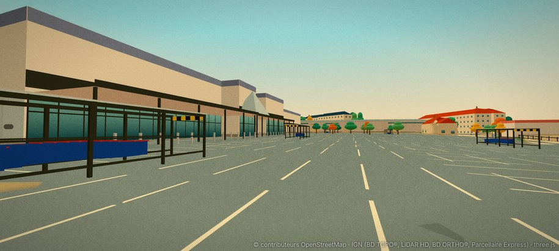

## 2026-10-30 — D123. Bâtiments d'après photos, étape 3 : l'hôtel de ville, volumes et toits

**Demande de l'utilisateur** : modéliser l'hôtel de ville d'après ses photos, en commençant par les volumes et les toits ; retirer l'inscription. Photo fournie (non versionnée, elle sert seulement à décrire) : la façade sur le Champ de Mars (sud-sud-est), de face, depuis la place un peu à l'ouest de l'axe. Lecture : 11 travées ; pavillons d'angle de 2 travées et avant-corps central de 3 travées, en légère saillie, à toits d'ardoise raides et tronqués (le central plus haut, avec paratonnerre) ; trois niveaux : soubassement en pierre blonde à bossages et arcades grillagées, étage noble clair à hautes fenêtres à frontons cintrés, étage en pierre blonde ; perron et portique au centre, balcon à balustrade, trois drapeaux aux baies du balcon, lucarne-fronton aux armes ; œils-de-bœuf, lucarnes, cheminées. Pas d'inscription.

**Constat** : la mairie était le volume générique (cinq niveaux de petites fenêtres identiques, un toit à croupes uniforme, D18), avec l'inscription « HÔTEL DE VILLE » et les drapeaux sur le plus long mur (nord-est), invisibles depuis la place.

**Mesures** (modèle de surface et de terrain LiDAR HD, WMS, fenêtre de 0,5 m autour du bâtiment ; hauteurs au-dessus de la place devant la façade, à −4,5 m) : façade de 44,6 m ; corps principal de 13,75 m de profondeur, corniche à 17,0 m, faîtage à 22,6 m (deux pans) ; pavillons d'angle de 8 m, plateau à 24,9 et 25,0 m ; pavillon central de 12 m, plateau à 27,9 m ; ailes autour de la cour (côtés et arrière) plus basses : égout à 14,4 m, faîtage à 19,5 m sur leur ligne médiane, croupes aux angles ; perron de 12 m de large dont le palier est à 4,5 m (le niveau de la cour, et le haut du soubassement). Les lucarnes relevées sur le pan avant (tous les 4 m, symétriques) confirment les 11 travées de 4,05 m.

**Données** : étape autonome `tools/data/build_monuments.py` (après `build_kinds.py`, qui réécrit `kinds`). La lecture de la photo est dans `monuments` de `tools/data/manual.json` (coin de départ de la façade dans le contour, travées, pavillons en travées, hauts du soubassement et de l'étage noble, `sign: false`) ; l'étape y ajoute les mesures (médianes sur les parties entre pavillons, qui écartent lucarnes et cheminées ; corniche = droite du pan avant ramenée au mur ; plateau des pavillons = cellules à moins de 0,6 m de leur 90ᵉ centile ; égout des ailes = pente entre 1,5 et 4,5 m du mur) et n'écrit que le champ `hall` du bâtiment dans `kinds/26_35.json`, en retirant l'inscription. La fenêtre LiDAR est gardée dans `.cache/shared/raw/monuments` ; une deuxième passe ne réécrit rien.

**Rendu** (`buildTownHall`, `src/render/monuments.ts`, dans le maillage plein de la tuile : aucun appel de dessin de plus, 1 566 triangles et 144 de vitres allumées) : murs, toit et façade génériques ne sont plus dessinés (comme pour un abri à chariots) ; la collision reste l'emprise. **Volumes à pans nets** : corps principal à deux pans (débord de 30 cm), pavillons en saillie de 35 cm à toits en tronc de pyramide jusqu'au plateau mesuré (zinc), ailes basses à deux pans dont le faîtage suit la ligne médiane entre contour et cour (croupes et noues aux angles, ce qui suit le contour irrégulier sans maillage du relevé) ; le pan sur cour de l'aile avant rejoint la corniche arrière du corps principal. **Niveaux** : soubassement et étage en pierre blonde, étage noble clair, bandeaux et corniche clairs ; travées régulières : arcades sombres au soubassement (sauf derrière le perron), fenêtres hautes à l'étage noble et plus courtes à l'étage, portes et baies en plein cintre dans l'avant-corps central ; fenêtres simples tous les 4 m aux mêmes niveaux sur les autres murs, là où elles tiennent entre le sol et la corniche. Plus d'inscription ni de drapeaux génériques.

**Pas encore** : le détail de la façade (bossages, frontons, chaînes d'angle, étape suivante), le portique, le balcon, les drapeaux et le perron (qui reste le talus en marches de D94), les lucarnes, œils-de-bœuf et cheminées, les autres façades d'après photo ; la silhouette lointaine (LOD) reste le volume générique.

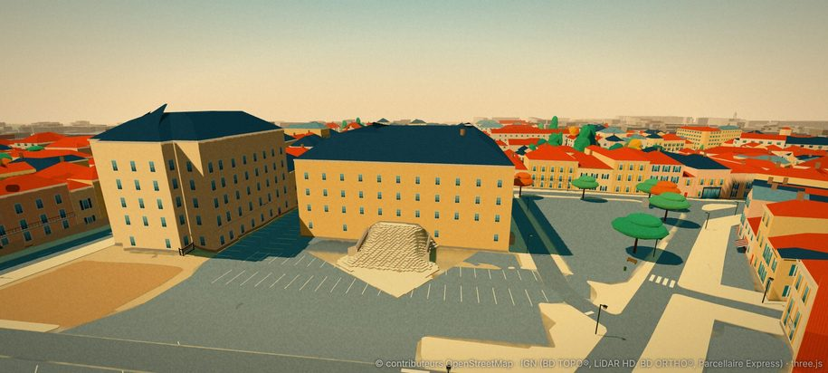

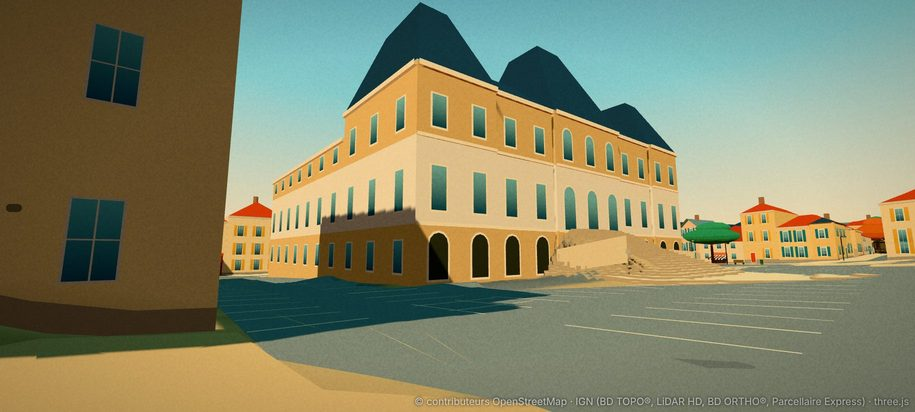
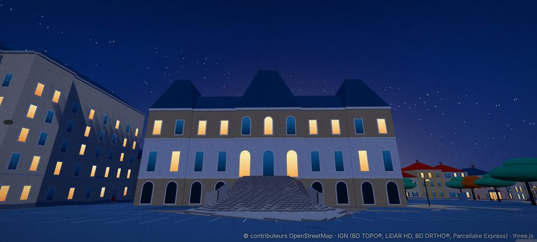

## 2026-10-30 — D124. Bâtiments d'après photos, étape 4 : l'hôtel de ville, détail de la façade

**D'après la photo de l'utilisateur** (façade sur le Champ de Mars, D123), le détail de la façade principale, toujours dans `buildTownHall` (`src/render/monuments.ts`), sans nouvelle donnée :
- **Soubassement à bossages** : refends horizontaux tous les 55 cm (joints creux sombres), clé saillante au sommet de chaque arcade, cordon saillant au-dessus.
- **Étage noble** : appui saillant, corniche et **fronton cintré** (segment de cercle de 2 m de corde, 42 cm de flèche, avec son épaisseur) au-dessus de chaque fenêtre hors de l'avant-corps central ; bandeau sous l'étage.
- **Étage** : appui et linteau saillant.
- **Chaînes d'angle** aux coins saillants des pavillons, de l'étage noble à la corniche : blocs de pierre blonde alternés (95 et 55 cm), en alternance d'une face à l'autre du coin.
- **Corniche moulurée** du corps principal : doucine, larmier de 42 cm de saillie, bandeau, et **modillons** tous les 90 cm sous le larmier côté façade. Les corniches et bandeaux sont prolongés de leur saillie aux deux bouts : les coins saillants se referment.
- Les ornements de quelques centimètres de saillie (chaînes, refends) n'ont que leur face avant : 3 654 triangles pour tout le monument (6 062 avec des pavés complets, sans différence visible).

**Pas encore** : portique, balcon, drapeaux et perron (étape suivante), lucarnes, œils-de-bœuf, cheminées, sculptures des baies centrales.

## 2026-10-30 — D125. Bâtiments d'après photos, étape 5 : l'hôtel de ville, portique, balcon, drapeaux et perron

**D'après la photo de l'utilisateur** : portique de colonnes devant les trois portes cintrées de l'avant-corps central, balcon à balustrade au-dessus, drapeaux aux baies du balcon, perron droit à rampes entre deux murs d'échiffre, lampadaires à deux lanternes sur des piédestaux au pied.

**Mesures** (`build_monuments.py`, même fenêtre LiDAR ; `perron` dans `monuments` de `manual.json` désigne l'escalier remplacé) : bord avant du balcon à 2 m de la façade (le modèle de surface y passe sous l'étage noble), haut de la balustrade à 12,2 m au-dessus de la place ; palier à 4,6 m (terrain sous le portique : le haut du soubassement), qui s'avance jusqu'à 2,25 m de la façade ; pied de la volée 9 m plus loin (terrain revenu à 10 cm du sol relevé 12 à 16 m devant, la place remonte de 30 cm devant le perron) ; volée de 11,25 m de large (terrain au quart de la hauteur, à mi-volée). Champs `portico`, `perron`, `stairs` du `hall` ; une deuxième passe ne change rien.

**Rendu** (`portico`, `src/render/monuments.ts`) :
- **Portique** : six colonnes octogonales (par paires aux bouts, une entre chaque porte) sur bases et sous chapiteaux carrés, entablement en trois assises (architrave, frise en pierre blonde, corniche), dessous clair.
- **Balcon** : plinthe, balustres tous les 32 cm, main courante, dés au-dessus des colonnes doubles.
- **Drapeaux** : tricolore à la baie du milieu, européen (fond bleu, couronne de douze étoiles) à droite, sur des hampes qui sortent du mur à 45° et penchent de côté pour être vus de face. La photo en montre un troisième, rouge et bleu, que l'utilisateur n'a pas encore identifié : il n'est pas dessiné.
- **Perron** : marches régulières (26 de 16 cm, 35 cm de giron) du palier au pied mesurés, posées 5 cm au-dessus du relief ; murs d'échiffre pleins du sol de la place au garde-corps (85 cm au-dessus des marches) ; deux rampes en fer qui partagent la volée en trois ; piédestaux et lampadaires à deux lanternes, allumées la nuit. **L'ancien escalier sur le relief** (`stairs` « hotel-de-ville », D94, colonnes de 50 cm arrondies à la marche) n'est plus dessiné quand un monument le remplace ; la zone reste interdite aux voitures, et l'on marche toujours sur le relief (pente régulière, sous les marches de moins de 20 cm : test).
- 4 896 triangles et 176 de lumières pour tout le monument.

**Pas encore** : sculptures des baies du balcon, lucarnes et œils-de-bœuf, lucarne-fronton aux armes, cheminées, épis et paratonnerre (étape suivante) ; silhouette lointaine.

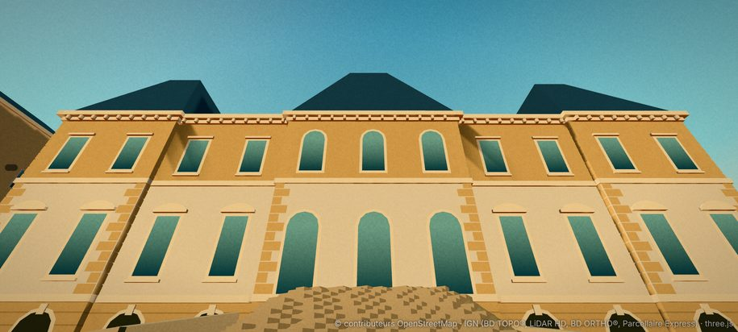
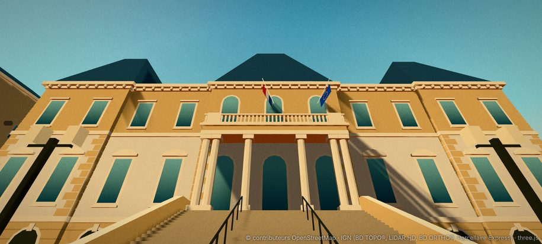

## 2026-10-30 — D126. Bâtiments d'après photos, étape 6 : l'hôtel de ville, toits et silhouette lointaine

**D'après la photo de l'utilisateur** : œil-de-bœuf à encadrement de pierre sur le pan avant de chaque pavillon d'angle, deux lucarnes rondes de chaque côté entre les pavillons, grande lucarne-fronton sculptée aux armes sur le pavillon central, épis sur les pavillons, paratonnerre au centre, crêtes de faîtage, cheminée de brique à droite.

**Mesures** (`build_monuments.py`) : lucarnes des travées 2, 3, 7, 8 (`dormers` dans `manual.json`) : haut = point le plus haut qui dépasse le pan avant de plus de 50 cm (15,95 m local, 3,45 m au-dessus de la corniche, pour les quatre) ; lucarne-fronton : modèle de surface à 0,75-1,75 m de la façade, là où il dépasse le pan raide du pavillon central (18,05 m, 5,5 m au-dessus de la corniche) ; paratonnerre : point le plus haut du plateau central (2,3 m au-dessus) ; les plateaux des pavillons d'angle n'ont pas de pointe mesurable (épis trop fins pour le LiDAR à 0,5 m : hauteur d'après la photo) ; cheminée : celle que la chaîne avait repérée (`chim` du bâtiment), derrière le faîtage à droite, là où la photo montre une cheminée de brique. Une recherche automatique des cheminées par les pics du modèle de surface a été essayée puis écartée : sur des pans raides et des faîtages, elle trouve surtout des arêtes. Les œils-de-bœuf des pavillons d'angle (`oculi`) suivent la photo (2 m de large, 4 m au-dessus de la corniche) : le relevé ne les distingue pas du pan raide.

**Rendu** (`src/render/monuments.ts`) : `dormer` dessine une lucarne sur n'importe quel pan (face verticale de contour donné, joues triangulaires jusqu'au pan, couverture en zinc qui rejoint le pan) ; lucarnes rondes (face à plein cintre, oculus cerclé) sur le corps principal, œils-de-bœuf plus grands à clé sur les pavillons d'angle, lucarne-fronton (panneau à fronton cintré, corniche, cartouche ovale, volutes) sur le pavillon central ; crête en fer autour des plateaux, épis, paratonnerre ; cheminée en brique coiffée d'une dalle. 5 431 triangles pour tout le monument.

**Silhouette lointaine** : `build_monuments.py` remplace le prisme unique du bâtiment dans `lod/26_35.json` par cinq (corps principal, trois pavillons, ailes basses), chacun avec son égout et son haut ; les autres entrées du fichier sont inchangées et une deuxième passe ne réécrit rien. De loin, la mairie garde ses trois toits plus hauts.

**Pas encore** : les autres façades et la cour d'après photo (aucune photo pour l'instant), la cheminée de pierre à gauche de la photo (non retrouvée dans le relevé), le troisième drapeau, les sculptures des baies du balcon.

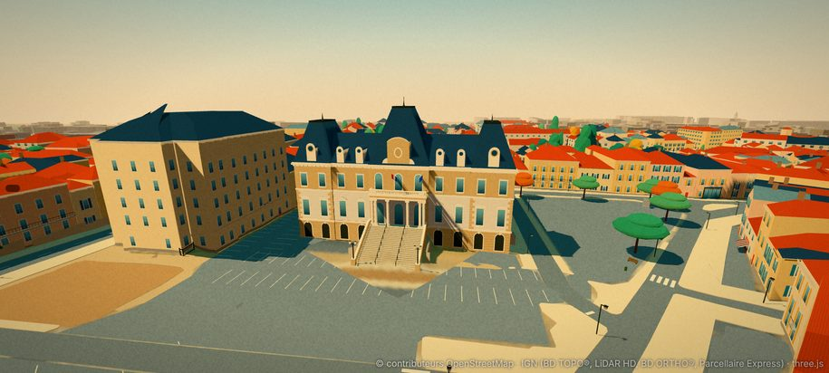
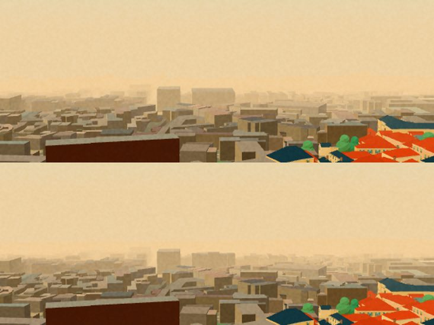

## 2026-10-30 — D127. Bâtiments d'après photos, étape 7 : la cathédrale Saint-Lazare, volumes mesurés

**Demande de l'utilisateur** : modéliser la cathédrale d'après ses photos, avec la même méthode que pour l'hôtel de ville. Photos fournies (non versionnées, elles servent seulement à décrire), points de vue confirmés par l'utilisateur : vue de drone au-dessus du chevet (sud-sud-est) vers la ville ; le chevet au sol depuis le sud-est ; le flanc est de nuit, flèche à gauche et tour est du porche à droite. Lecture : nef de 7 travées entre le porche (nord-nord-ouest) et la croisée, chapelles gothiques le long des bas-côtés (grandes baies, pinacles, balustrade), toits de tuiles plates brun-ocre ; abside polygonale, bloc carré au bout du bras ouest du transept et petite tourelle, couverts de tuiles vernissées en losanges ; tour de croisée à baies jumelles, galerie, flèche octogonale de pierre grise à gâbles, crochets et clochetons ; deux tours carrées au porche, à flèches de pierre ; portail roman au pignon du bras est. Plan validé : (1) volumes mesurés et couleurs, (2) chevet et tuiles vernissées, (3) tour de croisée et flèche, (4) flancs et porche.

**Constat** : la nef était le bâtiment générique (grand mur nu, œils-de-bœuf et portes de maison), `buildCathedral` (D95) y ajoutait des volumes approximatifs couverts d'ardoise bleue, flèche comprise ; de loin, le clocher lointain était un mât de 54 m (haut de la tour mal mesuré : l'anneau autour de la flèche prenait la flèche elle-même).

**Mesures** (`build_monuments.py`, modèle `cathedral`, dans le repère de `mon` de build_kinds : s le long de la nef vers le chevet, t vers l'est-nord-est ; profils médians du modèle de surface LiDAR, ce qui écarte pinacles et arbres ; murs = chutes de plus de 3 m entre deux échantillons de 0,5 m ; égouts = droite du pan ramenée au mur ; hauteurs au-dessus du sol du bâtiment) :
- porche de 13 m de large et 11,4 m de long, faîtage à 20,1 m ; nef de 38 m (7 travées de 5,5 m) et 14,5 m de large, égout 19,0 m, faîtage 30,0 m ;
- bas-côtés en appentis de 5 m (13,5 m contre la nef, 11,4 et 12,6 m au mur extérieur) ; chapelles par travée jusqu'au bord de l'emprise BD TOPO, plus basses à l'ouest (6 à 8 m) qu'à l'est (12 m, celles de la photo de nuit) ;
- transept de 14,5 m entre pignons à 46 m l'un de l'autre, égout 20,6 m, faîtage 25,1 m (plus bas que la nef) ; au bout du bras ouest, le bloc carré (11 × 15 m), égout 10,8 m, pointe du toit 25,4 m ;
- tour de croisée de 12,5 m de côté, corps à 40,3 m, flèche à 85,6 m ;
- chœur de 13,5 m de large, égout 20,0 m, faîtage 30,6 m ; abside de 6,75 m de rayon, corniche à 24,7 m (relevée à 75 cm du mur sur l'axe, plus haute que celle du chœur) ; elle finit au bout de l'emprise, le toit débordant d'1 m au-delà ; bas-côtés du chœur en appentis.
- **Tours du porche : le relevé ne les voit pas.** Aux coins avant du porche, le modèle de surface reste au niveau du sol (le parvis, 3 m plus bas que le bâtiment), alors que l'orthophotographie de l'IGN et les photos de l'utilisateur montrent deux tours carrées à flèche de pierre. Seule une arête fine de 30 à 32 m longe le bord ouest du porche (non identifiée). Côté pris sur l'emprise (6 et 5,3 m), hauteurs d'après les photos (corps à 26 m, pointe à 36 m, `towers` dans `manual.json`), les deux tours identiques (symétrie validée par l'utilisateur).

Champ `cath` du bâtiment dans `kinds/26_32.json` ; l'étape corrige aussi le clocher lointain (`tower` du bâtiment et son repère dans `kinds/index.json` : tour de 12,5 m jusqu'à 40,3 m, flèche à 85,6 m) et remplace le prisme unique de la silhouette lointaine (`lod/26_32.json`) par douze (porche, tours, nef, bas-côtés, transept, bloc, tour de croisée, chœur et abside, bas-côtés du chœur). `mon` reste (repère, et gabarit D95 des cathédrales sans modèle). Une deuxième passe ne réécrit rien.

**Rendu** (`buildSaintLazare`, `src/render/monuments.ts`, dans le maillage plein de la tuile : aucun appel de dessin de plus, 1 043 triangles) : murs, toit et baies génériques ne sont plus dessinés (comme pour la mairie) ; la collision reste l'emprise. Volumes à pans nets, murs qui suivent le relief (le sol monte de 5 m du parvis au chevet) ; toits de tuiles brun-ocre (nef, porche, transept, bloc, chœur, abside, bas-côté ouest), gris-vert sur le bas-côté est et toutes les chapelles (d'après l'orthophotographie) ; flèches en pierre grise. Baies sombres en plein cintre : fenêtres hautes de la nef par travée, grandes baies des chapelles, baies de l'abside, portail et grande baie au pignon est du transept, baies jumelles des tours, grand arc du porche.

**Pas encore** (étapes suivantes du plan) : les tuiles vernissées et la tourelle du chevet (étape 2), le détail de la tour de croisée et de la flèche (3), les chapelles gothiques, les fenêtres en arc brisé, les marches et le portail du porche (4) ; la fontaine Saint-Lazare au pied de la tour est (photo de nuit), à confirmer.

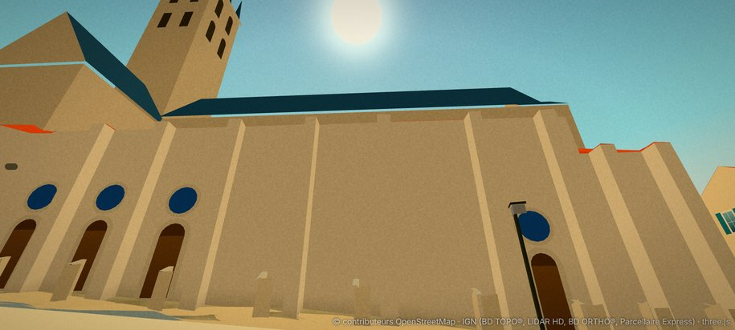

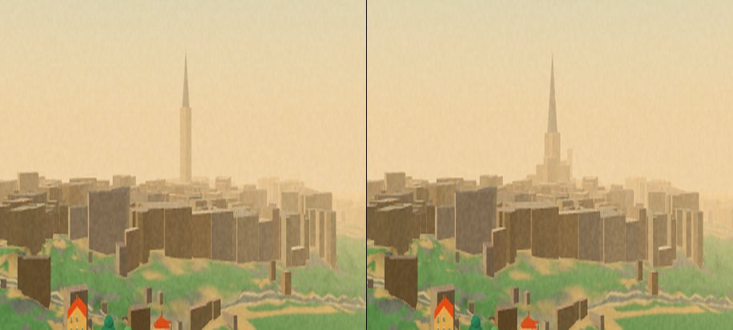

## 2026-10-30 — D128. Bâtiments d'après photos, étape 8 : la cathédrale, le chevet et ses tuiles vernissées

**D'après les photos de l'utilisateur** (drone au-dessus du chevet, chevet au sol depuis le sud-est) : l'abside polygonale à contreforts et hautes baies, le bloc carré au bout du bras ouest du transept et une petite tourelle entre lui et le chœur sont couverts de tuiles vernissées en losanges (jaune d'ocre, vert, brun-noir, rouge) ; le bloc a de grandes baies.

**Mesure** (`build_monuments.py`) : la **tourelle** se voit dans le modèle de surface (pointe à 22 m au-dessus du sol du bâtiment, au-dessus du bas-côté du chœur à 10-12 m et du toit du bloc) : point le plus haut juste derrière le transept, au coin du bloc ; centre = médiane des cellules à moins de 1,5 m de ce haut ; côté d'après la photo (3 m, `turret` dans `manual.json`). Champ `turret` de `cath` ; une deuxième passe ne change rien.

**Rendu** (`src/render/monuments.ts`) :
- **Tuiles vernissées** (`glazedPan`) : sur un pan quelconque (quadrilatère ou triangle), rangs de losanges en quinconce, chaque losange fait de deux triangles de part et d'autre d'une ligne de rang ; couleur selon les deux diagonales du réseau : tous les quatre losanges, une résille verte dans un sens et brun-noir dans l'autre, un losange rouge au cœur de chaque maille, fond jaune. En aplats, sans texture (D17). Sur le cône de l'abside, le toit en croupe du bloc et la pyramide de la tourelle (`hipRoof` accepte maintenant un dessin de pan).
- **Abside** : corniche saillante, contreforts à glacis aux angles du polygone, deux étages de baies en arc brisé par pan (hautes baies en haut, petites en bas).
- **Bloc** : deux grandes baies en arc brisé par face libre, contreforts d'angle. **Tourelle** : corps carré, corniche, baie, pyramide vernissée jusqu'à la pointe mesurée.
- `archOn` dessine aussi l'arc brisé équilatéral ; `buttress` pose un contrefort dans n'importe quelle direction.
- 2 643 triangles pour toute la cathédrale (1 043 à l'étape 1).

**Pas encore** : le motif exact de chaque toit (la photo du drone montre aussi des chevrons) est stylisé, le même pour les trois toits ; le détail de la tour de croisée et de la flèche (étape 3), les flancs et le porche (étape 4).

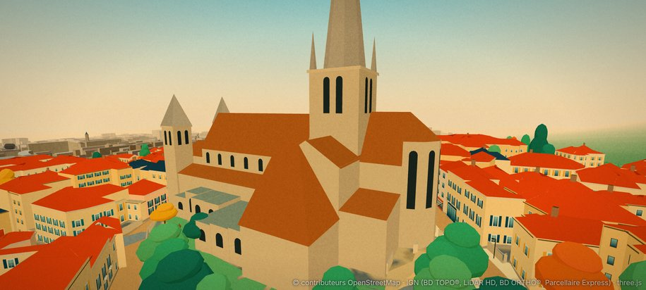

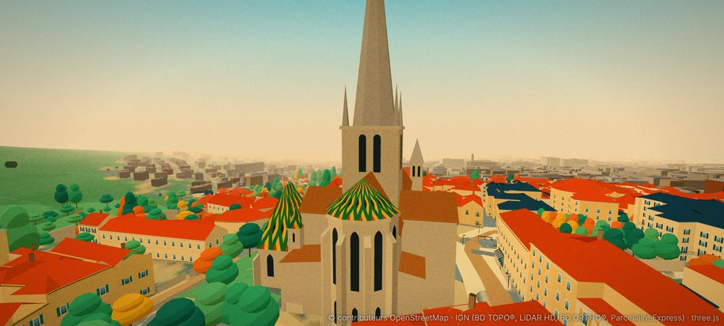

## 2026-10-30 — D129. Bâtiments d'après photos, étape 9 : la cathédrale, tour de croisée et flèche

**D'après les photos de l'utilisateur** (chevet au sol depuis le sud-est, drone) : tour carrée à contreforts d'angle, deux hautes baies jumelles en arc brisé par face, galerie à balustrade ajourée ; flèche octogonale de pierre grise à crochets sur les arêtes, gâbles ajourés au pied des faces, grands clochetons aux angles de la tour, croix.

**Mesures** (`build_monuments.py`) : **rayon de la flèche au pied**, 5,4 m (octogone presque aussi large que la tour de 12,5 m) : pour chaque altitude, rayon de l'octogone de même aire que les cellules du modèle de surface plus hautes ; droite en altitude entre 8 m au-dessus de la tour et 6 m sous la pointe (plus bas, gâbles et clochetons élargissent la coupe), ramenée au haut de la tour. Les **clochetons et les gâbles** sont trop fins pour le relevé à 0,5 m : un seul angle de la tour monte à 9,5 m au-dessus de la galerie, les trois autres à 4-5 m, et les gâbles ne se distinguent pas du cône de la flèche ; hauteurs d'après la photo (clochetons à 9 m au-dessus de la tour, ce que confirme l'angle mesuré ; gâbles de 6 m), dans `spire` de `manual.json`. Champs `tower` (rayon ajouté) et `spire` de `cath` ; une deuxième passe ne change rien.

**Rendu** (`src/render/monuments.ts`) : deux contreforts à glacis à chaque angle de la tour, au-dessus des toits ; par face, un arc de décharge en retrait et deux baies en arc brisé ; corniche et balustrade (parapet de 1,1 m percé de jours tous les 60 cm, `rectOn`) ; flèche au rayon mesuré, crochets tous les 2,8 m sur les huit arêtes (ailettes vues des deux côtés) ; quatre gâbles au pied des faces tournées vers la nef, le chœur et les bras, avec leur petit toit qui rejoint la flèche et une lucarne en arc brisé ; clochetons d'angle (fût carré et pyramide) ; croix en fer. 3 299 triangles pour toute la cathédrale.

**Pas encore** : les flancs (chapelles gothiques, fenêtres en arc brisé, pinacles et balustrade) et le porche (marches, portail, tours), étape 4.

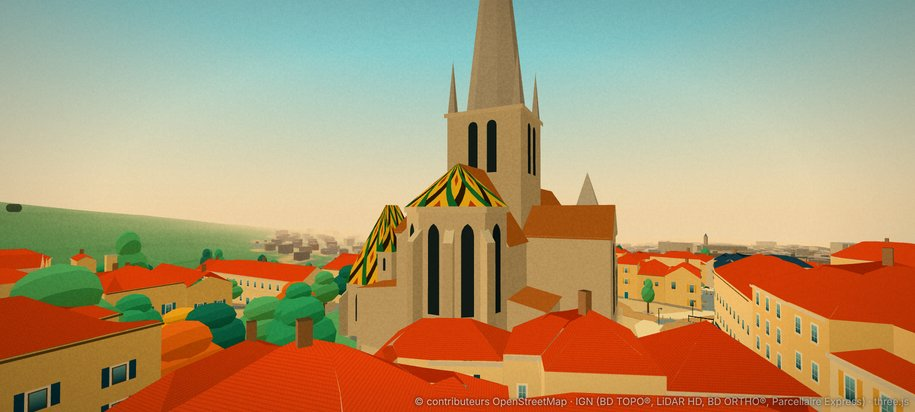

## 2026-10-30 — D130. Bâtiments d'après photos, étape 10 : la cathédrale, flancs et porche

**D'après les photos de l'utilisateur** : le flanc est de nuit (chapelles gothiques à grandes baies, contreforts surmontés de pinacles, balustrade ajourée le long des toits ; fenêtres hautes de la nef en plein cintre ; portail roman à petit pignon au bras est du transept ; tour est du porche à deux étages de baies jumelles, contreforts et flèche de pierre à clochetons) et la vue de drone (les deux tours du porche).

**Rendu** (`src/render/monuments.ts`, aucune donnée nouvelle) :
- **Chapelles** : grande baie en arc brisé à meneau par travée, contreforts à glacis entre les travées ; côté est seulement (photo de nuit), pinacles au-dessus des contreforts et balustrade ajourée (parapet de 90 cm, jours tous les 60 cm). Les chapelles de l'ouest, plus basses (6 à 8 m mesurés), n'ont pas de photo : baies et contreforts seulement.
- **Nef** : bandeau sous l'égout.
- **Transept** : avant-corps du portail au pignon est (6 m de large, petit pignon couvert de tuiles), voussure claire et porte.
- **Tours du porche** : deux étages de baies jumelles en plein cintre dans un encadrement en retrait sur chaque face, cordon entre les étages, contreforts aux angles extérieurs jusqu'au cordon, clochetons aux angles de la flèche.
- 4 163 triangles pour toute la cathédrale (1 043 à l'étape 1 ; la mairie en a 5 431). Le test borne le monument à 8 000.

**Pas encore** (faute de photo ou de validation) : la façade du porche (portail, marches depuis le parvis, plus bas de 3 m : le relevé ne montre pas de marches devant le porche), les chapelles de l'ouest, la fontaine Saint-Lazare au pied de la tour est ; l'éclairage de nuit de la cathédrale (la photo de nuit la montre illuminée, le jeu la laisse dans l'ombre comme les autres bâtiments).

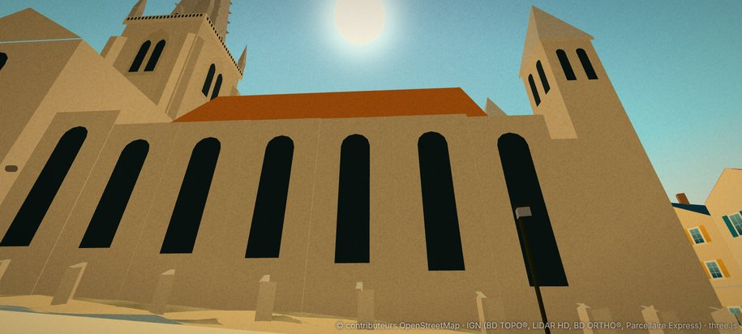
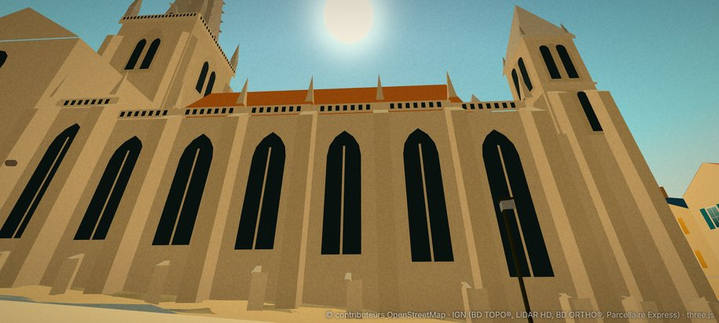
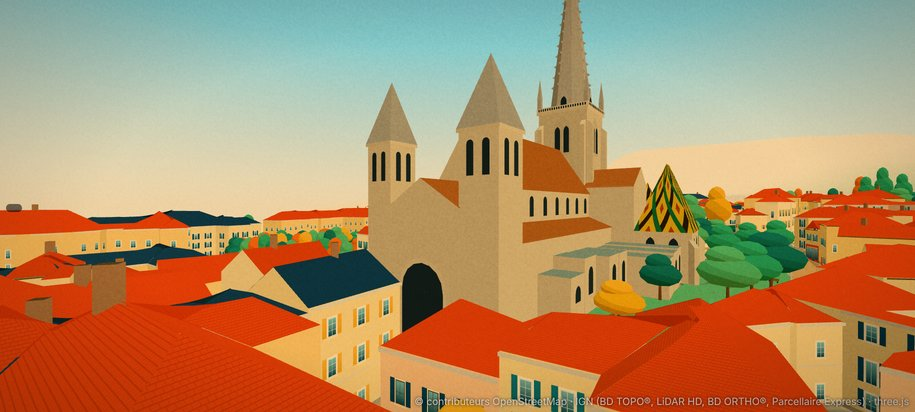

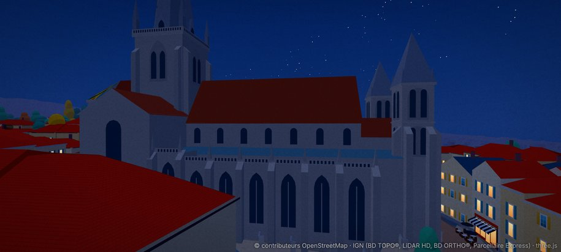

## 2026-10-30 — D131. Bâtiments d'après photos, étape 11 : le portail de la cathédrale et la fontaine Saint-Lazare

**Photos de l'utilisateur** (non versionnées) : le portail au fond du porche, de face ; la fontaine Saint-Lazare vue du nord-est, avec derrière elle les chapelles de l'est et le flanc du porche ; l'utilisateur confirme que c'est l'édicule vu au pied de la tour est sur la photo de nuit (D127). Lecture :
- **Porche et portail** : porche ouvert sous une voûte en berceau, arcs sur les murs latéraux, escalier jusqu'au seuil entre deux grilles à pointes ; deux portes de bois à panneaux, trumeau portant une statue, colonnes à chapiteaux dans les ébrasements, linteau sculpté, tympan du Jugement dernier (Christ en mandorle au centre, figures en registres), trois voussures dont une à médaillons. Sur le flanc du porche (photo de la fontaine), arcades jumelles en arc brisé et oculus.
- **Fontaine** : emmarchement et bassin bas à lobes en pierre sombre, vasque sur pied avec jet au centre, édicule Renaissance de pierre claire à quatre piles (piédestaux, colonnes cannelées), arcs en plein cintre sur chaque face, entablement à inscription, frontons, vases aux angles ; lanterne ronde à colonnettes et niche, coupolette, pélican au sommet.

**Mesures** (`build_monuments.py`, modèle `fountain` dans `monuments` de `manual.json`) : la fontaine est dans OpenStreetMap (mobilier `fountain` « Fontaine Saint-Lazare », 13 m à l'est de la tour est du porche, comme sur les photos). Sur le modèle de surface : centre de l'édicule (cellules à plus de 2 m au-dessus du sol), haut 8,3 m, bassin de 3,0 m de rayon (premier cercle où la médiane du relevé retombe à moins de 10 cm du sol) ; orientation de la cathédrale. Site `fountain` dans `kinds/26_33.json` (et le compte des sites de `kinds/index.json`) ; une deuxième passe ne change rien. Le porche n'a pas de nouvelle donnée : le seuil des portes est pris au sol du bâtiment (BD TOPO), faute de mesure possible sous le toit ; le pied de l'escalier est au plus haut point du relief du jeu, 4,2 m devant les portes, soit 11 marches.

**Rendu** (`src/render/monuments.ts`) :
- **Porche** : le mur avant est percé d'un vrai grand arc (`archWall`, intrados et piédroits `archSoffit`), ce qui laisse voir l'intérieur : voûte en berceau, murs intérieurs à arcs aveugles, escalier et grilles, **portail** (`portal`) sur le mur ouest de la nef. Le tympan est stylisé en aplats : demi-disque, mandorle plus sombre, Christ plus clair, deux registres de figures de part et d'autre, frise du linteau, médaillons de la voussure. Proportions d'après la photo (portes de 5 m sur 4,2 m, tympan de 6,4 m). La collision reste l'emprise : on ne monte pas dans le porche.
- **Fontaine** (`buildFountain`, dessinée par la tuile où elle se trouve) : modèle complet, hauteurs d'après la photo mises à l'échelle du haut mesuré. Le cylindre générique du mobilier n'est plus dessiné (même identifiant OpenStreetMap). Le bassin devient un obstacle de son rayon. Un arbre de la carte poussait au milieu : les arbres à l'intérieur du bassin ne sont plus ni dessinés ni des obstacles (`treesOutsideMonuments`).
- 5 275 triangles pour la cathédrale (4 163 avant), 1 112 pour la fontaine.

**Pas encore** : on ne peut pas entrer dans le porche (la collision suit l'emprise) ; la façade extérieure du porche n'a pas de photo (un seul grand arc) ; la navigation des passants garde l'ancien rayon de la fontaine (1 m) ; l'éclairage de nuit.

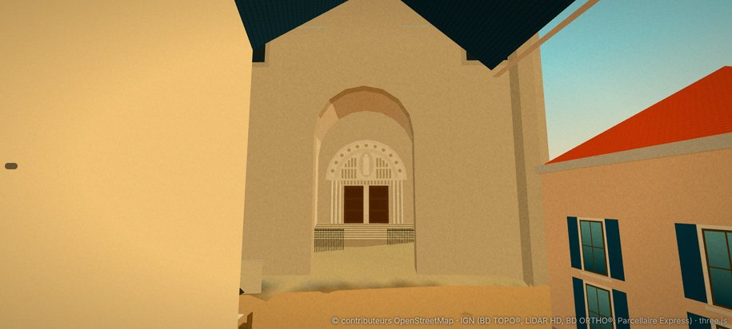

## 2026-10-30 — D132. Bâtiments d'après photos, étape 12 : la façade du porche, l'entrée dans le porche, la fontaine pour les passants, la cathédrale la nuit

**Demande de l'utilisateur** : traiter les quatre points laissés en D131, avec deux nouvelles photos (captures Google Street View d'août 2018, non versionnées) de la façade du porche, du parvis Chanoine-Denis-Grivot. Lecture :
- **Bas** : trois larges marches sur toute la façade, puis le palier sous le porche ; des grilles à pointes de part et d'autre de la volée qui monte au portail (passage ouvert au milieu) ; arcs plus bas sous les tours, fermés de grilles.
- **Haut** : grand arc à voussure moulurée sur colonnes engagées, contreforts massifs de part et d'autre, cordon au-dessus de l'arc, galerie de petites arcades dont trois ajourées, corniche et pignon bas ; deux tours carrées à baies jumelles.

**1. Façade du porche** (`src/render/monuments.ts`) : voussure (deux anneaux), colonnes engagées et chapiteaux du grand arc, cordon, galerie de cinq arcades aveugles dont trois percées, corniche, contreforts entre l'arc et les tours ; sous chaque tour, un arc ouvert en façade (62 % de la largeur de la tour, sommet aux deux tiers de celui du grand arc), avec intrados, fond sombre et grille.

**2. On entre dans le porche** (`porchLayout`, `porchDecks`, `cathedralWalls`, `src/core/landmarks.ts`) :
- **Niveaux** (`build_monuments.py`, champ `entry` de `cath`) : parvis = terrain LiDAR médian sur toute la largeur de la façade, 2,5 m devant elle (3,3 m sous le sol du bâtiment) ; palier = parvis + 3 marches de 16 cm (photo, `entrySteps` dans `manual.json`) ; seuil = sol du bâtiment (le relevé ne voit pas sous le toit). Une deuxième passe ne change rien.
- **Surface** : deux tabliers invisibles (comme les ponts, D93), enregistrés avec ceux de la tuile : les trois marches de la façade, puis le palier, la volée (17 marches de 16 cm) et le palier des portes. Le jeu prend toujours le plus haut du relief et du tablier ; au dessin, chaque marche est posée au-dessus des deux (le relief du jeu remonte par endroits sous le porche), la marche visible et le sol de marche restent à quelques centimètres.
- **Obstacles** : l'emprise BD TOPO n'est plus un obstacle devant le porche ; à sa place, les tours pleines, les piles du grand arc, les murs de la salle et le mur des portes (fermées), et les grilles de part et d'autre de la volée (1,2 m, on ne les escalade pas). Test : du parvis on va jusqu'aux portes, pas dans la nef ; les grilles barrent les côtés de la volée ; les tours sont pleines.

**3. Les passants et la fontaine** : la navigation actuelle contourne déjà la fontaine (les arêtes les plus proches passent à 3,5 et 3,8 m du centre, hors du bassin de 3 m). `build_nav.py` prend désormais le bassin mesuré (site `fountain`) comme rayon d'obstacle et écarte les arbres qui y poussaient, comme le jeu (D131). La navigation n'est pas régénérée : `build_nav.py` repart de tout OpenStreetMap et réécrirait toute la ville ; la correction s'appliquera à la prochaine génération.

**4. La cathédrale la nuit** (photo de nuit, D127) : pendant `buildSaintLazare`, murs, contreforts et flèches sont doublés dans le maillage des vitres allumées (visible la nuit seulement, aucun appel de dessin de plus), en dégradé chaud du pied (projecteurs) vers le haut. Les toits restent sombres. Les flancs des contreforts sont plus sombres que leur face pour qu'ils se détachent du mur. Les baies et encadrements sont redessinés dans le même maillage, après les murs : sans quoi, de loin, la lumière (tirée vers la caméra) les recouvrait. Les baies restent sombres.

**Coût** : 6 253 triangles pour la cathédrale (5 275 avant) et 2 378 d'éclairage, dessinés la nuit seulement (test : moins de 8 000 et 4 000).

**Pas encore** : l'intérieur de la nef (les portes restent fermées) ; les sculptures du portail restent en aplats ; la navigation des passants ne passe pas dans le porche.

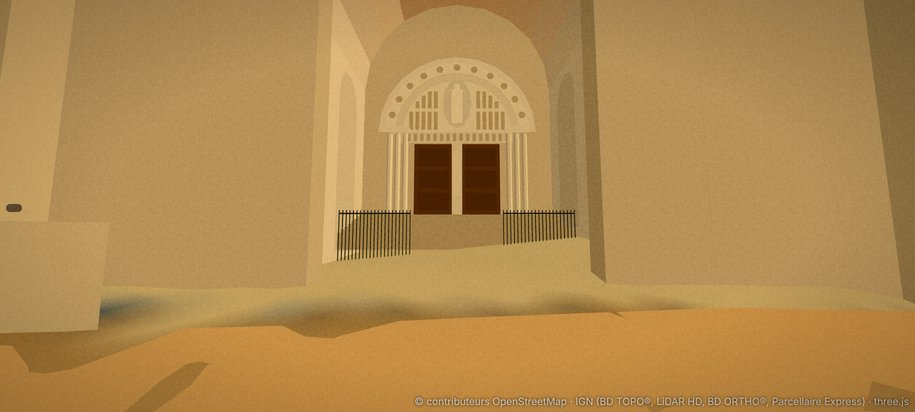

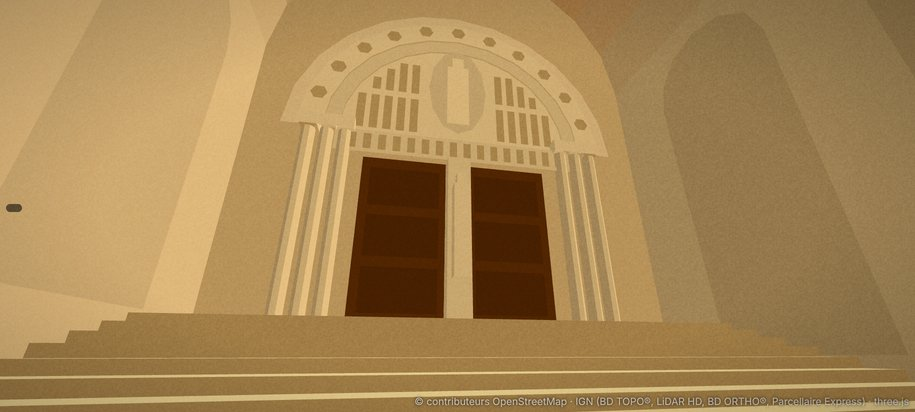

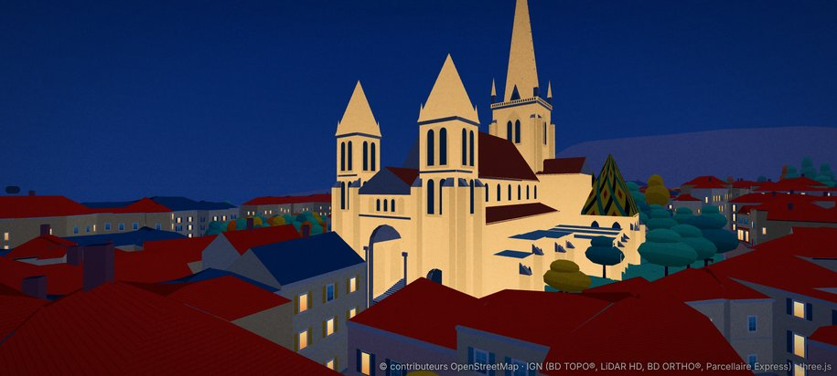
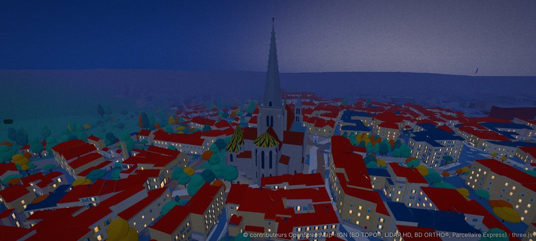
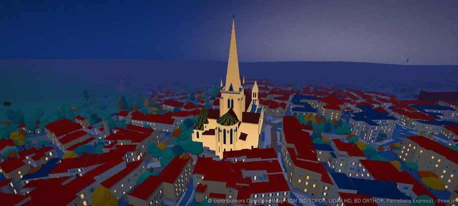

## 2026-10-31 — D133. Bâtiments d'après photos, étape 13 : le théâtre romain, volumes mesurés

**Demande de l'utilisateur** : modéliser le théâtre romain d'après ses photos, avec la méthode de la cathédrale. Photos (non versionnées), points de vue confirmés : vue de drone depuis l'est au-dessus du stade ; du haut de l'extrémité nord vers le sud-sud-est ; depuis l'aile sud vers le nord. Lecture : cavea en demi-cercle ouverte à l'est-nord-est, une quinzaine de rangs restaurés en pierre grise derrière un podium bas, escalier central jusqu'à l'orchestre de terre battue, allée herbue au-dessus, partie haute en massifs de maçonnerie moussus séparés par des escaliers rayonnants (quelques coins à gradins restaurés, marches à traverses de bois), gros massifs ruinés aux extrémités, rideau de grands arbres au sommet, scène moderne sur le diamètre (plateau gris clair, marches, barrières), poteau d'éclairage, bancs. Pas de mur de scène ni de vomitoire lisible. Choix de l'utilisateur : gradins, précinction, coins du haut et escaliers praticables ; pas d'éclairage de nuit ; la piste du stade voisin en terre rouge-brun. Plan validé : (1) volumes mesurés, (2) ruines et détails, (3) jouabilité et passants, (4) scène et mobilier.

**Constat** : le théâtre était l'emprise BD TOPO `BATIMENT0000000035039419` (« Arène ou théâtre antique », 17,5 m), dessinée comme un immeuble en fer à cheval de six étages à toit plat qui couvrait toute la cavea ; au sol, on était dedans. Le relief LiDAR, lui, a bien la forme de la cavea.

**Mesures** (`build_monuments.py`, modèle `theatre`, site `theatre` de `kinds/29_36.json`) :
- **Centre et orchestre** : cercle ajusté sur le pied des gradins (premier rayon où le terrain dépasse l'orchestre de 60 cm), sur les directions où la pente monte de plus de 8 m : centre (857,7 ; 299,7), **rayon 26,5 m** (écart de quelques centimètres d'une direction à l'autre) ; orchestre à −15,2 m (quart bas du terrain dans 18 m, la scène et le pré occupant l'autre moitié). **Axe vers 201°** : la cavea s'ouvre vers l'est-nord-est ; pente mesurée sur 168°, dessinée en demi-cercle (les bouts, ruinés, sont sur le diamètre).
- **Le terrain (MNT) gomme tout** : gradins et ruines y deviennent une pente lisse de 1 pour 3, 2 à 3 m sous les ruines. Profil médian du **modèle de surface (MNS)** sur l'axe ± 50° : gradins restaurés jusqu'à 38,5 m (pente 0,48), **précinction** de 38,5 à 41 m (palier à −8,55 m), partie haute jusqu'à la **terrasse** (56,5 m, vers −1,2 m), **lisière des arbres** à 66,5 m, **sommet** à 78 m (+1,8 m, 17 m au-dessus de l'orchestre ; 148 m de diamètre au haut de la pente, comme dans les sources).
- **Gradins restaurés** : droite du MNS entre le pied et la précinction ; **15 rangs** (photos, le relevé à 0,5 m ne les sépare pas) de 77 cm et 35 cm ; podium de 50 cm d'épaisseur et 1,5 m de haut devant le premier rang. **Étendue sur l'orthophotographie** (pierre grise peu saturée entre 29 et 37 m) : de −58° à +61° autour de l'axe.
- **Escaliers** : voies `highway=steps` d'OpenStreetMap (API officielle, gardée dans `.cache`) : trois en bas (dont celui de l'axe, qui descend dans l'orchestre), six en haut (sept coins). Haut de chaque escalier du haut : terrain à la lisière.
- **Coins du haut** : hauteur médiane du MNS au pied, au début de la terrasse et à la lisière (quart bas du MNS et au plus 4 m au-dessus du terrain près des arbres, dont les cimes débordent) ; les deux coins extrêmes et les **massifs du bas au-delà des gradins** sont des ruines : profil en paliers (9 et 6 mesures).
- **Scène moderne** : contour OpenStreetMap (`building=scene`), dessus = médiane du MNS (1,5 m au-dessus de l'orchestre, de plain-pied avec le pré), marches côté orchestre jusqu'où le MNS atteint le dessus (5,5 m).
- Le bâtiment BD TOPO est masqué (`hidden`) et sa silhouette lointaine retirée : de loin, la cavea est le creux du relief. Une deuxième passe ne réécrit rien.
- **Piste du stade du Théâtre romain** : sans étiquette de revêtement dans OpenStreetMap ; d'après la photo de drone et l'orthophotographie, c'est une allée de terre rouge-brun. Correction `tracks` de `manual.json` (site `track` avec `s: "dirt"`), appliquée par `build_monuments.py`.

**Rendu** (`src/render/theatre.ts`, logique dans `src/core/theatre.ts`, dans le maillage plein de la tuile : aucun appel de dessin de plus) : orchestre de terre battue et dallage au pied du podium, posés sur le relief ; podium ; rangs de pierre grise ; précinction herbue ; coins du haut en pente nette (dessus d'herbe, flancs de maçonnerie), massifs ruinés en paliers ; escaliers à marches de pierre (demi-marches entre les rangs) ; scène (marches et plateau). Chaque morceau est un secteur d'anneau dont les bords descendent jusqu'à ce qui le jouxte (rang, escalier, relief) ; une marche plate ne passe jamais sous le relief. Les arbres de la carte dans la cavea, l'orchestre et sur la scène sont retirés (il y en avait un, dans le massif nord). **6 966 triangles** (test : moins de 12 000, pour les détails de l'étape 2).

**Jouabilité, déjà en place** (D93) : tabliers invisibles. Nouveau type de tablier, le **secteur d'anneau** (`DeckSector`, altitude linéaire en rayon, `Decks.addSectors`) : podium, chaque rang (exactement sur la marche dessinée), précinction, dessus des coins et des paliers des massifs ; les escaliers et les marches de la scène sont des rampes qui passent par le milieu des contremarches (à une demi-marche près, moins de 20 cm, test). On monte de l'orchestre au sommet par l'escalier de l'axe sans marche de plus de `STEP_UP` (test). **Obstacles** : le podium (on l'escalade, on voit par-dessus) sauf à l'escalier de l'axe, les bords des massifs et des coins plus hauts de plus d'1 m que ce qui les jouxte (escaladables jusqu'à 2,5 m, D106), les barrières des deux côtés de la scène.

**Pas encore** (étapes suivantes) : le détail des ruines (moellons, ruptures, coins du haut à gradins restaurés, marches de bois), la navigation des passants, les barrières dessinées de la scène, le poteau d'éclairage et les bancs.

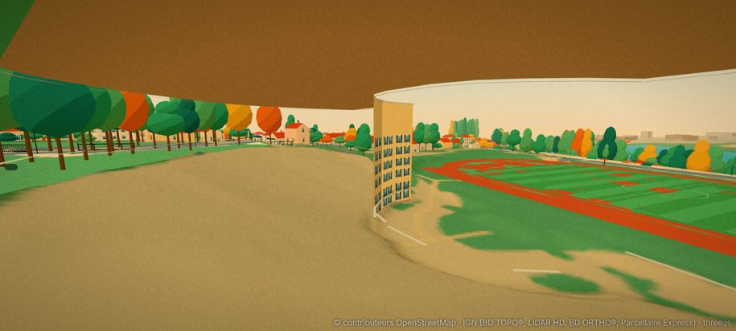
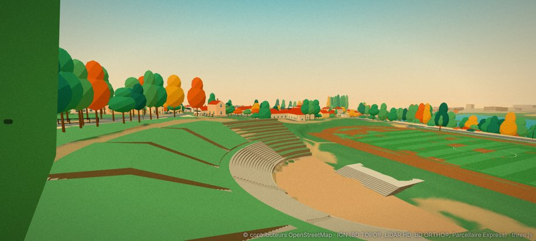

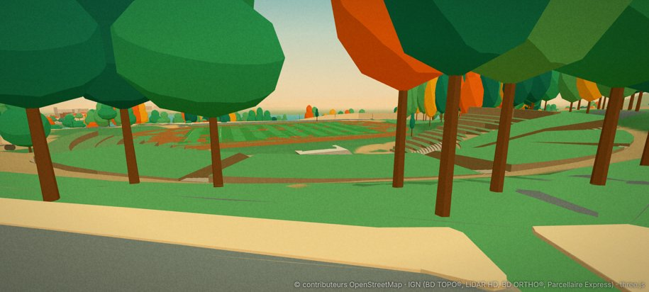
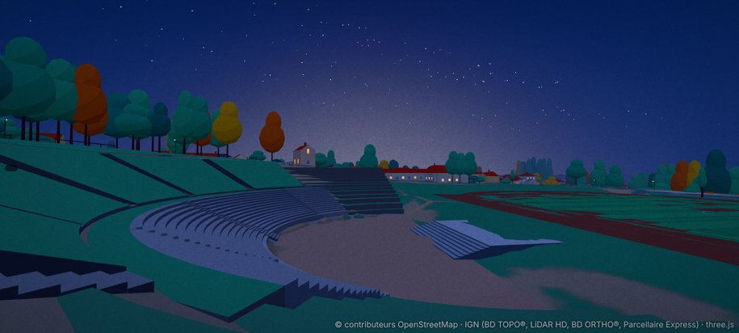
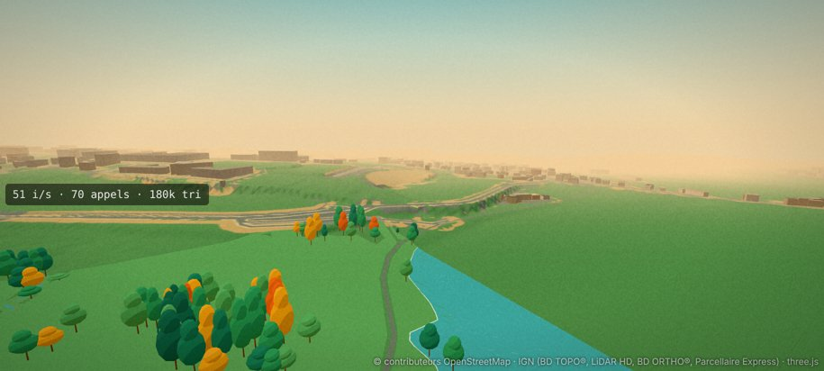

## 2026-10-31 — D134. Bâtiments d'après photos, étape 14 : le théâtre romain, ruines et détails

**Suite du plan validé (D133), étape 2.** Ce qui se voit sur les photos de l'utilisateur et que l'étape 1 ne dessinait pas : les massifs des extrémités sont des blocs de maçonnerie cassés (pas de grandes marches régulières), deux coins de la partie haute ont retrouvé leurs gradins, les murs des voûtes affleurent dans l'herbe des autres coins, les escaliers du haut ont des marches d'herbe tenues par des traverses de bois.

**Coins restaurés : d'après les photos, la mesure ne suffit pas.** Recherche du rythme des rangs (période de 0,6 à 1 m) dans le profil radial de l'orthophotographie, coin par coin : les gradins du bas, restaurés, donnent un rapport de 0,31 ; seul le coin de 12° à 33° au sud de l'axe, sur sa pente (42 à 56 m), en donne autant (0,28), le coin de l'axe 0,12, les autres moins de 0,1. La photo de drone montre des gradins dans ces deux coins (au centre et au centre-gauche, vue depuis l'est). Choix : ces deux coins (`upperRows` de `manual.json`, indices 3 et 4 depuis l'extrémité nord) ; nombre de rangs = hauteur de la pente divisée par celle des rangs du bas, mesurée : **20 et 19 rangs** d'environ 35 × 78 cm, comme en bas (`build_monuments.py`, 5ᵉ valeur de chaque coin de `cun`).

**Morceaux** (`blockPieces`, `src/core/theatre.ts`) : chaque massif est découpé en morceaux (secteurs d'anneau) qui servent à la fois au dessin, aux tabliers invisibles et aux obstacles :
- **ruines** : blocs d'environ 7 m de large ; chaque palier mesuré est relevé ou abaissé de −0,5 à +0,3 m par un bruit déterministe (la maçonnerie est cassée, pas taillée en marches) ; au bout de la cavea, sur le diamètre, chaque bloc s'arrête 0 à 2 m en retrait (dents de scie, comme sur la photo de drone) ;
- **coins restaurés** : la pente devient des rangs (secteurs plats, exactement à la hauteur dessinée), la terrasse reste herbue ;
- **autres coins** : pente et terrasse herbues.

**Rendu** (`src/render/theatre.ts`) : maçonnerie en moellons (teinte nuancée d'une face à l'autre, assises sombres tous les 90 cm à hauteur absolue, alignées d'une face à l'autre, sur les faces de plus de 1,3 m) ; dessus moussus des ruines, jamais sous le relief ; murs rayonnants des voûtes en bandes de maçonnerie de 90 cm affleurant de 12 cm dans l'herbe des coins non restaurés (le relevé montre des bandes plus hautes dans chaque coin) ; escaliers du haut à marches d'herbe et contremarches de bois ; arcs dessinés tous les 5° (4° avant). **9 518 triangles** (6 966 à l'étape 1 ; borne du test : 12 000).

**Tests** : 39 rangs restaurés dans la partie haute, de 30 à 45 cm ; plus de 60 blocs de ruine, de hauteurs variées ; la surface du jeu est exactement le dessus de chaque rang et de chaque bloc (ou le relief s'il est plus haut).

**Pas encore** (étapes suivantes) : les passants (navigation), les barrières dessinées de la scène, le poteau d'éclairage et les bancs.

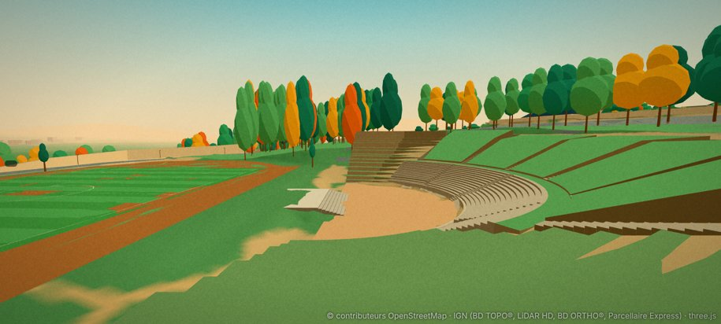

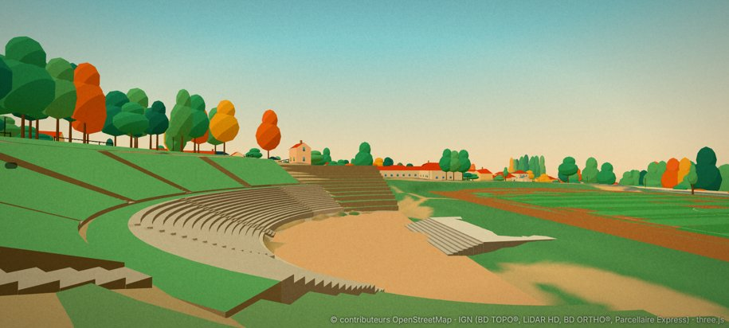
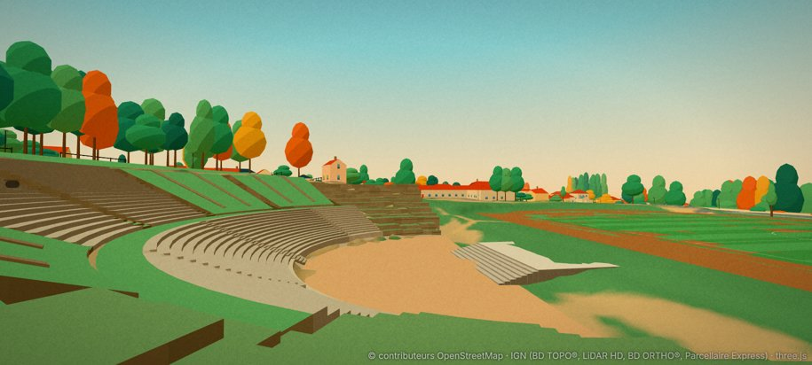

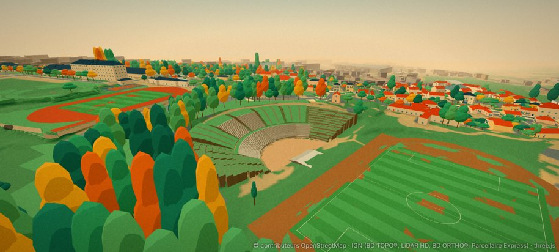

## 2026-10-31 — D135. Bâtiments d'après photos, étape 15 : le théâtre romain, les passants

**Suite du plan validé (D133), étape 3.** **Constat** : la navigation des passants (D40) ne passait pas dans la cavea. `build_nav.py` retire les voies OpenStreetMap qui traversent un bâtiment ; l'emprise BD TOPO du théâtre (masquée dans le jeu depuis D133) couvrait toute la cavea : il ne restait que le chemin du sommet (`249622262`), et l'escalier qui en descend près de la maison du gardien.

**Choix : une étape autonome, `tools/data/build_theatre_nav.py`, qui ne réécrit que la super-tuile du théâtre** (`nav/s7_9.json`) et son entrée dans `nav/index.json`. Régénérer la navigation repartirait de tout OpenStreetMap et réécrirait toute la ville ; et `build_nav.py` ne sait pas dessiner des chemins sur des gradins. Après une régénération, il suffit de relancer cette étape (README).
- **Ce qui est ajouté** (31 arêtes, aux mesures du site `theatre`) : l'**allée de la précinction** (chemin), d'un bout des gradins restaurés à l'autre ; l'**escalier de l'axe**, de la précinction à l'orchestre (escalier) ; les **six escaliers du haut**, jusqu'au chemin du sommet (raccord : l'arête la plus proche, à moins de 12 m, est coupée en deux ; les six le sont) ; un **carrefour au milieu de l'orchestre**, la **scène** (marches, plateau, sortie à l'est, contournée à 1,5 m) et une **sortie nord**, au-delà de l'extrémité des gradins (u < −90°, hors des massifs), jusqu'à l'escalier OpenStreetMap près de la maison du gardien. Fréquentation 140 sur 255 (lieu touristique), zone résidentielle (la même que le sommet). Les escaliers latéraux du bas, qui finissent sur le premier rang (le podium fait 1,5 m), ne sont pas dans le graphe.
- **Idempotente et réversible** : nœuds ajoutés marqués du drapeau 64 (inutilisé pour les piétons), arêtes ajoutées avec la référence de la voie OpenStreetMap du théâtre (`153779957`). Une passe retire d'abord ce qu'elle avait ajouté et recolle les arêtes coupées (la longueur d'origine est partagée entre les deux morceaux, le point de coupe disparaît au recollage), puis refait l'ajout : une deuxième passe ne change rien, et le retrait rend exactement le fichier de `build_nav.py` (vérifié).
- **Altitudes** : les passants prennent la surface du jeu avec leur altitude actuelle (D93) : ils montent sur les tabliers des gradins et de la scène comme le joueur.

**Vérifié en jeu** (150 passants demandés, 13 h, joueur dans la cavea) : 12 à 20 des 27 passants présents dans les 75 m du théâtre, sur l'allée de la précinction (à −8,55 m, l'altitude de son tablier), dans l'orchestre, sur la scène, à la sortie nord ; altitude des passants = surface du jeu.

**Tests** : le graphe du théâtre est relié au reste de la ville (plus de 500 nœuds atteints depuis l'orchestre) ; en suivant chaque chemin dans les deux sens, aucune marche de plus de `STEP_UP` ; aucun obstacle du théâtre ne coupe un chemin. Le test « files hors des bâtiments » ignore désormais les bâtiments masqués (l'ancienne emprise du théâtre).

**Pas encore** : les passants ne s'assoient pas sur les gradins (la simulation n'a pas de place assise) ; les barrières dessinées de la scène, le poteau d'éclairage et les bancs (étape 4).

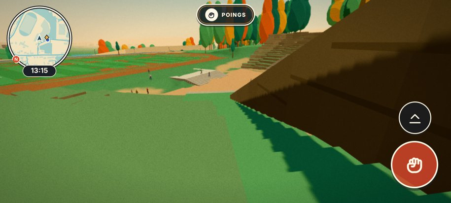

## 2026-10-31 — D136. Bâtiments d'après photos, étape 16 : le théâtre romain, barrières, poteaux et arbustes

**Suite et fin du plan validé (D133), étape 4.** Mobilier moderne vu sur les photos de l'utilisateur.

**Correction de ma lecture des photos** : j'avais lu « des bancs le long de l'allée » sur la photo de drone (à droite, au nord-est). L'orthophotographie montre à cet endroit **quatre arbustes taillés en boule**, en rangée sur un îlot d'herbe entre deux allées, et pas de banc. Ce sont donc des arbustes. Aucun banc n'est visible ailleurs, ni dans OpenStreetMap.

**Mesures** (`build_monuments.py`, `poles` et `shrubs` du site `theatre`) :
- **Poteaux d'éclairage** : aucun n'est dans OpenStreetMap ni dans le mobilier des tuiles. Sur l'orthophotographie, deux ombres fines d'environ 13 m, sans couronne : leur pied donne la position (`poles` de `manual.json`). L'un au sud-est de l'orchestre (photo 2 : au-delà de la scène ; photo de drone : dans la pelouse au premier plan), l'autre près des arbustes (photo de drone, à droite). Hauteur : plus haut point du modèle de surface à moins d'1 m du pied, **9,2 m** pour le premier ; le second est trop fin pour le relevé (2,4 m) : il prend la hauteur du premier (ombres de même longueur). **Le premier était dans la carte comme un arbre** (couronne d'1,2 m de rayon, 10,4 m) : cet « arbre » n'est plus dessiné ni un obstacle.
- **Arbustes** : positions sur l'orthophotographie (`shrubs`), hauteur = plus haut point du modèle de surface à moins de 75 cm, bornée à 0,6-1,4 m (0,6 à 0,65 m).

**Rendu** (`src/render/theatre.ts`) :
- **Barrières de la scène** (photos) : barrières galvanisées le long de ses deux côtés, panneaux de 2,4 m, poteaux, lisses haute et basse, barreaux tous les 20 cm, au niveau des marches puis du plateau. Elles correspondent aux obstacles de D133 (1,1 m, escaladables).
- **Poteaux** : fût effilé, traverse et deux projecteurs tournés vers le milieu de l'orchestre ; **jamais allumés** (choix de l'utilisateur : le théâtre n'est pas éclairé la nuit).
- **Arbustes** : octogones qui se resserrent en haut, vert sombre.
- Poteaux (20 cm) et arbustes (70 cm) sont des obstacles ronds (`landmarkCircles`).
- **10 930 triangles** pour tout le théâtre (9 518 avant ; borne du test : 12 000).

**Tests** : deux poteaux de 7 à 12 m, quatre arbustes, tous obstacles ; l'arbre du pied du premier poteau est bien retiré.

**Bilan du théâtre (D133 à D136)** : cavea mesurée, gradins restaurés en bas et dans deux coins du haut, précinction, coins herbus et massifs ruinés, escaliers, orchestre, scène et ses barrières, poteaux, arbustes ; tout est praticable, les passants y entrent, la piste du stade est en terre. **Pas fait** : les sièges des passants sur les gradins (la simulation n'a pas de place assise) ; pas de mur de scène ni de vomitoire (rien de lisible sur les photos ni dans le relevé).

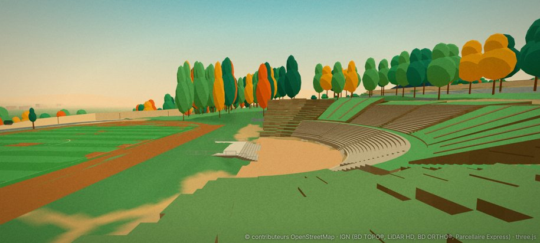

## 2026-10-31 — D137. Bâtiments d'après photos, étape 17 : la porte d'Arroux

**Demande de l'utilisateur** : refaire d'après ses photos les portes d'Arroux et Saint-André (D95), avec un modèle commun et ses variantes, puis modéliser le temple de Janus ; trois étapes séparées. Choix de l'utilisateur : rien de praticable en hauteur (on passe sous les arches), les trois monuments éclairés la nuit (pour ceux sans photo de nuit, un éclairage par en dessous comme à Arroux). Points de vue confirmés : porte d'Arroux de face depuis la rue côté ville (sud-sud-est), de jour et de nuit.

**Lecture de la photo** (`photo` de l'entrée `porte-arroux` de `manual.json`) : deux grandes arches au centre (archivoltes à claveaux moulurés, pile centrale à imposte), deux petites aux bouts, à demi enterrées ; grand appareil de calcaire gris clair ; parement perdu au-dessus des arches, de la droite de la grande arche gauche jusqu'au bout : blocage de moellons ocre-brun ; corniche, attique de deux assises ; **galerie conservée sur la partie gauche seulement** (7 arcades sur 10, pilastres à chapiteaux, entablement, bloc en saillie au sommet) ; bout gauche déchiqueté en gradins ; maison accolée à droite, haie et arceaux à vélos à gauche. La nuit, projecteurs chauds au pied.

**Mesures** (`build_monuments.py`, modèle `gate`, champ `gm` du site `gate` de `kinds/25_39.json`) :
- **Le relevé LiDAR ne contient qu'une partie de la porte** (comme les tours du porche de la cathédrale) : le MNS la voit sur une douzaine de mètres depuis la maison, à 8,8 m (médiane ; 9,4 m au plus haut) au-dessus de la rue, et rien au-dessus de sa partie ouest-sud-ouest, là où l'orthophotographie montre les arcades. La galerie n'y est pas.
- Ce qu'on mesure : **épaisseur du corps 4,25 m** et son décalage en travers (profil médian du MNS sur la partie relevée : le centre OpenStreetMap est 1,5 m trop au nord-nord-ouest) ; **rue à −32,4 m** au droit de la porte (médiane du MNT sur l'axe), −32,8 m côté faubourg et −32,1 m côté ville (elle monte vers la ville).
- **L'ombre sur l'orthophotographie est illisible** (enrobé sombre, arbres, ombres des maisons) : la hauteur de la galerie vient de la photo, prise de face et à niveau (verticales parallèles), donc à échelle constante sur le plan de la façade. Échelle : la longueur de la porte (18,7 m, D95) sur la largeur qu'elle occupe dans la photo. Lu ainsi : grandes arches de 3,7 m (naissance à 4,9 m), petites de 1,7 m (naissance à 1,5 m : elles sont enterrées), archivoltes de 0,95 m, corniche à 8,2-8,5 m, **attique à 9,55 m** (le relevé donne 8,8 à 9,4 m pour le haut du blocage : recoupement à moins d'1 m, test), arcades de 0,9 m au pas de 1,63 m, haut des arcs à 11,8 m, entablement de 12,1 à 12,9 m, bloc sommital à 13,55 m. Ces valeurs sont dans `manual.json`, en mètres depuis le bout gauche de la photo ; l'étape les place dans le repère de la porte d'après le côté de la photo (`photoFrom`).
- **La galerie est sur la face côté ville** : sur la photo, l'attique et la galerie sont dans le plan de la façade. Premier essai écarté : galerie en retrait au nord-nord-ouest, d'après le rang d'arcades claires au bord nord-ouest de l'orthophotographie ; en fait c'est l'orthophotographie qui penche (prise du sud-est, plus un point est haut, plus il est déporté vers le nord-ouest), et depuis la rue la galerie en retrait était presque cachée.
- Une deuxième passe ne réécrit rien.

**Modèle commun** (`gateLayout`, `src/core/landmarks.ts` ; rendu `src/render/gates.ts`, dans le maillage plein de la tuile) : il sert aussi au modèle par défaut de D95 (porte sans lecture de photo), et servira à Saint-André avec ses variantes (galerie complète, toit, tours). Corps percé des arches (passages voûtés sur toute l'épaisseur, piédroits, intrados), dessus suivant le profil ruiné (`top`, marches comprises), **blocage apparent** (zones `rubble`, sur les deux faces : moellons ocre-brun à lits sombres), **assises** du grand appareil tous les 62 cm, **archivoltes** à claveaux en relief nuancés un sur deux, **impostes**, **corniche** interrompue là où le parement est perdu, **galerie** des arcades conservées (pilastres à base et chapiteau sur les deux faces, entablement, bloc sommital). **2 372 triangles** (1 446 pour l'ancienne porte ; borne du test : 4 000).

**La nuit** : chaque pan est doublé dans le maillage des vitres allumées (visible la nuit seulement, comme la cathédrale, D132), en dégradé chaud du pied (projecteurs) vers le haut, modulé par la teinte de la pierre ; intrados et piédroits compris (les voûtes sont claires sur la photo). Autant de triangles que la porte, seulement la nuit.

**Silhouette lointaine** : les portes n'en avaient pas (elles disparaissaient au-delà du rayon de détail). La porte d'Arroux a maintenant deux prismes dans `lod/25_39.json` (corps, galerie conservée).

**Jeu** : rien ne change pour la circulation (D95) : seules les piles sont des obstacles ; une voiture passe au milieu de chaque grande arche (3,7 m), un piéton dans chaque petite (test). Les passants passent déjà par les deux petites arches (`nav_debug.py`).

**Tests** : épaisseur mesurée, attique et relevé concordants, 12 à 15 m de haut, 7 arcades, galerie du côté ville, passages libres ; budget de triangles et éclairage seulement pour une porte éclairée.

**Limites** : l'autre face (côté faubourg) n'a pas de photo : elle reprend la lecture de la face côté ville (blocage, corniche). La petite arche cassée contre la maison est dessinée entière.

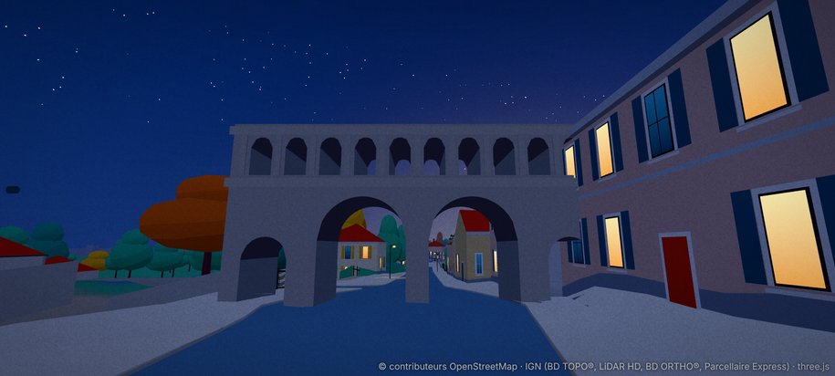

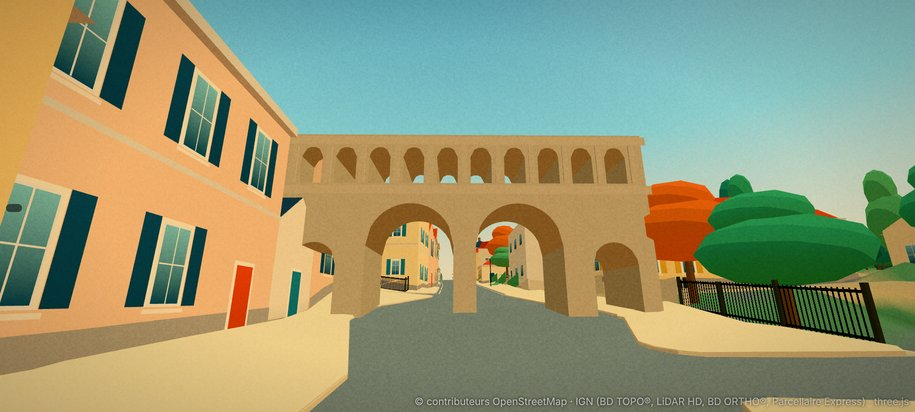

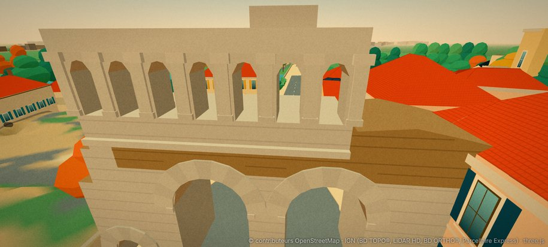
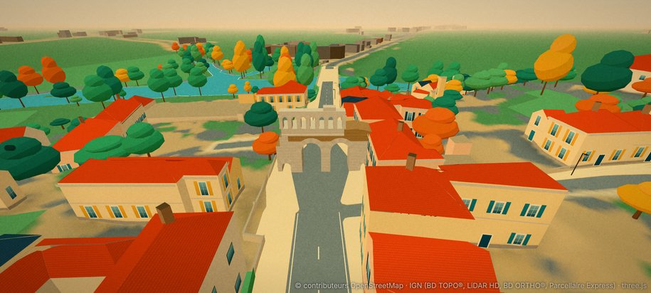

## 2026-10-31 — D138. Bâtiments d'après photos, étape 18 : la porte Saint-André, sa tour et l'église Saint-André

**Suite de la demande de D137, étape 2.** Points de vue confirmés : photo de face depuis la rue côté ville (ouest-sud-ouest, de biais), vue de drone depuis l'est-nord-est. « Tour médiévale accolée » : les deux, d'après l'utilisateur (la tour de moellons au bout sud-sud-est et l'église à tour ronde au bout nord-nord-ouest).

**Lecture des photos** (`porte-saint-andre` et `BATIMENT0000000348848796` de `manual.json`) : même schéma qu'Arroux (deux grandes arches, deux petites, archivoltes moulurées), passages voûtés profonds ; **galerie complète de 10 arcades sur les deux faces**, couloir entre les deux sous un **toit de tuiles à faible pente** ; calcaire blanc-gris restauré ; au bout sud-sud-est, **tour de moellons bruns** un peu plus haute que la porte, à chapeau de tuiles ; au bout nord-nord-ouest, l'**église Saint-André** : nef à pignons en moellons et brique, porte claire au pignon ouest-sud-ouest, baie en plein cintre sur le long mur, et côté est-nord-est une **tour ronde à toit conique** plus basse que la nef.

**Mesures** (`build_monuments.py`) :
- **Le contour OpenStreetMap est décalé d'environ 2 m** le long de la porte. On mesure les bouts : **bout libre** (sud-sud-est) là où le MNS retombe à mi-hauteur sur l'axe, **bout contre l'église** là où l'axe entre dans son emprise BD TOPO (`ends`). Porte de **20,8 m** de la tour à l'église (19,1 m dans les sources, sans la tour), corps de **5,25 m** d'épaisseur, rue à −27,65 m.
- **Toit** : faîtage à **13,65 m** (90ᵉ centile du MNS sur le corps), égout au haut de l'entablement (photo, 12,9 m). **Tour** : depuis le bout, la partie du MNS plus haute que le faîtage de 40 cm (en passant le bord flou du relevé) : **2,75 m**, sommet à **14,4 m**.
- **Travées** : les deux photos sont de biais (largeurs déformées) ; proportions lues en largeurs de grande arche, ramenées à la longueur mesurée sans la tour : grandes arches de 3,34 m, petites de 2,17 m. Hauteurs sur la photo de face (verticales parallèles), à l'échelle du toit mesuré : naissances à 3,5 et 1,9 m, corniche à 7,5-7,9 m, attique à 8,2 m, arcades de 1,05 m jusqu'à 11,2 m, entablement de 11,6 à 12,9 m.
- **Église** (modèle `chapel`, dans le repère de la porte) : nef = rectangle de l'emprise BD TOPO (10,3 × 15,3 m), tour ronde = cercle ajusté sur les sommets de l'emprise côté est-nord-est (**5,3 m de rayon**) ; au MNS : égout de la nef 10,75 m, faîtage 12,9 m, égout de la tour 7,7 m, pointe de son toit conique 10,6 m (plus basse que la nef, comme sur la photo de drone). Porte et baies : photos.
- Le bâtiment BD TOPO sous la porte (son toit) reste masqué (D95). Une deuxième passe ne réécrit rien.

**Modèle commun, variantes** (`src/render/gates.ts`) : galerie sur une face (Arroux) ou sur les deux (`face: both`, couloir entre les deux, pilastres sur les faces extérieures), toit à croupes de la tour à l'autre bout, tour de moellons à lits sombres et chapeau de tuiles, teinte de la pierre ; longueur mesurée (`l`). **2 850 triangles** pour la porte (borne : 4 000), **202** pour l'église (borne : 2 000). L'église remplace murs, toit et façade génériques (oculi violets, deux portes) : nef à lits de brique, toit à deux pans, tour ronde, porte claire, baies à encadrement clair.

**La nuit** : porte, tour et église éclairées par en dessous, comme Arroux (choix de l'utilisateur : pas de photo de nuit, même éclairage) ; toits à peine éclairés.

**Silhouettes lointaines** : la porte (corps, galerie et toit, tour) et l'église (nef, tour ronde) remplacent le prisme générique.

**Jeu et passants** :
- La tour est un obstacle (elle déborde des faces), en plus des piles.
- Ici la rue ne passe pas sous la porte (elle la contourne ; la porte est sur une placette). Mais un chemin de la placette (OpenStreetMap) traversait la porte en biais par la pile centrale, et un nœud du trottoir d'Arroux tombait dans une pile du nouveau modèle. **Nouvelle étape `tools/data/build_monuments_nav.py`** : chaque arête piétonne qui traverse une porte hors d'une arche est détournée par le milieu de l'arche la plus proche, et un nœud dans une pile ou dans la tour est poussé devant la face ; seules les super-tuiles des portes sont réécrites, une deuxième passe ne change rien ; à relancer après `build_nav.py`. Test : aucun chemin ne traverse une pile ou une tour.
- La cache d'arme de la porte Saint-André (`pickups.ts`) tombait dans une pile : elle est au milieu de la grande arche ouest.

**Tests** : longueur, 10 arcades sur deux murs, toit, tour plus haute que le toit et au bout sud-sud-est, aucune arche sous la tour ; église plausible (tour ronde plus basse que la nef) ; chemins libres ; budgets.

**Limites** : le monticule devant la porte côté ville est dans le relief LiDAR (il était déjà là) ; les genévriers devant l'église ne sont pas dessinés.

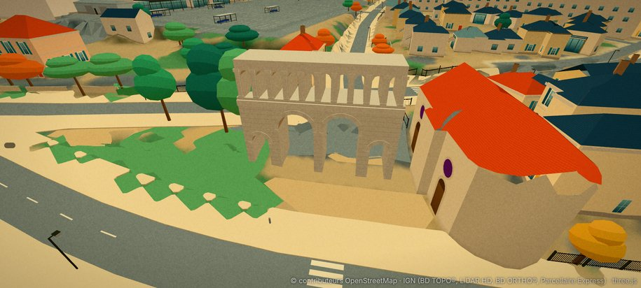

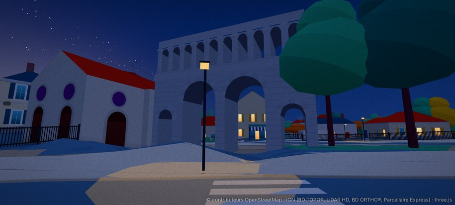

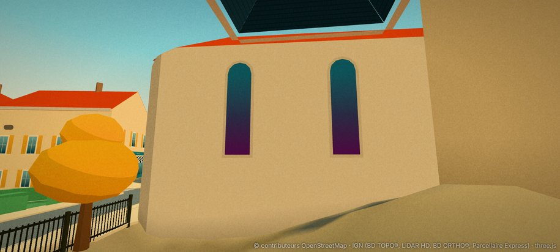
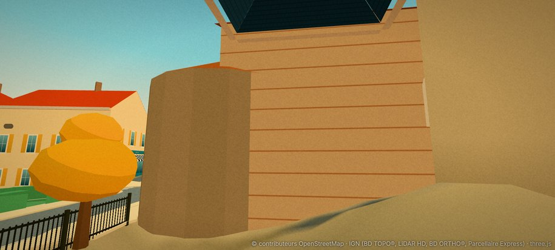
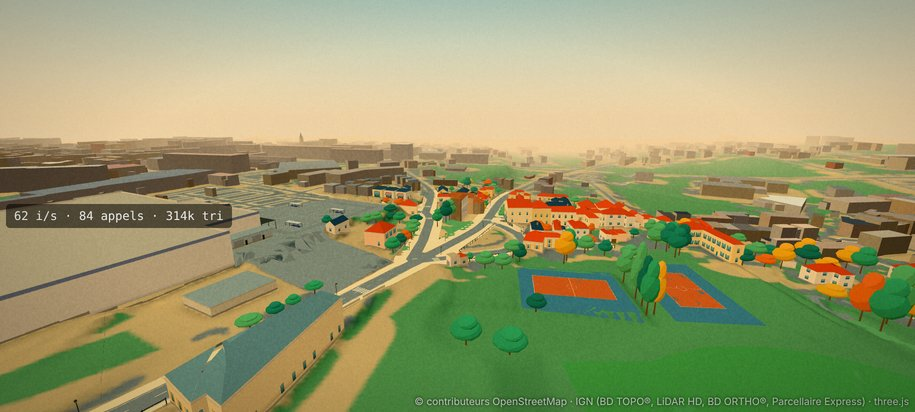
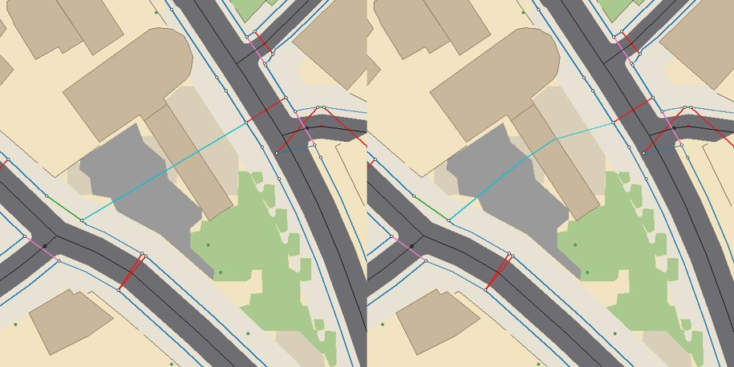

## 2026-10-31 — D139. Bâtiments d'après photos, étape 19 : le temple de Janus

**Suite de la demande de D137, étape 3.** Points de vue confirmés : de l'extérieur depuis le sud-ouest, et de l'intérieur de la cella depuis le nord-est (lumière du matin). **Position** : la demande donnait (−834 ; 775), tuile 22_38, où il n'y a qu'un champ ; OpenStreetMap (`way/542936385`) et le LiDAR placent le temple à **(−795 ; 1211), tuile 22_40**.

**Constat** : le temple était le contour OpenStreetMap (`barrier=wall`), dessiné comme un mur fermé sur quatre côtés ; **trois « arbres » de 20 à 21 m** étaient posés sur ses murs : c'étaient les murs eux-mêmes vus par le LiDAR (comme le poteau du théâtre, D136).

**Lecture des photos** (`temple-de-janus` de `manual.json`) : cella carrée dont il reste les murs ouest et sud, en L, très épais ; en bas, grandes ouvertures cintrées traversantes (deux dans le mur ouest, une dans le mur sud) et niches ; à l'étage, trois baies par mur sous des arcs de brique gris-rose ; rangées régulières de trous de boulin ; petit appareil beige-rose couvert de lichen orange ; dessus ruiné et herbu, en paliers ; pré, clôture.

**Mesures** (`build_monuments.py`, modèle `janus`, site `janus` de `kinds/22_40.json`, fichier créé et ajouté à l'index) :
- **Murs debout** : les côtés du contour dont le MNS médian dépasse 6 m (ouest et sud) ; leur coin commun est l'origine du repère.
- **Faces** à mi-hauteur du profil médian en travers (le relevé à 0,5 m est flou) : murs de **2,5 et 2,25 m**, à ±25 cm près. **Longueurs** là où le dessus retombe sous la moitié de sa médiane (bouts cassés net) : **16,63 × 16,6 m**, comme dans les sources (16,6 m) ; le contour OpenStreetMap est plus petit (15 × 15,5 m) et décalé.
- **Dessus** : plus haut point de la section tous les 50 cm, médiane glissante sur 2,5 m, simplifié à 1,5 m près : **jusqu'à 21,7 m** (mur sud) et 20,4 m (mur ouest), avec des creux vers 14-15 m (premier essai écarté : simplifié à 60 cm, le dessus était hérissé de pointes).
- **Terre-plein** intérieur 0,8 m au-dessus du pré (le relief LiDAR l'a déjà, en pente douce : pas de tablier), **souches** des murs nord et est au ras du terre-plein (0,94 m).
- **Ouvertures** : photos (positions en mètres depuis le coin sud-ouest, ramenées à la longueur mesurée ; les photos de biais ne donnent que leur ordre et leur taille approchée).

**Rendu** (`src/render/janus.ts`, dans le maillage plein de la tuile) : chaque mur est une dalle percée (arches traversantes, baies traversantes à appui, intrados et piédroits) ; dessus en **paliers de 1,2 m** qui suivent le profil mesuré à ±40 cm (les photos montrent un dessus cassé en gradins), herbu ; arcs de brique sur les arches et les baies, niches sombres, trous de boulin en quinconce, plaques de lichen orange ; souches basses des murs nord et est. **La nuit**, éclairé par en dessous comme les portes (choix de l'utilisateur). **2 302 triangles** (borne du test : 6 000). Silhouette lointaine : deux prismes (les deux murs).

**Retraits sans réécrire la tuile** : le mur OpenStreetMap fermé n'est plus dessiné ni un obstacle (`wallsOutsideMonuments`, le site nomme la voie qu'il remplace) ; les arbres dans la cella et à moins d'1 m disparaissent (`treesOutsideMonuments`).

**Jeu** : les morceaux pleins des murs, entre les arches, sont des obstacles ; on passe par les trois arches ; on entre aussi par les côtés nord et est, ouverts. **Passants** : aucun chemin n'entrait ; `build_monuments_nav.py` ajoute une boucle (arche nord du mur ouest, milieu de la cella, arche du mur sud) raccordée aux chemins voisins à l'ouest et au sud, en passant devant le coin quand le raccord couperait la cella ; nœuds marqués et arêtes à la référence du temple : une passe retire d'abord ce qu'elle avait ajouté, une deuxième ne change rien, et le retrait rend exactement le fichier de `build_nav.py` (vérifié).

**Outil de capture** : `tools/shot.sh` (et `play.sh`, `proto.sh`, `sounds.sh`, `ui.sh`) lançait le serveur par `npx`, dont l'arrêt laissait le serveur `node` ouvert ; une capture suivante tombant sur le même port photographiait une ancienne construction (c'est arrivé ici pour une capture « avant », refaite). Le serveur est maintenant lancé directement, et son arrêt est effectif.

**Tests** : cella de 15,5 à 17,5 m, murs de 1,6 à 3 m, hauts de 18 à 24 m ; on passe par chaque arche, pas à travers un mur ; arbres et mur OpenStreetMap retirés ; la boucle des passants entre dans la cella sans traverser un mur ; budget de triangles et éclairage de nuit.

**Limites** : les positions des ouvertures sont approchées (photos de biais) ; les baies hautes sont toutes traversantes ; pas de clôture ni de panneaux autour.

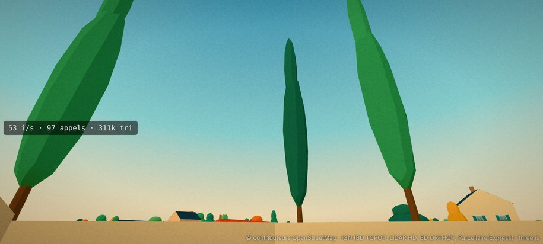

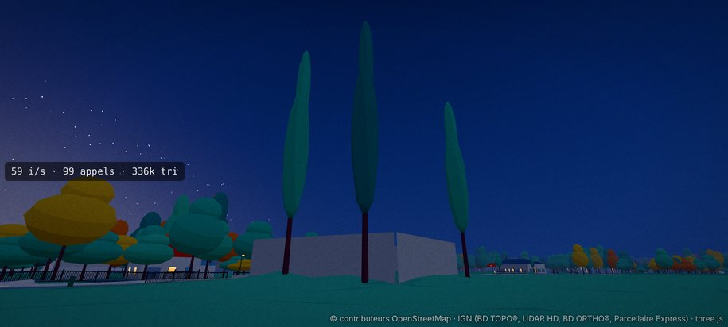

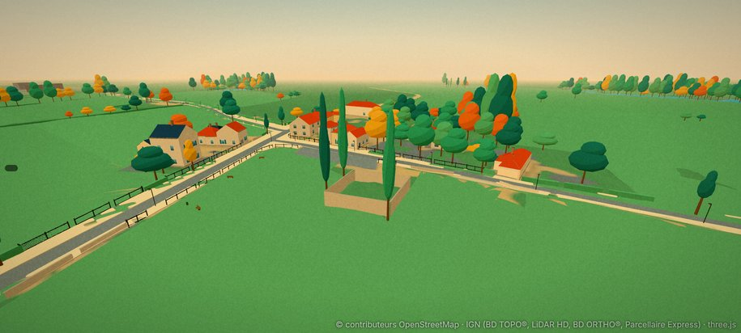
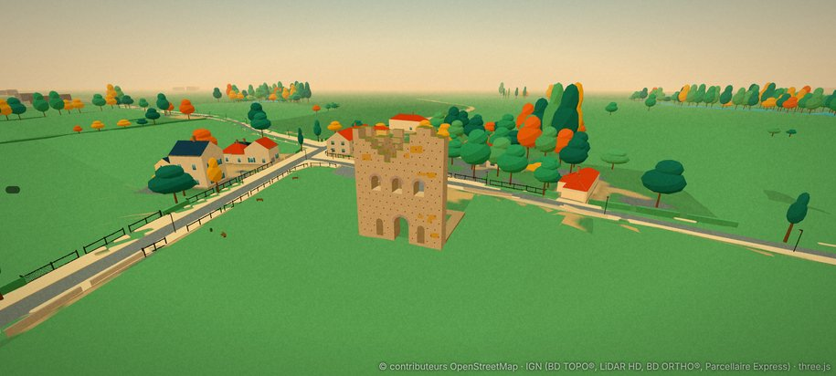
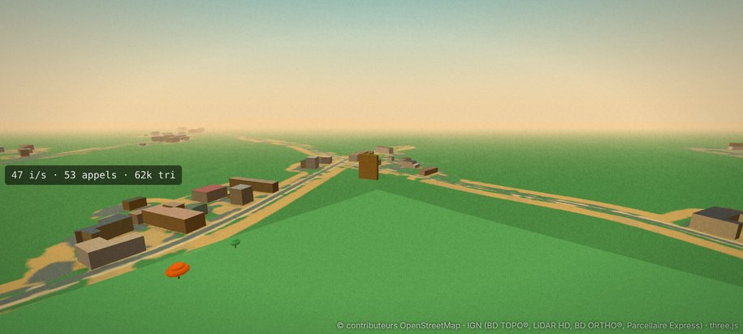
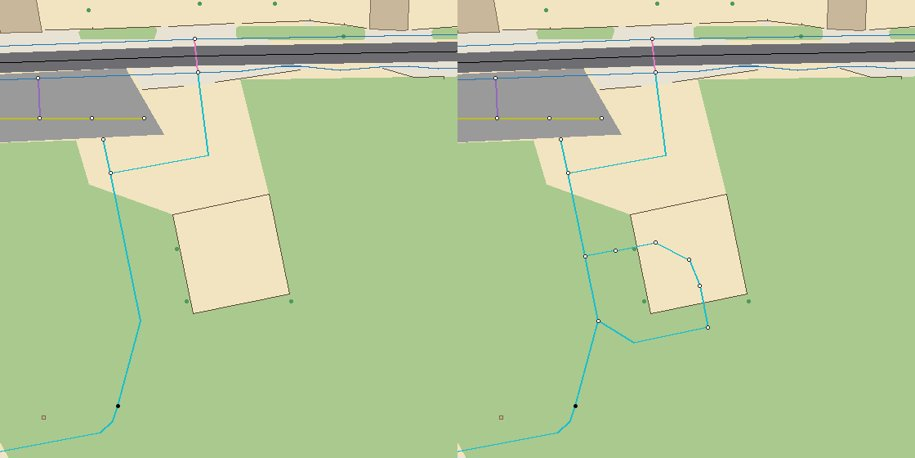

## 2026-10-31 — D140. Petits éléments d'après photos, étape 1 : la maison du 7 allée de l'Acaron

**Demande de l'utilisateur** : intégrer d'après ses photos trois petits éléments, en trois étapes séparées : une maison (7 allée de l'Acaron), une boutique (21 rue Guérin), le rond-point de la Croix Verte. Points de vue confirmés : photo de drone basse depuis l'est-sud-est, face au mur de l'aile ; photo de drone haute depuis le sud-est, au-dessus de la terrasse, face à l'angle rentrant ; vue aérienne, nord en haut. Côtés sans photo : sobres, mêmes volets ; au jardin, la terrasse et l'allée seulement.

**Dans les données** : bâtiment BD TOPO `BATIMENT0000000348848724` (tuile 28_38, vers (703 ; 905)), en L, tourné de 45°. Il était dessiné comme une maison générique à deux niveaux : égout à 5,6 m, quatre fenêtres carrées, toit rouge à 35°.

**Lecture des photos** (`BATIMENT0000000348848724` dans `monuments` de `manual.json`) :
- plain-pied avec combles, enduit crème, soubassement clair ;
- toit raide de tuiles plates brunes tachées de lichen, croupes à chaque bout ; corps et aile à faîtages perpendiculaires ;
- deux lucarnes à croupe : volets fermés sur le pan sud-est du corps, fenêtre ouverte sur le bout de l'aile ;
- cheminée crépie à chapeau métallique, parabole ;
- entrée couverte dans l'angle rentrant : poteau de bois à jambe de force, porte au fond ;
- mur du corps : grande porte-fenêtre cintrée à quatre volets persiennés repliés ; mur de l'aile : petite fenêtre cintrée à un volet et porte-fenêtre cintrée à deux volets ; appliques, gouttières et descentes grises ;
- terrasse de dalles claires, allée gravillonnée claire le long de l'aile.
Les photos sont prises de biais : elles ne donnent que l'ordre et les proportions des ouvertures.

**Mesures** (`build_monuments.py`, modèle `house`, MNS et MNT LiDAR HD par WMS) :
- **Le contour BD TOPO est trop petit et décalé** : 12,4 × 6,7 m pour le corps, une aile de 5,7 m. Le toit relevé déborde de plus d'un mètre au sud-ouest et au sud-est. On ne garde du contour que l'orientation et le point de départ.
- **Deux temps**, parce qu'un bord flou se confond avec un débord plus large et plus bas :
  1. Les pans sont ajustés sur le seul haut du toit (plus de 3 m) : contour en L à 3 m de haut, six bords, et pente (moindres carrés robustes, puis chaque bord affiné à 10 cm près ; 94 % du haut du toit à 30 cm près).
  2. L'égout est la hauteur où le MNS vaut la moitié de celle des pans prolongés (mi-hauteur, médiane sur les quatre grands bords) : **2,6 m au bord du toit**.
  Premier essai écarté : un ajustement sur toute la fenêtre donnait un toit de 15 m sur 9,6 m, avec un égout à 2,1 m.
- **Murs** : le contour du toit moins le débord de la gouttière (0,4 m, photo). Corps de **13,3 × 7,7 m** ; aile de **7,8 m** de large qui avance de **3,15 m**.
- Égout au nu des murs **3,0 m**, pente **44°**, faîtages **6,6 et 6,7 m**. Le relevé donne 6,3 à 6,7 m sur la ligne de faîtage, flou compris.
- Sol −33,95 (médiane du terrain à 1,5-3 m du contour).
- **Cheminée** : trop fine pour le relevé à 0,5 m ; sa position et sa hauteur viennent de la photo.
- Une deuxième passe ne réécrit rien.

**Toit** : le toit d'un L à pente constante est le plus haut des toits à quatre pans de ses deux rectangles. `build_monuments.py` découpe les pans avec shapely : chaque pan est gardé là où il est au-dessus de l'autre toit. Les pans coplanaires (le long côté nord-est commun au corps et à l'aile) sont gardés par le premier rectangle. Une ouverture morphologique retire les pointes sans surface le long des arêtiers. Résultat : 7 pans, contour en (s, t) et plan, dans `kinds/28_38.json` (type `house`).

**Rendu** (`src/render/house.ts`, dans le maillage plein de la tuile) :
- murs enduits suivant le sol et soubassement ;
- pans triangulés, dessous du débord, un rang de tuiles tous les 32 cm de montée, taches de lichen à 30 cm au moins des bords, arêtiers et faîtages coiffés ;
- rive et gouttière, quatre descentes ;
- lucarnes à croupe (façade enduite, joues et toit de tuiles) ;
- cheminée à chapeau, parabole ;
- ouvertures à arc surbaissé, volets persiennés repliés contre le mur, appliques ;
- entrée couverte (porte au fond, poteau, sablières, jambe de force) ;
- terrasse de dalles et allée gravillonnée posées sur le relief.
**1 154 triangles** (borne du test : 4 000). La nuit, 40 triangles allumés : la porte-fenêtre et la petite fenêtre de l'aile, la lucarne de l'aile, l'imposte de la porte d'entrée, les appliques. Silhouette lointaine : deux prismes, corps et aile. La maison est trop petite pour se voir de loin.

**Jeu** :
- L'obstacle est celui des murs mesurés (`houseRing`), et non plus du contour BD TOPO décalé. On entre sous l'auvent jusqu'à la porte d'entrée ; le poteau est un obstacle.
- Aucun arbre, mobilier ni mur de la carte ne tombe dans la maison ou contre ses murs. Il n'y a pas de cache d'arme à moins de 200 m.
- La maison est dans un jardin privé : rien à changer pour les passants.

**Tests** : dimensions, égout, pente et faîtage plausibles ; les pans couvrent exactement le L et son débord, sans se chevaucher, entre l'égout et le faîtage ; obstacle aux murs mesurés, entrée et poteau ; ouvertures dans leurs murs ; rien de la carte dans la maison ; budget de triangles et éclairage de nuit.

**Limites** : ouvertures placées en proportions (photos de biais) ; côtés nord-ouest, nord-est et sud-ouest sans photo ; ni mobilier de jardin, ni voitures, ni haie.

## 2026-10-31 — D141. Petits éléments d'après photos, étape 2 : la boutique du 21 rue Guérin

**Suite de la demande de D140, étape 2.** Photo : capture Google Street View de l'utilisateur (juillet 2026), presque de face, depuis la rue, face à l'ouest. Le n° 19 est à gauche, au sud (confirmé). Nom confirmé : « L'Armoire de Julie », dépôt-vente de vêtements. La nuit, les vitrines sont allumées et la porte du 21 reste éteinte (choix de l'utilisateur).

**Dans les données** : bâtiment BD TOPO `BATIMENT0000000348856843` (tuile 26_36), mur 7 de sa fiche sur la rue Guérin : 7,88 m, face à l'est. La fiche était une habitation (porte et fenêtres à volets au rez-de-chaussée), sans commerce : la boutique n'est pas dans OpenStreetMap.

**Lecture de la photo** (`fronts` de `manual.json`, champ `shop`) : devanture en applique en bois peint bleu lavande sur toute la largeur. De gauche à droite :
- pilastre ;
- porte d'immeuble pleine à deux vantaux et panneaux, avec imposte ;
- pilastre portant le n° 21 ;
- grande vitrine « DEPOT VENTE » en lettres blanches ;
- pilastre ;
- porte vitrée du magasin, à imposte ;
- pilastre ;
- seconde vitrine à mannequins devant un fond vert ;
- pilastre.
Au-dessus : pilastres à chapiteaux, frise, corniche, bandeau haut. Panneau rouge décalé à droite, « L'Armoire de Julie » en italique blanc. Soubassements de pierre blanche à grecque. À l'étage : enduit blanc, fenêtres à petits bois blanches, pas de volets visibles.

**Mesures** :
- **Largeurs** lues sur la photo, presque de face, et ramenées à la longueur du mur (7,68 m de devanture, 10 cm de marge à chaque bout).
- **Hauteurs** à la même échelle : porte de 2,47 m et imposte, appui des vitrines 0,8 m, haut des baies 2,83 m, frise de 2,93 à 3,40 m, corniche à 3,52 m, haut du bandeau 4,37 m. La fiche donne 4,4 m au rez-de-chaussée.
- Seule la façade compte ici : rien à mesurer au LiDAR.
- Les proportions viennent d'une seule photo, prise presque de face.

**Données** : `build_shop_fronts.py` (D120) applique la correction (`apply_shop`). La fiche devient « shop » :
- son commerce est au milieu du mur ;
- la couleur de devanture vient de la photo ;
- la devanture est décrite telle quelle (`ground.devanture`, nouveau champ, ajouté au schéma des fiches) ;
- enduit, menuiseries et volets de l'étage suivent la photo ;
- `status` passe à `observed`, avec une source « photo ».
Seule la tuile 26_36 est réécrite ; une deuxième passe ne change rien.
Remarque : le cache OpenStreetMap de l'étape était vide et a été retéléchargé. Aucune autre fiche n'a changé (vérifié : une seule tuile réécrite).

**Rendu** (`src/render/devanture.ts`, placée par `planFacades` à la place des modules de vitrine génériques) :
- panneau de fond, frise, corniche et bandeau en saillie ;
- pilastres à base de pierre, fût à panneau, chapiteau ;
- porte d'immeuble à panneaux en creux, imposte, bouton de laiton ;
- porte du magasin ;
- soubassements à grecque ;
- vêtements en aplats : sur un rayon dans la première vitrine, sur des mannequins devant un fond vert dans la seconde ;
- enseigne rouge en avant de la corniche, nom en italique (l'atlas des noms accepte maintenant une écriture `script`) ;
- « DEPOT VENTE » sur la vitre, « 21 » sur le pilastre.
Pas de fenêtre générique au rez-de-chaussée derrière ; les étages restent générés, en blanc. Une fiche `observed` prend l'enduit de sa fiche, et non plus la palette de son époque (c'est la seule fiche `observed`). **398 triangles**, 8 allumés la nuit (vitrines, porte et imposte du magasin), devant lesquels restent les vêtements.

**Passants** : `build_monuments_nav.py` ajoute le point d'intérêt « commerce » que `build_nav.py` aurait posé (milieu du mur d'entrée, 80 cm devant, cap vers la file la plus proche), dans la seule super-tuile s6_9. Un point déjà à moins de 30 cm est remplacé : une deuxième passe ne change rien, et le reste de la super-tuile est identique (vérifié).

**Tests** : fiche « observed » et commerce, devanture contenue dans le mur, ordre des travées de la photo, enseigne au-dessus de la devanture ; la façade pose la devanture et aucune fenêtre ni porte générique au rez-de-chaussée de ce mur ; géométrie finie, coût borné, vitrines allumées ; point « commerce » des passants. 746 tests.

**Limites** :
- trottoir générique (la photo montre des pavés) ;
- l'étage a les fenêtres générées, sans photo de détail ;
- les voisins (n° 19, devanture verte au nord) restent génériques ;
- l'enseigne et les vêtements ne s'animent pas.

## 2026-10-31 — D142. Petits éléments d'après photos, étape 3 : le rond-point de la Croix Verte

**Suite de la demande de D140, étape 3.** Photo : capture Google Street View de l'utilisateur (juillet 2026) depuis le boulevard Mazagran (n° 34), à l'ouest-sud-ouest, en regardant l'îlot vers l'est-nord-est (confirmé). Choix de l'utilisateur : seulement l'îlot central, son arbre et ses fleurs (ni îlots séparateurs, ni abribus), pas d'éclairage de nuit pour le cèdre.

**Dans les données** : rond-point de la tuile 28_37, au centre vers (620 ; 642,5), super-tuile de navigation `s7_9`. Il était dessiné par `build_public_space.py` (D94) en pelouse irrégulière à bande de trottoir, avec **trois « arbres » génériques de 13 m** (c'est le cèdre vu en trois morceaux par le relevé LiDAR) et un lampadaire posé au bord de l'îlot, absent des photos.

**Lecture de la photo** (`roundabouts` de `manual.json`) : îlot rond en pelouse, légèrement bombé, bordure basse claire ; au centre un grand cèdre seul, couronne bleu-vert en plateaux étagés, très large, aux branches basses jusqu'au massif ; massif de fleurs rouges, jaunes, roses et orangées au pied, avec quelques arbustes bas ; pas de lampadaire sur l'îlot. Au premier plan : îlot séparateur à bord blanc, cédez-le-passage, abribus, long mur (hors de cette étape).

**Mesures** (nouvelle étape autonome `tools/data/build_roundabouts.py`, orthophotographie à 0,25 m et MNS/MNT LiDAR HD) :
- **Bordure** : sur 144 rayons tous les 2,5°, le pixel le plus clair entre 11 et 16,5 m, retenu s'il a de l'herbe juste à l'intérieur (les rayons dans l'ombre du cèdre n'en ont pas) ; cercle ajusté aux moindres carrés sur 100 rayons : **rayon 13,69 m** au milieu de la bordure, centre (619,82 ; 642,52), écart médian **6 cm**.
- **Bombé** : médiane du terrain dans l'îlot moins celle de la chaussée autour : **41 cm** (déjà dans le relief LiDAR, rien à poser).
- **Cèdre** : **13,7 m** au-dessus du terrain, couronne de **10,4 m de rayon** à 1,5 m de haut, 8,3 m à 5,5 m, 6,6 m à 10,5 m ; tronc à (620,8 ; 642,4), centre de la couronne sur ses deux premiers tiers (le sommet penche un peu).
- **Voitures** : les files du graphe routier passent à **16,95 m** au moins du centre, soit 3 m au-delà de la bordure : on ne les touche pas (la circulation, ses files et ses carrefours restent exactement ceux de D94).
- Une deuxième passe ne change rien.

**Pourquoi une étape à part** : `build_public_space.py` réécrit toutes les tuiles (≈ 15 min, puis la navigation et la carte) ; `build_roundabouts.py` n'écrit qu'un site `roundabout` dans `kinds/28_37.json` (et l'index), sans toucher aux tuiles. À relancer après `build_kinds.py`.

**Rendu** (`src/render/roundabout.ts`) :
- **Sols** (maillage des sols de la tuile) : pelouse jusqu'à la bordure, terre du massif en anneau autour du tronc ; elle recouvre la pelouse et le trottoir de D94 dans l'îlot (la bordure cache leur contour).
- **Bordure** : anneau bas (50 cm de large, 26 cm de haut) à faces intérieure et extérieure.
- **Massif** : des coussins de fleurs aux cinq couleurs de la photo, semés au hasard, et six arbustes bas en dômes à facettes.
- **Cèdre** : tronc conique, puis un étage de branches tous les 1,6 m à partir de 2 m, chacun fait de trois ou quatre plateaux irréguliers aux bords échancrés qui retombent, dont l'ensemble atteint le rayon mesuré à cette hauteur ; pointe arrondie.
- **1 956 triangles** pour l'îlot, le massif et le cèdre, 252 pour les sols (borne du test : 3 000). Pas d'éclairage la nuit.

**Retraits sans réécrire la tuile** : les arbres de l'îlot (`treesOutsideMonuments`) et le lampadaire posé au bord (`furnitureOutsideMonuments`, qui remplace la liste des objets remplacés de D131 : fontaine Saint-Lazare, lampadaire de l'îlot).

**Jeu** : l'îlot se traverse (bordure basse, comme avant) ; seul le tronc du cèdre est un obstacle (cercle de 45 cm). Aucun chemin de passants n'entre dans l'îlot (vérifié : leur file la plus proche reste hors de la bordure), donc rien à faire dans la navigation. Aucune cache d'arme n'est dans l'îlot.

**Tests** : rayon, écart d'ajustement et bombé plausibles ; cèdre de 11 à 16 m, couronne plus large en bas qu'en haut, tronc dans l'îlot ; trois arbres et un lampadaire retirés ; tronc bloquant, îlot franchissable ; files des voitures à plus de 2 m de la bordure ; aucune file de passants dans l'îlot ; aucune cache d'arme ; sommets finis et coût borné.

**Limites** : la couronne est une évocation à plateaux, pas un relevé (le LiDAR donne l'enveloppe, pas les branches) ; fleurs et arbustes d'après la photo, positions au hasard ; le massif n'est pas dans les données ; les îlots séparateurs, l'abribus et le long mur de la photo restent comme avant.

## 2026-10-31 — D143. Le Lidl de Saint-Pantaléon, sa pharmacie et son abri à chariots d'après photos

**Demande de l'utilisateur** : modéliser le Lidl (bâtiment, entrée, enseigne, abris à chariots, parking) d'après ses photos, en une seule étape, avec les gabarits existants (retail, `fronts` et `kinds` de `manual.json`, `build_carts.py`, `build_shop_fronts.py`) et un modèle dédié seulement si les gabarits ne suffisent pas ; puis, après le plan validé, traiter aussi la pharmacie voisine et confirmer que le petit bâtiment à l'entrée du parking est l'abri à chariots. Photos (captures Google Street View de juillet 2025, photo de presse, capture Google Maps ; non versionnées, elles servent seulement à décrire) : le Lidl vu du parking, deux fois ; la pharmacie et l'abri à chariots côte à côte.

**Dans les données** :
- Lidl : BD TOPO `BATIMENT0000000348858792` (tuile 30_40, 94 avenue de la République, 2016), le « Lidl » d'OpenStreetMap (way 124227036). Contour de 7 points, sol à −23,15 m, fiche « shop » estimée.
- Pharmacie : `BATIMENT0000002202684554`, un « bâtiment industriel » de 29 × 14 m pour BD TOPO, sans type commerce.
- Abri : `BATIMENT0000002101118190`, 5,0 × 6,8 m, haut de 1,8 m, laissé en bâtiment par D121 (règle prudente : abris de 1,8 à 3,2 m de large).
- Le Google Maps de la photo 1 place l'épingle « Lidl » à l'entrée du parking, pas sur le toit ; les étiquettes « H et N Market » et « Pharmacie » qui flottent sur le toit du Lidl ne le concernent pas.

**Lecture des photos** (`stores`, `fronts` et `kinds` de `manual.json`) :
- *Côté des photos* (déduit, plan validé) : prises du parking, au sud du coin sud du Lidl (point 1 du contour), en regardant vers le nord-nord-est. Indices : la tour de 12 étages à gauche est celle de (948 ; 1466) ; la zone hachurée jaune au sol est à droite du coin, le long du long mur sud-est (orthophoto : 20 m, de 4 m du coin jusqu'à 24 m, à 1,2 – 3,6 m du mur) ; le bâtiment bas à vitrage sombre à droite est la pharmacie. Le mur vitré à gauche est donc le **mur ouest** (arête 0, 33,3 m) et le mur plein à droite le **long mur sud-est** (arête 1, 70 m). Avant, le calcul « le plus de parking devant » (D120) avait mis l'entrée au milieu du long mur sud-est et laissé le mur ouest nu.
- *Lidl* : façade vitrée sur toute la longueur du mur ouest (baies de 2,2 m, montants et traverse sombres, jusqu'à 4,3 m), bande de bardage gris au-dessus (et sur tout le tour, à partir de 4,4 m), sas d'entrée en saillie à marquise plate près du coin sud (centre à 8 m du coin, 4,5 m de large, double porte), **deux panneaux « LIDL » perpendiculaires au mur** de part et d'autre du sas (carré bleu, disque jaune cerclé de rouge, lisibles de face depuis le mur de la photo), toit plat à acrotère et garde-corps tubulaire de 1,1 m. Long mur sud-est : enduit blanc, bardage gris en haut, deux grilles de ventilation, casier rose (point relais) à 4,5 m du coin, socle gris.
- *Pharmacie* : bâtiment bas à toit plat ; le mur de façade est l'arête 0 (29 m, face nord-ouest, vue de gauche à droite du coin nord-est au coin ouest) ; galerie couverte de 2,2 m à poteaux gris-bleu, vitrage en retrait (baies de 1,8 m), potelets inox devant, large bandeau gris avec l'inscription « Pharmacie de Saint-Pan » et des croix vertes, grande croix verte lumineuse sur le toit côté ouest, pignon ouest en enduit blanc plein.
- *Abri à chariots* : toit plat sombre sur poteaux gris, petits côtés vitrés, grand côté arrière plein avec le panneau Lidl, chariots gris emboîtés, ouvert sur le long côté est (vers le parking). Le panneau vert « point de rassemblement » et la poubelle de la photo ne sont pas dessinés.

**Mesures** (nouvelle étape autonome `tools/data/build_stores.py`, modèle de surface LiDAR HD à 0,5 m ; une deuxième passe ne réécrit rien) : plan du toit ajusté aux moindres carrés sur les cellules à plus de 1,5 m des murs (trois passes, écart retenu de 25 cm), acrotère = médiane de l'écart au plan sur une bande de 40 cm le long des murs (de 15 à 70 cm).
- **Lidl** : z = 0,03325·x − 0,06074·y + 34,177 (écart quadratique de **3 cm** sur 8 129 cellules). Le toit n'est pas plat mais **penche de 6,9 % vers le nord-ouest** : 5,3 m au-dessus du sol au mur nord-ouest, 7,5 m au coin sud ; acrotère à 15 cm (le minimum). Avant, le gabarit le mettait à plat à 8,6 m (égout BD TOPO + 0,8 m d'acrotère), soit 1,1 m trop haut au coin d'entrée et 3,3 m au mur nord-ouest.
- **Pharmacie** : toit **plat** (pente de 1,2 %, écart de 4 cm sur 1 149 cellules) à 3,3 m au-dessus du sol de la façade. Le sol descend d'environ 1 m vers le sud-est : le mur sud-est atteint 4,3 m (c'est la hauteur de BD TOPO).
- **Abri** : le LiDAR ne le voit pas (le toit est classé en sol, `MNS − MNT` ≈ 0) ; hauteur de 2,6 m d'après la photo (chariots d'un mètre).
- Les positions le long des murs (sas, panneaux, casier, grilles, poteaux, croix) sont lues sur des photos prises en perspective : elles sont plausibles à un mètre près, pas mesurées. La zone hachurée est lue sur l'orthophoto.

**Données** : `kinds` de `manual.json` impose la pharmacie en `retail` (« Pharmacie de Saint-Pan », croix verte) et l'abri en `cart` de style `lidl` (côté ouvert : le milieu du long côté est) ; `build_carts.py` les applique (et ne supprime plus les abris imposés à la main, qui n'étaient pas dans sa détection). `stores` décrit la lecture de chaque magasin ; `build_stores.py` ajoute `store` et `roof` (plan z = a·x + b·y + c et acrotère) à l'entrée du bâtiment dans `kinds`. `fronts` donne le mur d'entrée (Lidl : mur 5 de la fiche, soit l'arête 0 ; pharmacie : mur 2) et `poi: true`.

**Rendu** (`src/render/store.ts`, nouveau ; `reshapeBuilding` et `drawsWalls` dans `src/core/landmarks.ts` et `src/render/landmarks.ts`) : les gabarits ne suffisaient pas (un seul mur d'entrée à sas centré, toit toujours plat, pas de panneaux perpendiculaires ni de galerie), d'où un modèle dédié, mais court, qui réutilise les murs, le toit et les sinks existants :
- `reshapeBuilding(b, kind, roof)` : toit plat à plan mesuré (pans remplacés par ce plan, murs à plan + acrotère à chaque sommet) ; sans plan, comportement inchangé.
- **Lidl** : bardage gris et socle sur tout le tour, mur vitré en baies, sas en saillie de 1,3 m à marquise de 2,8 m, panneaux à deux faces (disque rouge, disque jaune, « LIDL » en lettres de l'atlas), garde-corps (montants tous les 4 m, une lisse), casier rose avec sa façade sombre, grilles à lames, zone jaune et noire hachurée posée sur le relief. Vitrages allumés la nuit.
- **Pharmacie** : les murs sont dessinés par le magasin (sinon le mur plein de façade aurait caché la galerie) : mur de fond en retrait de 2,2 m, retours, plafond et dallage de la galerie, six poteaux, vitrage allumé à 80 % la nuit, bandeau gris à filet sombre, nom, croix de la façade, potelets, croix verte du toit (face et dos, allumée la nuit).
- **Abri** : `lidlCartShelter` (toit, poteaux, fond plein à panneau Lidl, côtés vitrés, deux files de six chariots gris).
- **Coût** : Lidl 1 256 triangles (+ 34 allumés, 8 de lettres), pharmacie 298 (+ 30, 2), abri 356 (+ 2), soit environ **1 990 triangles** pour les trois, dans les maillages de la tuile : aucun appel de dessin de plus. Avant, le Lidl était la boîte générique des grandes surfaces, la pharmacie et l'abri deux boîtes simples.

**Jeu** :
- *Obstacles* (`storeCircles`) : le sas (trois cercles de 75 cm devant la porte) et le casier (65 cm) bloquent ; le mur vitré, la zone hachurée et les potelets se longent ; la pharmacie n'ajoute rien (sa galerie est dans son contour BD TOPO) ; l'abri garde l'emprise (D121).
- *Passants* : `build_monuments_nav.py` retire l'ancien point « commerce » du Lidl (sur le mur nord-ouest, qui n'a pas d'entrée) et pose celui du Lidl au milieu du mur ouest (975,5 ; 1372,7) et celui de la pharmacie au milieu de sa façade (1000,3 ; 1351,0), à 80 cm devant le mur, seule super-tuile s7_10 (c'est ce que `build_nav.py` poserait à sa prochaine régénération, d'après les fiches). Aucune file piétonne ne passe à moins de 2,9 m du sas ou du casier (vérifié) ; une deuxième passe ne change rien.
- *Caches d'armes* : aucune à moins de 3 m des trois bâtiments (test).
- *Parking* : les places, les arbres et les files de circulation restent ceux d'OpenStreetMap et de D94 ; seule s'y ajoute la zone hachurée devant le long mur.

**Tests** (+10, 757 au total) : plan de toit (pans et murs sur le plan, égout au plus bas, sans plan toit plat comme avant) ; Lidl (pente de 3 à 10 % vers le nord-ouest, hauteurs de 4,8 à 8,2 m, mur vitré de 31 à 35 m face à l'ouest-sud-ouest, sas de 3,5 à 6 m à 5 – 12 m du coin entre deux panneaux, zone hachurée dans le long mur) ; pharmacie (toit à moins de 2 % de pente, 2,9 – 4,2 m à la façade, face nord-ouest, galerie de 1,5 à 3 m) ; abri (emprise 4,3 – 7,5 m, côté ouvert sur le contour, style Lidl) ; obstacles ; point « commerce » unique par magasin, devant le mur d'entrée ; aucune cache d'arme ; géométrie finie, vitrages allumés, inscriptions, coût borné, tout à moins de 5 m du contour.

**Limites** : positions le long des murs à un mètre près (voir plus haut) ; ouvertures du Lidl vues d'un seul côté (rien sur le mur nord-ouest, qui reçoit seulement bardage, socle et garde-corps) ; poteaux de la pharmacie régulièrement espacés (la photo les montre irréguliers), vitrage uniforme (la photo distingue des locaux voisins) ; potelets sans obstacle (les passants les traversent, comme les terrasses de D92) ; pas de chariots devant l'entrée du Lidl ; pas de lumière pour les panneaux ni pour les croix de la façade (seulement la croix du toit de la pharmacie) ; silhouettes lointaines (LOD) inchangées ; `build_nav.py` complet n'a pas été relancé.

## 2026-10-31 — D144. La zone commerciale de Bellevue d'après photos : But, Bricomarché, Intermarché et Jardinerie d'Autun

**Demande de l'utilisateur** : modéliser d'après ses photos une partie de la zone commerciale de Bellevue (But, Bricomarché, Intermarché, Jardinerie d'Autun, qui remplace l'« Agri Sud Est » du jeu), en une seule décision, avec les gabarits existants et un modèle dédié seulement si nécessaire. Photos (captures Google Street View de juillet 2026, photos de l'utilisateur, photo aérienne de l'Intermarché, capture Google Maps ; non versionnées, elles servent seulement à décrire). Après l'enquête (rien n'était modifié), l'utilisateur a validé : photo du But prise du parking sud-est, magasin ouvert sans volets ni pylône, entrée du Bricomarché centrée sur son mur sud-ouest, abris solaires de l'Intermarché à modéliser, Jardinerie vue du nord-ouest.

**Dans les données** :
- Bricomarché : BD TOPO `BATIMENT0000000348847158` (tuile 18_43), « Bricomarché » d'OpenStreetMap (way 90417642), 3 851 m², mur d'entrée 4 de la fiche (arête 0, face sud-ouest, 58,6 m).
- Intermarché : `BATIMENT0000000348847156` (tuile 19_43), OpenStreetMap way 90417908, 3 038 m², mur d'entrée 0 (arête 2, face sud-ouest, 23,4 m). La fiche est « dwelling » (sans effet : `kinds` est juste).
- But : `BATIMENT0000000348852219` (tuile 18_44), OpenStreetMap way 90417654 (`shop=furniture`), 2 329 m². L'entrée de la fiche était sur la face sud-ouest (arête 2, 36 m) ; elle passe sur la face **sud-est** (arête 4, 31,4 m).
- **Ancien « Agri Sud Est »** : BD TOPO `BATIMENT0000000348847180` (tuile 19_42), 2 829 m², nom venu du way OpenStreetMap 90417693 (`shop=garden_centre`) ; un nœud OpenStreetMap du même bâtiment s'appelle « Jardinerie d'Autun ». `kinds` de `manual.json` lui impose le nom « Jardinerie d'Autun » (plus aucun « Agri Sud Est » dans `kinds`).
- Le petit bâtiment BD TOPO de 98 m² (5,4 m) collé au mur sud-ouest du Bricomarché, vers son bout sud-est (`…348852209`), était dessiné comme un second magasin à entrée vitrée. C'est un abri ouvert : il devient une marquise (`kinds` de `manual.json`), et son ancien point « commerce » disparaît.

**Lecture des photos** (`stores`, `fronts`, `kinds`, `carports` de `manual.json`) :
- *Côté des photos* (déduit, confirmé par l'utilisateur) : But du sud-est (la haie dense longe son côté nord-est puis continue vers le sud-est, à droite de la photo ; les marquages du parking sont au sud-est) ; Bricomarché et Intermarché du sud-ouest (le store rouge du Drive est au coin ouest de l'Intermarché, le Bricomarché est derrière à gauche sur la photo aérienne) ; Jardinerie du nord-ouest (le passage piéton rouge et blanc de la photo est celui de l'orthophoto devant l'arête 9).
- *Bricomarché* : bardage anthracite, auvent orange continu de 36 m et de 3,2 m de profondeur sur poteaux fins (de 13 à 49 m), mur vitré dessous (de 17 à 46 m), portique orange libre à 2,3 m devant les portes coulissantes centrées (29,3 m), enseigne « BRICO MARCHÉ » avec « MAISON - JARDIN » au bout nord-ouest du mur, six tondeuses autoportées (rouge, jaune, noir) alignées devant, deux piles de chariots jaunes à droite de l'entrée.
- *Intermarché* : murs latéraux noirs, bloc de lames verticales rouges sur toute l'arête 2 (23,4 m) à partir de 4,2 m de haut, vitrage à meneaux blancs et porte coulissante, enseigne blanche « Intermarché SUPER » allumée la nuit, store rouge du Drive (pyramide) au coin ouest (−1778,6 ; 1975,2), sans collision (une file piétonne passe dessous).
- *But* : magasin ouvert (vitrine allumée la nuit, ni volets ni affiches), bloc central anthracite (de 4 à 27,5 m) plus haut que les ailes blanches (+1 m, sur 5,5 m de profondeur), vitrine et portes au centre sous un auvent sombre à bandeau brun-rouge, enseigne carrée rouge « BUT » avec « Cosy » en dessous, triangles gris sur l'arête 3 et sur le début de l'arête 5. Ni pylône ni polygone orange (voulu par l'utilisateur).
- *Jardinerie* : mur crème en tôle, bannière blanche « Jardinerie D'AUTUN » (feuille verte sur un pot, bouts bruns) sur l'arête 7, deux pavillons vitrés à pignon de bois en saillie de 2,4 m : le grand (arête 9, 13 m, avec la porte) et le petit en retrait (arête 1, 12 m).

**Mesures** (`build_stores.py` étendue ; LiDAR HD, MNS à 0,5 m, une deuxième passe ne réécrit rien) :
- Plans de toit, ajustés aux moindres carrés : **Bricomarché plat** (pente de 0,4 %, 6,6 m au-dessus du sol ; BD TOPO le donne « à croupes » avec un faîtage 4,6 m plus haut, ce qui est faux), **Intermarché plat** (0,2 %, 7,7 m), **But plat** (0,2 %, 5,4 m au plan ; le profil monte de 0,5 m vers le milieu de la face sud-est), **Jardinerie** : la halle sud-est est plate à 6,7 m, la partie nord-ouest est 1 m plus basse (5,5 m) et un lanterneau monte à 8,9 m. Acrotère de 15 cm partout (le minimum).
- Pour la Jardinerie, un seul plan sur toute l'emprise donnait 2,7 % de pente (faux) : le champ `fit` (demi-plan) de `stores` limite l'ajustement à la halle sud-est (écart de 8 cm sur 3 248 cellules).
- **Abris de parking solaires** (`carports` de `manual.json`, six centres lus sur la photo aérienne) : mesurés par composante du MNS à 2,3 – 7,5 m au-dessus du sol hors bâtiments, rectangle orienté et plan du dessus. Ce sont six dalles en rangée devant la face sud-ouest, de 23,5 à 26,3 m de long sur 13,7 m pour quatre, 19 × 9,3 m et 25 × 9,2 m pour deux (le LiDAR le montre : ce ne sont pas des erreurs de détection), grand côté à 39 – 45° (repère x vers l'est), plan incliné de 11 à 15 % qui monte vers le nord-ouest (dessus à environ 4 – 6 m). Chaque abri est rangé dans le `store` du magasin de sa tuile (quatre dans celui du Bricomarché, deux dans celui de la Jardinerie).
- L'orthophoto ne montre pas ces abris (elle est antérieure) : seul le LiDAR les voit.

**Données** : `stores` (quatre styles de plus : `bricomarche`, `intermarche`, `but`, `jardinerie`), `kinds` (Jardinerie, marquise du Bricomarché), `fronts` (mur d'entrée de chacun et `poi: true`, plus `poiOffset` et `poiClear` pour les points « commerce » des passants), `carports`. Chaîne : `build_carts.py` (types imposés), `build_stores.py` (toits, abris), `build_shop_fronts.py` (murs d'entrée : le But passe du mur 0 au mur 2, la Jardinerie du mur 6 au mur 8), `build_monuments_nav.py` (passants). `build_kinds.py` et `build_nav.py` n'ont pas été relancés ; la chaîne rejouée trois fois donne les mêmes fichiers.

**Rendu** (`src/render/store.ts`, étendu ; `carportShape` et `storeCircles` dans `src/core/landmarks.ts`) : les gabarits ne suffisaient pas (entrées à auvent et portique, lames, bloc surélevé, pavillons à pignon, abris solaires), mais le modèle de D143 les accueille : même toit à plan mesuré (`reshapeBuilding`), mêmes murs, mêmes sinks.
- Aides communes : `storefront` (baies à meneaux, vitrage allumé la nuit), `slidingDoor`, `socle`, `face` (face plane à sens corrigé par une normale d'appui), `post`.
- Couleurs de murs et de toits par style (Bricomarché anthracite, Intermarché noir, But blanc, Jardinerie crème).
- **Coût** : Bricomarché 388 triangles (+ 24 allumés, 6 de lettres), Intermarché 288 (+ 20, 4), But 114 (+ 16, 4), Jardinerie 122 (+ 24, 4), plus 362 pour les six abris solaires : **environ 1 400 triangles** pour toute la zone, dans les maillages de la tuile ; aucun appel de dessin de plus. La vue d'ensemble reste à 290 000 – 355 000 triangles comme avant.

**Jeu** :
- *Obstacles* (`storeCircles`) : montants du portique du Bricomarché (2) et poteaux de son auvent (7), poteaux de l'auvent du But (2), angles des pavillons de la Jardinerie (4), poteaux des abris solaires (29, à 1,5 m du bord haut). Les tondeuses, les potelets, le store du Drive et les chariots se traversent.
- *Passants* : un seul point « commerce » par magasin, devant le mur d'entrée : Bricomarché (−1825,1 ; 2038,6), Intermarché (−1761,1 ; 1958,6), But (−1874,0 ; 2165,0) au milieu de la face sud-est, Jardinerie (−1741,0 ; 1877,4) à 3,2 m du mur, devant le pavillon. Les anciens points sont retirés : But (face sud-ouest), Jardinerie (mur nord-est), Intermarché (bosse nord-ouest, à 2,5 m du contour, d'où `poiClear`), Bricomarché (l'ancienne annexe). Les files du réseau piéton (hors grille des places, qui couvre tout le parking) passent à plus de 30 cm des poteaux ; un premier essai, poteaux au bord du plan, en avait seize sur ces files, d'où les 1,5 m d'écart.
- *Caches d'armes* : aucune à moins de 2 km (la plus proche est à la gare routière ; test à 3 m des contours).

**Tests** (+9, 766 au total) : toits plats de 0 à 3 % et hauteurs de 5 à 8 m ; « Agri Sud Est » remplacé ; côté et longueur de chaque mur d'entrée, entrée du Bricomarché au milieu ; six abris solaires de 17 – 28 × 8,5 – 15 m, pente de 8 à 20 % vers le nord-ouest, hors bâtiments, poteaux sous le bord haut ; obstacles (portique, tondeuses libres, liste de la tuile) ; un seul point « commerce » par magasin, bon mur, hors obstacles ; aucune cache ; géométrie finie, vitrages allumés, inscriptions, coût borné, rien ne dépasse de plus de 6 m du contour (But et Jardinerie, abris à part).

**Limites** :
- Positions le long des murs lues sur des photos en perspective, à un mètre près (auvent, bloc, bannière, sas, enseignes, pavillons, store du Drive) ; hauteurs de l'auvent, du portique, des tondeuses et des pavillons à 0,3 m près, d'après les photos.
- Le LiDAR ne voit pas les toits vitrés : les pavillons vitrés de la Jardinerie sont dessinés d'après la photo.
- But : les triangles gris des ailes et la différence de hauteur du bloc central (+1 m) sont lus sur la photo, le LiDAR n'en montre que la moitié (0,5 m) ; la photo laisse le doute sur la longueur du bloc (22 m retenus) ; pas de pylône, ni de volets ni d'affiches (demandé).
- Jardinerie : le toit n'a qu'un plan (celui de la halle) ; la partie nord-ouest, 1 m plus basse, est donc trop haute d'un mètre, et le lanterneau comme la serre sud-ouest, le patio clos et l'abri à chariots de la photo 6 ne sont pas dessinés ; le mur crème à bannière de la photo 5 est lu comme l'arête 7 (19 m), sans certitude.
- Bricomarché : la serre et la cour de vente du bout sud-est, absentes des photos, restent des volumes génériques ; le bardage est uni (pas de lames horizontales).
- Intermarché : le sas d'entrée n'est pas en saillie (la photo en montre un) ; la bande couverte le long de la façade vue sur l'orthophoto n'est pas dessinée ; les panneaux solaires sont un aplat bleu sans quadrillage ; les voitures garées sous les abris sont celles des places d'OpenStreetMap.
- Les sept petites boîtes de 9 m² (1,4 à 2,1 m, `wall=no` dans OpenStreetMap) dans les parkings, probablement des abris à chariots, ne sont pas traitées faute de photo : elles restent des boîtes beiges.
- Les silhouettes lointaines (LOD) ne changent pas ; `build_kinds.py` et `build_nav.py` complets n'ont pas été relancés.

## 2026-10-31 — D145. La zone commerciale nord-ouest de Bellevue d'après photos : deux galeries marchandes, GiFi et Action

**Demande de l'utilisateur** : modéliser d'après ses photos la partie nord-ouest de la zone commerciale de Bellevue (la partie sud-est est D144), par familles de gabarits, un style par famille et un modèle dédié seulement si nécessaire ; enquête d'abord (rien n'était modifié), puis plan validé (« Ok pour le reste ») : D145 traite les deux galeries, l'aile manquante, GiFi et Action ; D146 reprend Aubade et Norauto (photos reçues après le plan). Photos (captures Google Street View de juillet 2023 et juillet 2026, photos aériennes de l'utilisateur, capture Google Maps ; non versionnées, elles servent seulement à décrire).

**Constat de l'enquête (avant toute modification)** :
- Les enseignes des photos ne sont pas à x ≈ −2100 à −1900 mais plus au nord-ouest : deux galeries marchandes de part et d'autre d'un grand parking (OpenStreetMap 917804160), x de −2340 à −2160 et y de 2310 à 2545 ; GiFi et Action sont juste au sud-est de la première.
- **Une aile entière manque** : au LiDAR, la galerie nord-est a une aile de 50 × 34 m au nord-ouest (Centrakor) que ni BD TOPO ni OpenStreetMap ne connaissent (l'orthophotographie, plus ancienne, y montre du gravier). Le repère « Centrakor » de Google Maps tombe dessus.
- Les toits sont plats (pente de 0,1 à 0,3 %) ; les « croupes » de BD TOPO sont fausses (GiFi, galerie nord-est) et les hauteurs de BD TOPO sont de 0,5 à 2 m trop hautes. La bande de 4,6 m × 174 m « industrielle » de 10,4 m le long de la galerie sud-ouest est l'auvent vitré ; le jeu la dessinait en mur plein.

**Dans les données** :
- Galerie sud-ouest : BD TOPO `BATIMENT0000002222388078` (tuile 17_44, 8 sommets, 174 m en V de 25 m de large, 5 222 m², OpenStreetMap way 917804154 sans nom). Son auvent : `…2222388080` (789 m²), maintenant `hidden`.
- Galerie nord-est : `…2222388083` (17_45, 2 229 m²) et `…2479786224` (1 477 m², sa fiche dit « dwelling »), OpenStreetMap way 917804153 sans nom ; plus l'aile `BATIMENT0000EXTRA0145`, ajoutée (tuile 16_45).
- GiFi : `…0357310923` (17_44, 1 703 m², OpenStreetMap way 90417738). Action et ses voisins : `…0348857700` (17_44, 2 494 m² : Action way 661356779 de 956 m², way 90417761 de 1 514 m², nœud « Mangeons Frais »).
- Le mur d'entrée de la fiche n'est pas l'arête du contour (D144) ; la galerie sud-ouest avait son entrée sur le mur de bout nord-ouest ; elle passe sur ses deux longs murs nord-est (murs 0 et 1, `also`).

**Lecture des photos** (`stores`, `fronts`, `kinds`, `extra`) :
- *Côté des photos* (déduit, confirmé par « Ok pour le reste ») : P3 (Intersport, Gémo) et P1 (Générale d'Optique…) depuis le parking nord-est de la galerie sud-ouest, P1 près de son bout sud-est ; P2 et P4 depuis le parking sud-ouest de la galerie nord-est ; GiFi de l'est-sud-est (mur 2 du contour, 48,5 m, le bâtiment bleu à droite est Action) ; Action du sud-sud-est (mur 1, 71,4 m, Action au bout sud-ouest). Indices : le repère Google Maps d'Intersport tombe au coin nord-ouest du contour, ceux de Maxi Zoo et de Maison de la Literie sur la galerie nord-est dans le même ordre que sur les photos, l'aire de jeux de la photo 4 est devant Maxi Zoo sur l'orthophotographie.
- *Galeries* : bardage bois miel entre des piles gris anthracite, vitrines à meneaux sous des bandeaux d'enseigne colorés, auvent vitré continu (plus haut que le toit) sur poteaux fins verts. Enseignes, du sud-est au nord-ouest : Basic-Fit (carte seule, non vue sur photo), Générale d'Optique (vert), Studio Comme j'aime, SCHMIDT, Optical Center, une enseigne noire illisible, Chaussea (lecture douteuse), Gémo, Intersport (blanc, lettres bleues) ; du nord-ouest au sud-est : Centrakor (orange, d'après la carte), une unité sans enseigne lue, Maxi Zoo, Stokomani (vert), Maison de la Literie (bleu marine, lettres jaunes).
- *GiFi* : bardage gris à bande haute claire, tour d'entrée orange au centre du mur, enseigne « GiFi », auvent d'entrée sur deux poteaux, vitrage de part et d'autre.
- *Action* (photo de 2023) : bandeau bleu « ACTION » au bout sud-ouest, entrée sous l'enseigne, puis des vitrines, dont une condamnée par une planche.

**Mesures** (LiDAR HD, MNS à 0,5 m, une deuxième passe ne réécrit rien) :
- Plans de toit (`build_stores.py`) : tous plats à moins de 1 %, 5,5 à 6,7 m au-dessus du sol (galerie sud-ouest 6,6 m ; galerie nord-est 6,4 et 6,7 m ; aile 6,4 m ; GiFi 5,6 m ; Action 6,2 m). Acrotère de 20 cm imposé pour les deux galeries (`par` : l'auvent au bord du contour fausse la bande de mesure, 45 cm), 15 cm ailleurs.
- **Auvents vitrés** (profils perpendiculaires au mur, relevé à la main de l'enquête, reporté dans `arcade` de `manual.json`) : dessus plat à 8,3 – 8,6 m au-dessus du sol, 3 m de profondeur côté sud-ouest de la galerie sud-ouest (continu sur ses 174 m), 2,5 m côté nord-est de la galerie nord-est (le contour BD TOPO empiète de 1,2 m sur l'auvent). Le verre renvoie en partie le LiDAR : ± 0,3 m.
- **Aile manquante** : composante du MNS hors des contours BD TOPO ; 50,2 × 34 m (même profondeur que l'unité voisine), toit à 6,4 m ; deux sommets communs avec le mur nord-ouest de l'unité voisine.
- Aires de jeux : deux îlots de parking à tapis vert sur l'orthophotographie (centres (−2230 ; 2458) et (−2260,5 ; 2398)).

**Données** :
- Nouvelle étape `tools/data/build_extras.py` (`extra` de `manual.json`, avant `build_carts.py`) : ajoute le bâtiment et sa fiche à la tuile de son centre (16_45, dont le compte de bâtiments passe de 0 à 1 dans `world.json`, pour que les autres étapes la lisent). Une régénération des tuiles (`build_tiles.py`) la retire : relancer l'étape.
- `stores` : trois styles (`galerie`, `gifi`, `action`) et des champs (`units`, `arcade`, `play`, `tower`, `par`) ; `kinds` : l'aile (`retail`), l'auvent sud-ouest (`hidden`) ; `fronts` : murs d'entrée, `also`, et `pois` : un point « commerce » par unité (mur, abscisse en mètres).
- Chaîne : `build_extras.py`, `build_carts.py`, `build_stores.py`, `build_shop_fronts.py`, `build_monuments_nav.py` (étendue : `pois`). Rejouée deux fois : fichiers identiques (somme de contrôle de `public/data`). `build_kinds.py` et `build_nav.py` n'ont pas été relancés.

**Rendu** (`src/render/store.ts` étendu ; `arcadePosts`, `playLayout`, `playCircles`, `storeCircles` dans `src/core/landmarks.ts`) : les gabarits (retail) ne suffisaient pas (unités à enseigne, auvent vitré de 174 m, aires de jeux), mais le modèle de D143 et D144 les accueille (mêmes murs, mêmes toits à plan mesuré, mêmes aides `storefront`, `slidingDoor`, `socle`, `plate`, `box`, `post`) :
- `unitFronts` : sur chaque unité, vitrine à meneaux et porte coulissante (ou mur plein à porte étroite, ou vitrine condamnée d'une planche), bandeau d'enseigne coloré et son nom (allumé la nuit), piles anthracite entre les unités.
- `arcade` : dalle de verre teinté, dessous clair, nervures et poutre avant vertes, poteaux fins verts tous les 6 m au plus.
- `playground` : tapis vert, tour de jeux à toit vert et toboggan argenté, trampoline enterré, banc rouge.
- `gifi` (tour orange, enseigne, auvent sur deux poteaux), `action` (unités à bandeau bleu).
- **Coût** : galerie sud-ouest 890 triangles (+ 130 allumés, 16 de lettres), partie sud-est de la galerie nord-est 434 (+ 50, 4), partie centrale 234 (+ 38, 2), aile 258 (+ 34, 2), GiFi 128 (+ 22, 2), Action 194 (+ 56, 2), aires de jeux comprises : **environ 2 500 triangles** pour toute la zone, dans les maillages de la tuile ; aucun appel de dessin de plus.
**Jeu** :
- *Obstacles* (`storeCircles`) : poteaux des auvents (62 cercles de 20 cm), tour de jeux (90 cm) et banc (60 cm) des deux aires, deux poteaux d'entrée du GiFi. Le tapis, le toboggan et le trampoline se traversent ; on passe entre deux poteaux et sous l'auvent le long du mur.
- *Files des passants* : les files du réseau piéton (hors la grille des places de parking, classe 7, qui couvre tout le parking) passent à plus de 30 cm des 68 cercles (écart le plus faible : 1,2 m, vérifié par un script). Un premier essai, banc au milieu du bord du tapis, posait le banc sur le chemin qui traverse chaque îlot (− 0,5 m) : il est au coin du tapis.
- *Passants* : 18 points « commerce », un par entrée, à 80 cm devant le mur, hors des obstacles ; les anciens points (milieu du mur de bout, nœuds OpenStreetMap) sont retirés (`poiClear`).
- *Caches d'armes* : aucune à moins de 3 m des six bâtiments ni à moins de 8 m des aires de jeux (test).

**Tests** (+10, 776 au total) : aile ajoutée (aire, toit, sommets communs, idempotente) ; toits plats et hauteurs ; auvent masqué ; côté et longueur de chaque mur d'entrée ; unités contiguës, enseignes ; auvents (hauteur, profondeur, espacement des poteaux, longueur couverte) ; obstacles (listés dans la tuile, passage libre) ; un point « commerce » par entrée ; aucune cache ; géométrie finie, vitrages allumés, inscriptions, coût borné, rien ne dépasse de plus de 5 m.

**Limites** :
- Largeur et position de chaque unité le long du mur estimées à ± 5 m (lues sur des photos d'ensemble et sur les repères de Google Maps) ; plusieurs enseignes (Basic-Fit, Chaussea, Centrakor, l'unité noire et l'unité sans nom) sont des hypothèses ; couleurs de bandeau lues, sans logo ; Cuisinella (nœud OpenStreetMap au mur nord-ouest) non placé.
- Auvent : poteaux verticaux sans les jambes de force des photos ; profondeur et hauteur mesurées, mais sur trois profils seulement ; côté nord-est de la galerie nord-est, l'auvent est étroit de 1,2 m (le contour BD TOPO empiète dessus).
- Murs arrière et de bout : bardage miel comme la façade (les photos montrent de l'anthracite aux bouts) ; pas de bande haute sombre sous l'acrotère.
- Aires de jeux à l'orthophotographie (taille du tapis à 1 m près, structures de la photo 4 simplifiées).
- GiFi : tour de 7,6 m lue sur la photo ; Action : état de 2023, avec les mêmes vitrines pour tout le mur sud-ouest de son aile.
- Pas de LOD (silhouettes lointaines inchangées) ; l'aile n'est pas dans la navigation des passants (`build_nav.py` non relancé) ; le sol de la tuile 16_45 est celui du relief du jeu.

