# Le collège du Vallon : bâtiments, cour, terrains de sport, parking : plan (phase A)

Enquête du 1ᵉʳ novembre 2026, sur `main` (après D170). Rien n'est modifié dans le jeu : ce fichier et trois captures « avant »
(`docs/captures/college-avant-*.jpg`) sont les seuls ajouts. Les photos de l'utilisateur ne sont pas versionnées : seule leur lecture est écrite ici.
Repère local du jeu (x vers l'est, y vers le nord), mètres ; les prochains numéros de décision seront D171 et suivants.

## 0. Ce qu'il faut retenir

1. **Le jeu a déjà le collège au bon endroit, mais en maquette.** Tuile 28_39. Bâtiments BD TOPO (boîtes beiges à toit plat, façade générique à volets jaunes, fiche `estimated`
   à 30 %), trois plateaux sportifs bien placés, ruisseau de Brisecou et pont d'entrée présents. Rien ne ressemble aux photos : ni le bloc d'entrée vitré, ni la barre de quatre étages,
   ni le portail.
2. **Le bâtiment principal est un seul contour fusionné** (`…848973`, 20 sommets, 65 × 80 m, 9,3 m, classé `culture` dans `kinds`, nommé « COLLÈGE LE VALLON ») : il mélange au moins trois ailes
   que les photos montrent distinctes (bloc vitré d'entrée, barre de quatre niveaux, volume aveugle en béton). Une simple fiche de façade ne peut pas les séparer : même constat que pour l'Hexagone.
3. **L'entrée est absente.** Le pont de 4,5 m existe (structure `decks`), mais ses parapets sont des dalles beiges pleines, l'enceinte voisine est un grand mur beige (3,5 m, « mesuré 5,8 » dans la tuile), et il n'y a ni portail coulissant, ni portillon, ni panneau
   « Collège le Vallon », ni lampadaire à tête en disque, ni borne d'interphone, ni arbre remarquable derrière la grille.
4. **La cour est un sol sans identité** : sable (couleur de trottoir) autour des bâtiments, alors que l'orthophotographie et les photos montrent de l'enrobé sombre. Ni marches, ni rochers, ni bacs roses,
   ni bouleau pleureur, ni haie devant le bloc d'entrée.
5. **Le parking** (le long de la rue de l'Acaron, au carrefour de l'avenue de la République et de la route d'Arnay) est dans l'état d'avant D154 : des traits épars (78 « marks » dans la tuile) et un aplat d'enrobé. Vue satellite et photo 5 : rangées régulières, flèches de sens peintes, lampadaires, panneau « P ».
6. **Le camion pizza existe déjà** (D115, `unique-pizza-du-vallon`, 503,5 ; 1105, cap 4,23, de 17 h à 22 h). Votre repère (46,960052 ; 4,305498) tombe en **(499,1 ; 1102,5)**, à 5 m au sud-ouest
   de la place actuelle : l'écart est celui que D115 avait volontairement pris (« quelques mètres plus dans le parking »). Voir §3.5 : on le revérifiera quand les rangées seront refaites.

## 1. Les photos

| n° | Ce que je lis | Lieu, caméra déduite | Certitude |
|---|---|---|---|
| 1 | Street View juil. 2026, « Rue de l'Acaron ». On regarde vers le nord-est depuis le passage piéton. L'accès au collège est une **rampe-pont en enrobé** à parapets de béton plein (≈ 1 m, longs murs inclinés), qui mène à une **grille noire** (portail à droite, portillon au milieu) ; panneau « Collège le Vallon » en haut à droite de la grille ; **deux lampadaires à mât mince**, un grand arbre à feuilles larges derrière ; à droite un **îlot de béton** en demi-cercle (parapet de ruisseau, 1,2 m environ) ; panneau « P » ; passage piéton avec « Rue de l'Acaron » peint ; clocher à gauche ; collines au fond. Deux piétons. | rue de l'Acaron, au débouché de la rampe, côté parking | bonne |
| 2 | Photo de presse (hors Street View) de **la grille de près** : portail à deux vantaux en barreaux noirs (≈ 4,5 m) avec **barre d'arrêt** sur le côté, **portillon piéton** à droite avec **panneau d'affichage gris**, boîte aux lettres et **borne d'interphone** dans le pilier de béton ; panneau blanc « **Collège le Vallon** » (logo de silhouettes) sur le pilier ; pancartes (« Attendre l'ouverture complète du portail pour entrer ») ; **lampadaire à tête en disque plat** devant, dans l'axe ; derrière : **grand hêtre ou marronnier** (≈ 20 m), bâtiment de deux niveaux en béton clair à toit plat, **conifères** sur la droite, bâtiment beige à fenêtres en bandes à gauche. Murs de béton à joints verticaux de part et d'autre. | devant la grille, au sol | bonne |
| 3 | Photo de presse hiver (arbres nus) de **la cour et du bâtiment principal**. Au centre un **bloc d'entrée à deux niveaux** en mur-rideau (vitrage sombre, panneaux bleu-vert en haut, **double porte vitrée** précédée de **quatre marches** en gravier, **bacs roses** et **rochers** à droite), un **bouleau pleureur** devant sa gauche, **haie taillée** à gauche. À gauche, **volume aveugle** en béton clair (mur nu, ≈ 7 m). À droite, **barre de quatre niveaux** en béton beige à bandes de fenêtres et allèges en saillie, **bande verticale orangée**, escalier ou cage au bout, caméra de surveillance. Cour d'enrobé large et vide. | milieu de la cour, face au bloc d'entrée | bonne ; orientation à confirmer (§8) |
| 4 | Street View août 2025, « Av. de la République ». **Cour nord ouverte sur l'avenue** (enrobé, marquage de places sur la chaussée au premier plan), petit **bâtiment bas** gris à toit plat à gauche, **bâtiment blanc à étage et escalier extérieur** à droite, buissons, deux peupliers, **grand toit rouge** derrière à gauche (halle ?), collines. | sur l'avenue de la République, face au sud | bonne |
| 5 | Street View juil. 2026, « Rue de l'Acaron ». **Grand parking** vu de l'est : enrobé fissuré, **flèches de sens** (gauche et droite), une rangée de places perpendiculaires (Audi Q3 garée), **lampadaires** à mât long, **drapeaux** et panneaux au fond, feux tricolores à gauche, feuillus à droite. | sur le parking, côté rue de l'Acaron | bonne |
| 6 | Vue satellite Google Maps (nord en haut) : **avenue de la République** en diagonale, **bloc principal** à toits plats gris, grand **toit blanc** (gymnase) au sud-est, **ruisseau de Brisecou** au sud, **trois plateaux** gris-brun au sud du ruisseau, grande cour d'enrobé à l'est et au nord, **parking à gauche** (ouest), petit bâtiment carré en bas à gauche du bloc principal. | — | bonne |
| 7 | Vue satellite du carrefour avec **votre repère** (46,960052 ; 4,305498, « La pizza au feu de bois camion vert »). **Parking** à l'est de la route d'Arnay : ≈ 35 × 45 m, bord nord le long de l'avenue (D107), **rangées de places** sur les deux bords et au centre, **flèches de sens**, petite pelouse plantée à l'ouest, **pont d'entrée** au sud-est. | — | bonne ; nombre de places à compter (§8) |

Détails notés : l'écart de saison (hiver sur la photo 3, été sur les autres) change la couleur des arbres, pas la forme ; le portail est **fermé** sur la photo 2 (pancartes de rentrée) ; la photo 4 est antérieure
de quelques mois aux photos 1 et 5.

## 2. État des données

Relevé sur la tuile 28_39 et ses captures (`docs/captures/college-avant-*.jpg`).

| Élément | État actuel | Verdict |
|---|---|---|
| Bloc principal `…848973` | 20 sommets, 65 × 80 m, toit plat à +9,3 m, 49 196 points LiDAR (8 plans), `culture`, fiche `estimated` | fusion de plusieurs ailes ; **type `culture` à vérifier** (une école devrait être `school`) |
| Bloc ouest `…849004` | 20 × 16 m, 3 niveaux, 9,1 m, 1973, `school` | à comparer à la photo 4 (le bâtiment bas à gauche paraît plus bas ; le LiDAR tranchera) |
| Gymnase `…848924` | 26 × 40 m, toit à croupes (8 plans), égout 4,4 m, faîtage ≈ 9 m, `school` | la vue satellite montre un toit blanc de halle ; **forme de toit à mesurer** |
| Annexes `…848968`, `…848969`, `…848974` | 4 à 20 m de côté, 3,7 à 4,4 m | à rattacher à leur bloc |
| Façades | enduit orangé, volets jaunes, fenêtres « picture » | **faux** (béton clair, bandes, mur-rideau) |
| Entrée | pont 4,5 m, parapets en dalles pleines, mur d'enceinte de 3,5 m (« mesuré 5,8 »), aucun portail ni panneau | à créer |
| Cour | `plaza_asphalt` (4 polygones) et sol de trottoir pour le reste | à reprendre |
| Terrains | 3 `pitch` (2 × `basketball`, 1 × `multi`), positions plausibles (566–643 ; 991–1049) | **sol rouge et bleu** dans le jeu, gris sur la vue satellite ; filets, paniers et buts absents ? |
| Parking | `plaza_asphalt` 27 points autour de (490 ; 1106), 78 traits épars | à refaire (méthode D154, D169) |
| Camion pizza | présent à (503,5 ; 1105), cap 4,23, 17 h à 22 h | à contrôler contre les nouvelles rangées |
| Arbres | 171 sur la tuile, dont un rideau de peupliers au bord de l'avenue | à contrôler (photos 2 et 4) seulement |
| Navigation | super-tuile existante, **non touchée** (convention D154) | inchangée |

## 3. Propositions

### 3.1 Les bâtiments : trois niveaux d'ambition

| | A. Fiches de façade seules | **B. Modèle dédié (recommandé)** | C. B + intérieur |
|---|---|---|---|
| Principe | comme Latouche (D163) : `fiches` et devantures modernes sur les contours BD TOPO | comme le lycée Bonaparte (D148-D151) et l'Hexagone (D165-D166) : ailes mesurées au LiDAR, détails lus sur photo (`manual.json`) | B, plus salles jouables |
| Résultat | bonnes façades sur une forme fausse | **ailes distinctes**, toits mesurés, bloc d'entrée vitré, barre de quatre niveaux, volume aveugle | idem |
| Coût | 1 lot | 3 lots (volumes, façades, détails) | hors périmètre |
| Défaut | ne règle pas le point 2 | un type de bâtiment de plus | collisions, navigation, éclairage intérieur |

**Recommandation : B**, pour la même raison que l'Hexagone : on habillerait une mauvaise forme. Contenu proposé :
- **Ailes** (une par volume lu sur photo et LiDAR) : bloc d'entrée (2 niveaux, mur-rideau), barre de 4 niveaux, volume aveugle, annexes basses ; hauteurs et égouts au LiDAR.
- **Façades** : béton clair à joints de panneaux, **bandes de fenêtres avec allèges en saillie**, **bande orangée verticale**, mur-rideau sombre à panneaux bleu-vert, double porte vitrée, enseigne, caméra de surveillance ; autres côtés estimés (fiche `estimated`).
- **Toits** : plats, acrotère bas, édicules mesurés ; le **gymnase** reprend la forme du toit mesurée.
- **Nuit** : vitrages du bloc d'entrée et enseigne émissifs (`glow` existant).
- Le bloc ouest `…849004` et le gymnase se règlent dans les mêmes lots, selon ce que le lot 0 montre.

### 3.2 L'entrée

- **Rampe-pont** : parapets bas en béton (≈ 1 m, à mesurer), enceinte ramenée à sa vraie hauteur (le mur du jeu fait 3,5 m, mesuré 5,8 : à contrôler au LiDAR, il a pu viser un arbre).
- **Grille** : portail coulissant (≈ 4,5 m) à barreaux noirs avec **barre d'arrêt**, portillon, pilier de béton avec interphone et boîte aux lettres, **panneau « Collège le Vallon »** (dessiné, logo en silhouettes stylisées), panneau d'affichage.
- **Mobilier** : lampadaire à tête en disque, borne, panneau « P », marquage « Rue de l'Acaron » sur la chaussée, **grand arbre** derrière la grille (vérifier qu'il est bien dans `trees`).
- **Comportement** (§6, point 2 à confirmer) : grille **fermée en dehors des heures de classe** (lecture de « fermée »), ouverte par exemple de 7 h 30 à 18 h ; une règle d'horaire seulement (le jeu n'a pas de calendrier, D116), sur le modèle du camion de D115. Fermée, elle est un obstacle plein (collision), et la barrière à chevrons au bout du tablier reste visible.

### 3.3 La cour et les abords

- **Sols** : enrobé sombre pour la cour (orthophotographie, comme D152 pour le lycée), classes de sol par polygone sans nouveau shader ; marches et palier du bloc d'entrée, gravier devant.
- **Mobilier** (props, avec collision et cassable selon D160 là où c'est raisonnable) : **bacs roses**, **rochers**, **bouleau pleureur**, haie taillée, caméra, bancs sous les arbres ; budget en §4.
- **Cour nord ouverte sur l'avenue** (photo 4) : la clôture noire que le jeu pose le long de l'avenue (capture « bâtiments ») est à vérifier ; on ne la retire que si l'orthophotographie montre que la cour est réellement ouverte.

### 3.4 Les terrains de sport

- **Trois plateaux** au sud du ruisseau (positions déjà bonnes) : revêtement lu sur l'orthophotographie (gris et brun, tracés blancs), **clôture grillagée** si elle existe, paniers de basket, buts, filets.
- **Gymnase** : voir §3.1 ; son accès et sa relation aux plateaux sont à lire (je n'ai pas de photo).
- Aucune photo des plateaux : les paniers et les buts sont des **hypothèses** jusqu'à lecture de l'orthophotographie ou d'une photo.

### 3.5 Le parking et le camion pizza

- **Méthode D154/D169** : redresser l'orthophotographie, lire les pics de lignes blanches, fixer pas et phase de chaque rangée, ajouter une entrée `lots` à `streetscape` dans `manual.json` ; `build_streetscape.py` remplace les 78 traits par des polygones propres,
  sans toucher à `vehicles.ts`. Ajouter les **flèches de sens**, le panneau « P », deux ou trois lampadaires à mât long (photo 5), le passage piéton peint de la photo 1.
- **Attendu** : trois à cinq rangées, le nombre de places est à **compter** sur l'orthophotographie (je ne le chiffre pas avant lecture ; la vue satellite 7 en laisse voir une quarantaine à vue d'œil).
- **Camion pizza** (décidé : sur les places du repère ; §9.5) : le repère (499,1 ; 1102,5) est dans le parking, sur la lisière nord, à 5 m de la place actuelle (503,5 ; 1105). Deux choix : **garder la place actuelle** (D115 l'a prise pour que le camion soit à l'axe de la chaussée, cabine vers l'ouest) ou **la ramener au repère**. Dans les deux cas :
  `Fleet.keepClear` écarte les voitures garées sur sa place, et un test (nouveau) vérifie qu'aucune place de stationnement ne coupe son emprise et qu'il tient dans la lisière ; son cap suit la direction des rangées relevée.
- **Piège connu (D154)** : les voitures cachent les lignes ; si l'orthophotographie est prise un jour de forte occupation, certaines places seront extrapolées au pas. La photo 5 montre un parking quasi vide : bon signe.

### 3.6 Exclu (réponse du 1ᵉʳ novembre)

- ~~Passants (élèves, surveillants)~~ **exclus** : devant la grille, aux heures d'entrée et de sortie : le jeu a déjà un point « école » pour le lycée Bonaparte (D149) ; même mécanique ici (`build_monuments_nav.py`). **Hors de ce plan sauf demande** : il faudrait relancer la navigation de cette super-tuile.
- **Cloche ou sonnerie** : pas prévu, rien dans le catalogue sonore actuel ne s'y prête simplement.

## 4. Plan d'implémentation

Chaque lot : un commit, une décision `D171…` dans `docs/DECISIONS.md`, captures avant/après dans `docs/captures/`, `PROGRESS.md` à jour, `npm run typecheck && npm run lint && npm test` verts.
Aucune relance de `build_nav.py` (navigation de `main` gardée comme en D154), sauf demande contraire.

| Lot | Contenu | Fichiers principaux | Tests (cible) |
|---|---|---|---|
| **0. Relevés (fait, §9)** | MNS/MNT LiDAR HD et orthophotographie 10 cm : contour exact de chaque aile, hauteurs et égouts, forme du toit du gymnase, nature du bloc ouest, position et axe de la grille, hauteur des parapets, rayon de l'îlot de béton, **nombre et direction des rangées du parking**, revêtement des plateaux ; rattachement des photos 3 et 4 à leur aile ; type `culture` de `…848973` | script jetable `tools/data/survey_college.py`, notes dans le plan (§8) | — |
| **1. Volumes et toits (fait, §10)** | type `college-vallon` (comme `hexagone` et `college`) : ailes, toits mesurés, gymnase ; les BD TOPO fusionnées sont masquées ; `kind` corrigé en `school` si le relevé le confirme | `src/data/types.ts`, `tools/data/build_monuments.py`, `src/render/monuments.ts`, `src/render/landmarks.ts`, `manual.json` | emprise dans le contour BD TOPO ± 2 m ; sommet à ± 0,5 m du LiDAR ; aucun triangle caché |
| **2. Façades** | bloc d'entrée vitré, barre de quatre niveaux, volume aveugle, bandes de fenêtres, bande orangée, enseigne, caméra, émissif de nuit | `monuments.ts`, `sign-atlas.ts`, fichier de façade comme `hexagone-facade.ts`, `manual.json` | porte vitrée dans le bloc d'entrée ; allèges dans l'emprise ; enseigne lisible |
| **3. Entrée** | parapets bas, portail et portillon, piliers, panneau, lampadaire à disque, borne, panneau « P », marquage « Rue de l'Acaron » ; grille ouverte (§3.2) | `props.ts`, `breakables.ts`, `manual.json` (`fronts`), `build_streetscape.py` | passage libre de 3 m ; aucun prop dans l'axe de la rampe ; joueur non coincé |
| **4. Cour et abords** | enrobé de la cour, marches, gravier, bacs roses, rochers, bouleau, haie ; clôture de l'avenue réexaminée | `build_courts.py` (`courts` : site du collège), `props.ts`, `manual.json` | aucun sol dans l'emprise des ailes ni sur la rue ; chaque prop à plus de 1,5 m de la façade |
| **5. Terrains de sport** | revêtement lu, tracés, grillage, paniers et buts | `manual.json`, `build_ground.py`, `props.ts` | paniers aux extrémités de leur terrain, à 3,05 m du sol |
| **6. Parking et camion pizza** | rangées lues à l'orthophotographie, flèches, lampadaires ; ancienne marque retirée ; place du camion contrôlée | `manual.json` (`lots`), `build_streetscape.py`, `src/data/streetscape.test.ts`, `src/core/uniques.ts` | entre N − 10 % et N + 10 % places (N compté au lot 0) ; toutes perpendiculaires à leur rangée à 5° ; camion hors de toute place |
| ~~7. Passants à la grille~~ | **exclu** (réponse du 1ᵉʳ novembre) | — | — |

Budget : le jeu rend environ 395 000 triangles sur cette vue (capture « bâtiments ») ; le modèle (ailes, façades, portes) doit rester sous 20 000 triangles, les props de l'entrée, de la cour et des terrains sous 8 000.

## 5. Risques et limites

- **Photos 3 et 4 non rattachées** : je n'ai pas trouvé, sans relevé, quelle aile BD TOPO porte le bloc vitré et laquelle porte la barre de quatre niveaux. Le lot 0 s'en charge ; tant qu'il n'est pas fait, les emprises du §3.1 sont des hypothèses.
- **Faces non photographiées** : arrière, côtés, plateaux et gymnase seront estimés (fiche `estimated` pour ces murs).
- **Hauteurs et épaisseurs** (parapets, marches, bandeaux) lues sur photo à ± 0,15 m, pas mesurées.
- **Saison** : photo hivernale pour le bâtiment principal ; teintes validées à l'écran en été.
- **Droits** : Street View, photos de presse et captures satellites ne servent que de référence de lecture, comme pour les lots précédents ; rien n'en est copié (textures et enseignes sont dessinées, le logo du collège est stylisé).
- **Mon analyse n'a pas vu l'orthophotographie** : tout ce que je dis des terrains et du parking vient de vos captures et des données du jeu ; le lot 0 est précisément l'étape qui le vérifie.

## 6. Questions pour l'utilisateur (réponses du 1ᵉʳ novembre : **option B**, **pas de passants**, **camion sur les places du repère**, grille « fermée » ; deux points restent ouverts, en gras)

1. **Option B ou A ?** Par défaut : B (modèle dédié).
2. **Grille** : vous avez écrit « fermée comme tu proposes » ; or j'avais recommandé « toujours ouverte ». **Je lis : fermée en dehors des heures de classe** (le jeu n'a ni calendrier ni vacances, D116 : une règle d'horaire seulement), par exemple ouverte de 7 h 30 à 18 h, fermée la nuit, comme le camion de D115 est absent hors service. **Confirmé le 1ᵉʳ novembre : fermée en dehors des heures de classe** (horaires exacts à fixer au lot 3, par défaut 7 h 30 à 18 h).
3. **Camion pizza** : réponse : sur les places de parking, au repère (499,1 ; 1102,5). Le lot 0 montre que le repère tombe dans la **rangée nord** (places perpendiculaires à l'avenue) ; voir §9.5.
4. **Photos en plus** : reçue, la cour est (photo 8). Restent, par défaut estimés : les plateaux de sport, le gymnase, la face nord et la face sud du bloc principal, la cour vue depuis la grille.
5. **Passants** : exclus.
6. **Ordre** : 0 → 1 → 2 → 3 → 4 → 5 → 6 (par défaut).
7. **Cap de la photo 8** : vous avez écrit « est-sud-est » ; **les ailes visibles me placent plutôt vers l'ouest-sud-ouest** (≈ 250°, §9.2). **Confirmé le 1ᵉʳ novembre par l'utilisateur : ouest-sud-ouest** (l'indication « est-sud-est » était une erreur).

## 7. Captures « avant »

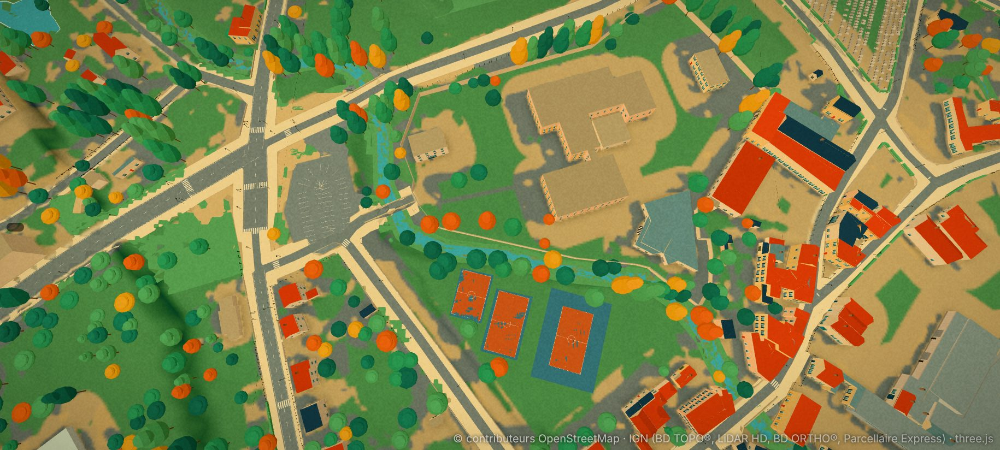
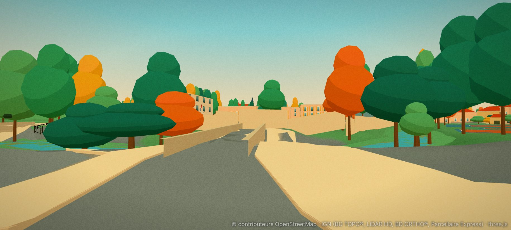
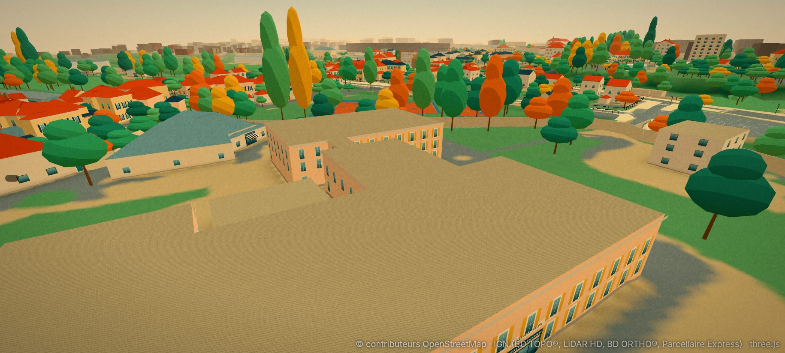

## 8. À relever au lot 0

- Contour et hauteur de chaque aile ; lequel de `…848973`, `…849004`, `…848924` porte le bloc vitré, la barre de quatre niveaux, le volume aveugle.
- Direction exacte des façades (compas du mur le plus proche), axe de la grille.
- Pas, phase et direction de chaque rangée du parking, nombre de places, orientation des flèches de sens.
- Sol des trois plateaux (couleur, tracés), présence d'un grillage.
- Hauteur des parapets du pont, rayon de l'îlot de béton, position de l'arbre remarquable.

## 9. Relevés du lot 0 (1ᵉʳ novembre 2026)

Mesurés sur l'IGN : MNS et MNT LiDAR HD à 25 cm, orthophotographie à 10 cm. Script reproductible : `python3 tools/data/survey_college.py [--images DOSSIER] [--overview | --crop NOM x0 y0 x1 y1 [res]]`
(rasters en cache dans `.cache/college/`, rien d'écrit dans le jeu). Hauteurs au-dessus du sol du bâtiment (MNS − MNT), ± 0,3 m ; plan ± 0,5 m ; caps ± 3°.

### 9.1 Le bloc principal : ailes, hauteurs, orientation

Toutes les ailes sont tournées de **17,5°** : leurs murs ont les caps 72° et 342°. Repère du bâtiment : origine (630 ; 1110), **u** vers le cap 72°, **v** vers le cap 342°.

| Aile | u (m) | v (m) | Dessus (m) | Niveaux | Lecture |
|---|---|---|---|---|---|
| **Barre sud** | −24 à +13 | −33,5 à −10 | **13,6** | 4 | la barre à bandes de fenêtres, 37 × 23,5 m ; sol −35,4 |
| Noyau sur sa face nord | −8 à +1 | −10 à −5 | 13,6 | cage | sort de la barre côté cour |
| Cage extérieure est | +13 à +20 | −25,5 à −21,5 | 7,7 | — | l'escalier de béton de la photo 8, à gauche |
| Aile ouest | −7 à +9 | −5 à +13,5 | 7,7 | 2 | porte le bloc d'entrée vitré (§9.2) |
| **Préau** | +9 à +27 | −5 à +12,5 | **3,8** | 1 | 18 × 17,5 m, toit en quatre berceaux (visibles sur l'orthophotographie) : les voûtes vertes de la photo 8. C'est le BD TOPO `…848974` |
| Aile est | +27 à +44 | +6 à +28,5 | 7,7 | 2 | bandeau vitré bleu-vert de la photo 8 (au fond) |
| Bloc nord | −16 à +27 | +13,5 à +35,5 | 7,7 | 2 | long volume à toit plat, nombreux édicules (acrotère visible) |

- **BD TOPO `…848973`** (65 × 80 m, 9,3 m, 3 niveaux) fond la barre (13,6 m), les ailes à 7,7 m et le noyau : sa hauteur unique de 9,3 m est fausse partout. **Le préau est un bâtiment à part** (`…848974`, 4 m, bien mesuré).
- **Bloc ouest `…849004`** (554 ; 1110) : 8,8 m sur sol −35,0, donc bien deux niveaux hauts (≈ 4,4 m chacun), toit plat ; c'est le bâtiment de béton clair derrière la grille sur la photo 2, pas le « petit bâtiment bas » de la photo 4.
- **Type `culture`** de `…848973` : il vient d'un tag OpenStreetMap `amenity` de la famille théâtre, cinéma, bibliothèque, centre d'arts ou centre communautaire (`build_kinds.py`, `AREA_AMENITY`) ; je n'ai pas relu l'objet OSM. À corriger en `school` au lot 1.

### 9.2 Rattachement des photos

- **Photo 8** (cour est, ci-dessus) : le repère (46,960231 ; 4,307759) tombe en **(670,6 ; 1125,3)**, sur l'îlot circulaire planté du bord est de la cour (visible sur l'orthophotographie). Les ailes relevées montrent une vue vers le **sud-ouest à l'ouest-sud-ouest (cap 250° environ)** : à gauche la barre sud et sa cage d'escalier extérieure (cap 199°), à droite le préau et ses voûtes (cap 254°). Un cap de 112° (est-sud-est) ne mène qu'à la cour et à des maisons. **Confirmé par l'utilisateur.** Vue en hauteur (étage ou haut d'un mur) : le point de vue est donc plus haut que le sol.
- **Photo 3** (cour, bloc vitré à deux niveaux, volume aveugle à gauche, barre à droite) : **hypothèse** : prise dans la **cour ouest**, face à l'est : barre sud à droite, aile ouest vitrée au centre, extrémité ouest du bloc nord (mur aveugle) à gauche. Façade d'entrée du collège = face **ouest** de l'aile ouest (cap 252°). Les marches, bacs roses et rochers sont donc à l'ouest, pas dans la cour de la photo 8.
- **Photo 4** (avenue de la République, vers le sud) : le petit bâtiment bas gris à gauche est **`…849030`** (701 ; 1153), **4,3 m** (BD TOPO : 7,1 m, **faux de 2,8 m**) ; le grand bâtiment blanc à étage et escalier extérieur est le bloc nord ; le grand toit rouge à gauche est la grange de rue des Drémeaux, hors collège.

### 9.3 Le gymnase `…848924`

Pas un toit à croupes : **un toit à deux pentes de très faible pente** (≈ 0,2), faîtage orienté nord-sud vers **x ≈ 672**, égouts à **3,0 m** (ouest) et ≈ 2,5 m (est), faîtage à **5,2 à 5,4 m** (il monte de 4,7 m au sud à 5,4 m au nord : léger rampant). Le jeu le dessine en croupes à égout 4,4 m et **faîtage 9,0 m, soit 3,7 m trop haut**. Sol −35,3 ; emprise ≈ 22 × 40 m, vue de dessus : toit blanc, lames de bac acier.

### 9.4 L'entrée

- Le tablier va de **(522 ; 1072) à (546 ; 1087)**, cap **58°**, **5 à 6 m de large** à l'orthophotographie (le jeu : 4,5 m), sur le ruisseau de Brisecou. À son extrémité nord-est, **barrière à chevrons jaunes et noirs** et la grille : axe de la grille ≈ **(547 ; 1087)**, perpendiculaire au tablier. Derrière : l'esplanade (550 ; 1090).
- **Parapets** : invisibles au MNS à 25 cm (écart ≤ 0,2 m par rapport au tablier) ; leur hauteur (≈ 1 m) reste une lecture de photo. Le grand arbre de la photo 2 est dans la masse d'arbres à l'est du tablier ; à mesurer au lot 3.

### 9.5 Le parking (ouest du collège)

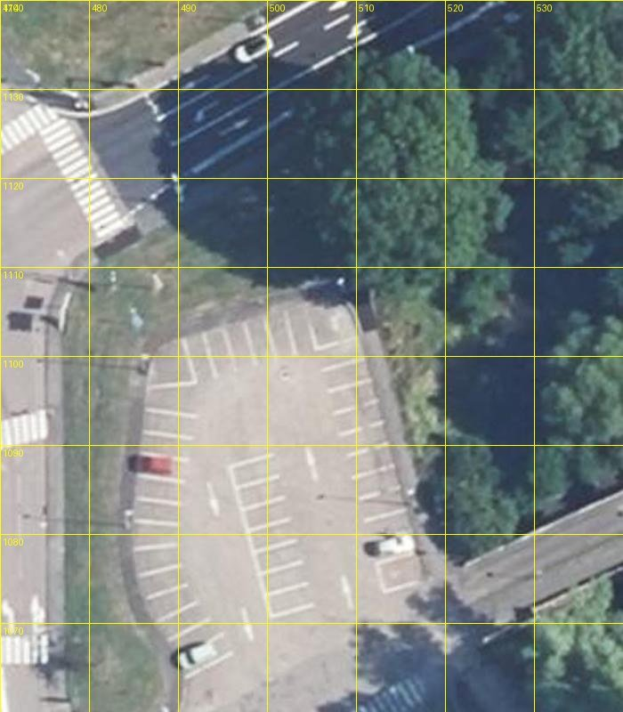

- **Emprise** : ≈ x 486 à 512, y 1068 à 1108, bord nord-ouest arrondi, bordée à l'ouest par la rue de l'Acaron, au nord par l'avenue, à l'est par le mur du ruisseau.
- **Rangées lues** : une rangée **nord** de places perpendiculaires à l'avenue (7 à 8), une colonne **ouest** (≈ 11, traits obliques), une colonne **est** (≈ 9 à 10, traits obliques), un **îlot central** de deux rangées dos à dos (≈ 14), un petit bloc marqué dans l'angle nord-est, **deux flèches de sens** peintes au centre. **N ≈ 42 places (36 à 48)** : décompte visuel, **pas de détection automatique** (mes essais de pics de luminosité ont échoué : traits obliques, trop fins). Le décompte définitif se fait au lot 6, à l'orthophotographie redressée par rangée (méthode D154).
- **Repère du camion** : (499,1 ; 1102,5), au milieu de la **rangée nord**, à 5,5 m du bord de l'avenue : c'est une place (ou deux) de cette rangée, à axe nord-sud. La place actuelle (503,5 ; 1105, cap 242°) est au bord de la lisière, orientée à l'ouest : elle **ne suit pas** les places. Au lot 6, le camion sera aligné sur la rangée (cap 0° ou 180° ; « dos à la route » = tournée vers le sud) sur **deux places voisines** centrées sur le repère, et `keepClear` écartera les voitures de ces deux places.

### 9.6 Les terrains

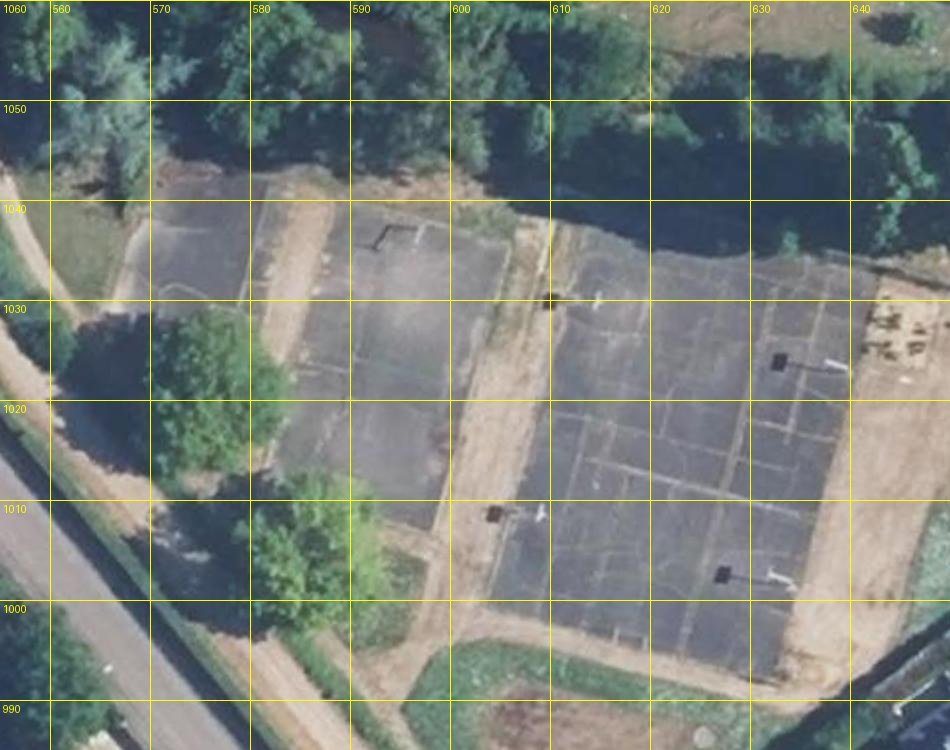

- Trois plateaux **en enrobé gris sombre** à tracés blancs fins, séparés par des bandes de terre battue : l'ouest (565 à 585 ; 1028 à 1046, tracé de demi-cercle), le milieu (580 à 606 ; 1002 à 1040), l'est, le grand « multi » (604 à 643 ; 991 à 1040) à nombreux tracés croisés. Positions et dimensions du jeu **concordent** à 2 m près ; **le sol rouge et bleu du jeu est faux**.
- **Quatre panneaux de basket** (rectangles sombres et leur ombre) vers (592 ; 1038), (607 ; 1011), (638 ; 1026), (631 ; 1002) : aux extrémités des plateaux milieu et est, à ± 2 m. **Aucun grillage visible** : les plateaux sont ouverts.

### 9.7 Ce que cela change au plan

- **Lot 1** : cinq volumes à poser (barre, ailes ouest et est, bloc nord, préau) dans un repère tourné de 17,5° ; hauteurs et niveaux de §9.1 ; gymnase à corriger (§9.3), `…849030` à ramener à 4,3 m.
- **Lot 2** : façade d'entrée = **face ouest de l'aile ouest** (hypothèse photo 3) ; barre et cage d'escalier côté cour est (photo 8), bandeau vitré bleu-vert de l'aile est, **préau à poteaux bleu-vert et toit en berceaux** (nouveau, absent du plan initial).
- **Lot 3** : tablier élargi à 5-6 m, grille au (547 ; 1087), barrière à chevrons.
- **Lot 5** : sol gris sombre, quatre panneaux, **pas de grillage**.
- **Lot 6** : N ≈ 42, camion sur la rangée nord (§9.5).
- **Restent ouverts** : cap exact de la photo 8 ; orientation de la photo 3 ; hauteur des parapets ; décompte précis des places ; luminaires et arbres de la cour.

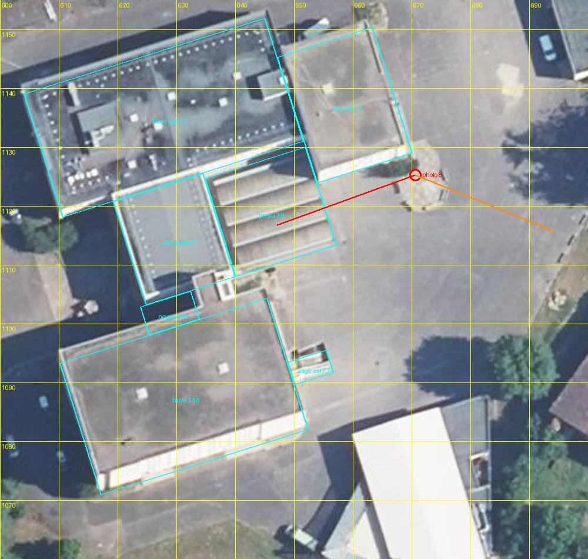
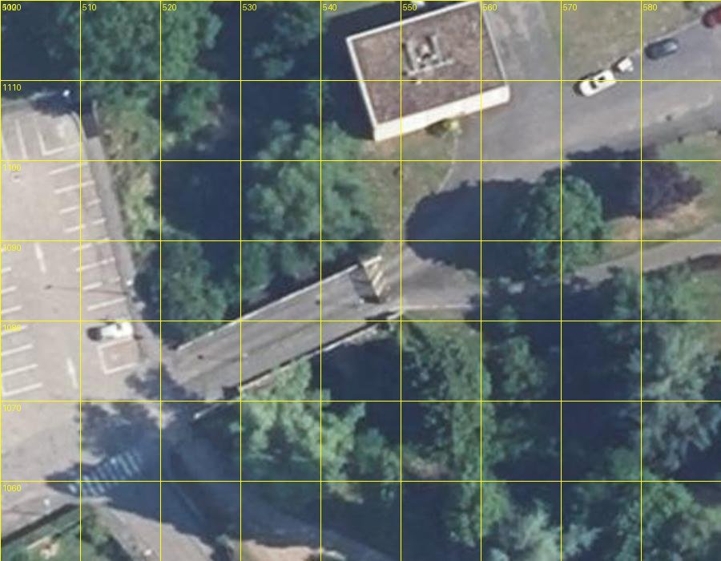

## 10. Lot 1 : volumes et toits (D172)

Fait. Trois bâtiments BD TOPO portent maintenant un modèle (`vallon` dans `kinds/28_39.json`), dessiné par `src/render/vallon.ts` à la place des murs et du toit génériques ; les collisions gardent l'emprise BD TOPO.

- **Bloc principal `…848973`** (type corrigé : `school`, plus `culture`) : six ailes à toit plat avec acrotère de 0,45 m, dans le repère tourné de 17,5° du §9.1 : barre sud (toit à 12,7 m du sol), noyau d'escalier, cage extérieure est, aile ouest, bloc nord, aile est (plus haute que l'aile ouest : 8,9 m au-dessus de son sol d'après la mesure fine, pas 7,7). Rectangles affinés au LiDAR à 0,25 m (le §9.1, tiré d'une grille de 2 m, est à ± 1 m).
- **Préau `…848974`** : murs jusqu'aux creux, **quatre voûtes** d'axe u (creux −30,75, sommet −30,1). Les murs sont pleins pour l'instant (lot 2 : poteaux bleu-vert et côtés ouverts).
- **Gymnase `…848924`** : l'emprise est découpée en **trois bandes** selon u : bas-côté plat à 3,0 m, **hall à deux pentes** (faîtage à 5,3 m en u = 27,7, égouts à 4,3 m, pente 0,12 ; le §9.3, tiré de coupes en x, donnait 0,2 : la coupe en u, dans le repère du bâtiment, est la bonne), bas-côté plat. L'ancien toit à croupes (faîtage à 9,0 m) a disparu.
- **`…849030`** (photo 4) : toit plat ramené de 7,1 m (BD TOPO) à 4,3 m du sol, par `flatRoofs` (D170).
- **Photo 3 confirmée** : la capture « cour ouest » (vue vers l'est) a le bloc nord à gauche, l'aile ouest au centre et la barre à droite, comme la photo.
- **Silhouettes lointaines** (`lod/28_39.json`) : un prisme par aile et par bande à la place de l'ancien prisme unique.
- **Pas fait, volontairement** : façades (murs unis), bandeaux, escalier extérieur, édicules et lanterneaux, ouverture du préau ; bloc ouest `…849004` (8,8 m, correct) laissé tel quel.
- **Reproduire** : `python3 tools/data/build_monuments.py vallon`, puis `python3 tools/data/build_flat_roofs.py` pour `…849030`.

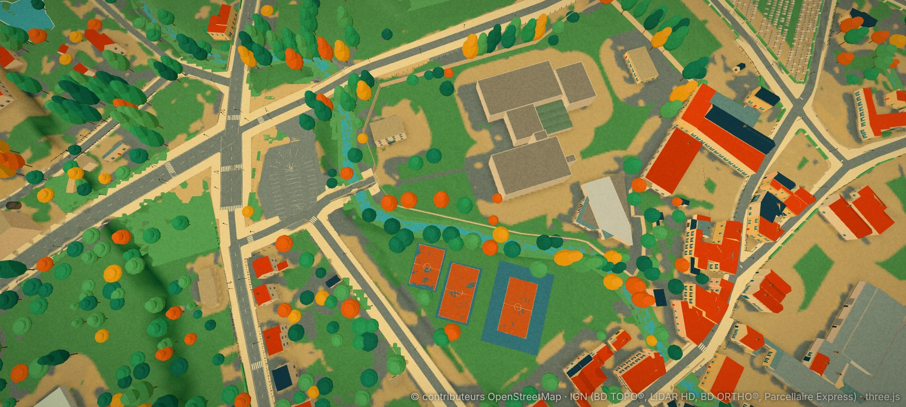
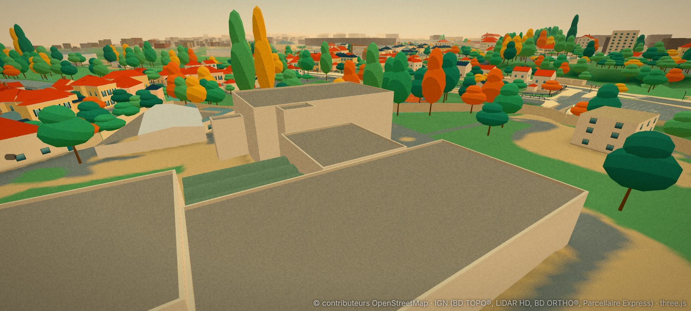
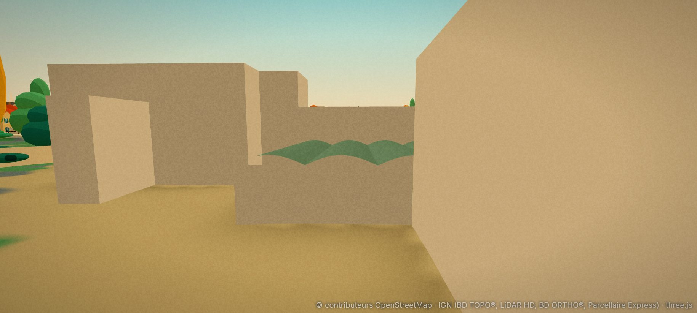
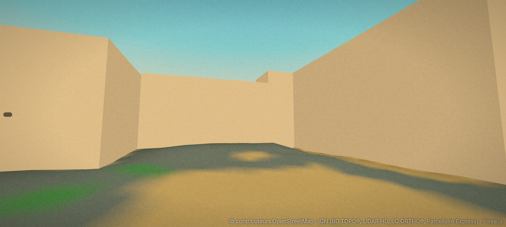
