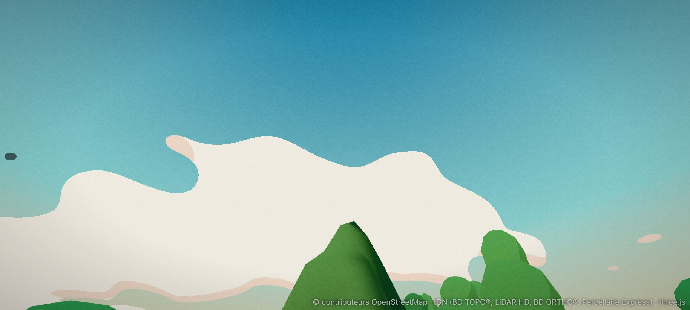
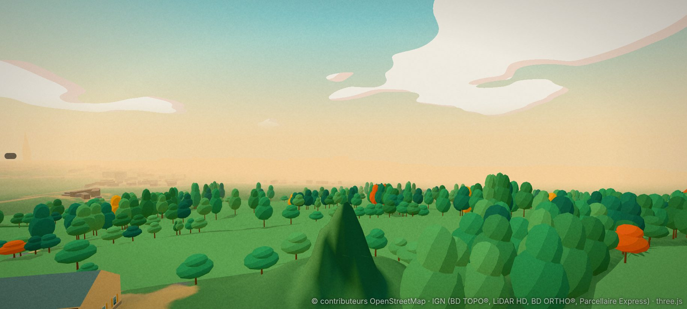
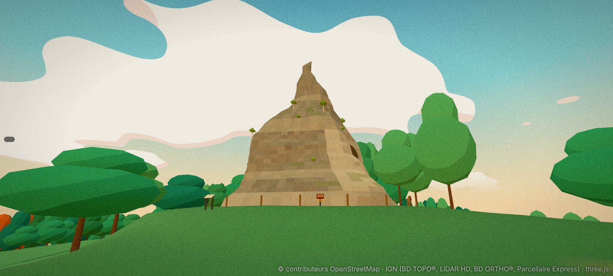
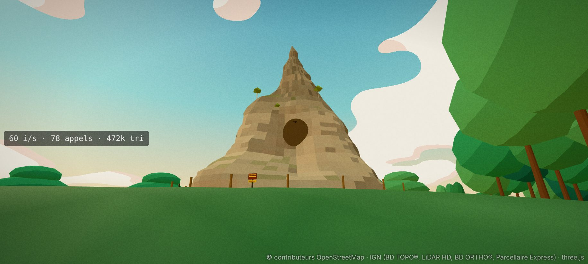
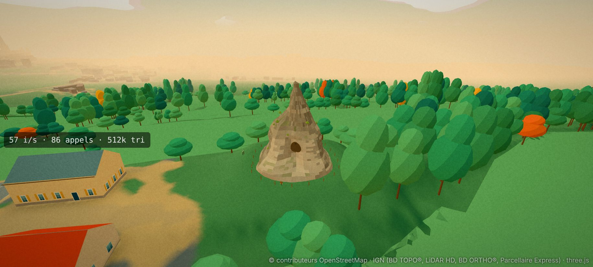
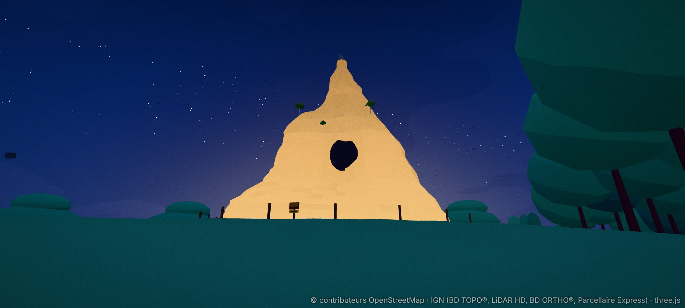
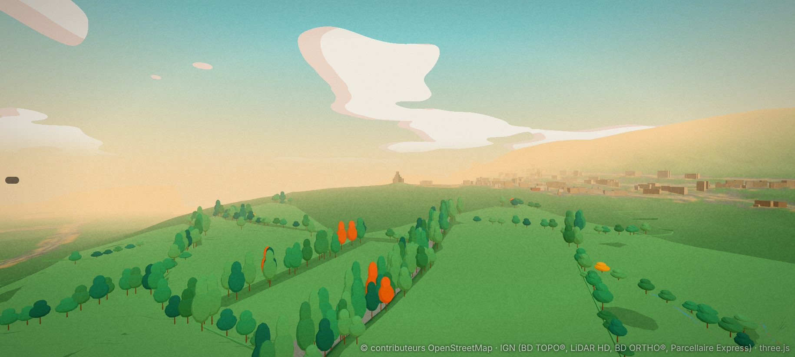

# La Pierre de Couhard : plan (phase A)

Enquête du 4 novembre 2026, sur `main` (D221). Rien n'est modifié dans le jeu : ce fichier, le script de relevés `tools/data/survey_couhard.py`
et deux captures « avant » (`docs/captures/couhard-avant-*.jpg`) sont les seuls ajouts. Les photos de l'utilisateur ne sont pas versionnées :
seule leur lecture est écrite ici. Repère local du jeu (x vers l'est, y vers le nord), mètres ; caps en degrés depuis le nord, sens horaire.

## 0. Ce qu'il faut retenir

1. **La pyramide n'existe pas dans le jeu, mais sa forme si : en herbe.** Le classement LiDAR de l'IGN range la maçonnerie en « sol » : le MNT,
   donc le relief du jeu (`build_terrain.py`), contient un **cône de terre verte de 23 m** à sa place (captures « avant »). Seules les deux caches
   d'armes (D84, D207) et la silhouette lointaine prévue en M4 la mentionnent.
2. **Le nuage de points suffit pour la forme.** Axe en **(1181,2 ; −749,1)**, pré à **z = 68,7** (398,7 m), sommet à **+22,8 m**. Pied d'environ
   10 m de rayon, mur raide jusqu'à +10 m (rayon 6,4 m), **ressaut** entre +10 et +12 m (le rayon perd 1,4 m), puis la pointe, de 3 m de rayon
   à +16 m à 1 m au sommet (§3).
3. **La cavité est mesurée** : un creux au **cap 150-160° (sud-sud-est), de +2 à +8 m**, sans retour LiDAR entre +6 et +8 m (trou profond). C'est
   le trou des photos 2 et 3 ; il confirme l'orientation de la photo 2 (cathédrale à gauche, donc caméra au sud-sud-est).
4. **Les photos suffisent pour la matière et les abords** : blocage de moellons gris-brun dans un mortier beige, base restaurée plus claire,
   touffes et petits bouleaux sur les ressauts, piquets en bois, panneaux « Interdit de pénétrer — Chute de pierres », panneau d'information.
5. **La face nord-est (côté bois) n'est pas photographiée.** Elle sera faite d'après le relevé et la même matière.

## 1. Les photos

| n° | Ce que je lis | Lieu, caméra déduite | Certitude |
|---|---|---|---|
| 1 | Printemps, ciel bleu, arbres nus de part et d'autre. Silhouette en cône irrégulier : large masse basse, **ressaut** vers le tiers de la hauteur à gauche, pointe en cheminée. Poteaux métalliques d'un grillage au pied, panneau d'information à gauche, borne claire. Pré en pente douce au premier plan ; à gauche, la plaine au loin. | Pré du sud-sud-ouest, caméra vers le nord-est (cap ≈ 30°), à 40 m environ. Le sud-ouest est le seul côté sans arbres (§3.4). | 70 % |
| 2 | Grand angle, ciel voilé. Maçonnerie restaurée, très claire, moellons saillants dans un mortier beige ; **trou sombre** à mi-hauteur ; pointe effilée. À gauche, au loin, **la cathédrale** et la ville. | Pré du sud-sud-est, caméra vers le nord-nord-ouest (cap ≈ 335°) : la cavité mesurée est au cap 155°, la cathédrale au cap ≈ 300° depuis la pyramide (à gauche du cadre). | 85 % |
| 3 | Vue aérienne d'automne, lumière rasante. Pyramide grise au milieu d'un pré entouré de haies et d'arbres dorés ; la cavité au pied de la face éclairée ; un chemin et un enclos de piquets autour du pied. | Prise de haut (drone ou colline), depuis le sud-sud-est. | 70 % |
| 4 | Printemps, ciel bleu. Même silhouette que la photo 1, de face : mur de moellons sombres, bandes de mortier plus claires, **petits bouleaux** sur les ressauts. Au pied, **piquets en bois** (≈ 1 m, tous les 4 m environ) et deux **panneaux jaunes « INTERDIT DE PÉNÉTRER — CHUTE DE PIERRES »**. Pré montant vers la pyramide, arbres nus des deux côtés. | Pas côté bois : l'est (60-120°) est boisé et le nord descend de 4 à 5 m. Pré du sud-ouest, caméra vers le nord-est (cap ≈ 40°), la cavité cachée sur le bord droit. | 65 % |

Les photos 1 et 4 montrent deux clôtures différentes (grillage sur poteaux métalliques, piquets en bois) : elles ne sont pas de la même année (question §6).

## 2. État des données

- **Relief** : le MNT contient la pyramide (classe « sol »). Le jeu affiche donc une butte d'herbe en cône à pans lisses, de la couleur du pré.
- **Bâtiments, OpenStreetMap** : rien à cet endroit dans les tuiles du jeu ; aucun site ni silhouette lointaine.
- **Caches d'armes** (`src/core/pickups.ts`) : fusil d'assaut à 16,4 m de l'axe (cap 93°), fusil de précision à 14,6 m (cap 56°). Les deux sont hors
  du pied (rayon maximal 12,9 m) : elles restent où elles sont.
- **LiDAR HD** (dalle `0799-6651`, COPC du 20 octobre 2025) : 89 728 points dans une fenêtre de 70 m, dont 52 363 « sol » et 31 625 de végétation
  haute. Lu à distance par requêtes partielles, sans télécharger la dalle (131 Mo).

## 3. Relevés du lot 0 (4 novembre 2026)

Script reproductible : `python3 tools/data/survey_couhard.py` (points mis en cache dans `.cache/couhard/`, rien d'écrit dans le jeu).
Classes 1, 2 et 6 du nuage (la végétation à part). Précision attendue : ± 0,3 m en rayon, ± 0,5 m en hauteur.

### 3.1 Axe et hauteur

| Grandeur | Mesure |
|---|---|
| Axe (centroïde de la section à +10 m) | (1181,2 ; −749,1) |
| Pré (médiane du sol à 13-16 m) | z = 68,7 (398,7 m) ; à ± 0,35 m tout autour |
| Sommet | z = 91,5, soit **+22,8 m**, à 1,0 m de l'axe (pointe un peu au sud) |

Côté ville (nord et ouest), le pré descend de 4 à 5 m à 25 m du pied : vue d'en bas, la pyramide paraît plus haute.

### 3.2 Profil moyen (rayon médian sur 24 secteurs)

| Hauteur | +1 | +2 | +4 | +6 | +8 | +10 | +12 | +14 | +16 | +18 | +20 | +22 |
|---|---|---|---|---|---|---|---|---|---|---|---|---|
| Rayon (m) | 10,8 | 9,7 | 8,1 | 7,8 | 7,1 | 6,4 | 5,0 | 3,6 | 3,0 | 2,1 | 1,3 | 1,0 |

Lecture : un talus de débris jusqu'à +2 ou +3 m, un **mur presque vertical de +4 à +10 m** (fruit de 1 sur 4), un **ressaut** à +10-12 m (le
« gradin » des photos 1 et 4), puis la pointe, en cheminée au-dessus de +18 m.

### 3.3 Sections et cavité

Les sections ne sont pas rondes : la masse basse déborde au sud-ouest et à l'ouest (caps 195-285 : 8 à 9 m à +8 m, contre 6 m au nord-ouest),
la pointe penche un peu vers le sud-est. Le tableau complet (24 caps × 19 niveaux) est la sortie du script ; le lot 1 le reprend tel quel.

**Cavité** : aux caps 150-160°, le rayon tombe de 9-10 m (voisins) à 7 m dès +2 m, puis aucun point de +6 à +8 m (le laser ne voit pas le fond).
Ouverture d'environ 2,5 m de large et 4 m de haut, centrée vers +6 m, profondeur à fixer d'après les photos (≈ 2 à 3 m). D'autres secteurs vides
isolés (40°, 240-260°, 320°) n'apparaissent qu'à un ou deux niveaux : ombres du relevé sous des surplombs, pas des trous.

### 3.4 Abords

| Cap | Sol à 13-16 m | Sol à 22-29 m | Végétation haute (13-30 m) |
|---|---|---|---|
| 0-30° (nord) | −0,2 | −3 à −4 m | moyenne |
| 60-120° (est) | 0 | −1 m | **dense (le bois)** |
| 150-240° (sud) | +0,1 | −0,6 à −2,4 m | **aucune : le pré** |
| 270-330° (ouest) | −0,1 à −0,3 | −4 à −5 m | moyenne (haies) |

La pyramide est sur un petit plateau plat d'une quinzaine de mètres de rayon, ouvert au sud (le pré des photos), boisé à l'est.

## 4. Plan d'implémentation

Même chemin que le temple de Janus (D139) : un site mesuré par la chaîne de données, rendu par un module dédié.

1. **Lot 1 : volume et terrain.**
   - `build_monuments.py` : site `couhard` (axe, sol, sections par cap et par niveau tirées du nuage, sommet, cavité), écrit dans `kinds/<tuile>.json`.
   - **Terrain** : sous le pied (rayon du pied par cap + 0,5 m), le relief est ramené au plan du pré (ajusté sur l'anneau de 13 à 16 m), avec un
     raccord progressif. Sinon le cône d'herbe traverserait la maçonnerie.
   - `src/render/couhard.ts` : un maillage « loft » à travers les sections (24 caps), avec des irrégularités de moellons (bruit déterministe de ± 15 cm,
     plus fort au-dessus de +10 m), le ressaut, la cheminée du sommet, la **cavité** (ouverture et alvéole sombre).
   - Obstacles : anneaux par niveau, comme `janusRings`. La pyramide ne se gravit pas.
2. **Lot 2 : matière.** Moellons gris-brun et bandes de mortier beige (couleurs par sommet, sans texture lourde), base restaurée plus claire
   (photo 2), touffes vertes et petits bouleaux sur les ressauts (photo 4).
3. **Lot 3 : abords.** Piquets ou grillage autour du pied (§6), deux panneaux « Interdit de pénétrer — Chute de pierres », panneau d'information,
   le chemin d'herbe usée de la photo 3. Les caches d'armes restent hors de l'enclos.
4. **Lot 4 : vue lointaine.** Silhouette dans les LOD (`replace_lod`, comme le temple), visible depuis la ville (le repère M4 de DECISIONS).
5. **Lot 5 : captures « après », tests, décision, progrès.** Mêmes points de vue que les captures « avant » ; un test du site (axe, hauteur, cavité,
   pied) dans `monuments.test.ts` ; une entrée D dans `DECISIONS.md` et une ligne dans `PROGRESS.md`.

Coût estimé : environ 2 000 à 3 000 triangles pour la pyramide, quelques centaines pour les abords.

## 5. Risques et limites

- **Hauteur publiée** : on lit parfois des hauteurs plus grandes ; le relevé (+22,8 m au-dessus du pré, davantage depuis le bas de la pente
  côté ville) fait foi.
- **Fond de la cavité** : le LiDAR ne le voit pas ; sa profondeur sera estimée d'après les photos 2 et 3.
- **Face nord-est** : sans photo, elle aura la même matière que les autres.
- **Terrain** : l'aplanissement touche une seule tuile ; à vérifier sur les coutures et sur la navigation piétonne autour du pied.

## 6. Questions pour l'utilisateur (réponses du 4 novembre : plan accepté ; éclairage comme les monuments déjà éclairés, à revoir plus tard ; une photo de plus, la 4)

1. **Clôture** : grillage sur poteaux métalliques (photo 1) ou piquets en bois (photo 4) ? Par défaut, les piquets en bois (sans réponse : piquets posés).
2. **Éclairage de nuit** : oui, comme les bâtiments déjà éclairés (même mécanisme que le temple de Janus) ; l'éclairage sera revu pour tous.
3. **Ordre des lots** : par défaut 1 → 5.

## 7. Captures « avant »

## 8. Réalisation (D222, 4 novembre 2026)

Lots 1 à 5 faits en une passe (`python3 tools/data/build_monuments.py couhard`, `src/render/couhard.ts`) ; détail dans `docs/DECISIONS.md` (D222).
Écarts au plan : la cavité est un **creux concave** (0,8 m) autour d'un **trou ovale peint** au fond, pas une alvéole maillée (un premier essai,
enfoncé de 3 m sur la grille du maillage, ressemblait à une porte rectangulaire) ; le relief est aplani jusqu'à 1,5 m du pied puis écrêté sous une
pente de 20 % jusqu'à 4 m (stable d'une passe à l'autre) ; pas de chemin d'herbe usée (le sentier OpenStreetMap fait déjà le tour).

