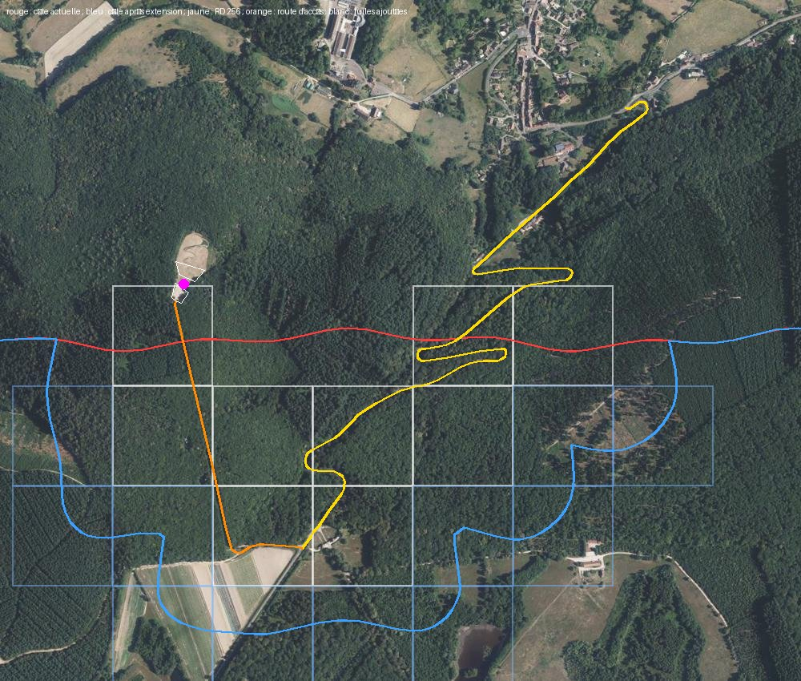

# La Croix de la Libération : plan (avant enquête)

Plan du 7 novembre 2026, sur `main` (après D264). Rien n'est modifié dans le jeu : ce fichier est le seul ajout. Les photos de l'utilisateur
ne sont pas encore arrivées : tout ce qui touche à la forme de la croix est à lire sur elles (lot 0). Repère local du jeu (x vers l'est, y vers le nord),
mètres ; altitudes au-dessus de `ORIGIN_Z` (330 m) sauf mention « NGF ». Les prochains numéros de décision seront D265 et suivants.

**Attention aux noms** : la route départementale s'appelle ici **RD 256** (ou « route de Montjeu »), jamais « D256 », qui est déjà le numéro d'une décision
(la tour des Ursulines éclairée la nuit).

**Décisions de l'utilisateur (7 novembre)** :
- **faire la croix**, pour elle et surtout pour **la vue sur la ville** depuis la hauteur ;
- **mode belvédère** validé : en hauteur, le jeu voit plus loin ;
- **agrandir la carte** pour l'accès réel : **la RD 256** depuis la ville, puis **la petite route** qui monte de la RD 256 jusqu'à la croix ;
- **de l'espace derrière la croix** : la falaise ne doit pas lui être collée.

## 0. Ce qu'il faut retenir

1. **La croix est déjà dans la zone jouable, au ras de la côte.** Point OpenStreetMap `node/936333171` (`historic=wayside_cross`, `tourism=viewpoint`)
   en **(−840,4 ; −1 808,7)**, tuile `22_28`, à 3 m du bord sud de la ville. Le relief du jeu y vaut ≈ 587 m NGF. Le trait de côte (D105) passe
   **142 m au sud** ; le sol tombe de 585 à 285 m NGF entre 20 et 110 m au sud de la croix (falaise de `coast_lib.shore_cap`).
2. **La croix n'est pas dessinée**, mais ses abords sont déjà dans la tuile `22_28` : le banc OSM (`14105148302`), un petit morceau d'enrobé, des pelouses.
   La carte la connaît (lieu « Croix de la Libération », type point de vue).
3. **Ce qui est sous la mer aujourd'hui** (OpenStreetMap, extrait du 7 novembre ; précisé au §8.4 : le premier kilomètre de la RD 256 est déjà dans le jeu) :
   - **la RD 256**, « Route de la Chicolle et Montjeu » (`way/149380971`, 2 475 m, et `way/149380970`, 66 m) : elle quitte la ville au sud-est, vers (284 ; −1 363),
     monte en lacets vers le sud-ouest et atteint un carrefour vers **(−544 ; −2 469)**, 660 m au sud du bord actuel ;
   - **la petite route d'accès** : `way/1053943801` (184 m) puis `way/80229499` (638 m), classées `unclassified` (voie revêtue, voitures admises :
     à confirmer sur photo), qui remontent plein nord du carrefour jusqu'à la croix ;
   - **un parking** (`way/80229518`, ≈ 1 200 m², centre (−857 ; −1 834)), **juste au sud de la croix** : c'est « l'espace derrière la croix ».
4. **Devant la croix, côté ville** : l'**aire de décollage de parapente et de deltaplane** de la FFVL (`way/1232988033`, ≈ 1 800 m², 588 m NGF,
   orientée nord et nord-est, « Creusot vol libre ») : la pente dégagée qui ouvre la vue. Autour : une table de pique-nique, deux poubelles, une caméra,
   un second point de vue à 17 m, un **mât d'antenne de 12 m** à 51 m (`node/8604152250`) ; un autre mât de 44 m à 400 m.
5. **La vue est aujourd'hui impossible** : le brouillard de jour ferme à 800 m (`src/render/style.ts`), les silhouettes s'arrêtent à 1 300 m
   (`VIEW_RANGE`, `src/render/terrain.ts`) ; la cathédrale est à ≈ 1,5 km de la croix, le centre et le nord de la ville bien plus loin.
6. **La chaîne de données ne doit pas être relancée en entier.** Depuis D153, les régénérations complètes sont évitées : un extrait OpenStreetMap plus récent
   change le graphe routier et les files des passants partout, et des tests de la circulation et de la police ne passent plus (D153, `--only s6_8`).
   L'extension se fait **seulement sur les tuiles ajoutées et leurs voisines**, le reste de la ville doit rester identique à l'octet près.

## 1. L'extension de la carte

### 1.1 Les tuiles

| | Tuiles |
|---|---|
| **nouvelles tuiles jouables (9)** | `22_26`, `22_27`, `23_25`, `23_26`, `24_25`, `24_26`, `25_26`, `25_27`, `26_27` (dont `22_27`, `25_27`, `26_27` sont aujourd'hui en bordure) |
| **nouvelle bordure** | l'anneau d'une tuile autour, une quinzaine de tuiles (rangées 24 à 27), où passera la nouvelle côte |
| blocs de 2 km touchés | `(2, 3)` et `(3, 3)` (colonnes 16 à 31, rangées 24 à 31) |

La forme est une **langue de terre qui suit la route**, comme le couloir de la route de Saulieu vers les Télots (D105). Derrière la croix, la terre
s'étend sur au moins 250 m (tuile `22_27`) plus les 125 m de rivage de `coast_lib` : la falaise s'éloigne de 140 m à près de 400 m.
`zone` de `world.json` descend de y −2 062 à y −2 562 (et un peu plus avec la bordure) ; le relief grossier grandit d'autant.

**À vérifier au lot 0** : que le tracé de la côte (zone jouable élargie de 125 m, bruit de ± 45 m) laisse les lacets de la RD 256 entièrement à terre,
sinon ajouter une tuile ; que le carrefour (−544 ; −2 469) et le départ de la petite route sont bien dans `23_25`.

### 1.2 Le piège du relief creusé

`build_coast.py` a **creusé la falaise dans les tuiles existantes** (rangée 28 et bordure) : le relief publié n'est plus celui du LiDAR.
D105 le dit : « si on relance `build_coast.py`, repartir du relief et des structures d'avant ». Le relief d'avant était dans `.cache`, **absent de ce conteneur**.
Il faut donc **refaire le relief à 1 m des tuiles touchées par l'ancienne falaise** (`21_28`, `22_28`, `23_28` et leurs voisines de bordure)
à partir des dalles LiDAR, sans réécrire leurs fichiers de tuile (bâtiments, arbres, sols, mobilier).

### 1.3 Fabrication locale (nouvelle façon de faire)

- `build_all.py` fabrique un bloc entier (toutes ses tuiles sauf `keep`) : ici, ce serait réécrire une soixantaine de tuiles de la ville pour en ajouter neuf.
  **Ajout** : une liste de tuiles à fabriquer (variable d'environnement ou option, par exemple `AUTUN_TILES`), qui réduit l'emprise du bloc
  (et donc les dalles LiDAR à télécharger) et n'écrit que ces tuiles. Les tuiles voisines existantes servent de contexte, comme `keep` (D105).
- Les étapes globales (`build_structures`, `build_kinds`, `build_public_space`, `build_coast`, `build_water`, `build_nav`, `build_map`…) recalculent
  toute la ville. **Ajout** à chacune utile ici : une restriction aux tuiles listées, ou une étape dédiée qui ne fait que ces tuiles
  (comme `build_monuments_nav.py` le fait pour des super-tuiles).
- **Navigation** : on **greffe** les nouvelles voies (RD 256, route d'accès, chemins, parking) sur le graphe existant à leur point de raccord,
  sans refaire les super-tuiles de la ville (règle « graphe routier gardé », D153). Les super-tuiles de 1 km neuves (sud de `s5_7`, `s6_7` et en dessous)
  sont fabriquées entières ; celles qui touchent la ville reçoivent seulement les arêtes ajoutées.
- **Vérification de non-régression** : empreinte (somme de contrôle) de chaque fichier de `public/data` avant et après ; seuls changent les fichiers des tuiles
  ajoutées et de la bordure, `world.json`, le relief grossier, la carte de la zone et les super-tuiles où l'on greffe. Tous les tests passent sans recalibrer.

### 1.4 Ce que l'extension apporte d'elle-même

Relief LiDAR, arbres (forêt de Montjeu), sols (cadastre et orthophoto), la RD 256 et la route d'accès avec leurs bas-côtés, le parking, la circulation
et les passants sur les nouvelles voies, la carte et la minimap. Pas de bâtiment attendu dans ces tuiles (à vérifier : fermes ou maisons le long de la RD 256).

## 2. La croix et ses abords (d'après les photos)

À lire sur les photos au lot 0, puis à mesurer au LiDAR (nuage de points, comme la pyramide de Couhard) :
- **la croix** : forme (croix latine, de Lorraine ?), matériau, hauteur (le nuage de points la mesurera si elle dépasse 3 à 4 m), section des bras ;
- **le socle** : marches, emmarchement, dimensions, inscriptions et plaques (texte à relever) ;
- **le sol** : gravier, terre battue ou dalles autour du pied (la vue Street View montre un sol clair de terre et de gravier), bordures ;
- **les abords** : banc, table, poubelles, mât d'antenne, éventuel garde-corps ou panneau d'orientation (table d'orientation ?), panneaux de l'aire de vol ;
- **le parking** : revêtement, limites (rondins, blocs, talus) ;
- **la clairière** : arbres à retirer devant la croix pour ouvrir la vue, d'après le LiDAR (modèle de hauteur) et les photos de la vue.

Dessin dans le style des autres monuments (`src/render/`, champ propre dans `kinds`, une silhouette lointaine visible de la ville :
la croix se voit d'en bas en vrai, à vérifier sur les photos). Navigation : point « monument » devant la croix (comme D227).

## 3. Le mode belvédère

**But** : depuis la croix, voir la ville entière (cathédrale à 1,5 km, gare et Saint-Pantaléon à 3 à 4 km).

**Idée** : la portée de vue dépend de la hauteur du regard au-dessus du relief environnant. Au sol en ville, rien ne change. Quand la caméra domine
(par exemple plus de 120 m au-dessus de la médiane du relief grossier dans un rayon de 1 km), on pousse progressivement, sur quelques secondes :
- le brouillard (`fog.near`, `fog.far`) jusqu'à 3 à 4 km ;
- la portée des silhouettes (`VIEW_RANGE` et sa marge) d'autant ;
- le plan lointain de la caméra.

Le détail (tuiles complètes) reste à 300 m : au-delà, ce sont les silhouettes, simples par construction. Le relief grossier couvre déjà toute l'emprise.
Les autres hauteurs du sud (Couhard, Montjeu) en profitent sans rien faire de plus.

**À mesurer** (`?bench=1` ou une vue `?view=croix-vue&debug`) : triangles, appels de dessin, images par seconde, mémoire, sur le téléphone de test.
C'est le seul vrai risque du projet. Repli si c'est trop lourd : silhouettes allégées au-delà de 1,5 km (sans toits détaillés), ou portée limitée à la
moitié nord du champ de vision.

**Questions ouvertes** : brume et pluie gardent-elles le droit de fermer la vue (oui, sans doute : c'est réaliste) ? La nuit, lumières de la ville au loin ?

## 4. Découpage

| Lot | Contenu | Données régénérées |
|---|---|---|
| **0. Enquête** | lecture des photos ; script `tools/data/survey_croix.py` : profils LiDAR de la RD 256 et de la route d'accès, contour du parking, nuage de points de la croix, arbres de la clairière ; tracé de la côte prévu ; captures « avant » | aucune |
| **1. Fabrication locale** | outils : fabrication d'une liste de tuiles, étapes globales restreintes, greffe de navigation, contrôle des empreintes ; essai à blanc sur une tuile de bordure sans rien publier | aucune (outils seulement) |
| **2. Extension** | `region.json`, 9 tuiles et la nouvelle bordure, relief refait sous l'ancienne falaise, côte, eau, sols, navigation greffée, carte | oui, locale |
| **3. La croix** | modèle, socle, sol, abords, parking, clairière, silhouette lointaine, point « monument » | `kinds` de la tuile |
| **4. Belvédère** | portée de vue selon la hauteur, mesures sur téléphone | aucune |
| **5. Finitions** | vues `?view=croix`, `croix-vue`, `croix-route`, `croix-haut` ; éclairage de nuit éventuel ; cache d'arme ou détail de jeu au sommet si l'utilisateur le souhaite | selon besoin |

Les lots 3 et 4 ne dépendent pas l'un de l'autre et peuvent passer avant le lot 2 (la croix existe déjà dans la tuile `22_28`) : si l'extension
prend du retard, on voit déjà la croix et la vue en arrivant par les chemins de Couhard.

## 5. Temps de calcul attendus

Mesures connues (D105, toute la ville, cache rempli) : ≈ 2 h 30 pour les 12 blocs, 1 h 10 pour `build_public_space.py`.

- **Le plus long : le lot 2, fabrication des nouvelles tuiles**, à cause du **LiDAR** : les dalles de 1 km (nuages de points classés, quelques centaines de Mo chacune)
  ne sont plus en cache dans ce conteneur et doivent être téléchargées puis traitées (relief, bâtiments, arbres). Avec une emprise réduite aux tuiles ajoutées
  (lot 1), compter **6 à 10 dalles**, soit de l'ordre de **1 à 2 heures** (surtout du téléchargement). Avec les blocs entiers : 16 à 20 dalles et le double.
- Étapes globales restreintes à ces tuiles : quelques minutes chacune (sols du cadastre et orthophoto sur 2 à 3 km² au lieu de 19).
- Une régénération complète de la ville (non retenue) : plus de 4 heures et la recalibration des tests de circulation et de police.

## 6. Photos demandées

1. la croix de face et de profil, avec une personne pour l'échelle ;
2. le socle, les inscriptions, les plaques (de près, lisibles) ;
3. le sol au pied de la croix et les abords (banc, table, poubelles, antenne, panneaux) ;
4. **la vue vers la ville** depuis la croix (portée et cadrage du belvédère) ;
5. la petite route d'accès (revêtement, largeur, bas-côtés) et le parking ;
6. si possible, le carrefour avec la RD 256 et un lacet de la RD 256 ;
7. la croix vue d'en bas, de la ville (pour la silhouette lointaine).

## 7. Les photos (première salve, 7 novembre)

Photos de l'utilisateur (non versionnées) : une photo au sol, deux vues de drone, deux vues Street View d'un particulier (août 2022) sur le site,
quatre vues Street View Google (juillet 2026) des routes, une vue satellite Google Maps.

| n° | Ce que je lis | Lieu, caméra déduite | Certitude |
|---|---|---|---|
| 1 | **La croix de face**, côté parking. **Croix latine massive en granite gris** à moellons équarris, face bouchardée et joints marqués : fût ≈ 3 assises de blocs de large, **bras épais en forte saillie** (leur dessous sombre se voit), tête courte ; un **petit carré en relief** à la croisée. **Socle** : une marche basse sous le fût, posée sur une **grande plate-forme en tronc de pyramide** (talus de pierre appareillée, ≈ 1 m) dont la face sud porte **trois plaques** (une grande au milieu, une petite à chaque coin). Autour, une **allée en enrobé** bordée d'une **bordure de béton**, puis la terre et le gravier. **Deux mâts d'éclairage** (projecteurs) de part et d'autre, côté vue. Des gens debout sur la plate-forme, au pied du fût : échelle. | sur le parking, au sud de la croix, vers le nord | bonne |
| 2 | **Drone, au nord, vers le sud** : la plate-forme est **carrée**, sa face nord est un **mur droit** (≈ 1,5 m) avec un **escalier à chaque angle** (celui de l'est bien visible) ; au sud, la **grande clairière de gravier clair** du parking, en demi-cercle, fermée par la forêt ; une **rangée de rochers bruts** sépare le parking de la plate-forme ; deux mâts d'éclairage aux angles nord ; **pelouse** de l'aire de décollage au premier plan ; **sentier** qui part à droite (est) dans la pente. | au-dessus de l'aire de décollage, vers le sud | bonne |
| 3 | **La vue** (drone, un peu plus haut que les yeux) : pelouse de l'aire de décollage avec un **sentier en lacets**, lisière de forêt, prés, le **centre hospitalier** (toits rouges et blancs, au milieu à droite), toute la ville, la **cathédrale** et sa flèche à droite, le **plan d'eau du Vallon** à droite au fond, la plaine et les collines à l'horizon. | au-dessus de la croix, vers le nord–nord-est | bonne |
| 4 | Street View sur le site : plate-forme vue de biais, **escalier de l'angle nord-ouest** montant vers la vue, plaques, rochers bornes, grand parking de terre, voitures garées le long des arbres. | parking, vers l'ouest–nord-ouest | bonne |
| 5 | Street View : le **parking de terre battue** (≈ 60 m de profondeur), rochers alignés à gauche, **poubelle ronde en béton** à droite, voitures en lisière, conifères et feuillus, **pylône d'antenne** derrière les arbres. | parking, vers le sud | bonne |
| 6 | **La route d'accès** : une seule voie revêtue (≈ 3 m), sans marquage, bas-côtés de feuilles, **toute droite en futaie**. Une voiture peut y monter. | route d'accès | bonne |
| 7 | **RD 256** au pied de la colline : chaussée étroite (≈ 5 m) sans marquage, **long mur de pierre** à gauche avec un pilier d'angle, poteaux électriques, prés. | bas de la RD 256 (à situer sur BD TOPO) | moyenne |
| 8 | RD 256 : allée d'arbres, panneau **« danger – piétons »**, talus herbeux. | bas de la RD 256 | moyenne |
| 9 | RD 256 en forêt : chaussée usée, fougères, feuillus et pins. | haut de la RD 256 | moyenne |
| 10 | Satellite : le tracé (deux grands lacets, la montée vers le sud-ouest, le **carrefour au sud** en lisière des champs, la **route d'accès droite** vers le nord jusqu'à la croix), le centre hospitalier et la tour des Ursulines au nord. **Concorde avec OpenStreetMap.** | — | bonne |

**Ordres de grandeur à confirmer au LiDAR** (photo 1, par les gens debout au pied du fût) : croix ≈ 13 à 15 m au-dessus de la plate-forme, envergure des bras ≈ 7 m,
fût ≈ 2,5 m de large ; plate-forme ≈ 20 m de côté (photo 2). Ce sont des lectures en perspective, à ± 20 %.

**Manque encore** (facultatif) : le texte des plaques (photo rapprochée) ; la face nord et un côté de la plate-forme au sol (escaliers, hauteur du mur) ;
le carrefour de la RD 256 et de la route d'accès ; la croix vue de la ville.

## 8. Relevés du lot 0 (7 novembre)

Script : `python3 tools/data/survey_croix.py [--images DOSSIER]` (OpenStreetMap par l'API officielle, nuage de points LiDAR HD lu à distance sur une fenêtre de 60 m,
MNT et MNS à 1 m et 0,5 m, orthophotographie ; cache dans `.cache/croix/`). Il ne modifie aucun fichier du jeu : l'extension de la carte est simulée en mémoire
(`coast_lib.land()` recalculée avec les tuiles ajoutées). Images : `docs/captures/croix-extension.jpg` (vue d'ensemble), `docs/captures/croix-site.jpg` (le site).

### 8.1 La croix et sa plate-forme (nuage de points)

L'IGN range la plate-forme en « sol » (classe 2) et la croix en « non classé » (classe 1, 212 points au-dessus de 4 m). Repère de la croix :
**u le long des bras, vers le cap 125°**, **t en travers, vers le cap 35°** (la face « avant » regarde le cap 35°, vers la ville ; l'autre le parking).

| Élément | Mesure | Remarque |
|---|---|---|
| axe du fût | **(−840,95 ; −1 809,25)** | à 0,8 m du point OSM |
| orientation | bras au cap **125° / 305°** ; faces vers **35°** (ville) et **215°** (parking) | la cathédrale est au cap 35° : **la croix regarde la cathédrale** |
| dessus de la plate-forme | z = **259,18** (589,2 m), au niveau du parking | plat à 15 cm près |
| dessus, étendue | u −3,0 à +3,5 ; t **−3,0 à +4,5** (≈ 6,5 × 7,5 m) | la croix est vers le bord sud ; la terrasse de la vue est au nord |
| côtés est et ouest (u) | **talus** de 2 m qui descend de 1,1 à 1,2 m | les faces de pierre inclinées des photos |
| côté sud (t < −3) | **talus** de 2 m qui descend de 1,0 m | la face aux trois plaques (photo 1) |
| côté nord (t = +4,75) | **mur droit** de 1,2 m | avec un escalier à chaque angle (photos 2 et 4) |
| emprise au sol | ≈ **10,5 × 11 m** | |
| marche sous le fût | u −1,3 à +1,7 ; t −1,2 à +1,5 (≈ 3 × 2,7 m), **0,5 m** | |
| fût | ≈ **1,7 × 1,7 m** | sections à 0,5 m près (points clairsemés sur les faces) |
| bras | envergure ≈ **4,9 m** ; de ≈ 6,5 à 8,2 m au-dessus de la plate-forme | épaisseur et saillie à reprendre sur la photo 1 |
| sommet | **10,1 m** au-dessus de la plate-forme (599,3 m) | |

**Correction** : j'avais lu 13 à 15 m de haut sur la photo 1 et une plate-forme de 20 m de côté. Le nuage de points donne **10,1 m** et **10,5 × 11 m** :
la perspective et l'allée enrobée autour (comprise dans « la plate-forme ») m'avaient trompé.

### 8.2 Les abords

- **Clairière** d'un seul tenant autour de la croix : **8 700 m²** (MNS − MNT < 1,5 m), de x −875 à −751 et de y −1 857 à −1 719.
  Lisière (premier arbre de plus de 4 m) : **aucune à moins de 90 m vers le nord et le nord-nord-est** (caps 0° et 30°), 88 m au cap 60°,
  16 à 32 m à l'est, au sud et à l'ouest.
- **Parking** (OSM, 1 217 m²) : 81 % dégagé, sol de 587,3 à 590,1 m, pente 7 %. Le contour OSM est plus petit et décalé par rapport à la clairière de
  gravier de l'orthophotographie (`croix-site.jpg`) : **le parking réel est à redessiner d'après l'orthophotographie**.
- **Aire de décollage** (OSM, 1 800 m²) : 98 % dégagée, de 586,1 à 576,8 m, **pente moyenne 21 %** vers le nord ; le sentier en lacets de la photo 3 s'y lit.
- OSM autour : banc à 21 m (ouest), table de pique-nique à 28 m et poubelles à 24 et 36 m (parking), **caméra** à 8 m (« Ville d'Autun : Croix de la Libération », Météo-France),
  **mât de télécommunication de 12 m** à 51 m (est, `node/8604152250`), second point de vue à 17 m.
  Quatre sentiers passent à 16-17 m (dont deux `access=no`).
- Mâts d'éclairage : **non trouvés** dans le MNS (trop minces) ; positions à prendre sur les photos (angles nord de la plate-forme).
- **Le jeu n'a aucun arbre dans la clairière réelle** : rien à retirer.

### 8.3 La vue

Œil à 1,7 m au-dessus de la plate-forme, obstacles lus sur le MNS (10 m au-delà de 90 m) :

| Repère | Distance | Cap | Angle sous l'horizon | Vu ? |
|---|---|---|---|---|
| Tour des Ursulines | 1 208 m | 45° | −9,9° | oui |
| Cathédrale Saint-Lazare | 1 517 m | 35° | −7,6° | oui |
| Centre hospitalier (Parpas) | 1 978 m | 13° | −7,8° | oui |
| Pyramide de Couhard | 2 283 m | 62° | −4,8° | oui |
| Lycée militaire | 2 358 m | 39° | −5,5° | oui |
| Porte Saint-André | 2 992 m | 28° | −5,3° | oui |
| Gare routière, collège du Vallon | 2,3 et 3,2 km | 9° et 26° | −7,1° et −5,2° | masqués par les toits voisins, la ville autour se voit |

La ville se voit **entre 5 et 10° sous l'horizon**, sur un secteur d'environ 0 à 60°. **Pour le belvédère : une portée de 3,5 km** couvre tout ce qui compte
(la Porte Saint-André est à 3 km).

### 8.4 Les routes

| | RD 256 (ways 149380971, 149380970) | Route d'accès (ways 1053943801, 80229499) |
|---|---|---|
| longueur | **2 541 m**, du carrefour (−544 ; −2 469) à la ville (262 ; −1 368) | **823 m**, du carrefour au parking (−861 ; −1 851) |
| OSM | `tertiary`, « Route de la Chicolle et Montjeu », 80 km/h | `unclassified` |
| altitude | de 391 m (ville) à 576 m (carrefour), **184 m de dénivelé** | de 574 à **601 m** (point haut en forêt, vers (−770 ; −2 260)), puis 590 m au parking |
| pente | moyenne 7,2 %, au plus 14 % sur 20 m | moyenne 1,8 %, au plus 18 % sur 20 m |
| lacets | **16 points de rayon < 20 m**, dont des épingles de 8 à 12 m | deux courbes de 19 m au carrefour |
| largeur | ≈ 5 m sans marquage (photos 7 à 9) | une voie ≈ 3 m ; trouée sans arbres médiane 9 m |

**Correction** : la RD 256 n'est pas toute en mer. Son premier kilomètre depuis la ville (tuiles `25_28`, `26_28`, `26_29`, `27_29`) **est déjà dans le jeu**,
avec le bon relief (écart au MNT : 0,1 à 0,3 m) ; elle s'arrête aujourd'hui à la falaise vers (−55 ; −1 862), au milieu des lacets.

### 8.5 Le jeu aujourd'hui

- Relief du jeu à la croix : 589,0 m (MNT 589,6 m). Profil nord-sud : identique au MNT au nord ; **au sud, le sol tombe de 589 à 287 m entre 0 et 120 m**
  (falaise de `coast_lib.shore_cap`) alors que le vrai sol reste à 589-598 m. La croix est à **143 m** du trait de côte ; le parking est déjà à moitié dans la falaise.
- Arbres du jeu à moins de 40 m de la croix : 11 (11,5 à 20,2 m de haut), tous dans la forêt réelle.

### 8.6 L'extension simulée

| | |
|---|---|
| nouvelles tuiles jouables (9) | `22_26`, `22_27`, `23_25`, `23_26`, `24_25`, `24_26`, `25_26`, `25_27`, `26_27` |
| nouvelles tuiles de bordure (11) | `21_25`, `21_26`, `22_24`, `22_25`, `23_24`, `24_24`, `25_24`, `25_25`, `26_25`, `26_26`, `27_26` |
| blocs | `(2, 3)` et `(3, 3)` |
| terre | 22,99 → **23,84 km²** (+0,85 km²) ; **aucune terre perdue ailleurs** à plus de 0,2 % près (1 612 m², le lissage de la côte) |
| RD 256 | à **190 m** de la nouvelle côte au plus près, entièrement à terre |
| route d'accès | à **155 m** de la côte au plus près |
| croix | à **347 m** de la nouvelle côte (143 m aujourd'hui) ; au sud de la croix, la terre s'étend sur 320 à 350 m |
| emprise | la terre descend jusqu'à y = −2 683 (−2 062 aujourd'hui) |

Le tracé proposé (§1.1) suffit : **aucune tuile de plus** n'est nécessaire. Le carrefour, au sud, finit en presqu'île au bord des champs (en bleu sur l'image) :
c'est le bout du monde de ce côté.

### 8.7 Ce qui change dans le plan

- Le **lot 3** (la croix) a toutes ses mesures, sauf l'épaisseur et la saillie des bras, la forme des escaliers nord et les mâts d'éclairage (photos).
- Le **lot 4** (belvédère) vise une portée de **3,5 km** dans le secteur nord ; le nord de la ville (Saint-Pantaléon, à plus de 4 km) restera dans la brume, comme en vrai par temps ordinaire.
- Le **parking** est redessiné d'après l'orthophotographie, pas d'après le contour OSM.

### 8.8 Captures « avant » (viewer, 15 h)

| Capture | Caméra | Ce qu'on voit |
|---|---|---|
| `croix-avant-vue.jpg` | sur la croix, à 2,8 m, vers la cathédrale (`cam=-841,-1805,2.8,36,-571,10`) | la pelouse de l'aire de décollage, la lisière, puis **le brouillard** : aucune trace de la ville |
| `croix-avant-haut.jpg` | à 70 m au-dessus de l'aire de décollage, vers le sud-ouest (`cam=-760,-1690,70,-850,-1840,0`) | l'aire de décollage et **son sentier en lacets** (déjà dans les sols du jeu), le sommet sans croix, la forêt |
| `croix-avant-parking.jpg` | au milieu du vrai parking, à 1,7 m (`cam=-852,-1845,1.7,-841,-1809,4`) | **la caméra est dans la falaise** : le parking réel n'existe pas dans le jeu |

**À vérifier au lot 4** : sur `croix-avant-vue.jpg`, la lisière du bas de l'aire de décollage arrive à la hauteur du regard. Le MNS dit que la ville passe au-dessus
des vrais arbres (§8.3) ; il faudra s'assurer que les arbres du jeu (hauteur et forme des houppiers) ne la cachent pas davantage.

## 9. Les photos (deuxième salve, 7 novembre)

| n° | Ce que je lis | Lieu, caméra déduite | Certitude |
|---|---|---|---|
| 11 | Photo Wikimedia, la croix de trois quarts : un **large escalier d'environ six marches** monte sur la plate-forme, bordé d'un **mur d'échiffre incliné** à couvertine ; à droite, le talus de pierre ; au fond, le parking et une voiture. | angle nord-ouest, vers le sud-est | bonne |
| 12 | **Face nord**, de près : **mur droit** en gros blocs de granite (≈ 1,2 m, deux assises et une couvertine), plaque **« CŒUR SACRÉ DE JÉSUS / NOUS AVONS CONFIANCE EN VOUS »** et une **croix de Lorraine**, en lettres rouges ; à droite, le mur monte en biais (échiffre de l'escalier). La croix de face : **bras plus épais que le fût et en saillie vers l'avant et l'arrière** (leur dessous sombre se voit, ≈ 0,4 m de débord), **carré en relief** à la croisée, tête courte (≈ 2 assises au-dessus des bras), fût en blocs bouchardés de hauteurs inégales. Gravier au pied, puis pelouse. | sur l'allée nord, vers le sud | bonne |
| 13 | Face nord en hiver : deux enfants assis sur la couvertine (échelle : mur ≈ 1,2 m), la plaque à droite, **la rampe inclinée de l'échiffre** à gauche, gravier, pelouse. | aire de décollage, vers le sud | bonne |
| 14 | **Plaque centrale** (photo Wikimedia), granite, lettres rouges : « CREDENTES LIBERATI SUNT / LEUR FOI LES A LIBÉRÉS / VŒU PUBLIC DE MGR LEBRUN ÉVÊQUE D'AUTUN 16 JUIN 1944 / LIBÉRATION DE LA VILLE 8 10 SEPTEMBRE 1944 / POSE DE LA PREMIÈRE PIERRE PAR MGR PIGUET ÉVÊQUE DE CLERMONT A SON RETOUR DE DACHAU 9 SEPTEMBRE 1945 / BÉNÉDICTION DE LA CROIX PAR LE CARDINAL GERLIER ARCHEVÊQUE DE LYON 7 SEPTEMBRE 1947 / INAUGURATION 5 SEPTEMBRE 1948 ». Posée **à plat sur le dallage incliné** (talus sud). Une autre plaque commence par « RECONNAISSANCE ». | talus sud | bonne |
| 15 | **La vue** depuis le haut de l'aire de décollage : hautes herbes, une lisière basse au premier plan qui cache le bas de la ville ; la **cathédrale** et sa flèche à droite du centre, la **tour des Ursulines** en bas à droite, le **plan d'eau du Vallon** à droite, des **immeubles blancs** au centre (Saint-Pantaléon ?), et à gauche **les deux terrils pointus des Télots** ; plaine bocagère, collines du Morvan à l'horizon. | aire de décollage, vers le nord–nord-est | bonne |
| 16 | Panorama (Alamy) : la même vue, plus large ; la lisière cache le pied de la colline, la ville est entière. | aire de décollage | bonne |
| 17 | La vue en hiver, depuis le haut de la pelouse : lisière d'arbres nus, ville, plan d'eau. | haut de l'aire de décollage | bonne |

**Ce que la salve apporte** :
- la face nord est un **mur droit à couvertine** portant la plaque du Sacré-Cœur ; **un escalier à chaque bout**, entre des murs d'échiffre inclinés (le relevé LiDAR le voyait : « escalier à chaque angle ») ;
- le **texte de la plaque centrale** (talus sud) : lisible, on pourra l'écrire en petit sur une texture ;
- les **bras sont plus épais que le fût** et débordent en avant et en arrière : à dessiner en boîte plus profonde que le fût, dessous en retrait ;
- **les terrils des Télots** sont un repère majeur de la vue, à gauche. Ils sont dans l'emprise du jeu (D105) : à vérifier au lot 4 qu'ils se dessinent (relief LiDAR) et se voient d'ici (≈ 5 km : au-delà de la portée de 3,5 km retenue au §8.3, à reconsidérer).
