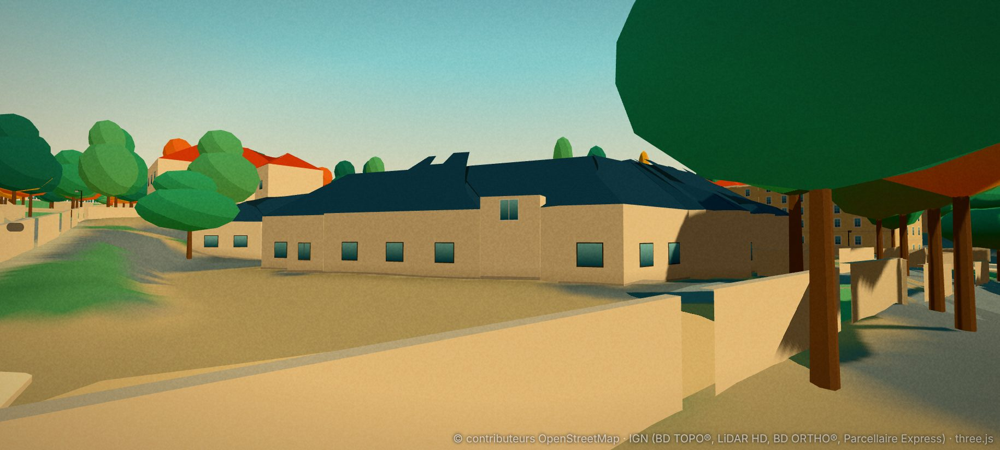
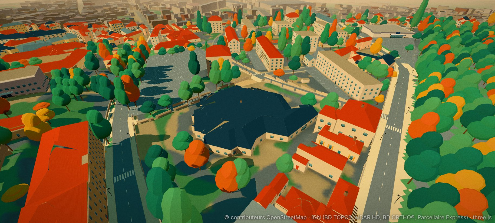
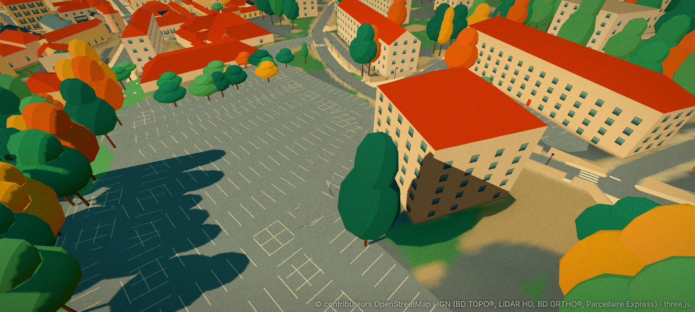
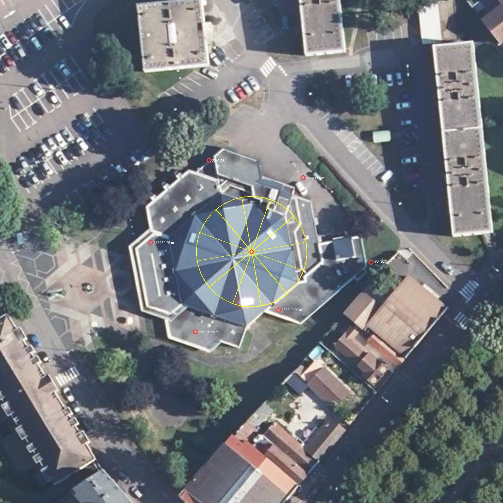
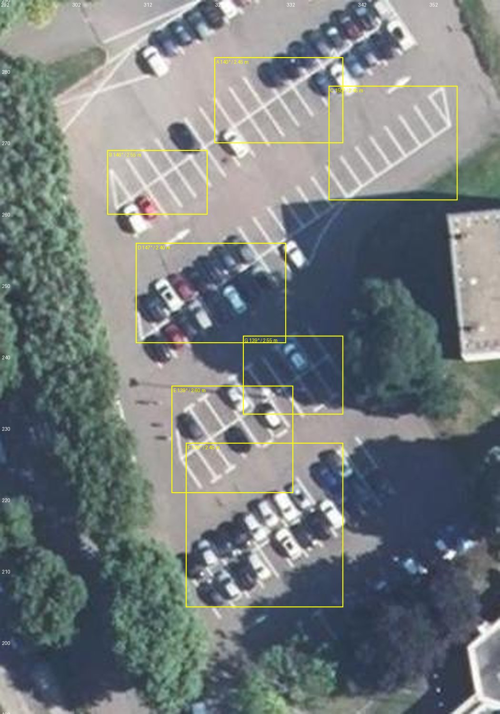

# L'Hexagone, son parvis et son parking : plan (phase A)

Enquête du 1ᵉʳ novembre 2026, sur `main` (D163). Rien n'est modifié dans le jeu : ce fichier et trois captures « avant » (`docs/captures/hexagone-avant-*.jpg`)
sont les seuls ajouts. Les photos de l'utilisateur ne sont pas versionnées : seule leur lecture est écrite ici. Repère local du jeu (x vers l'est,
y vers le nord), mètres ; caps en degrés depuis le nord, sens horaire.

## 0. Ce qu'il faut retenir

1. **Le bâtiment est mal construit, pas seulement mal habillé.** L'Hexagone est `BATIMENT0000000348844694` (type `culture`, tuile 27_35). Son
   contour BD TOPO est un anneau de **56 sommets en escalier** (67 × 58 m) : seuls 7 murs dépassent 8 m, le plus long en fait 26 m. La façade de
   la photo (une façade droite à quatre doubles portes sous deux bandeaux de béton) **n'existe pas** comme mur de ce contour. Une simple fiche de
   façade, comme pour l'hôpital de Latouche (D163), ne suffira donc pas.
2. **Le toit est faux.** Les 34 plans LiDAR au-dessus de 6 m ont tous une pente plafonnée à 0,70 (35°) : c'est la pente par défaut de l'ajusteur,
   pas une mesure (**lot 0 : la pente mesurée est de 0,205, soit 11,6°**, plus de trois fois moindre ; §8). Résultat visible sur la capture « avant » : une masse bleu nuit hérissée d'éclats et d'arêtes parasites, alors que la photo
   satellite montre une pyramide à pans réguliers en bac acier bleu-gris, entourée de toits-terrasses.
3. **La façade actuelle est générique** : enduit beige, petites fenêtres « picture » de 1,5 × 1,3 m, rez-de-chaussée « shop » à porte rouge,
   fiche `estimated` à 60 %. Absents : les deux bandeaux de béton en débord, les piliers rosés, les portes vitrées, l'enseigne « HEXAGONE ».
4. **Le parvis est un sol nu.** Le dallage géométrique (losanges et triangles rose brique, beige et gris anthracite), la sphère rayée, les
   topiaires en spirale dans leur bac hexagonal, les mâts à drapeaux, le lampadaire à tête triangulaire et la colonne Morris n'existent pas.
5. **Le parking de l'Hexagone (OSM 251682899) est dans l'état où se trouvait le Champ de Mars avant D154** : des traits de 4,8 m posés tous les
   2,5 m le long d'allées OpenStreetMap, épars et mal orientés (capture « avant »), contre cinq à six rangées régulières sur la vue satellite.
6. **Un doute à vérifier (hors Hexagone)** : les barres d'immeubles voisines (rue Henri-Dunant, rue du 8-Mai-1945) sont rendues avec des toits
   rouges à croupes (pente 0,70 là aussi), alors que la vue satellite montre des toits-terrasses gris à édicules. Même cause probable que le point 2.

## 1. Les photos

| n° | Ce que je lis | Lieu, caméra déduite | Certitude |
|---|---|---|---|
| 1 | Photo diurne, arbres nus. Bâtiment bas à étage unique visible, **deux bandeaux de béton rosé superposés en débord** qui font le tour de la façade, quatre ensembles de portes vitrées doubles sous le bandeau, piliers rosés entre les vitrages, grand toit bleu-gris à joints debout en pyramides à plusieurs pans au-dessus. À gauche, aile basse en enduit beige ; à droite, **sphère rayée** en pierre claire sur socle. Au premier plan, parvis dallé de losanges et de triangles (rose brique, beige, gris sombre), bac hexagonal blanc à gravier noir et topiaires en spirale, lampadaire à tête triangulaire, mâts à drapeaux. | Parvis, face à la façade principale, caméra à 30 m environ de la façade. Façade tournée vers l'**ouest** : le lot 0 mesure une normale à **275°** (ma première lecture, 250° ± 20°, était trop au sud ; §8). | 85 % |
| 2 | Street View juil. 2026. Même façade, plus près, de biais : lettres « ◉ HEXAGONE » sur le bandeau bas, **quatre à cinq ensembles de portes doubles** (nombre exact à compter au lot 0), deux **grandes topiaires en spirale** (≈ 3,5 m) et un second bac au fond, **deux drapeaux (France, Europe)** sur mâts à gauche, **sphère** et **colonne Morris** à droite, arceaux à vélos à gauche, lampadaire à triangle au centre. Arbres feuillus autour. | Parvis, un peu à gauche de la photo 1, cap ≈ 70° (vers l'est-nord-est). | 85 % |
| 3 | Vue satellite Google Maps, **carte tournée d'environ 30°** (le boulevard Latouche descend en diagonale ; même rotation que pour l'hôpital en D163). Toit octogonal à douze pans bleus au centre, couronne de toits-terrasses gris, parvis à losanges au sud-ouest. **Grand parking** au nord-ouest (« Parking Hexagone »), cinq à six rangées de places perpendiculaires aux allées, un petit bâtiment à toit plat dans le parking, rangée d'arbres le long du boulevard Frédéric-Latouche (ouest). Rue du 8-Mai-1945 au nord, rue Henri-Dunant à l'est, deux barres d'immeubles à toits-terrasses. | Orthophotographie IGN à redresser pour les mesures. Hexagone (389 ; 186), parking OSM (327 ; 260), à 95 m au nord-ouest. | 90 % |

| 4 | Street View juil. 2026 (« 2 Bd Frédéric Latouche »), de plus à gauche et de plus loin que la photo 2. Façade en deux étages de lecture : portes vitrées et grand pan de verre au rez-de-chaussée ; **bandeau bas beige portant « HEXAGONE » en lettres sombres sur une plaque**, **bandeau de fenêtres sombres** (vitrage fumé continu) au-dessus, **bandeau haut beige** en parapet. Une aile basse beige à **poteaux fins (ronds et carrés)** prolonge la façade à droite. Au premier plan : **colonne Morris** (affiche « Concerts à la carte »), trois mâts à drapeaux derrière elle, lampadaire à tête triangulaire, topiaire en spirale, **sphère rayée blanc et sombre** sur un pied à côté des portes, corbeille verte. Toit : bac acier gris-bleu à joints debout, **liseré bleu sombre au bord de l'égout**. | Parvis, face à la façade principale, un peu au sud de l'axe, cap ≈ 95° (vers l'est). Les portes sont à gauche de la sphère. | 85 % |
| 5 | Street View juil. 2026, « Autun, Bourgogne-Franche-Comté ». **Face nord-est** (selon vous) : étage supérieur **en bardage métallique bleu sombre à joints debout**, en encorbellement sur cinq **poteaux blancs fins** au-dessus d'un rez-de-chaussée beige (portes vitrées, fenêtres basses) ; deux **oriels** en saillie à stores beiges ; derrière, le pan gris de la pyramide et une **souche beige** carrée à son pied ; à gauche un toit blanc-argent de faible pente (annexe) et des volumes sombres ; à droite l'aile beige basse. Un massif de genévriers arrondi en bordure de chaussée, des voitures garées sur l'enrobé. | Voie au nord-est du bâtiment, caméra vers le sud-ouest (cap ≈ 215°), à 25 m environ du mur. | 75 % (le lieu est confirmé par le dessus mesuré : +2,2 m au lieu de +1,1 m sur cette face, §8) |

Détails à ne pas oublier, lus sur la photo 2 : **l'enseigne n'est pas visible sur la photo 1** (elle a pu être ajoutée ou être cachée par l'angle) ; la colonne Morris porte
des affiches ; l'écart de saison entre les deux photos explique des arbres nus d'un côté et feuillus de l'autre.

## 2. État des données

| Élément | État actuel | Verdict |
|---|---|---|
| Contour | anneau BD TOPO de 56 sommets, 355–422 × 156–214 | trop crénelé pour une façade droite |
| Hauteurs | sol −3,62 ; égout +0,99 ; faîtage +5,59 ; mesure LiDAR (§8) : sommet +9,17 (12,8 m), pied de la pyramide +4,4 (8,0 m), terrasses +1,1 (4,7 m) | **faux** : le faîtage du jeu est 3,6 m trop bas |
| Toit | `hip`, 14 plans, pente 0,70 partout | **faux** : pyramide à 12 pans, pente 0,205 |
| Fiche | `estimated`, 0,6 ; `plaster #cfc9bb` ; fenêtres « picture » ; porte rouge | à remplacer |
| Mobilier | aucun objet de parvis | à créer |
| Parking | traits aléatoires (OSM 251682899) ; places trouvées par `findStalls` | à refaire |
| Navigation | super-tuile existante, **non touchée** (convention D154) | inchangée |

## 3. Propositions

### 3.1 Le bâtiment : trois niveaux d'ambition

| | A. Fiche de façade seule | **B. Modèle dédié (recommandé)** | C. B + intérieur |
|---|---|---|---|
| Principe | comme Latouche (D163) : `fiches` + devanture moderne | comme le Temple de Janus ou l'hôtel de ville : volumes mesurés au LiDAR (`build_monuments.py`), détails lus sur photo (`manual.json`) | B, plus salle de spectacle jouable |
| Résultat | façade correcte sur un contour crénelé, toit toujours faux | pyramide régulière, couronne de toits-terrasses, bandeaux en débord, portes vitrées, enseigne | idem |
| Coût | 1 lot | 2 lots | 5 lots ou plus, hors périmètre |
| Défaut | ne règle pas le point 1 ni le point 2 | un type de bâtiment de plus à maintenir | collisions, navigation, éclairage intérieur |

**Recommandation : B.** Le bâtiment actuel est un contour de 56 sommets coiffé d'un toit à pente par défaut ; l'habiller n'en ferait qu'un meilleur déguisement
d'une mauvaise forme. B s'appuie sur une mécanique éprouvée (`CathedralModel`, `TownHallSpec` dans `src/data/types.ts`, rendu dans `src/render/monuments.ts`).
C n'est pas justifié tant que rien dans le jeu n'oblige à entrer dans un bâtiment (je n'ai pas vérifié si un intérieur est prévu ailleurs dans le jeu ; rien dans cette demande n'en parle).

Contenu proposé du modèle B (repère local : centre du toit, axe orienté sur la façade principale) :
- **Pyramide centrale** à douze pans, pente et hauteur au LiDAR (mesuré au lot 0 : sommet à 12,8 m au-dessus du sol, pied à 8,0 m, pente 0,205 ; §8), bac acier bleu-gris à joints debout (texture de lames à 60 cm).
- **Couronne basse** : toits-terrasses gris, un étage, qui font le tour de la pyramide ; l'anneau BD TOPO ne sert plus qu'à contrôler l'emprise.
- **Façade principale** : deux bandeaux de béton rosé en débord (≈ 1,0 m, épaisseurs lues sur la photo, à fixer à ± 0,15 m), piliers entre les vitrages, quatre à cinq travées de portes vitrées doubles, vitrage fumé, enseigne « HEXAGONE » sur le bandeau bas.
- **Autres côtés** : enduit beige, bandeaux répétés, portes de service ; estimés (aucune photo), marqués `estimated` dans la fiche.
- **Nuit** : enseigne et vitrines émissives (le jeu a déjà `glow` dans `MeshBuilder`).

### 3.2 Le parvis

- **Dallage** : trois classes de sol (rose brique, beige, gris anthracite) posées en losanges et triangles réguliers selon un gabarit déduit de la photo 1 et du satellite ; il se range dans `plaza_paving` sans nouveau shader (couleurs par polygone, comme D154 pour l'allée du Champ de Mars).
- **Mobilier** (props, avec collision et cassable selon D160 là où c'est raisonnable) : sphère rayée (≈ 2,5 m) sur socle, deux bacs hexagonaux avec topiaires en spirale, mâts à drapeaux (France, Europe, un troisième), lampadaire à tête triangulaire, colonne Morris avec affiches, arceaux à vélos.
- **Arbres** : ceux du boulevard Latouche et des abords sont déjà dans `trees` (182 sur la tuile) ; à contrôler contre la photo 2 seulement.

### 3.3 Le parking

- **Méthode D154** : redresser l'orthophotographie (le boulevard Latouche devient vertical), lire les pics de lignes blanches, fixer pas et phase de chaque rangée, puis ajouter une entrée `lots` à `streetscape` dans `manual.json`. `build_streetscape.py` remplace les anciennes marques de la zone par des polygones propres, sans toucher à `vehicles.ts` : les voitures garées utilisent les places via `findStalls`.
- **Attendu** : cinq à six rangées (simples ou dos à dos), nombre exact de places à compter sur l'orthophotographie (je ne le chiffre pas avant lecture), allées, îlots d'angle plantés, passage piéton à la sortie rue du 8-Mai-1945.
- **Piège connu (D154)** : les lignes sous les voitures sont invisibles ; si l'orthophotographie est prise un jour de forte occupation, les premières places seront extrapolées au pas. Une photo du parking vide (tôt un dimanche) lèverait le doute.

### 3.4 En option : les toits-terrasses voisins

Test simple avant de décider : pour les barres …377 et …387 (tuile 27_36), comparer le profil LiDAR sur une coupe nord-sud ; si le toit est plat, forcer `roofKind: flat`. À ne faire que si le test le confirme, dans un lot séparé (le changement touche des bâtiments que la demande ne mentionne pas).

## 4. Plan d'implémentation

Chaque lot : un commit, une décision `D164…` dans `docs/DECISIONS.md`, captures avant/après dans `docs/captures/`, `PROGRESS.md` à jour, `npm run typecheck && npm run lint && npm test` verts. Aucune relance de `build_nav.py` (navigation de `main` gardée comme en D154), sauf demande contraire.

| Lot | Contenu | Fichiers principaux | Tests (cible) |
|---|---|---|---|
| **0. Relevés (fait, §8)** | redresser l'orthophotographie autour de (389 ; 186) ; mesurer largeur de façade, nombre et largeur des travées, orientation exacte (compas du mur le plus proche de 250°), sol du parvis ; confirmer l'enseigne ; coupe LiDAR de la pyramide | `tools/data/` (script jetable), notes dans la décision | — |
| **1. Volumes et toit (fait, D165)** | type `hexagone` : `HexagoneSpec` dans `types.ts`, mesure dans `build_monuments.py` (pyramide, couronne), rendu `buildHexagone` dans `monuments.ts`, rattachement dans `landmarks.ts` ; l'ancien bâtiment …694 passe en `hidden` ou est remplacé | `src/data/types.ts`, `tools/data/build_monuments.py`, `src/render/monuments.ts`, `src/render/landmarks.ts`, `manual.json` | arête entre 8,5 et 10 m ; douze pans ; pas de plan plus penché que sa mesure ; l'ancien volume n'est plus rendu |
| **2. Façade** | bandeaux en débord, piliers, portes vitrées, enseigne, émissif de nuit | `monuments.ts`, texture d'enseigne (`sign-atlas.ts`), `manual.json` | bandeau bas dans l'emprise et en débord ; au moins quatre travées de portes sur la façade ; lettres dans le bandeau |
| **3. Parvis** | gabarit de dallage et zone de nettoyage dans `streetscape` ; sol de la place retiré de l'ancien aplat | `manual.json`, `build_streetscape.py`, tuile 27_35 | dallage trois couleurs, aucune dalle dans l'emprise du bâtiment ni sur la chaussée |
| **4. Mobilier** | sphère, bacs et topiaires, mâts et drapeaux, lampadaire, colonne Morris, arceaux ; collisions, objets cassables selon D160 | `src/render/props.ts`, `src/core/breakables.ts`, `manual.json` | chaque objet à plus de 1,5 m de la façade ; le joueur ne reste pas coincé entre deux bacs |
| **5. Parking** | rangées lues à l'orthophotographie, anciennes marques retirées, îlots, passage piéton | `manual.json` (`lots`), `build_streetscape.py`, `src/data/streetscape.test.ts` | entre N − 10 % et N + 10 % places (N compté au lot 0) ; toutes perpendiculaires à leur rangée à 5° ; aucune dans une allée |
| **6. (option) Toits voisins** | si la coupe LiDAR le confirme : `roofKind: flat` pour les barres …377, …387 | `manual.json`, `build_roofs.py` | pente des toits plats nulle ; hauteur inchangée |

Budget : le jeu rend déjà environ 610 000 triangles autour de l'Hexagone ; le modèle (pyramide, couronne, bandeaux, portes) doit rester sous 15 000 triangles et les sept à dix props sous 8 000.

## 5. Risques et limites

- **Contour et façade en désaccord** : si l'axe de la photo ne tombe pas sur un mur de l'anneau BD TOPO, le modèle B suit la photo et le LiDAR, pas l'anneau. L'écart d'emprise (jusqu'à 2 m) peut faire déborder un bandeau sur le trottoir ; le lot 0 le mesure.
- **Faces non photographiées** : arrière, côtés et couronne de toits-terrasses seront estimés ; la fiche reste `estimated` pour ces murs.
- **Hauteurs et épaisseurs** des bandeaux, lues sur photo à ± 0,15 m, pas mesurées.
- **Saison** : photos prises par temps et saisons différents ; les couleurs du béton et du bac acier changent avec la lumière. Les teintes retenues sont des moyennes à valider à l'écran.
- **Droits** : Street View et captures satellites ne servent que de référence de lecture, comme pour les lots précédents ; rien n'en est copié (textures et dallage sont dessinés).

## 6. Questions pour l'utilisateur (réponses du 1ᵉʳ novembre : **option B, ordre par défaut**, deux photos de plus (4 et 5) ; les points 2 et 3 restent ouverts)

1. **Option B ou A ?** Par défaut : B. Si vous préférez avancer vite, A donne une façade correcte en un lot mais laisse le toit tel quel.
2. **Photos des autres faces** (arrière, côtés, toits vus de dessus) et **une photo du parking à vide** : par défaut, estimations et extrapolation au pas.
3. **Toits voisins** (§3.4) : lot 6 inclus seulement si la coupe LiDAR le confirme ; dites-moi si vous préférez l'exclure d'office.
4. **Ordre** : par défaut 0 → 1 → 2 → 3 → 4 → 5, le parking en dernier car il ne dépend pas du bâtiment ; dites-moi si le parking passe avant.

## 7. Captures « avant »

## 8. Relevés du lot 0 (1ᵉʳ novembre 2026)

Mesurés sur l'IGN : MNS et MNT LiDAR HD à 25 cm, orthophotographie à 10 cm (fenêtre de 150 m) puis 20 cm (parking). Script reproductible :
`python3 tools/data/survey_hexagone.py --images docs/captures` (rasters mis en cache dans `.cache/`, rien d'écrit dans le jeu). Repère local, z au-dessus de `ORIGIN_Z`
(sol de l'Hexagone : −3,6), caps en degrés depuis le nord, sens horaire. Précision attendue : ± 0,3 m en altitude, ± 0,5 m en plan, ± 3° en cap.

### 8.1 Le toit : ce que le jeu avait faux

| Grandeur | Jeu actuel | Mesure |
|---|---|---|
| Nombre de pans | 14 plans (ajustement de plans libres) | **12**, en pyramide régulière |
| Sommet | +5,59 (9,2 m au-dessus du sol) | **+9,17 en (383,63 ; 183,57)**, soit 12,8 m |
| Pied de la pyramide | égout +0,99 | **apothème ≈ 16,5 m, z ≈ +4,4** (8,0 m) |
| Pente | 0,70 (35°) | **0,205 (11,6°)** |
| Arêtes | quelconques | **20° + 30°·k** (normales des pans à 35° + 30°·k) |

- La phase des arêtes est lue à l'œil : des rayons tracés à 20° + 30°·k suivent les arêtes de l'orthophotographie, ceux à 10° ne les suivent pas ; l'ajustement LiDAR donne aussi 20,0°, mais son écart est presque identique à tous les angles (0,4 à 0,6 m), il ne prouve rien seul.
- Le MNS laisse un écart de 0,4 à 0,8 m au plan : plusieurs **lanterneaux** rectangulaires sont visibles sur les pans (au moins trois : nord-ouest, nord-est et sud), et les pans paraissent légèrement bombés près du sommet (deux tons par pan sur le zoom). À modéliser en lot 1 ; le plan régulier suffit comme première approche.
- Une **souche** beige carrée au pied de la pyramide sur le côté nord-est (photo 5) : la fiche BD TOPO n'a qu'une cheminée de 0,7 m ; à mesurer au lot 1.

### 8.2 Les murs : un hexagone irrégulier, pas un hexagone régulier

Les six murs de la couronne ont leurs normales alignées sur un pan sur deux de la pyramide (**35° + 60°·k**). Distances du sommet au mur, et niveau du dessus de la couronne à cet endroit :

| Normale | Mur à | Milieu du mur | Dessus de la couronne | Lecture |
|---|---|---|---|---|
| **275°** (ouest) | 30,2 m | (353,5 ; 186,2) | +1,1 (4,7 m) | **façade principale**, côté parvis |
| 335° (nord-ouest) | 30,0 m | (371,0 ; 210,8) | +1,1 (4,7 m) | même niveau que la façade |
| 215° (sud-ouest) | 29,2 m | (366,9 ; 159,6) | −0,7 (2,9 m) | plus bas ; petit tronçon (11 m) |
| **35°** (nord-est) | 26,8 m | (399,0 ; 205,5) | **+2,2 (5,8 m)** | **photo 5** : étage supérieur en bardage sombre |
| 155° (sud-est) | 19,2 m | (391,8 ; 166,1) | quasi au sol | la pyramide descend presque jusqu'au sol de ce côté |
| 95° (est) | non fiable | ≈ (417 ; 181) | −0,5 (3,1 m) | la mesure atteint un immeuble voisin (35,8 m) ; à refaire en bornant la fenêtre |

- **Façade principale** : normale 275°, longueur d'un hexagone d'apothème 30 m ≈ 34,6 m (cohérent avec les quatre ou cinq ensembles de portes des photos 1, 2 et 4 sur une trentaine de mètres) ; hauteur du bandeau haut ≈ 4,7 m au-dessus du sol, parvis plat à −3,6.
- Le contour BD TOPO suit le mur sous les bandeaux : sur la façade ouest, l'orthophotographie montre les bandeaux **débordant d'environ 3 m** du contour (visibles comme deux marches claires sur le dessus).
- Le **dessus de +2,2 m au nord-est** confirme la photo 5 : l'étage en bardage sombre dépasse de 1,1 m le niveau des autres terrasses ; sa largeur n'est pas encore mesurée.

### 8.3 Le parking

- Les sept blocs de places lus sur l'orthophotographie ont **tous la même direction**, traits vers **143° ± 4°** (de 139° à 150° selon le bloc), pas de **2,49 m** (2,40 à 2,60). La dispersion de 11° entre blocs est plus grande que l'incertitude de la mesure (± 3°) : il faudra ajuster les blocs un par un au lot 5 (comme les rangées de D154), pas poser une grille unique.
- **Pas de décompte** : les voitures cachent les traits de plusieurs blocs, et une seule orthophotographie ne suffit pas. N sera compté au lot 5, avec Street View en appoint ; l'écart « N ± 10 % » du tableau du §4 reste à renseigner à ce moment-là.
- L'orthophotographie montre aussi une **haie taillée en bande** le long de la rue nord-est, deux **flèches de sens** peintes sur l'enrobé et un petit abri vert au nord-est du bâtiment ; je n'ai pas vérifié si le jeu les a.

### 8.4 Ce que cela change au plan

- **Lot 1** : le modèle est mieux défini. Pyramide régulière à 12 pans (apothème 16,5 m, pied +4,4, sommet +9,17, pente 0,205, arêtes à 20° + 30°·k), couronne de terrasses à niveaux par côté (tableau du §8.2), deux tests de hauteur à corriger : « arête entre 8,5 et 10 m » devient **sommet à 12,8 m ± 0,5 au-dessus du sol**, « pas de plan plus penché que sa mesure » devient **pente de chaque pan entre 0,17 et 0,24**.
- **Lot 2** : la façade principale est la face à 275° (milieu en (353,5 ; 186,2), ≈ 34,6 m). La face nord-est (35°) a un étage en bardage sombre sur poteaux fins, à ajouter au périmètre du lot (photo 5) ; sa hauteur est de 5,8 m, pas 4,7.
- **Lot 5** : sept blocs à ajuster séparément ; décompte à faire alors.
- **Reste ouvert** : mur est (95°), largeur de l'étage sombre, souche, lanterneaux, nombre exact de portes de la façade principale (photos 1, 2 et 4 donnent quatre à cinq ensembles ; la photo 4 en montre trois ensembles centraux, un à gauche et un à droite derrière la sphère) : tout cela se règle en lot 1 et 2 sur les vues de face.

## 9. Lot 1 : volumes et toit (D165)

Fait. Le bâtiment BD TOPO …694 est remplacé par un modèle dédié (`hex` dans `kinds/27_35.json`) : pyramide à 12 pans (pente 0,21, jupon plus raide de 14 à 16,5 m du sommet),
tambour de 12 pans, couronne de six terrasses à niveaux par secteur (contour BD TOPO, acrotère, marches entre secteurs), annexe haute sombre à l'est, silhouette lointaine
corrigée (sommet à 12,8 m au lieu de 9,2).

- **Correction du relevé** : un plan unique de 0,205 jusqu'au pied faisait un sommet 1,5 m trop haut au pied ; les coupes montrent un plan à 0,205 jusqu'à 14 m du sommet (z = +6,2) puis un **jupon à ≈ 0,72** jusqu'au pied (16,5 m, z = +4,4). C'est le « deux tons par pan » de l'orthophotographie.
- **Changement de méthode en cours de lot** : mes six distances de murs ne faisaient pas un hexagone propre (pointes à 34 m, SE à 19 m). Les murs suivent donc le contour BD TOPO, découpé aux limites des six secteurs ; les distances du §8.2 restent dans le modèle (`sides`) comme bord extérieur des futurs bandeaux (lot 2).
- **Reproduire** : `python3 tools/data/build_monuments.py hexagone` (le paramètre limite le passage à ce modèle ; les autres demandent les rasters LiDAR de leur zone).
- **Pas fait, volontairement** : façade (murs unis pour l'instant), enseigne, lanterneaux, souche, bardage sombre du nord-est. Collisions et navigation inchangées (emprise BD TOPO).
- Captures : `docs/captures/hexagone-lot1-*.jpg`.
