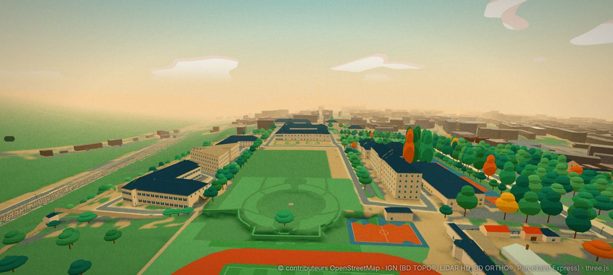
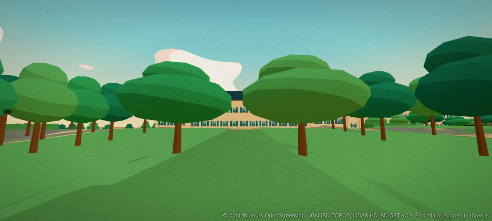
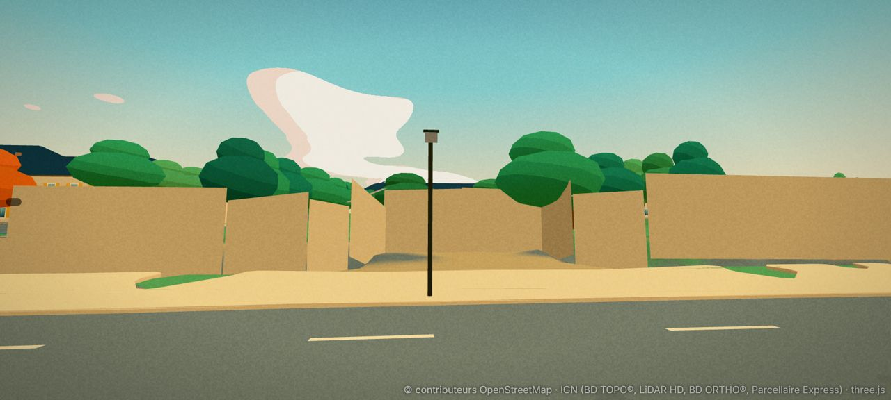
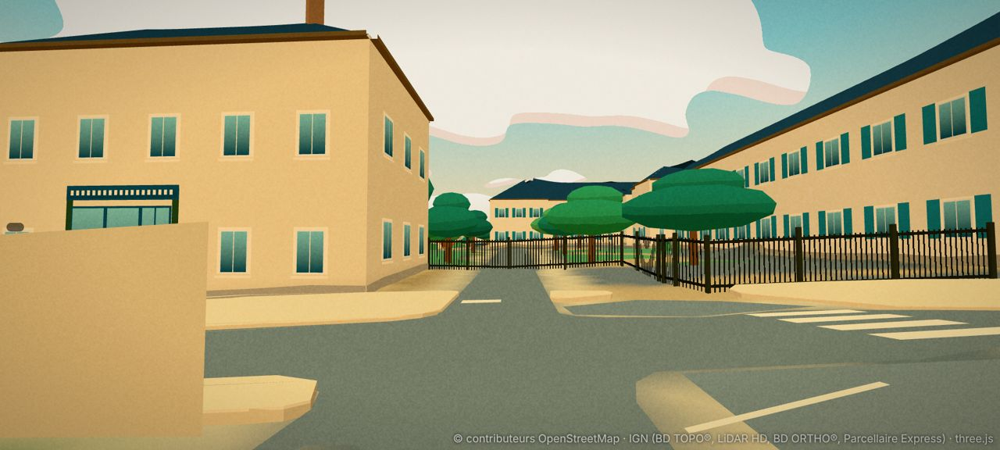
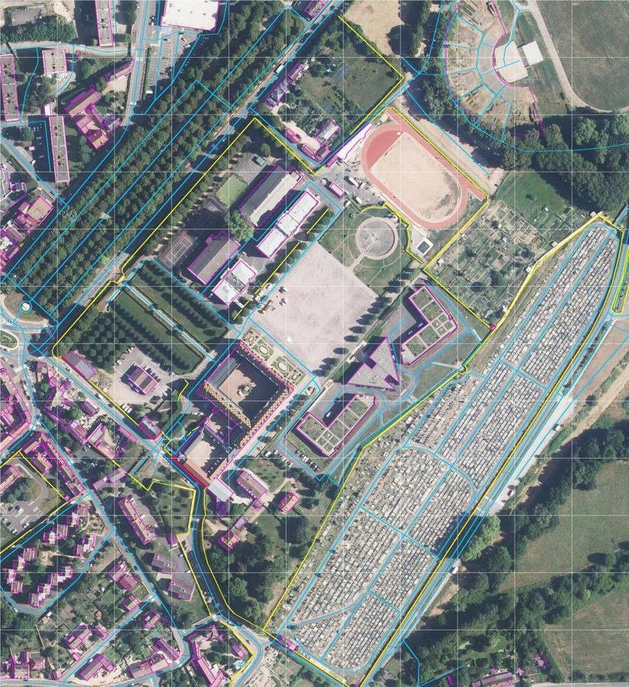
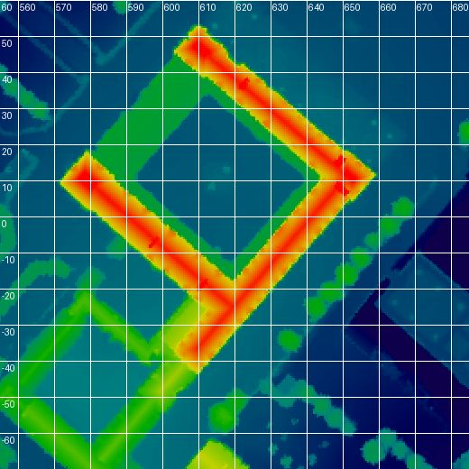

# Le Lycée militaire d'Autun : plan (lot 0, enquête)

Enquête du 6 novembre 2026, sur `main` (après D257). Rien n'est modifié dans le jeu : ce fichier, le script de relevés `tools/data/survey_militaire.py`,
la carte `docs/captures/militaire-carte.jpg`, le relief des ailes `docs/captures/militaire-mns-ailes.jpg` et quatre captures « avant » sont les seuls ajouts.
Les photos de l'utilisateur ne sont pas versionnées : seule leur lecture est écrite ici. Repère local du jeu (x vers l'est, y vers le nord), mètres ;
altitudes au-dessus de `ORIGIN_Z` (330 m). Les prochains numéros de décision seront D258 et suivants.

**Décisions de l'utilisateur (6 novembre)** : **tout inclure** (bâtiment historique, jardins, place d'armes, bassin, piste, bâtiments modernes) ;
**grand portail de l'avenue du 2e Dragons fermé** ; **entrée sud-ouest, rue Gaston Joliet, ouverte** : on entre dans l'enceinte.

## 0. Ce qu'il faut retenir

1. **Le jeu a le lycée au bon endroit, mais 7 m trop bas et sans forme.** Le bâtiment principal est un seul contour BD TOPO (`…844252`, 5 683 m², 44 sommets)
   à toit à croupes générique : égout à 8,3 m, faîtage à 12,9 m au-dessus du sol. Le LiDAR mesure **19,6 m au faîtage des trois grandes ailes** et **22 m aux pavillons**.
   Sa fiche de façade est fausse : « entre-deux-guerres, 1920, enduit, ardoise, rez-de-chaussée commercial ». C'est l'ancien **grand séminaire** de la fin du XVIIᵉ siècle
   (attribué à Daniel Gittard, devenu école militaire en 1886), en pierre, avec ses **toits de tuiles vernissées bourguignonnes**.
2. **Le plan réel est lisible et simple** (LiDAR à 25 cm et parties de bâtiment OpenStreetMap, concordants, §3.1) : une **cour d'honneur carrée** (≈ 31 × 31 m) fermée
   sur trois côtés par de **hautes ailes à deux pans** (NE, SE, SO ; 3 niveaux et 2 niveaux de comble, tuiles vernissées) et, au nord-ouest, par une **galerie basse à toit-terrasse**
   (6 m) percée du passage d'entrée. Les deux bouts nord-ouest des grandes ailes sont des **pavillons** à toit en croupe plus haut. Une **galerie de cloître** (≈ 3 m, 6 m de haut) borde la cour sur les trois autres côtés.
3. **La photo 1 est la façade nord-ouest, l'entrée d'honneur**, vue depuis les pelouses, sur l'axe du grand portail : galerie basse à balustrade et passage voûté au milieu,
   pavillons à gauche et à droite (bouts des ailes NE et SO), et, au-dessus de la balustrade, le grand toit de l'aile SE, de l'autre côté de la cour. L'axe portail → passage → cour → milieu de l'aile SE est droit (cap 132°).
4. **Le site est en pente** : 5,7 m au portail de l'avenue, 15,8 m au pied de la façade nord-ouest. L'allée monte en **glacis régulier de 8,5 %** sur 120 m (pas de terrasses).
   La cour d'honneur et la cour de l'entrée Gaston Joliet sont de plain-pied (16 à 16,4 m). La place d'armes descend doucement (15 → 14 m), le bassin est en creux (11,8 m)
   et un talus de 4 m descend vers la piste (8 m).
5. **Les abords sont faux.** Sur l'avenue, la grille sur muret et le grand portail sont **un mur beige plein de 3,5 m** (`249238889`).
   La place d'armes est en **pelouse** (c'est un sol stabilisé clair), le bassin rond est une **pelouse**, les parterres à la française n'existent pas,
   et l'entrée Gaston Joliet est **barrée par une clôture** (`249238898`, 1,8 m, escaladable) posée en travers du portail.
6. **Le bâtiment n'a pas de passage** : la cour d'honneur est un trou du contour BD TOPO, fermé de tous côtés. On ne peut pas y entrer.

## 1. Les photos

| n° | Ce que je lis | Lieu, caméra déduite | Certitude |
|---|---|---|---|
| 1 | Photo de la **façade d'entrée**. Deux pavillons de pierre blonde à toit en croupe de tuiles vernissées (losanges jaunes, verts, bruns, rouges), quatre niveaux de baies, lucarnes. Entre eux, un corps bas : rez-de-chaussée à grandes baies, **balustrade à pots-à-feu**, **passage voûté** au centre ; au-dessus, un long toit vernissé avec une **lucarne à fronton cintré et horloge**, un drapeau au sommet. Devant : pelouse en pente, **rangée de jeunes arbres taillés** à gauche, **gros ifs taillés** en cône et en dôme, haies, mur de moellons moussus au premier plan. | sur les pelouses du nord-ouest, vers le sud-est, sur l'axe du portail (vers 540 ; 65) | bonne |
| 2 et 3 | Street View juil. 2026, **3 rue Gaston Joliet**. Bâtiment blanc à deux niveaux et pignon, lanterne d'applique (à gauche) ; **portail à deux piliers de pierre** et grille noire ; **barrière en X** (chevrons rouges et blancs) en travers de l'entrée, panneau triangulaire « danger » ; drapeaux, panneaux d'affichage ; grille sur muret enduit à droite ; derrière, l'allée et un **pavillon à toit vernissé** ; aile basse beige à fenêtres encadrées de rouge et toit d'ardoise en croupe le long de la rue (à droite). | rue Gaston Joliet, au passage piéton (538 ; −40) | bonne |
| 4 | Street View, carrefour de l'avenue du 2e Dragons : peupliers taillés en têtard, panneaux directionnels, muret de pierre et grille, maisons. | carrefour avenue / place Anatole de Charmasse (≈ 445 ; 45) | bonne |
| 5 à 8 | Street View, **2 avenue du 2e Dragons**. **Grand portail** à deux vantaux entre deux **piliers de pierre à pots-à-feu**, **arc en fer forgé « LYCÉE MILITAIRE »**, drapeaux ; **grille à barreaux** sur muret le long de l'avenue (≈ 2,5 m), massifs fleuris, ifs taillés, bananier ; devant le portail, une aire de gravier ; vers le nord-est, la grille continue derrière un **talus de lierre et d'arbustes** ; peupliers et platanes de la promenade des Marbres en face. | sur le trottoir, devant le portail (500 ; 110) et le long de la grille | bonne |
| 9 et 10 | Vues satellite Google Maps (nord en haut) : plan d'ensemble, cour d'honneur, parterres, place d'armes, bassin, piste, bâtiments modernes. | — | bonne |
| 11 | Photo aérienne ancienne, depuis le nord-est au-dessus de la piste : piste, **bassin plein d'eau** dans un rond de pelouse, place d'armes, façade nord-est, collines. | au-dessus de la piste, vers le sud-ouest | bonne (photo datée, années 1990 ?) |

**Correction de ma première réponse** : j'avais pris la photo 1 et la photo aérienne pour deux façades vues d'un même côté. L'orthophotographie et le LiDAR montrent
que la photo 1 est la **façade nord-ouest** (sur l'axe du grand portail) et la photo aérienne la **façade nord-est** (sur les parterres et la place d'armes).

**Histoire** (recherche web, à confirmer sur la base POP du ministère de la Culture) : grand séminaire autorisé en 1666 et bâti vers 1669-1675 sous l'évêque de Roquette,
attribué à Daniel Gittard ; école militaire depuis 1886, l'un des six lycées de la Défense ; il abrite le musée des Enfants de troupe. Une source signale les **initiales « GS »**
(Grand Séminaire) dessinées en tuiles vertes et jaunes sur le toit : je ne les vois pas sur l'orthophotographie (motif de losanges et d'anneaux) ; à confirmer avant d'en faire un motif.
Le contour OpenStreetMap est nommé « Lycée militaire d'Autun ; Quartier Gangloff », 3 rue Gaston Joliet.

## 2. État des données

Relevé sur les tuiles 27_35, 28_34, 28_35, 28_36, 29_35 (`python3 tools/data/survey_militaire.py`).

| Élément | État actuel | Verdict |
|---|---|---|
| Enceinte OSM (way 80374605) | 67 sommets, 89 682 m², x 446 à 834, y −200 à 256 | sert de périmètre |
| Bâtiment principal `…844252` | 5 683 m², 44 sommets, deux trous (cour d'honneur, cour sud-ouest), égout 25,0, faîtage 29,6 (sol 16,7), fiche `estimated` 0,6 « interwar » | **7 m trop bas**, une seule forme, fiche fausse |
| Parties OSM du bâtiment | 7 parties : ailes NE `619462433`, SO `…435`, SE `…436` (3 niveaux + 2 de comble, tuiles, deux pans) ; pavillons N `…437` et O `…438` (croupes, 2,5 niveaux de comble) ; galerie NO `…434` (2 niveaux, toit en « papier goudronné » : plat) ; annexe sud-ouest `…431` (2 niveaux) | **concordent avec le LiDAR** : base du lot 1 |
| 16 autres bâtiments de l'enceinte | toits génériques à croupes (faîtage = égout + 4,6 m) ou plats ; tous `school` | hauteurs à reprendre (§3.4) |
| Mur de l'avenue `249238889` | 18 sommets, de (454 ; 39) à (685 ; 205), **mur plein de 3,5 m** (« mesuré 6,99 » : les arbres), suit le renfoncement du portail | à remplacer par muret, grille et portail |
| Entrée Gaston Joliet | clôture `249238898` (1,8 m) de (550 ; −48) à (541 ; −26), **en travers du portail** ; mur `249238892` (2,2 m) plus au nord-ouest | à ouvrir |
| Autres limites | mur nord-est `249238899` (2,2 m), mur sud `249238900` (2,5 m), remparts `−860000030`, `−860000034`, `−860000036` (aspect `restored`, D253) | à garder ; **trou possible au nord-est** entre (685 ; 205) et (722 ; 242), à contrôler au lot 6 |
| Sols | place d'armes en pelouse, bassin en pelouse, allées en partie | **faux** (§3.5) |
| Arbres | 260 dans l'enceinte (couronnes génériques) | alignements à garder ; ifs taillés absents |
| Haies | 11 haies OSM de 1,1 m (allées de la place d'armes, cour Joliet) | à garder et compléter |
| Terrains | 4 `pitch` dans `kinds/28_35` (2 tennis, handball, multisport) ; piste et foot dessinés | à contrôler seulement |
| Mobilier | une fontaine OSM (729,9 ; 141,4) = le bassin ; mât de drapeau OSM (652,0 ; 52,5) non dessiné | à dessiner |
| Jeep « Couhard Sentinelle » (D114) | garée à (676 ; 36), cap 2,36, sur l'allée au sud-est des parterres | à garder ; contrôler qu'aucun prop ne la touche |
| Repère `?view=lycee` | regarde (250 ; 120), à 440 m du lycée (déjà noté en D148) | ajouter `?view=militaire` |

### 2.1 Captures « avant »

## 3. Relevés

LiDAR HD de l'IGN (MNS et MNT à 25 et 50 cm), orthophotographie à 10 et 15 cm, OpenStreetMap (API, 6 novembre). Les fichiers sont gardés dans `.cache/militaire/` (hors git).

### 3.1 Le bâtiment principal

Le sol est à 16,2 à 16,9 m tout autour. Mesures prises en travers des ailes tous les quarts de leur longueur.

| Partie | Axe (du / au) | Longueur, largeur | Faîtage (au-dessus du sol) | Égout | Toit |
|---|---|---|---|---|---|
| Aile NE | (608 ; 53) → (657 ; 13), cap 129° | 63 m, ≈ 10 m | 36,3 (19,9 m) | ≈ 32 (15,7 m) | deux pans, tuiles vernissées |
| Aile SO | (572 ; 12) → (620 ; −30), cap 131° | 64 m, ≈ 10 m | 36,4 à 38,0 (≈ 20 m) | ≈ 32 | deux pans, tuiles vernissées |
| Aile SE | (657 ; 13) → (609 ; −40), cap 222° | 72 m, ≈ 10 m | 36,3 (19,9 m) | ≈ 32 | deux pans, tuiles vernissées ; dépasse l'aile SO de 10 m vers le sud-ouest |
| Pavillon N (bout NO de l'aile NE) | (603 à 616 ; 40 à 53) | ≈ 13 × 10 m | 38,2 (≈ 22 m) | — | croupes, plus haut de 2 m |
| Pavillon O (bout NO de l'aile SO) | (572 à 587 ; 3 à 18) | ≈ 13 × 10 m | 38,9 (≈ 22,5 m) | — | croupes, plus haut de 2,5 m |
| Galerie NO | (580 ; 18) → (604 ; 45) | 36 m, ≈ 12 m | 22,3 à 23,2 (≈ 6,3 m), plat | — | terrasse à balustrade (photo 1), toit gris sur l'orthophotographie |
| Galeries de cloître | côté cour des ailes NE, SE, SO | ≈ 3 m de large | 22 (≈ 6 m) | — | appentis ou terrasse, à lire de près au lot 1 |
| Cour d'honneur | trou BD TOPO (592 ; 8), (612 ; 32), (638 ; 8), (619 ; −15) | ≈ 31 × 31 m | sol 16,4 | — | gravier rose, monument central avec arbre (orthophotographie) |

**L'axe de symétrie** part du grand portail (507 ; 107), passe par le milieu de la galerie NO (590 ; 32) et coupe l'aile SE en son milieu (636 ; −10), à 31 m de son coin est.
Je n'ai pas trouvé de bosse de lucarne nette au LiDAR sur ce point : l'horloge de la photo 1 est **probablement une lucarne au milieu du pan côté cour de l'aile SE** (question 2).

**Annexe sud-ouest** (`619462431`, 2 niveaux) et cour sud-ouest (deuxième trou BD TOPO) : toits à 22 à 26 m (6 à 10 m au-dessus du sol), toit rouge le long de la rue Gaston Joliet.

### 3.2 Le relief

| Profil | Mesure |
|---|---|
| Portail de l'avenue → galerie NO (120 m) | 5,7 → 15,8 m, pente régulière de 8,5 %, aucune marche |
| Pelouses, parallèle à l'axe (93 m) | 8,3 → 15,8 m, même pente, ressaut de 0,8 m au pied du pavillon O |
| Entrée Gaston Joliet → cour de l'entrée (56 m) | 15,6 → 16,2 m : plain-pied |
| Aile NE → parterres → place d'armes (100 m) | 16,8 → 13,8 m (3 %) |
| En travers de la place d'armes (100 m) | 15,1 → 14,3 m (1 %) |
| Place d'armes → bassin → piste (178 m) | 15,3 → 13,1 (place), **12,1 à 11,8 (bassin, en creux)**, 13,0 (rebord), **talus de 4 m** → 8,1 (piste) |
| Grille de l'avenue (248 m vers le nord-est) | trottoir de 3,2 à 1,2 m ; côté lycée, talus de lierre de 2 m environ derrière la grille |

### 3.3 Les entrées

- **Grand portail** (avenue du 2e Dragons) : nœud OSM `4256085551` (505,5 ; 106,2), « privé, piétons ». Renfoncement en gravier entre (497 ; 104) et (513 ; 123) ; vantaux vers (503 à 510 ; 103 à 112).
  Allée de gravier dans l'axe, cap 132°, bordée de deux pelouses à alignements d'arbres (OSM `938815394` à `…397`) ; deux ifs taillés juste derrière le portail.
- **Entrée Gaston Joliet** : portail OSM `4256085503` (544,3 ; −30,6) et barrière levante `4256085505` (545,8 ; −28,8, voitures et motos). Allée de 6 m entre deux haies jusqu'à la cour de l'entrée (555 à 575 ; −10 à 0) ;
  passage piéton peint sur la rue (541 ; −46). Bâtiment blanc `…844665` (532,6 ; −22,5, 9 m) à gauche ; aile basse à toit rouge le long de la rue à droite.
- **Portillon de la place Anatole de Charmasse** (455,4 ; 37,8), privé : à laisser fermé.

### 3.4 Les autres bâtiments (hauteur au-dessus du sol : jeu / LiDAR)

| Bâtiment | Lieu | Jeu (faîtage) | LiDAR (médiane du toit) | Lecture |
|---|---|---|---|---|
| `…844665` bâtiment blanc | (533 ; −23) | 13,1 | 8,9 | pignon, enduit blanc, 2 niveaux (photos 2 et 3) |
| `…844251` | (522 ; 14) | 11,7 | 5,8 | trop haut |
| `…844653` | (620 ; −74) | 17,8 | 13,6 | à mesurer en deux pans |
| `…844706`, `…844707` | (605 ; 103), (585 ; 133) | 13,6 ; 12,3 | 9,4 ; 7,4 | trop hauts de 3 à 5 m |
| `…844705` | (651 ; 153) | 20,7 | 14,3 | trop haut |
| `…844708` gymnase (OSM `sports_hall`) | (634 ; 181) | 11,5 | 7,9 | halle, toit à lire |
| `…844249` triangle | (731 ; 27) | 12,9 plat | 11,1 plat | bon à 2 m près |
| `…844655`, `…844704` (1920) | (696 ; −25), (772 ; 58) | croupes 10,9 ; 13,0 | plats 6,7 ; 6,9 | **toits plats végétalisés à patios** sur l'orthophotographie, pas de croupes |

### 3.5 Jardins, place d'armes, bassin, piste

- **Pelouses du nord-ouest** (glacis) : deux grands rectangles de pelouse de part et d'autre de l'allée axiale, quatre alignements d'arbres taillés en rideau, haies basses. Ifs taillés devant la façade (photo 1).
- **Parterres à la française** : quatre ovales de buis et de gazon entre l'aile NE et la place d'armes, de (615 ; 18) à (668 ; 65), allées de gravier ; **mât de drapeau** sur leur axe (652 ; 52,5), à 27 m de la façade NE.
- **Place d'armes** : sol stabilisé clair d'environ 75 × 70 m, coins (676 ; 138), (731 ; 91), (680 ; 22), (625 ; 74), bordée d'alignements d'arbres au nord-ouest et au sud-est.
- **Bassin rond** : centre (729,5 ; 141,5), ≈ 14 m de rayon, margelle et allée circulaire, pelouses à chemins courbes autour ; **vide sur l'orthophotographie récente, plein d'eau sur la photo aérienne** (question 3).
- **Piste d'athlétisme** et terrain de foot au nord-est, 4 m plus bas que la place, avec le talus entre les deux ; mur d'escalade signalé par OSM au gymnase.

## 4. Propositions

### 4.1 Le bâtiment principal : modèle dédié

Comme le lycée Bonaparte (D148 à D151) : un type de bâtiment `militaire` remplace murs, toits et façade génériques de `…844252`.
- **Volumes** : trois ailes à deux pans (faîtage et égouts mesurés), deux pavillons à croupes plus hauts, galerie basse à terrasse au nord-ouest, galeries de cloître côté cour, annexe sud-ouest ; contours tirés des parties OSM et recalés sur le LiDAR.
- **Tuiles vernissées** : une texture de toit dessinée (losanges et chevrons jaune, vert, brun, rouge sur fond brun, d'après la photo 1 et l'orthophotographie), aucun pixel copié. Le motif « GS » seulement s'il est confirmé.
- **Façades** : pierre de taille blonde, soubassement, chaînages d'angle, bandeaux, quatre niveaux de baies à petits carreaux sur les pavillons, lucarnes à fronton, cheminées ; galerie basse à grandes baies, **balustrade à pots-à-feu**, **passage voûté** ; lucarne à horloge et drapeau ; nuit : une fenêtre sur trois allumée, horloge éclairée.
- **Passage et cour d'honneur jouables** : le passage voûté devient une ouverture (comme le porche de la cathédrale, D132) ; on entre dans la cour d'honneur (gravier rose, monument central, arbre). Pas d'intérieurs.

### 4.2 Les entrées

- **Avenue du 2e Dragons, fermé** : muret de pierre (≈ 0,8 m) et grille à barreaux de fer à pointes (≈ 2,5 m) sur toute la longueur du mur `249238889` ; renfoncement en gravier ; **grand portail** entre deux **piliers à pots-à-feu**, **arc en fer forgé « LYCÉE MILITAIRE »** (lettres dessinées) et drapeaux. Non escaladable, on voit et on tire à travers (comme la grille d'honneur de Bonaparte, D149).
- **Rue Gaston Joliet, ouverte** : la clôture `249238898` est retirée sur la largeur du portail ; deux piliers de pierre, vantaux de grille **ouverts** contre les piliers, **barrière à chevrons** et barrière levante relevée, panneau triangulaire, panneaux d'affichage, drapeaux ; le bâtiment blanc reçoit sa vraie façade (enduit blanc, pignon, lanterne). Voir question 4 pour les voitures.

### 4.3 Jardins, place d'armes, bassin

- Allée axiale en gravier, pelouses du glacis, alignements d'arbres taillés en rideau (couronnes rectangulaires), **ifs taillés en cône et en dôme** (props avec collision), haies ; parterres à la française dessinés au sol (buis bas en relief, gazon, gravier) ; mât de drapeau.
- Place d'armes en stabilisé ; bassin rond avec margelle et (selon la question 3) de l'eau, sur le modèle des bassins existants (`buildFountain`, `inland-water.ts`) ; allées courbes des pelouses du bassin.

### 4.4 Bâtiments modernes et terrains

- Hauteurs et toits mesurés sur les 16 autres bâtiments (méthode `fit_roof` de `build_stores.py`) ; toits plats végétalisés à patios pour `…844655` et `…844704` ; façades génériques propres (fiches `estimated`), sans photo.
- Terrains : contrôle des tracés, filets de tennis, buts, paniers ; talus de la piste.

## 5. Plan d'implémentation

Chaque lot : un commit, une décision `D258…` dans `docs/DECISIONS.md`, captures avant/après dans `docs/captures/`, `PROGRESS.md` à jour, `npm run typecheck && npm run lint && npm test` verts.
Aucune relance de `build_nav.py` (convention D154), sauf pour le lot 6 si l'on y met des passants.

| Lot | Contenu | Fichiers principaux | Tests (cible) |
|---|---|---|---|
| **0. Enquête (fait)** | ce fichier, `survey_militaire.py`, captures « avant » | — | — |
| **1. Volumes et toits** | type `militaire` : ailes, pavillons, galeries, annexe ; toits mesurés ; texture de tuiles vernissées ; silhouette lointaine (`lod/28_35.json`) ; repère `?view=militaire` | `src/data/types.ts`, `tools/data/build_monuments.py`, `src/render/monuments.ts`, `manual.json` | faîtages à ± 0,5 m du LiDAR ; ailes dans le contour BD TOPO ± 2 m ; < 8 000 triangles |
| **2. Façades** | pierre, baies, lucarnes, galerie à balustrade, passage voûté, horloge, cheminées, drapeau ; nuit | `monuments.ts`, `manual.json` | passage voûté sur l'axe ; baies dans l'emprise des murs |
| **3. Entrées** | grille et grand portail de l'avenue (fermé), entrée Gaston Joliet (ouverte), bâtiment blanc | `props.ts`, `world.ts`, `manual.json`, `build_kinds.py` | portail fermé non franchissable ; passage libre de 3 m rue Gaston Joliet ; joueur non coincé |
| **4. Jardins, place d'armes, bassin** | sols, allées, parterres, ifs taillés, haies, mât, bassin | `build_courts.py`, `build_ground.py`, `props.ts`, `manual.json` | aucun sol dans les ailes ; ifs à plus de 1,5 m des façades ; bassin dans son rond |
| **5. Bâtiments modernes et terrains** | toits mesurés, toits végétalisés, façades génériques, équipements | `build_stores.py`, `manual.json`, `props.ts` | sommets à ± 1 m du LiDAR |
| **6. Jeu** | cour d'honneur jouable (passage voûté), fermeture de l'enceinte contrôlée (trou du nord-est), jeep conservée ; passants si demandé | `world.ts`, tests de collision | on entre depuis la rue Gaston Joliet jusqu'à la cour d'honneur ; on ne sort pas par l'avenue |

Budget : modèle principal (ailes, toits, façades) sous 20 000 triangles ; grille, portails et props sous 10 000.

## 6. Risques et limites

- **Façades non photographiées** : sud-est (sur l'allée du triangle), sud-ouest (rue Gaston Joliet) et côté cour : faites sur le modèle de la photo 1 (fiche `estimated`).
- **Façade nord-est** : seulement la photo aérienne ancienne et l'orthophotographie ; mêmes règles que la photo 1 (pavillons, travées).
- **Galeries de cloître** : leur forme (arcades ou baies, terrasse ou appentis) n'est visible sur aucune photo.
- **Motif exact des tuiles** : lu sur une photo et l'orthophotographie, à ± un motif près.
- **Droits** : Street View, photos et captures satellites ne servent qu'à la lecture ; textures, lettres et motifs sont dessinés.

## 7. Questions pour l'utilisateur

1. **Cour d'honneur** : je propose d'**ouvrir le passage voûté** de la galerie nord-ouest pour entrer dans la cour (sans intérieurs). D'accord ?
2. **L'horloge** de la photo 1 : je la place au milieu du toit de l'aile sud-est, côté cour, sur l'axe du portail (de loin, elle paraît posée sur la galerie basse). Si vous savez qu'elle est sur la galerie elle-même, dites-le.
3. **Le bassin rond** : plein d'eau (photo aérienne) ou vide (orthophotographie récente) ? Par défaut : **plein**.
4. **Entrée Gaston Joliet et voitures** : à pied seulement (barrière levante baissée, piétons à côté) ou aussi en voiture (barrière levée) ? Par défaut : **à pied et en voiture**, barrière levée, comme une entrée ouverte.
5. **Passants** (élèves en uniforme, personnel) dans l'enceinte : oui ou non ? Par défaut : **non** (comme le collège du Vallon).
6. **Photos en plus** (facultatif) : un gros plan de l'avant-corps à horloge et de la galerie à balustrade, la façade nord-est vue des parterres, la cour d'honneur.
7. **Ordre des lots** : 1 → 2 → 3 → 4 → 5 → 6 par défaut.

## 8. Lot 1 fait (D258, 6 novembre 2026)

Réponses : « vas-y » sur les choix par défaut du §7 (cour d'honneur ouverte, horloge sur l'aile sud-est, bassin plein, entrée Gaston Joliet à pied et en voiture, pas de passants, lots dans l'ordre).

- Modèle `college` étendu, quatorze ailes : trois grandes ailes (faîtages 36,2 à 36,4), deux pavillons (38,2 et 38,8), galerie nord-ouest (22,1), cloître (21,8), annexe sud-ouest en cinq ailes.
- Tuiles vernissées en losanges, façades de la cour d'honneur et de la cour sud-ouest, façades sur cour au-dessus du cloître.
- 8 074 triangles (cible du lot : 8 000 ; plafond du modèle : 20 000), silhouette lointaine en quatorze prismes.
- Écart connu : le cloître du LiDAR finit à 8 à 8,5 m du faîtage ; le trou BD TOPO (murs de la cour et obstacles) à 7 à 9,9 m. On garde le trou BD TOPO jusqu'au lot 6.

## 9. Lot 2 fait (D259, 7 novembre 2026)

- Fenêtres de 1,2 × 2,1 m à petits carreaux (travée de 3,7 m), chaînes d'angle, lucarnes au pas de 7,4 m (mesurées : 7 à 9,6 m), cinq cheminées (LiDAR).
- Galerie : baies cintrées, passage voûté sur l'axe (dessiné fermé), balustrade à pots-à-feu ; cloître en arcades.
- **Question 2 tranchée par le LiDAR** : l'axe du portail tombe sur la lucarne du milieu du pan côté cour de l'aile sud-est (u = 30,4 ; bosse mesurée à 30,9) : c'est la lucarne à horloge. La galerie est plate (22 m), sans fronton.
- 14 307 triangles pour tout le bâtiment.
