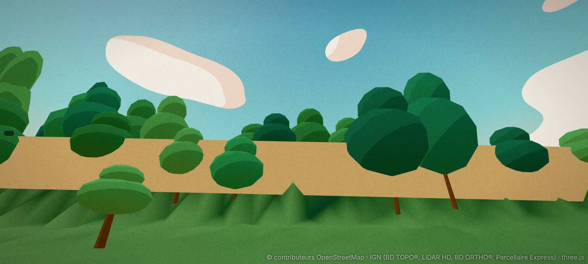
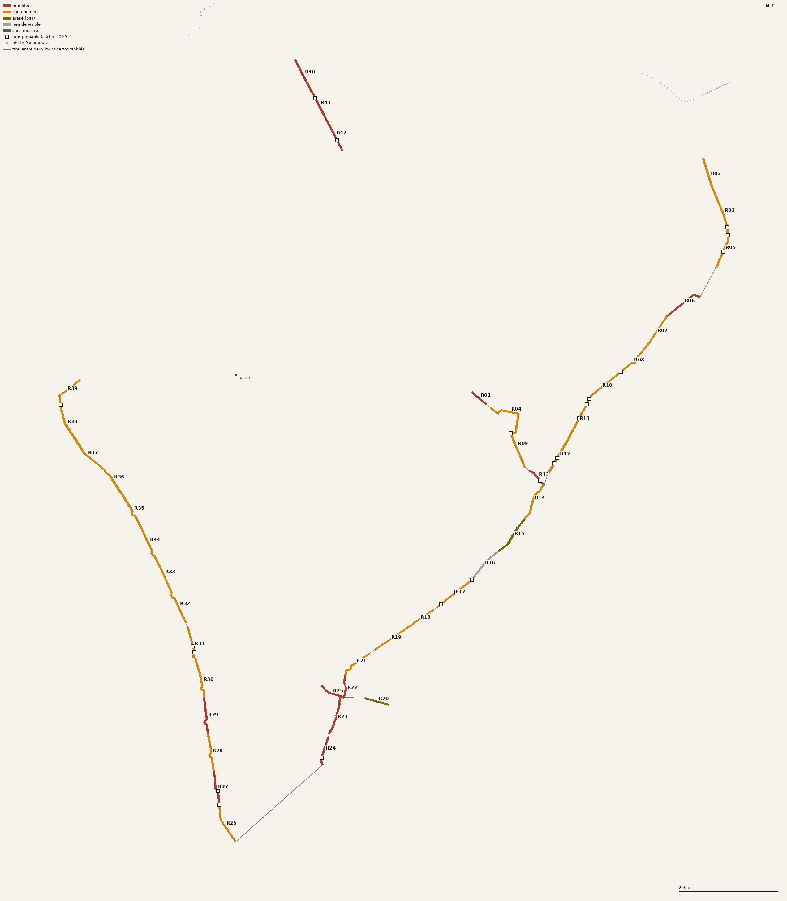

# Les remparts : plan (lot 0, relevés)

Enquête du 6 novembre 2026, sur `main` (D249). Rien n'est modifié dans le jeu : ce fichier, le script de relevés `tools/data/survey_remparts.py`,
la carte `docs/captures/remparts-carte.png` et une capture « avant » sont les seuls ajouts. Repère local du jeu (x vers l'est, y vers le nord), mètres.

## 0. Ce qu'il faut retenir

1. **Le jeu a 14 murs (3 144 m), tous en boîte de 6 m × 1,3 m posée sur le relief.** Le relevé montre que c'est faux sur les deux tiers :
   **2 139 m sont des murs de soutènement**, au niveau de la ville d'un côté et hauts de 5 à 10 m de l'autre ; 785 m sont des murs libres
   (jusqu'à 18 m côté extérieur au sud, rue de Breuil) ; 221 m sont arasés ou invisibles.
2. **La maçonnerie est déjà dans le relief, en herbe.** Comme à Couhard, l'IGN range le parement en « sol » (classe 2) : sur les murs de soutènement,
   90 à 100 % des points du haut sont du « sol ». Le jeu montre donc **un talus vert de 5 à 10 m surmonté d'une boîte beige** (capture ci-dessous).
   Le lot 1 doit couper ce talus et le remplacer par la face du mur.
3. **Les tours se voient mal au LiDAR.** 22 saillies hautes de 3 à 9,5 m côté extérieur sont retenues, mais beaucoup tombent sur une seule station
   (4 m) et certaines sont sans doute des contreforts, des appentis ou des arbres mal classés. Aucune tour n'est dans OpenStreetMap. **Il faut une
   liste et des photos** (§5).
4. **Panoramax ne sert à rien ici** : aucune de ses photos n'est à moins de 35 m d'un mur (57 à moins de 250 m). Les murs sont derrière des
   jardins, en contrebas de boulevards, ou dans des terrains clos. **Les photos de l'utilisateur sont la seule source d'aspect.**
5. **Il manque au moins 235 m à la pointe sud** (de (−1 ; −942), boulevard Mac Mahon, à (175 ; −787), rue Chaffaut), et toute la moitié nord de
   l'enceinte romaine est absente d'OpenStreetMap, comme ses tours.
6. **Une promenade sur le mur existe peut-être** : un sentier OSM (`426304451`) suit sur 94 m le haut du mur de soutènement de l'est (R10-R11), de
   (811 ; 62) à (715 ; −39). À confirmer sur photo. Aucun autre chemin n'est sur un dessus de mur.

*R11 aujourd'hui, vu du pied côté extérieur : le parement de 10 m est un talus d'herbe, la boîte de 6 m flotte sur la terrasse.*

## 1. Décisions de l'utilisateur (6 novembre 2026)

| Question | Réponse |
|---|---|
| Portions disparues | **Ne rien montrer.** |
| Dessus des murs | **Promenade seulement là où l'on marche en vrai.** Ailleurs, le mur reste infranchissable. |
| Enceinte médiévale du Château et du Marchaux | Laissée à ma recommandation (§2). |
| Photos | L'utilisateur fournira celles du §5. |

## 1 bis. Première série de photos (6 novembre 2026)

14 captures d'écran de Google Street View envoyées par l'utilisateur (juillet 2023, juillet 2025, juillet 2026). Elles ne sont pas versionnées :
seule leur lecture est écrite ici. Elles servent de référence d'aspect ; rien n'en est copié dans le jeu.

| n° | Lieu (adresse) | Tronçons | Ce que je lis | Certitude |
|---|---|---|---|---|
| 1 | Bd des Résistants Fusillés (2023) | R32-R39 | Mur de **moellons gris-brun irréguliers**, en assises grossières, joints peu visibles ; **tour semi-circulaire saillante, arasée au niveau du mur**, sans toit, herbe au sommet ; lierre par grandes plaques. Au sommet, un **chaperon clair** (ciment) et un **grillage vert de 2,5 m sur poteaux** : un terrain de sport au niveau du haut du mur, avec des bâtiments scolaires derrière. C'est bien un mur de soutènement (§3). Au pied, bande d'herbe puis chaussée. | 90 % |
| 2 | 12 bd des Résistants Fusillés (2023) | R33-R36 | Même mur sur une centaine de mètres, 4 à 5 m au-dessus de l'herbe, chaperon clair et grillage continus ; touffes d'herbe dans les joints ; deux autres saillies au loin (tours). | 90 % |
| 3 | 18 bd des Résistants Fusillés (2026) | R32-R35 | **Tour ronde plus haute que le mur** (≈ 8-9 m contre 5-6 m), sommet irrégulier ; reprises en pierres de taille claires sur la face, base reprise en moellons plus clairs, végétation dans les joints ; mur à gauche avec une rambarde au sommet, mur à droite sous les arbres. | 80 % |
| 4 | 11 rue de Rivault, vers le nord (2026) | — | Rue du Château vers la flèche de la cathédrale ; maisons enduites, pas de rempart visible. Utile pour l'ambiance du Château, pas pour les murs. | — |
| 5 | 11 rue de Rivault, vers le sud (2026) | près de R26-R27 | Haut mur de pierre le long de la rue jusqu'à un **portail cintré** au bout ; maison couverte de lierre à droite ; panneau « Les Ursulines ». Mur de clôture ou rempart vu de l'intérieur : à confirmer. | 50 % |
| 6 | D120, carrefour de la rue Saint-Blaise (2026) | pointe sud (trou de 235 m) | **Tour des Ursulines** (OSM : (8,5 ; −950,6), au bout de R26) : tour **carrée**, haute, en moellons, **surmontée d'une statue** ; à gauche, un long mur de pierre qui monte avec la route ; au centre, un mur de moellons clairs bas surmonté d'une haie. | 85 % |
| 7 | 4 rue de la Maladière (2025) | R02-R05 | Long mur droit **restauré**, moellons **beige clair en assises régulières** (petit appareil), joints beurrés ; 4 à 5 m au-dessus de la rue ; au-dessus, une terrasse avec des bâtiments (dont un bâtiment moderne vitré bleu) et un drapeau : un établissement public au niveau du haut du mur. | 85 % |
| 8 | 4 rue de la Maladière (2025) | R05-R06 | Même mur qui suit la courbe de la route ; **sommet irrégulier**, avec un ressaut plus haut à gauche (reste de tour ou de parapet) ; arbres au-dessus. | 80 % |
| 9 | 2 rue du Vieux Colombier (2026) | R18-R19 | Ruelle entre deux murs. À droite, le rempart : **pierres sombres brun-gris posées à plat, en plaquettes** (aspect de schiste), 4 à 5 m, herbe et arbustes au sommet. À gauche, un mur enduit plus bas. Une petite tour ou un pavillon au fond. | 85 % |
| 10 | 1 rue du Vieux Colombier (2026) | R19-R21 | Même parement ; **escalier extérieur en pierre** avec rampe en fer, qui monte à une **porte dans une petite construction au sommet du mur** ; lanterne murale ; **trous d'écoulement** (barbacanes) au bas du mur ; tige de fer rouillée sur la face. | 85 % |
| 11 | Bd Laureau (2026) | R40-R42 | Mur **entièrement restauré**, moellons **beige très clair**, assises régulières, **5 à 6 m** ; **tour semi-circulaire** au bout ; allée neuve en béton au pied (la piste cyclable OSM `1448590967`), pelouse, jeunes arbres. | 90 % |
| 12 | Bd Laureau (2026) | R40-R42 | Même mur et même tour, vue de l'autre sens ; une meurtrière sur la tour, fente au bas du mur ; un panneau d'information en bois. | 90 % |
| 13 | Rue Gaston Joliet (2026) | R13-R14 | Rue de lotissement : à droite, un **mur de moellons de 1,5 à 2 m sous des jardins**, avec piliers enduits et grilles ; à gauche, murs de clôture enduits. Le rempart n'apparaît pas comme tel. | 60 % |
| 14 | Rue Gaston Joliet (2026) | R13-R14 | Mur bas de moellons à gauche, surmonté d'une haute haie ; murs enduits et garages à droite. Même lecture. | 60 % |

**Conséquences pour le relevé :**
- **Boulevard Laureau** : le LiDAR donne 2,2 m, les photos 5 à 6 m. Le mur a été dégagé et restauré après le vol LiDAR : l'allée et les plantations sont neuves, et le tracé OSM est récent (identifiant `1448590419`). Ici, la **photo l'emporte**. Le mur est debout et on le garde, qu'il soit romain ou du Marchaux.
- **Boulevard des Résistants Fusillés** : les tours y sont nettes sur les photos 1 à 3, mais le détecteur du lot 0 n'en trouve aucune. Il écarte les stations dont le dessus mesure plus de 6 m de large, ce qui est le cas de tout mur de soutènement. Au lot 3, les tours seront cherchées sur le contour du pied vu de dessus (bosse de la face extérieure), plus sur le profil.
- **Rue Gaston Joliet** (R13-R14) : le rempart est fondu dans les murs de jardin. Type « noyé » : un mur bas de moellons sous des jardins, avec grilles ou haies au-dessus.
- **Rue du Vieux Colombier** : l'escalier et la petite construction au sommet sont à modéliser comme points particuliers (lot 4).

### Les types d'aspect retenus

| Type | Où (photos) | Aspect |
|---|---|---|
| **A. Moellons sombres d'origine** | Résistants Fusillés (1-3), ouest du Château par déduction | Moellons gris-brun irréguliers, plaques de lierre, herbe dans les joints ; chaperon clair et grillage là où un terrain est au-dessus. |
| **B. Petit appareil restauré** | Maladière (7-8), Laureau (11-12) | Moellons beige clair en assises régulières, joints beurrés, peu de végétation ; très clair et uniforme à Laureau (récent). |
| **C. Plaquettes de schiste** | Vieux Colombier (9-10) | Pierres plates brun-gris foncé, posées en lits fins ; herbe et arbustes au sommet ; barbacanes. |
| **D. Noyé dans les jardins** | Gaston Joliet (13-14) | Mur de moellons de 1,5 à 2 m, surmonté de grilles, de piliers enduits ou de haies. |

Tours : **ronde arasée** au niveau du mur (1, 11, 12), **ronde plus haute** reprise par endroits (3), **carrée médiévale** (tour des Ursulines, 6).

## 2. Château et Marchaux : recommandation

De l'Antiquité tardive à la fin du Moyen Âge, Autun s'est repliée sur deux pôles fortifiés à l'intérieur de la grande enceinte romaine. Ce qui suit
vient de mémoire et de sources secondaires : à vérifier, et la vérification n'a pas pu être faite depuis cette session (Wikipédia et culture.gouv.fr
bloqués par le réseau).
- **Le Château** : la ville haute du sud, autour de la cathédrale (centroïde en (37 ; −574)). Son mur reprend le mur romain au sud, à l'est et à
  l'ouest, et le ferme au nord par un mur neuf. Les tronçons R18 à R31 l'entourent.
- **Le Marchaux** : le bourg marchand, plus au nord, enclos plus tard. Son mur a presque entièrement disparu ; les boulevards l'ont souvent
  remplacé. Les tronçons R40 à R42, le long du boulevard Laureau, sont **à l'intérieur** de la ligne entre la porte d'Arroux et la porte
  Saint-André. Ce ne peut donc pas être le mur romain du nord, contrairement à ce que dit OSM (« Rempart romain ») : peut-être un reste du Marchaux.
  Le restaurant « Les Remparts », au coin du boulevard Laureau, va dans ce sens.

**Recommandation : un seul critère, « ce qui est debout aujourd'hui », quelle que soit l'époque.** Il découle de la réponse « ne rien montrer
des portions disparues ». Le Château est alors pris en entier sans travail de plus : ses murs sont ceux du sud de l'enceinte romaine. Du Marchaux,
on ne garde que les morceaux qui se voient (R40-R42 peut-être). L'époque ne sert qu'à choisir l'aspect : petit appareil romain, ou moellons
médiévaux plus irréguliers.

## 3. Relevés

Script : `python3 tools/data/survey_remparts.py` (≈ 3 min la première fois, quelques secondes ensuite). Il lit OpenStreetMap, le nuage LiDAR HD
(bande de 15 m de part et d'autre de chaque mur, dalles COPC lues à distance) et Panoramax ; tout est mis en cache dans `.cache/remparts/`.

Un profil en travers tous les 4 m (±12 m) donne :
- le **sommet** : 90ᵉ centile des points non classés, sol et bâti à moins de 2,5 m de l'axe ;
- le **sol de chaque côté** : classe 2, de 4 à 12 m ;
- la **largeur du dessus** : bandes à moins de 0,8 m du sommet ; 6 m ou plus, c'est une terrasse.

Le côté « ville » est celui qui regarde le centroïde des murs (242 ; −378).

Natures : *mur libre* (plus de 2 m des deux côtés) ; *soutènement* (moins de 1 m d'un côté, ou dessus de 6 m ou plus) ; *arasé* (moins de 2 m) ;
*rien de visible* (moins de 0,8 m). Précision attendue : ±0,5 m en hauteur. Sous les arbres (colonne « vég »), le sommet peut être sous-estimé.

### 3.1 Tronçons

Numérotés de R01 à R42 dans le sens horaire depuis le nord-est, chaque mur OSM coupé en morceaux d'environ 80 m. « h ville » négatif : la terrasse
est un peu plus haute que le sommet mesuré (parapet absent ou arbres). Rue : la plus proche, avec sa distance au milieu du tronçon.

| n° | Rue la plus proche | Long. | Nature | h ville | h ext. | Sol % | Remarque |
|---|---|---|---|---|---|---|---|
| R01 | rue de la Jambe de Bois (28 m) | 38 | mur libre | 4,5 | 5,3 | 0 | à l'intérieur de l'enceinte : mur de terrasse du lycée militaire ? |
| R02 | rue de la Maladière (12 m) | 79 | soutènement | −4,9 | 2,5 | 100 | |
| R03 | rue de la Maladière (9 m) | 79 | soutènement | −0,9 | 8,4 | 100 | |
| R04 | place du Capitaine Louis Leberger (12 m) | 96 | soutènement | 0,5 | 5,9 | 90 | à l'intérieur, avec R01 et R09 |
| R05 | rue de la Maladière (8 m) | 79 | soutènement | 0,1 | 8,6 | 100 | 3 saillies (tours ?) vers (990 ; 250-300) |
| R06 | rue de la Maladière (46 m) | 82 | mur libre | 1,4 | 7,8 | 8 | |
| R07 | rue de la Maladière (75 m) | 82 | soutènement | 0,9 | 8,9 | 39 | |
| R08 | rue de la Maladière (83 m) | 82 | soutènement | −0,3 | 8,2 | 100 | |
| R09 | rue Gaston Joliet (7 m) | 96 | soutènement | 1,0 | 5,1 | 42 | à l'intérieur |
| R10 | (cœur d'îlot) | 82 | soutènement | −1,3 | 6,7 | 93 | sentier sur le dessus ? |
| R11 | (cœur d'îlot) | 82 | soutènement | −0,2 | 9,7 | 100 | capture « avant » ; sentier sur le dessus ? |
| R12 | chemin du Hêtre Pourpre (47 m) | 82 | soutènement | −1,2 | 6,3 | 100 | |
| R13 | rue Gaston Joliet (6 m) | 42 | mur libre | 1,3 | 7,3 | 55 | |
| R14 | rue Gaston Joliet (6 m) | 85 | soutènement | 0,2 | 4,1 | 99 | |
| R15 | ruelle Sainte-Anne (33 m) | 85 | arasé | −0,3 | 1,3 | 100 | sous les arbres |
| R16 | ruelle Sainte-Anne (46 m) | 85 | rien de visible | −0,1 | 0,7 | 100 | sous les arbres : le mur existe-t-il ? |
| R17 | rue du Vieux Colombier (47 m) | 85 | soutènement | 1,4 | 7,4 | 72 | |
| R18 | rue du Vieux Colombier (4 m) | 72 | soutènement | 0,2 | 5,5 | 93 | |
| R19 | rue du Vieux Colombier (12 m) | 72 | soutènement | 0,1 | 5,1 | 99 | |
| R20 | rue du Vieux Colombier (29 m) | 51 | arasé | 1,1 | 0,1 | 100 | branche vers l'est : mur de jardin ? |
| R21 | rue du Vieux Colombier (49 m) | 72 | soutènement | 0,2 | 5,7 | 100 | |
| R22 | rue Blanche (33 m) | 72 | mur libre | 6,1 | 13,0 | 0 | sans doute un bâtiment adossé (0 % sol) |
| R23 | rue de Breuil (34 m) | 72 | mur libre | 8,5 | 14,7 | 0 | idem |
| R24 | rue de Breuil (32 m) | 59 | mur libre | 10,8 | 18,0 | 0 | saillie de 23 m vers (173 ; −772) : tour ? |
| R25 | rue Blanche (5 m) | 54 | mur libre | 7,2 | 6,3 | 0 | branche vers l'ouest |
| R26 | boulevard Mac Mahon (9 m) | 79 | soutènement | 0,0 | 7,7 | 100 | |
| R27 | boulevard Mac Mahon (7 m) | 79 | mur libre | 2,4 | 10,4 | 0 | 2 saillies vers (−35 ; −840 à −870) |
| R28 | boulevard Mac Mahon (8 m) | 79 | soutènement | 0,8 | 8,8 | 30 | |
| R29 | boulevard Mac Mahon (9 m) | 79 | mur libre | 0,4 | 8,3 | 96 | |
| R30 | boulevard Mac Mahon (11 m) | 79 | soutènement | 0,1 | 8,9 | 100 | |
| R31 | boulevard Mac Mahon (9 m) | 79 | soutènement | 0,1 | 7,3 | 100 | 2 saillies vers (−85 ; −550) |
| R32 | bd des Résistants Fusillés (7 m) | 75 | soutènement | 0,1 | 6,2 | 100 | |
| R33 | bd des Résistants Fusillés (9 m) | 75 | soutènement | 0,2 | 5,3 | 100 | |
| R34 | bd des Résistants Fusillés (8 m) | 75 | soutènement | 0,2 | 5,0 | 95 | |
| R35 | bd des Résistants Fusillés (7 m) | 75 | soutènement | 0,1 | 6,2 | 0 | maçonnerie classée bâti |
| R36 | bd des Résistants Fusillés (6 m) | 75 | soutènement | 0,2 | 5,7 | 87 | |
| R37 | bd des Résistants Fusillés (6 m) | 75 | soutènement | 0,5 | 4,9 | 88 | |
| R38 | bd des Résistants Fusillés (4 m) | 75 | soutènement | 0,5 | 4,7 | 93 | |
| R39 | bd des Résistants Fusillés (18 m) | 75 | soutènement | 0,3 | 3,8 | 100 | saillie vers (−354 ; −60) |
| R40 | boulevard Laureau (16 m) | 69 | mur libre | 2,2 | 2,2 | 54 | Marchaux ? (§2) ; piste cyclable au pied |
| R41 | boulevard Laureau (15 m) | 69 | mur libre | 1,3 | 2,1 | 94 | |
| R42 | boulevard Laureau (16 m) | 69 | mur libre | 0,7 | 2,3 | 87 | saillie vers (204 ; 474) |

Le détail par station (tous les 4 m) est dans `.cache/remparts/survey.json`.

### 3.2 Trous dans le tracé

| De → à | Longueur | Lecture |
|---|---|---|
| (−1 ; −942) bd Mac Mahon → (175 ; −787) rue Chaffaut | **235 m** | Pointe sud de l'enceinte, absente d'OSM. À relever au lot 1 (ligne de crête LiDAR) et à photographier. |
| (969 ; 216) → (938 ; 158), rue de la Maladière | 66 m | Rue ou brèche ? |
| (260 ; −652) → (218 ; −651), rue Blanche | 42 m | Entre R20 et R25. |
| 7 autres trous | 5 à 23 m | Raccords de dessin OSM ; à fermer au lot 1. |

**Moitié nord** : rien dans OSM entre R39 (bd des Résistants Fusillés, vers (−340 ; −30)) et la porte d'Arroux, ni entre R02 (rue de la Maladière,
(950 ; 480)) et la porte Saint-André (545 ; 844). D'après la brochure archéologique de la DRAC (lue seulement dans un résumé de recherche), environ
deux tiers de l'enceinte augustéenne subsistent, avec 30 tours. Il resterait donc des portions debout hors d'OSM. Le lot 1 cherchera des marches
nettes dans le LiDAR le long du tracé historique ; il faut pour cela un plan de l'enceinte (question 1, §6).

### 3.3 Promenades

Un seul chemin OSM est sur un dessus de mur : le sentier `426304451`, sur 94 m (R10-R11, de (811 ; 62) à (715 ; −39)). Trois autres sentiers
longent le pied de R07 à R12 (18 à 44 m chacun), et la piste cyclable du boulevard Laureau longe le pied de R40-R42 (98 m). La promenade sur le
dessus ne sera faite **que là où une photo montre des gens qui y marchent** (garde-corps, sol stabilisé, bancs).

## 4. Méthode proposée (lots 1 à 4)

- **Lot 1, forme** : tracé complet (OSM, trous, pointe sud, portions retrouvées au nord) ; profil mesuré tous les 4 m. Le mur devient un ruban
  de hauteur variable de chaque côté : pied au sol extérieur, sommet mesuré, parapet de 0,9 m là où la ville est au niveau du sommet. Le relief est
  creusé sous la face (fin du talus d'herbe). Les collisions suivent le nouveau tracé. Les portions disparues : rien.
- **Lot 2, aspect** : 4 à 6 types de parement (petit appareil romain, moellons médiévaux, partie restaurée, mur envahi de lierre, mur arasé dans
  les jardins). Chaque tronçon en reçoit un, d'après photo, sinon par déduction notée dans le plan avec sa certitude. Variations régulières
  par tronçon (teinte, lierre, mousse au pied, couronnement herbeux), pour la cohérence d'ensemble.
- **Lot 3, tours** : une liste vérifiée (photos et plan), un modèle de tour semi-circulaire saillante réglé sur les mesures LiDAR de chacune,
  un modèle à part pour les tours médiévales.
- **Lot 4, promenade et vie** : la promenade sur le dessus là où elle existe (sol, garde-corps, file des passants), les chauves-souris du
  crépuscule autour des remparts (D203 : mises sur la cathédrale faute de tracé), et le défaut déjà noté des panneaux bruns qui flottent
  au-dessus du talus vers (990 ; 255).

Budget : environ 6 km de mur au plus, en ruban de 4 faces par station de 4 m, soit de l'ordre de 12 000 triangles pour toute l'enceinte, répartis
sur une dizaine de tuiles.

## 5. Photos demandées

Pour chaque point : **une photo d'ensemble** (à 20-40 m, le mur entier dans le cadre), **une de près** (1 à 2 m, la pierre et le mortier
nets) et, si on peut y monter, **une du dessus**. Noter si possible la rue et le sens de la prise de vue (ou garder la localisation de la photo).
Par ordre d'importance :

| # | Où | Pourquoi |
|---|---|---|
| 1 | **Boulevard des Résistants Fusillés** (R32-R39), face au mur, depuis le boulevard | Le plus long tronçon (600 m) : il fixera le type « soutènement romain ». |
| 2 | **Boulevard Mac Mahon** (R26-R31), sous la cathédrale ; les deux saillies vers R27 et R31 | Côté ouest du Château ; murs libres R27 et R29 : sont-ils différents ? |
| 3 | **Pointe sud**, entre le bout du boulevard Mac Mahon et la rue Chaffaut ; **rue de Breuil** (R23-R24) | Trou de 235 m dans OSM ; mur de 15 à 18 m mesuré : tour, bâtiment adossé ou mur ? (tour des Ursulines ?) |
| 4 | **Rue de la Maladière** et le sentier au-dessus (R02-R12) ; la saillie vers (990 ; 250-300) | Promenade sur le dessus ? Tours ? Les photos du sentier `426304451` décident de la promenade. |
| 5 | **Rue du Vieux Colombier, rue Blanche** (R17-R22, R25) | Soutènement du sud-est, et branches R20 et R25 : rempart ou mur de clôture ? |
| 6 | **Boulevard Laureau**, le long de la piste cyclable (R40-R42) | Romain, médiéval (Marchaux) ou mur de clôture ? |
| 7 | **Rue Gaston Joliet, ruelle Sainte-Anne** (R13-R16) | R15-R16 : le LiDAR ne voit presque rien sous les arbres. Le mur est-il là ? |
| 8 | **Rue des Enfants de Troupe, place du Capitaine Louis Leberger** (R01, R04, R09) | Murs à l'intérieur de l'enceinte : rempart, ou murs de terrasse du lycée militaire ? |
| 9 | **Chaque tour que tu connais**, où qu'elle soit (et toute portion de mur au nord, entre la porte d'Arroux et la porte Saint-André) | Liste des tours ; portions absentes d'OSM. |

La carte numérotée (`docs/captures/remparts-carte.png`) sert de repère pour les numéros R.

**Après la première série (§1 bis)** : les points 1, 6 et 7 sont couverts ; les points 4 et 5 en partie (le mur vu de la rue, mais pas le
sentier sur le dessus ni la rue Blanche). Il reste, par ordre d'importance :
- **le dessus du mur rue de la Maladière** : le sentier qui suit le haut de R10-R11, vu d'en haut (est-ce une promenade publique ?) ;
- **la pointe sud** : le mur entre la tour des Ursulines et la rue Chaffaut, la tour vue de près, et la **rue de Breuil** (R23-R24) ;
- **le boulevard Mac Mahon** (R26-R31), sous la cathédrale ;
- **la rue Blanche** (R22, R25) et **la rue des Enfants de Troupe** (R01, R04, R09) ;
- **les tours** : une photo de chacune de celles que l'on voit depuis la rue ;
- **le nord** : y a-t-il des murs debout entre la porte d'Arroux et la porte Saint-André ? Le boulevard Laureau est à environ 350 m au sud
  de la ligne qui joint les deux portes ((−263 ; 1077) et (542 ; 853)).

## 6. Questions ouvertes

1. **Plan de l'enceinte** : as-tu (ou l'office de tourisme a-t-il) un plan des remparts avec les tours ? Une photo de panneau d'information
   suffit. Sinon, il faut autoriser `fr.wikipedia.org` et `www.culture.gouv.fr` dans le réseau de la session pour lire l'article et la brochure
   archéologique de la DRAC.
2. **R40-R42** (boulevard Laureau) : connais-tu ce mur ? Est-il romain ?
3. **Promenade** : sais-tu s'il y a un chemin sur le haut des remparts ailleurs que rue de la Maladière (par exemple le long des boulevards de
   l'ouest) ?

## 7. Lot 1 fait (D250, 6 novembre 2026)

Tracé complété (pointe sud au LiDAR, un raccord), forme mesurée tous les 4 m, face basse calée sur la marche du LiDAR, relief écrêté au pied,
creux d'affichage et bande de relief fin côté haut, collisions sur les deux faces. Détail, limites et test en échec : D250 de `docs/DECISIONS.md`.

Ce que le lot 1 a appris :
- **Le trait OSM suit la face extérieure**, pas l'axe (à 0,25-0,75 m près). Les chaussées dessinées débordent par endroits sur la bande d'herbe du pied.
- **Rue de la Maladière, au nord** (R02-R05) : la rue est au niveau du haut du mur, et le terrain descend de 8 m de l'autre côté, vers le plan
  d'eau. Ta photo 7 montre au contraire un mur qui domine la rue, avec des bâtiments au-dessus : elle a sans doute été prise plus au sud, le long
  d'un mur qu'OpenStreetMap n'a pas (question 4).

Question ajoutée :
4. ~~**Photo 7 (« 4 rue de la Maladière »)** : à quel endroit de la rue a-t-elle été prise ?~~ Réponse : à l'est du cimetière, vers le sud-ouest,
   au niveau du sud de l'aire de camping-cars. Le mur est la bordure du plateau du lycée militaire, entre R05 et R06, absente d'OSM : ajoutée
   au tracé (D252).

## 8. Lot 2 fait (D253, 6 novembre 2026)

Cinq aspects (`rubble`, `restored`, `bright`, `schist`, `garden`), d'après les photos ou par continuité (liste dans D253 et dans `looks` de
`manual.json`) ; blocs, bande sombre au pied, lierre, chaperon, haie des murs de jardin ; 126 000 triangles pour toute l'enceinte.

Ce qui manque pour confirmer les déductions, par ordre d'utilité :
- **boulevard Mac Mahon** (R26-R31) : supposé comme le boulevard des Résistants Fusillés ;
- **rue de Breuil et rue Blanche** (R20-R25) : supposées en schiste, comme la rue du Vieux Colombier ;
- **le long du cimetière, côté lycée** (R07-R12) : supposé restauré comme la photo 7.

Prochaine étape : les tours (lot 3).

## 9. Les tours : inventaire pour le lot 3 (6 novembre 2026)

Deux lectures croisées. **Le dessin OSM** : le trait du mur fait une bosse vers l'extérieur (3 à 4,5 m sur 4 à 6 m, encadrée de deux creux)
là où il contourne une tour. **Le LiDAR** : la marche du sol avance de 3 à 7 m devant la face, sur 4 à 12 m (utile là où OSM trace droit).
Le détecteur du lot 0 ne voyait pas les premières (mesurées par rapport au trait OSM, elles ne dépassent pas).

| Rue | Tours (centre approché) | Lecture | Certitude | Photo |
|---|---|---|---|---|
| Boulevard des Résistants Fusillés | 5 : (−357 ; −41) R39, (−262 ; −199) R36, (−209 ; −282) R35, (−170 ; −361) R34, (−130 ; −446) R32 | bosses OSM | 85 % | photos 1 à 3 (deux ou trois d'entre elles ; lesquelles ?) |
| Boulevard Mac Mahon | 5 : (−41 ; −835) R27, (−53 ; −769) R28, (−63 ; −700) R29, (−71 ; −633) R30, (−86 ; −568) R31 | bosses OSM | 85 % | aucune |
| Boulevard Laureau | 2 : (162 ; 555), (203 ; 476) | LiDAR | 95 % | photos 11 et 12 |
| Rue Saint-Pancrace, ruelle Sainte-Anne | 1 ou 2 : (416 ; −461), (469 ; −419) | LiDAR (6 à 7 m d'avancée, 10 m de haut) | 60 % | la « petite tour » au fond de la photo 9 ? |
| Rue de la Maladière, le long du cimetière | 1 ou 2 : (807 ; 24) R08 ; (719 ; −42) R10 | bosse OSM ; LiDAR | 60 % | aucune |
| Rue du Vieux Colombier, rue Blanche | 2 ? : (230 ; −595) R21, (218 ; −651) R22 | bosses OSM, près de murs qui bifurquent | 40 % | aucune |
| Lycée militaire (murs intérieurs R04, R09) | bosses dans les deux sens | angles de terrasses plutôt que tours | 30 % | — |
| **Tour des Ursulines** | (8,5 ; −950,6), au bout de R26 | carrée, médiévale, statue au sommet ; dans le jeu : une maison BD TOPO de 71 m², 13 m, toit à quatre pans | — | photo 6 (de loin) |

Écartée : la « saillie » de 24 m rue Chaffaut (174 ; −769) est un bâtiment.
