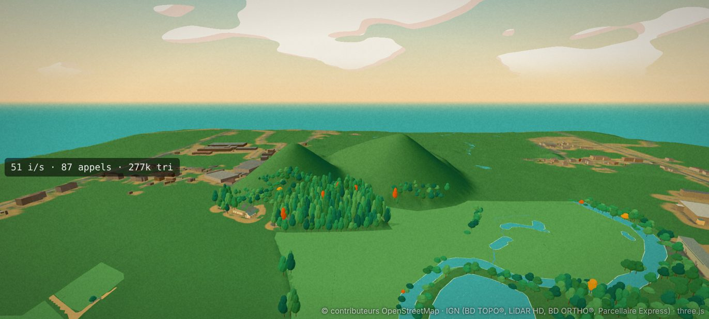
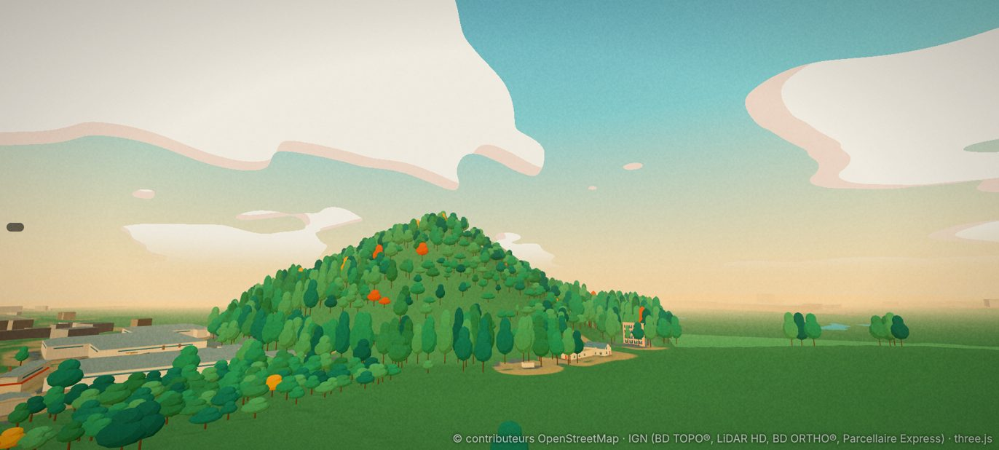
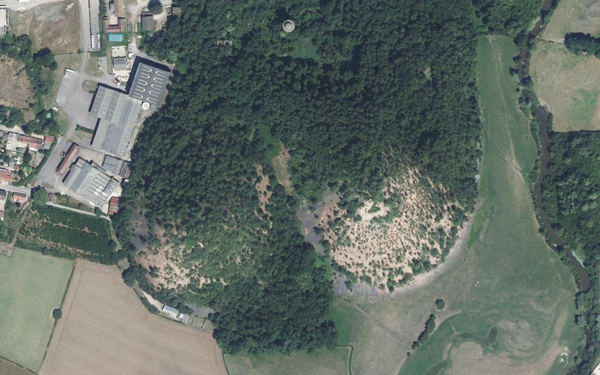
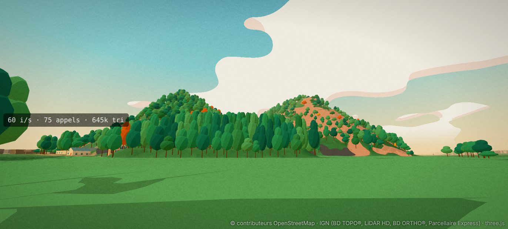
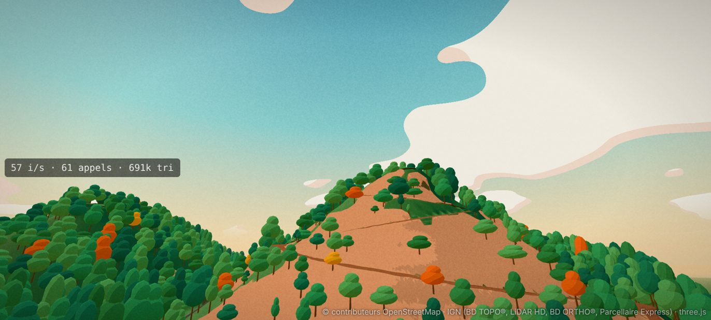
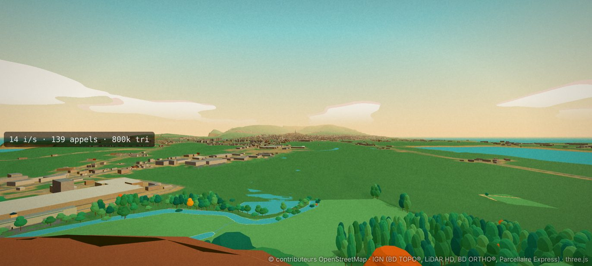

# Les terrils des Télots : plan (avant enquête)

Plan du 7 novembre 2026, sur `main` (après D268). **Réalisé le même jour : D269** (`docs/DECISIONS.md`) ; le §8 dit ce qui a été fait et ce qui
reste.
Repère local du jeu (x vers l'est, y vers le nord), mètres ; altitudes en NGF (le jeu soustrait `ORIGIN_Z` = 330 m). Les prochains numéros
de décision seront D269 et suivants.

**Demande de l'utilisateur (7 novembre)** : intégrer correctement les deux terrils de l'ancienne mine des Télots, et **pouvoir monter et rouler dessus**.
Quatre photos fournies (trois vues au sol, une vue satellite Google Maps).

## 0. Ce qu'il faut retenir

1. **Les terrils sont déjà dans la carte**, en pleine zone jouable, à 600 m de la côte nord : le relief LiDAR à 1 m les contient (tuiles `26_50` et `27_50`,
   bordure des tuiles `26_49`, `27_49`). **D268 se trompe** en écrivant qu'ils sont « au-delà du bord ouest du monde » et que le relief n'y dépasse
   pas 308 m : il monte à **393,5 m** (terril est) et **381,9 m** (terril ouest). Pas d'extension de la carte, pas d'`extend.py` : tout se fait sur
   deux à quatre tuiles existantes et dans `kinds`.
2. **Ce qui manque est la peau, pas la forme** (captures « avant » ci-dessous) : deux cônes **entièrement verts**. Sur les photos et l'orthophotographie,
   le terril est est une grande **face nue de schiste rouge-rose** (schiste brûlé), semée de petits arbres (bouleaux) ; le terril ouest est boisé
   avec des plaques roses au sud-ouest ; au pied, des **épandages de schiste noir** (gris anthracite) entre les deux et au sud.
3. **On peut déjà y monter**, à pied et en voiture ou à moto, mais pas à vélo (§3). Les flancs font **35 à 37°** partout (pente d'éboulement du schiste),
   sauf **une arête plus douce (16 à 20°) au nord-ouest du terril est**, vers le col entre les deux sommets.
4. Le site s'appelait la **mine des Télots** (`old_name` de la forêt OSM `way/42114288`), fermée en **1957** (`end_date` des deux terrils).

## 1. Ce que disent les données

| | Terril est | Terril ouest |
|---|---|---|
| OpenStreetMap | `way/907818795` (`man_made=spoil_heap`, `resource=coal`, abandonné, 1957) | `way/907818796` (mêmes étiquettes) |
| Sommet OSM (`natural=peak`, « Terril ») | `node/8429606537`, 397 m, en (354 ; 3 773) | `node/8429606538`, 386 m, en (117 ; 3 760) |
| Sommet du relief du jeu | 393,5 m, une trentaine de mètres au nord-ouest du point OSM | 381,9 m |
| Faces nues (OSM `natural=heath`) | `way/966466302` (périmètre 934 m) | `way/966466319` (538 m) |
| Pied | ≈ 295 à 300 m (prairie de l'Arroux à l'est, champs au sud) | ≈ 295 m |

Autour (OSM) : sentiers `way/1497939637`, `1497939638`, `909378502` au pied nord-est ; une piste (`way/250361755`, `grade3`) à l'ouest, depuis
la rue des Télots ; un château d'eau (`way/319078664`) au nord, dans le bois ; zones humides au nord ; l'Arroux et ses bras morts au sud et à l'est
(déjà dans le jeu, avec le petit étang de la photo 3). **Aucun chemin OSM ne monte aux sommets.**

Profils du relief du jeu (pentes par pas de 10 m, depuis le sommet) : terril est, 33 à 37° vers l'est, le sud et le sud-ouest, 16 à 20° vers le nord-ouest ;
terril ouest, 33 à 38° de tous côtés, sauf un replat de 11 à 19° vers le nord (le col).

## 2. Les photos (7 novembre)

Les quatre photos **conviennent pour le principal** : la couleur et la répartition des faces nues et des bois, la silhouette des deux cônes
(un plus pointu et plus nu, un plus boisé), les dépôts sombres au pied. Lecture :

1. **Vue lointaine du sud-ouest** (été) : deux cônes boisés à la base ; le terril est (à droite) nu de la mi-pente au sommet, rose saumon semé d'arbustes ;
   une **langue gris foncé** au pied du terril est (schiste noir) ; le terril ouest boisé avec une plaque rose en bas à gauche.
2. **Vue du sud, depuis les champs** (automne) : mêmes faces ; bouleaux jaunissants sur la face rose ; **un éperon gris anthracite** au pied entre les deux ;
   un bâtiment blanc bas au pied (le stand de tir, `Tir d'Autun / Société de Tir Autunoise` sur la vue satellite) — à vérifier dans les bâtiments du jeu.
3. **Vue depuis l'étang au sud** : reflets ; la face rose du terril est descend jusqu'à un talus **gris-noir** près de l'eau.
4. **Vue satellite** : la face rose au sud-est du terril est en éventail, tachetée d'arbres ; la forêt dense au nord et à l'ouest ; prairie à l'est jusqu'à l'Arroux.

L'orthophotographie IGN (`docs/captures/telots-ortho.jpg`, emprise x −150 à 650, y 3 550 à 4 050) le confirme et servira de référence pour délimiter
les sols (rose, noir, bois) à 0,5 m.

**Photos qui manqueraient pour aller plus loin** (aucune n'est bloquante) :
- le sol de près, sur la face rose et sur le schiste noir (grain, cailloux, traces de passage) ;
- le sommet du terril est (pointe ou petit replat ? vue depuis le haut ?) ;
- les accès réels : y a-t-il un sentier vers le sommet (sur l'arête nord-ouest ?), des traces de motos ou de VTT, une barrière, un panneau « interdit » ;
- le bâtiment blanc au pied sud (stand de tir ?).

## 3. Monter et rouler dessus

Mesuré dans le jeu actuel (pente constante, plein gaz, 150 m d'élan à plat ; distance horizontale gravie, en mètres ; le terril est demande ≈ 130 m
à 35° pour 90 m de dénivelé) :

| Pente | Vélo | VTT | Trottinette | Scooter 125 | Moto | Moto sportive | Citadine | Voiture | SUV | Sportive | Ancienne | Utilitaire |
|---|---|---|---|---|---|---|---|---|---|---|---|---|
| 20° | 10 | 8 | 13 | tout | tout | tout | tout | tout | tout | tout | tout | tout |
| 30° | 6 | 5 | 6 | 91 | tout | tout | tout | 177 | 169 | tout | 137 | 93 |
| 35° | 5 | 4 | 5 | 64 | 180 | tout | 144 | 121 | 122 | tout | 101 | 73 |

- **À pied** : rien n'arrête la marche sur une pente (seule une chute brusque fait tomber) : on monte déjà.
- **En voiture et à moto** : on monte déjà presque partout (c'est arcade : une vraie voiture ne grimperait pas 35° d'éboulis). Les voitures calent un peu
  avant le sommet du terril est par les faces raides ; par l'arête nord-ouest, tout passe.
- **À vélo, en VTT, en trottinette** : impossible, ils calent dès 15 à 20°. C'est cohérent avec la physique du jeu (un humain qui pédale), mais il faut
  un **chemin** pour que la montée ait un sens à vélo, ou accepter qu'on pousse son vélo.

**Proposition** : un **sentier en lacets** sur l'arête nord-ouest du terril est (et un sur le terril ouest), pente ≤ 12 à 15 %, terre rose tassée,
1,5 à 2 m de large, creusé dans le relief à 1 m (comme les remparts écrêtent le relief, D250), raccordé aux sentiers OSM du pied et à la piste de l'ouest.
Les passants pourraient l'emprunter (point d'intérêt « point de vue » au sommet). **Option de jeu** : le schiste glisse (adhérence réduite des véhicules
sur la face rose, comme une piste de terre), ce qui rend la montée en voiture plus difficile et plus drôle ; à décider.

## 4. Ce qu'il faut faire

1. **Sols** (`build_terrils.py`, nouvelle étape locale, sur le modèle de `build_croix.py`) : trois couches nouvelles dans les sols des tuiles touchées,
   délimitées sur l'orthophotographie (classification des couleurs, nettoyée, contrôlée sur les polygones `heath` d'OSM) :
   `schist_red` (rose saumon), `schist_black` (gris anthracite), `schist_path` (sentiers) ; couleurs à caler sur les photos, variation de teinte au bruit
   pour casser l'aplat ; ne réécrit que les tuiles `26_49`, `26_50`, `27_49`, `27_50` (et voisines si débord).
2. **Arbres** : retirer les arbres LiDAR posés sur la face rose qui n'existent pas, et y semer des **bouleaux clairsemés et bas** (densité lue sur l'orthophoto) ;
   garder la forêt dense du terril ouest et du nord. À vérifier : l'espèce et la taille données aujourd'hui aux arbres de la zone.
3. **Relief** : rien à refaire (LiDAR 1 m fidèle). Seuls changements : le sentier creusé en lacets, et peut-être un léger lissage du sommet du terril est
   (le LiDAR peut garder la pointe d'un arbre comme sol : à vérifier au lot 0).
4. **Silhouette lointaine** : vérifier que les deux cônes et leur couleur se voient de loin (relief grossier à 8 m : la pointe y est arrondie,
   captures « avant ») et du belvédère de la Croix (D268) ; teinter le relief grossier aux mêmes couleurs.
5. **Navigation** : sentiers ajoutés aux files piétonnes de la seule super-tuile concernée (comme `build_theatre_nav.py`), point « point de vue » au sommet.
6. **Carte et minimap** : faces roses et noires, sentiers ; lieu « Terrils des Télots » (et « Mine des Télots ») dans la carte.
7. **Vues** : `?view=telots` (du sud, comme la photo 2), `telots-haut` (du sommet vers la ville), `telots-etang` (photo 3).

## 5. Découpage

| Lot | Contenu | Données régénérées |
|---|---|---|
| **0. Enquête** | `tools/data/survey_telots.py` : orthophoto et classes de couleur, arbres LiDAR sur les faces, profils des arêtes, tracé possible des lacets, bâtiment blanc au pied ; captures « avant » (faites, ci-dessous) | aucune |
| **1. Sols** | couches de schiste rose et noir dans les tuiles, couleurs, relief grossier teinté, carte | sols de 4 tuiles |
| **2. Arbres** | bouleaux clairsemés sur la face rose, retrait des arbres fantômes | arbres de 2 tuiles |
| **3. Monter** | sentiers en lacets, navigation, point de vue au sommet ; option glissance du schiste | relief fin et sols de 2 tuiles, une super-tuile de nav |
| **4. Finitions** | vues, silhouette lointaine, lieu sur la carte, captures « après » | selon besoin |

Ordre conseillé : 0, 1, 2 (ce qu'on voit), puis 3 (ce qu'on fait). Temps de calcul : quelques minutes par lot (deux à quatre tuiles, orthophoto
d'un demi-kilomètre carré) ; pas de LiDAR à retélécharger sauf si l'on veut revoir les arbres au nuage de points (une dalle de 1 km : de l'ordre de 15 à 30 min).

## 6. Questions pour l'utilisateur

1. **Vélo** : sentier en lacets pour monter à vélo (proposé), ou on pousse son vélo / on monte seulement à pied, à moto et en voiture ?
2. **Voiture** : garder la montée « arcade » des voitures sur les faces à 35°, ou rendre le schiste glissant (montée difficile, descente en glissade) ?
3. **Sommet** : un petit plaisir au sommet (vue sur la ville et le belvédère comme à la Croix, une arme cachée, un défi de descente chronométrée) ?
4. **Photos** : si tu passes sur place, les quatre du §2 (sol de près, sommet, accès, bâtiment blanc) ; sinon on fait sans.

## 7. Captures « avant »

## 8. Réalisation (D269, 7 novembre)

**Réponses de l'utilisateur** : sentier en lacets oui ; voiture arcade (on garde la montée des faces à 35°) ; vue au sommet si ce n'est pas trop
complexe ; pas de photo de la vue d'en haut.

Fait (lots 0 à 4 en une passe, `tools/data/build_terrils.py`) : schiste rose et noir d'après l'orthophotographie, 95 petits arbres sur la face
rose, deux sentiers en lacets creusés dans le relief (virages élargis et presque plats), affichage du relief fin sous les sentiers, poids des
sols pour la vue lointaine, point de vue au sommet (panorama), lieu sur la carte, cinq vues, trois tests.

Reste : les passants ne prennent pas les sentiers ; les images de la carte ne montrent pas encore le schiste ; vérifier sur téléphone la couleur
rose et les images par seconde au sommet (panorama).

