# Le plan d'eau du Vallon : chemin du tour du lac, base nautique, pontons, abords : plan

Enquête du 5 novembre 2026, sur `main` (après D242). Rien n'est modifié dans le jeu : ce fichier et une vue annotée (`docs/captures/vallon-lac-osm.jpg`) sont les seuls ajouts.
Repère local du jeu (x vers l'est, y vers le nord), mètres ; altitudes relatives à `originZ` (330 m). Les prochains numéros de décision seront D243 et suivants.

Suite du plan de l'eau (`docs/plans/eau.md`, §7) : l'eau, le fond et la nage sont faits ; ici, tout ce qui est **autour**.

## 0. Ce qu'il faut retenir

1. **Le chemin du tour du lac n'existe pas dans le jeu.** OpenStreetMap a la boucle entière (allée Marcel Lucotte, plus l'allée Jacques de la Comble et l'allée
   Émile Château au sud), mais aucune étape ne la peint au sol : sur la boucle de 1,9 km (2,6 km avec les allées du sud), le sol du jeu est de la pelouse
   (94 % de l'allée est, 24 % de l'allée ouest) ou rien du tout. Les piétons la suivent déjà (arêtes « chemin » de la navigation, 1,5 à 1,8 m de large, très peu fréquentées) : ils marchent sur l'herbe.
2. **Le nord du lac est une digue.** La route de Chalon/Beaune passe à −27,3, la crête à −23,9, l'eau à −25,41 : la route est **1,9 m sous l'eau**, la crête
   1,5 m au-dessus. Le chemin du nord et ses bancs sont sur cette crête. Partout ailleurs, la berge descend en pente douce (de −20,5 à l'ouest et à l'est).
3. **Les photos décrivent l'apparence, les données donnent la position.** Les 13 vues Street View et photos de l'utilisateur (non versionnées, elles servent seulement
   à décrire) fixent les matières et les objets ; le tracé, les largeurs et les hauteurs viendront d'OSM recalé sur l'orthophotographie (20 cm) et du LiDAR (0,5 m), au lot 0.
4. **Les pontons sont des tabliers.** La mécanique existe : un tablier piéton (`decks`, `k: "foot"`) se parcourt à pied et, à moins de 1,05 m au-dessus de l'eau,
   un nageur s'y hisse (D241). Cinq pontons dans OSM, aucun dessiné aujourd'hui (`man_made=pier` n'est lu par aucune étape).
5. Cinq lots de jeu, chacun utilisable seul : **le chemin**, **la base nautique**, **les pontons et la cale**, **les équipements** (aire de jeux, skatepark, agrès),
   **la vie du lac** (pêcheurs, promeneurs).

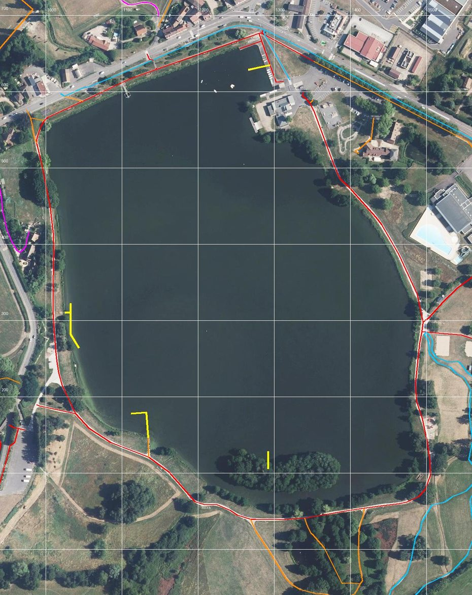

## 1. Ce que montrent les photos

Treize vues : Google Street View (juillet 2026) depuis la route et la base nautique, et Harry Trib (juin 2025) sur le chemin. Les emplacements sont **déduits** (rien n'est
géolocalisé dans une capture d'écran) ; le lot 0 les confirme sur l'orthophotographie.

| Vue | Emplacement probable | Ce qu'on y lit |
|---|---|---|
| Route de Chalon (2 vues) | depuis la route, vers (1350 ; 640), regard vers le sud-ouest | cale en béton qui descend dans l'eau ; pontons flottants à petits dériveurs ; bâtiment beige de la base au toit gris ; mât au drapeau ; grand saule pleureur ; panneau d'information sur pied ; pelouse rase et grillée l'été ; allées en enrobé gris |
| Toilettes | base nautique (1304–1310 ; 566–575) | bloc de toilettes en béton gravillonné gris ; bâtiment à toit en bac acier gris à un pan, enduit beige, auvent sur poteaux carrés ; banderole « Commune sportive Bourgogne-Franche-Comté » ; barrière levante blanche ; potelets bois ; rochers posés ; kayaks rangés |
| Skatepark | parking (1419 ; 586), regard vers le sud | bowl et modules en béton clair ; terrain vert grillagé (pump track ou city stade) ; ganivelle en châtaignier tout autour ; Moulin du Vallon à gauche ; lampadaires à tête en disque |
| Chemin, deux sens | rive est, le long de la clôture OSM w247999124 (524 m, déjà dessinée) | **stabilisé beige clair, 2,5 à 3 m**, sans bordure ; herbe haute, roseaux et joncs côté eau ; grillage vert à poteaux plats côté terre ; quelques lampadaires |
| Aire de jeux | (1505 ; 158), aire OSM w247999116 | deux structures (toboggans bleu et orange, toits orange et rouge), sol en gravillons, bancs et tables en bois, jeux à ressort |
| Pêcheurs | rive sud-ouest, regard vers le nord-est | trois biwys kaki (abris de pêche à la carpe) sur la pelouse, cannes sur supports ; le chemin longe l'eau à 2 m |
| Water Tap | (1003 ; 239), robinet OSM, parking PMR de 4 places | allée en enrobé, potelets bois en ligne, lampadaire, talus rocheux et boisé à droite (le pied du rempart, w247999104, à vérifier) |
| Pelouse au bord | rive sud, regard vers le nord | la pelouse descend jusqu'à l'eau sans berge marquée ; un piquet ; au loin, le village et la base |
| Allée ombragée | rive sud-ouest ou bord du Brisecou (à confirmer) | même stabilisé beige, sous des saules et des frênes ; un fossé d'eau à droite |
| Ponton de pêche | rive ouest, (1035 ; 292) ou (1129 ; 169) | **ponton fixe en bois gris** sur pieux, long et parallèle à la rive, relié par une passerelle perpendiculaire ; à 30-40 cm de l'eau, sans garde-corps |

## 2. Inventaire (OpenStreetMap, 5 novembre 2026, et données publiées)

**Le chemin** (tronçons OSM de la boucle) :

| Tronçon | OSM | Longueur | Matière (OSM) | Dans le jeu aujourd'hui |
|---|---|---|---|---|
| Allée Marcel Lucotte, ouest et sud-ouest | w223427553 | 982 m | `asphalt` (à vérifier : les photos du sud-ouest montrent du stabilisé) | pelouse 24 %, rien ailleurs |
| Allée Marcel Lucotte, est | w1525431705 | 658 m | `fine_gravel` | pelouse 94 % |
| Allée Marcel Lucotte, nord (digue) | w1548131445, w842375498 | 146 + 77 m | `fine_gravel` | rien |
| Piste cyclable du nord, le long de la route | w247999132 | 287 m | `asphalt` | trottoir 28 % |
| Allées du sud (Jacques de la Comble, Émile Château) | w234449480, w223582725, w234449490, w1290256589 | 170 + 122 + 77 + 22 m | `fine_gravel`, 1 m pour Émile Château | pelouse |
| Gué en pas japonais sur le Brisecou | w1290256590 | 2 m | `ford=stepping_stones` | rien |

Sept arbres de la carte sont à moins de 2 m de l'axe. Aucun mur ni aucune clôture ne coupe le chemin.

**Pontons** : quatre flottants, (1280 ; 632) 29 m, devant la base ; (1029 ; 310) 8 m et (1035 ; 292) 62 m à l'ouest ; (1129 ; 169) 53 m au sud-ouest ; un fixe (1292 ; 117), 23 m,
au sud, face à l'île. **Cale de mise à l'eau** : (1306 ; 606).

**Base nautique et abords** : deux bâtiments BD TOPO de 5,1 m (1304 ; 566) et (1310 ; 575), au rendu générique aujourd'hui ; location de bateaux (1318 ; 581) et de vélos
(1310 ; 582) ; toilettes ; panneau d'information (1337 ; 581) ; table de pique-nique en bois (1341 ; 554) ; deux blocs anti-voitures (1339 ; 600) et (1351 ; 589) ;
skatepark (1374 ; 569, 105 m de tour) ; pump track (1399 ; 541, trois boucles) ; aire de camping-cars de 17 places (1370 ; 607) ; Centre de loisirs du Moulin du Vallon (1440 ; 517).

**Le long du tour** : 14 bancs (12 par paires sur la digue, tous les 40 m environ, déjà dessinés), 3 agrès de fitness (1006 ; 261), (1210 ; 54), (1504 ; 136), 2 robinets,
une boîte à livres (1489 ; 290, déjà dessinée), le panneau « Les oiseaux du lac » (1414 ; 49), l'aire de jeux (1505 ; 158), une piste VTT en terre au sud-est (668 m, hors du tour).

**L'eau autour** : le Brisecou entre au sud (étang de 0,19 ha, seuil, buse sous (1353 ; 42)) et ressort sous la digue au nord-ouest (buse (1097 ; 621)).

## 3. Le chemin (lot 1)

### 3.1 Le tracé et la largeur

(Mesures du lot 0 au §12 : elles remplacent les valeurs attendues ci-dessous.)

- Axe : tronçons OSM de la boucle, **recalés sur l'orthophotographie** là où ils s'écartent du chemin visible de plus de 1 m (lot 0 : écart mesuré tous les 10 m).
- Largeur : mesurée à l'orthophotographie par tronçon (attendu : 2,5 à 3 m à l'est d'après les photos, plus étroit au sud, 1 m pour l'allée Émile Château).
- Matière : **stabilisé beige clair** (nouvelle couche de sol `path_gravel`, plus clair et plus chaud que `plaza_gravel`) partout où les photos le montrent ; **enrobé** pour la piste
  cyclable du nord et les allées de la base. Pas de bordure : le bord se fond dans l'herbe (léger dégradé, comme les pelouses).
- Relief : pas d'aplanissement général (le chemin suit la berge). Sur la digue, le dévers est corrigé si le LiDAR en montre un de plus de 4 % en travers.

### 3.2 Ce qui va avec

- **Bord côté eau** : bande d'herbes hautes et de roseaux, interrompue aux pontons, à la cale et aux pelouses où l'on descend à l'eau (pêcheurs, rive sud).
- **Arbres** : les 7 arbres à moins de 2 m de l'axe sont décalés hors du chemin, pas supprimés.
- **Lampadaires** : ceux qu'on voit sur les photos (rive est, base, parking) ; leur nombre et leur position sont relevés à l'orthophotographie (ombres) au lot 0, sinon un tous les 30 m
  le long de la base seulement. Pas d'éclairage sur le sud, plus sauvage.
- **Navigation** : la largeur des arêtes du chemin passe à la largeur mesurée ; la fréquentation monte (c'est une promenade très courue) : à fixer au lot 5.
- **Carte et minimap** : le tour dessiné comme un sentier (rang 3), avec son nom.
- **Le gué** : les pas japonais du Brisecou (quelques pierres plates, obstacles bas qu'on enjambe).

## 4. La base nautique (lot 2)

- Volumes mesurés au LiDAR (comme la gendarmerie, D238) : bâtiment principal à toit à un pan en bac acier gris, auvent sur poteaux, petit bâtiment voisin.
- Façades d'après les photos : enduit beige, portes de hangar (kayaks rangés), banderole « Commune sportive Bourgogne-Franche-Comté ».
- Abords : bloc de toilettes en béton gravillonné, mât et drapeau, grand saule pleureur, panneau d'information, barrière levante, potelets bois, rochers posés, table de pique-nique,
  deux blocs anti-voitures sur l'allée.

## 5. Les pontons et la cale (lot 3)

- **Cinq pontons** en tabliers piétons (`decks`, `k: "foot"`, nouveau style `pier`) : planches grises, sans garde-corps. Les flottants sont au ras de l'eau (0,3 m, à mesurer
  sur l'orthophotographie et le LiDAR) ; le fixe repose sur des pieux. Forme (passerelle perpendiculaire, puis ponton parallèle à la rive) relevée sur l'orthophotographie.
- **Sortie de l'eau** : à moins de 1,05 m au-dessus de l'eau, on s'y hisse en nageant (D241) ; c'est le principal gain de jeu de ce lot.
- **Cale** : rampe en béton qui entre dans l'eau, en pente douce (0,08) : on en sort à pied, une voiture peut y descendre (et couler, D242).
- **Bateaux amarrés** (petits dériveurs, kayaks posés sur le ponton de la base) : décor fixe, sans collision fine, à confirmer avec l'utilisateur (§9).

## 6. Les équipements (lot 4)

- **Aire de jeux** (1505 ; 158) : deux structures à toboggan, jeux à ressort, sol en gravillons, bancs et tables.
- **Skatepark et pump track** : bowl et modules en béton clair, pump track en enrobé, terrain multisport grillagé s'il est confirmé à l'orthophotographie, ganivelle autour.
- **Agrès de fitness** (3), panneaux d'information, robinets. Bancs et boîte à livres : déjà là.

## 7. La vie du lac (lot 5)

- **Pêcheurs** : biwys kaki et cannes sur supports, posés sur les pelouses du sud et de l'ouest, quelques personnages assis ; nombre et horaires à décider (§9).
- **Promeneurs et joggeurs** sur le tour, plus nombreux le week-end et en été (calendrier existant, `core/week.ts`).
- **Canards** : déjà là (D240).

## 8. Risques

1. **OSM et l'orthophotographie ne coïncident pas** : un chemin décalé de 2 m tombe dans l'eau creusée ou dans les roseaux. Recalage au lot 0, et contrôle : aucun point de l'axe
   à moins de 1 m de l'eau, sauf aux pontons et à la cale.
2. **Les matières d'OSM sont incertaines** (allée ouest en `asphalt`, photos en stabilisé) : la matière se décide sur l'orthophotographie et les photos, OSM ne fait que proposer.
3. **Les pontons au-dessus de l'eau** : la surface de l'eau et le tablier sont tous deux presque plats et proches (0,3 m) ; vérifier qu'un nageur passe sous un ponton flottant
   ou s'y hisse, mais n'y reste pas coincé, et que l'eau ne perce pas le tablier.
4. **La digue** : la route est sous le niveau du lac. Rien ne change pour l'eau (le fond est creusé à l'intérieur du polygone seulement), mais la pente entre la crête et la route
   doit rester un talus, pas une marche.
5. **Poids** : le chemin, ≈ 7 000 m² de polygone, et cinq pontons ; quelques kilo-octets dans une douzaine de tuiles (colonnes 29 à 32, rangées 35 à 37). Aucun fichier lourd.

## 9. Questions à l'utilisateur

1. **Pêcheurs** : présents en permanence (décor), ou seulement certains jours et heures ?
2. **Bateaux** : des dériveurs et kayaks posés ou amarrés au ponton de la base ; faut-il aussi des voiliers **sur l'eau**, l'été, en journée ?
3. **Le sud** : le garder plus sauvage (pas d'éclairage, herbes plus hautes), comme sur les photos ?
4. **Ordre des lots** : chemin, base, pontons, équipements, vie du lac ; ou les pontons juste après le chemin, pour pouvoir sortir de l'eau partout ?

Réponses au §11.

## 10. Lots

| Lot | Contenu | Résultat dans le jeu | Décision |
|---|---|---|---|
| **0. Relevés** (fait, §12) | `tools/data/survey_vallon.py` : axe OSM contre orthophotographie (écart tous les 10 m), largeur et matière par tronçon, profil du LiDAR (digue, dévers), pontons (forme, longueur, hauteur au-dessus de l'eau), cale, lampadaires, arbres sur le chemin, terrain multisport ; emplacements des photos ; captures « avant » | aucun | D243 |
| **1. Le chemin** (fait, §13) | couche `path_gravel` ; tracé recalé ; arbres décalés ; herbes hautes et roseaux ; lampadaires ; arêtes de navigation à la bonne largeur ; carte et minimap ; pas japonais | on fait le tour du lac sur un vrai chemin | D244 |
| **2. La base nautique** (fait, §14) | volumes LiDAR, façades, abords (toilettes, mât, saule, panneau, barrière, potelets, rochers) | la base ressemble aux photos | D245 |
| **3. Les pontons et la cale** (fait, §15) | cinq tabliers `pier`, cale en béton, bateaux posés | on marche sur les pontons ; on sort de l'eau par un ponton ou par la cale | D246 |
| **4. Les équipements** | aire de jeux, skatepark, pump track, agrès, panneaux | | D247 |
| **5. La vie du lac** | pêcheurs (permanents), promeneurs, voiliers sur l'eau l'été | | D248 |

Chaque lot est vérifié dans le navigateur (captures, comme d'habitude) avant le suivant ; on peut s'arrêter après n'importe lequel sans laisser le jeu incohérent.

### Tests prévus

- **Lot 1** : axe à plus de 1 m de l'eau hors pontons et cale ; chemin continu (boucle fermée) ; largeur par tronçon ; aucun arbre ni obstacle sur le chemin ; couche dessinée
  au-dessus de la pelouse ; arêtes de navigation à la largeur mesurée ; idempotence de l'étape.
- **Lot 2** : volumes contre le LiDAR à 0,3 m ; emprise BD TOPO à 3 m ; triangles bornés.
- **Lot 3** : chaque ponton parcouru à pied de la rive au bout ; nageur hissé sur un ponton flottant ; nageur qui passe sous le ponton fixe ou en est empêché, sans se coincer ;
  sortie à pied par la cale ; voiture qui descend la cale et coule (D242 inchangé).
- **Lots 4 et 5** : obstacles posés hors du chemin ; maillages finis et bornés.

## 11. Réponses de l'utilisateur (5 novembre 2026)

1. **Pêcheurs** : toujours là (décor permanent, de jour comme de nuit).
2. **Bateaux** : oui, posés et amarrés à la base ; et **des voiliers sur l'eau en été** (lot 5).
3. **Le sud** : sauvage avec modération. Tout le tour reste facilement praticable : un chemin net et continu, pas de passage étroit ni boueux ; herbes un peu plus hautes
   et pas de lampadaires, mais rien qui gêne la marche ou le vélo.
4. **Ordre des lots** : celui du §10 (chemin, base nautique, pontons et cale, équipements, vie du lac).

## 12. Lot 0 : relevés (5 novembre 2026, D243)

Script : `tools/data/survey_vallon.py` (OSM par l'API, orthophotographie IGN à 20 cm, modèle de surface LiDAR HD à 0,5 m, relief publié) ; tous les chiffres dans
`tools/data/vallon_survey.json`. Captures « avant » : `docs/captures/vallon-avant-haut.jpg`, `vallon-avant-rive-est.jpg`, `vallon-avant-digue.jpg`, `vallon-avant-base.jpg`.

### 12.1 Le chemin

La boucle : **1 905 m**, quatre tronçons OSM et un raccord de 42 m par les allées de la base ; 191 stations tous les 10 m.

| Mesure | Résultat |
|---|---|
| Stations où le chemin se voit à l'orthophotographie | 134 (70 %) ; 57 masquées par les arbres (27 au sud et à l'ouest, 11 sur la digue, 19 à l'est) |
| Écart de l'axe OSM au milieu du chemin | médiane 0,3 m, 90 % 1,1 m, max 4,3 m ; plus de 1 m à 14 stations (surtout l'angle sud-ouest vers (1016 ; 237), le pied de la digue vers (997 ; 495), la base vers (1349 ; 582) et l'est vers (1490 ; 300) et (1500 ; 145)) |
| Largeur (bande claire) | sud et ouest : médiane **3,2 m** (10 % : 1,4 ; 90 % : 4,4) ; digue : **1,8 m** (1,3 à 2,4) ; est : **3,8 m** (3,0 à 5,4) |
| Hauteur au-dessus du lac | médiane 1,5 m ; au plus bas 0,28 m au pied de la digue nord-ouest (997 ; 495) ; 0,45 à 0,58 m au sud-ouest (1128–1153 ; 107–123) et à l'est (1490 ; 253–273) |
| Distance à l'eau | jamais moins de 2,8 m |
| Dévers (pente en travers sur 3 m) | médiane 2 % ; plus de 4 % à 29 stations : la **digue** (6 à 11 %, la crête est étroite et le relief à 1,5 m de l'axe est déjà dans les talus) et quelques points de l'ouest et de l'est |
| Arbres de la carte | un seul à moins de 1,5 m du milieu du chemin |

Lecture :
- **Le tracé d'OSM est bon** : on le garde, recalé seulement aux 14 stations à plus de 1 m (sur le milieu mesuré).
- **La largeur** n'est pas la même partout : 3 à 3,5 m au sud, à l'ouest et à l'est (les mesures à 4-5 m sont sans doute des élargissements au droit des bancs, des aires et des parkings, ou une bordure d'herbe sèche aussi claire que le chemin : à regarder station par station au lot 1),
  **2 m sur la crête de la digue**. Les 1,4 m du dixième le plus étroit sont des bouts à l'ombre. On prendra 3,2 m, 2 m sur la digue, et la largeur mesurée là où la bande
  s'élargit nettement.
- **La matière** : l'enrobé ne se distingue pas de l'herbe rase grillée sur cette orthophotographie (même gris) ; le chemin est **clair partout où il se voit**, y compris sur
  l'allée ouest notée `asphalt` dans OSM. Stabilisé beige sur toute la boucle ; enrobé sur la piste cyclable du nord et les allées de la base, comme sur les photos.
- **La digue** : la crête est un dos d'âne de 2 m ; le chemin y sera posé à plat en travers (relief aplani sur sa largeur seulement), les talus restent.

### 12.2 Les pontons et la base

Le modèle de surface du LiDAR ne voit pas l'eau (sur l'eau libre, il donne de 0 à 4,5 m au-dessus du lac, des valeurs interpolées) : **il ne mesure pas la hauteur des pontons**.
On prendra celle des photos : 0,3 m pour les flottants, 0,45 m pour les fixes sur pieux.

| Ponton (OSM) | Ce qu'on voit à l'orthophotographie (10 cm) | Longueur |
|---|---|---|
| w422698578, devant la base | ponton droit de 20 m depuis le quai d'une **darse** (petit port fermé par un quai en enrobé, au nord-ouest de la base) ; une quinzaine de dériveurs blancs et colorés rangés sur le quai, deux embarcations à l'eau | 29 m |
| w842375499 et w842375500, rive ouest | **le ponton de pêche des photos** : passerelle perpendiculaire de 8 m, puis un ponton de 40 m parallèle à la rive, au bout coudé ; 1,5 m de large | 8 + 62 m |
| w842375502, rive sud-ouest | en L : 33 m vers le large, puis 20 m parallèles à la rive | 53 m |
| w1227421196, au sud, vers l'île | sous les arbres, invisible ; à 98 % dans l'eau : un ponton fixe ou une passerelle vers l'île, à vérifier sur place (Street View ne va pas jusque-là) | 23 m |
| non cartographié, au sud-ouest de la base (≈ 1265 ; 555) | un ponton d'une vingtaine de mètres le long de la rive, avec un abri au bout | à mesurer au lot 3 |

- **Base nautique** : trois volumes à toits gris (bac acier, à un pan et plats), pas un seul bâtiment ; dalle claire et terrasse devant ; parking à places marquées à l'est.
- **Cale** (1306 ; 606) : rampe en béton clair à l'entrée de la darse.
- **Skatepark** : dalle grise rectangulaire à modules (≈ 25 × 20 m) ; **pump track** en boucle d'enrobé ; pas de terrain multisport distinct : le terrain vert grillagé des photos
  est le pump track ou la dalle du skatepark, à revoir au lot 4.
- **Aire de jeux** : structures rouges sur sable, contre le chemin est.
- **Parking du sud-ouest** (robinet, places PMR) : dalle de béton clair en patte d'oie, à la jonction de deux allées.

### 12.3 Ce que montrent les captures

- On marche sur une pelouse uniforme jusqu'au liseré de l'eau : ni chemin, ni roseaux (rive est, digue).
- La clôture de la rive est est dessinée en barreaux noirs ; sur les photos, c'est un **grillage vert** à poteaux plats.
- La base est un bâtiment générique beige à toit en croupe ; ni darse, ni pontons, ni bateaux.
- Vue haute : la boucle n'apparaît pas du tout ; l'île boisée du sud est bien là.

### 12.4 Ce qui change dans le plan

- Lot 1 : largeurs mesurées (3,2 m, 2 m sur la digue), stabilisé sur toute la boucle, recalage à 14 stations, crête de la digue aplanie en travers ; clôture de la rive est en
  grillage vert ; sud « sauvage modéré » (§11).
- Lot 2 : la base, c'est trois volumes et la darse avec son quai.
- Lot 3 : un sixième ponton (non cartographié) ; hauteurs prises sur les photos ; ponton vers l'île à vérifier.
- Lot 5 : pêcheurs permanents, voiliers sur l'eau l'été.

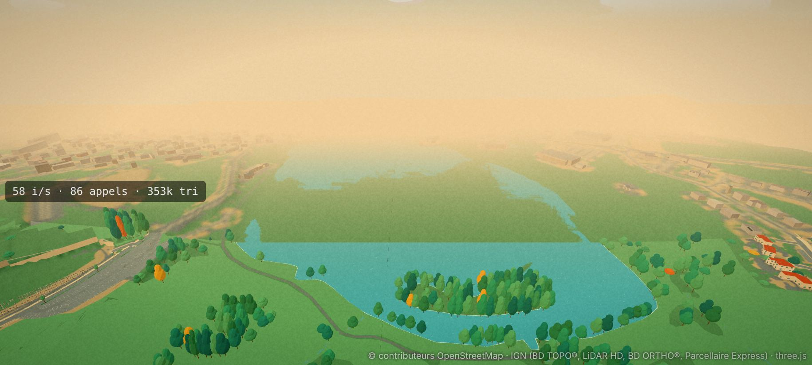
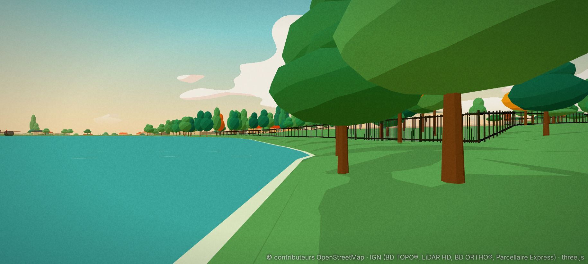
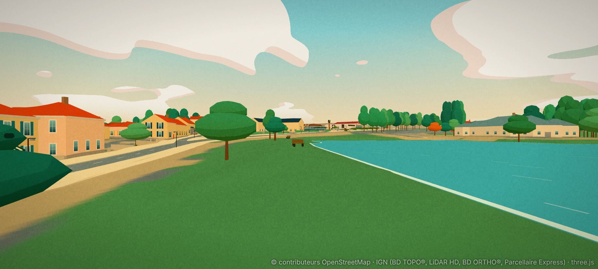
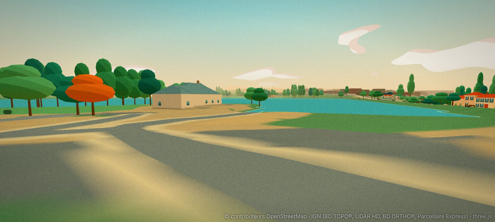

## 13. Lot 1 : le chemin (5 novembre 2026, D244)

Fait. Étape `tools/data/build_vallon_path.py` : `--trace` écrit le tracé recalé (`tools/data/vallon_path.json`, versionné), la pose l'applique d'après
`vallonPath` de `manual.json`. Une deuxième passe ne change rien.

- **Tracé** : l'axe OSM décalé du milieu mesuré (médiane glissante sur 5 stations, interpolée sous les arbres, bornée à 4,5 m), un point tous les 2 m.
  Trois tronçons de boucle (sud et ouest 983 m, digue 223 m, est 657 m) et les allées du sud prises dans OSM (Jacques de la Comble 2,5 m, Émile Château 1,2 m).
  Le raccord de 42 m par la base reste aux allées en enrobé déjà dessinées. Le gué en pas japonais n'est pas fait (lot 4).
- **Sol** : nouvelle couche `path_gravel` (stabilisé clair `#eedcb6`, 4 cm au-dessus du relief, au-dessus de la pelouse), 6 535 m² dans 9 tuiles, moins l'eau (0,4 m),
  les bâtiments et les passerelles.
- **Largeurs** : 3,2 m, et 2 m sur la digue. La crête de la digue **n'est pas aplanie** : le dévers mesuré (6 à 11 %) prenait le relief à 1,5 m de l'axe, déjà dans les talus ;
  à 2 m de large, le chemin posé sur le relief ne montre pas de dévers gênant en capture.
- **Arbres** : 11 poussés hors du chemin (à largeur / 2 + 1,2 m).
- **Roseaux** : 686 m de bord, en plages de 12 m (65 % gardées), à moins de 18 m du chemin, hors des pontons, de la cale, de la base et des deux pelouses de pêche ;
  touffes de 6 à 8 lames tous les 30 cm, de 0,9 à 1,65 m, un épi brun sur quatre (`src/render/reeds.ts`). Environ 45 000 triangles de plus sur la vue de la rive est
  (174 000 → 219 000) : à surveiller au banc.
- **Lampadaires** : 16 sur la rive est, un tous les 32 m, côté terre, crosse vers le chemin ; pas de lampadaires au sud ni sur la digue.
- **Grillage** : la clôture de la rive est (OSM w247999124) passe en grillage vert à poteaux plats (`look: "mesh"` des murs), 1,8 m au lieu de 3,2 m ; on peut l'escalader.
- **Navigation** : 29 arêtes piétonnes élargies à la largeur du chemin. Fréquentation inchangée (lot 5).
- **Carte et minimap** : le chemin est dessiné (`#e8cf9e`) ; sur la digue, où il longe du papier et non de la pelouse, il se distingue mal (palette de la carte réduite).
- **Sud « sauvage modéré »** (§11) : pas de lampadaires, roseaux comme ailleurs ; l'herbe plus haute du sud n'est pas faite (elle viendra avec la vie du lac, lot 5).

Tests (+10, `src/data/vallon-path.test.ts`) : boucle de 1,8 à 2 km refermée, largeurs, axe hors de l'eau et à plus de 2 m du bord, surface du sol, aucun arbre sur le chemin,
lampadaires côté terre et tournés vers le chemin, roseaux au bord et hors des zones exclues, maillage des roseaux fini et borné, grillage, largeur des arêtes piétonnes.

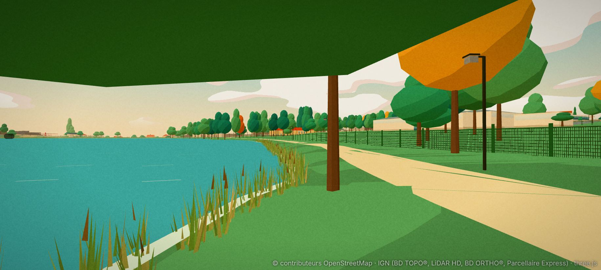
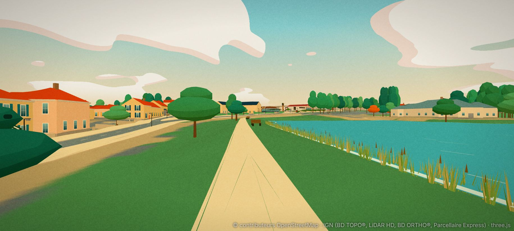
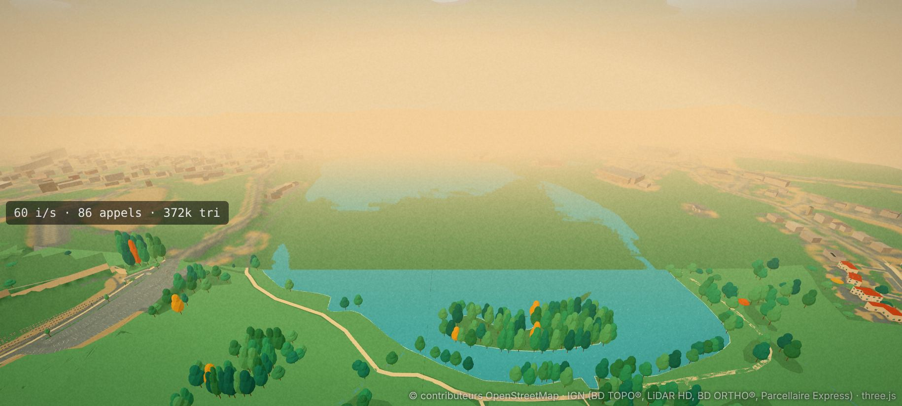
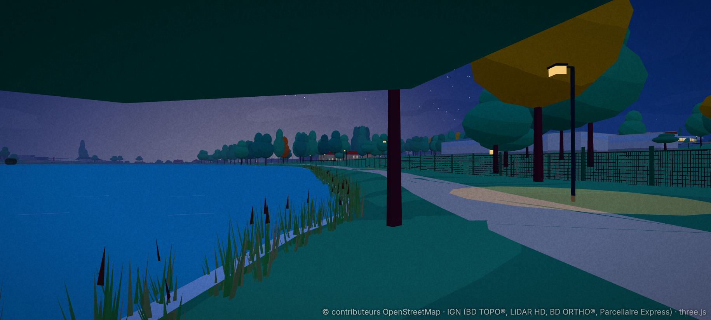

## 14. Lot 2 : la base nautique (5 novembre 2026, D245)

Fait. Relevé `tools/data/survey_nautique.py` (modèles de surface et de terrain LiDAR HD à 0,5 m), modèle `nautique` de `build_monuments.py` (champ `naut`
du bâtiment BD TOPO …847357, le petit bâtiment …847358 du porche masqué), rendu `src/render/nautique.ts`, collisions `src/core/nautique.ts`.

- **Repère** : coin sud-ouest du hangar du sud, s à 18,4° au nord de l'est ; tous les murs BD TOPO lui sont parallèles (sommets à 0,3 m près).
- **Neuf volumes** (sol à −23,88) : hangar du sud en **pavillon** (8,4 × 11,3 m, égout 3,2 m, sommet 5,7 m) ; porche de l'entrée (3,0 m) ; aile ouest (4,1 m) ;
  corps central en trois toits plats (3,1, 4,7 et 3,6 m) ; volume du milieu à **deux pans** (égout 3,5 m, faîtage 5,7 m à t = 23) ; liaison (3,6 m) ; bloc nord-est
  à **un pan** (5,1 m à l'ouest, 3,4 m à l'est). Ce ne sont pas trois volumes, comme l'orthophotographie le laissait croire au lot 0.
- **Façades** : enduit beige sur soubassement gris, bac acier gris, débords de 35 cm, fenêtres hautes en bandeau (allumées la nuit) ; deux portes de hangar sur le lac,
  porte vitrée du porche ; côté darse, **baies ouvertes sur poteaux avec kayaks rangés** ; banderole « COMMUNE SPORTIVE / BOURGOGNE-FRANCHE-COMTÉ » sur le bloc nord-est.
- **Abords** (positions approchées, photos et orthophotographie) : bloc de toilettes en béton gravillonné, mât au drapeau tricolore, barrière levante baissée,
  quatre potelets en bois, quatre rochers posés, panneau d'information. Tous sont des obstacles ; la barrière s'enjambe.
- **La darse** : le LiDAR place son quai **au niveau de l'eau** (0 à 5 cm au-dessus) : rien à construire, un nageur en sort partout ; le talus jusqu'à la base reste
  celui du relief.
- **Pas fait** : le grand saule pleureur (pas de modèle de saule ; un arbre de 17 m de la carte est à sa place supposée), les dériveurs rangés sur le quai (lot 3),
  les côtés sans photo (sud et ouest) sont approchés ; les passants suivent encore l'ancien contour (navigation non régénérée).
- **Vues** : `?view=nautique` (depuis la route de Chalon), `nautique-darse`, `nautique-lac`, `nautique-haut`.

Tests (+5, `src/render/nautique.test.ts`) : neuf volumes de 2,5 à 5 m, faîtages plausibles, porche BD TOPO masqué ; formes de toit (sommet, faîtage, pan) ;
volumes sans chevauchement et contour BD TOPO couvert à 1,5 m ; obstacles (volumes, toilettes, barrière) ; dessin fini et borné (1 500 à 9 000 triangles), textes.

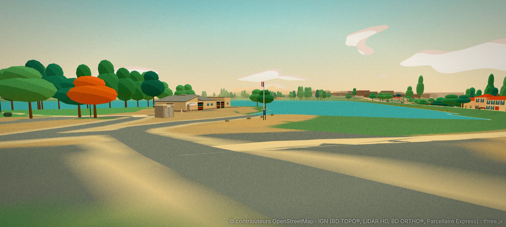
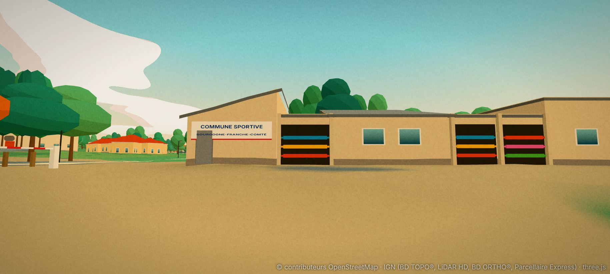
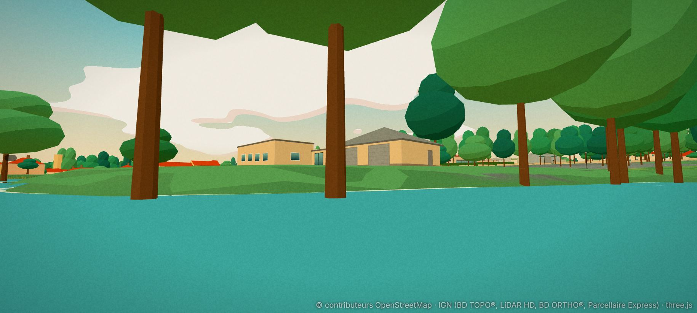
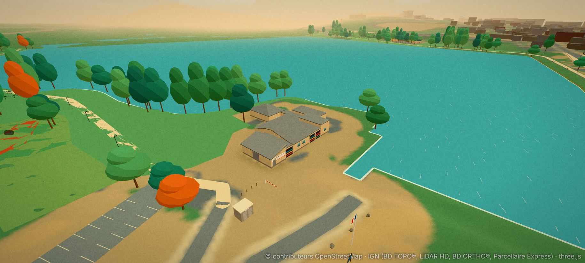

## 15. Lot 3 : les pontons et la cale (5 novembre 2026, D246)

Fait. Étape `tools/data/build_vallon_piers.py` (réglages `vallonPiers` de `manual.json`, lus sur l'orthophotographie à 10 cm et les photos), rendu
`src/render/piers.ts`, collisions `src/core/piers.ts`. Une deuxième passe ne change rien. Réponses de l'utilisateur : ponton de l'île raccourci au bord des arbres,
abri sur poteaux, pente de la cale telle que mesurée, deux bateaux amarrés.

| Ponton | Forme et longueur | Hauteur | Ce qui le porte |
|---|---|---|---|
| Base (OSM w422698578) | droit, 25 m depuis le quai de la darse, 2 m de large | 0,3 m | flotteurs |
| Pêche, ouest (w842375499 et w842375500) | passerelle de 11 m depuis la berge, puis ponton en **T** de 62 m (il dépasse de 12 m au nord, coude de 21 m au sud), 1,5 m | 0,35 m | **pieux** (photo), 26 + 5 |
| Sud-ouest (w842375502) | **L** : 51 m vers le large depuis la berge (y = 128, et non 146,5 comme OSM), puis 20 m vers l'ouest | 0,3 m | flotteurs |
| Île (w1227421196) | 13,5 m depuis l'île, arrêté au bord des arbres (OSM : 23 m, invisible sur l'image) | 0,45 m | pieux, 6 |
| Sixième, au sud-ouest de la base (absent d'OSM) | droit, 21 m sur 2,4 m, parallèle à la rive ; passerelle de 7,6 m sur 3 m depuis la berge | 0,3 m | flotteurs |

- **Les tabliers** : `decks` des ouvrages, `k: "foot"`, nouveau style `pier` (planches grises en travers tous les 16 cm, jours sombres, rives, sans garde-corps),
  `fl` (flottant) ou `pl` (abscisses des pieux). Un ponton accroché à la rive part de la berge (3 cm au-dessus du relief) et rejoint sa hauteur en 2 m.
- **Monter dessus depuis l'eau** : à 0,3 m, on en sort en marchant (`STEP_OUT`) ; à 0,35 et 0,45 m, on se hisse (`HOIST` vaut 0,8 m, et non 1,05). Le tablier compte
  comme un sol : on ne passe pas dessous, on ne peut donc pas y rester coincé.
- **L'abri** du sixième ponton : toit plat blanc de 8,3 × 10 m sur quatre poteaux, à 3 m au-dessus du lac, au-dessus de la passerelle (approché : vu d'en haut seulement).
- **Les bateaux** : 27 coques comptées sur l'image, posées sur le quai de la darse (4 dériveurs de couleur, 5 dériveurs blancs, 5 kayaks, 13 petits dériveurs blancs
  sur la bande sud) ; 2 amarrés au ponton de la base (un dériveur au mât dressé, une barque), approchés. Obstacles bas qu'on enjambe.
- **La cale** : dalle de béton clair de 102 m² (couche `slipway`), posée sur la rampe du relief (pente mesurée 0,15 à 0,18), jusqu'à 5 m sous l'eau.
- **Le quai de la darse** (443 m², couche `quay`) : en enrobé, comme sur l'image ; il était dessiné en herbe.

Ce qui diffère du plan :
- **Le lac était en partie à sec.** Sur 17 % du plan d'eau (3,5 ha, surtout un triangle entre l'île et la rive ouest), le LiDAR, qui ne voit pas l'eau, a interpolé un
  relief jusqu'à 0,9 m au-dessus de la surface, et build_water.py (D240) ne creusait que là où le relief était à moins de 0,3 m au-dessus : on voyait de l'herbe au milieu
  du lac. Réglage `flood` du Vallon : à plus de 3 m du bord du polygone, tout est de l'eau ; il reste 0,4 % de cellules sèches (au bord). Les berges et l'île ne changent pas.
- **La darse s'arrêtait 5 m avant la cale** (contour d'OSM) : un creux sans eau au pied de la rampe. Réglage `extend` de build_water.py : contour ajouté, lu sur l'image.
- **Le ponton de pêche est sur pieux**, bien qu'OSM le dise flottant (photo).
- **Le ponton de l'île est dans le marais peu profond du sud** (0,4 m, D240) : on l'atteint en marchant dans l'eau, pas à la nage.
- **La cale garde sa pente mesurée** (0,15 à 0,18 au lieu de 0,08) ; les roseaux évitaient déjà tous les tracés définitifs (`noReeds` inchangé).

Pas fait : le saule pleureur de la base ; la vue `pontons-ile` montre peu de chose (le ponton est sous les arbres, comme en vrai) ; les passants ne vont pas sur les pontons (pas d'arêtes de navigation) ; les bateaux ne bougent pas sur l'eau ; la partie de
l'abri au-dessus de la berge est supposée (une passerelle dessous) ; le dessous des pontons n'est pas éclairé par les lampadaires.

Tests (+14, `src/data/vallon-piers.test.ts`) : sept tabliers `pier` sans parapet, hauteurs et longueurs ; chaque ponton se parcourt à pied de la berge au bout
(le T de pêche et le ponton de l'abri jusqu'à leurs deux bouts) ; un nageur monte sur trois pontons flottants et se hisse sur le ponton fixe de pêche ; le ponton de l'île
se rejoint en marchant dans le marais ; un nageur placé sous le ponton fixe en sort, et longe ses pieux sans s'arrêter ; dessin fini et borné (planches, flotteurs,
pieux jusqu'au fond) ; la cale : surface, pente, eau à son pied ; on sort de la darse à pied par la cale ; une voiture qui la descend coule ; 29 bateaux hors des pontons,
obstacles enjambables ; passage libre sous l'abri ; dessin des bateaux et de l'abri borné.

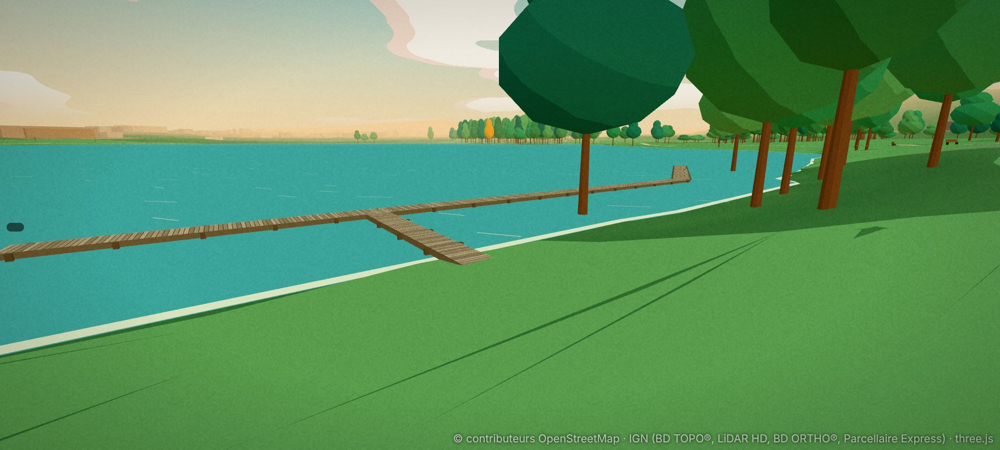
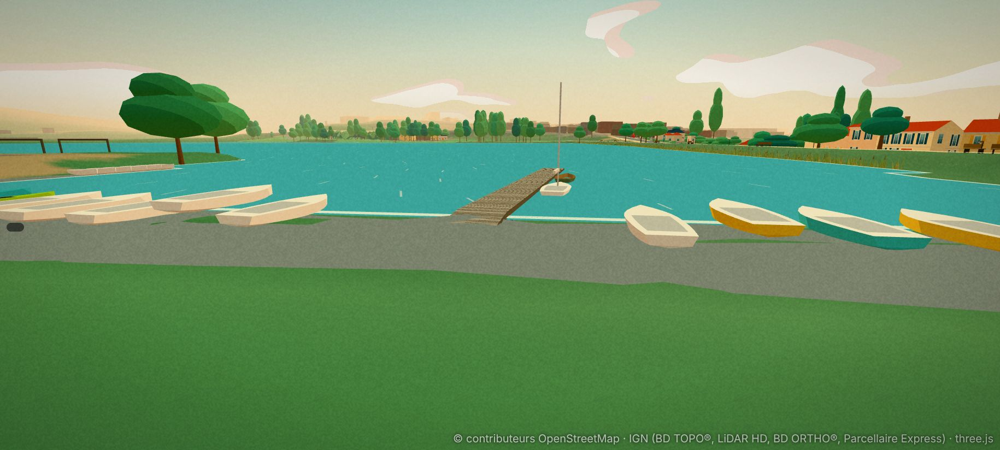
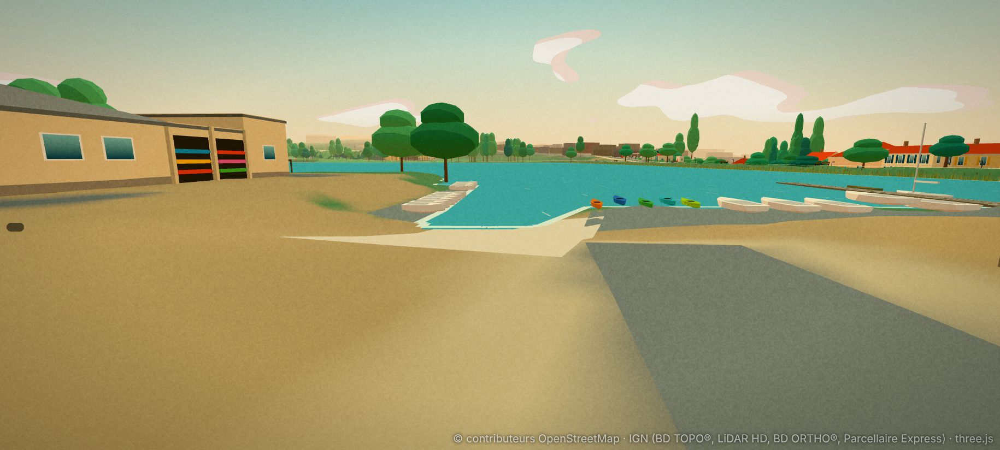
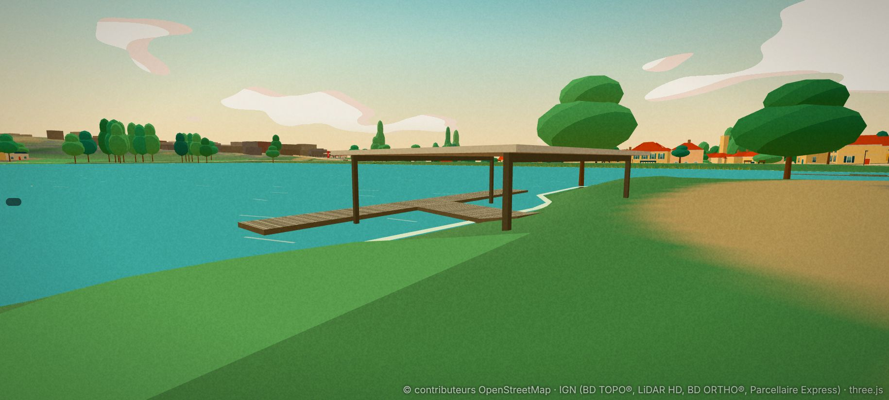
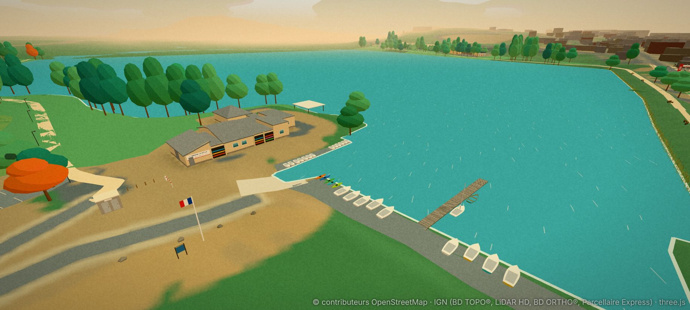
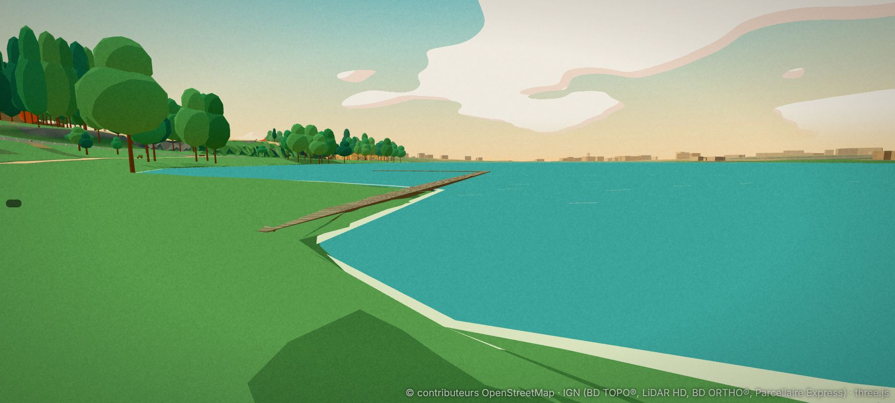
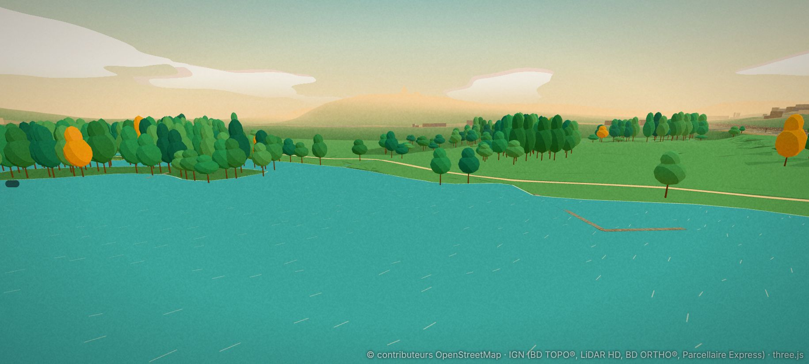
